## 二十那年，我双手插兜，站在AI自媒体的 银河上眸望未来——实现指数级增长心得分享

**260917 副业 SC 精华**
整理：公众号懒人搜索，懒人专属群精选
懒人微信：lazyhelper1

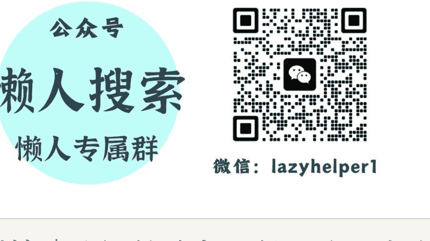

> **小懒判断** | 适合刚起步或遇到瓶颈的 AI 自媒体从业者，能学到从引流到变现的闭环打法。不适合只想赚快钱、不愿深耕内容的投机者。最值得 关注的是文中拆解的小红书矩阵号引流策略及转化 路径。坑在于多平台运营精力分散，需警惕前期 流量焦虑带来的动作变形。

好久不见，大家。我是逸尘，06年的生财二年级学生。写过七篇精华帖，特级传术师。目前主要在做 X AI 自媒体，八个月 5.4W Followers，在中推 AI 圈排名前列。

- 精华：我做X AI垂直小号，一个半月涨粉8k，变现2w实战复盘
- 精华：通过小红书最快验证产品MVP闭环
- 精华：[YouTube新人必读中级篇2.0]进入深海面前的无保留分享——做一个视频只需十几分钟？
- 精华：我是如何从一看生财就焦虑，2个月内实现YouTube1.5亿播放量，赚回“2倍”门票？
- 精华：YouTube新人25天做出千万播放爆款，分享从0到1开通高级YPP实操经验
- 精华：[YouTube新人必读] 复用Google ai studio，复制爆款AI视频易如反掌
- 精华：如何做一个接入AI功能的站？如何做一个UI精美的站？（小白实战教学，你学不会我就改！）

趁着 20 岁这个节点，抽空写下这篇关于过往的快速回顾，和对未来的思考。说起我和生财的故事，起源于大一上，我在贝拉付费社群看到的生财消息，于是立马关注生财公众号，当时被其中令人瞠目结舌的赚钱思路震撼良久。加入生财之后，便关注到刘小排、小鹅、涛哥，这些传奇人物，他们的思考、他们的战绩、他们的生活态度，让我顿感井底之蛙窥见浩瀚天空。所以开始疯狂补功课，从最开始一篇文章只能读懂一两成，用了两个月，生财里面所有文章不靠 AI 基本全部能理解。先后参加了 Web 网站、YouTube AI 视频、AI 短剧等航海项目，也在中途接触了海内外各大社交媒体和学习各种赚钱思路。

### 我的航海

- 2025-12

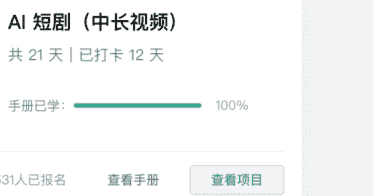

- 2025-05

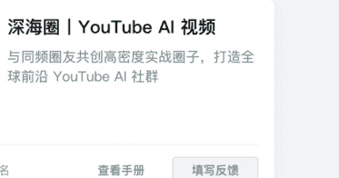

- 2025-09

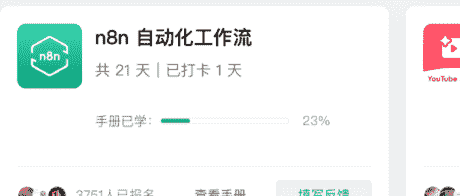

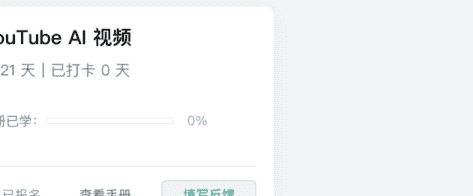

- 2025-06

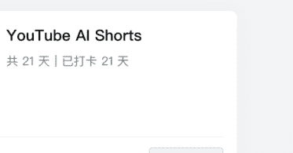

- 2025-03

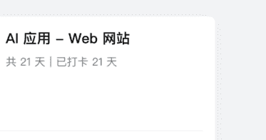

终于在 X AI 自媒体这个项目，把过去一年所有的积累快速放大。AI 产品、AI 视频、AI 自媒体、AI 企业服务，我都有所涉及，所以我做 X AI 自媒体如有神助，起号涨 AI 垂类粉丝速度应该是有史第一。

### 逸尘
3,610 帖子

编辑个人资料

**逸尘**
@gengdajin

🐒 06 年连续创业者｜潜意识发起者｜永远在学习的法学生
⚖️ 正在上海法律科技律所，打工攒素材
●● YouTube—一个月十万粉｜AI 产品营收五位数
💌 付费咨询（yichen10801）：企业 AI 服务&AI 自媒体增长
💌 付费社群：TradeWinds
📇 gengdajin1101@gmail.com

- 社交媒体影响力 https://github.com/mcncarl yichen.ai
- 出生于 2006 年 8 月 1 日 2025 年 3 月 加入
- **269** 正在关注 **5.3 万** 关注者

53,943
概览 观众 内容 视频 直播 空间

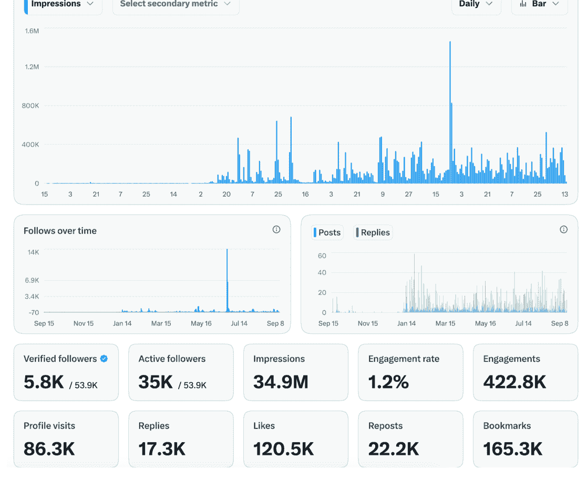

关于变现方式，其实我之前的精华贴就已经讲过基本的玩法：
https://bcn5ot9wwnew.feishu.cn/wiki/JB92wcXppiWZfdk1euncasBGnKg

我觉得更高阶的玩法，其实已经不是「项目级玩法」。而是一种更高维度的赚钱方式，也是做 IP 的核心本质。这块内容会融入在后文，更多靠大家顿悟，而非刻舟求剑。小鹅老师，之前在生财分享过一篇文章，叫做《二十不惑》：
https://scys.com/articleDetail/xq_topic/2852215488525881

我本来也打算用「二十不惑」作为标题，但是转念一想，我的二十其实是充满了未知和疑惑的。人和 AI 的关系到底会如何变化？具身智能到来之后，人还要不要工作？RSI 出现，AGI 和 RSI 加速到来，世界会办成啥样？脑机接口出现之后，大家是不是不用学习了？在 AI 发展如此迅猛的今天，甚至 OpenAI、Anthropic 和 Grok 一致同意暂缓前沿 AI 研究。说实话，我看不清科技的变化，所以暂且用了「眸望未来」。

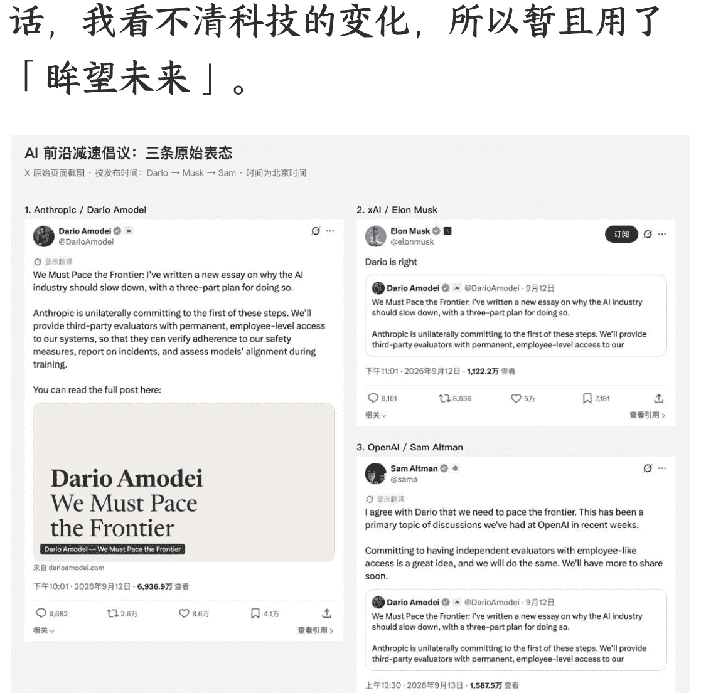

但是我对未来充满乐观，因为我似乎找到了——AI 自媒体和「地球 online」这场游戏结合的乐趣。我想把一些让人生在 AI 时代实现指数级增长的心得分享给大家。

## 一、X是最适合 AI 时代认知迭代、资源迭代、人脉迭代的平台

为什么我的 X 能异军突起、进步飞速，并且能获得很多铁粉？从别人的磕瓜描述中，能得出一个结论：【我的内容和别人的内容就是很不一样】但是为什么不一样，很多人其实只有一种 feeling，说不出理由。这其实是因为我搞清楚了一个问题，在内容层面上做了更多的设计。

自媒体的核心到底是什么？接商单？卖课做知识付费？我认为都不是。自媒体的核心在于，信任的增与减。比如我去接商单，是在用我的信任去换取粉丝对产品的注意力。比如我去卖课，也是在我的信任去换取粉丝缓解焦虑的学费。二者都是减。但是如果我接商单的同时，把产品的特点和我自身的经历、实际的业务结合起来，我实实在在在用这个产品提高了收入、降低了成本。那这其实就是增。用“真实”“价值感”对抗“广告”，并且内容 IP 感会上升。

比如我这篇推荐 GamsGo 的推文，我就是引用了学生账号被收回的自身痛点，来介绍对应的产品，就更加真实，抵消了广告的廉价感。

https://x.com/gengdaJ/status/2017604421430218993

好家伙，我也中招了，Google AI 学生认证的账号被收回了，我真的很痛苦——antigravity、gemini pro 大量调用 notebookmark、vec0.3.1、nanobanana pro 全部都被收回了，我的生产力严重被限制。虽然买的时候我就有预期这种薅羊毛的方式会被制裁，但是侥幸心理，大家应该都能理解 🥺

这种账号被收回了，说实话，找咸鱼卖家根本没有任何用，售后保障形同虚设。但是确实每个月充正版 20 刀，对于需要充值多个 AI 工具的我来说是有一点压力，所以我就想要找到一个打折的办法：

> 我可以稍微比咸鱼多给一点预算，但我希望我的账号能长久地获得保障和售后。

所以，我找到了“海外版咸鱼”——**GamsGo**，上面的 Gemini 普遍比官方得要便宜得多（比官方便宜一半以上），虽然比咸鱼略贵一点，但我认为对于生产力工具，保障更加得重要，花小钱省大事。

而且随着我的深入了解，GamsGo 这个平台还不仅卖 gemini，还提供更便宜的 chatgpt、midjourney、youtube premium、spotify、manus、genspark、perplexity 这些热门订阅工具。不仅如此，这个站做了 7 年了，诚信有保障，售后无忧。

所以，赶紧收藏这个宝藏网站，把他当做长期的正经的“海外版咸鱼”，开启正道省钱之路 🎈

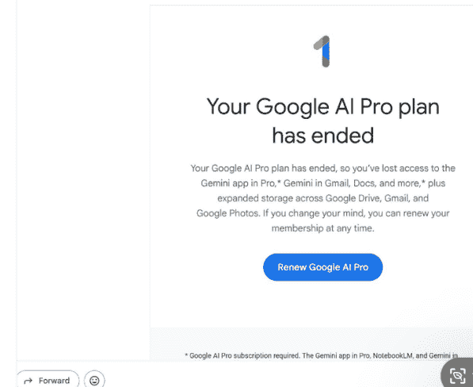

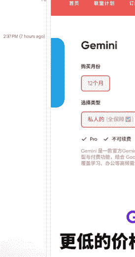

但是商单一但多了起来，自己人生阅历、实际业务又没有那么多，怎么办？那我觉得我最牛逼的点到来了——我会 Push 自己破圈增长。如果只学 AI 领域内的知识、只玩 X，那我的经历肯定没那么多。但是如果，我直接跨领域——法律、产品、硬件、网络、自媒体、经济、电商...那我写的内容，都是指数级别增长。

比如，三月份我买了 Mac，就写了一篇关于使用 Mac 心得的推文，就收获了 12W 的曝光：[https://x.com/gengdaJ/status/2035720139052916792](https://x.com/gengdaJ/status/2035720139052916792)

今天早上收到Macbook Air之后玩了一天。
分享下我从win迁移到mac的真实感受，以及我已经安装了哪些工具。

### 一、从win迁移到mac的感受：

1. 肯定是不习惯的。键位、触控板、快捷键这些都有很多区别。（包括现在我打这个账号都错了两次。。。）截图、复制、粘贴、录制这些都很不一样，光是截图，mac就有shift+command+2、shift+command+3和shift+command+5，太高谓了哈哈哈哈。
2. 原配是不带鼠标的，虽然说触控板在某些时候很好用，但是确实没有鼠标方便，至少对我来说，光标选中这些我感觉都十分不容易，对于我这种追求效率的人来说，还是必须得买一个，这不，又下单了一个一百多的无线鼠标。
3. win的“我的电脑”变成了“访达”，回收站变成了废纸篓，这两确实还不适应。
4. mac的生态确实很好。包括备忘录、照片这些都是和iphone同步的，也能把手机直接镜像到电脑，对于开发app来说很方便了，看来我还得去买个iPhone。。。
5. mac的续航确实很顶，我从早上用到现在，都还没充过一次电。而且充电的那个玩意儿也很小巧，再也不像win一样背个那么大的充电器到处走。
6. mac的自定义功能很强，虽然还没怎么深度使用，但是已经感受到了，之后得慢慢武装我的mac。
7. 我做过最蠢的决定，把win的数据迁移到了mac，然后我用的不是根目录用户登陆，所以现在还在迁移数据。

### 二、安装了哪些工具

1. 第一个自然是一个能科学上网的工具，网速很拉极，就是我买dmirt之前淘汰的那个，但是勉强能用，用这玩意儿先把chrome浏览器和codex app下载了，也把app store登陆了（之前注册的是美国app id）。
2. 然后用codex app和app store帮我安装了一大堆工具。我用app store和浏览器安装的一些工具，先是保存成.dmg文件，然后点击会出现一个win没有出现过的拖拽界面，拖拽一下就在“app”里面好了，这个“app”就是应用程序，mac单独弄了一个地方放这些app（win就是满天飞哈哈哈），五指合井触碰磁板，就能快速唤起。
3. 安装了一下claude code，这个就比较简单了，打开智谱的官网，照着下了node，用了一个键安装脚本，就下载好啦。
4. 下载好了clash verge，利用codex app下载了个yaml文件，把之前dmit的配置迁移过来，用上了最稳定的上网环境。
5. 我一篇推文有个大佬推荐了一篇推文，我安装了几个我觉得有用的，然后结合我自己的一些需要，今天暂时只安装了以下工具，供还没有安装mac的朋友一些参考：

* Clash Verge
* Raycast
* Stats
* Ghostty
* Shottt
* Obsidian
* OrbStack
* Visual Studio Code
* CC Switch
* Homebrew
* Codex
* 谷歌浏览器
* 飞书
* QQ
* Telegram
* 微信
* WhatsApp
* 百度网盘
* 夸克网盘
* Screen Studio
* Antigravity
* AutoGLM
* Quicksilver

而使用了 Mac 之后，我还写了一系列只有用 Mac 才能写得出来的推文，都获得了很大的曝光。

**逸尘 @gengdaj · 4月16日**
这个工具太强了！我已经把我微信收藏的143条数据全部成功解析了出来。这个做出来的网站是skill内置的，但是数据反正都在本地，自己想怎么分类整理都可以。
Mac电脑是唯一的限制。
收藏夹不再吃灰，是AI时代给我最强的体感之一。
小红书、X、微信，已经全部打通了。。。太强了！

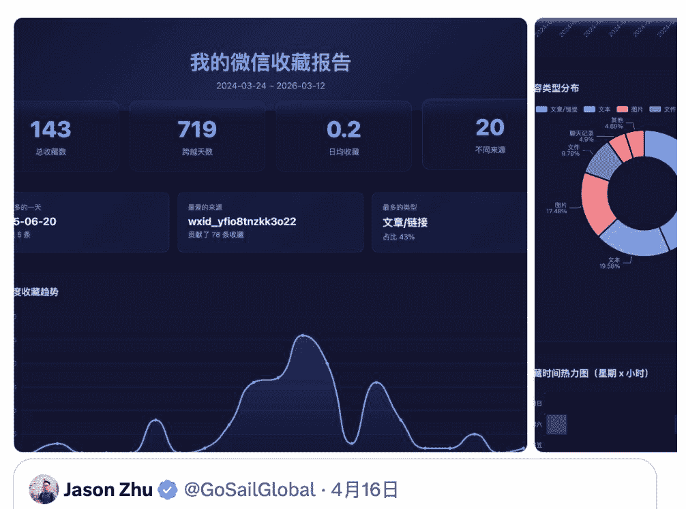

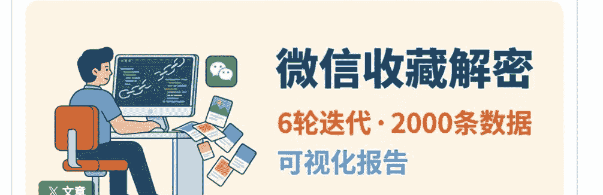

**Jason Zhu @GoSailGlobal · 4月16日**
**微信收藏被加密锁死？我用frida逆向6轮迭代解密2000条数据，生成7种图表可视化报告**

微信收藏是很多人的数字仓库，十年积累下来几千条收藏，但这些数据被锁在加密数据库里，连导出都做不到。用 Claude Code 写了一个 Skill，从加密的微信 Mac 本地数据库端到端解密，最终生成一份包含 7...

👤 29 🔁 94 ❤️ 425 📊 11万 ⭳ 816

**逸尘 @gengdaj · 3月11日**
关于X平台数据解析，我用本地部署的大模型配合API调用...

人生第一款App完成了网站、App备案，终于到最后一步华为审核了。全程都使用Codex完成信息填写、备案，我坐在一边刷短视频的感觉太爽了啊！

这款App已经有上百位付费用户支持，但是作为我第一架上架到应用市场的App，如果成功，就将免费开放给给大家。

这是一款直接把待办记录在手机锁屏上的App，目前仅限安卓。但是是Flutter框架，我自用版本还有Mac App，以后也会拓展到iPhone。

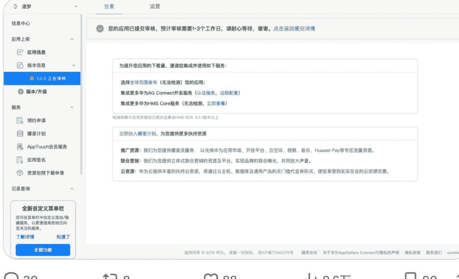

而且在此同时，我自己的认知和设备已经完成了迭代，花出去的钱，通过买 Mac 而写的推文获得的广告收益或者别的盈利方式补了回来。很多做自媒体的人其实都有认知焦虑，包括大家耳熟能详的卡兹克。

那怎样才能保证灵感不够枯竭，卡兹克和我的想法都是一致的——不能为了做自媒体而做自媒体，自媒体只是真实生活的分享而已。先丰富生活，再去做自媒体。

所以，我不断破圈，内容横跨 AI、自媒体、产品、商业变现、网络、创作、法律科技、跨境支付、个人成长......为了解决各种网络问题，仔细去研究了 DNS、TLS、ISP等等原理。

为了能有垂直行业企业 AI 服务的经验和学会团队协作的工具，我特意来了上海的法律科技律所。

为了之后能更好地指数级增长，我还会继续深耕出海、金融、英文、科技、社交、历史、写作……至此，完成「认知迭代」。

至于「人脉迭代」，才是重中之重。这一点，可能是我和别的所有 AI 自媒体博主都不同的地方。别人做X都是为了赚钱，我做 X 不只是为了赚钱，更核心的目的就是迭代自己的社交圈。

要知道，X 是当今国内认知水平最高的一群人最关注的平台，包括亦仁老大。我如果能在上面不断产出高质的内容，那我就能轻松成为这些大佬时间线的「常客」。这件事情相当恐怖。我现在微信加了数百个各行各业的公司创始人、高管，和大量极端优秀的 00 后、05 后。我和其中一部分人成了朋友，找到了并肩作战的同龄人。我被其中一部分大佬看中，获得了大量的金钱、人脉、机会等资源。我把自己作为信任中枢，成功地把我和更多优秀的人紧密地绑定在一起，实现增长飞轮。

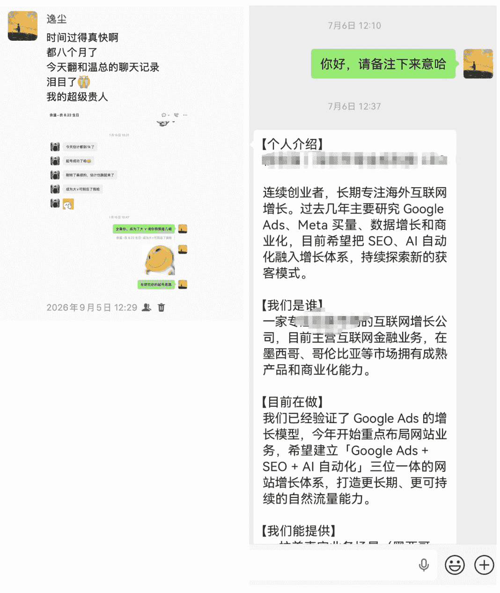

X 除了用户非常优质之外，还有三个值得注意点。构建 X 账号=构建世界影响力，和只有国内十几亿的用户的抖音、小红书不一样（不算他们的海外平台），各个国家的大佬们都在上面活跃，包括海外最顶级的 AI 实验室、各大 AI 巨头、海外大 V。一个优质的 X 账号，甚至可以作为之后去和海外公司合作的信任背书，也可以作为去打通海外市场很关键的一环。这一块玩法，算是一颗种子，我只是埋在这里。我现在跑通的仅仅是海外大厂商单和 AI 产品对接，就已经获得了在国内无法得到的资源。

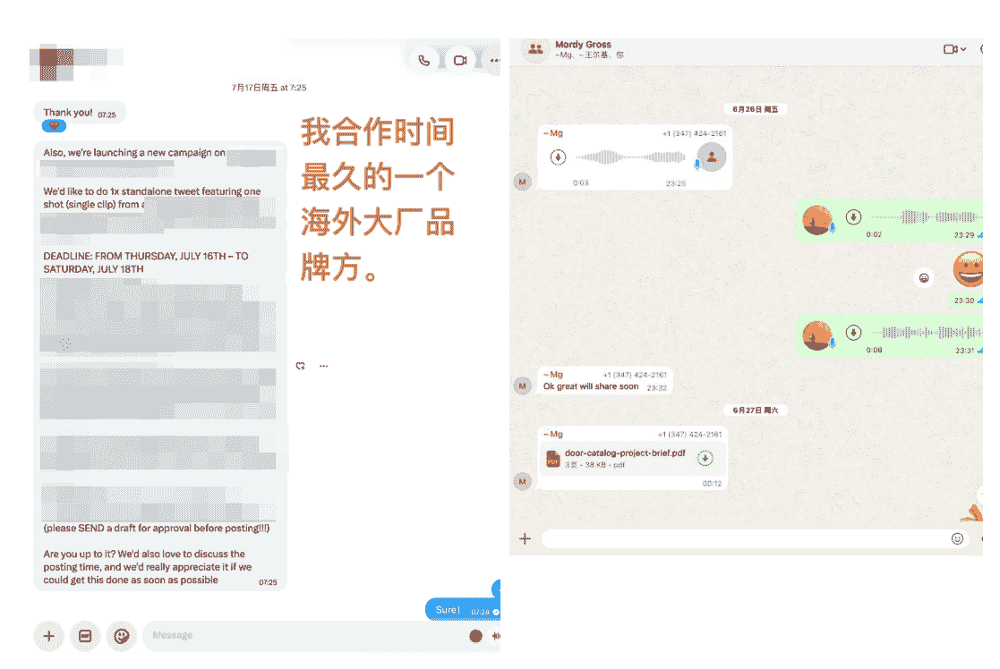

而且在 X 做内容几乎没什么限制，只要不涉政，不做违法的事情就行。相对国内平台来说，不会有任何的「审核焦虑」，你的内容写好了，一定能够发布出去。X 的优质内容+Agent 的辅助，造就了我能够自由探索的舒适圈，我的认知能够畅通无阻地快速补充。X 不会有引流 的限制，你可以丝滑的打通公域和私域，吸引优质的粉丝到自己的朋友圈。不管是交朋友、还是做社群，都是非常丝滑。唯一需要注意的就是通过频率不要过于频繁，避免风控。

我开一个付费社群，**TradeWinds**，和同行者一起追逐星辰大海。

过去7个月，我创作了500篇推文和13篇长文章，涨了5万Followers。

开源了20个Skill、Agent回忆系统、AIto创作助手。

内容横跨AI、自媒体、产品、商业变现、网络、创作、法律科技、跨境支付、个人成长...

帮助我的很多Followers都取得了很不错的商业结果。

凭借在X疯狂Learn in public和Build in public，不仅收入有了重大突破，还有幸线下拜访了AI界真神卡兹克，和金融、医美、软件、教育的大佬们结识，不断遇贵人。

成长到现在，我之所以能小有成就，诚然，一定有努力和前期沉淀的因素，但更重要的是我进入了一个好的环境，

**在不断地接触更多比我优秀的同龄人和前辈中**，

能够获得更广阔的见识、更稀缺的资源、去创业学习的动力。

回首我遇到人生第一个贵人—余温，温总@ **glxkspace** 的这段聊天记录，热泪盈眶。

我每次想躺平的时候，但是身边的这群00后大佬总是鞭策我前进：

* @**glxkspace** 05年，年年百万，超级AI个体
* Vesta（不在X）06年，不良资产全球头部，团队年收入过亿
* Sidrel（小红书博主），01年，融资百万，赛道（静音口罩）创始人，微博热搜第一
* @**Astraunat_1216** 01年，月入5万，抖音万粉创业博主
* @**Leoba1825** 03，月创收百万，X和抖音万粉创业博主
* @**harrisonsme** 06，超级AI链接者，熟练接洽B端和G端业务

之前自己做项目的时候，越往前走，很多朋友渐行渐远，自己也时常形单影只，甚至很多时候都不知道自己和创业的兴奋和谁分享，但是所幸，我能在前行路上遇到现在这群伙伴，同行的力量超乎我的想象！

所以，我创建了**TradeWinds**，不限年龄，不限背景。

出海全球化、影响力互动、自由随性，是TradeWinds的核心。

一方面是事业，大家都要做大专做强，目光放眼全球；用影响力互相赋能，自媒体和产品有机结合。

一方面是生活，工作之余，也可以线下组局、娱乐，去任何地方做任何想尝试的事情，成为知心好友。

至于TradeWinds要交付什么，说实话，我没想好，这个问题要用很长时间去回答。

我能承诺的是TradeWinds也会长期作为我的小圈子，我会把我珍藏和未来学会的“具”、“术”和“道”我会向所有社群成员开放。

所以TradeWinds是永久的，价格999元（会持续涨价），但是基于我和我的微信承接能力有限，首期只开放50个名额，同时用飞书问卷填写相关信息，我会在接下来几天逐个邀请愿意加入的朋友。

此外，如果是首次刷到本条推文的朋友，我是不会同意你加入TradeWinds的。

如果你自己没有任何的的事业和项目基本盘，我也非常不建议你立刻加入。

我希望你是基于我的内容，已经帮你学到了知识、拿到了结果的前提下加入：

> bcn5ot9ywnew.feishu.cn/share/base/for...

了解更多关于我和我的社群：yichen.ai/products/trade...

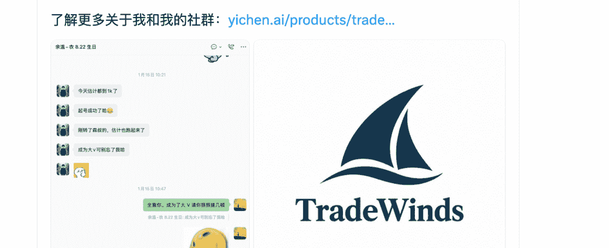

下午2:01 · 2026年9月8日 · 4.6万 查看

## 二、学会投资，是实现十倍增长的核心

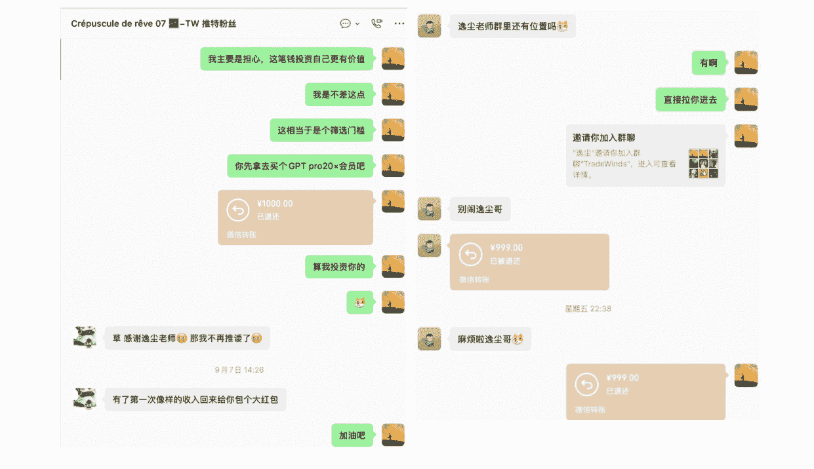

# 三、AI 时代的年轻人是需要足够大胆的，Fake it till you make it

人有多大胆，地有多大产。对自己绝对自信，想成为谁就成为谁。Fake it till you make it。上个月，我一个朋友接了个律所大客户，下午两点的会议，十二点半我才知道我要去单独对接对方一个团队的企业 AI 服务。。。然后我这朋友说我是她的 co-founder，实际上狗屁来的团队啊。。。结果我硬着头皮去吹牛，把我朋友称呼为“沈总”。自己就伪装成业务负责人，直接去忽悠，哦不，对接了半小时。最后就是效果得到认可，有触成合作的可能。而且我当时想的是，即使失败了，似乎也没啥大不了的。我没有任何损失啊，经济层面的、名声层面的，都没有。而如果成功了，最好的结果就是成了，最坏的结果是自己得到胆量的磨练。何乐而不为？就和有一个比较知名的采访主播类似，失败只会磨砺胆量，而少数的几次成功就能让自己腾飞。

8 月 2 日 12:22

那一点半的时候
大概就先介绍一边服务
然后重点说培训
别说漏嘴了
咱们一个团队的
啊？
我要去啊

8 月 11 日 10:41

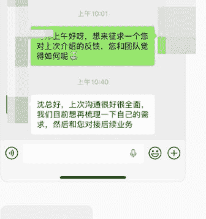

老兄牛逼

合适的时机，如果要聊具体的业务方面，你就把我推给他

可以

再讲讲我身边朋友们的**大胆操作**吧：用 Agent 去 Boss 直聘批量找老板聊，同时接很多个远程工作，用 Codex 做任务，拿多份工资。混进高端聚会，用 AI 这个话题切入和大佬聊天，成功找到大腿老板。商场看到一家服装店，直接进店找老板聊天，达成 AI 生图的合作。“一个人的水平大概率等于他最常接触的五个人的平均值”。环境也很重要，我通过自己的努力，让身边都变成了这些人，我也“被逼”着大胆起来，去做一些常人无法理解的事情。

# 四、绝对相信自己，做到当下的最好，你是地球 online 游戏唯一的气运之子

从刚进入生财的时候，我只能仰望优秀的 00 后和前辈大佬们。

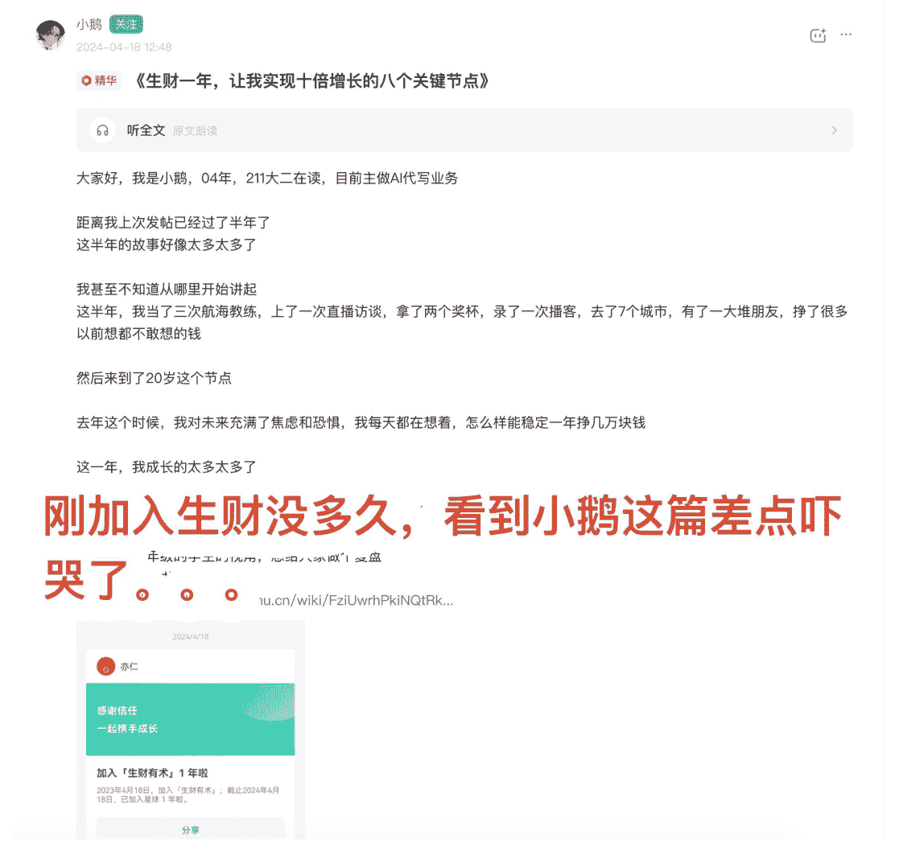

但是，我没有被他们的光芒给压到睁不开眼，而是铆足了劲，把他们身上做人做事的优秀品质，全部汲取到我自己身上。没有商业经验，数百篇精华帖奠定了我的商业基础。没写过长文章，评定为生财精华帖给了我绝对的肯定。没有做过有价值的项目，我有幸加入了生财航海。没参加过陌生人的线下聚会，生财给了我机会。没有做过公开场合的分享，生财给了我舞台。

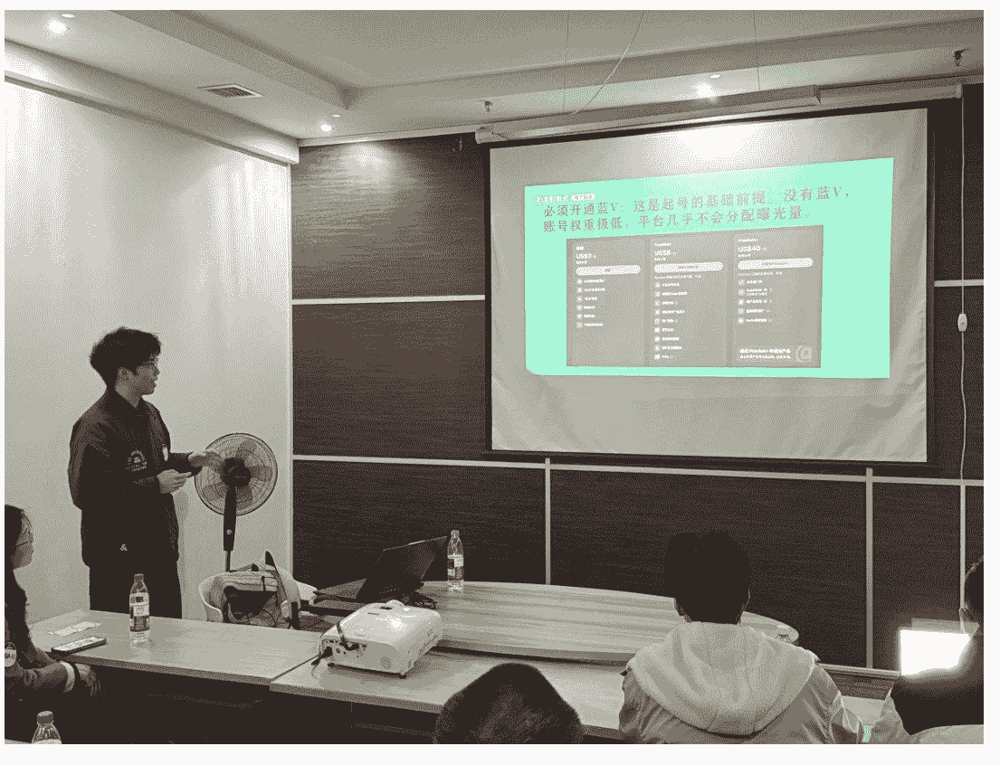

# 分割线

看完这篇 SOP，你觉得你懂了。但 90% 的人一到实操就会卡在第一步。

工具和教程只是最低级的壁垒，真正的壁垒是“立刻动手”和“圈层信息差”。

如果你想看全网最新的变现玩法，并且和一群执行力极强的极客一起下场拿结果，欢迎围观我的核心私域：【懒人专属群】。

我们不聊虚的，只做商业闭环的拆解与 AI 效率的压榨。系统内已沉淀 1000+ 跑通的套利实战局。

- 查阅圈子完整数字资产与上车门槛：

https://lazyso.com/insider/

认同价值、准备好下场干活的，扫码加我微信（lazyhelper1）

备注：【实操上车】，不闲聊

微信公众号懒人搜索，懒人专属群

微信：lazyhelper1
