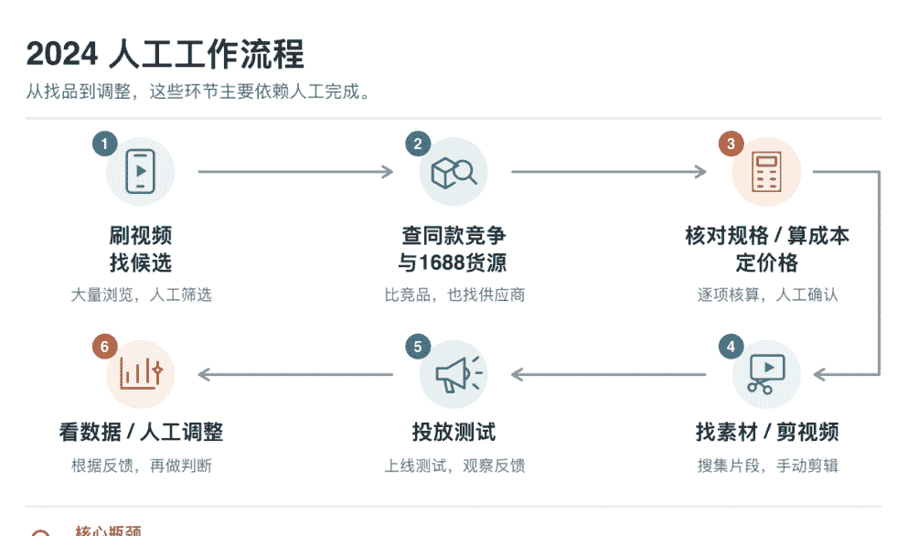
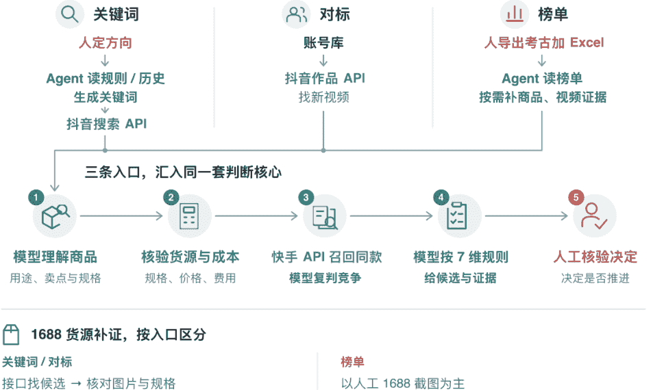
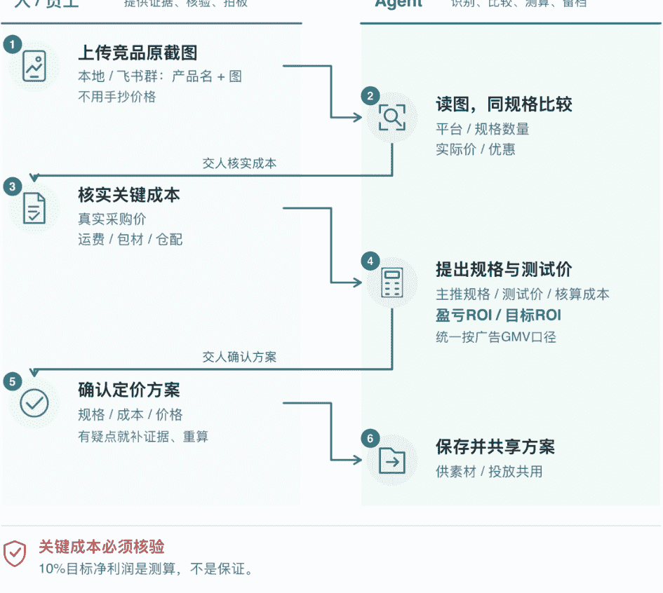
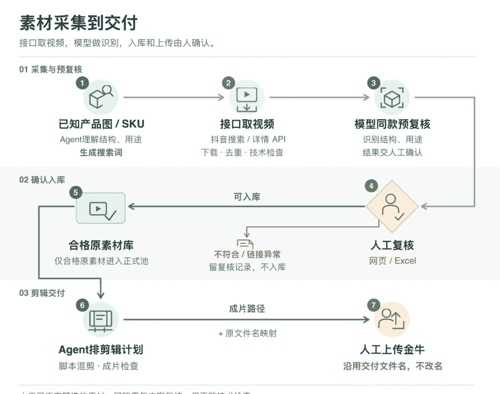
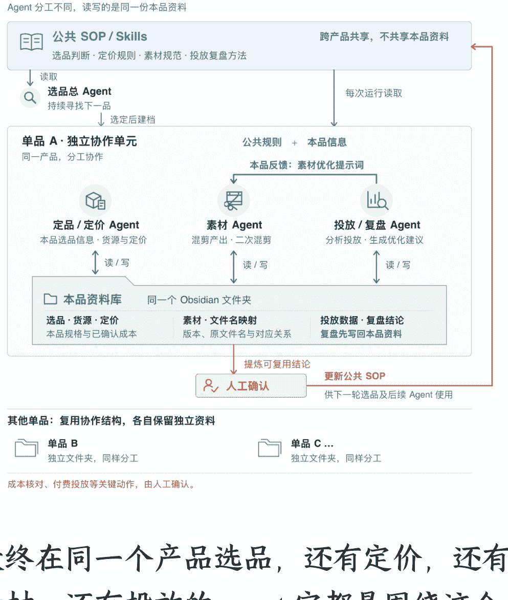
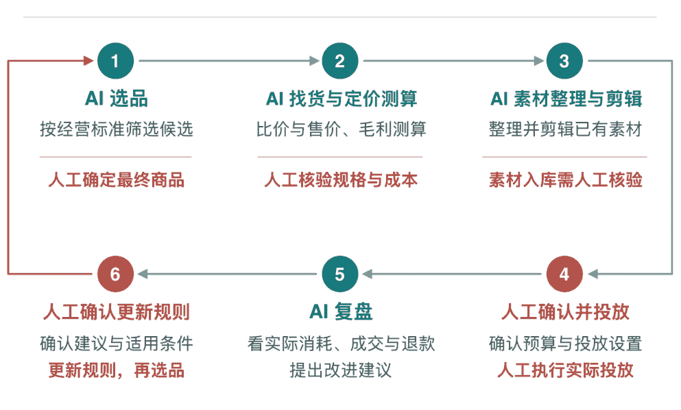
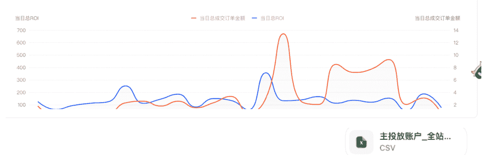
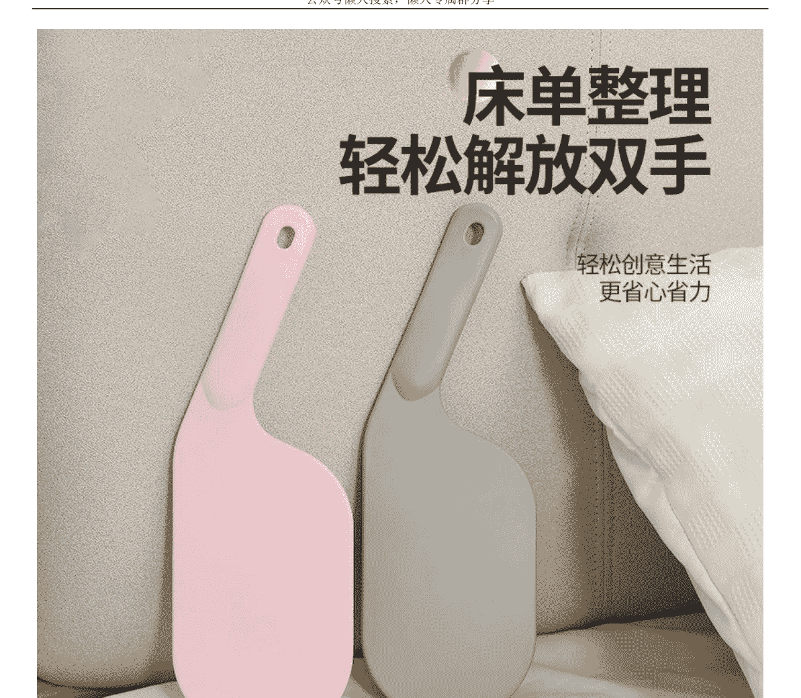
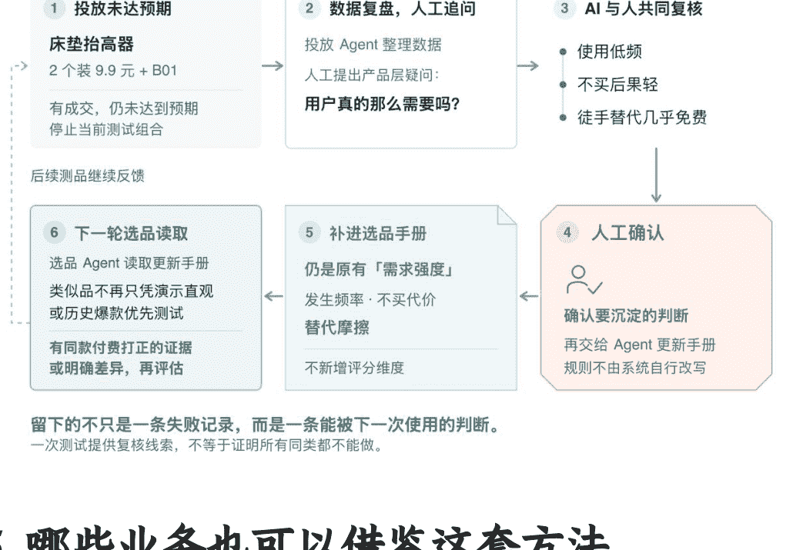

# 我如何从 0 到 1 搭建一个 AI Native 电商团队

260914 副业 SC 精华

整理：公众号懒人搜索，懒人专属群精选

懒人微信：lazyhelper1


微信：lazyhelper1

> **小懒判断** | 适合手里有成型电商或标准化业务、想提人效的操盘手，不适合闭环没跑通就想靠 AI 一步到位的新手。最值得关注的是把选品经验沉淀成七项打分规则交给 Agent 跑，AI 一天分析上千条素材、效率至少人工 5 倍，人只卡关键核验点。坑在于梳理业务逻辑和沉淀规则本身很耗时，涉及金额的投放环节仍需人工操作，别指望完全撒手。

大家好，我是迪伟；

这几年一直在做电商方面的业务，在做电商之前，是互联网产品经理；今年因为龙虾以及各种 Agent 的普及，所以尝试着用 AI 把我们之前做过的快手电商业务，进行一次 AI 化的改造；这次改造最明显的变化，不只是 AI 替我选品，剪素材，而是我们把原有的流程结合 AI 进行了一次重构，改造成了一个 AI 决策，AI 执行，AI+人工迭代的系统；这篇分享主要是把我们改造电商的思路分享给大家，如果有需要的圈友，可以进行借鉴，也欢迎指教和探讨；分享的大纲大概是这样的：

- 这个业务之前是什么样子的（没有 AI 介入的时候)
- 我是怎样拆解各个模块和功能，进行 AI 化改造的；
- 改造完成后，他大概是什么样子的，同时带来了哪些改变；
- 实际运行的 demo 演示
- 有哪些类似的业务也可以参考和借鉴这套方法；

## 1. 没有 AI 的时候，这个业务是怎么做的

我们这个业务是快手单品付费模式；按照之前的流程，大概是这样的，需要先选符合要求的产品，确定货源、规格和价格，准备短视频素材，再通过付费投放测试。产品有反馈，就继续投入；不合适，就调整或者换下一个品。

2024 年做这个业务时，这些环节主要靠人来完成。我需要先刷大量视频，从里面找值得研究的商品，再查同款、看竞争、找 1688 货源、核对成本。确定要做以后，才往素材和投放环节走。

那时候的工作流程，大概就是下面这张图。



**核心瓶颈**
大量筛选耗时，判断经验集中在人。

这里面最耗费时间和经验的，就是选品。要在抖音或者考古加等数据平台大量去看视频或者品，然后还要去分析这个品是否符合快手的人群特征，在抖音上是否被验证过能爆？快手有没有人在做？这个品是否具备性价比等？这些问题，都要花时间仔细分析和排查。

很多时候，一天刷了几百条视频，但是没有一个能做的品；另外，判断很依赖个人经验。换一个人来选，就要重新教他怎么去选品，都要考虑哪些条件、怎么判断同款、哪些情况要排除。并不是多招一个人，马上就能多出一份有效产出。

到 2024 年后面，产品越来越难选，有些品即使测出来，也没有多少利润空间。前面选品和素材又耗费大量时间，人效就成了一个很现实的问题。

所以今年重新看这门生意时，我就在想能不能让 AI 把我们人工需要操作的事情都尽可能的去解决掉，同时让它也能够形成一个闭环，从选品到复盘，再到最终的迭代，让它变成一个能够不断迭代和进化的系统；

## 2. 我是怎样拆解模块，进行 AI 化改造的

在做 AI 化改造的第一步，我的操作是先把整个业务模块中的流程全部拆解出来。拆解出来了以后，再针对每一个流程节点进行梳理，整理出它的规则和判断逻辑，把这些规则整理和沉淀成文档或者 skill，在交给 AI 去执行； **先拆工作流，再明确每一步的交付。** 我们逐步把主流程拆成选品、定价、素材制作、投放复盘几个模块。每个模块都要说清楚三件事：接收什么资料，判断规则是什么，最后交付什么。涉及人工确认的地方，也提前写进去。

| 模块 | AI 主要做什么 | 交给下一步什么 |
|---|---|---|
| 选品 | 找候选品，理解视频，核对同款、竞争和货源线索 | 候选品、判断依据、来源证据和待核验项 |
| 单品定价 | 整理规格截图，比较售价，计算成本和投放参考线 | 经人工确认的规格、成本与售价方案 |
| 素材制作 | 采集、预复核、整理物料，按规则剪辑和检查成片 | 成片路径、源文件名和素材来源记录 |
| 投放复盘 | 整理报表，匹配素材表现，分析问题并提出建议 | 单品复盘结论，以及值得回到选品环节核验的问题 |

下面按四个模块展开详细的说明；

## 2.1 选品：把“刷视频、研究商品”拆成可执行的动作

以前我们选品有三条路：

- 每天大量刷视频，或者搜关键词找商品；
- 关注一批对标账号，看他们每天更新什么；
- 去考古加看商品和素材榜单。

三条路的入口不同，但后面的工作很相似：先弄清卖的是什么，再查货源和成本，最后判断适不适合拿到快手来做。

改造时，我就沿着这套顺序，把“人怎样找到一个品”拆成 Agent 可以接着执行的动作。

## 选品流程

- API 取资料
- 模型做理解和判断
- 人做核验与决定



**关键词这条路，先让它自己找搜索方向。** 我给本轮目标和需要排除的方向，Agent 读取选品规则、历史候选和已跑过的关键词，按场景、痛点、功能生成一组搜索词。例如围绕电动车收纳，可以继续拆出前梁收纳、手机水杯放置等方向。词是它生成和调整的，不需要我每天先列好清单。

接下来让它调用抖音视频搜索 API，分词、分批取得视频链接、标题、作者、发布时间和相关数据，再下载可分析的视频。到这里，关键词这条路拿到的是一批带来源链接和基础数据的视频线索，交给后面的公共模块继续判断。

**对标账号这条路，把“每天去看同行更新”交给 Agent。** 我们有经过筛选的账号库。Agent 调用账号作品接口获取新作品，整理其中的商品线索，再和已经分析过的候选去重。这条路交付的是对标账号的新视频和对应商品线索。

**考古加这条路，由人工把榜单交进来。** 我们导出 Excel，Agent 读取商品、素材链接和榜单数据，合并重复品，整理需要进一步核验的视频或商品资料。这条路交付的是带榜单数据和关联资料的候选品，后面也进入同一个公共模块。

**三条路汇合后，开始进入找货源模块。** 通过前面的流程把视频等信息拿回来后，接着开始去 1688 找同款货源，同时把货源的成本价及运费等信息都拿到。

**最后按同一套规则，判断这个品值不值得测。** 这套规则，就是我们之前选品的经验沉淀下来的判断规则，主要包含以下七项：需求强度、快手受众适配、画面可视化、来源验证信号、快手同款竞争、价格可行性和售后风险可控性，最终结合每项的判断进行打分和综合评估。

完成上面这些流程后，最终回填到飞书的多维表格里，最终表格里呈现出来的是带证据的候选品和下一步建议：哪些值得去测试，哪些要补资料，哪些先放下。

选品模块按照这样的流程改造后，我从“先刷一整天再开始判断”，变成“先看 Agent 整理出的结果，再处理关键判断”。之前那些重复和耗费时间的流程，全部交给 Agent 去处理，人工只负责核验关键的信息；下面几张图分别是选品最终运行后的结果图以及 obsidian 知识库的部分截图；

| # | 商品 | 来源平台 | AI 来源链接 | 首张图 | 下一步动作 | 最佳价格 | 建议量 |
| :--- | :--- | :--- | :--- | :--- | :--- | :--- | :--- |
| 273 | 长柄弯头垃圾夹 | 快手 | https://www.kuaishou... | [图] | 小销首选 | 12.8 | 50m长度 |
| 272 | 超大号黑管打包收纳行李袋 | 快手 | https://www.kuaishou... | [图] | 小销首选 | 4.88 | 洗衣袋 |
| 271 | 20元满99.9元送洗衣液 | 快手 | https://www.kuaishou... | [图] | 暂缓 | 2.40 | 优选品 |
| 270 | 海氏康诺可移动抽拉收纳架 | 快手 | https://www.kuaishou... | [图] | 智存观察 | 1.50 | 优 为 30c |
| 269 | 序半座可更换脚底器 | 快手 | https://www.kuaishou... | [图] | 暂缓 | 0.27 | ABS防滑 |
| 268 | 洗衣池护挡泥板 | 快手 | https://www.kuaishou... | [图] | 智存观察 | 1.60 | 中号成小 |
| 267 | 冰箱通用鲜胚沥水盘 | 抖音 · 快手 +1 | https://www.kuaishou.c... | [图] | 智存观察 | 30.00 | 1号成大 |
| 266 | 床头圆底收纳提篮 | 抖音 · 快手 +1 | https://www.kuaishou.c... | [图] | 小销最优选 | 0.22 | 耳机手机 |
| 265 | 洗衣机毛线止开帘帘门置物架 | 抖音 · 快手 +1 | https://www.kuaishou.c... | [图] | 智略 | 191.00 | 洗衣机盖 |
| 264 | 加宽卫生间手托拉环器 | 抖音 · 快手 +1 | https://www.kuaishou.c... | [图] | 小销最优选 | 1160 | 电话（电 |
| 263 | 浴室防打蚊蚊蚊蚊器 | 抖音 · 快手 +1 | https://www.kuaishou.c... | [图] | 小销最优选 | 1.60 | 驱蚊防蚊 |
| 262 | 中式风格双层放置置物架 | 抖音 · 快手 +1 | https://www.kuaishou.c... | [图] | 智存观察 | 10.40 | 中药店药 |
| 261 | 衣柜伸缩分层隔板 | 抖音 · 快手 +1 | https://www.kuaishou.c... | [图] | 智略 | 1.50 | 眼镜袋 |
| 260 | 书架桌面收纳有钩 | 抖音 · 快手 +1 | https://www.kuaishou.c... | [图] | 靠工厂检验 | 2.80 | 车载挂钩 |
| 259 | 餐桌桌面湿干架 | 抖音 · 快手 +1 | https://www.kuaishou.c... | [图] | 智略 | 1.60 | 30m长度 |
| 258 | 马桶纸巾盒手纸置物架 | 抖音 · 快手 +1 | https://www.kuaishou.c... | [图] | 智略 | 1.50 | 生活空间 |
| 257 | 水暖暖气片置物架 | 抖音 · 快手 +1 | https://www.kuaishou.c... | [图] | 小销最优选 | 610 | 222m长 |
| 256 | 浴室卫生间洗漱台 | 抖音 · 快手 +1 | https://www.kuaishou.c... | [图] | 智存观察 | 2.69 | 陶瓷盆架 |
| 255 | 花洒套装双功能定器 | 抖音 · 快手 +1 | https://www.kuaishou.c... | [图] | 小销最优选 | 3.50 | 免打孔 |

| 需求强度 | 快手受众匹配 | 画面可视化 | 来源验证信号 | 快手同款竞争状态 |
| :---: | :---: | :---: | :---: | :---: |
| 强 | 强 | 强 | 强 | 偏高挤 |
| 中 | 中 | 中 | 中 | |
| 中 | 强 | 中 | 中 | 近期弱信号 |
| 中 | 强 | 中 | 中 | 低拥挤 |
| 中 | 中 | 中 | 中 | |
| 强 | 强 | 强 | 强 | 偏高挤 |
| 强 | 强 | 强 | 强 | 低 低 |
| 中 | 中 | 强 | 中 | 偏高挤 |
| 中 | 强 | 中 | 强 | 窗口不确定 |
| 中 | 强 | 中 | 中 | 低 |
| 中 | 中 | 中 | 中 | 偏高挤 |
| 中 | 中 | 中 | 强 | 窗口不确定 |
| 中 | 中 | 中 | 弱 | 窗口不确定 |
| 中 | 中 | 中 | 弱 | 低 |
| 中 | 中 | 中 | 弱 | 窗口不确定 |
| 强 | 强 | 强 | 强 | 偏高挤 |
| 强 | 中 | 强 | 强 | 偏高挤 |
| 强 | 中 | 强 | 强 | 偏高挤 |

| 快手销量空间预判 | 快手入品阶段预判 | 价格可行性 | 售后风险可控性 | AI找货置信度 |
| :---: | :---: | :---: | :---: | :---: |
| | | 可测 | 强 | 高可信同款 |
| | | 可测 | 中 | 高可信同款 |
| 低 | 历史沉寂 | 可测 | 中 | |
| 中 | 二茬补跑 | 强 | 强 | |
| 低 | 饱和尾声 | 偏弱 | 中 | 高可信同款 |
| 中 | 饱和尾声 | 强 | 强 | 高可信同款 |
| 低 | 无法判断 | 不适合 | 中 | 高可信同款 |
| 中 | 二茬补跑 | 可测 | 中 | 高可信同款 |
| 中 | 二茬补跑 | 强 | 中 | 高可信同款 |
| 低 | 无法判断 | 可测 | 中 | 高可信同款 |
| 低 | 无法判断 | 不适合 | 中 | 未找到可靠资源 |
| 低 | 无法判断 | 可测 | 中 | 近认可承接 |
| 低 | 无法判断 | 不适合 | 中 | 未找到可靠资源 |
| 低 | 无法判断 | 不适合 | 中 | 未找到可靠资源 |
| 中 | 饱和尾声 | 强 | 高 | 高可信同款 |
| 低 | 饱和尾声 | 可测 | 中 | 高可信同款 |
| 中 | 二茬补跑 | 可测 | 中 | 高可信同款 |

# 快手单品付费项目

# 00公共沉淀

# 01选品方法论

- 00选品方法论总览
- 01AI Native选品执行SOP
- 02选品评分与判断口径
- 03候选品卡模板
- 04对标账号采集与选品分析
- 05多账号测品分配口径

### 评分维度

完整评分最多包含了 7 个维度，但不是每个候选品都必须跑满 7 项。各项仍按 1-5 分判断，不将被移除维度的分数分摊给其他项，也不另设总分通过线。

**执行时分阶段判断：**

- 初筛阶段：只用考古品/蜂妈妈 Excel 可见信息，不能填写成本、价格、快手同款竞争结论。
- 关键词/账号视频发现初筛：可以用视频内容和 AI 找货结果修正需求、画面和平台适配，但不能填写最终快手窗口和价格结论。
- 成本和 SKU 证据确认后：重评需求、快手受众、画面、价格可行性、售后风险，通常由此决定是否值得进入快手同款竞争精判。榜单单通常由人工截图提供证据：关键词/账号线可由高可信 AI 找货结果提供证据。高价值例外可先跑快手精判，再补本阶段证据。
- 快手同款竞争精判后：才填写 快手同款竞争状态、 快手入场阶段 和 快手跑量空间，并进入最终动作判断。

如果一个品在成本和 SKU 证据确认后，已经因为价格感知、售后风险、画面证明不可信、平台适配或一票否决项明显不适合本轮推进，可以直接进入留存观察或暂缓，不需要为了跑满维度继续消耗快手精判成本。

需求强度也可以在这一阶段直接触发降级：同时满足“低频、不买后果轻、替代免费且简单”时，需求强度最高 2 分；没有自商品付费打正证据或明确结构差异时，不能进入 优先素材验证，也不等待外部平台截图或最终售价。仍有较强历史验证或素材价值时，完成必要快手精判后最高进入 小预算备选；否则直接进入 留存观察。

评分口径如下：已经补证的数据项可给 1-5 分，未补证的数据项保持空/待判断，不能用猜测分替代。

| 维度 | 5分 | 3分 | 1分 | 数据来源 |
| :--- | :--- | :--- | :--- | :--- |
| 需求强度 | 高频、强痛点、不买后果明显，现有替代方案麻烦，用户容易马上购买 | 有真实需求，但痛 点一般、频率不高或需要解释 | 低频便利需求，替代方案简单，不买也没明显损失 | 素材、评论、商品图、历史经验 |
| 快手受众适配 | 有效购买人群足够大，触发条件常见，覆盖家庭、 | 人群存在，但触发 条件偏细分、偏懂 | 偏小红书/抖音种草型，主要靠颜值、 | 快手搜索、历史数据、评论区、 账号主页、爆款结构 |

## 2.2 定价：先把规格比对清楚，再算卖多少钱

选品流程结束后，符合要求的品则进入定价流程，进入定价流程时，我们重点给 Agent 提供这个品在其他平台的售价，以及在快手平台的售价。

让他综合这个品在其他平台的售价，以及当前快手同行的价格，然后给出我们建议的价格，具体流程如下图：

# 定价时的人机分工

前提：已确定要做的产品，且已有1688货源成本初证



**关键成本必须核验**
10%目标净利润是测算，不是保证。

- **我或员工提供原始资料**。把淘宝、拼多多、快手、抖音、1688 货源的规格和价格截图交给 Agent。
- **Agent 负责读图、对规格和比价**。它识别平台、款式、件数、可见价格和优惠。
- **Agent 据此生成方案并算账**。结合同行规格、价格带和我方成本，并参考广告付费时的 ROI，最终给出主推规格和价格；
- **我确认后，Agent 保存并交接**。最后核对主推规格、成本和执行价，把确认结果写进飞书及单品资料，交接给后续的 Agent；

## 2.3 素材：从找视频，到交付能上传的成片

选品及定价的流程完了后，接下来就是找素材的这个阶段了；以抖音同款素材采集为例，我们把它拆成下面几个连续动作。



先把产品图转换成搜索词和判断依据。Agent 读取产品图、1688 截图及确认的 SKU，提取外形、安装方式、用途和常见叫法。例如三轮车前置收纳盒，可以搜索“三轮车收纳盒”“前梁储物盒”“三轮车前置置物架”；同时记下后置车筐、挂兜等容易混入的款式，供后面区分。

用接口抓取抖音上面的素材。Agent 分别用这些词调用抖音搜索 API，获取视频 ID、原链接、作者、时间和可用数据，并下载候选视频。

让模型看抓取后的素材，判断是不是符合我们的要求。这里我们一般会接 Gemini 的视觉模型，让他结合视频以及货源的图片进行判断，看这条素材是否符合我们的要求；把源素材最终入库的判断交给人。模型在帮我们做完初步的判断了以后，最终这个素材能不能入库，当做混剪的原素材，我们人工进行二次的复核。

入库成功后混剪。Agent 为当前产品建立正式物料清单，我们会把之前混剪的流程

沉淀成 skill，最终让 agent 再结合入库后的素材，还有这个规则进行混剪。在剪完了以后，每个素材都会有对应的唯一名称，我们人工再进行最终的审核，确认没问题后上传到磁力金牛的后台。开始搭建投放计划；

## 2.4 投放复盘：不只读数字，还要找到下一步该改什么

在这里我们会把我们之前分析投放数据时的规则跟 agent 的再进行沟通。比如说重点看素材的 ROI，还有包括 3 秒播放率，点击率、转化率以及各方面的数据进行综合的分析。

把这些复盘的规则沉淀成 skill 了以后。让 agent 再结合这种思路进行分析，同时给出下一步优化的建议。比如说要调整计划，或者说要针对素材再做裂变；如果需要针对素材再做二次的裂变或者混剪，它也会生成对应的提示词。然后我们会让负责剪辑的 Agent 进行二次的剪辑；如果说这个产品它的投放数据不好，那么在这里它也会结合整个的选品流程，还有全链路进行分析，看是不是我们的选品方法需要进行优化或者迭代。

这也是整个流程中复盘的终点。我们每测试一个品，最终结果好还是不好，都需要在这里进行一个深度的复盘。

如果说是选品方法的问题的话，他同时也会在这里整理出来下一轮的选品方法应该怎么样去迭代；多个 Agent 协作，以及复盘时的流程和资料状态。在整个的流程跑下来后，我们的多个 agent 它的协作以及分工大概是下面图片中的这个样子。



最终在同一个产品选品，还有定价，还有素材，还有投放的 agent 它都是围绕这个产品，单独的资 料库去进行复盘和协作的。

而单个产品，它里面如果复盘出来有用的信息，比如说针对选品流程中的复盘或者迭代，那么会把这个信息上升到公共的 SOP 中。

每个 Agent 它在运行的时候，既会结合公共 SOP 中的规则，也会结合当前这个产品的信息，具体在 obsidian 中的文件架构图如下：

> 快手单品付费项目
> 00公共沉淀
> - 01选品方法论
> - 02素材模块
> - 03投放模块
> - 04案例复盘
> - 05技术模块
> - 06决策机制
> 00输入
> 01单品项目
> - 000单品模板
> - 2026015_正式打品_空调挡风帘
> - 2026016_平台受众适配复评
> - 2026016_正式打品快手窗口复核
> - 2026016_C线能力验证_拉车购物袋
> - 2026017_冰箱侧门收纳盒开测前复核
> - 2026017_画面可视化复评
> - 2026018_旋转六爪多功能挂钩开测前复核
> - 2026024_三品快手竞争状态策略复核
> - 2026024_二品快手竞争状态策略复核_6品
> - 2026024_优先级素材验证快手窗口复核_4品
> - 2026025_磁吸窗帘遮光扣定价复核
> - 20260702_正式打品_电动车车筐内胆包
> - 20260702_正式打品_风扇清洁刷
> - 20260706_正式打品_伸缩分层隔板挂篮
> - 20260707_正式打品_床单床垫整理抬高器
> - 20260708_正式打品_洗衣机水龙头自动止水阀
> - 20260713_正式打品_电动车防晒把套
> - 20260717_正式打品_台面锅盖架带沥水盘
> - 20260729_正式打品_厨房台面斜坡沥水架
> - 20260729_正式打品_裤夹衣架
> - 20260729_正式打品_双面发泡刮底密封条
> - 20260730_正式打品_双面蕾丝竹纤维洗碗布
> - 20260730_正式打品_水龙头过滤防溅水器起泡器
> - 20260813_正式打品_煤气灶防滑支架
> - 20260813_正式打品_免拆后视镜电动车手机...
> - 20260813_正式打品_磁力磁铁挂钩
> - 20260813_正式打品_一次性马桶刷

### 3. 改造以后，它是什么样子，带来了哪些变化

现在再看这个业务，底层经营逻辑没有变，还是找品、准备素材、测试和复盘。变化主要在于：大量中间工作由 AI 执行，人工的注意力移到了几个关键判断点。

选品 Agent 可以持续按任务去找线索和整理证据，我集中审核最终选出来的品；素材 Agent 按已经确定的规则采集和制作，我只做判断，判断素材是否符合要求；投放以后，Agent 再把数据整理成下一步的建议。

下图是目前这套体系的整体流程，里面也标出了仍然需要人工确认的位置。

### AI 辅助的单品经营闭环
从选品到复盘，关键决策由人确认



AI 提供建议与执行支持；商品、素材、预算和规则由人把关。

对我来说，比较明显的变化有三处。

**第一，选品不再完全占用我的时间。** 过去是我先花大量时间刷和查，才有候选结果；现在可以让 AI 直接先去执行这一段，AI 一天可以自动分析上千条素材，效率最少是人的 5 倍以上。

**第二：找素材及剪辑不用人工在去参与。** 这个环节在过去也是比较费时间的流程。现在 AI 可以按照我们的标准及要求寻找原素材并进行混剪，我们人工只负责最终的审核就可以。

**第三：团队的经验和沉淀比之前更加完善。** 现在每个环节都有沉淀下来的经验和手册，而每次测试一个品又会总结出新的规律和经验，对团队的协作以及经验的沉淀比以前更加完善。以前一个品做得好还是不好，经验可能只留在我脑子里。现在会让 AI 重新检查判断依据，把确认值得采用的修正写回公共规则，让下一轮选品用上，让实操过程中积累的经验能够持续沉淀；

#### 4. 实际运行 Demo：一个产品怎样走完整 个流程

下面用一个我们最近测试过的产品：“电动三轮车前置收纳盒”做一遍实际演示。

##### 选品阶段：

这款收纳盒是从抖音对标账号更新的素材中发现的，就是下方这条视频。Agent 先调用 Gemini 理解完整视频，识别产品的以及它的卖点和使用场景；在看懂商品后，Agent 再对照我们的选品手册做初筛（下面截图就是我们在 obsidian 中的部分规则）。综合初筛后的这些信息，初步判断它符合我们的选品标准，然后在进入后面的找货环节。

| 快手单品付费项目 | 00 公共沉淀 | 01 选品方法论 | 02 选品评分与判断口径 |
| :--- | :--- | :--- | :--- |
| 需求强度 | 高频、强痛点、不买单后果明显，现有替代方案麻烦，用户容易马上购买 | 有真实需求，但痛点低 | 低频低利需求，替代方案简单，不买单也没明显损失 | 素材、评论、商品面、历史经验 |
| 快手受众适配 | 有效购买人群足够大，触发条件常见，覆盖家庭、厨房、卫生间、卧室、车主、电动车等快手强场景，卖点朴素直接 | 人群存在，但触发条件偏细分、偏维修/安装/换新，或偏兴趣、偏审美，需要快速验证 | 偏小红书/种草型，主要靠颜值、仪式感或小众审美驱动；或购买触达人人群很窄 | 快手搜索、历史表、平台经验 |
| 画面可视化 | 3秒内能看懂问题，并能用动作、对比、道具或人物讲证明卖点 | 问题能看懂，但结果需要字幕、口播或补充道具承载 | 效果抽象，主要靠文字承载，缺少可信证明方式 | 商品图、对标素材、视频帧 |
| 来源验证信号 | 多素材、多账号、双平台或商品广告/直播/价格有有效验证 | 有单点覆盖、单平台有效视频或历史素材 | 来源侧也缺少有效商品判断 | 考古加/蝉妈妈/抖音指数/快手探索/账号监控/视频理解 |
| 快手同款竞争 | 近 90 天低拥挤；有少量同款验证但不密集，或我们有明确差异 | 窗口不确定，或历史验证强但近期弱信号，需要留存观察/补证 | 近 90 天高拥挤且无差异化，或近期弱信号且无复活理由 | 快手同款竞争精判 |
| 价格可行性 | 初步建议测试价下有广告费空间，用户感知可接受 | 可测，但成本占比、退货或用户感知还需验证 | 用户能接受的价格打不出利润，能打出利润的价格明显差 | 成本、标准履约成本、初步建议测试价、参考价 |
| 售后风险可控性 | 不易坏、不易误用，投诉风险低 | 有潜在差评点，需要评论补证 | 易碎、强粘贴、强承重、强功效、合规风险明显 | 评论、详情、历史经验 |

需求强度必须同时看：发生频率、不买单代价 和 替代难度。如果问题低频、不购买没有明显后果，且用户用快手或家中现有物品能低成本完成，需求强度原则上最高 2 分；画面再直观、来源素材再爆，也不能把它补成强需求。

**快手受众适配：有效购买人群校验**

**快手受众适配** 不能只看场景覆盖面。

接下来，Agent 再继续调用 1688 搜索接口取得候选货源，在找到货源后，在提取对应规格和价格，继续深入判断它的价格和利润空间，看这个品是否可以进行后面的测试（最终是否进行测试，需要人工在进行审核及决策），下面这两张截图就是当时跑完后他给出的分析报告及评估建议。

##### 电动三轮车前置收纳盒

- AI结构化状态：已结构化
- 需求强度：中
- 快手受众适配：中
- 画面可视化：强
- 来源验证信号：强
- 快手同款竞争状态：低拥挤
- 快手跑量空间预测：中
- 快手入场阶段初判：早期验证
- 价格可行性：强
- 售后风险可控性：中
- AI找货置信度：高可信同款

**代表素材**
三轮车储物盒电动三轮车放东西神器三轮摩托车主工具机收纳箱；00:04展示黑色三轮车前置收纳盒的外观；00:09 演示将收纳盒卡在三轮机前挡板上进行无损安装；00:12-00:16 往收纳盒内放入饮料、充电宝、手机和钥匙，展示其收纳容量

##### 电动三轮车前置收纳盒

**AI推荐货源链接**

**AI综合建议 2026-08-20 [优先素材验证]**
这是垂类爆品利，不买可用口袋、车馕或挂袋替代，所以需求利和有人群都只评中；但三轮车用户每次骑行都可使用，且快手人群匹配高。近90天3条有效严格同款/近似、最高180675播放，属于有当前温度但未拥挤；成本低、画面直接。在素材和详情明确适配加架尺寸的前提下，仍保留优先素材验证。

- 标准履约成本：¥6.20
- 初步建议测试价：¥15.90
- 主推规格：第4代纯黑色
- 副推规格：第4代灰色/橘色/蓝色/绿色
- 最终建议测试价：请输入内容

##### 定价阶段：

最终我们人工审核后，确定做这个品，就开始继续补充抖音，拼多多，淘宝，快手等平台的价格和规格，让Agent结合这些平台的规格和价格，给出我们最终的规格和定价；下面表格是他当时给出的建议内容：

| 项目 | 内容 |
| :--- | :--- |
| 执行规格与售价 | 第 4 代纯黑色单个装，12.90 元 |
| 测算成本 | 按 9 月 4 日补充的 5.00 元 综合履约成本计算 |
| 投前参考线 | 按当时扣点、退款等假设，保本 ROI 约 2.16，预估 10% 净利润对应 ROI 约 2.75 |

##### 素材模块：

定价模块完成后，接下来让素材 Agent 继续调用抖音平台的接口，然后去找到这个产品同款 的素材，并把它下载进行入库；在入库前，也会让我们人工进行核验；入库完成后，Agent 结合我们的剪辑手册，自动 进行剪辑；下方第一张图是我们剪辑手册中的部分内容，第二张图是他当时剪辑 完成后的结果情况；

**快手单品付费项目 / 00 公共沉淀 / 02 素材模块 / 02 单品素材制作流程 / 10-A 线原素材迁移 / 02 原素材混剪 SOP**

###### 首轮批次控制

A 线物料池不等于第一轮必须全部上传测试。首轮 B01 的目标是用可控成本验证素材方向，而不是一次性消耗全部素材。

按物料池规模处理：

- 小素材池：如果可用素材数量不多，可以全量进入 B01，并完成全量开头覆盖。
- 大素材池：如果可用素材很多，先按 开头优先级、播放数值、人工复核质量和素材差异度选 Top 20-30 条进入 B01。
- B01 跑出有效素材后，再围绕有效开头、有效表达或有效素材组合生成 B02/B03。
- 不建议首轮一次性把 100+ 条素材全部生成并上传，避免上传、复核和投放成本过高。

同一批次内需要避免：

- 同一条成片里重复使用同一个原素材。
- 生成完全相同的来源组合。
- 所有成片都集中使用同一条素材做尾部。

播放量高、复核确定性强的素材允许在多条成片中重复出现，但必须保留来源记录。

###### 投放复盘后的二次混剪边界

B02 及之后的 A 线混剪，必须以投放复盘结论为约束，不再让剪辑 Agent 自由扩展素材方向。

执行前由投放复盘给出三类输入：

- 有效素材：已经出现消耗、点击、成交或 ROI 正反馈的开头、素材或组合。
- 弱效素材：有消耗但点击、成交或 ROI 明显弱的素材。
- 排除素材：已验证低点击、无成交、非同款、价格机制冲突或承接风险明显的素材。

**二次混剪的默认策略：**

A线B01混剪已完成。

- 从30个唯一素材中按播放数值选择Top20。
- 生成20条成片，每条为“指定开头+2条平衡随机尾部”的整条拼接。
- Top20开头覆盖20/20；每条素材作为尾部使用2次。
- 规格、全量音频解码均为20/20通过。
- 时长45.28~417.45秒，最大文件129.60MB。
- 本轮未按价格、件数、优惠或赠品筛选素材，也未新增价格信息。
- 暂未上传或投放，目标账号仍待分配。

**交付位置：**

- ☐ 20条成片目录
- ℹ️ B01执行说明
- ☹️ 人工上传清单
- 📷 成片来源记录
- ℹ️ 拼接点抽帧总览

##### 投放模块：

在剪辑完成后，我们人工开始上传素材和搭建计划（因为涉及到金额和投产等操作，这些关键步骤我们目前没有让Agent去自动操作），等计划消耗一段时间后，我们会把后台的投放数据导给Agent，然他进行复盘和迭代，因为在剪辑过程中，它给每条素材都有一个唯一的命名，所以在把投放数据导出来后，它会根据素材的唯一命名匹配到素材内容和数据，从而进行详细的分析。

下面第一张图，就是经过这一轮流程走下来后，这个品最终的投产和GMV数据；第二张图是它结合素材数据复盘后的情况，这个品当时第一轮我们是让他分析数据，然后继续补充素材的；如果一个品持续没有起量或者经过爆量后已经衰退了，我们会把数据给他，让他继续进行全面的复盘，看是否能总结出一些新的规律和方法论；最终每测一个品，都会进行一次复盘，系统沉淀出来的经验也会越来越丰富；

**0831_加厚行李箱收纳盒电_17:55**

| 指标 | 数值 |
| :--- | :--- |
| 花费 | 1,529.75 |
| 曝光次数 | 129,388 |
| 点击次数 | 3,191 |
| 当日成交订单金额 | 3,999 |
| 当日总成交订单数 | 309 |
| 当日净ROI | 2.61 |
| 当日净成交订单金额 | 3,882.9 |
| 当日净成交ROI | 2.54 |



主投放账户_全站... CSV

这是我们要最近的投放数据，你仔细分析下这些明细和汇总的数据，然后结合剪辑的规则（“/Users/zhaozhuiwei/Documents/Obsidian Vault/快手单品付费项目/00公共知识库/02素材-模块/02单品素材制作流程/10-A线索素材迁移/02原素材裁剪SOP.md”，给我们生成对应的剪辑提示词，让我剪辑的Agent负责去剪辑；

用时 1h 11m 13s

**已完成分析并生成 B03 剪辑任务词：**

20260904_B03_投放数据迭代混剪_任务提示词.md

###### 核心结论

- 累计消耗 6,568.05 元，总 ROI 2.81，净 ROI 2.57。
- 近 7 日总 ROI 已提升至 3.22，净 ROI 3.02，但仍略低于 10% 净利润目标对应的 3.30。
- KS-001 + DY-015 是稳定放量结构，近 7 日消耗 1,392.95 元，净 ROI 3.03。
- DY-015 + DY-016 已成为效率结构，近 7 日净 ROI 3.60。
- DY-018 + DY-017 虽然能获得点击和消耗，但成交效率不足，不再作为主结构。
- B02 总消耗只有 8.15 元，样本不足，不能根据偶然订单判断素材优势。

B03 固定生成 6 条，只使用 KS-001、DY-015、DY-016，主要验证描-缩短开头、缩短尾部两个有效结构交叉。任务词已经包含裁剪范围、商品一致性要求、音频要求、输出目录、记录字段与验收门禁，直接交给剪辑 Agent 执行即可。

再看一个“测品失败后，怎样把经验沉淀下来”的例子。上面电动车收纳盒算是个测品成功的案例，我们在这之前还测试过一个失败的产品，就是图片中的这个床垫抬高器，这个品最终投产非常低；



我先把投放报表交给投放 Agent，让它判断这个品还值不值得继续测试，最终他结合投产，点击等相关数据，给出的建议是放弃（下图一）。

接下来就开始和它一起复盘，为什么这个品会测试失败，比如是在选品上出问题了还是哪里出问题（如下图二）；再到后面跟它进行持续的探讨和分析，最终分析出来，应该在选品层面在增加一个用户替换成本的考虑条件（如下图三），紧接着让他把这个结论在加到我们的选品流程中去（如下图四）。

我们 这个产品 在 7 月 8 号 创建 了 计划 。 当时 我们 按照 去年 ROI 设置 的 是 1.6， 冷 启动 ROI 设置 的 是 1.28。

然后 持续 了 好 几天 一直 没有 消耗 ， 到 7 月 9 号 的 时候 ， 我们 也 重建 了 计划 ， 但 还是 没有 消耗 。 最终 一直 到 7 月 13 号 ， 计划 才 开始 有 消耗 。

在 这个 期间 ， 我们 的 ROI 目标值 设置 的 都 是 1.6， 冷 启动 的 ROI 设置 的 都 是 1， 这个 表 里面 是 这个 产品 最新 的 数据 情况 。 你 按照 文格 的 流程 评估 一下 ， 看 这个 产品 我们 是不是 现在 可以 放弃 了 ？

**结论 ： 可以 放弃 当前 测试 组合 ， 建议 现在 停止 投放 。**

这次 放弃 的 是 “ 2 个 装 9.9 元 + BO1 素材 ” 这套 组合 ， 不 代表 产品 需求 完全 不 存在 。

**关键 数据 ：**

- 累计 花费 483.24 元 ， 总 ROI 1.01， 净 ROI 0.93。
- 最近 三个 完整 自然 日 花费 363.77 元 ， 窗口 ROI 仍 为 0.93， 没有 目标 ROI 1.6 爬升 。
- 商品 点击 率 1.43%， 点击 成交 率 11.02%， 说明 一直 有 兴趣 、 商品 也 能 成交 。
- 但 成交 成本 约 9.83 元 ， 已 经 接近 售价 9.9 元 ， 尚未 计入 产品 、 运费 、 平台 等 成本 。
- 按 净 成交 风险 、 广告 费 和 最低 履约 成本 计算 ， 本轮 至少 亏 损 约 131.16 元 ， 实际 亏损 还会 更高 。
- 006、 020 两条 主推 转 素材 的 净 ROI 分别 只有 0.86 和 1.28， 没有 有效 赢 家 素材 进 1.6。

前期 不 消耗 的 原因 也 比较 清楚 ： 系统 在 目标 ROI 1.6 下 找 不 到 合适 流量 ； 冷 启动 阶段 到 1.0 才 开始 放 量 ， 最终 就 靠 这个 品 来说 ， 用户 买 不 买 其实 影响 不 大 —— 如果 不 买 ， 他 完全 可以 不用 这个 东西 ， 直接 用 手 去 插 床 ； 在 这种 情况 下 ， 他 就 可以 选择 不 买 ， 因为 对 用户 来说 ， 这个 需求 强度 并 不是 特别 强 。

可以 这么 理解 ， 而且 这个 案例 真正 有 价值 的 反馈 是 ：

**判断 需求 强度 时 ， 不 能 只 看 “ 产品 能 解决 什么 问题 ”， 还 要 看 “ 用户 用 不 用 它 ， 原 来 能否 轻松 解决 ”。**

床 单 整理 拾 器 的 问题 在于 ：

- 替代 方案 随手 可 得 ： 直接 插 手动 床 、 抬 床 垫 ， 不 需要 购买 其他 东西 。
- 替代 成本 接近 于 零 ： 不 增加 金钱 成本 ， 只是 稍微 累 些 。
- 替代 效果 基本 够用 ： 虽然 工具 更 省力 ， 但 徒手 也 能 完成 任务 。
- 不 购买 后果 较轻 ： 最多 整理 床 麻烦 一点 ， 不会 持续 造成 明显 损失 。
- 使用 频率 有限 ： 通常 只在 换 洗 床单 时 使用 ， 并非 每天 高频 发生 。

所以 它 属于 “ 有 用 ， 但 不 一定 需要 买 ” 的 产品 ， 画面 上 虽然 很 直观 ， 用户 也 可能 觉得 新奇 、 方便 ， 但 这种 兴趣 不 一定 转化 为 足以 覆盖 广告 获 客 成本 的 购买 意愿 。

更 准确 的 判断 公式 可以 概括 为 ：

```
真正 需求 强度
= 问题 发生 频率
× 不 解决 的 后果
× 现有 替代 方案 的 差距
× 产品 相对 替代 方案 的 改善 幅度
```

这个 目前 三 项都 不 高 。 因此 即使 产品 改善 感 强 、 画面 可 视化 强 ， 整体 需求 仍 很 弱 。

不过 也 不 能 简单 理解 为 “ 存在 替代 方案 就 不能 做 ”。 如果 替代 虽然 免费 但 非常 麻烦 、 效果 差 或 风险 高 ， 产品 仍然 可能 是 强 需求 。 例如 洗 水 锁 可以 用 普通 湿 布 替代 ， 但 普通 湿 布 长期 清洁 力 不 够 ， 替代 过程 存在 明显 落差 ， 需求 强度 就 完全 不同 。

我们 通过 这个 品 来 复盘 一下 ， 看看 能 得到 什么 样 的 经验 ， 尤其 在 产品 层面 。

我 在 想 ， 这个 品 是 不 对 用户 来说 ， 痛点 并 没有 那么 痛 ？ 它 的 使用 场景 更 多 是 插 床单 、 床 垫 ， 但 大多 数 用户 其实 没有 这个 产品 也 可以 正常 插 床单 ， 所以 这 就 导致 它 的 痛点 不够 强 ， 虽然 画面 可 视化 ， 但 实际 痛点 不 突出 ， 而且 可 替代 性 非常 强 。

你 按照 文格 的 流程 ， 拉 上 智 慧团 一起 来 复盘 一下 。 看看 这个 产品 对 我们 整个 的 选 品 ， 或者 整个 的 流程 能 沉淀 下来 什么 样 的 东西 ？

**复盘 完成 ， Claude 、 DeepSeek 、 豆 包 都 参与 了 复盘 。**

**核心 结论**

你 的 判断 部分 成立 。 这个 产品 是 不 完全 没有 需求 ， 点击 成交 率 达到 11.02%， 说明 低价 下 确实 有人 购买 。 但 它 属于 ：

**强 画面 、 弱 必要性 、 低 客单 的 付费 价值 不 足 型 产品 。**

主要 问题 是 ：

- 使用 频率 不 高 。
- 不 购买 没 有 明显 后果 。
- 徒手 插 床单 替代 方案 几乎 零 成本 。
- 家庭 场景 很 广 ， 但 真正 遇到 马上 购买 的 人群 较 窄 。
- 画面 能 吸引 点击 ， 却 难以 支撑 更 高 客 单 。
- 9.9 元 客单 无法 覆盖 约 9.83 元 的 获客 成本 。


对，已经更新文档，而不是新增独立维度，而是统一放在 `需求强度` 下，名称叫 `替代摩擦`。

当前文档已经明确：

- 同时判断 `发生频率`、`不买代价`、`替代摩擦`。
- 如果低频、不买后果轻、徒手写现有物品即可免费简单替代，需求强度最高 2 分。
- 即使画像可视化和历史储量很强，也不能补足低需求。
- 没有自行付费订正证据或结构性差异，不能进入 `优先级` 验证，最高为 `小预算备选`，否则 `暂存观察`。

对应内容在：

- @01AI Native选品执行SOP.md (line 410)
- 02选品评分与判断口径.md (line 215)
- 更完整的需求判定说明在 @ 评分与判断口径 (line 230)

这个品跑完一整套流程后，最终是测品失败的结果。但是它给我们下一轮的选品复盘和迭代出了有效的经验；通过最终的闭环后，这个系统它就做到了 AI 驱动、AI 迭代的一个大闭环。

### 让一次失败，改变下一次判断

##### 床垫抬高器：投放失败如何回到选品



> 留下的不只是一条失败记录，而是一条能被下一次使用的判断。
> 一次测试提供复杂线索，不等于证明所有同类都不能做。

### 5. 哪些业务也可以借鉴这套方法

通过这个案例来看，我觉得最值得借鉴的，是拆解和改造业务的方式。

比较适合尝试的，通常有几个共同点：有明确的输入资料，有能讲清楚的判断标准，做完有可检查的交付物，而且后续能拿到真实反馈。原来依赖人反复查找、比较、整理的环节，尤其值得先拆出来看看。

其他平台的电商和采购业务，可以先改造找品、询价、比价、报价这些环节。例如输入产品需求和供应商资料，AI 先把规格、价格、交期及差异整理好，人工确认后再采购。

内容生产相关的业务，可以把选题、资料整理、制作和复盘接起来。先明确什么内容适合自己的受众，再让 AI 协助找资料、做初稿或制作准备，人负责核验和发布。发布后的反馈，可以帮助检查下一轮选题和表达。

客户线索和服务交付，也有类似的改造空间。比如把客户需求、沟通记录交给 AI 整理，形成待确认的问题和方案初稿，由人确认报价、承诺和最终交付。真实的客户反馈，再用来完善需求核对表和交付标准。

上面这些，是结合我们这个案例，我能想到的一些业务或者场景；对我来说，AI Native 团队最实在的变化，就是在帮我们提高效率的同时，而且还把过去只在我脑子里的判断，逐步变成一套能执行、能交接、能自迭代的工作方式。

也欢迎在做类似尝试的圈友一起交流学习；

---

看完这篇 SOP，你觉得你懂了。但 90% 的人一到实操就会卡在第一步。

工具和教程只是最低级的壁垒，真正的壁垒是“立刻动手”和“圈层信息差”。

如果你想看全网最新的变现玩法，并且和一群执行力极强的极客一起下场拿结果，欢迎围观我的核心私域：【懒人专属群】。

我们不聊虚的，只做商业闭环的拆解与 AI 效率的压榨。系统内已沉淀 1000+ 跑通的套利实战局。

- 查阅圈子完整数字资产与上车门槛:
[https://lazyso.com/insider/](https://lazyso.com/insider/)

认同价值、准备好下场干活的，扫码加我微信（lazyhelper1）

备注：【实操上车】，不闲聊


