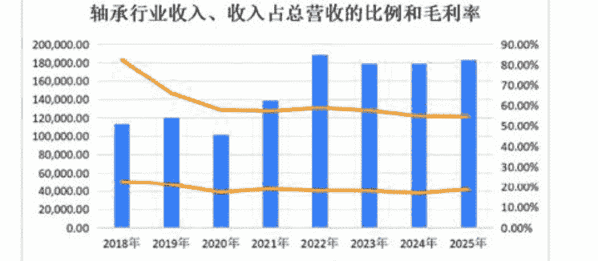
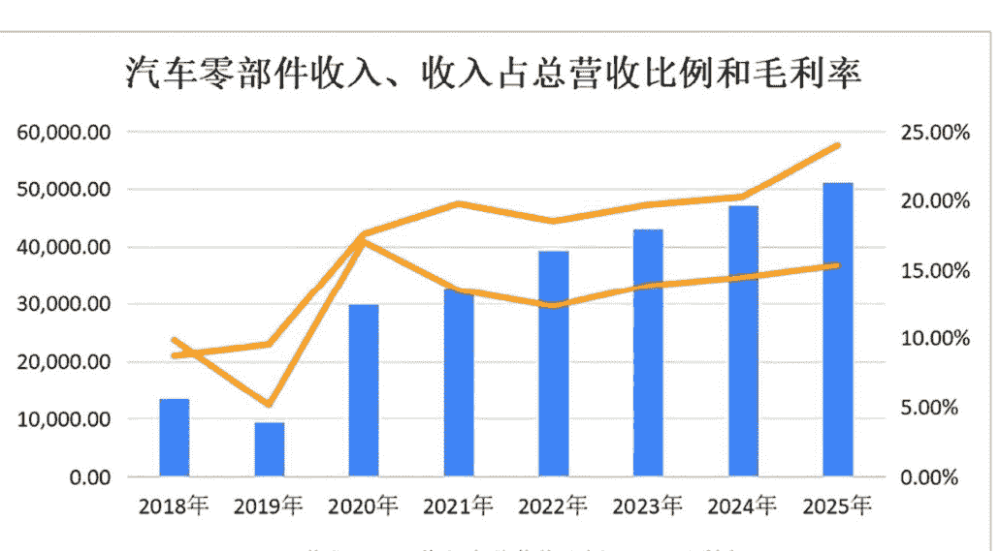
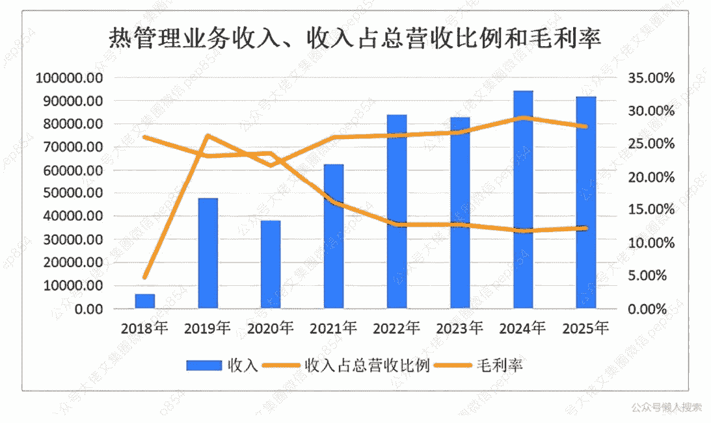
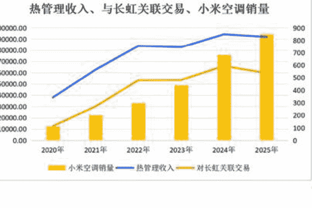
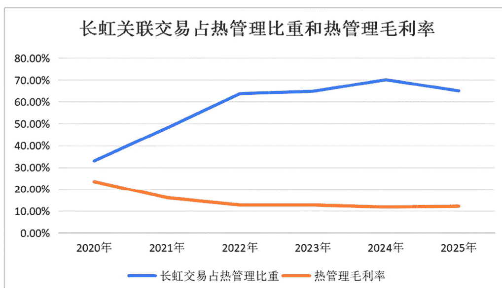
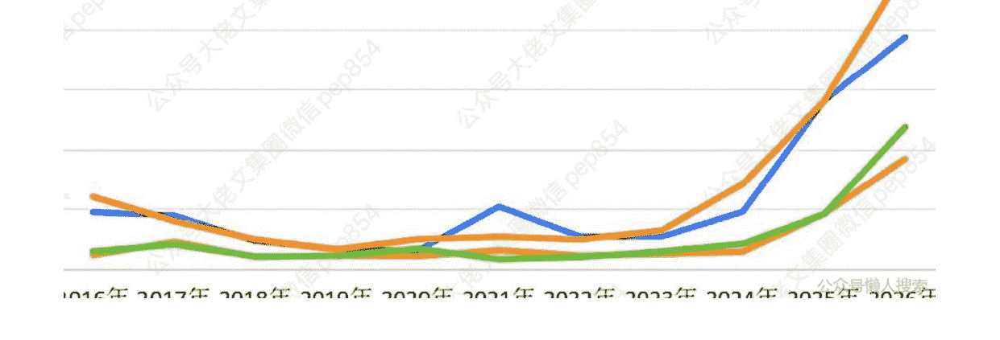
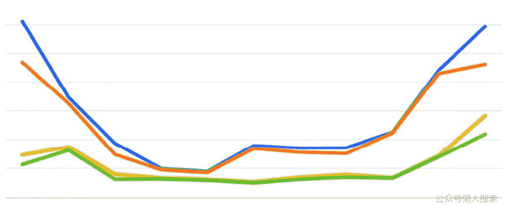
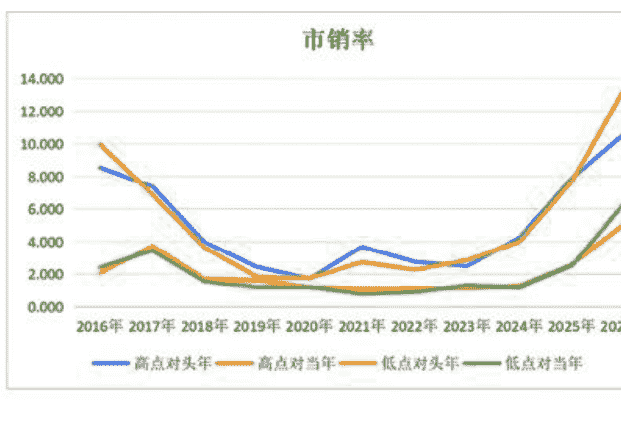

# 公司分析 28：一遇风云便化龙，传统制造业公司如何实现股价逆袭

260916 安民
整理：公众号懒人搜索，懒人专属群精选
懒人微信：lazyhelper1

> **小懒判断** | 想学财报拆解方法论的值得细看，找代码直接抄作业的别来。最值得记的是拆解框架：按业务线算“收入-成本增速差→毛利率变动→毛利贡献”，29 张图表全是现成模板。坑在于：源 PDF 有两处图表加载失败（主营业务年度表和 K 线图），数据有缺口；且作者明说“不构成投资建议”，别当荐股看。

公司分析 28：一遇风云便化龙，传统制造业公司如何实现股价逆袭
原创 anmin0001 安民 Anmin0001 深度分析 2026 年 9 月 16 日 07：00 湖北 14 人

市场从来都不公平，处于风口浪尖的弄潮儿公司永远都会受到最多的关注和炒作。

而传统行业就像老黄牛，被市场以挑剔的目光看待。今天分析的这家主板公司，深耕精密制造多年，也通过自主研发拥有了傍身的硬功夫。

但多年以来，作为传统制造业企业，股价一直不温不火，在低位徘徊。直到机器人概念的兴起，让公司在本轮牛市中股价涨了 8.39 倍。

这种涨幅，公司从未遇到过，正可谓是“一遇风云便化龙”。机器人概念在过去几年里被反复炒作，每次炒作，都会起飞一批产业链上的公司。

其中有的确实颇具竞争力，有的只是恰好踩中风口，本身并无所长。真正衡量公司本事的，就是看它有没有独一份的开创性，或者，能不能通过国产替代，从外企口中夺食。

今天分析的这家公司，作为我国精密制造业的代表企业，罕见地掌握了主营业务全产业链的加工生产工艺。

这些积淀下来的技术和经验不仅让它在数个领域成功实现国产替代，还能反向出口零部件给国外巨头。万变不离其宗，公司依托扎实的精密加工底蕴，利用底层互通的同源技术，有了无缝切入人形机器人的底气。

也由此不自觉地肩负起了推动我国人形机器人独立自主、不受国外巨头在关键零部件上卡脖子的使命。未来人形机器人想要全面铺开，一个是技术上能够完成进口替代，一个是成本，一个是产量。

这就注定我们不能只依靠外国成熟巨头提供关键零部件。因为如果咱们技术上过不了关，外国公司不仅会在价格上卡死你，还会在走量的关键时期，用产能卡死你。

所以人形机器人零部件的国产替代是肉眼可见的趋势，哪家公司抓住这个趋势，就是给自己买了张高铁票，不管几等座，好歹能上车，好歹有后续的故事可讲。

就像我们说过多次的，人想改变命运，也要搭上时代的列车。时势造英雄，但前提是英雄要耐得住多年打磨内功的寂寞。8.39 倍的涨幅，就是时势对英雄，和英雄的股东们最好的奖赏。

如今，公司的股价相比高峰已下跌了一半多，而且还有进一步下跌的空间。此时正是观察公司下山的绝佳时机，错过涨 8.39 倍的人，可以借这波下跌和后续大势调整，等待一个合适的低点，为机器人未来的爆发提前埋伏。

公司有较多机器人零部件产品，而且也已经打入了国际国内人形机器人生产线，从 2026 年半年报数据来看，2026 年上半年机器人零部件产品的销售收入，已经高于 2025 年全年，表明整个机器人产业还是带给了公司以成长性。

公司还有好几个大型投资项目，其中主要是有关汽车和机器人产业的，这也涉及到公司未来的成长性，值得高度关注。当然，本波牛市，公司股价大涨，炒的是 0 到 1，即机器人零部件产品有没有，那么，从下波牛市起，炒作将回归到业绩线，即是从 1 到 10，炒的是业绩有没有高速增长等等。

这也是我们后面需要特别关注的。文章分为六个部分，包括公司业务分析、各财务环节对公司利润的影响、影响公司业绩的因素和排序、这是一家什么样的公司、制造业老兵如何获得市场青睐、公司的市场定位。

我们团队一直在强调，我们研究的公司，都是目围绕着某个行业进行的。

我们在一年多以前就制定了相关投资计划，包括行业分析报告，准备在下一波牛市中重点介入该行业，进行重点投资。

因此，该公司分析报告，是我们团队对该行业的重要公司的全面扫描。

我们的目的还是很简单，为的是完成资产跃迁与升级。为此，我们持续在那个方面下功夫，做足准备，而且这个准备的周期可能会比较长。

我们就是要展示一个完整的行业分析、行业投资规划与投资实操周期，展现散户如何靠自己的眼光来完成人生的蜕变。（声明：本文是公司分析，仅为开拓视野、引导思路，并非择时，亦非荐股，股市有风险，入市需谨慎。本文不构成任何投资建议或意见，不对投资者依据本文做出的任何投资或决策承担责任。请大家注意投资风险）

## 一、公司业务分析

这家公司是五洲新春，代码 603667。公司深耕精密制造二十余年，是国内少数涵盖精密锻造、制管、冷成形、机加工、热处理、磨加工、装配的轴承及精密零部件全产业链企业。

公司以轴承业务为基本盘，产品覆盖风电、汽车、工业传动，服务海内外众多头部客户；通过并购，再依托自身的制管、焊接工艺，延伸发展热管理零部件业务，并且五洲新春还是国内唯一量产安全气囊气体发生器部件的公司。

当前公司积极向新能源汽车与人形机器人赛道转型。人形机器人也是我们此次研究它的核心原因。

### 1. 轴承行业（单位：万元）

| 轴承行业 | 2024年 | 2025年 | 增速 | 增量 |
| :--- | :--- | :--- | :--- | :--- |
| 收入 | 178631.26 | 182742.86 | 2.30% | 4111.6 |
| 成本 | 148595.49 | 148514.42 | -0.05% | -81.07 |
| 毛利 | 30035.77 | 34228.44 | 13.96% | 4192.67 |
| 毛利率 | 16.81% | 18.73% | | 1.92% |

收入略微增长，增量 4111.6 万元；毛利两位数增长，增量 4192.67 万元。收入增速快于成本增速 2.35 个百分点，带动毛利率提高 1.92 个百分点，正面影响毛利 3501.33 万元，占轴承行业毛利增量的 83.51%。

下面是公司 2026 上半年的轴承行业业务表现（单位：万元）：

| 轴承行业 | 2025上半年 | 2026上半年 | 增速 | 增量 |
| :--- | :--- | :--- | :--- | :--- |
| 收入 | 99440.85 | 84743.12 | -14.78% | -14697.73 |
| 成本 | 81407.52 | 66884.45 | -17.84% | -14523.07 |
| 毛利 | 18033.33 | 17858.67 | -0.97% | -174.66 |
| 毛利率 | 18.13% | 21.07% | | 2.94% |

注意，与 2026 半年报不同，2025 半年报中的机器人相关业务没有分列，直接与“轴承行业”合计算在一起了，所以在 2025 上半年，此业务既包括常规轴承，又包括机器人相关业务。

2026 年上半年轴承业务因为减少了机器人相关业务，因此收入和毛利都有下滑。2026 上半年，轴承业务收入两位数下滑，减少 1.47 亿元；毛利略微下滑，减少 174.66 万元。

成本下滑速度快于收入下滑速度 3.06 个百分点，带动毛利率提高 2.94 个百分点，正面影响毛利 2490.73 万元。下面是历年轴承行业占总营收的比例（单位：万元）：

上图中蓝色柱状图为收入，用主坐标轴。橙色折线为轴承收入占总营收比例，黄色折线为毛利率，两者共用次坐标轴。可以看到，轴承业务是公司的绝对支柱业务，巅峰期占全部营收的比例超过 80%，后来随着其他业务的发展，营收占比逐渐下降，但一直保持在 50% 以上。

最近三年，其营收数值增长已经停滞。毛利率在早年曾超过 20%，从 2020 年起降至 20% 以下，长期保持在略低于 20% 的平稳状态。

轴承业务是公司的起家业务，公司从上世纪 90 年代起就做的是轴承套圈代工。轴承套圈是什么呢，以大家最常见的轴承为例，套圈就是一大一小两个铁环，中间保留沟槽，套在一起后，在铁环中间的沟槽塞入铁球，把两环隔开。

这两个铁环，就是最常见的轴承套圈，外面较大的是外圈，里面较小的是内圈。有了轱球相隔，这样无论是外圈还是内圈，都可以通过轱球的滚动而自如旋转。

本章节篇幅有限，我们在后面再讲轴承的基本信息，这里大家明白一点就好：轴承就是工业的关节，只要物理世界中还存，只要人类机械中还存旋转运动，那么轴承就不可或缺。

由于高端轴承对原材料和精密加工的要求很高，所以轴承业务不仅意味着产品本身，还意味着公司深耕精密锻造、制管、冷成形、机加工、热处理、磨加工、成品装配等。

这些都是精密加工的基础，也是公司后续扩张业务，开辟新增长曲线的底气所在。

### 2. 汽车零部件行业（单位：万元）

| 汽车零部件行业 | 2024年 | 2025年 | 增速 | 增量 |
| :-- | :-- | :-- | :-- | :-- |
| 收入 | 47126.2 | 51215.27 | 8.68% | 4089.07 |
| 成本 | 37589.7 | 38931.31 | 3.57% | 1341.61 |
| 毛利 | 9536.5 | 12283.96 | 28.81% | 2747.46 |
| 毛利率 | 20.24% | 23.98% | | 3.75% |

收入个位数增长，增量 4089.07 万元；毛利中高速增长，增量 2747.46 万元。收入增速快于成本增速 5.11 个百分点，带动毛利率提高 3.75 个百分点，正面影响毛利 1919.99 万元，占汽车零部件行业毛利增量的 69.88%。

下面是公司 2026 上半年的汽车零部件行业表现（单位：万元）：

| 汽车零部件行业 | 2025 上半年 | 2026 上半年 | 增速 | 增量 |
| :--- | :--- | :--- | :--- | :--- |
| 收入 | 24365.75 | 25627.76 | 5.18% | 1262.01 |
| 成本 | 19315.36 | 19478.61 | 0.85% | 163.25 |
| 毛利 | 5050.39 | 6149.15 | 21.76% | 1098.76 |
| 毛利率 | 20.73% | 23.99% | | 3.27% |

收入个位数增长，增量 1262 万元；毛利中高速增长，增量 1098.76 万元。收入增速快于成本增速 4.33 个百分点，带动毛利率提高 3.27 个百分点，正面影响毛利 837.18 万元，占汽车零部件行业毛利增量的 76.19%。

公司的汽车零部件业务，产品包含三大块：
- 安全气囊气体发生器部件；
- 新能源汽车动力驱动装置零部件，包括变速器、减速器的齿轮、齿坯、齿套的精锻件和机加件等；
- 电子差速器接合锁和传动轴连接法兰件等。

这三块业务都是以轴承精密制造技术为底座，向整车配套环节延伸形成的。此业务中最有含金量的是安全气囊气体发生器部件。气体发生器是气囊系统的核心，其工作原理是依靠内部燃料的瞬间燃烧产生大量气体，迅速为气囊充气。

五洲新春提供的并不是整个的气体发生器，而是其部件，主要指其中的特种钢管及加工产品。它构成了发生器的结构壳体，用无缝钢管约束高压气体，其工艺要求高，因为产品在十到十五年的汽车寿命中，如果因为质量问题导致气体泄漏，就会影响气囊系统的可靠性。

由于该部件对强度、密封性和可靠性的要求极为严苛，技术难度高，所以长期被日本新日铁和意大利特纳瑞斯所垄断。经五洲新春攻关，公司成为了唯一能供应此产品的本土公司。

当下全世界能将该部件研发成功并规模化生产的公司只有新日铁、特纳瑞斯，以及五洲新春。

我们看公司在汽车零部件行业的 2025 年营收只有 5.12 亿，并不突出，再减去动力驱动装置等其他产品，气体发生器部件的营收就更少了。作为唯一的垄断产品供应商，似乎无法匹配其地位。

所以我们再根据外部信息深入了解其原因。2025 年全球安全气囊发生器外壳市场销售额约 3.64 亿美元，合当前人民币 24.42 亿人民币，预计在 2032 年将达到 5.19 亿美元。这个总市场容量，就不是很高。

而且五洲新春的“气体发生器部件”可能无法完全覆盖发生器外壳市场。根据 2023 年的公开信息显示，公司的气体发生器部件主要应用于“乘用车侧气帘和腰部、膝部气囊”等，并未提及“主、副驾正面气囊”壳体。

而且腰、膝部气囊壳体多用无缝钢管，主副驾气囊壳体多用冲压焊接罐式壳体，公司对标的日铁和特纳瑞斯也都是知名的管材巨头，所以我们可以推断公司的实际市场潜力可能还要再打折扣。

据我们了解，侧气帘、腰、膝部气囊壳体，其产值很可能要在全部气囊壳体的基础上打一半以上的折扣，可能在 10 亿人民币以下。

这样我们就有数了，公司在汽车零部件行业的核心产品是安全气囊气体发生器部件，在这方面它确实是国内独一份，是标准的国产替代的题材。

但安全气囊气体发生器部件的市场天花板并不高，二三十亿的水平，并且公司的产品可能是气体发生器部件中更加细分的领域，天花板更低，所以导致公司汽车零部件业务的营收没有特别高。

再来看汽车零部件业务历年经营情况（单位：万元）：

上图中蓝色柱状图为收入，用主坐标轴。橙色折线为收入占总营收比例，黄色折线为毛利率，两者共用次坐标轴。收入增长比较线性，并没有随新能源车的爆发而同步爆发。

首先是前文分析的，业务核心产品的气体发生器部件，天花板不高。

其次是气体发生器部件作为安全件，认证周期非常长，所以销量释放节奏慢，不会随车市同步爆发。

第三，公司生产的汽车动力驱动装置零部件，比如齿轮齿坯、传动法兰等精锻机加工产品，并不是很稀缺，国内锻造厂众多，竞争激烈，附加值不高，获取新项目难度大。

不过由于气体发生器部件确实具有国产替代优越属性，再加上公司显然没有为了跟随新能源汽车行业的增长而去抢业务，所以此业务的毛利率稍好，优于轴承业务。

这项业务的毛利率在 2024 年和 2025 年都超过 20%，此前的毛利率也略高于轴承业务。2026 上半年，汽车零部件业务的毛利率创下新高，达到了 23.99%，在重资产制造业中，属于不错的水平。

尤其在行业普遍以价换量的内卷时期，此业务发展得比较健康。当然，核心问题，仍然是天花板不够高。

### 3. 机器人零部件行业（单位：万元）

| 机器人零部件行业 | 2024年 | 2025年 | 增速 | 增量 |
|---|---|---|---|---|
| 收入 | 613.1 | 1599.5 | 160.89% | 986.4 |
| 成本 | 420.97 | 1748.68 | 315.39% | 1327.71 |
| 毛利 | 192.13 | -149.18 | -177.65% | -341.31 |
| 毛利率 | 31.34% | -9.33% | | -40.66% |

收入超高速增长，增量 986.4 万元；毛利超高速下滑，同比减少 341.31 万元。成本增速快于收入增速 154.5 个百分点，带动毛利率下滑 40.66 个百分点，负面影响毛利 650.42 万元。

下面是公司 2026 上半年机器人零部件行业的情况（单位：万元）：

| 机器人零部件行业 | 2025 上半年 | 2026 上半年 | 增速 | 增量 |
| :--- | :--- | :--- | :--- | :--- |
| 收入 |  | 1947.33 |  |  |
| 成本 |  | 1879.44 |  |  |
| 毛利 |  | 67.89 |  |  |
| 毛利率 |  | 3.49% |  |  |

如前文所述，2025 上半年机器人零部件行业没有分列数据，只有 2026 上半年的数据，所以无法对比。但看今年上半年的情况，营收已超过 2025 全年，并且毛利率转正。机器人业务是公司依托精密制造、押注未来的新兴业务。

其实早在 2016 年，公司上市后的第一份年报中就表明了自己已具备机器人谐波减速器轴承的批量生产能力。但这个时期的机器人，概念应该更多指向工业机器人。

2023 年公司在保持减速器轴承的一贯切入方略下，在机器人领域开辟了新的切入口，就是机器人线性关节。人形机器人作为公司最新钦定的重点发展方向，还处于早期阶段。

因为业务年轻，不仅营收少，而且产销销都不稳定，所以 2024 年和 2025 年毛利率波动巨大。关于机器人方面的内容，我们后面再细讲。

### 4. 热管理系统零部件行业（单位：万元）

| 热管理系统零部件行业 | 2024 年 | 2025 年 | 增速 | 增量 |
| :--- | :--- | :--- | :--- | :--- |
| 收入 | 94238.67 | 91927.94 | -2.45% | -2310.73 |
| 成本 | 83216.63 | 80799.79 | -2.90% | -2416.84 |
| 毛利 | 11022.04 | 11128.15 | 0.96% | 106.11 |
| 毛利率 | 11.70% | 12.11% | | 0.41% |

收入略微下滑，减少 2310.73 万元；毛利略微增长，增量 106.11 万元。成本下滑速度快于收入下滑速度 0.45 个百分点，带动毛利率提高 0.41 个百分点，正面影响毛利 376.37 万元。

下面是公司 2026 上半年热管理系统零部件行业的情况（单位：万元）：

| 热管理系统零部件行业 | 2025 上半年 | 2026 上半年 | 增速 | 增量 |
| :--- | :--- | :--- | :--- | :--- |
| 收入 | 61383.57 | 36053.85 | -41.26% | -25329.72 |
| 成本 | 55349.58 | 32218.63 | -41.79% | -23130.95 |
| 毛利 | 6033.99 | 3835.22 | -36.44% | -2198.77 |
| 毛利率 | 9.83% | 10.64% | | 0.81% |

收入超高速下滑，减少 2.53 亿元；毛利高速下滑，同比减少 2198.77 万元。成本下滑速度快于收入下滑速度 0.53 个百分点，带动毛利率提高 0.81 个百分点，正面影响毛利 291.14 万元。

公司的热管理系统零部件，主要用于汽车热管理系统和家用空调散热系统。前面几项主营业务更多是基于公司技术底座，内生出来的选择，而热管理系统零部件则更多依靠上市后的并购。

公司在 2017 年募资收购新龙实业，2018 年完成收购。新龙实业主营汽车空调和家用、商用空调管路件的制造，五洲新春将其收购后，建立了与汽配公司法雷奥、马勒贝洱、富奥翰昂、热交换器和系统制造商摩丁、空调生产企业长虹空调、海信日立等企业的联系。

当然，在跨向热管理业务的过程中，公司传统的制管、精密冲压焊接等领域的优势依然发挥了作用。下面是热管理业务业务历年经营情况（单位：万元）：

上图中蓝色柱状图为收入，用主坐标轴。橙色折线为收入占总营收比例，黄色折线为毛利率，两者共用次坐标轴。自从 2018 年成功收购新龙实业后，热管理业务一跃成为公司的二号支柱，业务营收占总营收比例长期高于 25%，这两年保持在 28% 左右。

但毛利率一路走低，不容乐观，从最高时超过 25% 跌到 2025 年的 12.11%，少了一半还多。热管理业务的变化中，包含着两个问题：一是为什么毛利率一路走低；二是为什么近两年增长停滞，并且 2026 上半年业务出现重大滑坡，营收暴跌 41.26%。

这两个问题的根本原因，其实都在于热管理业务的大客户，长虹空调。新龙实业被五洲新春收购前，本来就高度依赖长虹空调的订单，长虹长期以来都是新龙的第一客户。

新龙和长虹早在 2005 年 10 月就设立了合资公司长新制冷，新龙占比 65%，长虹占比 35%。

所以新龙和长虹的交易算关联交易，在五洲新春收购新龙实业后，合资关系被五洲新春继承。五洲收购新龙后，试图降低单一客户依赖，但长虹依旧是热管理板块最大家电收入来源。

下表是近三年五洲对长虹的关联交易额，以及这笔关联交易占热管理收入的比重（单位：万元）：

| | 2023年 | 2024年 | 2025年 |
| :--- | :--- | :--- | :--- |
| 对长虹关联交易额 | 53522.94 | 66040.53 | 59767.46 |
| 热管理总收入 | 82724.16 | 94238.67 | 91927.94 |
| 长虹占热管理收入比 | 64.7% | 70.08% | 65.02% |

长虹作为五洲热管理领域的第一大客户，地位显而易见。近年来，小米空调爆发，长虹刚好是小米空调的第一代工厂，据机构推算，长期承担 70% 以上的代工任务。

所以长虹对小米供货量暴增，在理论上，会使五洲新春间接受益于小米空调的增长。在理想的产业链关系中，是五洲向长虹提供空调管路等产品，长虹给小米代工时，用到了五洲供应的货。

但实际上，没有直接信息披露五洲产品在长虹生产时是如何划拨的，也就是说，五洲的热管理部件既可能用于小米的代工，又可能用于长虹自有品牌的生产。

所以小米对五洲新春热管理部件的影响几何，我们只能从一些边缘信息分析。

我们先看公司的热管理收入和小米空调的销售数据（单位：万元，万台）：

| | 热管理收入 | 对长虹关联交易 | 小米空调销量 |
| :--- | :--- | :--- | :--- |
| 2020 年 | 37996.38 | 12521.79 | 110 |
| 2021 年 | 62743.26 | 30165.20 | 200 |
| 2022 年 | 83781.41 | 53334.53 | 295 |
| 2023 年 | 82724.16 | 53522.94 | 440 |
| 2024 年 | 94238.67 | 66040.53 | 680 |
| 2025 年 | 91927.94 | 59644.99 | 850 |
| 复合增长率 | 19.33% | 36.64% | 50.52% |

上图蓝色折线为热管理收入，橙色折线为五洲对长虹的关联交易金额，两者共用主坐标轴；黄色柱状图为同年的小米空调销量，用次坐标轴。

结合上面的图表，2020 年到 2024 年期间，五洲的热管理业务、与长虹的关联交易、小米空调的销量，三者的增长比较同频。小米自 2020 起，空调销量以 50.52%的复合增长率爆发，这些卖出去的空调，大部分由长虹代工完成，而五洲新春大部分的热管理销售额，又是长虹提供的。

五洲新春和长虹之间的关联交易，复合增长率是 36.64%，虽然低于小米空调销量的复合增长率，但也不低了，考虑到小米、长虹、五洲三者之间明确的供需关系，可以认为五洲业务增长和小米空调增长存在相关性。

再看五洲和长虹的关联交易占热管理业务收入的比重，以及热管理业务历年的毛利率：

长虹关联交易占热管理营收的比重和热管理业务的毛利率存在非常明显的负相关：和长虹的交易越多，热管理业务的毛利率就越低。

为什么会更低呢？有两重原因：一是因为五洲和长虹的关联交易本来就是刻意压过毛利率的。前文讲的新龙和长虹合资，成立了长新制冷，由长新制冷向长虹供货，物料费用是平价，但加工费低于市场价，是常见的以毛利换稳定客户。

二是因为长虹给小米做空调 ODM。我们在日之前的文章里讲过，在这里简单复述一下，也就是说长虹自己出核心技术、设计、生产，然后把长虹生产的空调贴上小米的牌子卖出去。

ODM 本来毛利率就比自有品牌低，而小米空调为了竞争力，又是出了名的便宜，必然会把毛利率压得更低。

所以就变成了市场竞争压小米的毛利率，小米压长虹的毛利率，长虹压五洲的毛利率。

这就解释了为什么五洲和长虹的交易越多，热管理业务的毛利率就越低。

所以我们说五洲新春的热管理业务，营收间接受益于小米，毛利率间接受害于小米，两者关系是比较紧密的。从逻辑和数据上，都能解释。

在确定了五洲、长虹、小米的关系后，一些其他问题也比较好分析了。

比如 2025 年的热管理业务收入有所下降，而 2026 年上半年，该业务超高速下滑，降幅超过了 40%。官方的解释是长虹家用空调管路件需求下降。

给小米代工的是四川长虹空调有限公司，其母公司是上市公司长虹美菱，我们查阅长虹美菱 2026 上半年的空调业务，营收果然下滑了 21.95%。

2025 年小米武汉工厂投产，这是继汽车超级工厂、手机智能工厂后的第三座智能工厂。小米相关负责人介绍，预计到 2026 年，武汉可以年产 300 万台小米空调。

所以业绩下滑的真正原因在于本属于长虹的 ODM 订单被小米自有工厂分流，殃及五洲新春。而随着 2026 年武汉工厂的产能爬坡，长虹的代工单下滑更厉害，五洲新春也一样。

对此，五洲的应对措施是开拓珠三角客户，降低对单一大客户的业务依赖。结合珠三角的关键词，公司应该会着力深化与美的、格力的关系。

公司在业绩会上说下半年新空调客户落地，对空调管路订单形成部分回补。

### 5. 主营业务（单位：万元）

收入略微增长，增量 6876.35 万元；毛利两位数增长，增量 6704.94 万元。收入增速快于成本增速 2.08 个百分点，带动毛利率提高 1.71 个百分点，正面影响毛利 5615.68 万元，占主营业务毛利增量的 83.75%。

下面是公司 2026 上半年主营业务的情况（单位：万元）：

| 主营业务 | 2025 上半年 | 2026 上半年 | 增速 | 增量 |
| :--- | :--- | :--- | :--- | :--- |
| 收入 | 185190.18 | 148372.06 | -19.88% | -36818.12 |
| 成本 | 156072.46 | 120461.13 | -22.82% | -35611.33 |
| 毛利 | 29117.72 | 27910.93 | -4.14% | -1206.79 |
| 毛利率 | 15.72% | 18.81% | | 3.09% |

收入两位数下滑，减少 3.68 亿元；毛利个位数下滑，减少 1206.79 万元。成本下滑速度快于收入下滑速度 2.94 个百分点，带动毛利率提高 3.09 个百分点，正面影响毛利 4582.18 万元。

### 6. 其他业务（单位：万元）

| 其他业务 | 2024 年 | 2025 年 | 增速 | 增量 |
| :--- | :--- | :--- | :--- | :--- |
| 收入 | 5845.7 | 6843.85 | 17.07% | 998.15 |
| 成本 | 2695.66 | 3986.55 | 47.89% | 1290.89 |
| 毛利 | 3150.04 | 2857.3 | -9.29% | -292.74 |
| 毛利率 | 53.89% | 41.75% | | -12.14% |

收入两位数增长，增量 998.15 万元；毛利个位数下滑，同比减少 292.74 万元。成本增速快于收入增速 30.82 个百分点，带动毛利率下滑 12.14 个百分点，负面影响毛利 830.61 万元。

下面是公司 2026 上半年其他业务的情况（单位：万元）：

| 其他业务 | 2025 上半年 | 2026 上半年 | 增速 | 增量 |
| :--- | :--- | :--- | :--- | :--- |
| 收入 | 4243.6 | 5011.99 | 18.11% | 768.39 |
| 成本 | 2414.45 | 2953.46 | 22.32% | 539.01 |
| 毛利 | 1829.15 | 2058.53 | 12.54% | 229.38 |
| 毛利率 | 43.10% | 41.07% | | -2.03% |

收入两位数增长，增加 768 万元；毛利两位数增长，减少 229.38 万元。成本增速快于收入增速 4.21 个百分点，带动毛利率下滑 2.03 个百分点，负面影响毛利 101.82 万元。

### 7. 全部业务（单位：万元）

| 全部业务 | 2024 年 | 2025 年 | 增速 | 增量 |
| :--- | :--- | :--- | :--- | :--- |
| 收入 | 326454.92 | 334329.43 | 2.41% | 7874.51 |
| 成本 | 272518.46 | 273980.76 | 0.54% | 1462.3 |
| 毛利 | 53936.46 | 60348.67 | 11.89% | 6412.21 |
| 毛利率 | 16.52% | 18.05% | | 1.53% |

收入略微增长，增量 7874.51 万元；毛利两位数增长，增量 6412.21 万元。收入增速快于成本增速 1.87 个百分点，带动毛利率提高 1.53 个百分点，正面影响毛利 5111.19 万元，占全部业务毛利增量的 79.71%。

下面是公司 2026 上半年全部业务的情况（单位：万元）：

| 全部业务 | 2025 上半年 | 2026 上半年 | 增速 | 增量 |
| :--- | :--- | :--- | :--- | :--- |
| 收入 | 189433.78 | 153384.05 | -19.03% | -36049.73 |
| 成本 | 158486.92 | 123414.59 | -22.13% | -35072.33 |
| 毛利 | 30946.86 | 29969.46 | -3.16% | -977.4 |
| 毛利率 | 16.34% | 19.54% | | 3.20% |

收入两位数下滑，减少 3.6 亿元；毛利个位数下滑，减少 977.4 万元。成本下滑速度快于收入下滑速度 3.1 个百分点，带动毛利率提高 3.2 个百分点，正面影响毛利 4911.87 万元。

## 二、各财务环节对公司利润的影响

### 1. 费用环节的影响（单位：万元）

| | 2024年 | 2025年 | 增量 | 影响 |
| :--- | :---: | :---: | :---: | :---: |
| 税金及附加 | 2657.49 | 2853.95 | 196.46 | -196.46 |
| 销售费用 | 10875.11 | 11755.43 | 880.32 | -880.32 |
| 管理费用 | 16370.01 | 19253.93 | 2883.92 | -2883.92 |
| 研发费用 | 9870.04 | 11894.31 | 2024.27 | -2024.27 |
| 财务费用 | 3303.65 | 2521.71 | -781.94 | 781.94 |
| 合计 | | | | -5203.03 |

2025年，费用环节一共减少营业利润 5203.03 万元。经过这 5 个环节，公司 2025 年的营业利润同比增加 1209.16 万元。

费用环节中，影响最大的是管理费用和研发费用。其中管理费用的支出增长大头是职工薪酬，增加了 2262 万。研发费用的大头支出在于“直接投入费用”，意思是研发中消耗掉的材料、水电燃料、模具、样品等金额的汇总，同比增加了 1871 万元。

下面是公司 2026 上半年的情况（单位：万元）：

| | 2025上半年 | 2026上半年 | 增速 | 增量 |
| :--- | :---: | :---: | :---: | :---: |
| 税金及附加 | 1419.49 | 1301.36 | -118.12 | 118.12 |
| 销售费用 | 5027.1 | 5989.02 | 961.92 | -961.92 |
| 管理费用 | 9655.57 | 9507.55 | -148.02 | 148.02 |
| 研发费用 | 5379.81 | 5600.26 | 220.45 | -220.45 |
| 财务费用 | 451.49 | 1349.68 | 898.19 | -898.19 |
| 合计 | | | | -1814.42 |

2026 上半年，费用环节一共减少营业利润 1814.42 万元。经过这 5 个环节，公司 2026 上半年的营业利润同比减少 2791.82 万元。

其中影响较大的是销售费用和财务费用。销售费用增长主要是因员工薪酬增长；财务费用增长主要是人民币升值，造成了近 1620 万元的汇兑损失。

### 2. 利得和损失的影响（单位：万元）

| | 2024 年 | 2025 年 | 增量 | 影响 |
| :--- | :--- | :--- | :--- | :--- |
| 其他收益 | 3598.95 | 2877.96 | -720.99 | -720.99 |
| 投资收益 | -1.8 | 112.86 | 114.66 | 114.66 |
| 公允价值变动收益 | | -44.86 | -44.86 | -44.86 |
| 信用减值损失 | -362.02 | -12.79 | 349.23 | 349.23 |
| 资产减值损失 | -3031.9 | -3804.18 | -772.28 | -772.28 |
| 资产处置收益 | 9.81 | 151.69 | 141.88 | 141.88 |
| 合计 | | | | -932.36 |

2025 年，这 6 个环节共计减少营业利润 932.36 万元。经过这 6 个环节，公司营业利润同比增加了 276.8 万元。其他收益和资产减值损失是影响最大的两块。

其他收益减少，主要是因为与收益相关的政府补助减少了 1189 万元。而资产减值损失的变动，主要来自于存货跌价损失及合约履约成本减值损失，损失同比增加了 739 万元，其中库存商品的减值计提最多，为 1248 万元。

下面是公司 2026 上半年的情况（单位：万元）：

2026 上半年，这 6 个环节共计增加营业利润 454.64 万元。经过这 6 个环节，公司营业利润同比减少了 2337.18 万元。

### 3. 营业外收支、所得税费用和少数股东损益等（单位：万元）

2025 年，这 4 个环节共减少公司股东净利润 274.83 万元。经过这 4 个环节，公司 2025 年股东净利润增加了 1.97 万元。

其中影响较大的是所得税费用和少数股东损益。下面是公司 2026 上半年的情况（单位：万元）：

| | 2025 上半年 | 2026 上半年 | 增速 | 增量 |
| :--- | :--- | :--- | :--- | :--- |
| 营业外收入 | 27.69 | 11.95 | -15.74 | -15.74 |
| 营业外支出 | 379.59 | 126.12 | -253.47 | 253.47 |
| 所得税费用 | 1166.71 | 1029.55 | -137.16 | 137.16 |
| 少数股东损益 | 766.41 | 242.21 | -524.2 | 524.2 |
| 合计 | | | | 899.09 |

2026 上半年，这 4 个环节共增加公司股东净利润 899.09 万元。经过这 4 个环节，公司股东净利润减少了 1438.09 万元。

## 三、影响公司 2025 年和 2026 上半年业绩的因素及排序

影响公司 2025 年业绩的因素一共 20 个，其中正面影响因素 9 个，负面影响因素 11 个（单位：万元）：

| 排序 | 正面影响 | 影响额 | 负面影响 | 影响额 | 合计 |
| :--- | :--- | :--- | :--- | :--- | :--- |
| 1 | 轴承行业 | 4192.67 | 管理费用 | -2883.92 | |
| 2 | 汽车零部件行业 | 2747.46 | 研发费用 | -2024.27 | |
| 3 | 财务费用 | 781.94 | 少数股东损益 | -970.96 | |
| 4 | 所得税费用 | 666.01 | 销售费用 | -880.32 | |
| 5 | 信用减值损失 | 349.23 | 资产减值损失 | -772.28 | |
| 6 | 营业外支出 | 154.74 | 其他收益 | -720.99 | |
| 7 | 资产处置收益 | 141.88 | 机器人零部件行业 | -341.31 | |
| 8 | 投资收益 | 114.66 | 其他业务 | -292.74 | |
| 9 | 热管理系统零部件行业 | 106.11 | 税金及附加 | -196.46 | |
| 10 | | | 营业外收入 | -124.62 | |
| 11 | | | 公允价值变动收益 | -44.86 | |
| 合计 | | 9254.7 | | -9252.73 | 1.97 |

2025 年，公司业务毛利三增两减。三增的是，轴承行业增加毛利 4192.67 万元；汽车零部件行业增加毛利 2747.46 万元；热管理系统零部件行业增加毛利 106.11 万元；这三项业务共增加毛利 7046.24 万元。

两减是：机器人零部件行业减少毛利 341.31 万元；其他业务减少毛利 292.74 万元，两者共减少毛利 634.05 万元。全部业务共增加毛利 6412.21 万元。

费用方面减少营业利润 5203.03 万；利得和损失共减少营业利润 932.36 万；营业外

## 收支、所得税费用及少数股东损益

减少股东净利润 274.83 万。

终至全年股东净利润同比增加了 1.97 万。少量因四舍五入产生的偏差为正常现象。影响公司 2026 上半年业绩的因素一共 17 个，其中正面影响因素 10 个，负面影响因素 7 个。

因为 2025 上半年没有分制机器人部件数据，无法和 2026 上半年对比，故把业务笼统分为主营业务和其他业务（单位：万元）：

| 排序 | 正面影响 | 影响额 | 负面影响 | 影响额 |
| :--- | :--- | :--- | :--- | :--- |
| 1 | 少数股东损益 | 524.2 | 主营业务 | -1206.79 |
| 2 | 信用减值损失 | 498.34 | 销售费用 | -961.92 |
| 3 | 营业外支出 | 253.47 | 财务费用 | -898.19 |
| 4 | 其他业务 | 229.38 | 研发费用 | -220.45 |
| 5 | 管理费用 | 148.02 | 资产减值损失 | -153.88 |
| 6 | 所得税费用 | 137.16 | 资产处置收益 | -39.14 |
| 7 | 税金及附加 | 118.12 | 营业外收入 | -15.74 |
| 8 | 其他收益 | 94.83 | | |
| 9 | 公允价值变动收益 | 44.86 | | |
| 10 | 投资收益 | 9.63 | | |
| **合计** | | **2058.01** | | **-3496.11** |

2026 上半年，公司主营业务减少毛利 1206.79 万元，其他业务增加毛利 229.38 万元，全部业务共减少毛利 977.41 万元。

费用方面减少营业利润 1814.42 万；利得和损失共增加营业利润 454.64 万；营业外收支、所得税费用及少数股东损益增加股东净利润 899.09 万。

终至 2026 上半年股东净利润同比减少了 1438.1 万。少量因四舍五入产生的偏差为正常现象。

## 四、这是一家什么样的公司

这里我们首先给公司下一个判定，五洲新春是一家基础扎实，但不得志的公司。这里有两个要点，一是基础扎实，二是不得志。

### 1. 何谓基础扎实

公司业务有四大块，但轴承是一切的基础，它给公司注入了精密加工的基因，也提供了最稳定的营收和毛利。有轴承业务在，我们不担心公司未来会没饭吃。

正如前文所说：只要物理世界中还存在摩擦力，只要人类机械中还存在旋转运动，那么轴承就不可或缺。

#### （1）为什么轴承重要

这里先把轴承的相关信息简要科普一下，让大家对公司的核心业务更有数。

人类对轴承的需求，本质上是希望降低摩擦力，这样劳作起来更省力。而减小摩擦力的常见做法是用滚动摩擦代替滑动摩擦。

比如古埃及的奴隶运输石料时，会把石料放在辅好的圆木上，利用圆木的滚动，推着石料走。这样就省得把石料放在地上拖，可以省力。两河文明和中国文明也有类似的方法。

这就是早期用滚动摩擦代替滑动摩擦的案例。人类发明轮子后，把轮子的中心打孔，再把一根车轴穿过两个轮孔，车轴用来承载车厢和重物，并且把人或马的直线牵引力传递到车轮上，让车轮滚动起来。一旦车轮滚起来，就省力了。

但是车轴和轮孔套合的部分怎么处理呢？如果轮孔箍得太紧，轮子就会被车轴卡死，转不动，此时就算有外力牵引，也只是外力把轮子拖在地上滑动，无法形成滚动摩擦。

但如果套得太松，当路面颠簸、转向或加减速时，轮孔与车轴之间会反复摇摆磕碰，加速磨损。为此，古人把车轴和轮孔套合的部分用铁或铜包裹，利用金属的光滑和坚韧提升耐磨性，再往其中注入油脂，进一步降低摩擦力。

这套技术出现后，人类用了几千年。直到二十世纪中后期，一些农村的畜力车仍然用到这套技术，赶车人会在车上配个油壶，走一段路就往轮子里加油润滑。

之所以又要包铁，又要润滑，是因为轮轴和轮孔之间，轴表面静止不动，而轮孔的内表面绕着轴一圈圈地转。两者接触处没有任何滚动物体介入，是金属或木头表面直接贴着表面蹭，这就是典型的滑动摩擦。

到这一步，这种衬套+润滑的古老模式，就已经属于轴承范畴了，它叫滑动轴承。轴在孔中旋转，两者表面直接接触并发生相对滑动，依靠润滑剂减少摩擦和磨损。

滑动轴承的思路是润滑衬套减少摩擦力。而在摩擦面加入滚动体，改滑动为滚动，则是另一种思路，由此诞生了滚动轴承。前文说过的古埃及用圆木运重物，就是这个思路的起源。

滚动轴承的历史也很悠久，公元前 1 世纪的亚述和秦朝就有滚动轴承的雏形，达芬奇和伽利略也都曾设计出了具有前瞻性的滚动轴承结构。但直到 1794 年，才诞生了第一个球轴承的专利。

1883 年，球磨机发明后，才迎来了滚动轴承的工业化时代。滚动轴承的应用从此远远超过了滑动轴承。滚动轴承应用这么广，却直到 19 世纪才反超滑动轴承，是因为它的制作难度更高，需要更坚硬的金属材料，以及把金属切削成滚动体的精加工能力。

建国时，中国的轴承年产能只有 13.8 万套，全国没有一家能完整生产一套轴承的工厂。直到 70 年代，民用、低端轴承才有较多的保障。而高端的机器维修、工业配套仍然严重依赖进口轴承。

所以轴承看似简单，但其背后是深厚的材料学和精加工底蕴。正是因此，我们到七十年代才只有上亿套的低端产能，也正是因此，直到现在我们都没能完全解决高端轴承的自给自足。

#### （2）五洲新春的轴承逆袭

对于想逆袭的制造业企业而言，最合适的方式是先集中资源，在少数几项技术指标或产品中达到一枝独秀，有了安身立命的本钱后，再徐徐图之。

##### ① 技术和产品打入外部

五洲新春公司最直接的优势是掌握了精密锻造、制管、冷成形、机加工、热处理、磨加工、装配等环节，是国内少数拥有轴承全产业链的企业。

在这之中，公司的最大优势在于磨前产品。所谓磨前，是指精密磨削之前的全部加工环节。磨前产品形状和组织性能已经基本定型，但尺寸精度、表面质量还没达到成品轴承的要求，可以理解为半成品。

它的品质直接影响成品轴承的性能和寿命。一套好轴承，光有打磨还不够，必须要有好的磨前产品作为基础才行。公司核心磨前技术之一，冷辗技术，拿过国家科学技术进步二等奖。

其核心是在室温下，通过外辗轮和内芯辊夹住钢圈旋转挤压，局部连续辗压，直接压出接近最终形状的轴承内外套圈毛坯，这个过程几乎不切掉金属，靠金属流动成型。

传统车削会把钢材内部纤维流线切断，而冷辗是挤压流动，金属纤维顺着套圈轮廓完整包裹，抗接触疲劳、耐磨性能更好，可以大大提升轴承寿命。

并且由于不切削金属，所以还能省料。也正是依靠以冷辗技术为代表的一系列磨前技术和工艺储备，公司的磨前产品在国内是真正的领先水平，在国际也处于优秀水准，是斯凯孚和舍弗勒两大巨头的主要轴承套圈供应商和战略合作伙伴。

##### ② 关键产品的国产替代

除了磨前产品达到了国内领先、国际先进水平，公司还有一个非常关键的项目。就是始于 2018 年，初成于 2020 年，大成于 2022 年的风电滚子国产替代。

风力发电的起点是叶片转动，有转动就有轴承。所谓的风电滚子是圆柱、圆锥或者鼓形的精钢制滚动体。它们的作用就是替代常见轴承中的那些钢球，钢球和滚道是点接触，而风电的叶片很重，所以负载能力非常重要。

这次五洲充分利用了自己全产业链的优势，实现了从原材料、锻造、机加工、可控气氛热处理、磨加工、超精加工、探伤检测的全流程制造，价格为进口产品的 70%。

2020 年实现了进口替代，为蒂森克虏伯、德枫丹、斯凯孚等国外公司配套，同时也是远景能源的战略合作商，为国内风电轴承企业，如新强联、烟台天成、大冶轴等提供配套。

据一些机构测算，五洲的风电滚子占有率在国内市场一度超 80%，占全球约 30%。

### 2. 何谓不得志

#### （1）业绩的尴尬

公司的全产业链、磨前产品、风电滚子，以及前文提到的国内独一份的安全气囊气体发生器部件，都证明五洲新春是有本事傍身的。

但这些优势在经营数据上并没有很好地体现，下面是公司几项关键数据（单位：万元）：上市 10 年，公司营收复合增长率 13.46%，营业成本复合增长率 14.27%，营收增速不及成本增速。

更扎眼的是，股东净利润的复合增速只有 0.33%，等于是这 10 年公司净利润基本没变化。即使以股东净利润最高的 2022 年为终点计算，复合增速也只有 8.88%。

2024 和 2025 年，一家营收三十多亿的公司，净利润不过亿，确实比较尴尬。而且从 2026 半年报的表现来看，2026 年也不容乐观，全年的净利润可能在 7400 万到 1 亿之间。

#### （2）为何不得志

究其原因，比如国内普遍存在的内卷，我们这里就不提了，因为公司有更显眼的其他原因。

- **① 天花板不够高**
首先是我们在前文讲过的，部分业务的天花板不高。

比如安全气囊气体发生器部件，全球市场年销售额估计也就十亿左右，还得几家来分蛋糕。这个细分领域，要求不低，利润不高。

- **② 核心产品系统化不足**

再往深处分析，则是公司的核心产品系统化程度不足，始终处于偏上游的较低附加值地位。业内管直接对接主机厂、品牌方的供应商叫一级供应商，称为 Tier1。

给一级供应商供货的，叫二级供应商，Tier2。给 Tier 2 供货的叫 Tier 3，以此类推。五洲新春具有竞争力的产品，比如以轴承套圈为代表的磨前产品，是供给轴承厂的；比如风电滚子，也是供给风电轴承厂的；比如安全气囊气体发生器部件，是供给安全气囊气体发生器厂的。

在这种供应关系中，五洲新春最多最多，只能排到 Tier2，在很多情况下，还会排到 Tier3。如果五洲的核心产品能更系统化，往下游再努努力，比如说自己做超高精度轴承，而不是只给轴承巨头提供套圈；比如说自己做风电轴承，而不是只做滚子；比如自己做安全气囊气体发生器，而不是只做壳体，那它的营收和利润肯定会好看。

当然，我们不是说公司只会做基础部件，公司本身就是高水平轴承厂商，该有的产品都有。但一切以结果论，结果就是五洲最拿得出手的核心技术和产品，仍然只是零部件的零部件，供应商的供应商。

- **③ 后来者的苦衷**

不过市场上永远都有 Tier1，Tier 2，Tier3 之分，很多国外厂商也是安心做 Tier 2，Tier 3，为什么我们还是强调要往前排，才能有更好的收益呢？

首先因为很多外国企业做的就是利基市场，天花板不高，够自己吃就行了。典型如安全气囊气体发生器部件，就那么几个亿的市场，再挤新人进来，大家就都不松快了。

而且国外可以靠垄断优势稳吃溢价，而中国作为后来者，还有资格吃吗？肯定是没有的，因为你是追赶者，想在别人开辟的市场里活下去只有一个做法，就是降价让利。

风电滚子就是如此，五洲比外国货便宜 30%。是它不想要这 30%的利润吗？肯定不是，因为它知道如果自己没有价格优势，客户没理由选一个新兵蛋子。

国产光伏也是类似的道理，但更恶劣，一方面作为后来者要有价格优势，另一方面内卷又让公司恨不得贴钱卖货。

这就是国产替代的一个变现难点，国产替代不意味着好日子从此到来了。因为大家不是开辟者，而是后来者，降价是必须的。此时既要看替代的领域天花板高不高，还要看你能往终端靠得多近，能不能拿出系统化程度更高的产品，尽量划拉一些溢价到怀里。

## 五、制造业老兵如何获得市场青睐

### 1. 同一家公司被三种力量定价

先看下面这张五洲新春上市以来的不复权周 K 线图：我们把这张图用黄线和黄色数字分为三段。2018 年 6 月到 2021 年初，公司刚刚通过收购新龙实业进军热管理零件领域，并且和国产汽车崛起搭上了一些边，能为新能源汽车提供空调压缩机轴承、电机轴承、变速箱轴承及第三代轮毂轴承。

此外汽车安全气囊气体发生器部件已经开始走量，风电滚子也有了初步的收入。在这段时间里，公司股份在 10 元以下平稳运行，波澜不惊。

我们将其称作第一段。2021 年初到 2024 年 9 月，公司完全拿下了风电滚子的国产替代。前文讲过，此品类最高时占有国内市场的 80%，世界市场的 30%。

这段时间，公司以半年左右为周期，股价在 10 元到 20 元之间波动。我们称之为第二段。

第三段从 2024 年 9 月到史上最高价的 2026 年 2 月。公司股份从 12 块多，半年涨了快三倍，2025 年 1 月时来到了 48 块多，2 月涨到了 53 。

后面经过不到半年的调整，再次上攻，到 2026 年 2 月时，来到了史上最高的 96.69 元，已经是低点的 8 倍多。

我们在上一章节里说，公司基础扎实，但不得志，在业绩和股价都能反映出来。在第一段和第二段时间里，公司要么切入了新领域，要么实现了独一份的国产替代，但都没有获得足够的市场重视。

第一段在 10 元以下徘徊，第二段在 10 元到 20 元之间波动。如果分析其原因，可以说是因为公司的几次突破并没有获得足够的业绩，业绩不足以支撑合适的炒作。

但第三段的 2024 年 9 月到 2026 年 2 月，公司的业绩也一般，为什么能获得如此高的关注度，一年半的时间涨了七八倍呢？因为公司在 2024 年正式介入机器人领域。

首先登场的是公司拿手的机器人轴承，包括柔性薄壁轴承、四点接触球轴承、角接触球轴承、滚针轴承、高承载高精度圆锥滚子轴承、十字交叉滚子轴承等等。

目前已配套深圳德镁、纽氏达特、中大力德、极亚精机、南通振康等机器人相关企业。除轴承外，更重要的是公司带来了人形机器人极其重要的线性关节主流技术方案，行星滚柱丝杠和滚珠丝杠。

现在回看公司 2018 年到 2026 年经历的三个阶段，其本质是同一家公司被三种完全不同的力量定价。

第一段 2018-2021 是传统制造业现金流定价，没有逆天业绩没人讲故事；第二段 2021-2024 是概念轮动定价，这个期间，新能源车、风电、机器人，大量概念你方唱罢我登场，预期反复试错，仍然是业绩为王；第三段 2024 到 2026 是人形机器人期货定价，只看叙事，不看报表，所以公司才能在业绩一般的情况下屡创新高，值钱的是机器人的概念。

这一点我们是一定要有认识的，即公司前期关于机器人的炒作，以产品和概念为主，也就是 0 到 1，而不是业绩炒作为主。换句话说，2026 年 2 月的最高价是今后较长一段时间内难以到达的。如果要到达或超过，那业绩和业绩的增速一定要跟上才行。

### 2. 公司如何涉足人形机器人

#### （1）技术同源

这一章我们主讲丝杠，不介绍轴承，但还是那句话，轴承制造是公司的根，它为公司注入了精密加工的基因。在最近的半年度业绩说明会上，公司董秘明确表示，轴承与丝杠同属精密传动零部件，材料、热处理、精密磨削、质量检测等底层工艺高度同源，属于精密制造能力的延伸迁移。

丝杠是一种把旋转运动变成直线运动，或反过来把直线运动变成旋转运动的传动部件。

比如说汽车手摇千斤顶，靠摇动手柄带动螺杆旋转，螺母向上顶起重物。在这个过程中，人的手在做旋转运动，但最终呈现的结果却是直线运动。这就是常见的梯形丝杠。

这种梯形丝杠的螺纹面直接接触，滑动传动，优点是结构简单可自锁，缺点是效率低、磨损较大。人形机器人经常会面对腿伸直、手指伸缩等情景，此时不仅不需要丝杠把电机的转动转化为部件的直线运动，更对丝杠的精度和效率要求非常高，远非千斤顶粗糙的梯形丝杠可匹配。

每当涉及精度和效率，就一定会讨论摩擦力，而涉及摩擦力，就会考虑到变滑动摩擦为滚动摩擦。

这种思路和轴承如出一辙，再一次证明两者思路和技术同源。一种常见的高精度丝杠是滚珠丝杠。它在丝杆与螺母螺纹沟槽里放入一批钢珠作为滚动体，钢珠循环滚动，把滑动摩擦改为滚动摩擦。

在这个过程中，虽然钢珠多，但都是单点受力，所以滚珠丝杠的缺点是钢珠接触面积小，易变形磨损，高强度使用后间隙容易变大，负载也不敢加大。

优点是传动效率高。而行星滚柱丝杠采用螺纹滚柱行星排布，和丝杆形成大面积的线接触，虽然传动效率略低于滚珠丝杠，但载荷被多个啮合面均匀分摊，相同外径规格下，承载能力是滚珠丝杠的 3 到 8 倍。

这样要么可以缩小体积，要么可以放心加大负载，适配人形机器人的髋、膝、大臂等高负荷关节工况。并且多个大面积的线接触面，不会带来钢珠的碰撞噪音。

此外，行星滚柱丝杠的寿命更长，是滚珠丝杠的 10 到 15 倍。当然，行星滚柱丝杠的加工难度更高，行业成熟度也不如滚珠丝杠。

不过两者各有特点，在需要高负载、体现运动能力和耐久性的部位会用到行星滚柱。在低负载、需要高速响应、成本敏感的场景下会用滚珠丝杠。

两者都会在 humanoid 机器人的构成中占据重要地位，但行星滚柱丝杠的附加值会高很多。一些机构预估未来单台机器人行星滚柱丝杠用量超 10 根，远期增量市场为百亿级。

10 根只是估计，因为有的机器人碍于成本，不会用行星滚柱丝杠，有的则会用更多，比如小鹏机器人，用到了 14 根。

也就是说，高价值的，具备较强运动能力的 humanoid 机器人，一定会用到行星滚柱丝杠。尤其是现阶段，humanoid 机器人多用于科研的现状下，其运动能力更是重要。

我们在日《含着金汤匙出生，生而龙头的机器人公司》中有说过机器人现阶段的科研价值。行星滚柱丝杠仍是由国外先发企业垄断高端产品，但日企优势不大，我国的主要竞争对手都是欧洲企业。

这方面最出名的厂家是瑞士的瑞威士和 GSA，以及瑞典的伊维莱，这三家产品覆盖正向、反向、循环式行星滚柱丝杠，是全球最标杆的厂商，目前全部属于德国的舍弗勒集团。

除此之外，德国的博世力士乐也做得不错。

国外能在行星滚柱丝杠领先，其核心原因和很多国外机械工业的领先原因完全一致，就是先发优势。

前文提到的三家行星滚柱巨头，最早在上世纪 50 年代就开始生产行星滚柱丝杠。

这使它们可以积累更好的金属材料配比、更好的热处理技术、更大的实测数据库、更广泛的客户认证，此外还有更好的磨床和磨削能力。

国内企业钻研行星滚柱丝杠，基本都是近十年的事，所以论底蕴肯定是比不过的。但这个时候能不上吗？不上，就是把未来的利润和机器人产能交到别人手里。

而如果要上，又有几家能比五洲新春这种深耕精密制造的公司更合适呢？

#### （2）阶段性成果

这一块信息来源纷杂，一般我们更倾向采信官方发文发言、地方政府成果汇报、权威媒体等信息。但互联网上很多时候确实汇集着靠谱渠道流出的信息，所以也可以参考其他信源。

大家关于这类信息做到心里有数，但不要盲信所有数据，尤其是产品指标数据。

##### ① 产品指标

五洲新春已实现 3 毫米微型滚珠丝杠（注意是滚珠丝杠）的量产与国产替代，并在 1.8 毫米超微规格上取得重大突破。此类产品多用于灵巧手。

在行星滚柱丝杠方面，公司研发的反向式行星滚柱丝杠表面粗糙度 Ra≤0.3 微米，导程精度达到 5 微米，重复定位精度小于 1 微米，已在 C3 级以内水平，虽然国际巨头从 C1 到 C3 都能生产，但五洲的生产成本仅为进口产品 30% 至 50%。

此外，五洲在和 小鹏的合作中透露，向小鹏小批量提供整体反向式行星滚柱丝杠，寿命超过 10 万次循环，重复定位精度 1 微米，反向间隙小于 2 角秒，成本较进口产品低 40%，已通过小鹏工厂 1000 小时连续运行测试。

此外，还为机器人髋关节、肩关节等旋转关节提供 14 个四点接触轴承，精度达 P4 级，可承受径向载荷 3000N。

##### ② 供应链合作

五洲新春和杭州新剑传动是深度合作的供应链伙伴，虽然新剑传动还没上市，但市场上有时会把五洲新春视为新剑传动的影子股。 2025 年 3 月，两家公司签订了《战略合作框架协议》，双方承诺优先选择对方作为核心配套商，共同推动行星滚柱丝杠、微型滚珠丝杠等零部件产品，以及智能汽车用丝杠产品的生产配套。

由于新剑传动是市场公认的特斯拉人形机器人一级供应商，所以市场上传言五洲新春 2025 年底顺利通过特斯拉 Optimus 工厂审核，跻身 7 家核心零部件供应商序列，还是比较靠谱的。

此外，公司已切入智元、小鹏、小米、宇

树等供应链。小鹏前文说了，机器人要用 14 套丝杠，五洲的产品寿命、精度、成本表现都很好；公司的薄壁交叉滚子轴承已装配在智元机器人关节上，并且也是智元的丝杠供应商之一；小米方面，五洲已实现轴承产品独供；宇树方面，和宇树联合研发轻量化机器人执行器组件。字节、华为等企业，也和五洲有送样对接或供应链对接。

此外，五洲还和中鼎股份各自输出自家产品，联合开发人形机器人关节总成。

我们前文说过，完成了国产替代的公司，如果替代的领域产值有限，那么未必能享受到替代的果实。

这个时候就有必要尝试把自己的产品系统化，尽可能地往主机厂和品牌商靠近，拿到更多的溢价。

现在看，公司在人形机器人领域的行动比以前主动了非常多。虽然在特斯拉供应链上还是 Tier 2，但特斯拉作为世界机器人的领导品牌之一，当它的 Tier 2 完全没问题。

而且五洲已经和国内大量主机厂直接接触，已实现了成品丝杠或轴承的送样与供货，这就是典型的从 Tier 2、Tier 3，往 Tier 1 爬。更何况人形机器人的天花板，可高太多了。

##### ③ 产能规划

2022 年，公司募资建设风电滚子技改项目。但 2024 年，因风电市场不及预期，公司砍了该项目的部分投资，改变资金用途，选择建设线控执行系统核心零部件研发与产业化项目，总预算 1.6 亿元。

截至 2026 半年报时时间点，完成进度为 90%，预计 2027 年 2 月底前投产运行。项目达产后预计每年新增净利润 5501.4 万元。

该项目主要产品为汽车转向系统丝杠螺母副、线控制车系统丝杠螺母副、反向行星滚柱丝杠及微小型滚珠丝杠和汽车传动系统其他零部件。

这项工程以丝杠为主，投资不大，且兼产汽车和机器人产品，但值得多说一句的是，线控制车肯定是未来新能源汽车和智能驾驶发展中要抓的一块。

2025 年 3 月公司和新昌高新技术产业园区管理委员会签订对外投资协议，推进行星滚柱丝杠、微型滚珠丝杠及智能汽车丝杠建设项目。

计划投资 15 亿元，预计年产 210 万副人形机器人行星滚柱丝杠、15 万组通用机器人专用轴承、1 万副智能汽车转向系统、刹车驻车系统及电子悬挂减震系统，目标年产值 30 亿元。

2025 年 6 月公司定向增发后拟建设“具身智能机器人和汽车智驾核心零部件研发与产业化项目”，总投资 10.55 亿，建设期 3 年。

达产后可实现年产 98 万套行星滚柱丝杠、210 万套微型滚珠丝杠、7 万组通用机器人专用轴承、100 万套汽车转向系统丝杠和 400 万套刹车驻车系统丝杠。

根据董秘和投资者的交流内容可知，本次增发的募资用于 2025 年 3 月的对外投资部分项目中。

那么可以认为这个 10.55 亿的项目其实就是前面 15 亿对外投资协议的落地版本，不排除后面还有二期、三期工程，完全兑现 15 亿的投资协议。

现在了解到，该项目的建筑基本完工，后面再是厂房工艺布局，设备采购与安装调试工作。

我们看到有报道说该项目今年 10 月或年底就能试产，未免太乐观了，根据设定，项目要到 2028 年 5 月才正式可用。如果试产，最多也就是利用现有设备，小批量试产。

## 八、公司的市场定位

### 1. 市盈率（单位，倍）

| 市盈率 | 高点对头年 | 高点对当年 | 低点对头年 | 低点对当年 |
| :--- | :--- | :--- | :--- | :--- |
| 2016 年 | 94.179 | 120.491 | 22.599 | 28.913 |
| 2017 年 | 88.976 | 79.619 | 44.819 | 39.953 |
| 2018 年 | 45.816 | 48.592 | 19.460 | 20.323 |
| 2019 年 | 32.442 | 31.945 | 21.609 | 21.125 |
| 2020 年 | 30.232 | 49.051 | 20.754 | 33.423 |
| 2021 年 | 103.611 | 53.256 | 30.410 | 15.338 |
| 2022 年 | 53.768 | 48.616 | 21.507 | 19.206 |
| 2023 年 | 53.418 | 63.618 | 24.342 | 28.728 |
| 2024 年 | 95.041 | 142.134 | 28.088 | 41.497 |
| 2025 年 | 281.060 | 280.412 | 91.775 | 91.240 |
| 2026 年 | 387.440 | 499.738 | 184.364 | 237.475 |

我们选择每年的高点价格、低点价格、对头年的每股收益、对当年的每股收益计算市盈率，参考送红股与转增的情况。2026 年数据涉及业绩预测，不一定准确，故标红，下同。

### 2. 市净率（单位，倍）

| 市净率 | 高点对头年 | 高点对当年 | 低点对头年 | 低点对当年 |
| :--- | :--- | :--- | :--- | :--- |
| 2016 年 | 12.219 | 9.370 | 2.932 | 2.248 |
| 2017 年 | 6.919 | 6.505 | 3.485 | 3.264 |
| 2018 年 | 3.743 | 2.962 | 1.590 | 1.239 |
| 2019 年 | 1.977 | 1.891 | 1.317 | 1.250 |
| 2020 年 | 1.789 | 1.694 | 1.228 | 1.155 |
| 2021 年 | 3.579 | 3.375 | 1.050 | 0.972 |
| 2022 年 | 3.407 | 3.117 | 1.363 | 1.231 |
| 2023 年 | 3.425 | 3.031 | 1.561 | 1.369 |
| 2024 年 | 4.528 | 4.459 | 1.338 | 1.302 |
| 2025 年 | 8.817 | 8.582 | 2.879 | 2.792 |
| 2026 年 | 11.857 | 9.223 | 5.642 | 4.383 |

### 3. 市销率（单位，倍）

| 市销率 | 高点对头年 | 高点对当年 | 低点对头年 | 低点对当年 |
| :--- | :--- | :--- | :--- | :--- |
| 2016 年 | 8.529 | 9.957 | 2.047 | 2.389 |
| 2017 年 | 7.352 | 6.861 | 3.704 | 3.443 |
| 2018 年 | 3.948 | 3.618 | 1.677 | 1.513 |
| 2019 年 | 2.415 | 1.800 | 1.609 | 1.190 |
| 2020 年 | 1.703 | 1.737 | 1.169 | 1.183 |
| 2021 年 | 3.668 | 2.714 | 1.077 | 0.782 |
| 2022 年 | 2.741 | 2.245 | 1.096 | 0.887 |
| 2023 年 | 2.466 | 2.830 | 1.124 | 1.278 |
| 2024 年 | 4.228 | 3.978 | 1.250 | 1.161 |
| 2025 年 | 7.866 | 7.665 | 2.569 | 2.494 |
| 2026 年 | 10.591 | 13.307 | 5.040 | 6.324 |

毫无疑问，五洲新春正处于公司史上罕见的高位。虽然市销率和市净率的绝对数值不算太高，但和以往比，这个定位还是太高了。更别提市盈率奇高。

正如我们前面分析的，公司的现有业务盈利乏力，支撑不起当前股价，即使比巅峰期下跌了一半左右，定位还是高了。公司只是具有人形机器人概念，除此之外，它仍是一家传统重资产制造业企业。

机器人概念让它的股价有一飞冲天的机会，但在机器人业务落到实处之前，还是要小心。公司接下来利空越多越好，业绩越差越好，利空出尽，股价见底才是入场的好时机。

如果有人怕未来某个时间点公司突然踩上机器人的爆点起飞，想提前入场，我们建议不要太急。实在想介入，入场后就当没投过它，涨跌和自己无关，等到机器人产销量起来后再说。

根据经验，这类型股的投资，跟行业指数高度相关。人形机器人行业指数见底，它只会在指数见底前后见底。（声明：本文是公司分析，仅为开拓视野、引导思路，并非择时，亦非荐股，股市有风险，入市需谨慎。本文不构成任何投资建议或意见，不对投资者依据本文做出的任何投资或决策承担责任。请大家注意投资风险）

分割线

在这个 AI 能替你写代码、写文章的时代，基础技能正在迅速贬值。绝大多数人正被淹没在海量的免费垃圾信息里，陷入低效的体力内卷。

当“努力”不再是壁垒，人与人之间唯一的护城河，只剩下“信息过滤”的效率与“认知系统”的维度。

圈子已稳定运行 7 年。我们每天利用 Python 爬虫与大模型算力，过滤全网最顶级的政经内参和搞钱风向标，做你最冷酷的“外部大脑”。

如果你认同这种“重塑认知防线”的极客主义，欢迎围观我的个人情报智库：【懒人专属群】。

https://lazxyso.com/insider/

认同信息过滤价值、想省下每天 3 小时无效阅读时间的读者，扫码加我微信（lazyhelper1）

