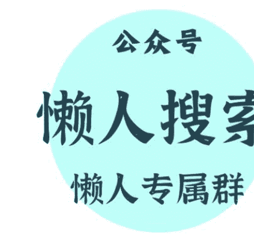
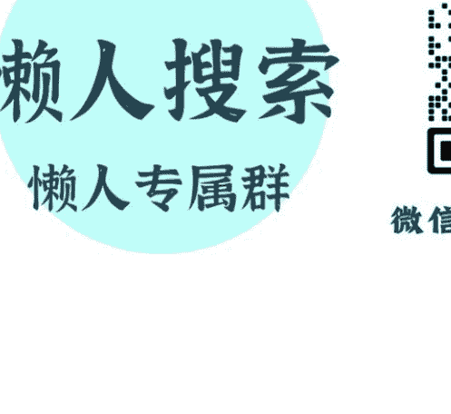

# 教育改革会出现哪些变化

260916 珍大户

整理：公众号懒人搜索，懒人专属群精选

懒人微信：lazyhelper1

> **小懒判断** | 家里有娃、正为学区房和选专业焦虑的值得看，单身或娃已上大学的可以划走。最值得记的是“盯住 200 所地方应用型本科”——本地产业绑定专业，就业比名校冷门专业实在。坑在于：作者只给方向不给时间表，“五年后学区房进历史”当参考听就行，别真拿它做买卖决策。

## 【帖子编号 1093】<教育改革会出现哪些变化>

写一下教育十五五规划，这是在十五五规划全文后单独出的一个文件。里面内容细细碎碎的，为了显得不凌乱，我决定用“从小到大”的顺序写好了。

- 1、幼儿园和小学人越来越少了，而大学则要开始扩招：

因为出生人口下降是最近几年出现的，所以目前才开始影响幼儿园，即将要影响小学。规划里说“错位达峰”，意思是幼儿园已经过峰值，开始拐点向下了，而小学马上要达峰。

但大学还在人数向上增长的过程，离达峰还早，所以大学…又要开始扩招了（本科越来越不值钱 ing）

- 2、幼儿园阶段的变化：

公立越来越多，覆盖年龄越来越广，免费覆盖率越来越高。对人口减少，幼儿园的对策是向下招收，先开始招收 2-3 岁的，我估计过几年应该要继续开始收 1-2 岁的了。

但注意，规划里写“大力发展公办幼儿园，提高公办园学位占比”、供给端，公办供给更加加大，需求端，新生儿数量在减少。意味着民办幼儿园是要开始死一批的，纯纯大逃杀游戏。

现在在民办幼儿园当幼师的朋友，你们要注意，早考教师资格证，早找公立幼儿园的工作，否则饭碗容易有问题。

- 3、小学中学阶段的第一个变化：

是“结合实际有序推进小班化教学。”所以也意味着，教师饭碗还是挺铁的，不是什么大问题。

另外结合规划里，从小学就要开始引入 AI 教育（后面详细说），叠加每个老师平均带的孩子数量在减少，应该意味着对每个孩子能更加个性化培养，从前的大班流水线模式会有渐进式的改变。

- 4、小学中学阶段第二个变化：

“中小学生每天综合体育活动时间不低于 2 小时。”“每个学生至少掌握 1 项体育技能。”——体育系毕业生迎来最好就业时期。赶快去考铁饭碗。然后因为中小学生开始普及体育，这等于是培养土壤的问题。那么随后体育产业、乃至体育竞赛的土壤都越来越厚了。

- 5、小学中学阶段第三个变化：

“配齐配强学校心理健康教育教师；”+“全国学生心理健康监测预警系统；”+“学校全员育心。”跟上面体育那条加一起，其实能看出来，背景信息是目前中小学生出现心理问题的比例越来越高了。

所以这里，增设的不是心理课堂，而是监测预警系统，逐渐接入教育治理的数据系统。后续肯定会有一些对学校的 KPI 考核的，专门针对学生心理健康率，然后未来五年里，心理专业的学生，会有一波就业小高峰。

在这块，我还得对家长补充一点心理按摩：国家开始强调体育（身体健康）+心理健康，如果后续依然是分数导向，那肯定还是有家长宁愿放弃孩子的身体和心理也要提升成绩。

所以，明面是开始重视身心，暗线其实还有一条，就是后续分数没有那么重要了，后面讲到中考和高考时我会继续提这条暗线，一方面是大学还在扩招，学历会越来越没用，另一方面是 AI 时代，很多需求都必须变了，考高分确实没用。多思考一下，未来 AI 时代到底什么才有用吧。

- 6、中考阶段的变化：

“扩大优质高中招生指标到校比例；”、“均衡派位；”、“登记入学；”、“高中阶段多元录取”——这意味着，“中考”这件事开始变得越来越多元化，不再仅凭中考分数选高中。

而因为学区房往往对应的幼升小、小升初，因为为了上好大学必须上好高中，而原来好高中是要靠中考分数的。

所以为了中考不被分流，甚至考更高分、上好高中，就必须先上好小学和好初中。

这就是曾经学区房价值的来源。

所以，中考改革，影响最大的，就是学区房肯定是要没了。我估计五年之后学区房的概念应该也快进历史了。

- 7、高中阶段的一个变化：普高职高的划分模式，要有改革了。

以前，旧的方向，要么读普高，要么读职高。甚至还有中考分流的政策，进了职高基本上无缘大学了。

现在十五五规划里对高中的设计，一是要搞普职融通，没那么强的界限了，二是要新增两个品类，分别是综合高中、科学高中。科学高中，大概是要有点提前选拔科技好苗子的意思，可能更针对那种很偏科的人才的提前培养，后续更可能有定向送入大学，可能就不走高考路线了。

综合高中不知道是什么意思。然后职高/普高，后续都能参加高考，并且在大学阶段也增加了设计，开始增加职业本科和职业硕士。就是职高毕业后，不一定直接工作，也不是非得只能上大专，可能又新开一条职高——职本——职硕的路线，针对的可能是高技能的纯操作类的工程师，大概类比为去焊火箭的工人？

- 8、高中阶段第二个变化：高中可能要渐进式普及，因为规划里写的“探索延长义务教育年限。”

“扩大普通高中办学资源、增加普通高中学位供给。”5 年后大概率人人都有高中学历了。

- 9、大学阶段第一个变化：大学的专业，会快速新增、快速取消。

规划里写的：高校可以“超常规布局急需学科专业”+缩短专业调整周期；+优化传统专业；+就业状况与招生计划联动；+实行毕业生就业红黄牌提示制度。

所以后面可能会有很尴尬的情况：入学的时候还在读的专业，到自己毕业时候成最后一届，毕业后就被取消了…所以还是那句话，大学的 ROI（投资收益率）在下降，并且投资失败的风险也在上升。

毕业后找不到工作也是很高的概率。而专业快速变化的方向，其实是跟产业相挂钩的，产业需要什么专业，大学就新增一条该专业的“生产线”，去批量生产什么专业的人才，产业不再需求，大学就得关“生产线”。

这对家长的难度就大了，你必须带着一点前瞻性的投资眼光，才能防止 N 年后自己家孩子读的专业是被淘汰、被取消的专业。

- 10、大学阶段第二个变化：专业分布上会开始调整“双一流”高校本科招生增加 10 万人以上；“扩大理工农医优质本科招生”“扩大研究生培养规模；”“新建若干新型研究型大学；”“提高研究生教育层次占比。”

——理工农医…文科生啊国家用不太上你们…但跟规划里其他的内容再联系一下，反正意思还是，学校教育要跟产业更强的关联起来。学校生产的学生，应该是产业的“原材料”。

另外，大家要重视交叉学科。可能不管什么学科都要跟AI结合起来了。

- 11、大学阶段第三个变化：高中低档大学的体系，要被重新设计。

重评一轮“双一流”——定位可能是负责基础科研类的学校。然后应用型本科评“双优”，——定位可能是负责产业技术和应用的学校。

然后职业本科评“新双高”——定位可能是培养技能人才（高科技技工、类比为焊火箭的）用这种体系代替原有的985、211、一本、二本的体系。整体设计思路针对的还是实用性。

- 12、大学阶段第四个变化：“推广项目制育人。”

就是推着学生走，不能在教室待着，要多去实验室、企业、科研项目、工程项目、创业项目里，学校教育和社会教育的界限要变薄一些吧。

- 13、研究生阶段的变化：“学术学位和专业学位分类选拔、分类培养、分类评价”+“专业学位研究生可以用实践成果申请学位”。

专业学位的研究生，可以不用写论文了[ 呲牙 ]听起来好像挺爽的。

- 14、全阶段的变化：“推进人工智能全学段教育。”

全学段，意味着根本不是到了大学读了计算机系后才开始学 AI，而是从小学开始。但问题来了，小学生能学什么 AI？

大家想过吗？答案可能就在另一句话里：人工智能+教育，要推动“培养模式、考试考核、科研范式和治理机制深层次变革”。注意：考试考核。

关键的问题其实就是：现在 AI 能在几秒钟之内解数学题，写作文，写代码，翻译英语，分析历史材料，让 AI 去考试，绝对比大部分学生考试分数都更高。

如果 AI 什么题都会做，我们还能教孩子答题有什么意义？花 12 年时间，每天做题，背知识点，记标准答案，训练自己更快、更准确，有什么意义吗？

所以，这才是 AI 对教育真正可怕的冲击。因为后面的时代变了。如果能被标准化，那么 AI 一定做的比人更好。凡是规则明确的，答案确定的，大量重复的，可以被数据训练的，AI 一定是比人更快。

所以家长也想清楚一点吧。会背、听话的孩子不是好孩子，以后脑洞大的、爱问为什么的孩子才更适应未来的社会。因为当 AI 被大规模应用之后，真正需要的是这样的人：能够给 AI 提出好问题和好任务的（意味着这个孩子必须有很强的自我、自己不延迟满足、自己不亏待自己、不委屈自己、不自我牺牲、有欲望和需求——这种孩子上个时代很容易落后和被淘汰，但下个时代则更容易脱颖而出）能判断 AI 靠谱不靠谱的（意味着这个孩子必须有大量跨学科的知识，不一定多专精，但知识储备库很大，同时不盲从、不迷信、具有怀疑精神、探索欲望、求证欲望）能产生更多脑洞、具有创造力（意味着这个孩子有好奇心、好玩、爱玩…）以及最重要的——责任感。

所以 AI 时代，从教育理念到教育系统，都需要有很漫长很巨大的革新，甚至把上个时代的理念和经验全部推翻掉。大家要学着，早点适应未来吧。

风险提示：市场有风险，投资需谨慎

## 【帖子编号 1094】<教育改革补充>

感觉还有不少遗漏，小补充一下：

- 一是中考没那么重要了，家长放轻松一点。因为毕竟又加体育、又加心理，又加 AI 的，说明要考的内容会越来越广，然后中考又搞一堆各种其他名额出来，加上高中要普及了。

- 所以中考的重要性肯定在下降。二是，高考恐怕也没那么重要了。纯本科含金量在下降，只有特定专业（好就业的）的含金量才在上升。

对能上名校的孩子们影响当然不大，但如果是普通家庭的孩子，我建议可以后续重点盯一下“应用型本科”。读金融。四年以后，合肥学院摇身一变变成合肥大学了，然后问了一下学校的就业情况，说只有新能源车专业是 100% 抢着就业的，都被江淮打包收走了，月薪一两万，不叫工人，都叫工程师，专业盯智能工厂的生产线，做线下运维之类的工作。

所以，应用型本科到底是怎么回事，我推断是这样的：

- 1、肯定是地方院校。

不可能是隶属于教育部的（这一类更可能是科研型大学，而不是应用型大学）

- 2、必须跟当地产业相结合的，一定是本地院校围绕本地产业。

比如，一个城市的产业是新能源车产业，那么围绕的专业一定是机械；电气；自动化；材料；电池；软件；工业设计；供应链。如果一个地方是生物医药产业集群，那么专业大概率是生物工程；制药工程；医学检验；医疗器械；AI医疗。

普通人家的孩子，注意去盯这 200 所地方所属的“应用型本科”。

- 三、从上面逻辑再出发，我们会发现，后续学校和地方/城市的关系会很紧密，一个城市有产业集群了，然后就会有当地的应用型本科，然后有匹配的专业，再产生匹配的当地就业···所以城市地点上，注意结合十五五规划文件的解读，里面能看到珠三角重要性还蛮高的，可以关注一下当地的应用型本科。

但反过来，如果一个地方院校，跟当地产业没一点相关性，这就会很尴尬。举例来说，比如各地的“某某财税专科职业院校”、“某某广播电视学院”，它肯定跟产业没法挂钩上。这种就会越来越凉。

- 四、上篇遗漏一点：文件里说“办好少而精的中等职业学校。”

注意小而精，重点是——少！！！！意味着，中职院校要开始关停淘汰了。在其中工作的朋友们早做打算。

- 五、专业上，因为整个十五五教育规划里，明显就是以产业、实用为导向，所以以后大概率能常赢的专业，其实就是：数学/物理等基础学科、集成电路/电子信息、自动化/机器人、新材料、能源、生物医药、工程类、农业科技类…（以及一些新兴的交叉学科，或者引入 AI 升级过的学科）

风险提示：市场有风险，投资需谨慎

————分割线————

在这个 AI 能替你写代码、写文章的时代，基础技能正在迅速贬值。绝大多数人正被淹没在海量的免费垃圾信息里，陷入低效的体力内卷。

当“努力”不再是壁垒，人与人之间唯一的护城河，只剩下“信息过滤”的效率与“认知系统”的维度。

圈子已稳定运行 7 年。我们每天利用 Python 爬虫与大模型算力，过滤全网最顶级的政经内参和搞钱风向标，做你最冷酷的“外部大脑”。

如果你认同这种“重塑认知防线”的极客主义，欢迎围观我的个人情报智库：【懒人专属群】。

https://lazyso.com/insider/

认同信息过滤价值、想省下每天 3 小时无效阅读时间的读者，扫码加我微信（lazyhelper1）

