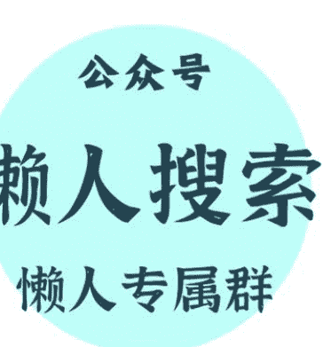
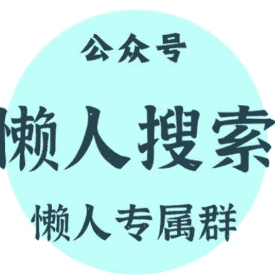

## 伪复利：为什么越学越多，却没有变强？

整理：公众号懒人搜索，懒人专属群精选
懒人微信：laxyhelperl

本文选自《深度思考日课》第47期，完整的课程在专属群内连载中。

我们之前讲了不同学科的复利，复利的各种因子，以及负复利；今天着重讲一个概念：伪复利。

然后再把伪复利和负复利合在一起，去观察不同的学科、理论、技能，你能看清晰很多东西。

伪复利是一种什么东西呢？它遍布在很多学科、很多领域里，它会让你主观上有进展感。——注意，不是“进展”，是“进展感”；

你有取得了进展的感觉，但这不是真正的进展？不是。如果是的话，那它就是复利。正因为不是，我们才说它是伪复利。看起来像复利，实际上没有。问题在于，真复利和伪复利，都会有进展感，你不能根据自己的感觉去区分它，所以我们要看客观。

在客观上，伪复利的结构率比较低，约等于零，但是折旧率往往不低。很多人用 AI，感觉自己强大很多了，但那只是你的感觉而已。真正去做判断，未必会更准确。

因此要看两点：结构率、折旧率。

举几个典型的例子。

- 一个是编程。有时候，对编程的学习可能变成收集框架和工具，你学第七个前端，不会比学第二个得到的东西更多，但你会感觉我又多学了一个。注意，我说的不是所有的编程。很多人编程，有人每年都会对编程理解得更深，有人前三年有进步，从第三年到第十年，虽然也学了新东西，但水平没啥变化，这就是编程里的伪复利。
- 另一个是投资。我仍然不是说所有关于投资的学习都是伪复利。但是在投资学习里面，收集各种指标和策略，每天看财经新闻，可能会包含比较多的伪复利。这么说，不知道是不是又要得罪人了，因为我们得到同学里关注财经新闻的可能不少。其实我自己也看。我不是建议你不要看财经新闻，而是想让你明白，追新闻是一种消费，不是关于投资的学习。为什么呢？因为财经新闻的折旧率很高，不仅财经新闻，几乎所有新闻的折旧率都高，但财经新闻可能是最典型的。尤其是每天股价的涨跌。除了折旧率高，还有个特点是，财经新闻的结构率几乎为零。就像我们喝奶茶、喝酒，吃反式脂肪酸，可以吃喝，但要知道这是为了快乐，不能告诉自己“我这是为了健康”。

还有文献综述——我扒拉扒拉这个话题下哪些人都干过什么事，但我扒拉这些是想干什么？不知道。这也是伪复利。以及，追踪新方法、新工具，但是不做实质性工作。最典型的，是AI新工具层出不穷，每个工具出来都想用，但是，用它来解决什么问题？不知道。只能让它“给我写个小说”“给我做个网页”，你本来有没有写小说、做网页的需求呢？没有。那么，你也不可能掌握它到很深的程度。因为它不面向实质性问题。

在语言学习里，如果永远都是新语言的初级学习者，像集邮那样多学几种语言，但是工作也用不上，生活也用不上，也学得不深，就是想有一种“我又多会一门语言”的感觉，这里面伪复利的成分也很大。在健康领域，收集各种小知识、小妙招，各种养生帖子。在哲学领域，收集立场和标签，“我是某某主义”之类的。在历史领域，了解名人轶事、历史掌故，以及背大事年代……其中伪复利的比例很高。

为什么这么讲？两个指标：结构率、折旧率。结构率低到几乎是零，你每学一个东西，边际成本不会降低，你学十年了，去记住一个历史人名，跟第一天学的人记住那个人名花的时间是一样的。这就是结构率低。你记住今天的股价，但这个股价对明天来讲没有用。假如你一个月后卖掉一只股票，在这期间你看 100 次股价，和你看一次，最大的差别是看 100 次让你消耗了更多时间和情绪，它并没有让你加深对这家公司的理解，也不能提高你的投资水平。因为那些信息的折旧率非常高。

现在，我们来看覆盖面最广的伪复利——消费型学习：听播客、看视频、翻通俗读物、浏览摘要。这些行为里，伪复利的成分比较大，或者说，它们是伪复利的高发地带。原因不是这些内容浅，内容不一定浅。关键是，这些行为容易给你制造一种廉价的理解感。

“理解感”是可以廉价获得的，“理解”不可以。

有同学给我反馈说，这门课有些地方听不懂。我说，我努力用大白话表达。但就算我努力，可能还是要保留相当的摩擦。因为如果没有摩擦、太顺滑的话，它的生产工艺就变了——变成优化“听懂了”的感受。恰恰是那种优化，会让某些认知资产流失掉。

再来说一个典型，是做笔记。会做笔记、用笔记的人，笔记可以产生复利；不会做不会用的人，笔记容易产生伪复利。

十多年前，我有个表弟去我家，晚上抄课文，那时候他上高中，抄的是《前赤壁赋》。我说，抄这些干什么？是老师布置的作业吗？他说不是，是他妈让他学习，他就抄课文。这就是典型的伪复利。抄一遍没有增加他对课文的任何理解，只是在耗时间。——我这么说可能会有点武断，但我知道他那个状态，他不是抄得很嗨的那种，他就是机械地抄。不知道该怎么学，干脆抄一遍，也能告诉自己，我在学习了。

如果你真的对《前赤壁赋》有感觉，你可能是在散步的时候想到它，脑子里一句一句唾摸、回味。有人做笔记是为了做笔记，为了让笔记堆很多，显得学富五车的样子。这是一种外置存储。外置存储不会产生结构。

堆积笔记是收集，重写笔记才是压缩。

如果你的笔记只增加，不减少，不修改，它就是一个仓库，不是你的结构。

那么，怎样识别伪复利呢？

六个测试。

1. **压缩**
学一样东西一年之后，你能不能用更少的活把问题讲清楚？一年前十句话才说明白的事，现在一句话说到点子上，这是真复利。

2. **预测**
你的存量能不能让你对没见过的东西做出判断？能，有结构；不能，是清单。

3. **删除**
如果随机忘掉这些知识的一半，你能不能重建它？如果有结构，你可以重建。如果只是清单，就重建不了。

4. **难度**
高结构率的标志是越学越快。学第 100 个知识点比学第 10 个快得多。如果每学一个都是同等费劲，那就没结构。

5. **迁移**
换一个平台，换一个领域，你还能不能把那种想法和见解讲出来？这跟外溢性相关。结构率越高，外溢性通常也越高。

6. **教学**
面对一个聪明的外行，你能不能引导他自己往下走？如果有结构，你一指方向，他自己就能慢慢摸到窍门。没结构的话，光指方向是不行的。

另外，越是有结构的东西，天赋在不同人的差别上表现得越明显。如果没结构，大家表现差不了很多，跟花的时间关系比较大。所以，在有结构的领域，如果你够资深，你的眼睛看人会越看越准，谁是这块料，谁不是这块料，你会一年比一年看得清。

现在，我们来说说伪复利和负复利的不同。

伪复利是零增长，负复利是反向增长。

伪复利的成本主要是机会成本，也就是说，用集邮的方式学东西，主要是在浪费时间。但负复利不是，负复利最大的成本是清除成本。就像一块空地，在上面折腾三年啥也没盖，这是伪复利；但是你盖了一栋有问题的楼，还得把它拆掉，盖得越高就越难拆，这是负复利。

退出难度也不一样。

伪复利没有沉没结构，说放下也就放下了。你学了第七门外语，第三门以后都是半懂不懂，哪天说不学，也就不学了。把你收集的各种框架放下，什么也不会塌。但是，

负复利有承重结构，它和你的身份绑在一起，你要放下的话，等于把自己的一部分拆掉。

伪复利比较多地出现在低结构率、高折旧率的领域，很多是流行内容、消费内容，和昙花一现的工具。而负复利比较多地出现在高结构率、低验证的领域，是理论、诠释、宏观体系。这就导致一种结果，伪复利高的人不容易负复利，负复利高的人不容易伪复利。

我们之前说过，从主观感受上，不容易区分真复利和伪复利，因为都会有获得感。但是，主观感受上，可以区分伪复利和负复利。伪复利的感受是，我很忙，天天都在学习，但好像没有变得更强。而负复利的感受是，我变得越来越强，越来越确定，越来越通透。伪复利和负复利，在感受上，都和真复利不好区分，但它们之间，反而相对好区分一点。

不过，这里面有一个危险，就是从伪复利到负复利，有个快速通道，比从伪复利到真复利更近。

因为，你只需要提高结构率——也就是，学得更系统、建立框架、把零散的东西串起来，你就会远离伪复利；但这种远离，到底是走向真复利，还是负复利，取决于你有没有验证。

有验证，你会抵达真复利；没有验证，就跑到负复利那儿了。

也就是说，“学得更系统”，不天然是好的，

你得问：这个系统是不是对的？怎么能证明它不对？注意，不是怎么证明它对，是怎么证明它不对。如果你不知道，那很危险。

负复利的折旧率是很低的，它不会自己过期。高折旧率的错误会自己死掉，但是低折旧率的错误，不仅不会自己死掉，甚至还能活成一个学派。为什么有人相信迷信而且越信越顽固，什么证据都改变不了他的看法？那是典型的负复利，不是伪复利。低折旧率在正确的东西上是资产，在错误的东西上是诅咒。

## 总结一下这一讲的主要内容：

1. 伪复利会制造持续进步的感觉，它的结构率很低、折旧率很高。
2. 伪复利和负复利的区别在于：伪复利没有形成有效结构，主要损失是时间和机会；负复利形成了错误而牢固的结构，清除它需要拆掉已经与身份、经验和世界观结合在一起的东西。
3. 从伪复利走出来，不一定会走向真复利。提高结构率、建立系统，只能让知识变得更牢固；它最终成为资产还是诅咒，取决于这个系统能不能接受验证。

## 思考题

当你的判断和绝大多数人都不一样的时候，你对自己的判断有多大的信心？你觉得自己是因为知道得多才形成这种判断，还是因为知道得深？哪些证据出现，可以证明你的判断是错的？那种证据真出现的时候，你会放弃之前的判断吗？

欢迎在留言区分享你的思考，我们一起交流。也欢迎你这篇文章分享给你身边爱思考的朋友。

我是王路，我们下一讲再见。

***

在这个AI能替写代码、写文章的时代，基础技能正在迅速贬值。绝大多数人正被淹没在海量的免费垃圾信息里，陷入低效的体力内卷。

当“努力”不再是壁垒，人与人之间唯一的护城河，只剩下“信息过滤”的效率与“认知系统”的维度。

圈子已稳定运行7年。我们每天利用Python爬虫与大模型算力，过滤全网最顶级的政经内参和搞钱风向标，做你最冷酷的“外部大脑”。

如果你认同这种“重塑认知防线”的极客主义，欢迎围观我的个人情报智库：【懒人专属群】。

https://lazyso.com/insider/

认同信息过滤价值、想省下每天 3 小时无效阅读时间的读者，扫码加我微信（lazyhelper1）

