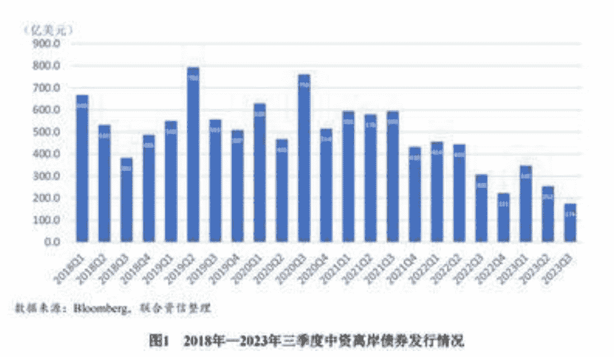
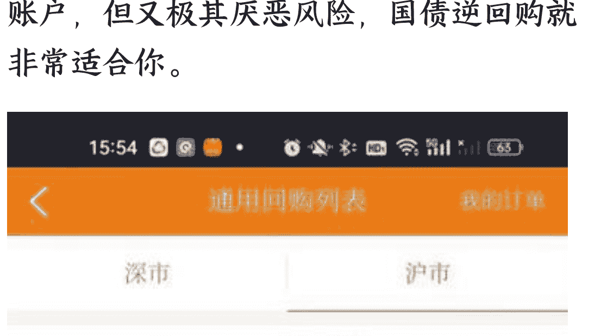
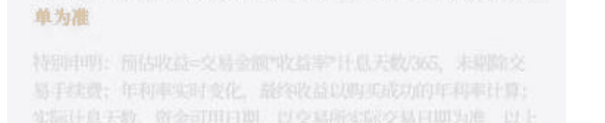

# 美联储加息，普通人该做点什么？

260918 文/卢克文工作室 暴躁萌妹
整理：公众号懒人搜索，懒人专属群精选
懒人微信：lazyhelper1

小懒判断｜手上有闲钱、正纠结存款买房还是进股市的，看完能少踩不少坑；指望抄个股搏一把的别看，这文反复强调不杠杆不碰个股。最值得关注国债逆回购，有证券账户又怕风险的人，1天期年化约1.39%，比余额宝高一截。坑在美债QDII，人民币升值7%全变汇率损失，费用还比国内债基贵一倍，别看历史走势漂亮就冲。

北京时间2026年9月17日凌晨，美联储全票通过加息25个基点，三年来首次加息，终于还是落地了。

对于我们普通人来说，美联储加息绝不是和自己无关的事，它会直接影响甚至扭转全球资本的流动和定价，不管你是买理财固收，还是炒股买房，还是贷款创业，都会深受影响。

如果完全无视宏观风险，只知道埋头努力，轻则损失财产，重则血本无归。

举个例子，2022年美联储开启加息周期，因为你不知道北向资金将从高估值股票回流至高息美债，继续买入当时还在高位的科创50、创业板指数、中证消费或中证医药指数，你将稀里糊涂地亏损三年，本金或已腰斩。

再比如，2022 年你买了房，情况可能同样如此，甚至你买的房子还可能烂尾。

因为加息迫使全球央行为了遏制资本外流，跟随加息，结果拉爆中资企业的海外债务，导致它们无法再借新还旧。

当年中资企业的离岸债 90% 是美元债，借债三大主体又是地产、城投和金融，在国内房地产需求萎缩的情况下，海外债违约成为压死地产企业的最后一根稻草，其中一家就是恒大。

当然，这次的情况和 2022 年有所不同，所以需要重新判断趋势和机会，具体问题具体分析。

对于后续利率走势，高盛、摩根、花旗等大行的观点在互相打架。但总体来看，中东局势一日不解决，加息风险就一日不能得到排除。

所以相当一段时间内，我们会面临一个加息尚未完全落地、但加息预期来回反复的时期。在这样的阶段，普通人可以干点啥呢？

我们先说买房。

这次和 2022 年有一个很大的不同，中国早就做了防守，资产泡沫已经被充分挤掉，尤其是房地产，目前来看已经实现了软着陆。

现在人民币汇率稳定走强，几乎不太可能出现国内资产价格暴跌这种情况，房地产市场很难发生宏观风险。

美联储加息，美国房贷利率飙升至 7%以上，我们会不会跟随加息脚步，导致房贷利率水涨船高呢？目前来看可能性不大。

2022-2023 那波加息周期，人民币全年贬值幅度达到 9%，当时中国都扛着压力，多次下调 MLF 与 LPR，保持货币宽松，更不要说现在人民币如此强势，中国在利率问题上只会更加“以我为主”。

结合现在内需疲软、通胀水平极低的经济基本面，以及 8 月份的央行 2026 年下半年工作会议，总基调仍然是继续实施好适度宽松的货币政策。

所以，不用过度担心短期宏观和利率风险，结合各自的城市、楼盘和家庭规划，该买买。关于房地产投资策略，我们近期已经推出一系列文章，大家可以再回顾一下。

再说银行存款。

上文提到，中国制定利率已经是“以我为主”，不管是提振内需，还是维持实体企业最需要的低借贷成本，都需要压制利率，即便上涨幅度也不大，所以不要对存款利率上升抱太大希望。

截至 2026 年 9 月，国有六大行的活期利率，普遍是 0.05%， 1 年期约 0.95%， 5 年期约 1.3%， 股份制银行可能要再高 5 个点左右。

当前存款利率的确太低，即便是大额存单也好不到哪里去。

如果普通家庭有一笔闲钱，觉得买房不划算或流动性差，就可以考虑理财投资。美联储加息受影响最大的就是二级市场，所以需要特别留意。

先说大逻辑，现在这个阶段，风控高于一切，除非你有自信能承受住 20-70% 的波动，否则应该减少股市配置，尽量多留现金，闲钱中的现金比例至少占 50% 以上。

现金这部分，其实也有低风险管理方法，我们按资产配置风险从低到高分析。

货币基金，大家平时用的余额宝、零钱通，其实就是货币基金，特点是风险和收益都最低，波动性极小，目前 7 日年化收益率大概是 0.8%， 几乎不受加息影响。

还有一个最简单、风险几乎为零的薅羊毛技巧，国债逆回购。

简单说就是你把钱借给机构，机构拿国债质押给交易所做担保，到期之后还本付息给你，一般是 1 天、2 天、3 天、4 天、7 天这类超短期为主。

以 9 月 17 日为例， 1 天期国债逆回购的年化收益率约 1.39%， 显著高于余额宝这类货币基金。

通常来说，1天期最划算。如果你有证券账户，但又极其厌恶风险，国债逆回购就非常适合你。

| 品种 | 年化收益率(%) | 每10万收益(未扣除手续费) | 资金可用 | 计息天数 |
|---|---|---|---|---|
| 1天期 | 1.390 | 11.42 | 09-18 | 3天 |
| 2天期 | 1.360 | 14.90 | 09-21 | 4天 |
| 3天期 | 1.360 | 14.90 | 09-21 | 4天 |
| 4天期 | 1.360 | 14.90 | 09-21 | 4天 |
| 7天期 | 1.445 | 39.59 | 09-24 | 10天 |
| 14天期 | 1.460 | 84.00 | 10-08 | 21天 |
| 28天期 | 1.460 | 112.00 | 10-15 | 28天 |
| 91天期 | 1.405 | 350.29 | 12-17 | 91天 |
| 182天期 | 1.395 | 695.59 | 03-18 | 182天 |

如果要追求更高收益，且可以承担极小的波动，可以考虑纯债基金。

纯债基金，可以理解为基金经理挑选打包了一堆债券组成的基金，取得它们收益的平均值。

纯债基金也分很多种，美联储加息，影响最大的是海外债QDII基金，这些基金主要持有美元债券，以美国国债和美国机构债为主，也可能持有中资美元债。

海外债QDII基金有巨大的坑。很多人以为，美联储加息，海外债收益就高了，那我是不是应该优先配置美债QDII基金么？

不是的，普通散户几乎不会也没有机会直接买美债并持有到期，都是在二级市场买随时可自由交易的美债衍生品，中间是会产生价格波动的。

如果市场预期美联储即将加息，意味着机构手里的美债就要贬值，所以机构会卖掉旧债券，导致债券价格下跌，你手里的美债QDII基金净值也会下跌！

请大家务必记住，在美联储加息预期下，债券市场是会下跌的，这对散户在二级市场交易美债是利空。

第二个风险是，在人民币升值趋势下，你去买美债QDII基金，除了承受加息风险，还要承受汇率风险。

人民币每较美元升值1%，你基金的最终收益率就要减1%。去年到现在人民币相较美元升值7%，你可以掂量一下汇率损失多么巨大，再加上QDII基金的管理费、托管费，通常比国内普通债券基金高一倍左右，通常要再在收益上减去1%。

当前情况下，建议大家谨慎考虑美债QDII基金，不要看它们历史走势还不错，就盲目跑去买。

查QDII底层资产的方法很简单，去证监会指定的披露平台“巨潮资讯网”，直接输入基金代码，在公告列表里筛选报告类型，可以在季度报告或中期报告中查看持仓。当然，一些炒股软件也可能显示前十大重仓债券。

当前配置债券基金的第二个原则，是买短不买长。

债券基金分长债和短债两种，在利率存在上行风险时，首先被抛弃的是长债，美债、欧债都是长债跌得最狠，短债还行，所以长债比短债波动大。

短债基金长期持有的年化收益率，大概在2%-3%，虽然不高，但也远超定期存款了。

怎么挑选债券基金呢？

大家买基金的时候，千万不要去软件上看基金排名，觉得靠前就能买，它过去的走势再好，也仅代表过去，不代表未来。

如果你没有选基金的软件，最简单的方法是打开天天基金网，在“投资工具”一栏，找到“基金筛选”，基金类型选“债券型”，基金公司选“不限”，基金规模选“小于100亿”（规模太大收益会边际下滑），机构评级选“五星”。

选中后，再核实基金底层资产，方法在上面介绍过了，去巨潮资讯网查一下，想偷懒让AI帮你干也行。

还有一类纯债基金需要注意，这就是可转债基金。

按照最基础的分散投资逻辑，债券是对冲股市风险的，但是，可转债这类基金可以从债券转到股票，因此和股市风险挂钩较多，不能完全用来对冲股市风险。

最后说说大家最关心的股市。

再次强调，这段时间小散最好不碰股市，不要对解套、抄底心存幻想，因为接下来的波动可能会相当大。如果具有基本的投资知识且能承担一定风险，你再看下去。

现在加息落地，美联储既没有释放更鹰派的信号，也没有市场期待的“加息+鸽派信号”，所以对股市影响比较中性，不算最烂，但也不算好。

A 股在经历一段时间的回调后，泡沫已经不大了，大部分老登股，甚至已经被挤得一滴都不剩了，再下跌空间也不大。

现在的情况是，从 5 月后，外资开始撤出 A 股，8 月又跑去炒韩股，场上留下的主要是国家队、公募、量化、散户。

既然外资主力部队已经撤离了，它还能掀起什么做空大 A 的波澜呢？

7 月证监会开会后，国家又着手收拾量化，所以量化也不敢明目张胆地割国家和散户的韭菜。

同时，市场已经提前交易了加息预期，利空已经出得差不多了。

除非后面再有巨大的黑天鹅，比如中国科技龙头的盈利出现断崖式下跌，否则资金面带来的风险还算可控。

实际上，现在中证 800 的 PB（市净率，估值核心指标之一），已经降到了年内冰点的 1.55 倍，如果把时间拉长到 2010 年，现在的估值还在中位数下方。

简单理解一下，A 股核心股票的综合估值，比过去 15 年一半以上的时间要低，但也没到极其便宜的地步。而且这个数据具有一定迷惑性，因为这里面有一些科技股，这部分科技股的估值仍然偏高，所以投资时需要记住几个原则。

绝不杠杆。

尽量不碰个股，定投中证 500ETF、沪深 300ETF 这些宽基指数基金，或者中证红利 ETF、现金流 ETF 这些高股息低估值标的，不但省心，风险收益也适中。

优化持仓结构。

按照历史经验，美联储加息，几乎都会通过压制美股科技股的形式，映射到 A 股板块，短期内 A 股科技要走出独立行情，是很难或不持久的。

所以科技板块可能还会经历震荡，高位进场的需要注意，超过止损位，就头也不回地认输离场。

重仓科技的，可以适度配一些红利、现金流这类抗跌的 ETF 基金，它们囊括了中国现金流最好、生意最稳定、分红最大方的一批上市公司，是老登股中相当具备价值投资属性的标的。

比如 2022-2024 加息周期中，中证红利（分红再投入方式计算）累计上涨 27.74%，年化收益率约 8.52%，同期沪深 300 跌了 20.35%，年化收益-7.31%。

其它老登股如消费建议谨慎观望，内需没有根本改善，消费短期内是起不来的。

第四，逢低配置黄金。

黄金的逻辑，我们之前已经写文章分析过了。

虽然短期内黄金怕强势美元，但现在多了一个变量：中东出事了，沙特被胡塞打得很惨，美国根本不敢帮忙。

美国无法给盟友提供安全庇护，姑且不论沙特会不会立刻翻脸，当下的问题是，沙特的石油出口通道被封死，它就不能通过卖石油挣到美元，那么，它哪里来的钱去买美债？

所以石油美元出了非常严重的问题，黄金就会迎来布局机会。

无论是中东还是各国央行，增持黄金的大趋势不会变，有全球央行购金需求托底，即便黄金短期震荡，长期还是看多。

所以可以继续定投黄金，但不要梭哈，一定要有计划地通过定投拉平波动。

总之，这次中国早已提前布局，做了很多防御工作。国家为中国资产兜底，普通人通过加强风控和优化资产配置，也能平稳度过这轮加息周期，守护好自己的钱袋子。

最后再次声明，以上观点不构成任何投资建议。

————————————————分割线————————————————

绝大多数人只盯着眼前的工资，却不知道一次远在中东的冲突、一次降息的决议，就能在一夜之间洗牌普通人的财富。

看懂宏观，是为了在周期切换时，不被当作代价。

如果你认同这种“抬头看路”的长期主义，欢迎围观我的个人情报智库：【懒人专属群】。

圈子已稳定运行 7 年。我们每天利用 Python 爬虫与大模型算力，过滤全网最顶级的政经内参和搞钱风向标，做你最冷酷的“外部大脑”。

[https://lazys​o.com/insider/](https://lazys​o.com/insider/)

认同价值的。扫码加我微信，备注：【进群】

