# 专注用 AI 做小红书虚拟资料 K12 教学课件，摸索试错半年后我做到月入 2 万 + 实操复盘

- 260921 副业 SC 精华
- 整理：公众号懒人搜索，**懒人专属群**精选
- 懒人微信：lazyhelper1

**小懒判断** | 适合有稳定工作想用 AI 做虚拟资料副业的人，不适合追求短期暴利或没教学经验的人。最值得关注的是作者把课件制作拆成 7 步工作台，skill 嵌入解决记不住名称的痛点，从文档生产到 canva 分层全自动，暑假高峰日入千元。坑在于这波收益有暑假时间红利，开学后需求必然下降，没 K12 教学经验的人光抄工具做不出合格课件。

### 一. 自我介绍

大家好，我是新手老白，今年 45 岁，小城市体制内，20 多年拿着微薄的工资，养家糊口很不容易。做过几年实体店小买卖，没赚多少，近几年不景气，早就停掉了。然而，一眼望到头的日子让人很是疲惫，总不甘心。

其实我一直有点犹豫值不值得分享。

一方面，这个项目确实跑出了一些结果；另一方面，从 3 月份真正开始全力做虚拟产品，到现在也就半年左右，远远谈不上什么“成功经验”。

很多东西我自己还在边做边调整。

所以这篇不是什么“项目教程”，更不想告诉大家照着做就一定能赚多少钱。

我只是想把这两个月自己真实做过的事情整理出来：

这半年里的几次转折，以及我怎样用 AI 把反复发生的课件制作工作整理成一套可以持续使用的流程。

如果你也在做虚拟资料，或者正在研究怎么把 AI 真正放进自己的工作里，希望能提供一点参考。

前面是一些碎言碎语，无感请跳过！

### 二、项目现状

去年 11 月，我第一次在小红书尝试做虚拟资料，先开过几个杂货店，几乎都没有跑起来。

后来我把一个新店转向英语课件，9.9 元一份，12 月卖了 200 多单，收入 3000 多元。平台政策变化后，我停过一段时间。

3 月重新开始时，我从女儿正在学习的三年级语文课件入手，基本上能在老师上到某篇课文之前做出来。

这段时间做得比较慢，这几个月，我也不光是埋头做课件，通过这段时间，我逐步摸清了，从制作到上架出售再到发布运营的一整道工序，也整理出了适合自己一套工作流。

今年暑假，继续做四年级上册以及其他年级的课件，慢慢把教案、逐字稿、PPT、上架和笔记发布整理成自己的工作台。

每天很多时间都用在优化环节上，逐步打造出了现在这套 PPT 工作台（虽然离完美还很远）。

当然，现在回头看，第一版做出的课件其实挺粗的。

后面无论内容、结构还是页面，我都重新修整过很多次。

到 8 月初，小学阶段课件基本完成。8 月中旬开始，每天基本都大约有 1000 元收入。

这个结果如果放在 6 月份，我自己其实都想不到。

这里主要是一个主号的数据，还有另外三个店，是 8 月下旬开始同步铺开，慢慢发笔记，收益只在 500-1500 左右，就不发图了。

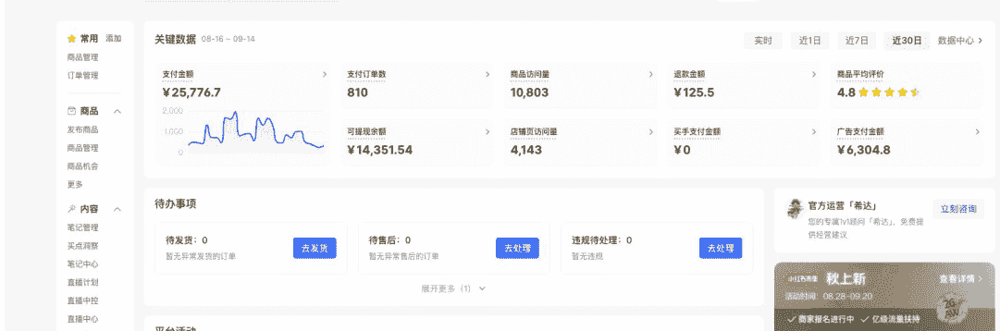

最近降了一些，每天 500 左右，把投流停了，想单独试一下自然流。

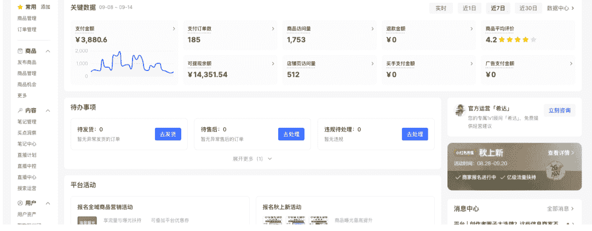

### 这里简单说一下我是怎么投流的

一开始我只是简单把投流这件事理解成买彩票，总觉得不划算，在简单投里面每天花个几十块钱就不敢再花了。

后来研究了几天千帆后台的乘风推广，尝试着设置了一些人群、roi 等等的一些参数，感觉好像是起了一些效果。7 日 roi 能在 2.5 左右，至少投了不亏了。用了 10 多天每日花费 300 左右，带来的收益在 6-800，相当于这一块能赚 400 左右，后面停掉，一方面是为了测一下不投流时的效果，再一个是考虑到不想靠投流把销量推得太虚高，反而被同行盯上（不知道是不是多余的担心□），停掉以后最近的销售额是降了一些，不过实际上除掉投流获得的收益外，自然流并没有受到影响，所以我觉得，投不投流好像对自然流影响不大，应该就是为了扩大总收益。

不论怎样，对我来说，这至少验证了一件事情：

> 这个课件需求是真实存在的，还有就是回报也来源于积累

当然，我并不觉得是自己做得咋好了。

时间点其实非常重要。

暑假本来就是老师准备新学期、集中找教案和课件的时候，我正好赶上了需求比较集中的阶段。

所以这里面既有产品和效率的原因，也有明显的时间红利。

如果脱离这个时间节点，只拿“每天多少”出来讲，我觉得反而没有太大意义。

而且开学以后，需求会不会下降、下降多少，都还需要继续观察。

所以相比收益，我现在更看重另外一个结果：

这两个月，我把一套原来非常零散的课件制作过程，慢慢跑成了一套相对完整的工作流。这才是我现在最想分享的部分。

### 三、PPT 工作台流程详解

从这里开始，不说废话了，目前我是根据自己实际业务中的每一步流程，做出了一个 PPT 工作台，我感觉是目前对于自己来说，是最丝滑的流程，涵盖了从制作到运营的每一步。一次配置好，后面傻瓜式操作。

我直接从工作台的每个板块逐个介绍，基本就是这个项目的每个细致流程，不足之处请批评指正。

#### 1. 文档生产

就是先产出教案大纲逐字稿（基本三件套）

我把制作三件套的 skill 嵌入到工作台，这样有个好处，我不用每次都打开 ai 对话窗口，让它调用某个 skill 执行某个任务，因为我总记不得 skill 名称。这里已经固定好了 skill，我只需要输入要处理某篇课文的路径，输入“制作这篇课文的交付内容”，下面可以选择用 workbuddy 或者 codex 来执行，然后一段命令提示词就会出现在自动打开的 ai 对话窗口，我敲个回车，等待

任务执行完毕，这些文档就会出现在我指定的路径中。这里会根据我预先做好的 skill 指令，自动分析教材，分析参考资料，交付给我三件套的成品。

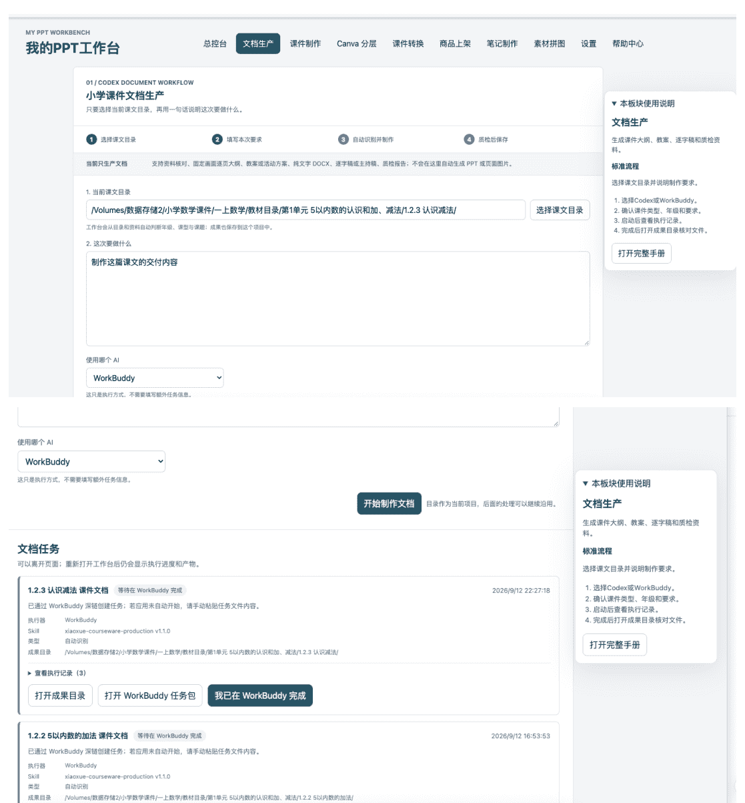

#### 2. 课件制作

同样也是傻瓜操作，我只需要选择大纲的上传路径，在发送设置里选择课件需要保存的输出路径，就可以自动开始制作，这里可以说一下，我设置了三种选择方式，一是通过网页版 ghatgpt 来制作，好处是不费多余的 token，风险在于制作过于频繁的话会有风控的风险，不过目前观察下来不会涉及到封号，只是被暂停访问，风控时间过了还可以继续使用，制作量少的时候我把并发数调为 1，就不会多个窗口同时工作。（图 1 可以看到·1）

还可以选择交给 codex 制作，以及使用 API 制作。这两种都高效，就是费 token 一些。

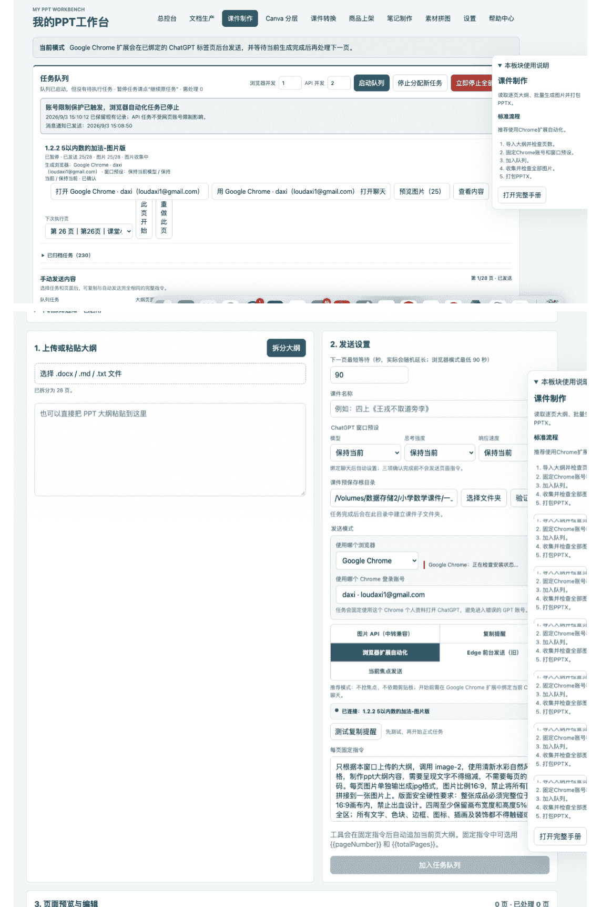

#### 3. 课件转换

这一步主要是把图片版的 PPT 转换为文字可编辑版本，这里我没有使用 wps 的转换功能，因为容易出现错字，也很容易把背景上的一些图片转换得很糊，反而后面不好修改。

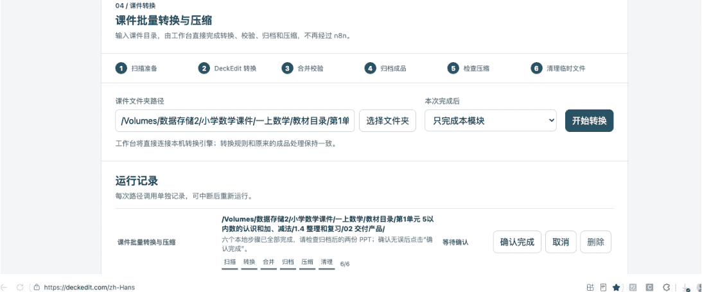

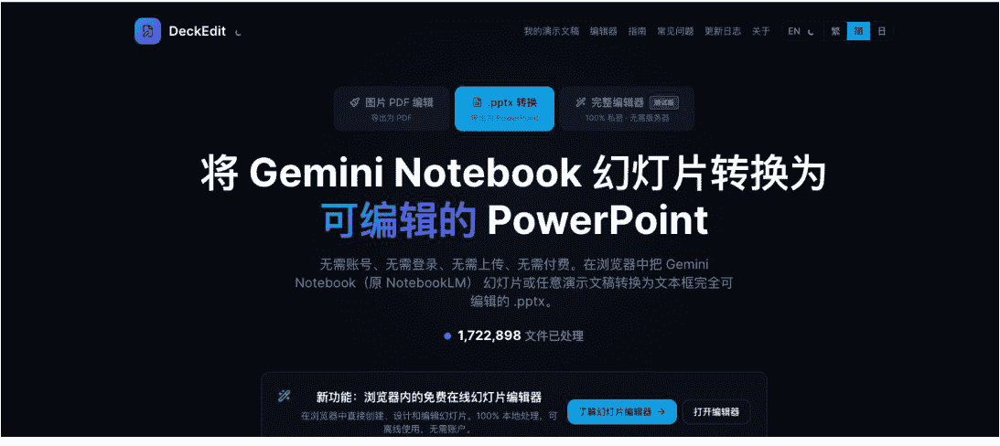

把上一步制作好的图片版 ppt 路径填入，直接点开始转换，自动打开转换工具网页，https://deckedit.com/zh-Hans，并根据要求，分割页面数，压缩文件大小（每份文件不能超 15 页小于 30M）。逐个转换后自动合并成一份新的 PPT，自动命名为待编辑的名称。

到这里就可以选择直接上架商品，或是继续下一步精细化的制作。

我是先上架商品，直接开卖，然后再同时进行人工修整，加动画，调整细节。

至于精细化制作就要使用到 canva 的 ai 图层功能，这里后面再细说，我先把上架和制作笔记的流程介绍一下。

#### 4. 上架商品

这一步主要是为多 sku 准备的，如果是单个课件，就没必要走这步。

在这里打开新品采集扩展

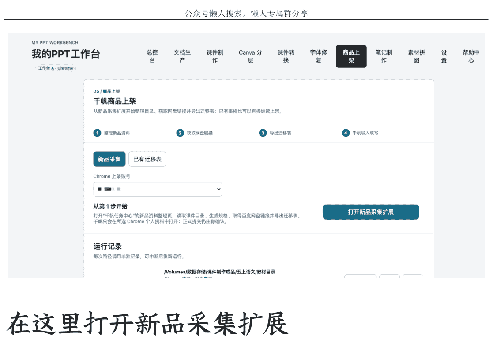

选择本地完整读取资料，会弹出本地文件夹，选择资料存放的根目录，自动读取根目录下所有文件夹，以及子文件夹（这里是以课件名称命名，我会先把整个目录结构复制一份到百度网盘，确保目录结构一致），读取完以后下面就会出现读取后的结果。

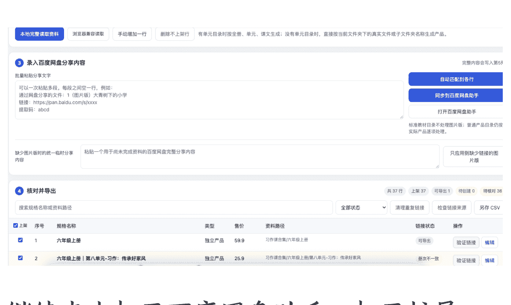

继续点击打开百度网盘助手，打开扩展。进入存放资料的根目录，设当前页为主目录，测试一条没问题后，从断点继续，就会自动根据你的目录结构，每份资料存放的路径读取分享链接，自动填入上一步的链接状态里面。

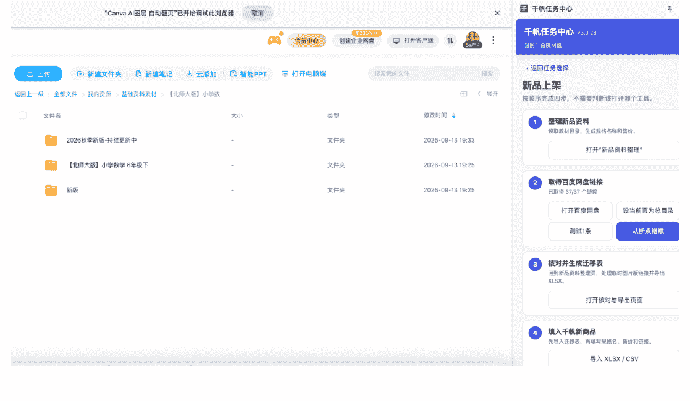

导出 xlsx

这时就可以打开千帆商家后台，新建商品了，这一步最重要的是解放双手，不用一个个填写规格名称，链接等。当然商品主图，详情说明，售价这些还是自己填一下，也可以批量填写的。

规格少的时候感觉不出来，如果规格很多，特别是多个店铺需要填写相同信息的时候，帮助就特别大。

#### 5. 笔记制作

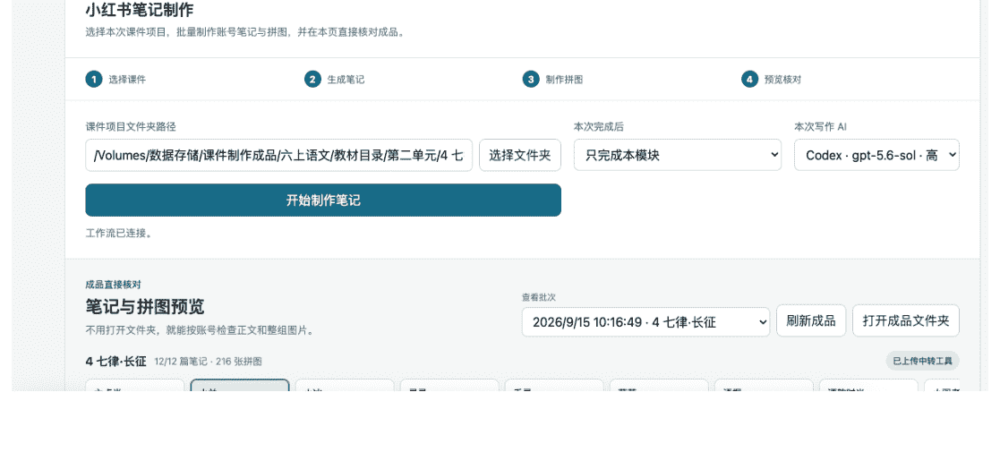

我的 PPT 工作台

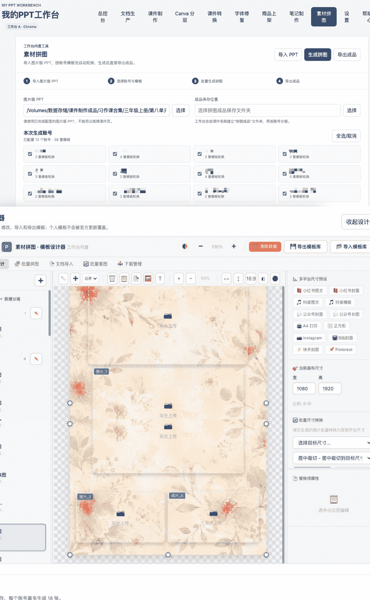

这一步就更简单了，选择需要制作笔记的某个课件，甚至某个单元批量制作，可以选择使用 codex 来执行或者其他 ai 来执行，目前是用的是 codex 和 workbuddy。codex 没额度了就切换。

笔记完成后自动进入到拼图制作流程，后台调用拼图工具，上传 PPT，自动按照 PPT 页面进行拼图，每个账号对应不同的模板，可以自行添加，修改模板，步骤是自动写笔记，自动调用拼图工具生成拼图，将笔记和拼图上传到我的素材中转网站，因为不敢直接自动化发笔记，所以做了中转网站，专门按账号存放我的素材，每个账号都有专门的入口，提取对应的素材，一键复制和下载图片，打开小红书粘贴就发布，这样比较安全。

**运行记录**

| 任务 | 描述 | 状态 | 操作 |
| :--- | :--- | :--- | :--- |
| 小红书笔记制作 | /Volumes/...上长征/素材目录/第二单元 七律·长征/ | 等待确认 | 查看成品, 确认完成, 取消, 删除 |
| 小红书笔记制作 | /Volumes/...上长征/素材目录/第三单元 汉祖祖/ | 等待确认 | 查看成品, 确认完成, 取消, 删除 |
| 小红书笔记制作 | /Volumes/...上长征/素材目录/第四单元 汉祖祖/ | 等待确认 | 查看成品, 确认完成, 取消, 删除 |
| 小红书笔记制作 | /Volumes/...上长征/素材目录/第四单元 汉祖祖/ | 等待确认 | 查看成品, 确认完成, 取消, 删除 |

全部素材 / 六上长征作业分层，让每个孩子都有收获

**六上长征作业分层，让每个孩子都有收获**

所属账号：■■■■■■

**文字内容**

标题：六上长征作业分层，让每个孩子都有收获

正文：
《七律·长征》的课后作业，我采用了分层设计。基础层要求背诵默写全诗，确保每个孩子掌握基本知识；提高层要求学生选择诗中一个意象，画一幅插图并配一段说明文字；挑战层则鼓励学生搜集长征相关的故事或资料，制作成手抄报在全班展示。

课中提供了作业示例和评价标准，让学生明白每个层次的目标和要求。这种分层作业尊重了学生的个体差异，让不同水平的学生都能获得成就感。

同时，手抄报展示环节也激发了学生的学习热情，课堂延伸至课外，学习效果显著。

话题：#分层作业 #个性化教学 #六上语文 #七律 主题

到这里，普通流程就算完成了，商品说明可以描述为文字可编辑了。如果后续需要图片也能编辑，那就进入下一步。

#### 6. canva 分层处理

**全部图片 (18)**

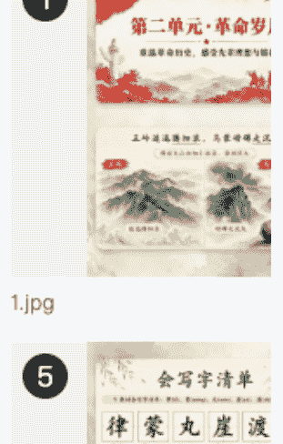

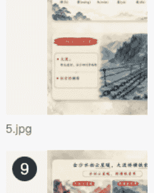

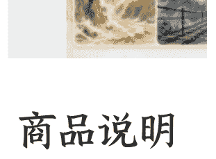

**背景底图分层与原创对象保留**

只需要将背景底图的背景页保留并用于分层，将文字、插图、背景图和动画等处理成可编辑的 PPT 中，完成后获得合并预览。

- 1. 只提取图像背景图
- 2. 只提取 Canvas 或 Canbolu
- 3. 背景大对象分析
- 4. 背景分割并保留

原始 PPTX

/Volumes/数据存储/课件制作成品/二上语文/教材目录第六单元/5 朱德的扁担/(可编辑）朱德的扁担_36页.pptx

任务工作目录

/Volumes/数据存储/课件制作成品/二上语文/教材目录第六单元/5 朱德的扁担/Canva分工任务/(可编辑）朱德的扁担_36页

Chrome 下载显示在（工作目录 A 专用）

/Volumes/数据存储/课件制作成品/二上语文/教材目录第六单元/5 朱德的扁担/Canva下载缓存

原始使用 Canva 可编辑版本，不需要它整个导出文件，直接在 Chrome 下载缓存中指定一次。

Canva 整体导出结果中

/Volumes/数据存储/课件制作成品/二上语文/教材目录第六单元/5 朱德的扁担/Canva分工任务/(可编辑）朱德的扁担_36页/Canva整包导出.pp

最终总任务总包为

/Volumes/数据存储/课件制作成品/二上语文/教材目录第六单元/5 朱德的扁担/(图文剪辑）朱德的扁担_36页.pptx

处理项目

导出任务 A 文件名 (B)

ab

导出方式仅参考。默认导出编辑文件至指定任务目录。

- 开始完整流程
- 只提取背景底图
- 开始智能处理是 PPTX 格式大小：提取后的背景层统一为两张 JPG，超过 50MB 会自动缩放限制制内，且不改变原片分辨率，原 PPT 不含修改。
- 只执行合并
- 必须完成/可保留原背景层，再点保存前，统一一份的总导出 PPTX，合并时只要背景底图。

**背景提取与 Canva 任务**

将要提取完成，可在任务卡片中选择 Canva Carlon。

Canva 正在处理 2845 页 2026/01/15 17:12
正在处理：24.9MB - JPG - 23 页已转换 - 质量 100 - 部分背景
源文件：/Volumes/数据存储/课件制作成品/二上语文/教材目录第六单元/5 朱德的扁担/(可编辑）朱德的扁担_36页.pptx
任务目录：/Volumes/数据存储/课件制作成品/二上语文/教材目录第六单元/5 朱德的扁担/Canva分工任务/(可编辑）朱德的扁担_36页
最终输出：/Volumes/数据存储/课件制作成品/二上语文/教材目录第六单元/5 朱德的扁担/(图文剪辑）朱德的扁担_36页.pptx
查看：(可编辑）朱德的扁担_36页背景底图.pptx Chrome - alivoyin@gmail.com 下载 只执行合并：选择 Canva PPTX 停止
放弃任务

正在整包导出 3232 2026/01/15 12:29
分层版本：正在你份导出 PowerPoint。
上传转换：24.5MB - JPG - 25 页已转换 - 质量 100 - 部分背景

整包导出背景 可 只提取背景原图底图。

- 开始完整流程
- 只提取背景底图
- 开始智能处理是 PPTX 格式大小：提取后的背景层统一为两张 JPG，超过 50MB 会自动缩放限制制内，且不改变原片分辨率，原 PPT 不含修改。
- 只执行合并
- 必须完成/可保留原背景层，再点保存前，统一一份的总导出 PPTX，合并时只要背景底图。

**背景提取与 Canva 任务**

将要提取完成，可在任务卡片中选择 Canva Carlon。

Canva 正在处理 2845 页 2026/01/15 17:12
Canva 正在处理 2845 页。
正在处理：24.9MB - JPG - 23 页已转换 - 质量 100 - 部分背景
源文件：/Volumes/数据存储/课件制作成品/二上语文/教材目录第六单元/5 朱德的扁担/(可编辑）朱德的扁担_36页.pptx
任务目录：/Volumes/数据存储/课件制作成品/二上语文/教材目录第六单元/5 朱德的扁担/Canva分工任务/(可编辑）朱德的扁担_36页
最终输出：/Volumes/数据存储/课件制作成品/二上语文/教材目录第六单元/5 朱德的扁担/(图文剪辑）朱德的扁担_36页.pptx
查看：(可编辑）朱德的扁担_36页背景底图.pptx Chrome - alivoyin@gmail.com 下载 只执行合并：选择 Canva PPTX 停止
放弃任务

同样的，只需要选择好上一步已经转换过一次的 PPT 路径，点击开始完整流程，任务出现在下方，自动进行 PPT 拆分，分把已经拆分好的文字和背景底图分别拆分开，这里只需要背景图。为什么要这么多做一步呢，因为 canva 的 ai 分层功能虽然好用，但是有个致命缺点，就是汉字非常容易识别错误，我经过上一步的拆分，已经将大部分的文字拆分出去了，这里再进行 ai 分层，错误率会大大降低，后面再修改也容易。

在下面的任务状态这里可以选择使用那个浏览器来执行，这个功能我刚加上去，非常实用，因为如果没有 canva 会员，使用 ai 分层功能会有时间限制，每 5 分钟才能制作一页图片，我同样使用了一个浏览器扩展，进行自动的定时操作，5 分钟自动点击一次。可以也很慢对不对，那这个选择浏览器功能就可以加快速度了，不同的浏览器登录不同的 canva 账号，每个任务使用不同的浏览器，速度是不是就能翻倍。电脑性能好的话，甚至可以再继续增加。

每一份课件完成分层后，下载到本地，再点击一次任务样中的只执行合并：选择下载好的课件，又能将之前拆分出去的文字部分合并回来，并且不会影响文字所在的排版位置，动画效果等。

经过这一步再洗一次出来后，就是一份图 文均可编辑的版本了。检查一下错别字，搞定。

#### 7. 流程小结

看到这里，整个制作流程就简单介绍完了，你也应该能从这份流程中看出整个制作的逻辑了。看起来说得很啰嗦，但是整个思路就理清了，我做这个工作台，最重要的就是，我不用每次通过 codex，worrybuddy 这些去找到我要使用的是那个 skill，所以我没有贴和 ai 的窗口对话截图，以前最头疼的地方是 skil 名称总是记不得，skill 一多了就乱，打个“/”还要往下翻半天才找到要用那个。现在不用了，因为已经嵌入到

了工作台里，基本上每一步我都只需要点击选择路径，傻瓜式的操作，并且我需要更新 skill 的时候，在 codex 里指令一下，skill 更新会同步到工作台里。

## 四、普通人如何复制

这一点我觉得也有必要说清楚。

看完前面的流程，很容易产生一种感觉：

是不是把这些 Skill、工作台拿过去，就可以直接复制？

我觉得没有那么简单。

工具当然可以学。

工作流也可以参考。

但真正决定最后产品质量的，还是前面的判断。

### 第一，需要基本的内容判断能力

做课件的时候，很多判断其实来自日常教学。

什么内容应该放在 PPT 上？

什么地方需要讲？

什么地方需要让学生说？

哪些知识点不能错？

一篇课文分几个课时比较合理？

这些东西 AI 可以辅助，但最后还是需要人判断。

如果完全不瞭解这个领域，只靠 AI 批量生成，确实可以做得很快，但产品质量很容易失控。

### 第二，需要一定的 AI 使用能力，但不需要会写代码

我现在用到的 ChatGPT、Codex、Skill 以及一些自动化程序。

自己也是在项目实际操作中，逐步学习，一点点积累的微薄经验，基本都是：

遇到问题 → 找方法 → 能解决 → 留下来。

所以如果刚开始，我反而不建议先研究复杂自动化。

先把第一套产品真正做完，比先搭一个漂亮的系统重要得多。只有做完以后，你才知道自己在重复什么。

### 第三，需要有整理流程的习惯

这一点我现在越来越重视。

每出现一个重复问题，我都会想：

能不能变成规则？

每出现一个重复动作，我都会想：

能不能交给工具？

真正把效率拉开的，很多时候并不是会多少 AI，而是有没有这种意识。

## 五、最后说几个我自己踩过的坑

1. 不要一开始就追求全自动

这是我现在特别想提醒的一点。

有时候为了自动化一个十分钟就能做完的事情，我可能折腾几个小时。

后来我的标准很简单：

> 只做一次的事情，直接做。会重复几十次、几百次的事情，再考虑自动化。自动化真正有价值的地方不是：
>
> 这一次帮你省了十分钟。
>
> 而是：
>
> 以后每一次，都不用重新想。

2. 不要把“会用 AI”当成产品壁垒

现在 AI 生成内容、图片、PPT 都越来越容易。

所以单纯“我会用某个 AI”这件事情，我觉得以后会越来越不值钱。

真正能够留下来的，还是：

- 你对这个领域懂不懂；
- 你知不知道用户真正需要什么；
- 你有没有自己的质量标准；
- 你能不能持续稳定地产出。

工具会越来越简单。

判断反而越来越重要。

3. 不要只看别人晒的收益

包括我前面提到自己的成交，也是一样。

它只能说明：

我在这个时间点、用这套产品，确实跑出来过。但它不能说明：

任何人在任何时间进来，都可以复制同样的结果。

暑假本身就是教师课件需求比较集中的时期。

平台流量、选题、产品质量、定价、发布时间，都会影响结果。

## 六、那现在入场还有没有机会？

这个问题如果现在让我回答，我不会简单说“有”，也不会说“没有”。

我觉得：

需求肯定还在，但粗放地做，应该会越来越难。AI让生产门槛下降以后，意味着会做课件的人一定越来越多。

以后真正拉开差距的，可能不再是谁会生成PPT。

而是谁更懂用户。

谁的内容更准确。

谁的课件真的能拿去上课。

谁更新得快。

谁能稳定维护。

谁能形成自己的产品体系。

所以如果现在只是想：

- 找一个提示词；
- 批量生成；
- 批量上架；
- 然后等着卖。

我个人并不是特别看好这种做法。

但如果你本身就在某一个领域有经验，又愿意把 AI 当成生产工具，把自己的经验慢慢沉淀成流程，我觉得依然值得尝试。

## 七、写在最后

现在这个工作台当然还远远谈不上完善。

很多地方我还在改。

很多流程也还在继续验证。

但我的思维确实和两个月前不太一样了。

以前遇到一个问题，我想的是：

“这一页怎么解决？”

现在我会多想一步：

“能不能让以后所有课件都不再遇到这个问题？”于是：

- 做一个产品，
- 留下一个方法；
- 遇到一个问题，
- 留下一条规则；
- 重复一个动作，
- 想办法把它做成 Skill；
- 几个 Skill 反复一起使用，
- 再把它们串成工作流。

最后才慢慢有了现在这个工作台。

所以如果一定让我总结这两个月最大的收获，我可能还是会说：

不是做出了多少套 PPT，也不是某一天卖了多少钱，而是终于开始有了一套属于自己的做事方法。我现在也越来越相信：

AI 时代真正值得长期积累的，可能不是提示词，而是自己的方法和判断。 提示词会过时。

模型会更新。

软件也会换。

今天很好用的工具，明年可能就有新的替代品。

但你对用户的理解、对产品的判断、踩坑以后留下来的规则，以及最后沉淀出来的工作流程，这些东西不会因为换一个 AI 就消失。

我现在依然还在做课件。

也依然在继续改这套工作台。

很多东西都没有最终答案。

这篇也只是把我目前走过的一段路，如实整理出来。

如果里面有一两个方法，刚好能帮你少踩一个我踩过的坑，那这次分享就已经有意义了。

---

看完这篇 SOP，你觉得你懂了。但 90% 的人一到实操就会卡在第一步。

工具和教程只是最低级的壁垒，真正的壁垒是“立刻动手”和“圈层信息差”。

如果你想看全网最新的变现玩法，并且和一群执行力极强的极客一起下场拿结果，欢迎围观我的核心私域：【懒人专属群】。

我们不聊虚的，只做商业闭环的拆解与 AI 效率的压榨。系统内已沉淀 1000+ 跑通的套利实战局。

查阅圈子完整数字资产与上车门槛：

https://lazys.com/insider/

认同价值、准备好下场干活的，扫码加我微信（ lazyhelper1 ）

备注：【实操上车】，不闲聊

