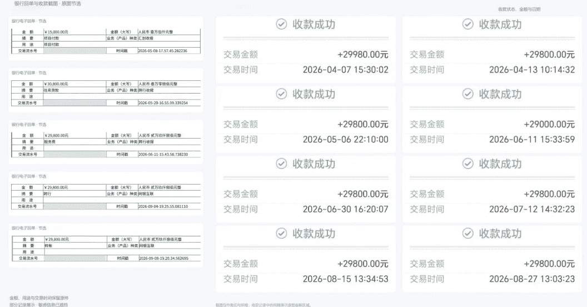
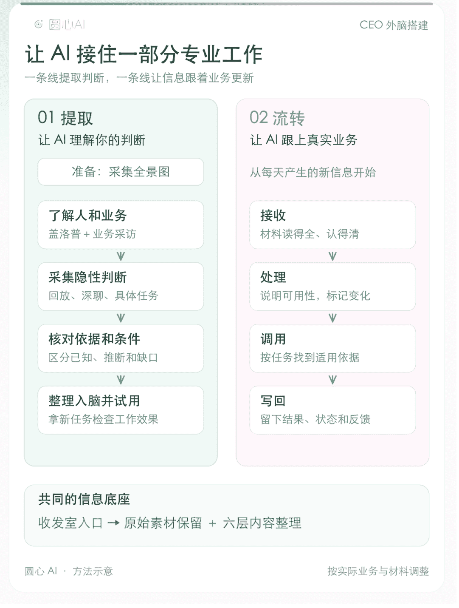
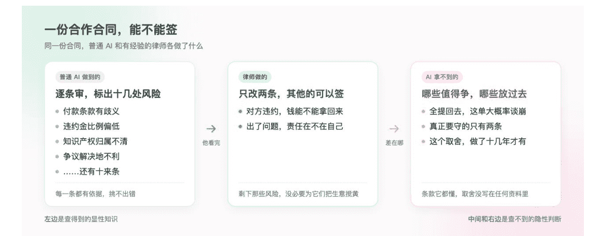
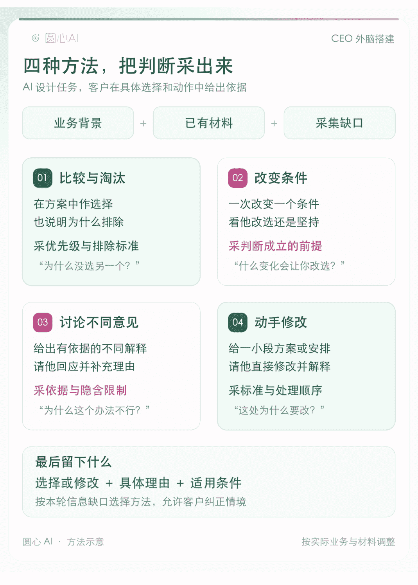
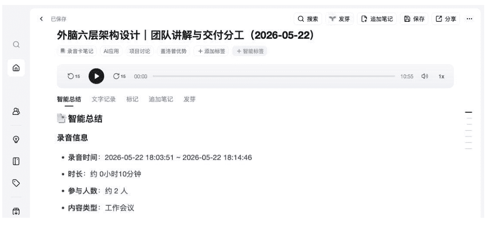

# 半年营收 50w，分享我的 FDE 产品：CEO 外脑——让 AI 接手专家型客户手中的高精度工作

260917 副业 SC 精华
整理：公众号懒人搜索，懒人专属群精选
懒人微信：lazyhelperl

**小懒判断** | 适合正做或想进企业 AI 服务这行、有耐心做深度采访的朋友，也适合律师财税这类业务特别依赖个人判断的专家型客户自查；不适合指望 AI 开箱即用、不想跟客户反复深聊的人。最值得抄的是那套采集全景图，分成业务、客户、本人三层，加盖洛普测试（正版约 300 元）把隐性判断挖出来。坑在于周期长、靠客户持续配合，报价要是没包住前期十几小时的采访核对，容易白干。

大家好，我是袁欣，前大学新媒体老师，出版过大学的新媒体教材，近十年主要从事自媒体相关的工作，也做过线下实体，开过装修公司。

在今年春节之前，我只是 AI 的初级使用者，主要用国内的 AI 工具，偶尔使用 GPT，用来解决文案写作、PPT 制作之类的单点问题。

从今年 3 月到现在，我开始深度、系统地使用 AI，并且为 16 家企业提供定制化 AI 服务。主要服务的，是国际金融财税顾问、律所合伙人，以及知识付费领域的专业 IP 这类对 AI 工作精度要求很高的专家型客户。

我主要帮他们提取靠整理资料拿不到的经验和判断，再搭建一套信息流转机制，让 AI 能结合专家的判断标准和每天变化的业务情况，接手一部分原本必须由本人完成的专业工作。

我做这项业务的客单价在 2—5 万元，5 个多月累计营收超过 50 万元。

# 部分业务成交记录

这类客户多数已经有成熟的产品，也有稳定的客源，但业务极度依赖个人能力，即使有团队或助理，很多重要的工作还是只能亲自完成。所以，他们的卡点不是缺一个写文案、整理资料的工具，而是有客户、有业务，却没有更多自己的时间去承接。

助理接不住，普通 AI 也接不住：AI 能帮他们完成一些辅助工作，但涉及分析具体问题、比较方案、给客户提出建议时，结果常常达不到要求，最后仍然需要本人重新做一遍。他们真正希望节省的，是自己的时间，而不只是助理的时间。

那么，要让 AI 接住专家的工作，就需要解决两个卡点：

- 一是真正值钱的信息，它拿不到。面对眼前这一位客户、这一件事，专家先看什么、怎样判断、为什么选这个方案不选那个，这些往往没有写在现成资料里，有些连他自己也说不清，我们要想办法把这些判断采出来。
- 二是信息变得太快，它跟不上。客户的情况每天在变，上周还成立的判断，这周可能已经不成立，AI 如果还按最初整理的资料工作，建议就会越来越不对。但如果每次都要人重新整理、解释，又会把原本省下来的时间消耗回去。

所以，要提高 AI 在实际业务中的工作精度，不仅需要有价值的信息交给它，还要让它在工作时找到并用对这些信息。这篇内容，就来给大家分享这两个部分：

1. **提取：** 用一套流程，把专家没写进资料、自己也说不清的隐性经验和判断采集出来，让 AI 接住专家手上的工作。
2. **流转：** 让海量信息顺畅进入，及时更新、处理冲突，让 AI 在具体工作中找到并用对相关信息，跟上真实业务。

# 阅读须知

## 1、方法是否有技术要求

这套方法里没有一行代码，它依赖的是拆解、追问，和对业务的理解，这刚好是我过去做老师、做生意练出来的能力。所以，**非技术出身，不是这件事的门槛**。

## 2、适合谁读

这篇内容，一方面正在做、或者准备进入 FDE 行业的朋友，如果希望提升 AI 的工作精度，让它交出的结果更符合客户的实际需求，这篇文章会很适合你。同时，即使你不做 FDE 业务，但你希望 AI 能接手一些目前只能由自己完成的高精度的工作，这篇内容给到的方法同样可以直接用。

文章写的比较细，有很多我的核心方法论和真实落地的细节，全文约 1.8 万字，我会尽量把具体的方法、每一步得到什么，以及后面怎样使用讲清楚。感谢大家花时间阅读。

# 一、提取隐性经验与判断，让 AI 接住专家手上的工作

专家型客户常常评价 AI「差点意思」，这个「差点意思」到底是什么，看一个例子就清楚。

例如，我的一位客户是律所合伙人。他的客户把一份合作合同发过来，问能不能签。我们把合同给 AI，AI 完成了逐条审查，标出十几处风险，每一处都有依据，都是对的。但这个客户看完合同，决定只修改了其中两条，其他的告诉对方：就按照这样签。因为如果每个风险都要规避，修改十几条内容提交回去，这单大概率就谈崩了。

他是结合了法律，以及对业务的理解，决定真正要守住的只有两条比较大的风险。剩下那些风险，没必要为了它们把生意搅黄。哪些值得争、哪些得放过去，这个判断 AI 给不了。

这也是很多专家使用 AI 的感受，虽然 AI 具备相当完善的知识，但实际业务中，会有非常多的判断和取舍，这些判断和趋势，是专家做了十几年慢慢形成的，不会写在他的任何业务资料里。所以，很多专家还是花费大量时间自己做核心的判断工作，AI 只能完成一些基础的润色工作。AI 在做的，还是低价值的助理的活。

我觉得，这就是显性知识和隐性判断的区别。显性知识，是已经能够写下来、讲清楚、查得到的内容，例如规则、流程、条款和标准做法。隐性判断，是一个人在长期实践中形成，却没有被充分表达出来的识别方式、经验、判断和行动习惯。在专家型业务里，隐性判断更接近价值的核心。

所以，要让 AI 接手一部分原本必须由专家本人完成的工作，需要让它理解专家的隐性判断，而不只是掌握可查询的显性知识。换句话说：掌握显性知识，AI 能完成一些辅助工作；理解专家的判断标准，才能进一步参与原本需要专家本人分析、取舍和推进的工作。

那把这些判断告诉 AI 不就行了？问题是，**你问一个专家「你是怎么判断的」，大多数人讲出来的都很空泛**，这也是为什么老手很难带出新手，销冠教不出销冠。就像有些人跟客户聊上两句，就知道现在该逼单还是该放一放，你问他怎么看出来的，他也说不上来，更多是一种感觉。所以我们不能靠问，而是要设计一套流程和方法，把它找出来。

市面上大部分知识库和工作流的搭建方法，是从已有资料开始的，让 AI 去处理"已经写下来的信息"，**而我的这套方法，还要先解决这些信息怎么采集的问题**。

## 准备：建立采集全景图

要让 AI 接手这些工作，我们首先需要明确：究竟要给它哪些信息。结合自己使用 AI 和服务客户的经验，我发现，不同客户虽然业务不同，但需要采集的信息有不少共同的方向，所以我把它们整理成了一张采集全景图。有了这张图，后续就能围绕它检查：哪些信息已经有了，哪些还需要补充，避免漫无目的地采集，也避免漏掉重要的内容。

我把要采的信息分成三类：

- **业务信息：这门生意是怎么运转的**
- **客户信息：他正在服务的客户是什么情况**
- **本人信息：他这个人是什么底子，做事有什么固定的做法**

先展示一下这张图，是我们服务 16 个客户整理出来的真正精华，每一项需要采集的信息后面，我都写了用途，也就是采到以后，AI 会在什么地方用到它。

### 采集全景图

要让 AI 接住专家的工作，需要了解这三类信息。每一项后面是采到以后 AI 在哪些地方用到。

#### 业务信息：这门生意是怎么运转的

| **采什么** | **具体看什么** | **用来做什么** |
| :--- | :--- | :--- |
| **产品与服务** | 卖什么、给谁、交付什么、周期多长 | 知道客户卖的是什么，不提出超出范围的建议 |
| **报价与收费** | 价格、付款方式、什么情况加价或优惠 | 协助报价时分清哪些用标准的、哪些要先确认 |
| **成本与利润** | 主要成本、最耗时的环节、谁在负担 | 比较方案时把实际投入算进去 |
| **获客与转化** | 客户从哪来、怎么成交、常见顾虑 | 知道下一步沟通先解决什么 |
| **交付流程** | 启动条件、关键节点、所需材料、验收要求 | 产出能推进下一步，知道怎样算完成 |
| **团队与分工** | 谁负责什么、谁拍板、哪些事总回到老板手上 | 判断一件事卡住是缺精力、缺信息还是缺权限 |
| **成员情况** | 每个人擅长和不擅长什么、老板对他们的评价、做得好和做砸的例子 | 安排或建议分工时，知道交给谁合适、哪件事要盯着 |
| **工具与资料** | 在用的软件、模板、资料放在哪 | 沿用现成的，不重复提 |
| **目标与痛点** | 近期目标、最费时最容易出错的工作 | 决定下一轮采集的优先级 |

#### 客户信息：他正在服务的客户是什么情况

| **采什么** | **具体看什么** | **用来做什么** |
| :--- | :--- | :--- |
| **身份与决策关系** | 联系人、使用者、付费者、决策者各是谁 | 不把联系不上的一句话当成最终要求 |
| **真实诉求** | 他说出来的要的，和从反复出现的话里点出来看他真正要的 | 围绕真正的目标分析 |
| **顾虑与异议** | 他犹豫、追问、绕开的地方 | 出方案和沟通先处理这些 |
| **决策值与信任强度** | 他对什么有反应、态度什么时候变软变硬、现在信任到什么程度 | 判断在该推进还是该等 |
| **购买内容与承诺** | 买了什么、范围、时间、沟通中答应过的 | 不脑补答应过的，也不擅自扩大范围 |
| **沟通历史** | 讨论过什么、定过没定过、还有哪些分歧 | 不重提已经被否过的方案 |
| **执行条件** | 预算、时间、团队能力、能提供配合的材料 | 分清楚理论上好和这个客户真正能做的 |
| **当前进展与下一步** | 做到哪了、卡在哪、下一步待处理 | 参与正在发生的工作 |

#### 本人信息：这个人是什么底子，做事有什么固定的做法，花最多精力的部分

| **采什么** | **具体看什么** | **用来做什么** |
| :--- | :--- | :--- |
| **底盘** | 快工作通用，一次采齐 | |
| **才干结构** | 直接看前面十项，组合起来是哪几人、短板在哪 | 知道谁天生擅长哪一段、哪一段要补位 |
| **思维方式** | 要数据还是要例子，结构优先还是细节，先发感觉还是先收敛 | 给他的信息用他接受的方式 |
| **决策方式** | 整套感受、一步步谈、看人还是看数据；信逻辑还是信数据；什么情况下决策启动或卡住 | AI 用他的依据给建议，不在他卡住的地方硬推 |
| **反复出现的模式** | 是维持稳定、固定切换的状态、下限 | 相关任务里的依据数据 |
| **心力** | 什么特别消耗他，什么状态下判断力会走样 | 减少负担，提醒该跳出的事，重要决定要看时机 |
| **自我认知** | 他怎么看自己，什么话题有防御，什么他会加劲 | 采集协作时知道从哪进、哪里不碰 |
| **优势与不适合** | 擅长什么、不擅长什么、适合站在什么位置 | 分工、哪些留给他本人 |
| **表达习惯与适应场** | 常用什么、高外怎么样、怎么不变立场 | 知道什么时候该逼问，不照单全收 |
| **与 AI 的协作方式** | 从最底层还是从结构进、怎么提意见或不提 | 设计采集对话、日后随场使用 |
| **打法** | 标准怎么交付 AI 的工作，言采一次，每场采集标准：场景 → 判断 → 为什么、适用条件 | |
| **信号** | 他看什么才判断这事的状态 | AI 结束时先看懂的信号 |
| **流程与节奏** | 标准顺序、多久做一次、什么触发 | 知道现在在走到哪一步、什么时候该动 |
| **决策规则** | 什么情况推、等、放，什么情况不给结论 | 在他的框架下判断 |
| **分级** | 对不同事/对象/类型怎么变 | 不用一套话术对付所有人 |
| **复盘** | 成和没成的各是哪一步的问题 | 判断的适用条件从这里来 |

首先说业务信息和客户信息，这两类相对好采。产品、报价、流程、客户名单这些，一般是先让客户把手上的资料整理出来，再通过我人工对客户进行采访补全，大部分信息靠资料加采访就能拿到。真正要花时间的，是资料里没有、采访也不一定问得出来的那部分，这也就是我们采集的重点，归属在了本人信息这一类。

本人信息的采集，我把它分成两层：底盘和打法。

### 底盘：这个人是什么底子

每个人都有自己的思维惯性和认知方式，有人先看框架，有人先看细节；有人信数据，有人信逻辑；有人决定得快，有人要想很久。这些东西不管他在做哪件事都一直在起作用，会一直影响他做事的步骤和方式，所以要采下来。

采出来不是为了写成人物画像，而是让每一条信息落成三句话：他是什么样的，具体表现在哪，AI 因此要怎么去和他进行配合。这里举两个例子帮助大家理解。

第一个是我自己。我是一个非常相信逻辑的人，甚至有时候我对逻辑的信任，会大于对数据的信任，因为我觉得数据在某些情况下可能有失误，也可能造假。所以数据和我的判断冲突的时候，除非是我确信非常权威的数据，不然我多数会先怀疑数据的来源和解读，想一想是不是它错了。

这条信息我采集给我的 AI 以后，它给我东西就比较喜欢先给逻辑链，从逻辑链证明结果的置信度，而不是首先拿数据来说服我。

第二个是我的一位做国际保险的客户。他一直觉得助理做事达不到他的标准，几次想换人。后面我们采集了他的表达习惯之后才看出来，他因为自身的专业性非常强，比较理所当然地认为别人应该也是这样，所以在交代工作时习惯省略一些对专业部分的解释，助理接到的一直是打了折扣的信息，没有真正理解他的要求。

这个表达习惯带来的影响，我们在他谈客户和做自媒体的过程中，也明显地看到了：客户因为没理解他对产品的解释，导致了丢单；自媒体的内容数据也不是很好，因为多数用户看不懂，能看懂的主要是同行。在采集到这些用户的「特点」后，会发现他很多业务中遇到的问题，都是共同的原因，AI 也可以顺利介入，帮他解决这些问题。

我们在底盘里要采集的每一项都是这样，看起来可能不起眼，但采到了才知道它在哪起作用。

### 打法：他做事的固定做法

底盘更多是聚焦在「人」的身上，打法则主要聚焦于他做事的一些固定方法。一个人的业务流程大概率是相对稳定的，卖什么、客户从哪来、怎么成交、怎么交付，一年到头变化不大。所以他在做这些事的路径和思路上，会有一套自己的打法。

我们不需要把客户的整个业务都采集一遍，而是先确定：**他希望把哪些具体工作交给 AI**。再针对每一项工作，从下面五个方面，采集他平时的做法和判断依据，让 AI 了解他先看什么、怎么思考、按什么顺序处理，以及遇到不同情况时怎样调整。这样，AI 才能参考他的思考方式和工作流程，去完成这些具体的工作。

- **信号：他先看什么**
  接到这项工作时，会先了解哪些信息，怎样判断目前是什么情况。
- **流程与节奏：他通常怎么做**
  一般先做什么、再做什么，什么时候推进，什么时候需要停下来等一等。
- **决策规则：他怎样作选择**
  有几种做法时，为什么选这一种，哪些条件会让他改变决定，什么信息不清楚时不能下结论。
- **分型：他怎样根据对象调整做法**
  面对不同的客户、需求和执行条件，哪些做法可以沿用，哪些需要调整。
- **复盘：他怎样根据结果修正做法**
  过去哪些处理有效，哪些没有达到预期，他从中发现了什么，后来有没有改变做法。

例如，回到前面的律师案例，我们要了解的，不只是他最后改了哪两条，而是他为什么先看这些风险、为什么有些要争取、有些可以接受，以及什么情况下他会改变处理方式，这些就是我们要采集的“打法”。

以上这些构成了一个基础的采集范围，那么这份采集全景图，大家拿到手以后怎么用？

## 这份「采集全景图」怎么用

因为这个全景图，是我基于服务过的客户，提炼出来的比较有共性的部分，所以大家采集的时候可以拿它当基础。遇到特殊的行业，或者有特别的内容，就在对应的类别下面加细项。也可以直接把我的这张图直接给 AI，把客户的背景这些基础的东西交给它，让它帮忙细化。

> 这是采集清单，这是客户的基础背景，我准备让 AI 接手的工作是（填）。请对照清单，列出这项工作需要采的信息，每一项说明要了解什么、之后用在哪里。已有材料能回答的先整理出来，需要向客户确认的单独列出。

这样，就能梳理出：要让 AI 接手这些原本需要专家本人完成的工作，应该采集哪些信息。有了信息的采集范围，接下来就是怎么把信息拿到手。

> 我把这个过程分成四步，接下来就给大家逐一做介绍：
>
> 1. 通过盖洛普测试和业务采访，整理已有信息和缺口
> 2. 围绕缺口设计深度对话，采集具体的判断和打法
> 3. 回收完整对话，放回真实业务里核对
> 4. 整理成 AI 能用工作依据，再拿新任务测试

**提取隐性经验与判断：准备四步**

每一步都是做，留下什么，下一步从哪里接。

| 业务采齐全景图 | 第一步：盖洛普＋业务采访 | 第二步：按缺口分批次聊 | 第三步：回收对话，回业务核对 | 第四步：整理依据，新任务测试 |
| :--- | :--- | :--- | :--- | :--- |
| • 业务、客户、本人三类 • 哪些靠个人经验判断 • 哪些岗位分工和流程 | • 盖洛普了解人 • 业务采景了解事 • 从口采景找缺口 **做：需求或业务场景梳理** **留：客户说法、真实业务缺口** | • 先回测真实工作 • 按回测缺口入题 • 批次追问业务判断 **做：基于缺口的深度对话** **留：客户和做的 AI、我批题给** | • 回收整理对话，不要总结 • 看业务判断和协作方式 • 好/才工上条件 **做：核对 AI 输出与实际差异** **留：我批做的 AI、必要协作法** | • 成盘、打法、协作要求 • 每批对话看透三在哪 • 每套对话缺口补全 **做：结构化整理与测试** **留：我给做的 AI、客户过反馈** |
| 留下：要补什么缺口等 | 留下：初步了解、采集成场准等 | 留下：完整对话、判断信息 | 留下：有误差、有套套的判断 | 留下：AI 能用的工作信息 |

**第一步：完成盖洛普测试和业务采访**

这正式开始服务的时候，我首先会做两件事，一件是了解人，一件是了解事。

了解人，靠盖洛普测试。盖洛普是一个相对比较权威的才干测评，测完后会给出 34 项才干的排序，能大概看出一个人天生擅长什么、习惯怎么想事情。我一般会为客户免费赠送一次正版的测试。

官方售价是 59.99 美金，实际购买的成本大概在 300 元人民币左右

这个环节有两个好处

### 1、减少漫无目的的探索

服务刚开始的时候，我和 AI 对这个客户都是空白的，盖洛普的结果能让我们先建立一个基本认知，后面的挖掘就有了一个基本的方向，少走很多弯路

### 2、提升客户的参与度

我发现很多人对探寻自己是比较有兴趣的，而且不少人没听过盖洛普，测完以后会很有兴趣跟我和 AI 深聊

客户能积极配合、进入状态，后面的采集和服务就会顺很多

了解事，靠我本人对他做一次或多次业务采访

梳理出他的业务版图：卖什么、客户从哪来、怎么成交、怎么交付、哪些环节必须他亲自做、他最想让 AI 接走什么

采访稿我会让 AI 来出，分三步完成：

- ① 我先和 AI 沟通，结合我过去创业的经验和对商业的理解，再让 AI 去查这个行业的情况，搭出采访的基本骨架
- ② 把前期我和客户沟通的录音、聊天记录喂给 AI，把已经聊过的碎片信息补进去
- ③ 把盖洛普的结果也给 AI，让它分析这个客户可能比较能接受的沟通方式

### 这样出来的采访稿，有几个好处：

- □ 首先是不会在采访中暴露自己不专业，不去追问基础的行业常识
- □ 并且已经融合了客户之前给过的信息，不浪费他的时间，做反复的沟通
- □ 结合了盖洛普的分析，用的是他比较能接受的沟通方式，用户比较舒适，沟通效果也比较好

这些准备除了能提高采访效率，还有一个作用：让客户感受到我们理解他的业务，也重视他已经提供的信息，逐步建立信任

### 为什么在采集过程中，我会特别重视客户的感受

因为后面的采集需要他持续配合，包括提供真实材料、花时间与 AI 深聊，以及在我们没理解准确时，愿意继续解释和纠正

如果前期的沟通就让他觉得费力、重复，或者总是被误解，后面就很难深入下去，真正有价值的信息也就拿不到

所以，客户的沟通感受会直接影响他后续的配合程度，进而影响我们能采到什么

- ▼ 这里附上给 AI 的指令，可以让 AI 帮我们出整个采访的提纲

> 请根据采集清单、这个行业的基本情况、我和客户的前期沟通记录，以及他的盖洛普报告，帮我准备一次业务采访
> 先把已有信息填进清单，标出来源，行业通用情况和这个客户已确认的情况分开
> 围绕他希望 AI 接手的工作，列出还需要了解的问题，按他容易讲的业务顺序排，不要照着清单机械问一遍
> 盖洛普只用来考虑怎么问他更容易讲清楚，不要据此推断他的业务/做法
> 最后给我一份电话采访提纲，主问题和必要时才追问的问题分开

这一轮不用急着把所有判断都挖透，完成盖洛普测试和业务采访后，我们主要需要拿到三样东西：

**对人的初步了解**：他的才干特点，以及值得进一步了解的思考和沟通习惯

**对业务的初步了解**：他正在做什么、遇到了哪些问题、希望把哪些工作交给 AI

**可供继续分析的真实材料**：他与客户的沟通记录、过去给出的建议、做完的项目资料等

接下来，把这些内容与前面的采集全景图对照，就能梳理出：**哪些信息已经拿到了，哪些还缺，哪些虽然提到了，但具体的做法和判断依据还没有讲清楚**

第二步的深度对话，就围绕这些缺口展开

▼ 这个对照也是可以让 AI 来做，参考指令如下：

> 请阅读采集清单、盖洛普报告、业务采访记录和已有材料，先把已经拿到的信息整理出来，保留来源
> 再逐项对照清单，分成三类：已经拿到的；有线索但还要验证的；完全没有的
> 不要把盖洛普的描述或你自己的推断直接填成已确认的事实，资料互相矛盾的地方两种说法都保留
> 最后按他希望 AI 接手的工作，列出下一轮要采的任务：哪些整理资料就能解决，哪些要本人回忆或判断，需要安排对话

核对完这份结果，我们手上就有了**一张具体的采集任务清单**，后面的深度对话，其实就说围绕这些还没拿到的东西展开了

## 第二步：按信息缺口安排深度对话

上一步，我们已经明确了还需要采集哪些信息

这一阶段的采集，会通过我们设计对话任务 → 客户与 AI 深聊 → 我们根据反馈调整来完成

### 1、我们负责设计：这轮怎么聊

根据客户的业务、个人特点和信息缺口，设计这一轮的对话任务，明确：

- · 聊什么：这轮要补上哪部分信息
- · 从哪里进入：选哪件真实工作或哪个具体问题作为切入点
- · 怎样往下问：重点追问什么，客户说不清楚时怎样继续

最后交给客户的，是一份包含任务说明、背景材料和对话指令的采集安排

这是整理的接下来需要你和 Codex 深聊的三个主题

可以抽空聊完返回给我，我再看是否需要补充内容

可以闪个电话，语音录入回复 ai，比较节省时间

以提示词里我基本都先让 Codex 读取和梳理已有内容了，只有原来没有聊到或者理解得不够细的部分，再通过对语补充，如果他的提问中你明确记得录音或者别的地方你已经有过记录，可以提醒 ai 先去读取

三个主题建议分别新开三个 Codex 对话，不要混在同一个对话里

> 袁欣欣的聊天记录
> 袁欣: 主题一 🐱 先把目前的六条业务线梳理完整。这一步主要是让 AI 真正理解每条业务是怎么运转的，以及客户和方案背后的判断条件

### 2、客户与 AI 深聊：让判断在具体事情里显现

客户把这份安排交给自己常用的 AI，围绕指定的话题展开讨论

前面的业务采访由我们来做的，是为了了解整体情况、找准需要深挖的地方，到了这一阶段，则让 AI 按我们设计的任务陪客户继续往下聊

这样，客户可以按自己的时间分几次展开，想到新的例子、找到新的材料，也可以接着补充，不必把所有内容都集中在一次采访里讲完

我们再根据完整的对话记录，看哪些地方已经讲清楚、哪些地方还需要换一种问法，调整下一轮安排

我们要取得的，不只是他最后选了什么，而是他在讨论中注意到了什么、怎样比较、为什么坚持或改变决定

这些过程，才是后面整理判断依据的材料

### 3、我们根据反馈调整：哪里没采到，就调整哪里

每轮对话后，重点看两件事：

- • 需要的信息有没有采到：有没有具体的做法和依据，还是仍然停留在空泛的原则上
- • 对话方式是否合适：什么问题能让他展开，什么问法容易让他卡住，AI 有没有误解他的意思，这将会影响后续的对话设计

再根据这些反馈，调整下一轮的话题、材料和追问方式

这样，深度对话就不是一次性发出一组问题，而是围绕采集目标，逐轮取得信息、调整问法，不断深入

为了让这个过程更容易展开，我通常会把对话分成三批进行

### 第一批：先回放近期的真实工作

我一般先从客户最近一两周做过的事开始，比如他刚给出的一条重要建议，或者在几个处理方向之间做过的一次选择

这些事刚发生，材料好找，他也记得比较清楚，适合用来回溯他当时是怎么判断的，采集前面提到的「打法」

但不能只问一句“你当时为什么这么想”, 就等着他把整个过程讲清楚

这一轮，我们先帮客户选好一件事，请他找出相关材料，再让 AI 按下面三个动作陪他回放

#### ① 还原背景：先确认当时发生了什么

客户把当时的沟通记录、相关资料和最后给出的建议交给 AI，让 AI 先整理三件事：

- 对方当时遇到了什么问题
- 自己当时已经知道哪些情况
- 最后建议怎么做

客户确认或补充后，再往下聊，避免 AI 带着错误的背景追问，也避免把后来才知道的结果混进当时的判断

#### ② 聚焦选择：只追问一个关键决定

背景清楚以后，不用把整个项目从头到尾复述，先挑一个关键选择，沿着它往下问
比如一位顾问建议他的客户暂缓推出新产品，AI 就围绕这个决定，一次问一个问题：

- 当时最先注意到了哪条信息
- 除了暂缓，还考虑过哪些办法
- 最后是什么让他决定建议暂缓

#### ③ 拆开模糊回答：找到判断背后的具体依据

如果他只说“感觉时机不成熟”，对话还不能停在这里，AI 需要继续问：

“当时有什么具体情况，让你觉得现在推不合适？”

他可能会讲到：客户原有业务的交付已经跟不上了，新产品又要用同一批核心人员

这样，我们才采到了一个具体的判断依据：他在评估新产品时，会看现有团队是否还有能力承接，而不只是看产品有没有机会

这一轮要留下的，就是这些从真实工作里还原出来的判断依据

确实记不清的地方先标出来，不要求他为了回答而补出一个理由，后面再通过其他方式继续采集

▼ 我们会把这一轮要采的几个问题，从总清单里单独列出来，连同相关背景和下面这段指令一起交给客户

客户补上这次工作的真实材料后，把整份内容一次性发给自己常用的 AI 即可

指令是一次发出的，对话则按步骤进行：AI 先还原背景，等客户确认，再一次追问一个问题，最后整理结果

> 请陪我回放一次最近做的重要判断，下面是当时的沟通记录、相关资料和我最后给出的建议
> 先根据材料还原客户当时遇到的问题、我已经掌握的情况，以及最终作出的决定，等我确认以后再继续
> 然后围绕一个关键选择，一次只问一个问题，了解我最先注意什么、考虑过哪些办法、哪条信息或哪个顾虑影响了最后的决定
> 如果我只说「凭经验」「不合适」，请让我回到具体的材料或顾虑上，不要替我编理由
> 分开我当时知道的情况和后来才知道的结果，记不清的部分保留为待了解
> 最后按“当时的情况、我认为会产生的影响、因此作出的选择”整理这次判断，交给我确认有没有理解错或遗漏
> 还没说清的地方单独保留，并注明这些内容分别对应本轮采集清单中的哪个问题

### 第二批：围绕他这个人聊

我们第一批话题，是回放了客户在某一次工作里的判断，但了解了客户的一次选择过程，还不足以知道这个人平时是怎么思考、表达和与人配合的

所以第二批话题，我们会回到前面讲的「底盘」，把还没有了解清楚的部分继续补上

了解这些，是为了可以进一步判断：AI 后续在和他配合的时候，应该提前为他准备什么，在哪些地方继续追问，以及怎样为他呈现结果，他才更容易快速判断和使用

#### ① 选话题：优先找两类值得深聊的线索

我会把第一步拿到的盖洛普报告、业务采访和上一轮的工作回放放在一起，对照还没有采到的信息，确定这一轮聊什么

线索多的时候，不需要每一条都追，我一般优先选两类：

**会影响 AI 接手工作，但目前还没有了解清楚的：**

比如客户希望 AI 帮他分析方案，但我们还不知道，他需要看到哪些依据才愿意作决定

**在不同事情里反复出现，但还不知道原因的：**

比如员工交付反复达不到要求，很多工作最后还是要他接回来，但原因还没有讲清楚

盖洛普报告可以提供线索，具体聊什么，还要结合客户在采访和真实工作中的表现，不按报告给他下结论

#### ② 聊具体的事：从他做了什么，追到他为什么这么做

选好话题以后，我们就让客户拿一件真实的事来讲，再让 AI 顺着他的回答往下问

例如，客户说“重要的事情必须自己做”，就请他选一件最近从员工手里接回来的工作，讲清楚员工交了什么、哪里没达到要求，以及他接手后改了什么、为什么改

再对照当初交代的要求，才有机会分清楚：是员工没拿到完整信息，是质量标准没讲清楚，还是某个环节确实需要他本人判断

原因不同，后面让 AI 介入的方式也不同

如果是信息没给全，我们就可以让 AI 协助整理交接材料；如果是标准没讲清楚，就继续把这些标准提取出来；如果某个环节仍然需要客户本人判断，就先让 AI 帮他做好材料准备和分析支持

所以，这一批我们要了解的，不只是客户有哪些做事习惯，还包括他为什么这样做，以及换一种情况以后，他的做法会不会变化

#### ③ 同时观察：怎样的对话方式，更容易让他讲清楚

在看客户和 AI 的对话时，我还会顺便留意另一件事：他是怎样和 AI 配合的

例如哪些问题能让他展开，哪些会让他卡住，什么样的回应容易被误解，这些 都值得留下

比如，直接问“你对交付有什么要求”，他只能说“专业一点”；给他一个初步方案，他却能指出漏了哪些情况、哪个步骤不对

下一轮就可以让 AI 先给一小段方案，再请他修改并解释原因，让这次观察真正用到后面的采集中

我们把本轮要了解的问题、相关背景和上一轮记录一起交给客户的 AI，让它一次问一个问题，最后整理新增认识和剩余缺口

这一批主要留下两类信息：他思考和做事的习惯，以及更适合他的 AI 沟通方式

4月16日 11:43

天啊，AI居然把我聊哭了，我感觉他太懂了吧～挖出来的东西真的是非常深的东西，这些东西太具有实际价值和意义了，还有就是他能看到我正在做的事情和我的诉求实际上是相悖的，或者说我分明想要个A，但是我搭建的以为是A的东西，实际上他是个B

👍👍👍 太棒了

所以我们的问题设计，是需要从自我探索开始深挖

后面的很多他给方案，就会比较基于我们人性的一些东西，还有真正适配的方案，提前考虑到一些卡点

实际上，我刚刚在跟他了聊了第一个问题，就是，帮我看到我看不到的东西，下面5个问题都没有开始

### 第三批：用具体任务，把还没说清的判断采出来

前两批聊完，我们已经拿到了一些真实的工作过程，也对客户这个人有了进一步的了解

但有些判断，客户靠回忆和解释还是说不清楚

比如，他说几个目标“都重要”，但我们不知道真正发生冲突时，他会优先保哪个；他觉得一个方案“不合适”，却讲不清楚具体差在哪里

这时，我们就可以换一种方式：让他面对一个具体任务，去选择、回应或者修改，再从这些动作里继续采集

主要有四种方法：比较与淘汰、改变条件、评价不同意见、动手修改，四种方法我们主要按信息缺口选择，不一定每个方法客户都做一遍

具体拿什么来问，可以让 AI 根据客户的业务背景、已有材料和采集缺口设计，我们主要检查任务有没有对准目标、情境是否合理

**四种采集方法：按信息缺口选择，不必全部做一遍**

#### ① 比较与淘汰：看他优先选什么，先排除什么

如果客户只说“效果、效率、体验都重要”，可以让 AI 给出几个各有优缺点的方案，请他选择并解释愿意接受什么代价

比如，一个方案效果上限更高，但需要持续投入时间；另一个效果相对保守，后续负担较小，面对一个已经很忙的客户，他会推荐哪一种？为什么？

也可以反过来，让他先排除不能接受的方案，追问问题出在哪里、能否补救

选择能帮助我们看到优先级，淘汰则能帮助我们找到排除标准

客户认为题目不成立、有第三种做法，或者暂时不能选，也要允许他展开，不强迫他接受预设选项

#### ② 改变条件：看他的判断在什么情况下会变化

还是前面的例子，如果客户现在安排了一位有经验的负责人，能够持续推进这件事，他还会作出同样的选择吗？

改选了，就问这个变化为什么重要；没改选，就了解还有什么顾虑，或者这个条件为什么不影响判断

我们就可能发现，他并非偏好简单方案，而是关注对方有没有能力执行

这个方法采的是判断成立的条件，避免我们把某一次选择误认为他的固定偏好

具体改变什么条件，由 AI 结合材料设计，一次先改一个关键条件，并让客户确认假设是否合理

#### ③ 评价与讨论不同意见：看他认同什么，为什么不认同

有些结论，客户觉得理所当然，直接问“为什么”只能得到重复的回答，这时可以让 AI 根据材料提出另一种合理解释

比如，顾问建议暂缓新产品，但材料显示已有客户表达购买意愿，AI 就可以问：“先做一个小范围试行，有没有可能？”

如果他仍然反对，就继续了解试行需要什么资源、最担心影响哪件事，他可能会补出“即使缩小范围，也会占用最紧缺的核心人员”这条限制

也可以请他评价别人的方案：这个办法有效，你会不会采用，哪些地方不会用？

**认为一种做法有效，不代表愿意自己采用**，其中的差别可能涉及服务承诺、客户关系和风险考虑

我们要采的是他补充的依据和限制，不让他改主意为目标

#### ④ 动手修改：看他的标准怎样落实到工作里

如果客户看着材料更容易讲清楚，就让 AI 准备一小段方案、客户回复或任务安排，请他直接修改

保留原稿、具体改动和修改原因，不只保留最后的成品

比如，他把“约对方开会”往后移，先加上“确认谁能作决定”，继续问原因，才知道他担心没有决策权的人参会后，还要重新沟通

我们因此采到的，就不只是一个新顺序，还有他安排工作时考虑的条件

#### 补充方法：先判断，再核对结果

另外，有合适的案例时，也可以先请客户预判结果，记录依据和不确定的地方，等实际结果出现后再核对，避免只有事后解释，我的经验来看，这样采的会更准，不会被客户自己「脑补」带偏

## 什么时候可以先收尾

回到本轮采集目标，能讲清楚客户面对什么情况、作出了什么选择或修改、依据是什么，并经他确认没有理解错，就有了可以送去核对的材料了

▼ 问题的设计，也可以让 AI 来

这段指令先交给我们自己的 AI，用来准备客户的对话安排

> 请结合客户的业务背景、前两批记录和本轮采集缺口，选择一个会影响 AI 接手工作的具体问题
> 从比较与淘汰、改变条件、评价不同意见、动手修改中选择合适的方法，说明要采什么、为什么这样设计，并列出需要客户准备的材料
> 优先使用真实业务，假设要明确标出，先让客户确认情境合理、信息足够
> 生成客户可以直接交给自己 AI 的对话指令：一次只问一个问题，根据回答继续；改变条件时一次先改一个；允许
> 客户纠正情境或提出其他方案，不替他补理由
> 最后整理选择、修改、依据和适用条件，交给客户确认，并保留剩余缺口

这三批完成后，接下来要检查的是：我们有没有把客户的意思理解对，这些判断在真实业务里是否也成立

## 第三步：核对采集结果，确认依据和适用条件

前面的采集过程中，我们每轮都会回看对话，看看拿到了什么、下一轮还需要补什么

到了这一步，我们把材料放在一起，集中检查重要判断的来源、理解和适用条件

一段对话聊得很深入，不代表我们已经准确理解了这个人

我会优先核对那些会影响 AI 选择方向、比较方案和安排工作的信息，暂时不影响工作的个人特点，不必为了补齐画像反复追问

### ① 看这条判断是怎么来的

拿回双方的完整对话，连同本轮指令和相关材料一起保留，不能只拿最后一份“AI 对我的总结”

比如，AI 总结“他非常重视执行能力”，是客户主动提到了人员安排，还是 AI 先问“你是不是担心团队执行不了”，他只回答了一个“是”？

后者还需要继续了解，不能仅凭一句认同，就补出一整套判断逻辑

可以先让 AI 对照原始记录整理依据，我们再重点检查解释跳得太快、材料不足和前后不一致的地方

### ② 结合真实工作，补上遗漏的条件

有相关沟通记录、项目方案或修改稿，就拿来对照；没有合适的历史材料，也不用专门翻找，可以留到接下来的真实工作里继续核对

比如，客户说执行资源不足时优先推荐简单方案，但某个项目里却选了复杂方案，就请他解释两次情况的差别

可能那次有专门负责人，也可能目标不同，简单方案无法满足要求，这些都是需要补进来的条件

核对后的理解，就可以从“他偏好简单方案”，变成“他先看执行条件，资源不足时降低复杂度，条件具备时也考虑复杂方案”

> 遇到不一致，先找是不是少了条件，不急着判断哪一次才代表他

### ③ 更新清单，留下可以使用的范围

核对后，将结果分成三类，并保留来源和适用条件：

- 已有依据：具体回答或行为记录能够支持，相关条件比较清楚
- 需要调整：原来的理解不准确，或遗漏了重要条件
- 仍待确认：暂时只有线索，不能当成确定

### 规则

需要客户补充时，集中问清楚“我们目前怎样理解、哪份材料对不上、需要确认什么”，不用让他重读所有记录。

这份清单会继续更新，新的证据可以补足缺口，后来的例外也可能让原来的判断需要调整。

不必等所有问题都解决才进入下一步，但会改变当前工作方向的关键疑问，要先处理清楚。

## 第四步：把采集结果整理进外脑，让 AI 真正用起来

前面采集和核对的内容，还分散在对话、录音和文件里，我们需要把它们整理成 AI 后续工作可以使用的依据。

实际上，我现在做的这项服务，名称就叫“CEO 外脑搭建”。

之所以叫“外脑”，是因为我希望为客户建立一个 AI 可以调用的外置大脑。

这里会逐步整理他的业务背景、经验积累、判断依据，以及思考和做事的方式，让 AI 在接手工作时，能够了解这个人正在面对什么情况、会关注哪些问题、怎样作出取舍，以及希望事情做到什么程度。

前面我们花了这么多精力去采集，就是为了把这些真正影响工作结果的信息整理出来，成为这个外脑里的内容。

### ① 先准备两个文件夹：收发室和外脑

具体搭建时，我会先准备两个不同用途的文件夹。

第一个叫收发室，是我们平时投放和查看新资料的地方。新的聊天记录、录音、文件，或者临时想到的一些内容，都可以先放进来。这里主要是方便我们自己使用，不需要一开始就整理得很规范，也不用每次先想清楚应该归到哪一类，可以先把东西放进去，再让 AI 读取和处理。

第二个叫外脑，是长期保留和使用这些信息的地方。外脑里面，又分成两部分：
- 00 素材层：保留值得留下的原始材料，比如完整对话、录音转写和原始文件
- 1~6 层：放经过处理的内容，按照不同用途归入对应的位置

比如，前面采集产生的一份完整对话，可以先放进收发室。AI 处理后，把需要保留的原始记录收进 00 素材层，再把其中整理出来的业务情况、个人判断和协作要求，分别放到对应的层里。

原始材料和整理后的内容都会保留，但承担的作用不同。后续做事时，可以使用整理后的内容；需要了解细节、核对依据时，也能回到原始记录。

### ② 按用途整理进六层

以客户自己的外脑为例，“关于我”指客户本人，“关于客户”指他正在服务的客户。
- 01 | 系统层：AI 怎样使用外脑，哪些操作需要确认，遇到不清楚或矛盾的信息怎么办
- 02 | 关于我：个人的思考和表达习惯、判断方式、具体工作的打法，以及协作要求
- 03 | 关于客户：每位客户的背景、需求、进展、承诺和重要沟通
- 04 | 关于业务：产品、报价、流程、专业资料、方法和案例
- 05 | 武器库：可以重复使用的指令、模板、Skill 和工具
- 06 | 持续生长：新的研究线索、待验证想法，以及实际使用中 发现的改进方向

前面采集的业务、客户和本人信息，主要对应中间三层，不必一开始把六层全部填满，我们一般先整理当前工作需要的内容即可。

顺便说一句，这套结构我从今年 5 月份开始启用，目前用下来，对比没有分类结构的时候，确实感觉 AI 在处理内容、存放内容的时候，会有条理，也更清晰，哪些是值得整理和存放的，非常推荐大家参考使用。

### ③ 整理成具体的工作依据

有了存放位置，还要把内容整理到能够影响 AI 做法的程度。

比如，只写“他重视落地”，AI 仍然不知道怎么分析方案，可以结合前面的材料整理成：
- **适用工作**：为客户比较实施方案
- **先了解什么**：方案需要谁持续投入，对方有没有实际的时间、人员和执行能力
- **怎样判断**：如果后续执行仍压在一个已经很忙的人身上，就要把持续投入和执行难度一起考虑，不能只比预期效果
- **条件变化时**：如果已有合适的负责人，执行条件改善，原来未采用的复杂方案可以重新比较
- **来源与状态**：附上对应对话或项目记录，保留已核对和仍待确认的部分

个人沟通要求也一样，要说明 AI 具体应先呈现什么、展开哪些依据，而不只写“喜欢有逻辑的表达”。

这些整理工作可以先由 AI 完成，我们检查有没有曲解、遗漏条件，确认后再归入对应位置。

但需要注意的是，这个环节非常重要，后续第二部分我们讲信息的流转和调用，大家就会知道，面对海量信息的时候，AI 要能够精准调用，以及不需要询问就可以判断，这个信息是否能完全信任和使用，就需要我们给信息加这样的「批注」，具体我们在第二部分展开说明。

### ④ 用一项新任务试用

拿一项没有参与过采集的新任务，把必要的业务资料和整理后的工作依据交给 AI，让客户看实际结果。

如果想直观看到差别，可以在两段独立对话里给相同的任务与业务资料，一次按原来的方式做，一次再加入整理后的依据，重点比较：
- 有没有注意到原来容易漏掉的条件
- 分析和推进的方式有没有更符合要求
- 客户还要补充什么、重做什么

> 表达更像他，不等于真正省了他的时间，要看结果能不能用、返工集中在哪

缺事实就补背景，错用了经验就补适用条件，知道原则却不会处理就继续采具体过程；也要检查 AI 是否理解和使用 了已经提供的材料，不能把所有问题都归为“没采够”。

到这里，外脑完成了初步搭建和试用，接下来要解决的，是新信息不断出现以后，它怎样持续更新，并在工作中被准确调用。

# 二、让信息持续流转，让 AI 跟上每天发生的真实业务

前面，我们已经把客户的业务背景、经验和判断整理进外脑，也尝试让 AI 用这些信息完成工作。

但实际业务每天都在变化，外脑里的信息也需要跟着更新。否则，即使 AI 掌握了客户的判断方式，也可能因为使用了过时的情况，给出不合适的结果。

所以，信息流转要解决的，不只是把资料收进来，还要让 AI 知道：这些信息现在还能不能用、适用于什么事情，以及新情况出现以后，哪些原来的判断和工作需要跟着调整。

这一部分，重点解决两件事：

第一，信息整理进去时，就提前说明它应该怎样使用。把来源、适用范围、确认情况，以及需要重新检查的条件一起整理好，减少 AI 后续反复翻找和询问。

第二，新信息进来以后，找到它影响了哪些地方。不仅保存新情况，还要检查相关档案、判断和正在进行的工作，哪些需要随之调整。

同时，这套处理不能给客户增加太多维护负担，否则省下来的时间，又会消耗在整理和解释资料上。

下面我们按照四个环节来讲：
- 接收：方便地把新信息交进来
- 处理：整理使用条件，识别信息带来的变化
- 调用：围绕具体任务，找到当前适用的信息
- 写回：留下工作结果和反馈，接到下一次工作里

前面已经介绍过收发室和外脑的结构，这里直接讲它们怎样在日常工作中配合。

## 第一步：接好信息入口，减少客户交资料的负担

我会先看客户的信息平时在哪里产生，再顺着他的使用习惯，安排尽量简单的交付方式。不用一开始就接入所有渠道，先把当前工作最常用的信息来源接好即可。

### ① 明确信息从哪里进入

常见的信息主要有四类：
- 录音：面谈、电话和临时想法
- 聊天记录：客户沟通、团队讨论和修改意见
- 会议记录：会议转写、结论和附件
- 文件：方案、报价、报表等资料

每一类都安排一个固定入口，采用 AI 当前能够读取的方式，统一进入收发室。可以自动同步的，在配置完成后自动接入；暂时不能自动接入的，就保留简单的转发、上传或放入文件夹的动作。

### ② 保留原始材料，不要求客户提前整理

客户不需要先做总结，也不用判断材料应该归入哪一层，这些交给 AI 处理。只需要尽量把同一件事的相关内容一起交进来，保留必要的上下文。材料里看不出客户或项目名称时，再补充标明即可。

### ③ 约定什么时候开始处理

资料放进收发室以后，还要有明确的处理时机：由客户发起，或者配置后按时间和条件触发，不能默认文件放进去，AI 就已经看过了。

AI 接收后先检查：能否完整读取、属于谁的事、有没有重复或缺少附件，材料里能确认的自行整理，影响后续处理的缺口再集中询问。

> 先让资料稳定地进来，再逐步提高自动化程度，原始内容保留，不用摘要替代

## 第二步：处理信息，提前说明怎么用，再检查它改变了什么

如果只让 AI 总结一遍再存起来，信息是否确定、适用于谁、现在还能不能用，这些问题仍会留到工作时反复询问。所以，我会把一部分判断提前到入库时完成。

### ① 分清信息性质，给重要内容补上使用说明

一份材料里可能同时有事实、明确决定、尚未确定的想法和 AI 推断，不能混成同一种依据。比如，“可以考虑先做小范围试行”和“确定先做小范围试行”，前者还不能直接替代原安排，后者才有更新计划的依据。

对会反复使用、影响工作方向或容易过期的信息，再补上五项说明：
- **依据**：来自哪里，是明确表达还是推断
- **范围**：适用于哪个对象、项目或任务
- **状态**：已经确认、仍在讨论，还是仅供参考
- **时间**：最后什么时候确认
- **重查条件**：哪些情况变化后，不能继续照搬

这里不需要 AI 随手给一个“90% 可信”的分数，更重要的是让它知道：这条信息有什么依据，以及这些依据能支持它用到什么程度。

假设一位顾问的客户明确决定“先选一个小团队试行，再决定是否全面铺开”，可以整理成：
- 当前决定：先做小范围试行，全面推进尚未确认
- 来源：本次客户沟通，附记录位置和确认日期
- 使用范围：当前项目的方案、时间安排和资源估算
- 使用方式：下一版方案围绕试行范围展开，不把全面推进写成已确定的安排
- 重查条件：客户重新确认范围，或者试行结果已经支持进入下一阶段

这样，AI 下次处理这个项目就不用从头确认范围，也不会把一次决定扩大成“这个客户永远只接受小规模方案”。

### ② 对照新旧信息，区分补充、替代和冲突
- 补充：原来没有写清楚，现在得到更多情况，补进去即可
- 替代：客户明确调整了原决定，更新当前依据，旧记录保留历史并退出默认使用
- 冲突：先看是不是对象、时间或情境不同，仍然对不上且影响当前工作时，再交给客户确认

时间更新，不自动等于内容更确定，后来随口提到的想法，也不一定能替代前面确认的决定。

### ③ 标记受影响的工作，不只新增一条记录

继续前面的例子，客户决定先小范围试行，AI 除了更新项目情况，还要找出原方案、时间安排、资源估算和待办中，哪些仍然依赖“全面推进”这个前提。我们可以在重要方案和任务旁边保留关键前提及对应资料，不必给所有文字建立复杂关联。

这一环先标记哪里需要重看，下一环接到具体任务后，再展开怎么修改，不要把“需要调整”写成“已经完成”。按事先约定的权限处理，可以更新的按规则更新；关键冲突、未确认的决定和超出约定范围的动作，再集中请人确认。最后反馈新增了什么、更新了哪里、影响哪些工作，以及还需要确认什么即可。

新信息不仅要存下来，还要找到它影响的依据与任务。

# ▼ 可以交给 AI 的信息处理要求

请对照本次新材料和相关档案，区分事实、明确决定、待定想法和 AI 推断，保留原始来源。

对重要信息说明依据、适用范围、确认状态、最后确认时间和重查条件，不给普通素材逐句加标签，也不凭感觉打信息分数。

区分补充、明确替代和仍有冲突的内容，旧依据被替代后保留历史，但退出默认使用。

找出依赖这些信息的方案和任务，标记哪些需要重新评估，按约定权限处理，未获授权的修改先给建议。

最后报告变化、更新位置、受影响的工作和需要我确认的问题。

## 第三步：围绕具体任务，找到当前适用的信息

信息处理解决的是“现在有哪些可用依据”，调用则要回答“这次工作需要其中哪些”，不能把整个外脑都交给 AI。

### ① 先明确任务，再找资料

AI 先从当前对话和档案里确认：这是哪个客户或项目、现在到哪一步、这次要完成什么、结果给谁使用，已经清楚的不用再问。

索引负责导航，简要记录资料讲什么、涉及谁、适合什么任务和当前版本，文件增删或版本替代时一起更新。具体内容旁边的使用说明，再帮助 AI 判断是否适合当前任务，是否已经过期或被替代。

> 索引帮助找到信息，使用说明帮助判断这次该不该用

### ② 把当前情况、专家判断和业务资料结合起来

继续帮顾问修改试行方案时，AI 需要同时看到：
- **客户当前情况**：已经确定先小范围试行
- **顾问的判断依据**：比较方案时，关注时间投入和执行资源
- **相关业务资料**：不同方案的内容和实施条件
- **本次交付要求**：方案给谁看，要帮助对方作出什么决定

据此，AI 才能先确认试行团队能承担哪些工作，再比较方案，而不只是把旧方案里的“全面推进”换成“试行”两个字。

第一部分采出来的判断，要和第二部分持续更新的业务情况结合起来，才能真正影响这次工作的结果。整理结果足够清楚时先使用整理结果，出现冲突、出处不清或需要核对措辞时，再回到原始记录。

### ③ 只把真正影响方向的缺口交给人

信息要符合当前对象和任务，适用条件仍然成立，且没有被新的依据替代。

缺少的信息如果会改变工作方向，就先确认；不影响已知部分的，可以继续完成并标出待确认项，不必每发现一个小问题就停下来。比如试行范围已明确、负责人还未定，可以先准备不依赖负责人身份的方案结构，但不能把执行分工写成已经落实。

## 第四步：留下结果和变化，让下一次工作接得上

一项任务结束后，除了交出成品，还要更新这件事的进展，以及值得保留的新反馈。

### ① 保存产出，分清状态

方案、报告或客户回复，注明是 AI 草稿、本人修改版、已交客户审阅，还是客户确认采用的版本。AI 写出来了，不等于客户已经采用；客户采用了，也不等于实际效果已经得到验证。

### ② 更新当前进展

留下已经确定的内容、未解决的问题、下一步由谁做什么，以及需要跟进的时间或条件，让后续任务有准确的起点。

### ③ 只提炼会影响后续工作的反馈

优先留下对原有理解的纠正、新增条件、可能复用的做法和实际结果，不把每一段对话、每一处文字修改都升级成长期规则。先记录具体发生了什么，再判断能否扩大使用范围，也不能因为 AI 多次引用，就认为一条判断越来越可靠。

### ④ 有新证据，就修正原来的依据

试行结束后，如果客户确认全面推进，就更新当前状态；如果结果不理想，也要补上问题和实际条件，不继续沿用原先的预期。

原始记录保留，当前情况更新，重要判断保留依据和适用条件，会扩大影响范围的规则调整，再由人确认。

这样，一次工作留下的结果和变化，就能进入下一次任务，而不是每次都重新解释整个项目。

## 从一条真实业务开始

先选一个正在推进的项目，接好最常用的信息入口，让一份新材料走完接收、处理、调用和写回，观察下一次工作是否减少了重复解释和返工。

没有省下来，就检查卡在材料没进来、信息没更新、调用没找到，还是找到以后用错了条件。

先把这条链路跑顺，再增加信息来源和任务范围，维护外脑不应该成为客户的新负担。

### 结尾

这两部分合在一起，就是我希望通过 CEO 外脑搭建，帮助客户完成的事情。

前面，我们把那些没有写在现成资料里、甚至本人也不容易直接讲清楚的经验和判断采集出来，整理成 AI 可以使用的工作依据。

后面，再让这些依据与每天发生的真实业务结合起来，持续补充、修正，并在具体任务中发挥作用。

我们希望 AI 接手的，也不只是资料整理和通用文案，而是一部分过去需要客户本人反复分析、取舍和推进的工作。

对想做企业 AI 服务的朋友来说，这篇内容可以作为一条从采集到使用的实践路径。

即使你不提供这类服务，也可以先从自己手上一项反复发生、又很依赖个人判断的工作开始，看看能不能把其中的经验整理出来，让 AI 帮你承担更多。

不用一开始就把整个系统搭得很复杂，先让一项真实工作产生变化，再逐步完善。

最后补充一下文中这些指令的用法。我自己长期使用的 AI，已经在持续配合中熟悉了我的业务背景、工作要求和常用方法，所以日常做这些事时，不需要每次重新输入文中这样的完整指令。

这里把它们单独整理出来，是希望还没有建立起这套配合方式的朋友，也能比较顺畅地开始尝试。

这些指令提供的是一个起点，真实业务中的沟通会更细，也会随着客户情况和对反馈继续调整。

大家可以先把自已的背景和材料补进去用起来，再结合本文的方法，让 AI 和你一起调整，不需要等指令写得很完善才开始。

最后，十分感谢大家花时间读到这里 □ 期待评论区和交流探讨

看完这篇 SOP，你觉得你懂了。但 90% 的人一到实操就会卡在第一步。

工具和教程只是最低级的壁垒，真正的壁垒是“立刻动手”和“圈层信息差”。

如果你想看全网最新的变现玩法，并且和一群执行力极强的极客一起下场拿结果，

## 欢迎围观我的核心私域：【懒人专属群】。

我们不聊虚的，只做商业闭环的拆解与 AI 效率的压榨。系统内已沉淀 1000+ 跑通的套利实战局。

- 查阅圈子完整数字资产与上车门槛:
https://lazyso.com/insider/

认同价值、准备好下场干活的，扫码加我微信（lazyhelper1）

备注：【实操上车】，不闲聊

