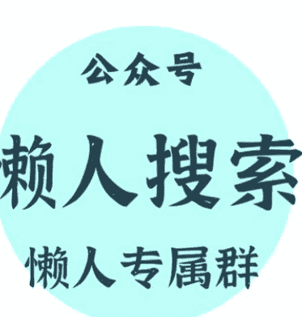
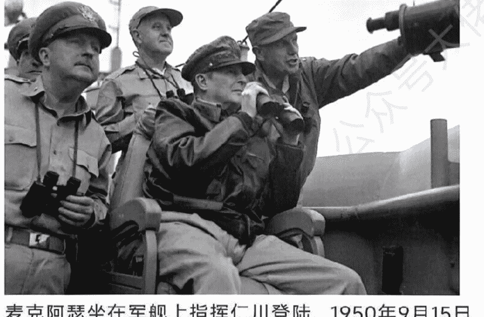
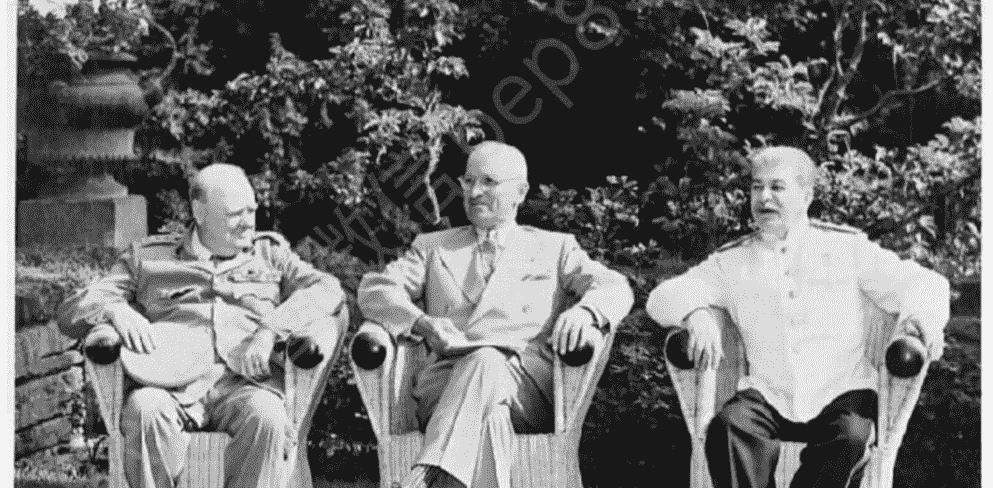
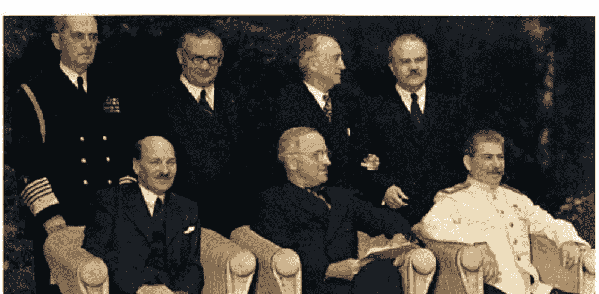
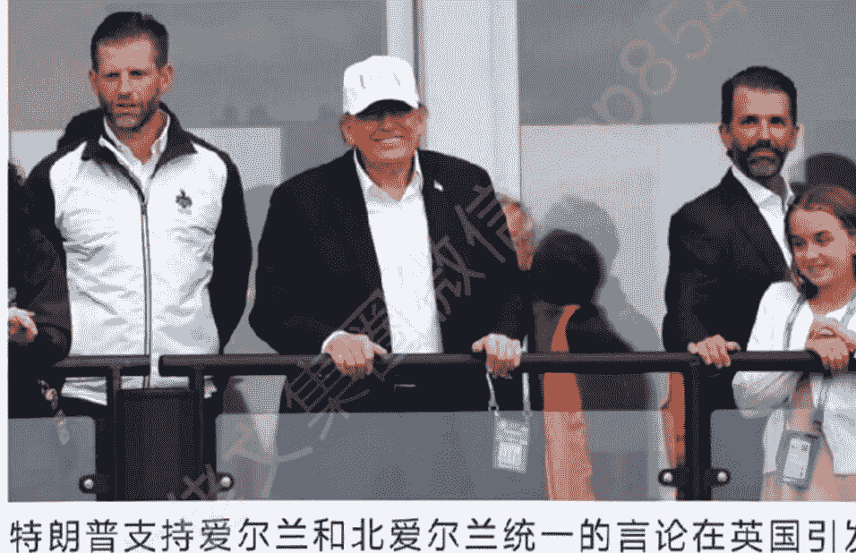
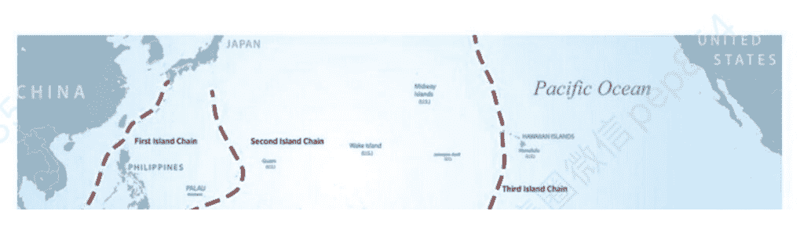
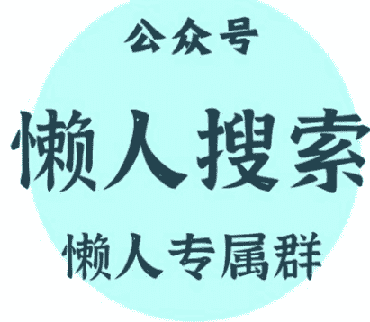

# 中美最无法调和的矛盾

260919 江宁知府
整理：公众号懒人搜索，[懒人专属群](link)精选
懒人微信：lazyhelper1

> **小懒判断** | 关心出海业务、想摸清中美长期博弈底牌的创业者一定要看，只找短平快搞钱项目的新手别浪费时间。文里讲透了**中国对俄乌冲突“限制升级”的两条真实底线**，还点破**中美最核心矛盾是第一岛链撤军**。最大的坑在于，别以为美国霸权明天就崩，当年大英帝国显露疲态后还硬挺了40年，做长线规划千万别盲目押注美国速衰。

1990年前后的东欧剧变和苏联解体，在很长一段时间里被西方舆论包装成了一个“神话”，这个神话就是“以美国为中心的民主胜利论”。

直到近些年出现了另外一种解释：冷战不光是关于资本主义和社会主义的辩论，还是西方发达国家与新兴国家之间发生的一场全面对抗。

以政权建立时间来看，冷战期间的西方阵营几乎都是老牌帝国，如：美国、英国、法国、日本，而东方阵营多为新兴国家，里面建立政权最早即“老大哥”苏联（1917年）。

冷战爆发之初，西方阵营国家大多已经完成了民族国家建设、工业化乃至海外扩张；东方阵营国家则是在第一次世界大战以后（仅苏联），尤其是第二次世界大战以后才真正建立起新的政治秩序。

即冷战一方面是两种意识形态的竞争，另一方面也是两种不同发展阶段国家之间的竞争，新兴国家事实上被打了一个“措手不及”。随着苏联阵营解体以及中国在经济层面全面融入西方世界，这种矛盾在上世纪九十年代暂时消弭。

然而在过去十多年里，新兴国家综合力量日趋壮大，挑战老牌发达国家的态势愈发明显——这一次新兴力量更为强劲，更加有备而来，发达阵营则显得有些疲惫和虚弱。

麦克阿瑟坐在军舰上指挥仁川登陆，1950年9月15日

2025年1月特朗普上任后，对全球力量格局的演变趋势深感忧虑，他认为“拜登方案”太慢了，靠一步步“去风险”来实现西方阵营内部的再工业化根本来不及，所以便决定出奇制胜。

在“出奇制胜”的宏大构思里，摆在桌面上的是“对等关税”方案——这张牌特朗普一上任就打了出去，以不惜失去自由贸易体系领导者地位的代价换取部分工业产能快速回流美国本土。

另一张桌面下的牌则更为隐晦，直到2026年才初露端倪。简单来说，特朗普认为亚非拉国家的能源自主政策极大削弱了美国影响力，希望通过施加军事压力的方式重新掌控一种能够制约新兴国家发展的战略资源，比如石油和天然气。

委内瑞拉和伊朗正是这一战略指向的目标，只不过前者取得巨大成功，后者遭遇了挫败。“页岩气革命”之前，美国自己就是全球最大的石油进口国，通过采购方式让美元流向产油国，进而吸引这些国家支持并服从美国的意志。

“页岩气革命”之后，美国固然实现了能源自足，可带来的延伸问题是产油国更倾向于用非美元结算石油，比如用人民币跟中国结算，用欧元跟欧盟结算。

如果说此前美国可以对产油国进行“威逼+利诱”，那么现在“威逼”的力度必须加大，以弥补减少的“利诱”。历史上，美国对于任何可能削弱自身控制权、影响力的行为都高度敏感，包括但不限于石油结算方式（能源控制力）、关键海峡通道（国际贸易控制力）、海外港口基地（地缘政治与军事控制力）等等。

以石油结算方式为例，美国担心“全球去美元化”进程会在某个时刻永久性颠覆美元的储备货币地位，绑架马杜罗的军事行动有两点真实意图：其一是获得委内瑞拉石油特许权、恢复“石油-美元”架构，其二是清除中俄在拉美地区的影响力。

再以争夺海外港口为例，之所以特朗普对中国控股建设的港口高度敏感，是因为担心中国会在特定时刻把这些港口迅速变成双重用途的“基地港”。

国际贸易本质上是一种资源调度的能力。近现代以来，海权国家往往能够比陆权国家调动更多资源，以英国和德国为例，尽管英国本土狭小，但通过掌控海上航路可以从非洲、美洲、亚洲源源不断调集资源，而德国只能依赖陆路铁路运输，目标对象局限在几个邻国中。

为了维持压制陆权的全球资源调度能力，海洋霸权必须掌控全球关键航道，在这些航道周边设立军事基地，随时应对潜在挑战者。

然而庞大的海外基地与军事干预只有在本国经济保持强劲时才有效，当经济开始承压时，海外军事预算就会成为负担。如今美国正越来越感受到维持庞大基地运作的财政压力，这种压力甚至已经挤压了武器研发预算。

另一方面，普通美国人越来越不在乎霸权。战争是消磨民众意志最快的方式，第二次世界大战末期，英国社会精疲力竭，民众对于捍卫超级大国地位丝毫不感兴趣。

1945年大选中，丘吉尔领导的极端帝国主义保守党输给了艾德礼领导下的社会主义工党。艾德礼政府同意印度等殖民地和平独立，把省下的军费拿来建立国家医疗服务体系，将英国从一个全球帝国转变为现代福利国家。

英国在野党长期设有“影子内阁”，权力交接非常快，换首相一天就能完成。

帝国的转型往往十分痛苦，比如英国丢掉苏伊士运河，法国丢掉阿尔及利亚，以及若干年后可能被写入历史书的美国丢掉霍尔木兹海峡。

但无论过程怎样反复，美国都不太可能无限期承担维护全球航道安全的主要责任，更加昂贵的替代性方案（运河/管道/铁路）、地区强权影响力上升，都是不可避免的事情。

实际上，即便中国综合国力超越美国，也不太可能复制后者的海洋霸权模式——英美的海权模型并不完全符合中国的战略需求，中方需要的是一种“低成本海权”。

在过去十多年发生的新一轮老牌发达国家 VS 新兴国家的对抗（或者说竞赛）中，呈现出这样几个特点：

- 新兴国家的凝聚力较冷战期间有所下降。
在中苏分裂前，莫斯科曾用“公平”“正义”“反殖民”等叙事拉起了一个内部协调性很强的团队。今天虽然新兴国家里有多个社会主义国家（中国、越南）或原苏联阵营国家（俄罗斯、印度、中亚），但大家不再需要接受统一的意识形态指导——中国追求稳健发展与综合实力，俄罗斯追求地缘政治利益，印度是个投机分子。

- 新兴国家综合实力明显增强。
上世纪五六十年代刚刚独立的前殖民地国家大都一穷二白，全球工业产能基本被七大工业国（G7）和苏联垄断。今天 G7 的工业产值占比已大幅下降，正因生产能力不断向新兴国家扩散而忧心忡忡。

- 老牌发达国家的内部凝聚力也出现了变化。
传统上认为，美国霸权的核心是“五眼联盟”（美国、英国、加拿大、新西兰和澳大利亚），周围环绕着欧洲、日本和韩国等条约盟友，外围则是拥有关键能源的中东产油国，美国自己作为一艘远离亚非欧大陆的“巨型航空母舰”统治着世界。

然而过去两年特朗普正系统性地拆解这一体系——跟加拿大爆发针锋相对的贸易纠纷；支持爱尔兰与北爱尔兰统一，直接触碰英国的核心利益；不断给欧洲、日本、韩国施加压力…

如果说先前大家批评美国搞“单边主义”有点宣传意味，那今天的特朗普政府就是真真正正、如假包换的“单边主义”。在这种背景下，今天的国际政治对抗更零散、更复杂，呈现“多线博弈”“利益交织”的特征，朋友和敌人没有冷战期间那样绝对。

### What's next after Donald Trump's united Ireland comments?

3 days ago
Enda McClafferty
Northern Ireland political editor

特朗普支持爱尔兰和北爱尔兰统一的言论在英国引发轩然大波。英国广播公司评论道：“在特朗普不可预测的世界里，没有什么禁忌。即使是最敏感的问题，也可以成为讨论的对象。”

中国应对俄乌、美伊两场战争的指导思想是“限制升级”。鉴于跟俄罗斯、伊朗相对紧密的关系，中方很难在斡旋谈判中提出对俄、对伊不利的解决方案。

假如力推有利于俄罗斯、伊朗的方案，又会得罪欧洲和海湾国家，无异于冲到前面替莫斯科和德黑兰抵挡火力。既然难办，干脆不办。

另一方面，特朗普长期以来对俄罗斯表现出和解态度，俄乌停火后，中俄关系的主导权就容易发生改变，即使俄罗斯继续维持跟中美现有的“距离”，也势必会向中方提出更多“条件”。

因此，在既定范围内中国并不会干涉特朗普或普京的战争。可一旦发现局面有超出阈值的风险，中国就会通过自己或第三方（如巴基斯坦）予以调停降温——注意是“降温”而不是“斡旋停火”。

“限制升级”对中国来说是有重大利益干系的，举例来说，万一俄乌冲突上升至俄军使用战术核武器的地步，欧盟大概率将以决绝姿态迫使中国在每年 2000 亿美元的中俄贸易和每年 8000 亿美元的中欧贸易间做出选择。

乌通社记者：芬兰总统斯图布接受采访时表示，中国外长曾向其保证，中方不会允许俄罗斯在乌克兰冲突中使用核武器。外交部对此有何评论？

郭嘉昆：关于王毅外长访问芬兰的相关情况，中方已经发布过消息。中方在乌克兰危机以及涉核问题上的立场是一贯的、明确的，将继续致力于劝和促谈，推动危机政治解决。

就目前各方透露的信息来看，中欧在这一点上达成的底线共识有两条：第一是不直接军援俄罗斯，第二是限制俄军使用核武器。

有欧洲学者称：“我从未想过中国最终会阻止俄罗斯在乌克兰使用核武器，我们现在处于一个非常矛盾的局面，受到的保护似乎不是来自北约伙伴美国，而是竞争对手中国。"

大国拥有与生俱来的“势力范围”信念。疫情期间普京专注于研究俄国历史，他在 2021 年 7 月发表了一篇论文，里面写道：“真正的乌克兰主权只有通过与俄罗斯合作才能实现。”

另一边，委内瑞拉所在的南美洲自“门罗主义”以来就被美国视作势力范围，特朗普强烈抵触其他大国介入该地区。

在 2025 年 12 月白宫发布的《国家安全战略》中，专门有一条“恢复美国在西半球（美洲及周边地区）主导地位”的表述，而就在该战略宣布后不久，美军便对委内瑞拉发动了军事袭击。

事实上，中美矛盾里最无法调和的就是势力范围问题。美国在中国国力弱小之际，通过一系列战争、同盟条约、军事基地和经济政治介入（台岛）在西太平洋建立起长期战略存在。

待到中国实力增长，美国并不会因为对手变强就自动放弃原有的战略利益，而中国也不会因为美国长期存在就必然接受既有格局。从根本上讲，中美矛盾需要通过美国从“第一岛链”撤军来得到最终解决。

或者按照美方设想的剧本，美国凭借 AI 科技革命再次拉开跟中国的国力差距，迫使中方接受现状。中美之间最终会形成什么样的战略秩序，很大程度上取决于未来十年至二十年的相对实力变化。

如果中国继续缩小与美国的综合实力差距，甚至实现反超，那么“第一岛链”就会越来越成为一个需要重新谈判的问题。

作为上任全球霸权，英国在看待今天的国际政治事件时习惯于将自身经历带入，形成更具大历史视角的解读。

2005 年伊拉克境内叛乱频发之际，英国《卫报》曾发表过一篇文章，如今读来颇令人感慨：如果你想知道 1905 年的伦敦是什么样子，来 2005 年的华盛顿看看吧，帝国威望和无处不在的自豪感，那种成为世界中心的感觉。

然而在表面之下，挥之不去的恐惧仍在蔓延，你的全球霸主地位远没有所期望的那么稳固，正如英国殖民大臣张伯伦在 1902 年所说：“疲惫的泰坦在命运的巨大球体下踉跄前行。”（注：泰坦是希腊神话中的巨神，此处指大英帝国。）

美国现在就是那个疲惫的泰坦，他正在经历大英帝国历史上那场旷日持久、血腥且代价高昂的布尔战争（指伊拉克战争），一小群外国叛乱分子顽强挑战着世界上最强大的军队。

中国和印度对今天的美国来说，就像一百年前德国和美国对英国的角色。（注：原文作者显然认为中美更有可能爆发冲突，被印度坐收渔利，其实很多中等强国都希望中美关系继续恶化。）

这并不是说美国明天会衰退和崩溃，恰恰相反，大英帝国在1905年后又持续了整整40年。

事实上，它在1918年达到最大规模，随后签署了自己的死亡判决书，耗尽鲜血和财富击败希特勒——这并非最糟糕的死法。

在今天的华盛顿，布什政府发布的《国家安全战略》毫不掩饰维护军事霸权的目标，但无论始于1945年的“美国世纪”会持续到2045年、2035年还是仅2025年，它的终结已经在地平线上隐约可见。

—————分割线—————

在这个AI能替写代码、写文章的时代，基础技能正在迅速贬值。绝大多数人正被淹没在海量的免费垃圾信息里，陷入低效的体力内卷。

当“努力”不再是壁垒，人与人之间唯一的护城河，只剩下“信息过滤”的效率与“认知系统”的维度。

圈子已稳定运行7年。我们每天利用Python爬虫与大模型算力，过滤全网最顶级的政经内参和搞钱风向标，做你最冷酷的“外部大脑”。

如果你认同这种“重塑认知防线”的极客主义，欢迎围观我的个人情报智库：【懒人专属群】。

https://lazyso.com/insider/

认同信息过滤价值、想省下每天 3 小时无效阅读时间的读者，扫码加我微信（lazyhelper1）

