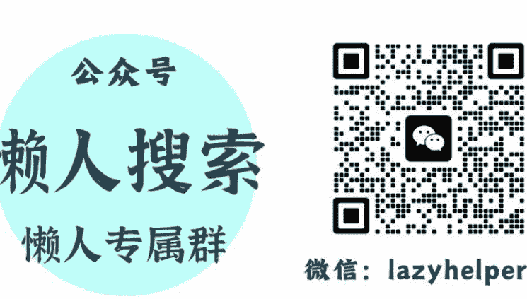
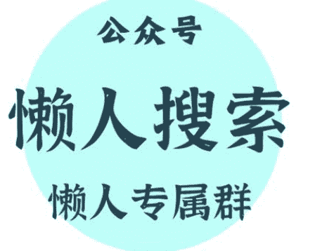

## 政治的逻辑

**小懒判断**：适合对政治博弈底层逻辑感兴趣、想看懂权力运作规律的人，不适合只想看赚钱实操的。最值得关注的是赫鲁晓夫不杀政变者的真正原因——不是善良，是杀了坐实“又一个大斯大林”，执政根基直接动摇，杀政敌比留政敌代价更大。坑在于文章把复杂政治简化为单一因果链，真实博弈比“不杀=正确”的框架复杂得多。

这几天逛知乎，刷到一个很有意思的问题——历史上有没有政变失败却能善终的案例？

你别说，还真有这样的案例。

1957年莫洛托夫、马林科夫等人趁着赫鲁晓夫出访发动政治偷袭，企图在苏共中央主席团会议上依仗前期串联获得的多数票罢免赫鲁晓夫。结果呢？

赫鲁晓夫采取扩大参与者的模式，将中央主席团投票扩大成所有中央委员集体投票，结果却是赫鲁晓夫不但获得大部分中央委员的支持，而且军方与克格勃也支持他，最后莫洛托夫、马林科夫被打倒成为新一轮的反党集团。

在斯大林时代，这类政变失败者百分百会被物理消灭的，但是赫鲁晓夫却手下留情，只是免掉了政变者官职，这些人最后都是善终。

看了一下问题后面的评论，大多数都是表扬赫鲁晓夫同志善良有底线。事实真相真是如此吗？

不是。

为什么赫鲁晓夫不杀这批政变失败者？这里就涉及一个政治的逻辑问题。

首先，赫鲁晓夫是怎么上位成为苏联一把手的？是反斯大林上位。做秘密报告，还要清算斯大林的遗毒，让赫鲁晓夫成为反斯大林的第一旗手。为什么赫鲁晓夫反斯大林能得到苏共全党的拥护？

因为斯大林时代把全党都整怕了，只要让斯大林不爽，即便位高权重明天也会被物理消灭，这种人人自危的局面让全党都整怕了，所以一旦有人出面表示要彻底结束斯大林时代，并且要清楚斯大林时代的遗毒，自然能得到全党的拥护。

为什么莫洛托夫、马林科夫前期串联苏共中央主席团多数人准备罢免赫鲁晓夫的时候，赫鲁晓夫能得到绝大部分中央委员与军方的支持？

不是赫鲁晓夫威望有多高，而是大部分中央委员与军方都担心莫洛托夫、马林科夫一旦成功，赫鲁晓夫这面反斯大林的旗手下台，苏联又回到斯大林时代！毕竟莫洛托夫、马林科夫搞赫鲁晓夫的原因就是因为后者要清算斯大林时代的罪责，这批人首当其冲就统统都是斯大林时代的旧人。

那么赫鲁晓夫胜利之后为什么不处决这批改变者？因为一旦赫鲁晓夫用物理消灭的手段解决反对者，那么他与斯大林有何区别？这个决定一旦做出，莫洛托夫、马林科夫固然小命不保，但是赫鲁晓夫自己执政根基就会动摇，大部分中央委员与军方都会离心离德。

所以赫鲁晓夫不杀改变者与善良有底线没有一毛钱关系，纯粹就是要遵循基本的政治逻辑，他在苏共二十大批斯大林个人崇拜，核心叙事就是：斯大林把党内分歧变成生死问题，同志变敌人，敌人变死刑犯。

如果他上台后把败给自己的老布尔什维克拉出去枪毙，那他就坐实了又一个斯大林。

所以不杀政敌等于明二十大路线是正确的。杀改变者，比留改变者代价更大。

某种层面甚至可以说，在苏共20大之后，不能用物理消灭手段解决党内分歧已经成为苏共的全党共识，谁敢打破这个共识谁就人心丧尽，离下台也就不远了。

那么1964年赫鲁晓夫为什么还是被搞下台了呢？这是另一套政治逻辑。

赫鲁晓夫是搞政治起家，处理实际事务能力平平，偏偏志大才疏好折腾，内政外交搞一大堆所谓的新政，却毫无例外全部失败。

改革这个事，过去我们常说会有阻力，会触动既得利益集团，所以改革成功的标志是什么？是触动既得利益集团，削减了既得利益集团蛋糕之后你得做出更大的蛋糕。也就是你得罪既得利益集团之后，必须要创造新的受益者，这个受益者就是坚定支持你改革对抗既得利益集团的基本盘。

随便列举一下历史上成功的改革者：

- 小平同志：农村包产到户，农民先富起来，乡镇企业主变成新既得利益者，他们天然拥护改革；然后沿海开放，外贸商、外资、特区官员都成了改革的受益者。老体制的人虽然利益受到一定的损害，但新蛋糕大到足以让大多数人选择跟着小平走。
- 彼得大帝：改革触动保守贵族，但他造出了新贵族（按功绩授衔）、新官僚、新军方，这些人靠改革吃饭，是改革的铁杆支持者。
- 明治维新：打掉幕府，但迅速用华族制度、新军、新官僚体系让更多的草根阶层成为受益者。

赫鲁晓夫呢？他搞农业改革，但没让农民真正获益（集体农庄框架没动），也没让管农业的官僚拿到新权力，玉米革命又惨遭失败，农业减产让所有种植玉米的农民与基层官员骂娘。

他搞工业改组，地方书记觉得被削权，中央部委觉得被架空，工业产值也没上去。他对外搞冒险，结果古巴导弹危机又被打脸。

赫鲁晓夫的改革相当于他拆了旧房子，但没盖新房子，也没给帮他拆房子的人分房间。所有人都在为他买单，没人从他改革中受益。所以赫鲁晓夫改革搞出来的就是全党都成为他潜在反对者，下台就是一种必然。

赫鲁晓夫对苏联最大的贡献就是结束了斯大林的黑暗森林时代，从此苏共对于党内分歧从过去的物理消灭改变成组织处理，党内斗争失败生命是没有问题的，基本待遇也能保留。

正因此，1964年赫鲁晓夫下台后也就能善终，对比一下斯大林那么强势的领袖，最后被自己绝对权力反噬反而得不到善终。

这方面还是教员看得远。1942年延安整风时，教员就明确提出，对于党内分歧甚至反对者基本原则就是，一个不杀，大部不抓，这个原则以后一直保留下来，这就很大程度上让中国（因为敏感词的原因）避免了苏联后来的解体悲剧。

中国有一句老话，做人留一线，日后好相见，这个留一线不仅对于普通人，甚至对于对手也是适用的。

所以，宽容不仅是一种美德，更是一种大格局。

在这个 AI 能替你写代码、写文章的时代，基础技能正在迅速贬值。绝大多数人正被淹没在海量的免费垃圾信息里，陷入低效的体力内卷。

当“努力”不再是壁垒，人与人之间唯一的护城河，只剩下“信息过滤”的效率与“认知系统”的维度。

圈子已稳定运行 7 年。我们每天利用 Python 爬虫与大模型算力，过滤全网最顶级的政经内参和搞钱风向标，做你最冷酷的“外部大脑”。

如果你认同这种“重塑认知防线”的极客主义，欢迎围观我的个人情报智库：【懒人专属群】。

https://lazyso.com/insider/

认同信息过滤价值、想省下每天 3 小时无效阅读时间的读者，扫码加我微信（lazyhelper1）

