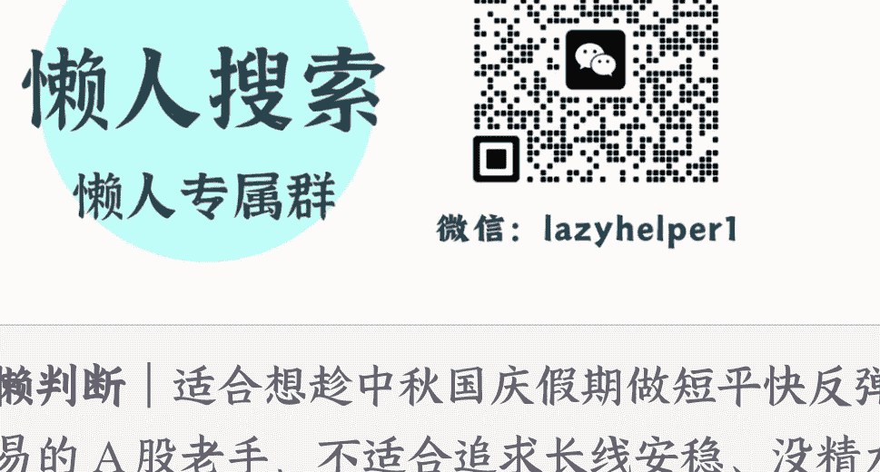

# 2026 中秋国庆过节锦囊【加息篇】

**260916 观星老道**

整理：公众号懒人搜索，懒人专属群精选
懒人微信：lazyhelper1

> **小懒判断**｜适合想趁中秋国庆假期做短平快反弹交易的 A 股老手，不适合追求长线安稳、没精力盯盘的保守型股民。重点盯紧美联储周四凌晨宣布加息前后的节点，主攻科创芯片特别是光刻机、光刻胶等小市值方向。行情节奏快且短暂，最大的坑是美联储加息可能引发川普重启关税等地缘风险，盲目重仓追高没及时撤退容易直接被套。

在漫长的时间里都被认为是老 A 死多头的李大霄老师最新表态请参考：李大霄：A 股牛市已经告一段落现在处于结构性调整阶段，到 2026 年的 5 月 14 号是基本告一段落判断熊市的三大要素：

- **第一：杀估值，杀盈利；**
- **第二：流动性紧缩；**
- **第三：重大危机。**

从三大要素上继续跟踪去看，当前杀估值条件已满足，杀盈利还尚未出现；流动性紧缩风险存在但并不一定会出现；重大危机并未出现。因此，对当前市场的综合研判为熊市要素仅满足一个，有两大隐患存在，尚未证实滑向深度熊市。

未来两个隐忧中，其中流动性紧缩的风险概率不大，但需要留意美联储会议加息动作与连续性。以及国外科技资本开支绝对值是否缩减，这是判断后续行情的关键因素。

短期去看，指数还不存在大跌的基础条件，美联储议息会议落地后，情绪有望回暖，交易机会有望增加。

以往的中秋国庆这种长假连着放我们都会选择休息休息节后再战，但这次恐怕不一样，这次是要趁其他人休息我们先干 ta 一炮，争取打好了再高高兴兴地休息。本篇重点就是“假设”会有一次反弹，那么如何把握？

上接前文：2026 年九月锦囊：从白露战到秋分（本篇内容较多请仔细阅读）

1. 处暑那篇了，所以原本的时间线大家还得回忆回忆；
2. 如果中秋的 visit 能顺利进行，那么中秋前的盘中暴跌即是我们手里的囤积的预备队大规模入场的机会，今日点解我也写了：260916 盘前参考汇总
3. 如果没有再出现 9 月 11 日那种盘中暴跌，那稳妥的打法就只能先等美股出现反弹再跟，美股不出现反弹则不能跟（因为美股走势目前看起来也很危险，未来模棱两可）；激进的打法就是抢美股的先手，此种打法也就不用考虑美股反弹的具体是什么板块哪个结构了，因为大概率都是 AI 科技股相关（包括上游原材料）
4. 性质上按照短暂的反弹理解，短平快的行情节奏要求稳准狠的买进卖出策略——不管之后跌了还是稳，反正我认为反弹会很迅猛、很短暂；
5. 从时间方面看，我不仅维持前两篇锦囊的观点，而且认为时间会具体到下周展开，即中秋前后；早的话美联储周四凌晨宣布加息前就开始启动（也就是周三今天），持续时间久的话我认为最多可能覆盖到国庆节后一个交易日。
6. 分板块看主攻方向目前看起来是周二提前启动的科创芯片方向，包括光刻机/光刻胶等（甚至可能主攻方向就是市值偏小的光刻机/光刻胶方向）——AI 算力方面的光和存这两大业绩最好的品种要看美股那边是什么反应，美股的对应品种有大反弹的话这边才可能有反弹，而且还得配合大放量否则这些权重股难以反弹出高度。
7. 美联储加息的各种版本影响可参考：今夜，白宫发声！“沃什没有退路”！美联储利率决议，最新研判→这里我猜沃什可能会采取的策略是：加息但不提供前瞻性指引——这也会给市场制造一个反弹的有利条件。

本阶段川普表态：此前，特朗普不仅口头呼吁美国应享有“全球最低利率”，甚至威胁若美联储不降息，将考虑切断与部分贸易逆差国的贸易往来，试图将货币政策与贸易政策捆绑。他还曾敦促沃什“做爱国者”。

相当于是回击了上一代美联储主席对他的逼宫，回味：日【权力的游戏】我花了一分钟时间让人工智能替美联储鲍师傅设计了一套组合拳对付川皇所以如果美联储加息，那往往意味着是连续加息的开始，而沃什不敢直接说连续加息的指引——不敢把川皇得罪太狠了；所以只能搞模糊化，而这种模糊化的伏笔是他自己老早就预设好的，可谓滴水不漏环环相扣。

而且只要美联储加息，那么川皇就会重启贸易战/关税地缘威胁，这又会给市场增添新的风险与不确定性。

———分割线———

在这个 AI 能替你写代码、写文章的时代，基础技能正在迅速贬值。绝大多数人正被淹没在海量的免费垃圾信息里，陷入低效的体力内卷。

当“努力”不再是壁垒，人与人之间唯一的护城河，只剩下“信息过滤”的效率与“认知系统”的维度。

圈子已稳定运行 7 年。我们每天利用 Python 爬虫与大模型算力，过滤全网最顶级的政经内参和搞钱风向标，做你最冷酷的“外部大脑”。

如果你认同这种“重塑认知防线”的极客主义，欢迎围观我的个人情报智库：【懒人专属群】。

[https://lazys0.com/insider/](https://lazys0.com/insider/)

认同信息过滤价值、想省下每天 3 小时无效阅读时间的读者，扫码加我微信（lazyhelper1）

微信：lazyhelper1
