## 00后到三亚旅居做摄影，从0到660元一小时，1年半营收20W的创业复盘

> 260922 副业 SC 精华

整理：公众号懒人搜索，懒人专属群精选

懒人微信：lazyhelperl

**小懒判断**｜适合有基础摄影能力、想旅居兼顾收入的年轻搭档，不适合不会摄影就想收高价或受不了户外高温的人。最值得抄的是定价升级路径：沙滩10元一张到小红书660元一小时，换个渠道定价方式就变了。坑在体力依赖加地域限制，旺季月入2万淡季只剩几千，个性化体验难复制，作者最终选择离开。

没有门店、没有员工、没有投流，大号涨粉200多、小号粉丝一百多，普通人如何通过自媒体获客，把爱好做成一门累计总营收约20万元的小生意？

大家好，我们是东东和西西，一对来自成都的00后创业搭档。

这篇文章想分享的，不是一个“靠摄影轻松暴富”的故事，是两个普通年轻人，凭借勇气奔赴梦想大海，靠自己跌跌撞撞去实现想要的自由的经历。

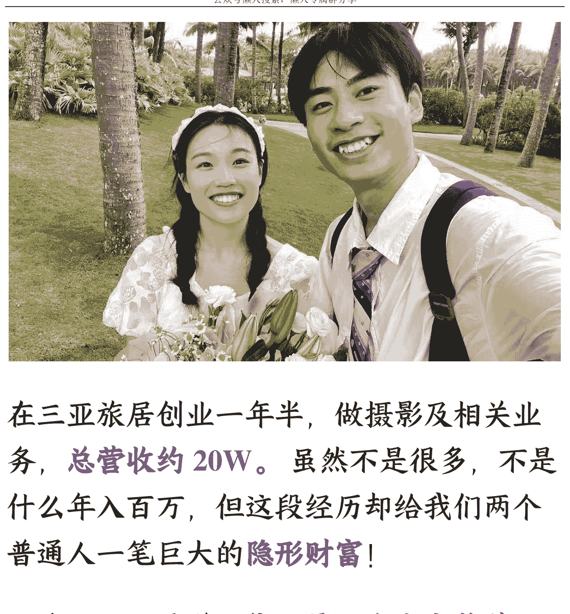

在三亚旅居创业一年半，做摄影及相关业务，**总管收约 20W**。虽然不是很多，不是什么年入百万，但这段经历却给我们两个普通人一笔巨大的**隐形财富**！

因为这不只是赚了钱，**是两个小白收获了无限的鼓励和爱**，还学习和悟到了许多赚钱的认知、丰富了经验。

我们将这次经历毫无保留的整理分享出来，希望也能让更多的普通人看到希望：

没资源、没学过做生意的普通年轻人，想去三亚看一次海，为糊口从沙滩上 10 元一张临时拍照做起，慢慢上手线上获客、设计产品、提高客单价、服务客户、做口碑转介绍和整合本地资源，跑通整个独立摄影赚钱项目。

作为普通人第一次深刻理解：**会一项技能，和把这项技能变成一门生意，中间还隔着很长一段路**。而我们，一一走过。

□ 全文阅读约需要 20 分钟左右，可收藏分多次读完。第一次写帖子，如果有建议也欢迎圈友们提出，相互学习。

### 一、最初 的开始，只是热爱自由，向往大海

事情的起点很简单，生在四川盆地的孩子，哪见过大海。

西西我长这么大，20多年没见过海，一直想去“东东，我好想看海啊。”

东东也没见过海，他立马答应：“好，我带你去看海！”

原本只是说说而已，以为以后有机会就去吧，因为那时刚毕业没多久，存款不多，连坐飞机去旅游，都觉得是一笔需要认真考虑的开支。

但东东执行力超强，他直接开始当年计划：就是国庆节了！趁着高速免费，可以从成都自驾海南！一路边走边玩，在三亚从10月中旬住到元旦，再开车回来。

时间越临近，我越发带着疑惑问东东：“啊！？真的要去吗？就直接去了？”

“对啊！”然后就被一直安排，反应过来时，已经在自驾去看海的车上了。

为了省钱，我们把面包车简单改成了可以睡觉的“房车”，带上行李、有限的生活费，还有我们的猫，出发了。就这样，丢掉之前的工作和生活，说走就走。

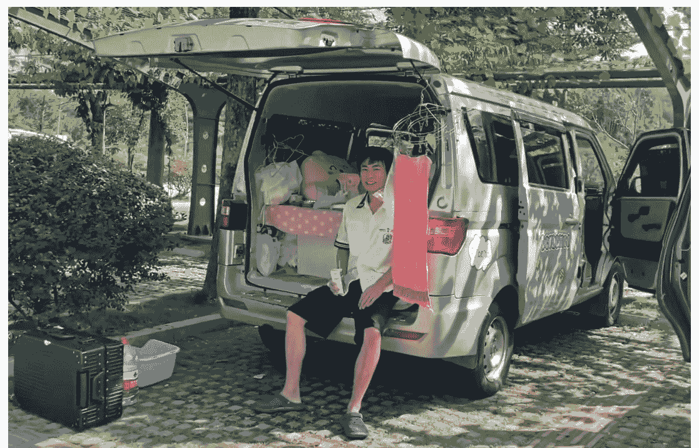

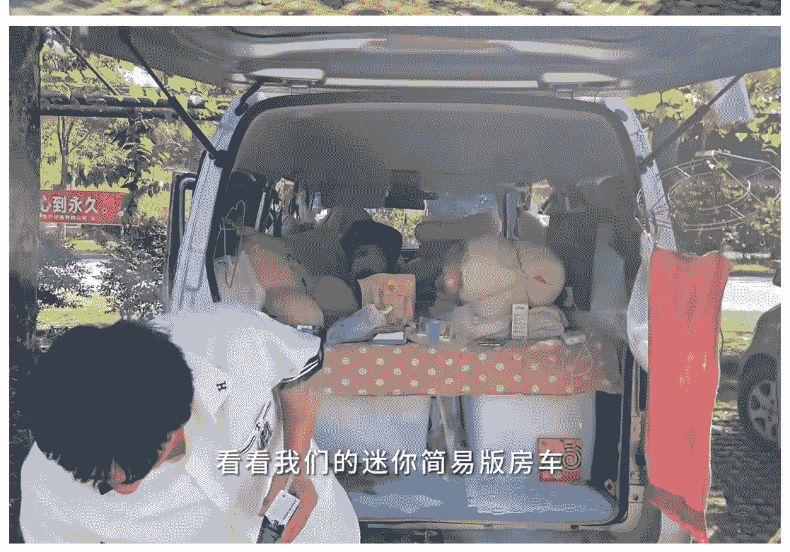

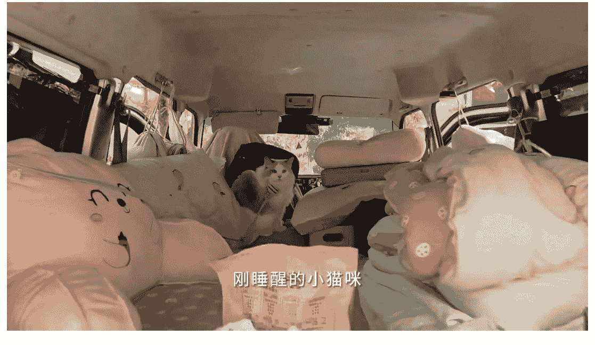

出发时，我们的口号是：

青春没有售价，成都自驾三亚。

起初我们没有什么创业计划，首先我们都来自普通家庭，家里没有教过怎么做生意，也不会给我们支持，其次，我们自己也囊中羞涩，没启动资金，只想着到了三亚以后，至少要想办法覆盖生活开支，办法就是靠摄影。

东东对摄影是真热爱，也是实打实的“技术派”——自己攒齐专业设备，对着教程啃过光影、构图和后期修图，对照片调色和质感、出片质量有股较真的劲儿。除了给身边朋友拍，也自己接些婚礼跟拍、人像写真的单子。去三亚之前他就打定主意：靠给游客拍照，起码能赚出生活费。西西我则打算做小红书，更新我热爱的舞蹈和旅居日常，看看能不能靠自媒体获得收入。

感觉人一旦有了热爱，就有了无限力量！

就这样，两个懵懂无畏年轻人开始了追求热爱，奔赴大海的故事。

谁曾想，原计划只在三亚住两个半月，没想到却开启了三亚创业之路并持续了一年半。

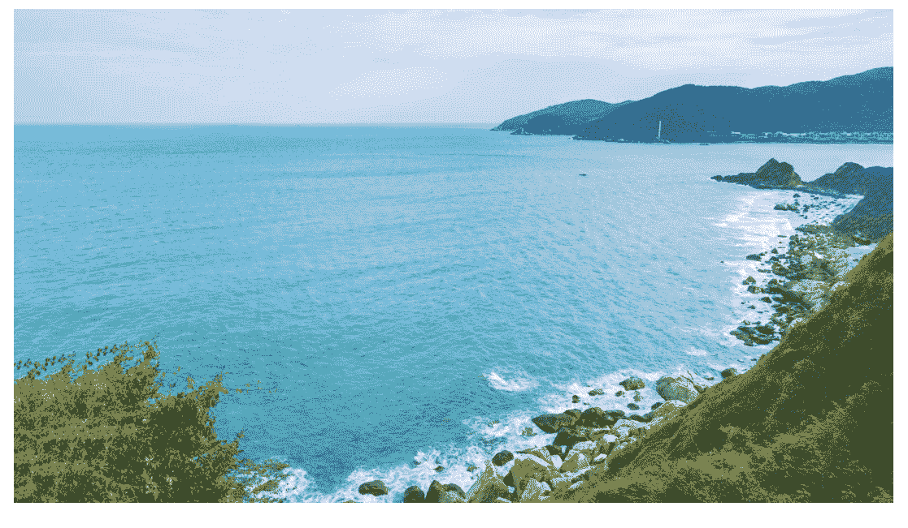

### 二、第一阶段赚钱方式：沙滩上找游客拍照，一张 10 元

刚到三亚时，我们对当地不熟，东东最开始采用的方式很直接：拿着相机去游客多的沙滩，主动询问别人要不要拍照，一张10 元。这看起来简单，但真做起来并不轻松。

一方面，他既要拍照，又要主动招揽客户。大多数游客会拒绝，脸皮薄一点的人很难长期坚持；另一方面，沙滩拍照市场非常混乱。大家不会比摄影风格、服务和后期，只关注“你拍一张多少钱”。

有人报 10 元，就有人报 5 元。还有人用高速连拍拍下大量照片，再让游客打包购买。游客在相机里看时可能觉得还不错，拿到手后却发现真正能用的照片很少，会发小红书吐槽让大家避坑，久而久之，也影响了整体沙滩摄影师的口碑和信任度。

但东东其实会修图，也有自己的审美要求，即使只卖 10 块钱一张，他回家后还是会用心认真处理照片，因为他是真的热爱。对比沙滩一些同行来说有自己的优势值得被看见，但在那个环境里，这些差异却被埋没。游客从沙滩路过，没时间去了解你是谁、拍摄水平怎么样、会不会精修、是否好相处，最终只能沦为被游客比价的对象。

我们意识到：

当一个市场只按照最低价格比较时，个人的技术、审美和认真程度很难被正确定价。

所以，待在不适合展示自身优势的成交场景里，无法体现我们的优势，那么，我们必须要改变！

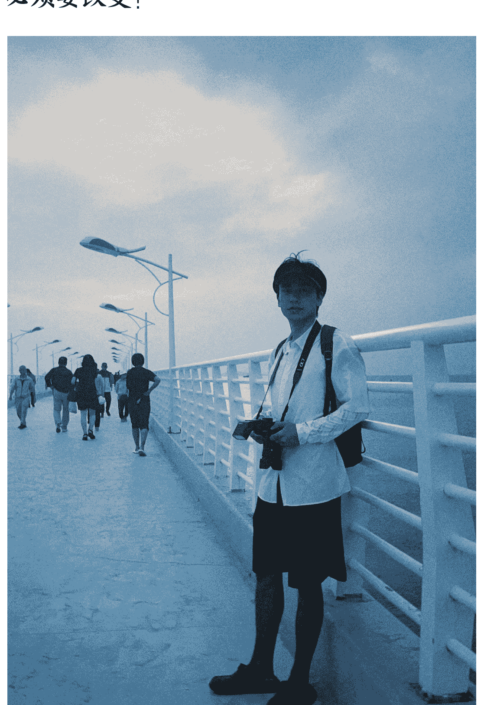

### 三、第二阶段：开源，不只线下沙滩，线上也要揽客

每天在外面晒太阳、不断被拒绝，收入却不高信心还受挫，我们开始商量：能不能多加一种获客方式？

经探讨，西西我决定暂时放下原本自己做的账号，转而帮东东在线上通过自媒体接单，新建了小红书和抖音账号，把东东拍的照片整理发到网上。

当时并不懂复杂的运营方法，也不会设计流量玩法，想法很朴素：游客在去三亚之前，可能会提前搜索三亚景点、甚至摄影师，我们把照片发出来，先让真正有需求的人看见，才有机会被找上门来。

#### 第 1 位线上客户：一小时 180 元

我们最早第一位线上客户，是通过抖音刷到我们、独自三亚旅行的男生。

旅拍客户大多是女生，所以市面上有很多女摄影师很吃香。我们反思，或许对这位男生来说，找男摄影师一起旅行、拍照，反而更自在，所以他选择了东东。当时我们的价格是 180 元一小时。

他一边去景点游玩，一边让东东跟拍，还连续找我们拍了两次。

虽然 180 元一小时价格不算高，但和在沙滩上一张张卖相比，收入已经明显提高了。更重要的是，客户是提前了解作品后主动找来的，不需要东东一直站在沙滩上硬着头皮推销。

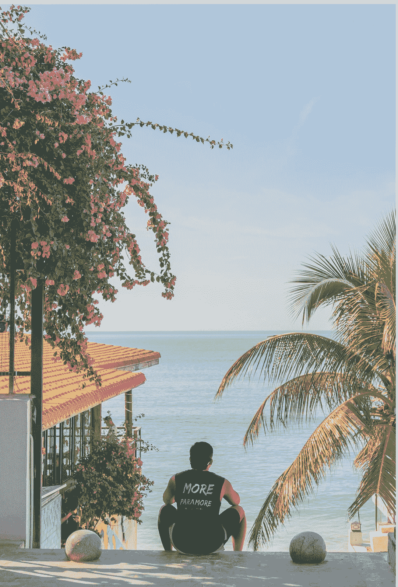

#### 第 2 个线上订单：日入破千！

第一次让我们体验到“自由职业，日入上千”快乐的，是第二个线上订单。

那是一对来三亚度蜜月的新婚夫妇，我们的报价仍是 180 元一小时。但在聊天时，我没有只问他们“准备拍几个小时”，而是继续了解：

- 想拍什么样的风格？
- 想要蓝天白云、落日，还是夜景？
- 与之对应的服装有没有准备？
- 客人还说需要化妆？我们就赶紧安排

他们远道而来，其实不只是想拍几张游客照而已，更希望认真记录二人的蜜月旅行。

给他们详细介绍了我们能拍的内容后，他们决定拍三套服装，覆盖不同时间段，一共拍了6个小时。

结算尾款时，180元乘以6小时，加上化妆道具等费用，一共 1200!

我们当时都震惊了，以为还计算器按错了!

因为在一个月前，东东还在沙滩上为一天一两百努力，转线上后，第二个订单就实现了单日过千！

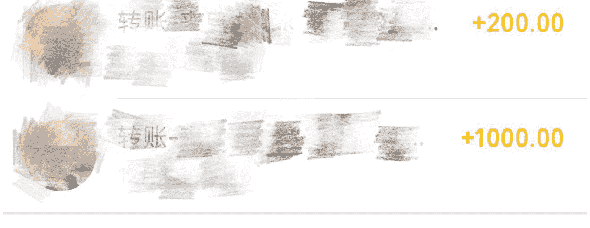

这次经历让我们第一次理解：

销售不是强迫客户多花钱，而是帮助客户把模糊需求理清楚，再给出适合他的方案。

客户原本可能只知道“我想在三亚拍照”，但当我们站在他们的角度，为他们着想，把不同时间、场景、服装和体验讲清楚后，他才知道自己真正想要什么，而我们也刚好能提供，就达到了共赢。

当然，我们刚开始也闹过一些小笑话。客户问我们能不能安排化妆师，客人需求怎能推辞？立马答应安排，临时去找。因为害怕化妆师当天临时爽约，东东曾提出让对方先交一笔小额保证金，确认到场后再和化妆费一起返还。第一位化妆师接受了，但后来我们再这样联系别人时，直接被拉黑。这才知道，我们完全不懂行业合作规则。

现在回头看，那些有点笨拙的操作，反而是创业最真实的部分：没有准备得万无一失才开始，是一边接单，一边发现问题，再一点点补课。

### 四、第三阶段：业务升级

线上开始有订单，我们又发现了新问题：账号里的照片风格不对。

东东在沙滩上拍什么客片我就发什么，而大多数照片集中在傍晚和日落的时分，其实不是他自己喜欢的清新、自然、阳光明媚的人像风格。

如果我们只不断发布已接到的订单，就只能被过去的客户定义，很难主动决定以后想接什么样的客户。

我们慢慢意识到：

摄影师不能只发已有客片，还要主动创作代表自己方向的样片。这时，我们在小红书上又认识了一位同样来自成都、正在三亚创业的年轻摄影师，对方在三亚刚开办工作室，也准备了很多写真服装，友好且志同道合合并愿意和我们合作，至此我们在三亚的人脉也徐徐展开，开始融入本地环境。

与此同时，我们一开始定的两个半月期限很快就到期，而体验到不给别人打工，自己赚钱的快乐后，我们都不想走了，决定留下来，好好大干一场！继续边赚钱边享受三亚海边旅居生活。我们便开始调整，再次出击了！

#### 一、创作样片：想拍哪种订单，就先主动创作哪种样片

我们想法也很简单：游客来三亚，本来就是为了海。既然要在海边拍照，就应该是印象中阳光、大海的美景和玩海的快乐，而不是之前总拍的海边日落晚霞，还有站在沙滩上摆拍。于是，我们开始创作新的海边样片：阳光大海泳装拍摄，我做模特，东东来拍摄和后期。

记得第一次拍样片，我们上午 8 点左右去海边，顶着太阳拍了三个多小时，整个人晒得很黑，还差点中暑，但功夫不负有心人，最后成片成为了我们业务转型的重要起点。

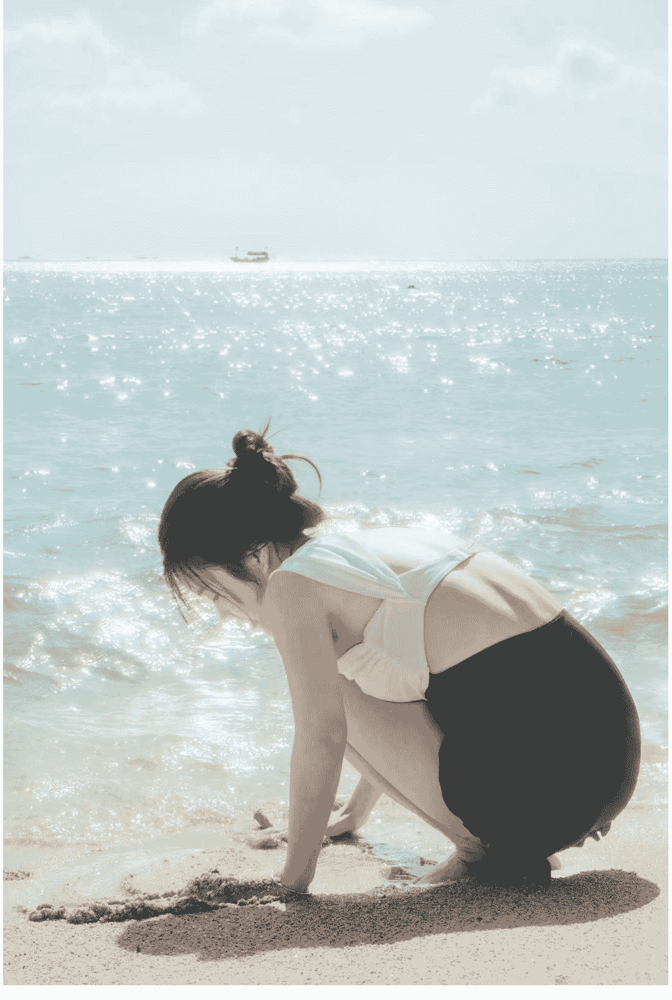

这组清晰自然、阳光明媚的海边写真发布后，很受欢迎，开始有人主动咨询。

从那以后，只要有时间，我们就自己或约朋友一起创作样片，不再完全依赖客片决定账号内容。

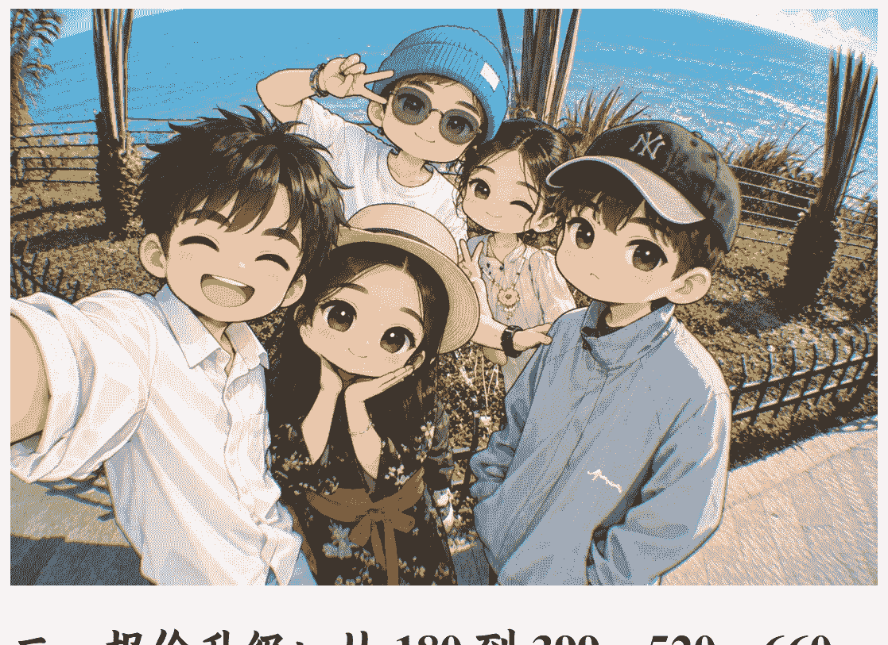

#### 二、报价升级：从180到399、520、660元，我们开始重新设计产品

想继续待下去，在有了新的样片后，我们开始重新思考报价。因为我们算了算，太低的价格，根本无法支撑三亚的生活成本，更无法涵盖我们的摄影专业设备器材耗损、升级，以及我们的学习成本，加上两个人的全职投入。这时发现，*算账能力真的非常重要*，直接影响报价和收入。

早期的180元一小时，无论一个人、两个人还是一家人，我们都按时间计算。

但真正拍过以后，我们发现，不同人数的服务和沟通成本也很有差别：

一个人拍摄，主要需要处理个人状态、动作和修图；两个人拍摄，要兼顾双方，还要设计互动；亲子拍摄不仅人数更多，还涉及孩子的状态、家庭氛围、现场节奏，以及每个人不同修图需求。

所以，为了收入能让我们用心投入、服务好并交付好每位客户，还能持续保持甚至升级更新，我们重新设计了三个基础价格：

- 单人拍摄：399元/小时；
- 双人拍摄：520 元/小时；
- 亲子拍摄：660 元/小时。

这个价格相较于 180 元几乎翻 2 倍，我们一开始也会担心：客户真的愿意买单吗？

但当我们开始第一单时，发现客户能接受！

反而一些同行知道我们的报价后，会被吓一跳。

这也让我们意识到，想提高收入，先要有能力，再要会算账，然后提高价格的同时同步提高整套交付，最后拿去给市场验证看行不行得通，而不能畏畏缩缩不敢上前。

我们升级了如下拍摄规则，当然很多也是跟着同行以及网上独立摄影师学习来的：

- 拍前了解客户需求，提前沟通拍摄事宜；
- 提前说明迟到、改期、定金和交付规则。
- 提供服装、化妆和场景建议；
- 根据时间和光线、喜好定制规划拍摄路线；
- 现场帮助客户进入状态、控制拍摄节奏，服务好客户每时每刻心情和状态；
- 拍后认真筛选和精修，完成售后并且调查满意度，满意为止；

我们卖的不再只是“摄影师的一小时”，而是一次从咨询开始到拿到照片的完整体验。

这套新价格和交付流程发布后，陆陆续续有人咨询并成交。

也正是在这个过程中，我们的核心方向逐渐被市场筛选了出来。

#### 三、如何定位：亲子 or 情侣？我们说了不算，市场给出了答案

在选择拍摄细分方向时，我和东东最初其实有不同判断。

东东一开始就提出，可以重点尝试亲子拍摄，认为来三亚旅行的家庭不少，已经成家的客户通常也有更强的付费能力；同行年轻摄影师拍单人的多，拍亲子的少。

但我当时更看好情侣拍摄，首先我们本身就是一对年轻情侣，两个人一起服务情侣客户有优势：东东可以和男生沟通，西西我来陪女生选衣服、整理状态，相处起来也更自然。而东东原本也更常拍女生，所以我认为情侣摄影更符合我们的已有能力。如果拍亲子，担心我们没经验让小朋友配合，更有甚者遇到又哭又闹，就不知道怎么办。

虽然我们定了情侣，但是市场却做出了相反的反馈。

命运的齿轮开始转动，3 小时 1980 元，这次拍摄改变了我们的方向 一位姐姐和她丈夫带 2 岁孩子来三亚度假，看中了我们的泳装样片。

样片并不是专门为亲子客户拍的，但她真心喜欢我们照片清晰明媚的风格，她说问过线上好几 位摄影师，我们的价格不低，但最后还是选择了我们。这也是我们的第一笔高客单亲子订单。

客户准备拍两套衣服，一套泳装，一套海边度假风。

拍摄前，我们提前安排了大致节奏：什么时候拍全家合照，什么时候给妈妈单独拍，什么时候拍父子、母子和孩子玩耍的画面。

这次拍摄里，西西我的角色也从线上客服变成了现场助理。最开始，孩子对我有戒心。如果牵她的手，她会直接甩开。但我本身很喜欢小朋友，也愿意蹲下来陪他玩。互动一段时间后，她慢慢放松下来，就会愿意跟着我玩、被我逗笑。

我负责和孩子互动、调动家庭氛围、安排拍摄节奏、打光，东东则把注意力集中构图、光线和拍摄上。

结算时，一共拍摄3小时，费用为1980元，加上路费扣定金，尾款1800!

我们又惊了，单日收入又刷新高!

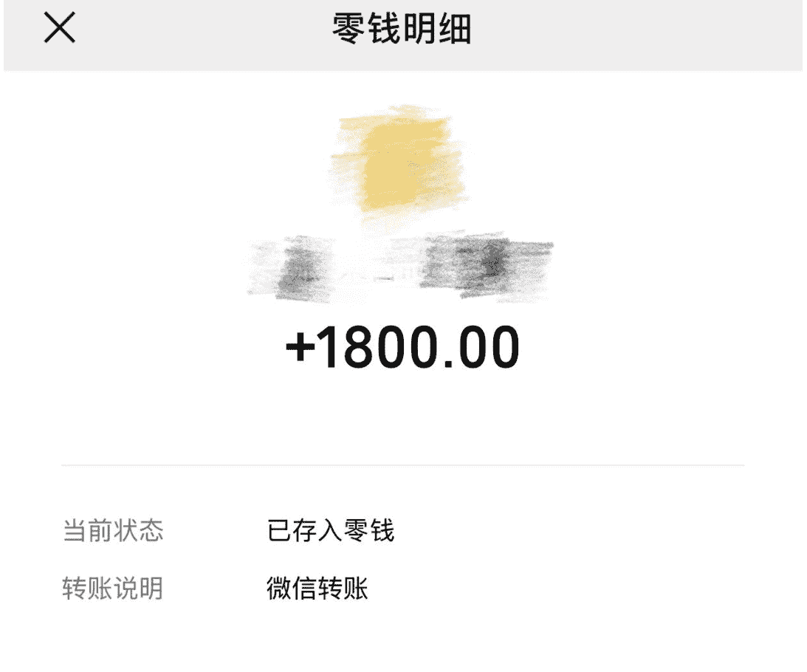

更让我们意外的是，客户不仅满意成片，也很喜欢整个相处过程，拍完后，他们邀请我们一起吃饭，和我们分享自己的家庭和创业经历。更没想到，照片交付后，这位姐姐还主动在网上推荐了我们。

这让我们触动了流量密码:

我们自己发客片，流量很一般，但客户以真实体验者的身份一分享，反而成了爆文，获得了很好的咨询反馈，并带来了一批需求和消费能力相近的亲子客户。

由于体验非常好，我们成了她最信任的摄影师，她后来还邀请我们去她的家乡再次拍摄，为我们安排当地五星级酒店，带我们吃饭、游览，原本的一次拍摄交易，收获[了喜欢和认可以及鼓励，最后还变成了一段很珍贵的友谊关系。

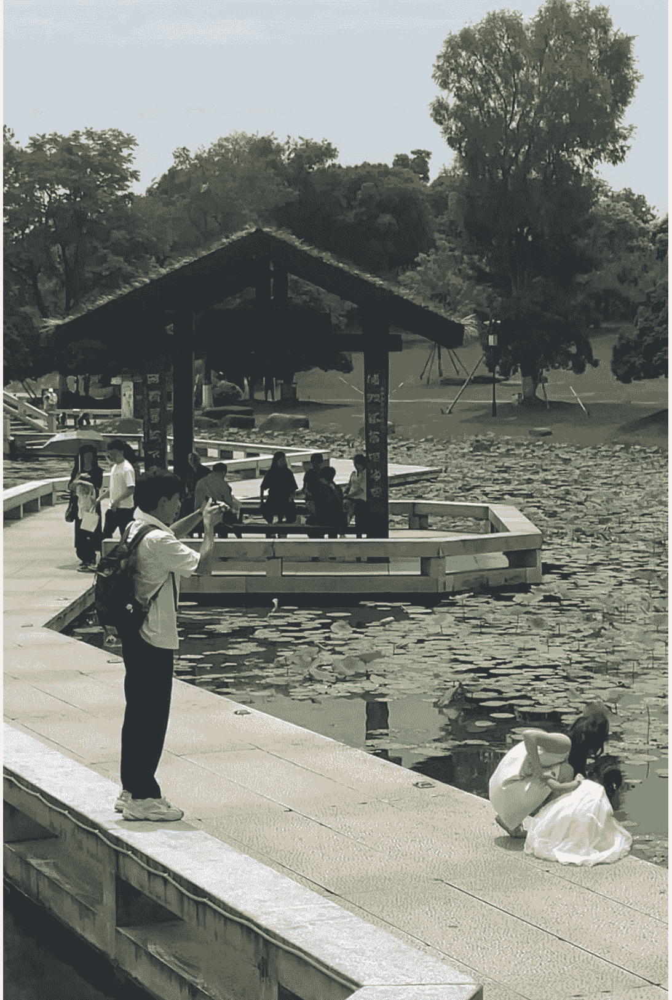

这次订单成片宣传出去后，我们陆续来了许多亲子拍摄订单咨询，经复盘后发现：

相比单纯做情侣拍摄，原来亲子旅拍更能发挥我们的摄影及审美能力，以及在儿童互动、客户沟通和现场节奏控制方面的优势。

最后，我们形成了亲子旅拍为主，单人、情侣、轻婚纱和其他拍摄为辅的业务结构。

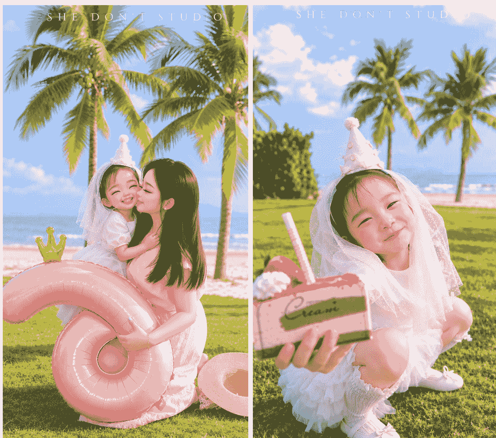

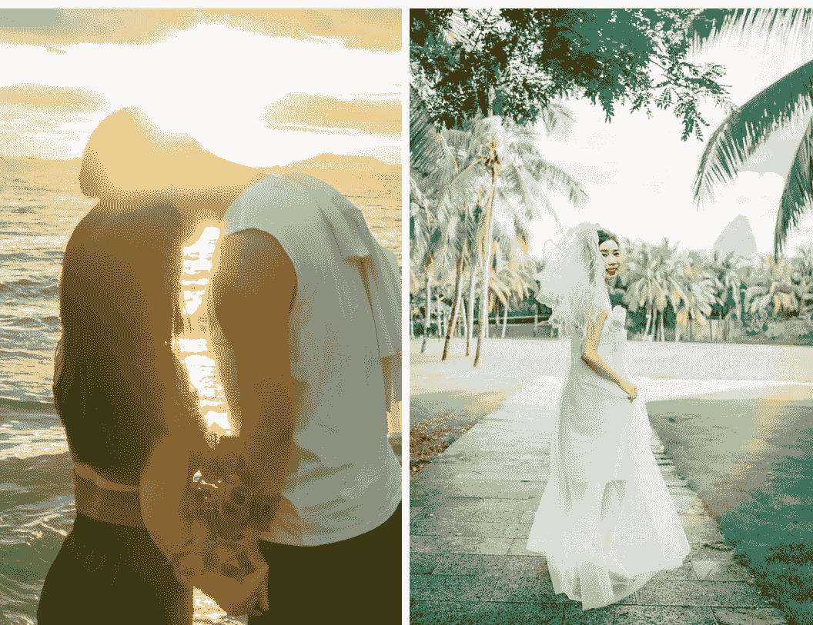

这不是谁一开始就完整预测对了，也不是毫无方向地碰运气，而是一个很真实的尝试过程：

先提出假设，再小范围尝试，用付费订单和客户反馈验证，最后集中资源。所以，定位不一定能在房间里直接准确想出来，但可以在行动中被验证出来。

#### 四、 如何发自媒体线上接单？

大号涨粉 200 多、小号粉丝 100 多，不投流为什么还能持续带来订单？整个三亚旅拍阶段，我们最主要的线上订单来源是小红书，其次是抖音。

我们前后运营了两个账号：大号累计发布了大约 50 篇内容，涨粉 200 多人；小号发布十几篇后，也开始比较稳定地收到咨询，粉丝只有一百多人。两个账号都没有投流，也没有做很复杂的运营玩法。

这件事让我们很意外：粉丝这么少，为什么还能带来订单？后来我们发现，本地服务账号和普通博主账号的逻辑不完全一样。准备来三亚旅游的人，本身就带着明确需求。他们会直接搜索：

三亚旅拍、三亚亲子旅拍、三亚家庭摄影、三亚情侣跟拍、三亚海边写真、三亚摄影师推荐...

这些用户不一定关注我们，也不一定给每篇内容点赞，但只要近期有拍摄需求，就可能直接私信咨询。

所以，我们的目标并不是先把账号做成几万粉的摄影博主，只是让有需求的人在搜
索时看见我们，并迅速判断：

- 喜不喜欢这个摄影风格；
- 这对摄影搭档是否好相处；
- 能不能拍好孩子；
- 拍摄过程是否轻松；
- 价格和服务是否匹配；
- 之前的客户是否满意。

所以我们设计线上发布的内容主要包括几类：

### 1. 客片：证明最后能交付什么

客片是最直接的结果展示。不同人群、不同时间、不同场景，都可以帮助客户想象自己拍出来的样子。

### 2. 主动创作的样片：告诉市场我们想接什么

如果只发随机客片，账号很容易没有方向。样片能够主动定义风格、客户和产品。

### 3. 拍摄花絮：让客户提前感受合作过程

很多人担心不会摆动作、孩子不配合，花絮可以让他们看见我们怎样引导、怎样互动，降低不确定感。

### 4. 生活和介绍：建立基本信任

客户不只是选择一台相机，也是在选择要共同相处几个小时的人。让别人知道我们是谁、为什么在三亚、平时怎样工作，会提高信任感。

### 5. 客户反馈和推荐：提供第三方证明

我们自己说服务好，远不如客户主动分享有说服力。尤其是亲子客户的反馈，更容易影响相似家庭。

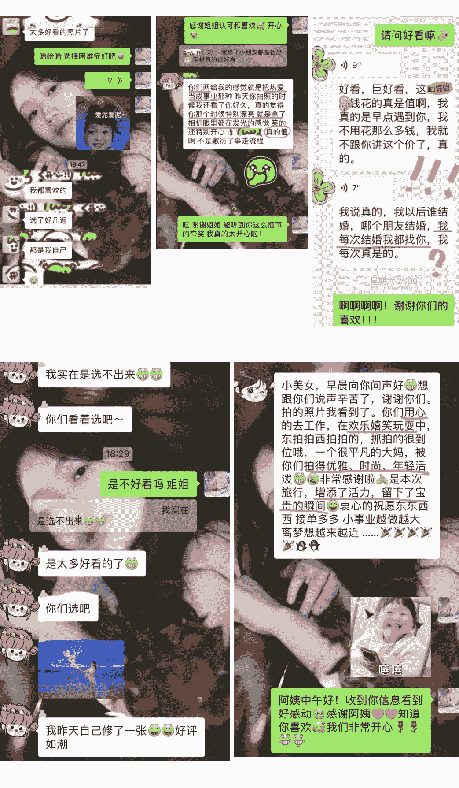

接单账号不一定需要很大粉丝量，只要内容足够精准，能匹配到真正有需求的人。

那我们小红书的内容就承担了四个作用：

被搜索到、展示结果、降低顾虑、承接咨询。有了这些，客户有兴趣后，引导到私域聊单，成交率才能更大。

而我们也总结了一点非常重要：**聊单，是双向选择的过程**。我们会通过线上沟通去筛选掉一部分客户，那些很急躁（可能只是来比价，看重价格不看质量的），语气不好的（可能不太好相处），要求过分的（售后会麻烦）等等，筛选出真正喜欢我们，又注重性价比的客户。

这样做可以节省我们的时间和精力，也能够让我们拿出最好的状态去服务对的人。

而最后加上微信，我们会了解需求、商量档期、价格如何计算、包含什么服务、是否有交通费、怎样收定金、迟到和天气问题等，解决顾虑。

但是要注意！

**自媒体接单也有风险**！靠平台给流量赏饭吃，又不交平台开店铺费用，就要乖乖遵守平台规则，避免限流。

刚做自媒体遇到限流很正常，同行都没有没被限流的，几个浏览量的肯定有问题。

但**心态**不能崩，把能想到的地方做调整，实在不行就删，然后像个没事人一样，照常发笔记和评论养养号，会恢复。

- 敏感词也不能发，发布前都要“零克查词”检查；
- 两个号发的图片和内容都需要做调整，不能完完全全一模一样。
- 引导私域来，也要想尽各种办法，群聊、表情包、小红书号、藏头诗、小号、转发笔记等等分别换着尝试，记得单是表情包我们都做了几十个不重样。

### 五、一笔订单是怎么完成的？我们的亲子旅拍SOP

最初我们并没有一套成熟的SOP，但在一次次拍摄中逐渐固定下来一些流程，经过反思，应该提炼出来，会给整个业务提效。所以，真的得有多思考总结的好习惯。

#### 第一步：先确认客户是否匹配

收到咨询后，我们会先了解：

- 拍摄日期；想拍亲子、妈妈单人，还是全家互动；一共有几位家庭成员；孩子的年龄；
- 住在哪个区域；喜欢蓝天、落日、泳装还是度假风；
- 计划几套服装；是否需要化妆和服装租赁；
- 预计拍摄时长和预算等等。

这些问题不是为了盘问客户，而是判断双方是否匹配，也避免到了现场才发现时间和需求完全对不上。

#### 第二步：把模糊需求变成具体方案

很多客户只会说“我们想拍一套亲子照”。我们需要进一步帮她梳理：

- 孩子的作息适合几点；哪个拍摄离酒店更近；两套衣服如何分配时间；白天和落日能否兼顾；
- 想同时拍妈妈写真，需要如何安排顺序；
- 小朋友状态不好时如何调整。

销售的过程，其实也是方案设计的过程。

#### 第三步：明确报价和边界

报价时，需要讲清楚：

- 按多少元一小时计算；包多少精修；是否提供原片；交通费是否另算；化妆服装和门票是否包含；
- 超时怎样收费；多久交付；可以修改到什么程度，等等。

我们是按时间收费，所以也会提前说明迟到规则。摄影师一旦为某位客户留出档期，就可能拒绝同一时间的其他订单。规则提前讲清楚，反而能减少拍摄后的矛盾。

#### 第四步：收定金并发送约拍须知

确认拍摄后，收取定金锁定档期，并把以下事项说明清楚：

- 天气变化如何处理；临时取消和改期规则；迟到是否计入拍摄时间；
- 现场临时增加人数或服装怎样计算；照片是否允许公开发布；尾款何时支付。

#### 第五步：拍摄前做好路线和节奏安排

亲子拍摄不能只设计动作，还要考虑孩子的情绪和体力。

我们通常会提前想好：

1. 先从全家轻松走动、玩耍开始，降低陌生感；
2. 孩子状态好时，优先拍亲子互动和全家合照；
3. 我陪孩子玩时，东东可以给妈妈拍单人照；
4. 根据光线切换场景和服装；
5. 孩子累了就减少要求，多拍真实互动。

#### 第六步：现场明确分工

- 东东负责摄影、构图、光线、抓拍、调动情绪、指导人物调整、控制节奏；
- 西西负责和客户沟通、整理衣服、哄娃、提醒拍摄和处理临时情况。

对亲子摄影来说，现场有人专门照顾孩子和家庭状态，摄影师才能更专注地抓住画面。

我们后来越来越确信，亲子摄影的壁垒不只是技术。

摄影水平决定照片下限，而孩子是否放松、父母是否省心、全家能否自然互动，往往决定客户对整次服务的评价。

#### 第七步：交付、反馈和案例沉淀

拍摄结束后，完成选片、精修和交付，处理客户合理的修改意见。客户满意后，我们征求是否可以发布成片或反馈。优质案例不仅是作品，也是下位客户了解我们的入口。如果客户愿意主动分享当然更好。

### 五、第四阶段：旺季负责赚钱，淡季才真正教会我们做生意

三亚旅拍的淡旺季非常明显。

寒假、春节和暑假等旅游旺季，亲子家庭明显增多。旺季时，我们一个月营收大约在 1 万多～2 万多元。

除了 660 元一小时的亲子写真拍摄，我们还接过 2500 元、8 小时的包天跟拍，边玩边拍，纯拍摄、不含精修。有些来三亚过冬的客户，因为认可拍摄质量，也和我们相处得很好，会连续找我们拍好几天，还会介绍亲戚朋友。单个客户及其介绍，有时可以带来上万元收入。

但旺季过去后，咨询会明显减少，淡季一个月通常只有几千元。刚开始面对落差，我们也会焦虑。

后来发现，旅游城市的生意不能只看旺季能赚多少，还要看淡季能不能控制住成本。

#### 1. 降低固定开支

10 月份刚到找房租，单间普遍 2 个月 1.3w，吓一大跳，当然租不起。

我们找了好几天捡漏月租 1400 元左右单间，水 9 元一吨，电 5 元一度，停车额外付 300 一个月。

而三亚生活成本很高，一个三四线城市却是一线城市消费，更别说旺季一大波人来过冬，抬高物价。

我们必须开源节流。

所以进入淡季，我们重新找房，最后搬到月租约 600 元的自建房，附近还能免费停车，去市区、海棠湾和其他景点也比较方便。房子条件没有那么好，但固定成本下降后，我们就需要为了交房租强迫自己接很多低价单，可以拿更多时间学习、更新升级。

#### 2. 拓展本地需求

淡季游客减少，我们会接三亚本地的亲子、情侣、订婚跟拍和活动拍摄。

因为本地客户长期生活在三亚，满意后更容易介绍身边的朋友，和一次性游客形成不同的口碑链路。

#### 3. 同行不只竞争，也可合作共赢

我们认识了很多同龄摄影师，也合作了二十多位化妆师，以及提供服装租赁的工作室。

自己档期满时，可以把订单推荐给靠谱同行；同行拍不过来，也会把客户介绍给我们。

客户不想为一套海岛服装专门购买时，可以去合作工作室租衣服，我们再和工作室分成。

#### 4. 设计新产品

平时亲子需求少时，就增加单人、情侣拍摄。

七八月份有双子流星雨，东东本身也是星空爱好者，自己就喜欢拍摄星空，就尝试做银河主题拍摄，吸引来了客户，还可以白天和夜景组合拍摄。

然后，我们再次拓宽业务边界：试水外籍家庭旅拍。

依托三亚大量外籍游客的市场，我们承接了多单新加坡、新西兰、美国混血家庭的亲子旅拍。即便英语并不流利，但依靠简单口语沟通、熟练的拍摄引导，完成所有拍摄服务。

在全网内卷国内客群的时候，我们率先打出涉外家庭旅拍的差异化优势，成为三亚创业末期最后突破。

#### 5. 利用淡季时间，拍样片、学习和交朋友

订单少时，我们会和摄影师朋友一起找新景点、创作样片，也学习小红书、销售、朋友圈经营和独立摄影师的业务方法。这些事情不会立刻产生收入，却会影响下一个旺季能不能接住更多、更匹配的客户。

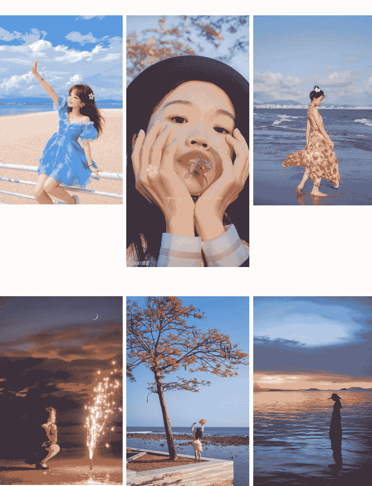

#### 6. 本地体验变成资源合作

搬到新住处后，我们认识了很多同样在三亚做旅游和服务的年轻人：

- 拍南海观音航拍的；做桨板和蓝洞拍照的；
- 做游艇、海钓和海上玩耍项目的；冲浪、浮潜、赶海、跳海的；
- 做摄影、化妆和各种兼职商演的。

我们会先跟朋友实际体验，觉得确实不错，才推荐给自己的客户。客户想玩项目时，我们负责对接，合作方会给一定的介绍费用。

这让我们真切理解了“资源整合”，拍摄收入需要我们顶着太阳到现场，保持服务状态，回来还要修图；资源合作则不一定需要亲自交付，只要连接双方的需求，就可能获得收入。当然，资源整合不是随便转发个联系方式，只有自己了解服务、相信合作方，并愿意为推荐负责，客户才会信任。

经历淡旺季，我们发现：

> 旺季考验接单和交付能力，淡季考验成本控制、产品调整和资源连接能力。

### 六、朋友圈分享，带来近3万元英国出版社订单

自媒体引流私域成交，朋友圈就是门面，需要用心经营，而靠朋友确实也给我们带来了一笔重要订单。

朋友圈持续发布客片、工作花絮和三亚生活，朋友知道我们在做摄影，也能看到作品和工作状态。刚好就有一位朋友介绍了英国出版社的拍摄项目，需要在上海完成书籍或产品相关的静物拍摄。

我第一反应其实是担心。我们以前主要拍人像，没有正式做过这一类产品拍摄，而且还要通过邮件和英国公司沟通。我不知道我们能不能达到对方要求。但东东的反应却很直接：虽然没拍过，但也不难，可以先试。

我们整理作品集，通过翻译工具和对方邮件沟通，再让朋友寄产品来试拍，东东刚好借用三亚朋友工作室打光拍摄。

没想到试拍通过，我们真的拿下了这单，就去上海完成了正式项目。一周左右的拍摄，收入约3000多英镑，折合人民币3万元左右。

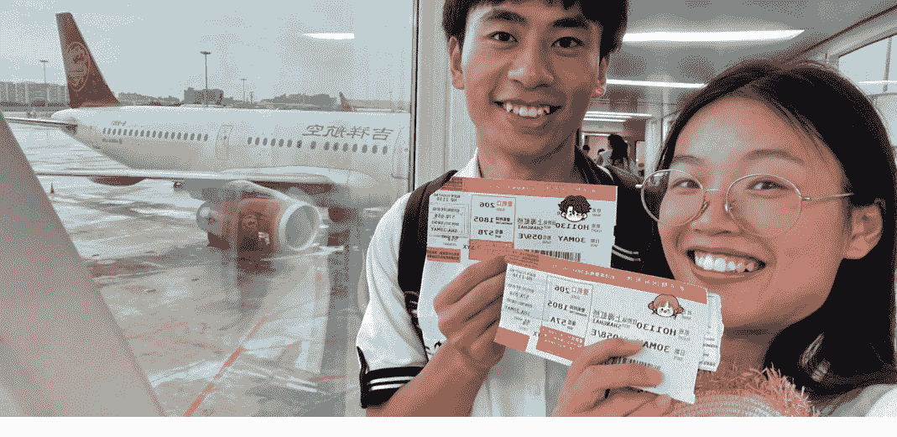

这次经历也给我们很深的体会。

第一，朋友圈不是只发广告。持续展示自己在做什么，相当于不断向身边的人更新你的“能力说明书”，当机会出现时，别人才会想起你。

第二，没做过不等于不能做。学习东东的思维：不给自己设限很重要！可以先判断能力边界，再通过试拍、小范围验证降低双方风险，而不是因为没有同类案例就直接拒绝。

后来回到三亚，我们依然以旅拍为主，但有了这次经验后，也陆续接本地活动和其他商业拍摄。

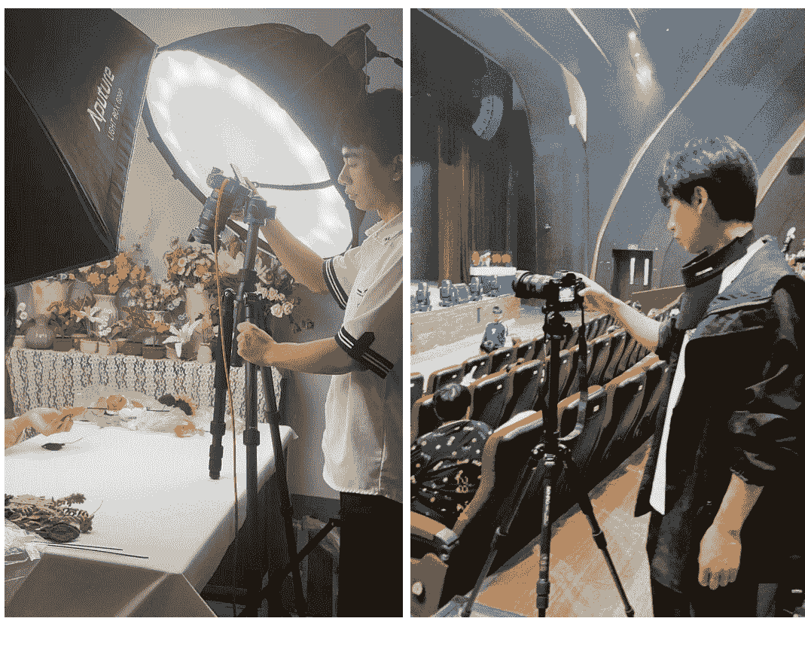

### 七、总结：为什么我们能拿到结果？

回头看，这门小生意能够跑起来，靠的不是某一张照片突然爆了，也不是东东一个人摄影技术技巧好。

起作用的是几个环节连在了一起：

1. **换个渠道，价值的定价方式就变了**

在沙滩上，客户只能比较一张多少钱；在小红书上，客户可以提前比较作品、审美风格、服务、评价和拍摄体验。同样的摄影能力，放在不同渠道里，得到的价格完全不同。

2. **定位不是一次想清楚的，而是不断验证出来的**

东东看好亲子，我更看好情侣。最后不是谁说服了谁，而是亲子订单、客户体验和转介绍共同证明了哪一条路更适合我们。先带着假设行动，再让真实付费和反馈帮助自己做选择。

3. **内容不只是为了涨粉，更是提前预备销售**

客户在私信以前，已经通过主页判断了很多问题，她看过作品、花絮、我们的日常和其他客户反馈后，才决定是否咨询。因此，本地服务账号的核心不一定是粉丝很多，而是能不能在搜索中被精准需求看见，并快速建立信任。

4. **高客单价来自完整交付，而不只是技术**

价格从 10 元一张提高到 660 元一小时，能做下来，是因为我们开始提供更完整的产品：拍前策划、现场互动、节奏控制、精修、规则和售后，当然还离不开我们持续不断学习和积累的审美能力、以及服务客户的能力。

5. **搭档的价值，在于互补**

我们不是两个摄影师，不是两个人都做同一件事。

东东负责设计拍摄，掌握拍摄节奏，现场服务好后期交付完成；西西负责让客户看见、信任、购买，在现场获得好的体验。

两个各司其职一起覆盖了产品、内容、销售、服务和运营，形成了一个最小创业团队。

甚至相互学习，后来东东也可以线上自己接单交付，西西我也从现场摄影助理开始做起，协助东东打光等拍摄，一步一步到也可以上手拍摄，偶尔各自还能分开单独接单拍摄，对彼此来说都是很大的进步。

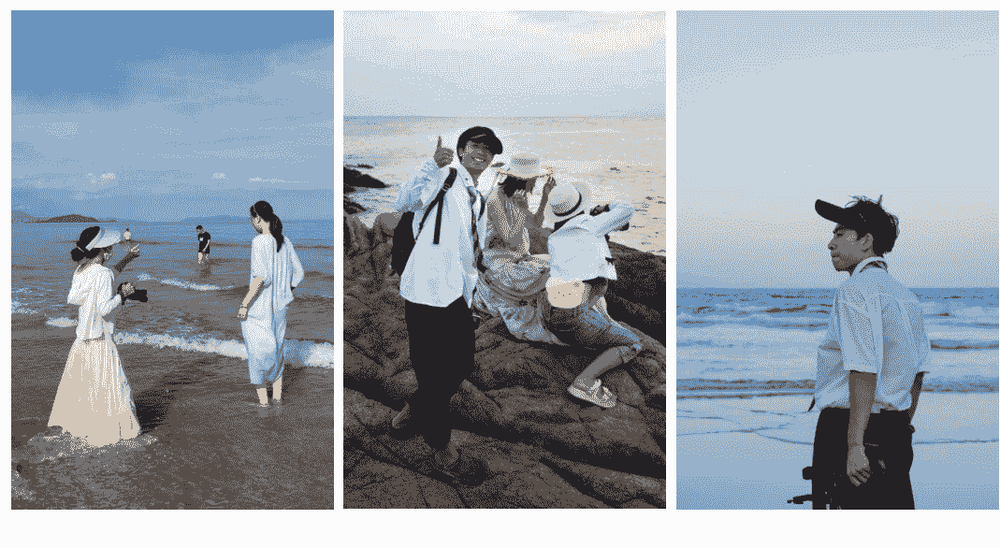

6. **客户满意只是第一步，主动推荐才会形成增长飞轮**

尤其我们的第一批亲子客户，她的分享比我们自己发广告有效太多，说明当服务、成片和客户关系都足够好时，一次订单有机会带来复购、转介绍和新的内容素材。

### 八、本次创业 8 个搞钱体会

1. **先进入真实市场，再谈完美规划**

我们一开始连行业规则都不懂，但沙滩拍摄至少快速验证了：游客确实愿意为拍照付费。

行动会暴露问题，也会提供下一步需要学习的方向。

2. **觉得吃力的时候，就多动脑袋，赚更多的钱不只靠体力，更多靠脑力**

优势无法被看见时，不要只在原来的地方更努力，东东没有靠在沙滩上站更久改变收入，而是通过线上渠道，让客户先看到作品和服务。有时问题不在能力，而在渠道和定价方式。

3. **想接什么订单，就精心做出案例**

不要永远等客户给你作品集。主动样片，是普通技能服务者定义产品最直接的办法。

4. **销售不是套路，而是需求梳理**

第一次六小时订单，不是强行让客户多买，是帮他们理解不同时间和风格的差别，让客户根据自己的旅行目的选择。

5. **高价格本身不是壁垒，值得才是**

我们谈单反复说的一句话：比起价格，价值才更重要。客户愿意支付 660 元一小时，是因为她喜欢我们的审美风格，满意前期沟通和现场愉悦的体验，当然还有对成片的喜欢和认可，一套流程下来开心拍摄拿照片没什么烦恼，很省心，客户花钱觉得很值，就够了。

6. **不要试图服务所有客户**

筛选匹配的客户会节省很多时间和精力。重视时间、审美和体验的客户，更容易理解我们的价值。

一路走来，特别要感谢那些尊重、喜欢和认可我们的客户，我们在他们的一路的支持、鼓励和爱中得到滋润和成长，而人都是相互的，用心服务好这些客户，比去讨好另外一些只比价格的客户更有意义。

7. **不要单干！不要单干！不要单干！多交朋友多分享，合作网络本身也是资产**

摄影师、化妆师、服装工作室和旅游从业者，让我们拥有了更多交付方式和收入来源。我们这一路如果没有这些朋友的帮助其实也不可能做到这种程度，我们也十分感谢帮助过我们的三亚朋友们！

所以，一个人做不完所有事情，但可以知道谁能把事情做好，相互学习合作共赢才最重要。

8. **创业不只有坚持，也包括及时判断天花板**

坚持一件事情之前，要先问自己：它越做越轻松，还是越做越消耗？能不能积累复利？能否离开某个城市继续做？扩大后，还是不是自己想要的生活？

一步一个脚印，我们最终结束了三亚旅拍阶段。

### 九、这门生意的启动门槛，到底高不高？

同需要租门店、装修影棚、招聘员工的传统摄影工作室相比，独立户外旅拍的启动成本确实相对可控。

但“启动成本可控”不等于“任何人拿起相机就能马上复制”。

#### 比较适合尝试的人

- 已经具备基础摄影和修图能力；
- 愿意持续发布内容；
- 愿意和客户沟通，不排斥销售；
- 对客户有耐心，能处理现场变化；
- 能接受户外高温、日晒和体力消耗；
- 想要旅居兼顾收入，而不是立刻打造大型公司；
- 愿意从一两组样片和真实订单开始验证。

#### 不太适合的人

- 完全不会摄影，却期待拍一组样片就直接收高价；
- 不愿意沟通，只想拍完就走；
- 不喜欢服务客户和处理客户情绪；
- 无法接受收入随淡旺季波动；
- 只想靠低价快速冲量；
- 希望项目完全不受地域和体力影响；
- 想迅速招人扩张，却不愿承担管理和质量控制。

如果已经有基础摄影能力，比较稳妥的0—1路径是：

1. 先确定一个目标客户；
2. 找一组匹配的模特或客户互勉；
3. 拍出一组能代表产品的样片；
4. 发布并观察真实咨询；
5. 用小额付费订单验证交付；
6. 根据反馈继续优化价格、内容和流程。

这里的重点不是“一组样片就一定能起盘”，而是不要为了追求完美，长时间停留在准备阶段。

而且现在 AI 出来了，做摄影只会更高效，比起我们那会儿就可以节约太多时间。

### 十、从 0 到 1 后，为什么我们没放大？反而选择离开三亚

做到后面，我们已经能稳定接到旅拍订单，也开始接触轻婚纱和更高客单的拍摄需求。

按常见的创业思路，下一步似乎应该是扩大规模：接更多订单、拍不过来就招更多摄影师、开工作室，甚至开一家旅拍公司，但我们对于未来想要怎样的人生，认真做了思考，发现无法忽略以下几个问题：

#### 第一，摄影收入依赖高强度体力消耗

三亚常年高温，顶着烈日长时间外出拍摄的我们，每天靠藿香正气丸续命，防中暑。

拍摄结束不代表工作结束，回来还要选片、修图和沟通。年轻时可以扛，但难保证长期有同样的体力。

#### 第二，业务受地域和旅游淡旺季限制

我们在三亚积累的景点经验、客户搜索和合作资源，一旦回到成都，就很难原样带走。

而且我们已经走到了中国最南的省份，走到了中国边界，看到了海，而海的那边又是什么样子？

我们下一步就应该去国外看一看，继续我们对世界的探索。

有这样的计划，所以我们的业务项目不能绑定固定城市，应该是走到世界任何地方都能够正常运转的，不会因为地理位置变动，直接断掉业务。

#### 第三，个性化体验很难大规模复制

旺季时，我们确实会遇到订单接不过来的情况。有些订单可以交给摄影师朋友，有些只能拒绝。

要赚更多钱，可以单量扩大，就需要招人拍摄，但客户本来喜欢的是东东的摄影风格和我们两个人的服务，换成别人后，成片和体验很难完全一致。当业务不断追求单量，就可能从定制服务走向流水线，而我们最珍惜的恰恰是与客户真实相处、认真服务每一组家庭，甚至处成朋友的过程，我们享受着喜欢我们的客人在异乡带给彼此的爱与温暖，所以冰冷的流水线，违背我们的初心。

而且如果真的把旅拍做大，能力重点会从摄影转向招聘、排班、管理、售后和质量控制，我们也不想从喜欢摄影的人，变成只管理订单的人。

#### 第四，摄影发展受限

要赚更多钱，还有一个办法：继续抬高清价。

但在内卷的市场里，我们的价格本就已经超过许多同行独立摄影师；单量做到非常高的，见过有些是本身技术都很强硬，拿过非常多的奖，有背书，还给明星拍照，自身身价和名气就比较高，我们没那能量和志向，有些就直接转行做商拍，这也是我们不想走的路。

> 一门生意能赚钱，不代表它一定适合长期经营。我们需要知道自己想要什么，**要什么，管理精力，同样很重要。**

所以我们决定离开。

我们留下，是因为三亚摄影能赚钱，能发展爱好还能在海边享受生活。

我们离开，是因为看见了这种体力模式的天花板和局限边界，而那不是我们想要的生活。

赚钱很重要，但生活同样重要，我们每个人都会各自的修行，去寻找工作和生活的平衡。

于是，在租房到期时，我们决定离开三亚，结束三亚旅拍。去开始崭新的篇章，新的人生，新的创业，去够上我们想要的生活。（当然还有另外一个原因，回成都结婚，像西天取经一样，两人一路经历艰难险阻、披棘斩棘，但好在一直相互鼓励和支持，关关难过关关过，后来修成正果。）

### 十一、新篇章：回成都开始第二次创业!

回到成都后，体验过自己掌控收入的创业状态，就很难再想回去打工做廉价劳动力，我们觉得开始新的创业之路，并且对于创业方向也有了更清晰明确的要求：

**第一，尽量不靠长期消耗体力赚钱，优先做具备复利的事业。** 三亚旅拍大部分靠长时间外出拍摄、消耗自身时间体力换报酬。目前拍摄我们调整为副业，希望新的事业更多依靠脑力取胜，并且能够拥有更多复利属性，项目做得越久，积累的资产、客户、方法论会持续产生收益，而不是干一单才有一单收入。

**第二，业务不受地域限制。** 在三亚积累的本地场地、化妆师、文旅资源，换一座城市就无法复用。不希望业务被某一个城市完全锁死；将来去其他国家，也能继续经营，继续我们去世界看看的梦想。

**第三，赚钱的同时不能牺牲生活与身体健康。** 人生苦短，不能把全部生活全部献给搞钱。见过不少朋友拼命打拼，赚到钱却透支身体，最后又把收入交给医院，在我们看来这是非常不划算的。而现在不到30岁的我们，熬夜也会很难受，所以天天熬夜加班的赛道是不可取的，要坚持让事业和生活平衡。

**第四，希望有机会赚取外汇，正在考察相关赛道。** 此前我们接过英国出版社的拍摄订单，也服务过不少在三亚旅游的外籍家庭，直观感受到了汇率带来的优势。“曾经沧海难为水”，所以把可以赚外汇的方向纳入考察范围。

**第五，利用好生财和AI。** 今年我们正好赶上 AI Agent 时代的浪潮，不想错过 AI 风口；刚好 5 月份又加入了生财大本营，从 5 月 AI 超级大航海开始我们就开始跟着生财学习 AI。希望利用 AI 提效赋能，并且学习生财好项目，继续加油赚到我们的下一桶金。

目前学习了 AI 第二大脑生产系统、AI Agent，成功开发了小程序和一些小工具、跑通了闲鱼店铺方向，也正打算考察 AI 服务、跨境电商等方向，进一步深耕，而在生财遨游的同时还通过生财线下交到一些志同道合的朋友，这是非常让人感到开心的，希望能和真诚的大家一起生财致富！

我们还在第二次创业的起点，还在路上，没有一个标准答案。但和第一次去懵懵懂懂去三亚，一不小心创了个业相比，我们至少已经成长了许多。知道“怎样验证需求，怎样通过内容找到客户，怎样设计服务，怎样从反馈里调整方向，也知道一门生意除了收入，还应该考虑成本、复利、身体和自己真正想过的生活”，相信未来还是蛮有希望的，咱们普通人是可以靠自己的努力一步一步实现自己的梦想！

结语：未来不在沙滩上，我们都拥有海洋！

回想这一年半，我们并没有时时刻刻埋头赚钱。

没有拍摄时，我们会去泡海、跳海、赶海，去体验当地的食物、风景和旅游项目，也结交了很多来自不同地方、同样向往大海和自由的朋友。

我们没有靠三亚旅拍赚到一个夸张的数字，但这份收入覆盖了我们的旅居生活，也让我们有机会在年轻的时候，真正选择一次自己想过的日子。

更重要的是，我们靠自己亲手证明：两个没什么背景的普通年轻人，也可以在一个陌生城市里，凭借自己的热爱，一点点创造出自己喜欢的工作，还能自己喜欢的自由。

从 10 元一张，到 180 元一小时，再到 399、520 和 660 元；从站在沙滩上找客户，到通过小红书被客户找到和喜欢；从只会拍照，到理解定位、销售、服务、口碑和资源整 合；从拉客拍摄的胆怯到与人交往的快乐、结交朋友、收获温暖鼓励和幸福感动；这些 东西，比最后约20万元总营收更值得我 们带走。

我们很庆幸，当时没有因为钱不够、经验 不够、准备不够，就把“去看海”一直推迟 到以后。

人生当然需要考虑现实，但有些路，真的 要先走出去，才知道沿途会出现什么。

正如我们自驾三亚一路听着的、很喜欢的 歌词：

就让我自己走吧！我的球鞋，我的暴雪！ 朝着山野，要去见，所有我喜欢的一切！ 别对我说，去成为谁的模样，未来不在沙 滩上，我们都拥有海洋。

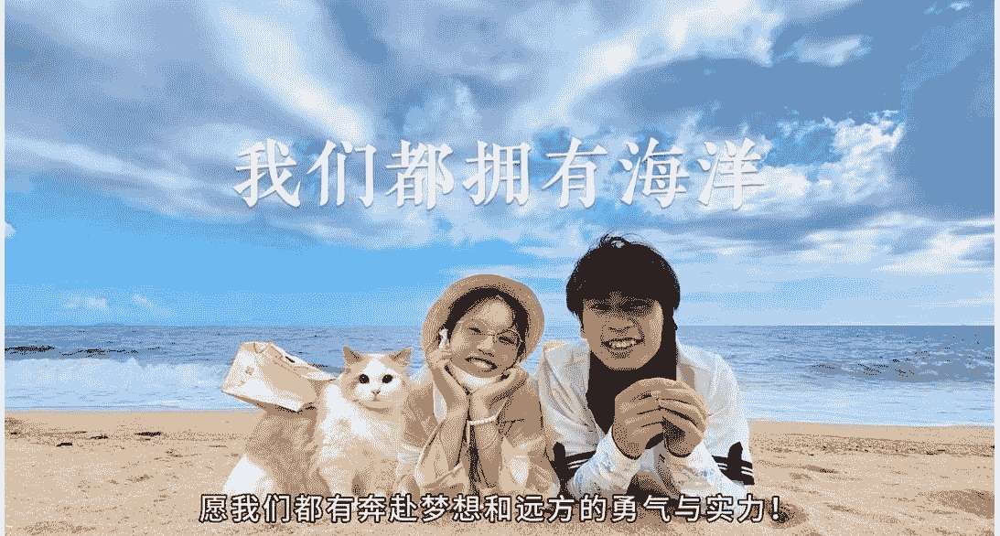

## 写在最后

感谢你耐心看到这里。

特别感谢鱼丸的邀请、小武的督促，让我 们完成这段三亚搞钱经历分享。

5月份刚加入生财的时候，总觉得社群里 全是大佬，满眼都是百万级收入，我们就只是很普通的小卡拉米，这点经历不值一提。直到受邀请，我们沉下心认真梳理，才发现比的去三亚之前，我们确实已经飞速成长了很多。总结过去的经历，亦是对我们自己的复盘，也希望能给大家带去一点信心。

还要特别感谢同龄的圈友小丹同学。当初看到小丹分享澳洲打工度假帖子，我们主动“勾搭”上了；上个月我们还一群人去露营追 8 月份英仙座流星雨！能和同样热爱生活、喜欢摄影的圈友一起，现在想起来都觉得是件特别浪漫的事。真诚的分享让我们相遇，谢谢小丹鼓励我们把这段三亚创业经历写出来。

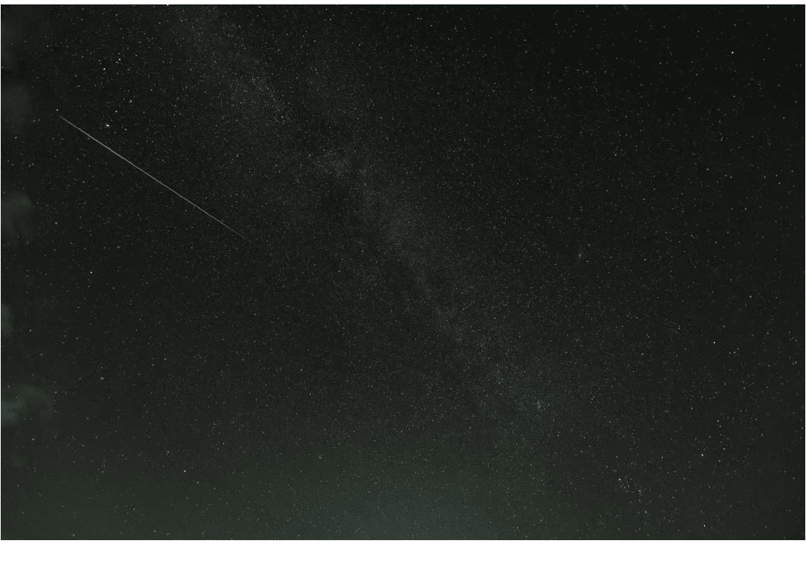

也谢谢圈友尹阳儿小仙女，今年组局分享 AI 学习，我和东东收到邀请参加线下活动；从尹阳儿、小 Q、斌哥那里也学到了很多 AI 相关的内容，大家的不吝分享相互照拂、彼此合作，让我们感受到了生财社群的温度，所以希望我们虽为小卡拉米，也能借此分享传递一些温暖。

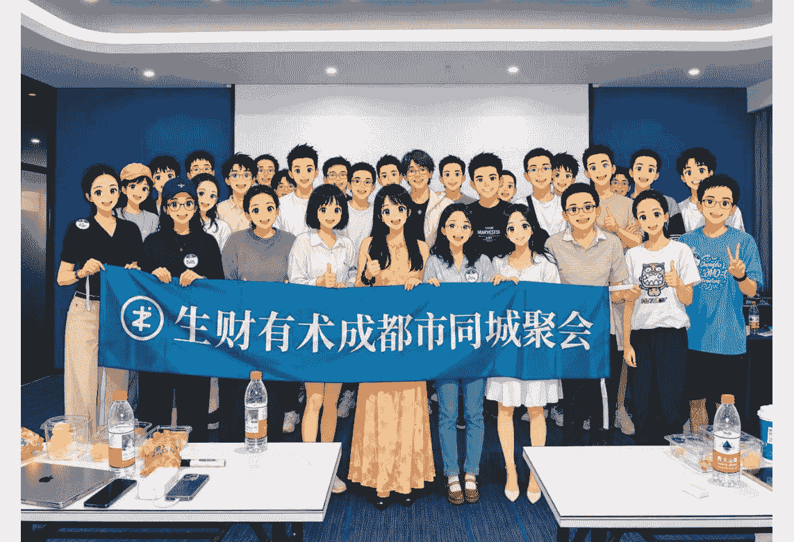

现在我俩已回到成都，准备围绕内容、AI、出海等方向开启第二次创业。

欢迎有相同目标或兴趣、自由职业或正在寻找创业方向的圈友，一起相互交流学习交友、约着一起玩；同时东东也接人像、活动跟拍等有拍摄需求也欢迎合作沟通，都可以找鱼丸链接。

我们很乐意结交志同道合、真诚的伙伴，也愿意分享踩过的坑、验证过的方法和正思考的问题，尽所能提供帮助。

希望我们都能在 AI 时代拿到满意结果！一起加油，一起生财！

分割线

看完这篇 SOP，你觉得你懂了。但 90% 的人一到实操就会卡在第一步。

工具和教程只是最低级的壁垒，真正的壁垒是“立刻动手”和“圈层信息差”。

如果你想看全网最新的变现玩法，并且和一群执行力极强的极客一起下场拿结果，欢迎围观我的核心私域：【懒人专属群】。

我们不聊虚的，只做商业闭环的拆解与 AI 效率的压榨。系统内已沉淀 1000+ 跑通的套利实战局。

- 查阅圈子完整数字资产与上车门槛：https://lazyso.com/insider/
- 认同价值、准备好下场干活的，扫码加我微信（lazyhelper1）
- 备注：【实操上车】，不闲聊

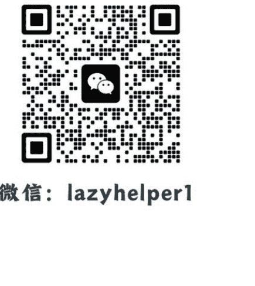
