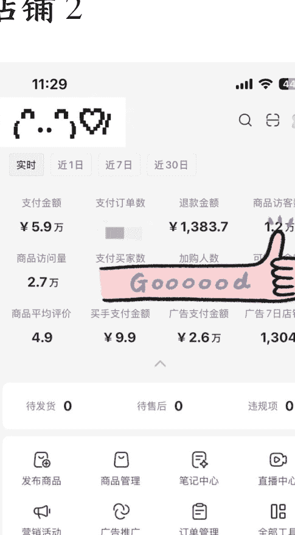
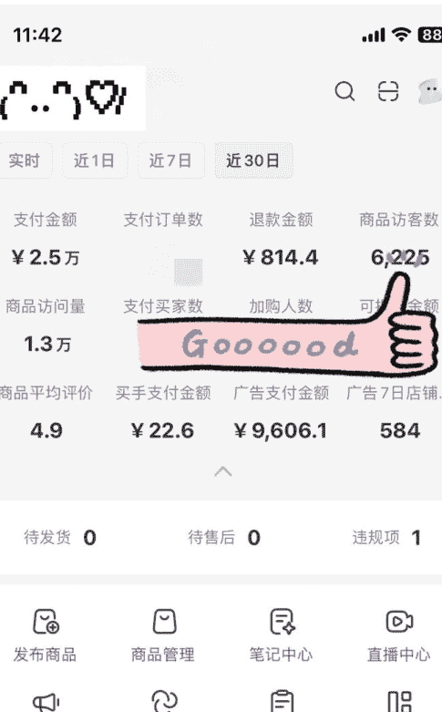
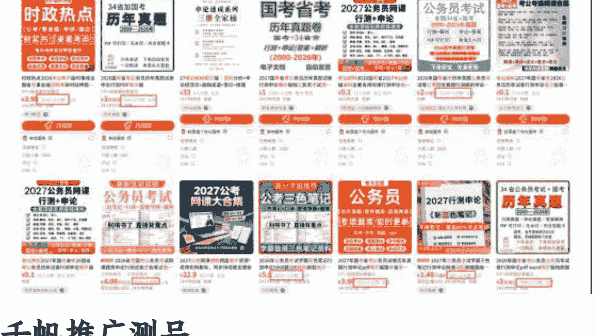
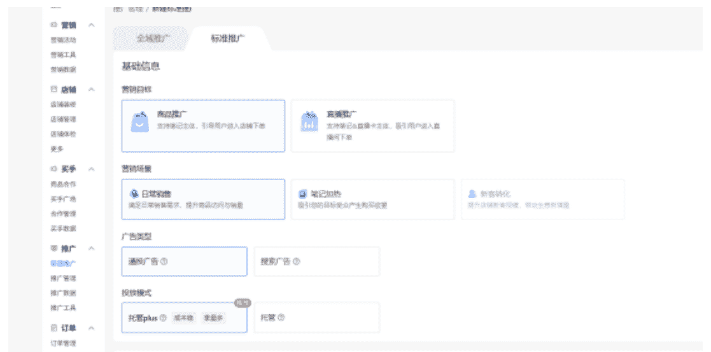
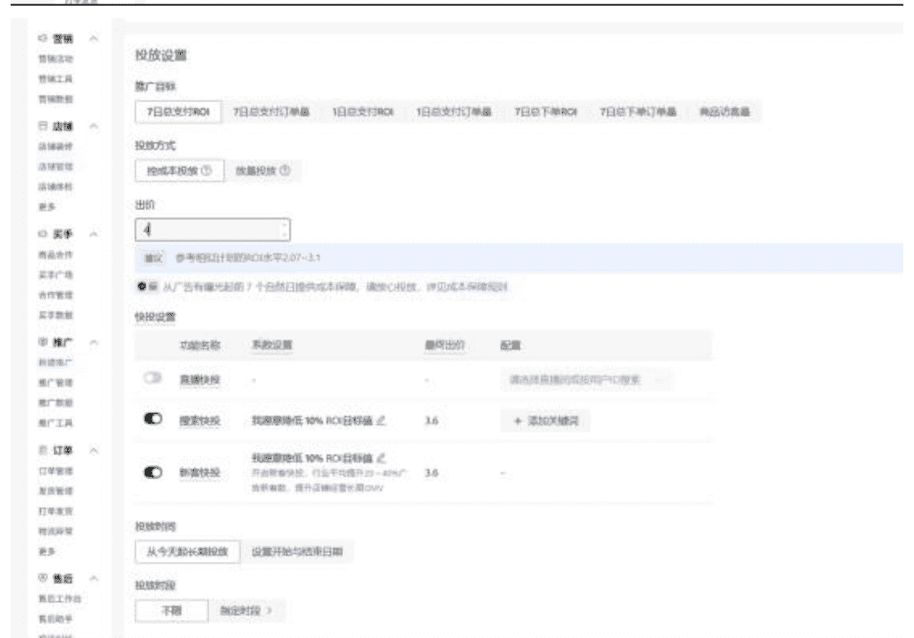
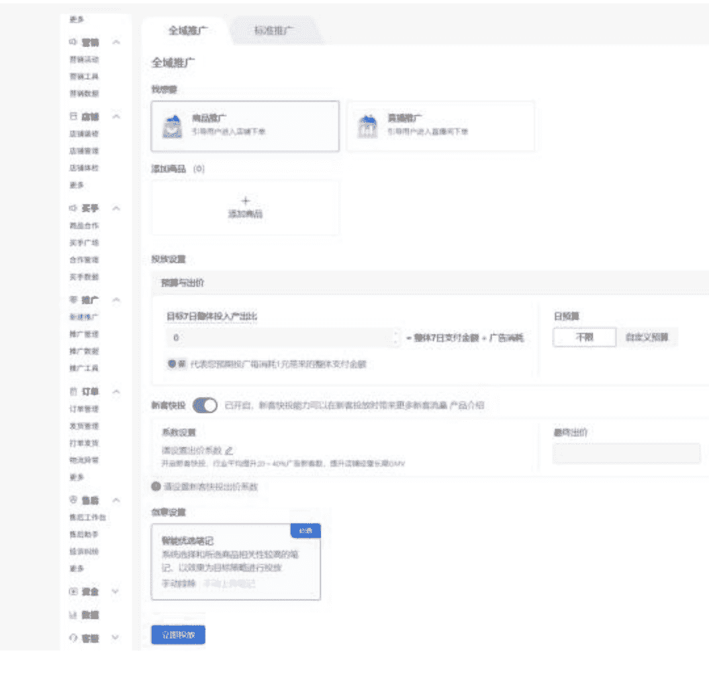
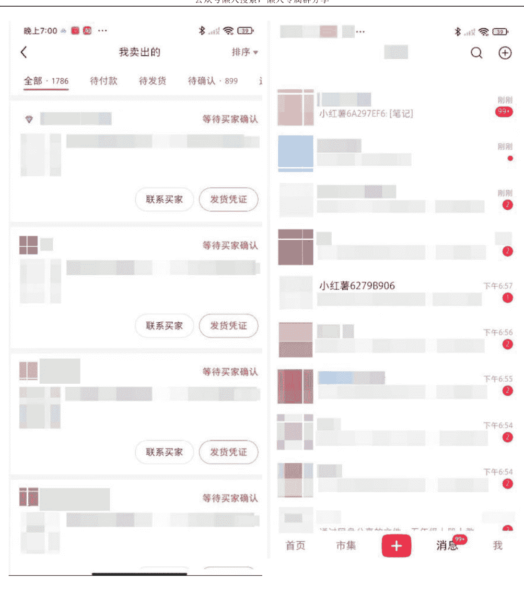

## 做小红书虚拟资料一年，我的一次单月近 10 万爆单复盘

260922 副业 SC 精华
整理：公众号懒人搜索，**懒人专属群**精选
懒人微信：lazyhelperl

> **小懒判断** | 适合资料店已开、卡在测品选品不出单的玩家，不适合想一夜暴富或靠机构资料捞快钱的。干货是测品公式：千帆标准推广直接用默认、推荐价取整填（3.7就填4），10个品各发5条笔记跑两周；爆单靠独家，山东省考真题花两三天线下找机构买回。坑在作者赶上架目开放+清退红利，现在开不了电子资料类目，复制要打折。

各位生财的小伙伴们大家好，我是 Killian，生财二年级学生。今天分享我近期的一次小红书虚拟资料爆单经历，我会尽可能事无巨细地写下来。希望各位前辈和同行的朋友看了能给我提供点建议，让我更上一层楼。如果刚好有正在做这个方向、还没等到爆单的朋友，希望这些记录能有一点参考价值。

全文大约 4000 字，分成五个部分：选项目 → 选品和测品 → 发笔记 → 开店 → 其他补充，左侧目录可以直接跳转。

先说一下成绩。我总共就做了两家店，从去年到现在，两家店平均每个月合起来都能赚个万把块。最近这个月爆单了，两家店的支付金额合计 8.4 万（退款只有 2,200 多），加上个人售卖的部分，扣掉投流和退款，这个月到手的利润接近 10 万；这个项目我刚好做了一年，除了最近这个月，平时没有花特别多的时间，大概一天也就一两个小时，所以我觉得这个收益我自己是挺满意的，哪怕抛开这次爆单来说，总的收益也还说得过去。

店铺 1

店铺 2

### 关于选项目

至少在我自己身上，选对项目比多努力更关键。比如我之前做的拼多多店群、抖音切片，还有前年做的视频口号播都拿过还不错的成绩，回头看本质上都是选对项目、选对了平台，再加上一些对的方法，爆单的概率会高很多。

我是从去年八月份左右，跟着航海人局小红书虚拟资料的，当时我选项目的逻辑是：

- 小红书虚拟资料很火，不论是生财还是其他社群，到处都在推这个项目。还记得当时参加线下聚会时，有一大半的人都在做这个项目。虽然越热门越卷，但也侧面说明它确实是可行的、有利可图，我对收益的要求不算太高，进去分一杯羹就能满足我的需求。
- 门槛比较低，拿个身份证就可以开店了，不需要任何资金，连保证金都不需要提前交，售卖的资料也是等用户下单了再去淘宝买就可以。
- 适合自己。对于去年的我来说，虽然有过往项目的爆单经历，但是像拼多多卖货的模式，需要对接的环节比较多，我并不喜欢，引流私域的模式也尝试过，跟用户对接打交道会让我心力交瘁，所以我当时觉得小红书虚拟或许会比较适合我——毕竟虚拟资料售后简单，要退就退，大不了赚点网盘推广的分成，如果是实物的话还要考虑运费和各种成本，处理起来要麻烦很多。

所以本质上，我还是选了一个比较热门、并且做起来自己也不会太心累的项目。

### 关于选品和测品

我认为测品比选品要重要得多。对于像我这种没有太强选品能力的人来说，选品本质上是在赌，测品是用小成本去验证——一个品到底行不行，发几条笔记、投一点广告就能看出来，试错成本比一上来就 all in 低太多了。

在还没摸清门道的时候，就不要一下子 all in 某几个产品，不然花了很多时间收不到成效，很容易就放弃了。接下来分享我的测品方式，以及我自己测出来卖得比较好的两类产品。

#### 淘宝通采

- 在淘宝搜索你要售卖的品类，比如我卖的是考公考编资料，我就在淘宝搜考公电子资料，然后选择那些弱版权的上架到店铺。
- 对于弱版权，我自己的判断依据是不出现人名、品牌名、机构名、出版社，并且只碰已经公开流通、没有明确署权利人的资料。这是我个人的土办法，不构成建议，具体边界还得大家自己把握；涉及机构、出版社署名的我一律不碰。
- 在搜索的过程中，我发现对于考公这个赛道来说，一个是真题、题库类卖得比较好，另外一个就是笔记类卖得比较好。所以我们就可以深挖这两个搜索词，比如国考真题、国考笔记、福建省考真题、福建省考笔记，就这样一直深挖，你能挖出很多这个赛道比较细分的类目，如果有销量比较不错的，在小红书上一般也能卖得还可以。当挖到细分的搜索词在淘宝都只有个位数或者两位数销量的时候，就说明挖得差不多了。为什么要挖到这么细？词够细，竞争就小；而只要它还挂着销量，就说明需求是真实存在的——这种词在小红书上更容易跑出来。

#### 千帆推广测品

上架完商品后，就同步发对应的商品笔记。每个商品至少发 5 个笔记，如果笔记太少容易漏掉一些还不错的品。

一般新上架的商品，我都是把标题发给豆包，让豆包生成对应的笔记封面和笔记内容。具体的提示词大家可以自行琢磨，我用的很朴素：

我在小红书售卖考公资料，接下来我会给你发考公相关的主题，你根据我发给你的主题生成完整的笔记，要求尽可能地覆盖相关搜索词，我也会发给你几篇同赛道的爆款笔记，你拆解分析学习，然后根据学习的内容优化笔记跟豆包多沟通几轮应该能得到不错的效果，不满意豆包效果的，也可以用 GPT 试试。

发完笔记之后，就可以在小红书 → 千帆推广 → 新建标准推广那边开始投流测品了。测品的投流比较简单，直接都用默认，然后出价就在推荐的出价上 +1 凑整（单位：元）就行——比如系统推荐 3.7 元就填 4 元，不是按比例加 10%；推荐出价在投放设置那一栏就能直接看到，品好的自己就能够跑出来。直播快投关掉，因为我们没有直播，其他的就留着。

这样坚持一轮下来，在保证每天每天不低于 10 个商品，每个商品不低于 5 篇笔记，大概两周，应该就能测出一两个还不错的品，也就是在这种模式下，每天都能卖个十几二十单的品。

#### 怎么把测出来的品放大

放大有两个方面。一个方面是测出来的品的笔记要持续不断地去发、去测试各种模板，各种不同风格的笔记，去覆盖这个品的每个关键词，比如我当时测出一个国省考历年真题的品，几乎把每个省份近几年的试卷都发了一遍，一个品发了近 500 条笔记，等于把这个品的搜索流量都覆盖住了，所以这个品到现在每天也都能够卖一些，国省考前会小爆一波。

另一方面就是优化投流。在「我的推广→全域推广→新建推广」里，这里的出价就要根据你原来标准推广的出价去调了。比如原来你的出价定在 4 左右，跑得也还可以，就继续按照这个价格新建一个全域推广，然后把新客快投打开就行。如果你觉得原来的价格跑得太慢了，就适当地降一些，直到调整到一个你自己觉得合适的价格。

### 爆品特点

我在近一年做小红书虚拟资料的过程中总结出来的两类爆品特点，就是独家跟有门槛。我会把自己爆单的产品也分享出来，以及我是如何选出这个品的，以便大家能对着自己的情况参考。

#### 第一个特点：独家

独家这个词对于做无货源的来说似乎有点遥不可及，但我的做法是多花一点心思，这部分钱就真的能挣到。

**发现需求：** 前面提到了我做考公资料，第一批上架的就有考公历年真题，总的来说卖得还可以，但是还没有到爆的程度。后面在经营的过程中，不断地有人来咨询我 25 年山东省考真题有没有，一开始我去网上搜了一圈，得出的结论是 25 年山东省考真题没有放出来，市面上也确实没人有，所以我也没有太在意，有人来咨询就直接告诉他没有这个资料。

**寻找货源**：无奈后面咨询的人实在是太多了。对我来说每一次有人咨询，等于有人主动来送钱，我却往外推。后面实在无法忍受这种有钱不赚的行为，于是花了两三天的时间，最终去咨询了两家山东线下的考公机构，从机构手中获得了一份 25 年山东的真题卷。

**结果**：当时全网就我一个人有这份资料，所以很轻易地就卖爆了。等到 26 年山东省考一结束，我又如法炮制，也卖爆了一波；最近这次爆，可能是因为暑假，也可能是因为离下一次省考的日子越来越近了。

#### 第二个特点：门槛

我最开始选品的时候，也会给自己预设很多困难：这个有门槛我可能做不来，这个太麻烦了，投入产出不成正比。有过几次爆单经历后，我就把自己的思路放开，不再局限——别人能卖，我想我也值得试一次。

我爆单的另外一个商品，也是淘宝通采，然后用我前面介绍的测品方法测出来的，是一个代处理照片的商品，包括处理格式、处理大小、修图等等。最开始通采的时候，因为价格默认设置的是 9.9 元，有些用户提了比较复杂的要求，我都给拒绝掉了——因为还要对接需求、处理照片，耗费的时间精力不成正比，问的人多了我都想把商品下架掉。

后来还是因为问的人越来越多，下架掉等于跟钱过不去，所以我就参考了卖得好的同类商品，然后调整自己的 SKU：最低还是 9.9 元，最高 99 元。经过跟用户的不断对接，逐渐优化 SKU 跟价格，最终的结果是 99 元卖得反而比 9.9 元的更好。

这次爆单让我发现，真正拉开差距的常常不是能力，而是愿不愿意多做那一步。因为虽然我卖修图服务爆单了，但首先我对修图的掌握也仅仅停留在最基础的阶段，其次哪怕是 99 的单子我也没有花费过很多时间——因为我所有的图都是让豆包搞定的，有一两个比较复杂的，豆包实在搞不定的，用 GPT 也能够解决。

很多时候门槛都是自己预设的。当需求足够多的时候，这些门槛就是我比别人多出来的那一点点优势。

### 关于发笔记

关于笔记，我踩过的弯路可能比经验还多。最开始的一段时间，我也会去分析研究各种爆款笔记，后面好几次花了两三个小时精心打磨出来的笔记，结果小眼睛只有个位数，后面就不再死磕形式了，不再拘泥于多么华丽精美的笔记，用不太耗费自己精力的方式去发笔记。但这不是说我不在意内容——我是在把爆款笔记的套路研究透之后，才敢对形式松手的：内容要点我心里大概有数，只是没那么在意形式罢了。

到目前我小眼睛（笔记浏览量）最高的笔记，还是随手发的一条大字报，而且转化也不低。

### 关于开店

因为我是去年开的店，当时小红书电子资源类目刚刚开放，只要申请就能通过。但是最近小红书清退了好多店铺，我想我这次爆单，可能也跟对手少了一大半有关系。

虽然电子资源类目开不了，但想在小红书上卖虚拟资料，也还有别的渠道。

上个月我尝试了个人售卖，开通几乎无门槛，在「小红书 → 设置 → 新功能体验 → 个人售卖」里直接就可以开通，上架方式跟闲鱼上架商品比较类似，而且也支持自动发货，就是不能在电脑端操作，有点不方便。

关键是效果出奇的好，流量有明显的扶持。下面是我干了一个月的成果——目前累计已经有近 3000 单。

所以暂时开不了电子资源的朋友也不用着急，个人售卖是条不错的路子，我自己试下来效果挺好的。

### 其他补充

小红书电商选品跟内容都是很重要的环节。关于选品可以参考我前面提到的，尤其是爆品特点部分，大概率是能够找到不错的品。关于内容，就像上一节说的：形式可以随意，但内容要点得心里有数。

另外我觉得自己在做电商过程中，最受益的特点就是多观察，把自己当成目标用户，不带偏见地去观察，从而去选品、去生产内容。比如我做考公资料，我会尽可能把自己当成一个正在考公的人，多去接触正在考公的人，然后去感受平时会对哪些笔记感兴趣、会需要哪些资料，这些能给我带来不一样的角度，不论是选品还是制作笔记。

在 AI 已经这么好用的现在，原来卡住我的很多难题都能绕过去了。几乎可以消除掉 90%的门槛，真的可以先去试一下。

回头看这一年，我最大的体会是：很多门槛都是自己吓自己，真正拉开差距的，往往是愿不愿意在别人不愿意做的地方多花那一些时间。以上都是我这一年的真实体会，不一定对，写下来给大家做个参考！

————————分割线————————

看完这篇 SOP，你觉得你懂了。但 90% 的人一到实操就会卡在第一步。

工具和教程只是最低级的壁垒，真正的壁垒是“立刻动手”和“圈层信息差”。

如果你想看全网最新的变现玩法，并且和一群执行力极强的极客一起下场拿结果，欢迎围观我的核心私域：【懒人专属群】。

我们不聊虚的，只做商业闭环的拆解与 AI 效率的压榨。系统内已沉淀 1000+ 跑通的套利实战局。

- 查阅圈子完整数字资产与上车门槛：
  https://lazyso.com/insider/

  认同价值、准备好下场干活的，扫码加我微信（lazyhelper1）

  备注：【实操上车】，不闲聊
