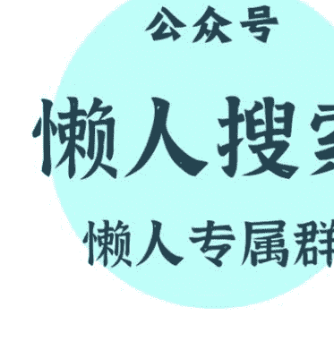

# ## 怎么利用好时间？

260919 副业 SC 精华  
整理：公众号懒人搜索，懒人专属群精选  
懒人微信：lazyhelper1

**小懒判断**｜适合时间被社交和家务切碎、想系统收回可支配时间的人，不适合追求工具酷炫或打卡记录控。最实用的一条换算原则：能用不多的钱买回大块时间就花，钱能再赚时间不能。核心是“一次做完+留交付物”，中途放下再捡起来的重启成本是隐形的。坑在这篇是口述经 Kimi 整理，40 条偏框架，工具只提了 WorkFlowy 和 Obsidian 和飞书三个名字没展开怎么搭。

────分割线────

▶ 以下内容，由我口述心得，Kimi 整理。

时间对每个人都等值，差距只在分配。管理的要义是：先收回被占走的时间，再守住精力与注意力，把可支配时间投对方向、用对方法，做完留下可复用的资产，让一份时间卖很多次，并在一生的尺度上保住健康与安全。

# □ **先把时间这笔账算清楚**

1. 每个人每天的时间完全一样，都是二十四小时，所以拉开差距的从来不是时间多少，而是同样这些时间被花在了哪里。
2. 时间管理别从一年谈起，要从一天谈起，因为任何一年都由三百多个普通的日子堆成，管不住一天的人，年度计划再漂亮也是空话。
3. 要管好一天，先给时间分分类：一部分被身体占用，一部分被别人占用，一部分被生活琐事占用，剩下的才是可支配时间。
4. 所谓时间管理，就是一场持续的收租运动：把被社交、被家人、被琐事占走的时间，一点一点收回来，装进自己可支配的口袋。
5. 不过收回来的可支配时间，还不能直接等于工作时间，它得先过两道关：一道是精力关，一道是注意力关，过不去就只是账面上的数字。

### 精力是时间能不能用起来的前提

6. 时间要变成产出，第一个前提是精力：生病卧床时，哪怕日历上全是空白，那些时间也只能交给休息，一分一毫都动用不了。
7. 所以健康管理本身就是时间管理：锻炼和睡眠看似占了时间，实则是在储蓄时间，还顺带决定了其余清醒时间的使用质量。
8. 精力有限还意味着不要把自己排得过满，留白不是浪费而是必要成本，因为疲惫状态下的一小时，产出可能只有状态好时的三分之一。

### 收回被人情和社交占走的时间

9. 精力保住了，先对付第一种外部消耗社交：一场饭局看似只有两小时，连上路上、洗澡、装扮，大半天就悄无声息地搭了进去。
10. 更隐蔽的消耗是不会拒绝：不好意思推掉一个请求、主动管一件闲事，时间表就悄悄变成了别人的，自己还浑然不觉。
11. 对付这类消耗，最有效的办法是提前立规矩：把社交从被动应约改成主动选择，能不见的面不见，能线上解决的事不专程跑一趟。
12. 放心，真朋友不会因为几次拒绝就离开，会因此走散的多半只是消耗你的人，所以拒绝不仅省时间，本身也是一种关系筛选。

### 收回被家人和生活事务占走的时间

13. 比社交更难处理的是家人：照护家人是责任，推无可推，但其中的大量事务是重复劳动，完全可以通过理顺流程、请人帮手来压缩。
14. 家务能外包就外包，能请人就不要硬扛，舍不得花这笔小钱，本质上是默认自己的时间还不如一份时薪值钱，这笔账怎么算都亏。
15. 就算没有外人打扰，吃饭、睡觉、通勤这些生活必需也占着大块时间，这类时间的优化不在硬压，而在花钱购买服务来换。
16. 记住一条换算原则：凡是能用不多的钱买回大块时间的事，都优先花钱，因为钱还能再赚，流逝的时间却永远不可能买回来。

### 守住注意力，才算真正守住了时间

17. 外部消耗清理干净后，最大的敌人变成自己：刷短视频、看网络文章、追剧，把时间切得粉碎，看似放松，产出却几乎为零。
18. 这类行为最迷惑人的地方在于常打着学习的旗号，但看完就忘、根本用不上，还白白占住大脑带宽，让正事根本挤不进来。
19. 带宽被占的代价是隐性的：专注力、筛选能力和快速行动能力都被削弱，同样一小时，能完成的有效工作可能只剩一半。
20. 守住注意力的方法很朴素：做事时让手机离开视线，一次只做一件事，使用番茄钟，给碎片信息规定固定时段集中消费，而不是随刷随看。

### 方向错了，一切白忙

21. 精力充足，注意力守住，可支配的工作时间就有了。接下来第一道把关是方向：事情做错了，方向选偏了，后面做得再漂亮，也是在往无底洞里投时间。
22. 判断一件事值不值得做，只需问一句：不做它的损失有多大？损失小说明它不重要，不必要的事做得再好，产出也是零。
23. 所以宁可慢下来想清楚再动手，也不要用战术上的勤奋掩盖战略上的懒惰，方向错误的一天，就是对正确方向的一天推迟。

# ☐ 方法对了，一小时才不止一小时

24. 方向定了，第二道把关是方法：同样一件事，用不用工具、会不会用工具，耗时能差出好几倍，工具是成本最低的时间杠杆。
25. 今天最该上手的杠杆是 AI：写作、查资料、写代码、整理信息，都先让 AI 跑一版，自己只做修改和判断，速度立刻翻倍。
26. 另一种浪费是寻找的浪费：文件随手丢、笔记到处记，用时翻半天，所以必须建一套统一的文件体系和能搜索的笔记库。
27. 还有一条捷径是外包：委托给专业公司、花钱请人做、社群共创、找互补的合伙人，以及搭建 AI Agent，让别人的时间替自己打工。

# ☐ 做完、做彻底、留下东西

28. 方法之外，执行上要坚持一次做完：中途放下再捡起来，光是回忆上下文就要花掉大量时间，重启是看不见的昂贵成本。
29. 一件事做完，必须留下交付物，无论是一份文档、一段代码还是一个模板：没有沉淀的努力，隔上一段时间，就等于从来没做过。
30. 交付物要追求长期复用：写一次能用一百次的模板是最划算的投资，用一次就丢的工作，则等于每一次都在从零开始。
31. 一个个可复用的交付物连起来，就成了个人资产库：它们指向最终的成果物，也让过去花的每一份时间继续为现在产出。

### 一份时间，尽量卖很多次

32. 沉淀之外还要主动发声，也就是 Build in Public：把过程公开、把成果发出去，同一份时间除了产出本身，还换来知名度、粉丝和潜在客户。
33. 再往上一个维度是一对多：服务一个人是一份回报，把经验做成文章、课程或产品去服务一万人，同样一小时，价值天差地别。
34. 做出来的东西一定要卖：只有变现拿到钱，才能拿钱买工具、买 token、买别人的服务，闭环转起来，时间才开始滚雪球。
35. 钱其实是时间的储蓄罐：它把未来可以使用、可以购买的时间存了下来，运用得当的话，这笔存储的时间还会翻倍增值。

### 让花掉的时间再榨一次汁

36. 做过的事别只留一个结果：把过程中的独特数据整理出来喂给 AI 当上下文，把踩过的坑写成笔记，这些萃取物会成为下一次的加速器。
37. 还要刻意记录高光时刻：里程碑、成果、别人的认可都留好档，它们既是以后卖东西时的信用背书，也是履历里最硬的部分。

# □ 拉长到一生，时间观还有最后一层

38. 把尺度拉长到一生，健康是最大的复利：同样条件下，活八十岁的人比活六十岁的人多出二十年工作时间，这是最底层的差距。
39. 安全则是底线中的底线：一个人再健康、再高效，也可能因为一次意外戛然而止，所以任何冒险之前，都要先问值不值得。
40. 最后回归生活底色：物品保持最小必要，少则得，多则惑；节日不被消费主义裹挟、不跟风仪式感，别人放假那几天，就是你多出来的工时。

——————分割线——————

补充回复圈友的内容：

建立文件体系和笔记库的关键词有四个：容器、分类、工作流、规则。我的容器是2+3，2是电脑和手机，3是负责行动类笔记的WorkFlowy、负责知识类和AI生成内容的Obsidian、负责团队协作的飞书。

积累可复用的东西，关键词也是四个：Template（从自己实践中生长的各种模板）、AI Skills（用AI做完一组任务，让AI总结过程并写成 skill.md）、How（由一份份清单构成，比如本文就是一份清单）、101文档（一个主题写一本小书，比如航海手册）。

分割线

作者：V 先生

标签：轻创业锦囊

发布：20260919

修改：20260919

更多：[V 先生在生财的全部帖子](https://example.com/v_xiansheng)

分割线

看完这篇 SOP，你觉得你懂了。但 90% 的人一到实操就会卡在第一步。

工具和教程只是最低级的壁垒，真正的壁垒是“立刻动手”和“圈层信息差”。

如果你想看全网最新的变现玩法，并且和一群执行力极强的极客一起下场拿结果，欢迎围观我的核心私域：【懒人专属群】。

我们不聊虚的，只做商业闭环的拆解与 AI 效率的压榨。系统内已沉淀 1000+ 跑通的套利实战局。

- 查阅圈子完整数字资产与上车门槛：[https://lazyso.com/insider/](https://lazyso.com/insider/)

认同价值、准备好下场干活的，扫码加我微信（lazyhelper1）

备注：【实操上车】，不闲聊

微信：lazyhelper1
