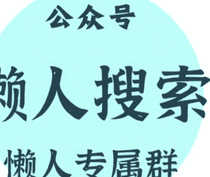

## 广汽与一汽互换股权，南北丰田要大整合？

**小懒判断**｜适合关注汽车行业整合大势的人，不适合想找短线标的的散户。最值得关注南北丰田合并后精简同质化车型的逻辑——卡罗拉和雷凌平台发动机变速箱轴距全相同就换个壳，合并后采购议价、渠道统筹、研发合并能省一大笔。坑在于整合牵扯地方税收就业，东风和长安就因主导权争夺暂停了合并，一汽广汽也只敢先拿合资板块试水。

继东风和长安尝试合并后，一汽与广汽两大巨头也拉开了资源整合序幕。

9 月 14 日，广汽宣布和一汽进行了一笔重磅交易，广汽获得一汽旗下某家合资整车公司的部分股权，同时一汽将成为广汽第二大股东。

虽然公告没有披露“某家合资汽车公司”是哪一家，但市场普遍猜测是一汽丰田。

广汽集团旗下有“广汽丰田”，如果获得一汽丰田的股份，等于南北两家丰田变成一家人。

这两年燃油合资车销量下滑，让两大巨头都很难受。从近两年的销量和利润数据，就能清晰地看出两家企业的困境。

2025 年，一汽集团全年整车销量达到 330.2 万辆，体量看着十分庞大，但增速仅 3.2%。

广汽的日子更艰难。

2025 年，广汽全年销量 172.15 万辆，同比下滑 14.06%，全年归母净利润为亏损 87.84 亿元，是上市以来首次大规模年度亏损。

广汽的整车制造业务毛利为负，平均每卖出一台车，企业就要亏损约 8300 元。

进入 2026 年，两家车企的经营压力不仅没有缓解，反而进一步增加。

一汽集团 2026 年上半年总销量为 151.8 万辆（含乘用车+解放商用车），同比下滑大约 15.3%。

一汽不是上市公司，没有公开财报，所以其净利润只是外界估算，行业内比较认可的数字是 80 到 90 亿人民币，对比去年同期的 146 亿人民币，利润接近腰斩。

广汽 2026 年上半年总销量 77.31 万辆，虽然营收上涨 2.35%，但归母净利润亏损 44.67 亿元，亏损幅度不但没有减少，还略微扩大了。

两大头部玩家双双掉进泥潭，是因为都非常依赖合资燃油车业务，合资燃油车的销量，常年占两家车企总销量的七成以上。

在新能源车快速普及、燃油车市场萎缩的大环境下，两家车企非常被动。南北丰田的衰落，就是合资业务红利消退的缩影。

在广汽体系内，广汽丰田曾长期是它的利润支柱。

最巅峰的2022年，广汽集团归母净利润79.98亿元，仅广汽丰田就贡献了其中的70亿元。

除了广汽丰田，广汽集团其他业务板块几乎不挣钱。正是有广汽丰田这个“奶妈”，广汽集团才能腾出手培育埃安、传祺等自主品牌。

但新能源浪潮爆发后，为保住市场份额，广汽丰田只能不断降价，盈利能力逐年下滑。到2026年上半年，广汽丰田贡献的净利润已不足20亿元。

“奶妈”渐渐奶不起，但埃安等自主品牌却还没有能力赚钱养家。

广汽官方披露，2026年上半年，埃安销量同比增长67%，达18.16万辆，销量看似不错，但依旧没有盈利，亏损约22亿人民币。

一增一减之下，广汽集团的亏损越来越严重。

一汽的问题也类似。

最高峰的2021年，一汽丰田为汽车贡献了42亿人民币的净利润，等到2026年上半年，一汽丰田销量仅为27.37万辆，同比下降27.4%，贡献的利润大约为10亿，缩水严重。

好在一汽对丰田的依赖度没那么高，除了一汽丰田，一汽旗下还有一汽大众能贡献现金流，主营卡车业务的一汽解放也能赚点钱，所一汽情况要好一些。

但从核心销量和增长数据来看，一汽的主力业务已经在走下坡路，靠合资业务赚钱的时代已经过去，自主品牌转型又遇到了很多困难。

在这样的困局下，一汽和广汽才走到一起，重点是整合南北丰田，收缩止血。

南北丰田常年分开运营，两套独立体系并行，带来了不少车型定位重合的问题。

比如卡罗拉和雷凌，两款车型的平台、发动机、变速箱、混动系统、车身骨架、轴距完全相同，内核几乎没有区别，就是换了个壳。

早年汽车市场处在增量阶段，市场盘子足够大，南北丰田都能分到订单，内卷和资源浪费的问题被高增长所掩盖。

但是当市场进入存量阶段，问题就开始暴露了。

假设一汽丰田和广汽丰田门店挨在一起，销售会互相压价抢单。客户反复对比两款姐妹车型，两边经销商只能不断降价给优惠，利润被压缩。

除了销售端，他们还有两套采购团队、两套营销体系，各自做市场调研、广告投放，甚至零部件采购都分开谈判，没法拿到足够的折扣。

研发层面，也是两边重复投入，花两份钱做差不多的事。

如果完成资源整合，或许能停止这种内耗，产品端可精简车型，不再推出高度重合的姐妹款，同平台只保留一款主力车型，减少研发和生产投入。

采购端可以合并议价，统一对接零部件厂商，拿到更低的配件价格。

销售渠道也可以统筹，同一座城市不再重复布局门店，经销商之间不用恶性杀价。

就连营销推广也可以合并，统一做市场宣传，不需要两套团队各自花钱投放。

省下的这些资金，能够集中投入到丰田电动车型的开发，弥补电动化上的短板。

更重要的是，双方可以以南北丰田合并为契机，探索更多合作机会，资源共享不局限于丰田。

广汽手里最拿得出手的，是埃安这套新能源业务，还有深耕多年的南方市场。

埃安从网约车市场起步，慢慢打开家用消费市场，在华南的门店、充电配套、用户运营等方面积累了不少经验，对国内电动车用户的需求理解更深。

华南是国内新能源车渗透率最高的区域，广汽在这里的渠道和客户基础，一汽很难快速复制。

而一汽的优势集中在北方市场和商用车板块。

北方市场对燃油车接受度更高，一汽大众、一汽丰田在北方沉淀几十年，经销商网络覆盖到不少三四线城市，用户粘性很强。

一汽解放的卡车业务，在国内商用车市场稳居前排，商用车的供应链、整车制造、大客户销售经验，是广汽欠缺的。

如果两家巨头能够开展合作，正好互补。

广汽可以借助一汽在北方的渠道，把埃安、昊铂等自主车型推向北方市场，不用从零搭建网点。一汽也能借鉴埃安在电动车研发、生产、用户运营上的经验，加快自家新能源业务的推进。

当然，大型车企整合注定不容易，东风和长安重组遭到挫折就是典型。

2025年2月，长安和东风开启整合工作。

但一年多以后的2026年5月，官方承认整合工作暂停，主要原因是双方对主导权的争夺。

从行政层级来看，东风是国资委直管的一级央企，原本的设想是由东风主导，把长安纳入体系。

但长安这几年新能源业务做得不错，深蓝、阿维塔这两个新能源品牌销量增长迅速，在智能化和电动化上积累了很多技术，产品迭代速度很快。

反观东风，新能源转型进展偏慢，整体还是依赖燃油车。

长安不想沦为集团下属的业务板块，希望自己掌握战略决策权。一边层级更高，一边手里握着更好的新能源资产，谁都不肯让步。

再加上湖北、重庆两地的产业、税收、就业牵扯，多方诉求很难平衡，重组计划只能搁置。

也许，正因东风和长安合并失败的前车之鉴，一汽和广汽没有选择直接把两个集团全部合并，而是先挑选南北丰田试试水。

集团层面的合并，牵扯到庞大的人员、品牌、地方利益，整合难度极大，南北丰田属于合资板块，相对独立，双方可以先从这一块入手，尝试统一产品、供应链和渠道。

南北丰田整合后，同质化车型大概率被精简掉，但这可能会导致零部件供应商订单锐减，供应商又牵涉到地方的税收和就业，精简业务可能会面临不小的压力。

冗余的销售、售后人员怎么妥善安置也是个问题，短时间内会产生大量人力调整成本。

对于上市的广汽来说，集团财报短期内可能不会好看，但长期可能是利好，如果南北丰田的利润能稳住，能极大缓解集团的亏损窘境。

“小范围”合作跑通后，双方才可能深化合作。要是遇到无法跨越的阻碍，导致整合失败，影响也局限在合资业务，不会波及 其他业务板块，损失和风险相对可控。

南北丰田合作最终能不能成为车企合并的成功案例，还有待观察。

## 分割线

绝大多数人只盯着眼前的工资，却不知道一次远在中东的冲突、一次降息的决议，就能在一夜之间洗牌普通人的财富。

看懂宏观，是为了在周期切换时，不被当作代价。

如果你认同这种“抬头看路”的长期主义，欢迎围观我的个人情报智库：【懒人专属群】。

圈子已稳定运行 7 年。我们每天利用 Python 爬虫与大模型算力，过滤全网最顶级的政经内参和搞钱风向标，做你最冷酷的“外部大脑”。

https://lazyso.com/insider/

认同价值的。扫码加我微信，备注：【进群】

微信：lazyhelper1
