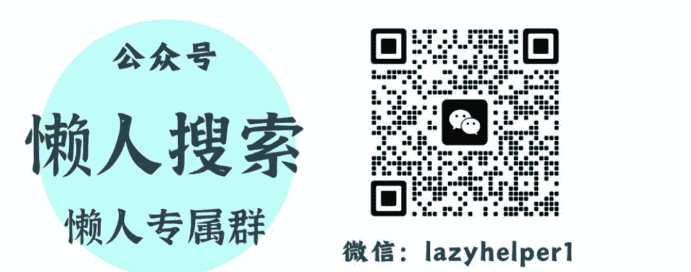
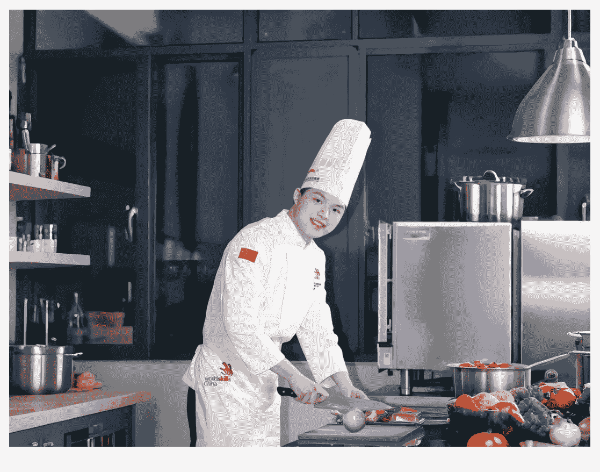
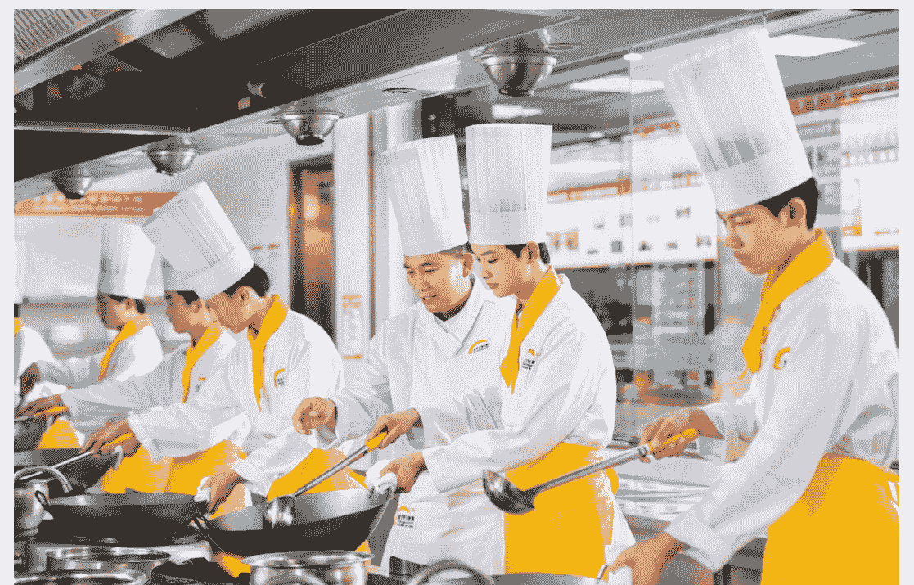
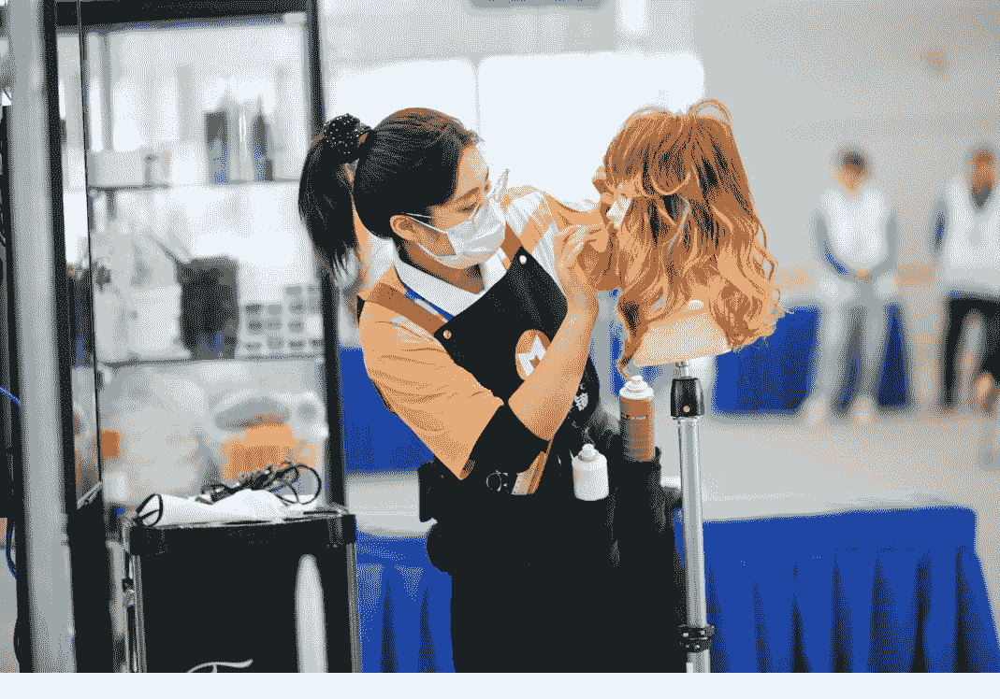
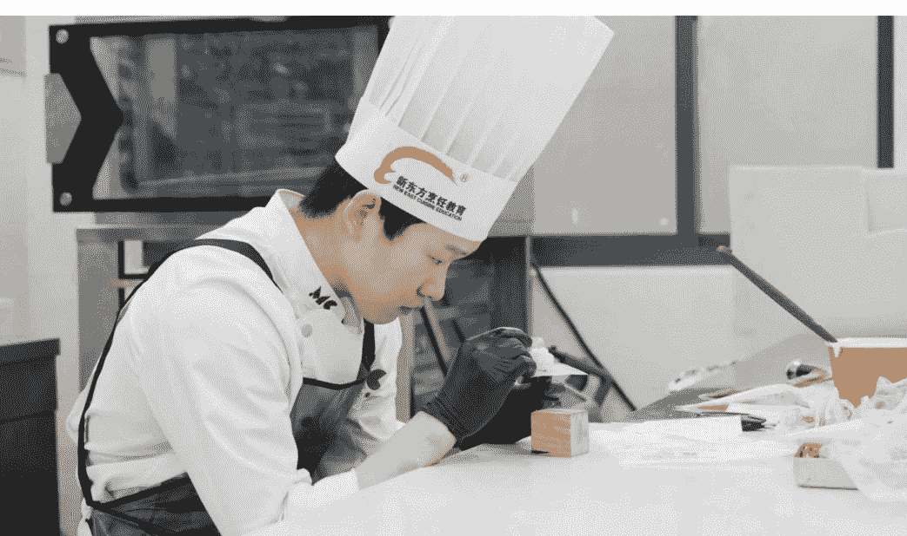
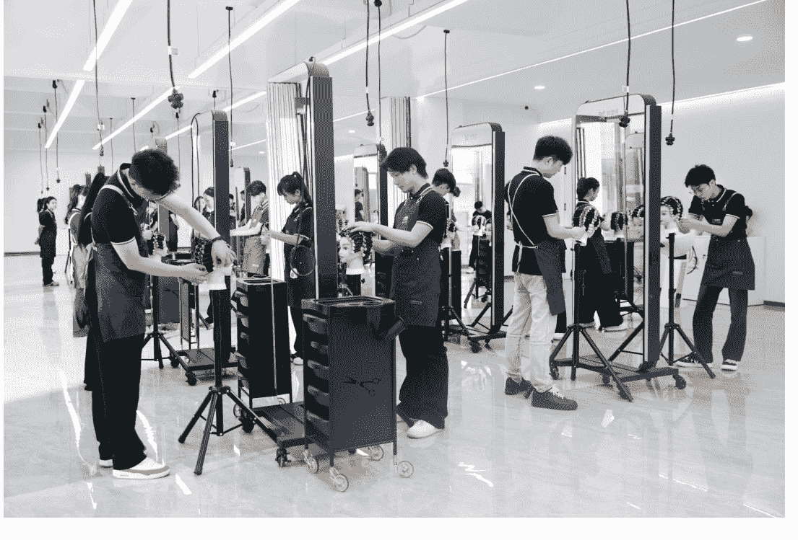
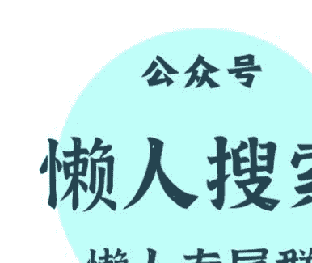

## 行行出状元，行行也需要“状元”

260923
整理：公众号懒人搜索，懒人专属群精选
懒人微信：lazyhelper1

小懒判断 | 正在考虑学手艺的人，或纠结要不要给孩子报职校的家值得看；只想了解世赛比赛结果的可以划走。最值得我关注的是冠军的副产品这条线：新东方用 AI 把营养目标当约束条件算食材搭配，精确到克，选手还把世赛农业机器人 3 天改成能下地摘草莓的。坑在于调研对象是企业自己的办学体系，数据都是对方给的，看结论记得自带滤镜。

今天，咱们接着说世界技能大赛。昨天咱们讲到，过去几年，我国在世界技能大赛里的冠军数量、奖牌数量都在稳步增长。所以，今天咱们就说说，这么稳定的冠军产出，到底是怎么实现的？

估计很多人会先想到一个很熟悉的词，就是“举国体制”，也就是国家集中力量办大事。

毕竟，咱们国家被誉为“世界工厂”，拥有全世界最长、最强大的产业链，这么庞大的基数，选出几个优秀的技能人才应该不是难事。

但就在前段时间，我们专门去中国东方教育集团做了一次详细的调研，看到了完全不同版本的答案。

过去几年，中国东方教育集团是世界技能大赛的重要选手输出方。根据公开数据，从第 45 届开始，旗下院校连续有学生进入国家集训队，同时也长期承担中国集训基地任务。

而今年的世赛，中国东方教育集团有 7 名师生进入中国集训队，其中杨萧剑、王天祥、李锌 3 人最终成为中国代表团正选，分别参加烹饪（西餐）项目、糖艺/西点制作项目，以及美发项目。

图片注释：48 届世赛烹饪（西餐）项目中国参赛选手杨萧剑这次调研，我们专门采访了新东方烹饪学校曹经伟校长，以及欧曼谛时尚美业研究院竞赛中心主任。

看完这套培养系统你也许会发现，培养世赛选手，不是简单的“万里挑一”，而是一套极其复杂的体系。

首先，咱们来说几组数据，直观感受一下，培养冠军的难度有多大。

- 第一，培养的单位不是个人，而是团队。更准确地说，冠军不是一开始就能被挑出来的，而是在长期培养和选拔中逐渐涌现出来的。

就拿烹饪这一个项目来说。仅安徽新东方烹饪学校每年就有四五千名学生，最开始学校会筛选出上百个人进入名单，之后通过持续训练、考察和比赛，一轮轮缩小范围。

最终确定的选手，是在这个过程中涌现出来的，而不是一开始就锁定某个人。

- 第二，培养冠军所动用的师资力量，远远超过一个常规的教学单元。比如，一位选手成为正选之后，有往届世赛的冠军选手参与培训和指导，还有同一批次的其他候选人在团队里继续陪练。

再比如，学校还会邀请国家级裁判员、国际裁判专家、国内裁判长以及其他集训基地的教练参与训练和技术交流。

换句话说，培养一个冠军背后，是由国内外教练、顶级专家、往届获奖选手、陪练和后勤保障组成的一整套支持系统。冠军只有一个，但冠军精神属于每一个人。

- 第三，耗材、设备、训练场地等基础设施的成本，也在千万级别。以安徽的政策为例，首次认定的世赛主集训基地可以获得500万元补助，副集训基地也有200万元补助，用于支持基地建设和选手培养。

这还只是政府层面的支出。回到日常教学和训练，每次练习用到的耗材、外部聘请的专家教练、专业的设备等，这些投入拉长到四五年这个周期看，都是一笔不小的数字。

肯定有人会好奇，为什么要投入这么多去培养世界级的技能人才呢？

当然，培养冠军，在一门手艺上打磨到极致，获得一份荣誉，获得一份社会认可，让选手为中国在这个领域赢得一个口碑、骄傲和认同度，这些都有价值。但假如只盯着这冠军本身看，我们很难看到那个更深层次的答案。毕竟，世界技能大赛跟奥运会给人的感觉还不太一样。

奥运会天然带着一层底色，叫做突破人类极限，我们可以说运动员在不断刷新人类身体能力的边界。

但假如你说，我们要在做蛋糕、剪头发、酒店服务这些事情上超过了人类极限，这件事听上去似乎就没有那么“酷”。

所以，这件事一定还有比“拿冠军”更实际的价值。那么，这层价值到底是什么呢？

这回我们在采访中国东方教育集团的过程中，获得了理解这个事情非常重要的一个角度，就是培养一个冠军，价值远远不在于冠军本身，更在于沿途产生的那些高价值的“副产品”。 什么意思呢？假如说培养一个冠军，要的是一个 100 分的选手，那么在培养他的过程中，还会诞生无数个 90 分的“副产品”，而且这些“副产品”，会产生持续的长期价值，甚至超越 100 分所带来的价值。

回到培养冠军这件事情，也是一个道理。一所学校、一个组织，如果最终的目标是培养一群在市场层面将将合格的手艺人，那么培养体系就可以在及格线徘徊，而一旦把目标定在培养一个世界顶尖水平的人才，那么这个近乎苛刻的标准会倒逼学校整体做升级。

那么，这些“副产品”具体都是什么呢？

- 第一个“副产品”是，培养高水平从业者的方法。比赛会结束，但产出冠军这个能力本身，会积累下来。

比如，在新东方烹饪学校，高水平的选手会在比赛后留校任教，进入教练团和专家组，再去训练下一批学生。

这样一来，他们在比赛和训练中积累下来的能力，会成为训练下一批学生的教学方法，而不是只停留在个人身上。

中国东方教育集团内部就有一个办学思路，叫“以赛立校”。简单说，就是把高水平竞赛的标准、训练方法和评价方式，反过来融入日常教学。

就拿美发项目来说，从一般就业要求来看，掌握剪发、染发这些基本技能，大体就能胜任不少岗位。

但是到了世赛这种规格的比赛，考察的就不只是单项手艺，而是选手的综合能力。

图片注释：48届世赛美发项目中国参赛选手李铎进行美发项目训练欧曼谛时尚美业研究院竞赛中心主任就说，他们会按照比赛要求倒推课程设计。

美发专业的学生不仅要学剪发、染发，还要学化妆、服装搭配、整体造型设计等，训练的是一整套综合职业能力。

换句话说，普通学生经过专业的培训，都有可能站上国际赛场，一展所长。比赛标准和训练方法进入课程，这些都会变成学校的教学能力，一层层渗透进普通学生的培养体系。

- 第二个“副产品”是，培养冠军的过程中，会产生大量的创新。在说这个问题之前，咱们先需要想明白一个道理，就是很多创新是怎么发生的？并不是一开始设计好的，而是发生在“原来的办法开始不够用”的时候。

只有当一个老方案解决不了问题，才会倒逼人们去寻找新的办法。

什么意思呢？你想，无论是烹饪、美发，还是酒店接待、修理空调等，在大多数日常工作场景里，现有的工具和方法其实已经相当够用了。

一个普通的从业者，跟着师傅学习一段时间，再经过一定训练，大体就可以达到这门手艺的从业要求。

那既然旧办法能解决大部分问题，人们自然也没有那么强的动力去重新发明一套办法。

但回头看世界技能大赛，它天然塑造了一个“不够用”的场景。也就是把常规场景中的技能，推到了接近极限的位置。这种条件下，很多原本够用的东西会暴露出局限性。

比如，AI工具的引入。就拿烹饪（西餐）项目来说。世赛考察的不只是“把菜做出来”，在世界技能组织的职业标准里，专门有一项叫“食材与菜单开发”。

选手要理解食材的营养、成本和季节性，还要考虑过敏、宗教饮食等不同要求，根据具体场景开发菜单、调整菜谱。

图片注释：48届世赛糖艺/西点制作项目中国参赛选手王天祥日常训练现在，新东方烹饪已经开始用 AI 工具辅助新菜品研发和智能营养配餐。不是简单地让 AI 随便想一道菜，而是先把人的年龄、身高、体重、能量需求，以及蛋白质、脂肪、碳水化合物等营养目标变成约束条件，再调用食物成分数据库，计算不同食材怎么组合。最终的食材搭配，甚至精确到几克这个单位。

再比如，美发专业，他们已经引入 AI 智能镜设备。

这是一种把造型镜台和触屏电脑结合起来的教学设备，既可以通过设备发送、传输作品，也可以辅助学生的整个造型操作流程，包括计时、问题报备、数据上传等。这样一来，数字化设备就真正进入了日常教学。

图片注释：欧曼谛时尚美业学校美发专业课堂学子实训很多时候，顶尖选手也会反哺行业创新。

比如，获得第 47 届世赛自主移动机器人冠军的蒋家俊和方灿豪，他们在比赛结束后做过一个很有意思的实验，他们用 3 天，把世赛上的农业机器人改成了一台真的能下地摘草莓的机器人。

当然，创新不只发生在选手身上。围绕顶尖选手建立起来的培养体系，也会在教学和训练中不断推动创新。

比如，中国东方教育旗下的宁夏新东方技工学校，就是第46、47、48届世赛糖艺/西点制作项目中国集训基地。他们之前申请过多项食品工艺类发明专利。其中一项叫《一种用于炸串串和辣糊糊的调料及其制备方法》。

这个事情的价值不在于本身的技术含量有多高，而是从原料的精准重量、油温、火候，再到烹饪的时长，都变成了一套可复制的技术流程。

说白了，就是把厨师的经验变成了可以复用的工艺流程。

表面上看，选手参加比赛是在打磨自己的技能，但比赛过程中形成和验证的技术方案、评价方法和技能标准，并不会只停留在赛场上。通过世赛，这些标准有机会获得更大范围的认可，进一步进入课程、教材，甚至影响行业标准。

- 第三个“副产品”是，在培养冠军的过程中，会把一个行业长期的目标配置优先级看清楚。你看，这几年，很多技能在逐渐被自动化，市场上一批一批出现了炒菜机器人、咖啡机器人、调酒机器人等。

这就给几乎所有技能型行业提出了一个非常现实的问题：我们今天投入资源培养的能力，十年之后还成立吗？真正值得人长期投入、更难被工具替代的部分，究竟是什么？

回答这个问题的最好方式之一，就是观察一个绝顶高手。因为在这些人身上，我们能清晰地看到那些超过基本功的东西。

反过来，如果你只盯着一个中等水平的从业者看，很难判断哪些是可以交给机器完成的、哪些又是必须留给人的，因为这些能力在他身上没有清晰的分界线。

这也是培养一个冠军对一个行业深层的价值，不只是赢下一块奖牌，也给整个行业提供了一个可以近距离研究的样本。

最后，再回头看世界技能大赛。奖牌当然重要，但更值得关注的是，投入大量资源培养一个世赛选手，其实是在用一个极限目标，倒逼一所学校、一个行业，甚至整个培养体系不断升级。

过去我们总说，三百六十行，行行出状元。

但换个角度，三百六十行，行行也需要状元。因为走到那里之后，留下的方法、标准、经验，就是给所有人预留的、往上走的那个台阶。

——分割线——

在这个 AI 能替你写代码、写文章的时代，基础技能正在迅速贬值。绝大多数人正被淹没在海量的免费垃圾信息里，陷入低效的体力内卷。

当“努力”不再是壁垒，人与人之间唯一的护城河，只剩下“信息过滤”的效率与“认知系统"的维度。

圈子已稳定运行7年。我们每天利用Python爬虫与大模型算力，过滤全网最顶级的政经内参和搞钱风向标，做你最冷酷的“外部大脑”。

如果你认同这种“重塑认知防线”的极客主义，欢迎围观我的个人情报智库：【懒人专属群】。

https://lazysO.com/insider/

认同信息过滤价值、想省下每天3小时无效阅读时间的读者，扫码加我微信（lazyhelper1）

