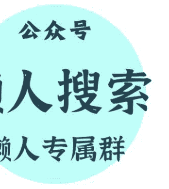
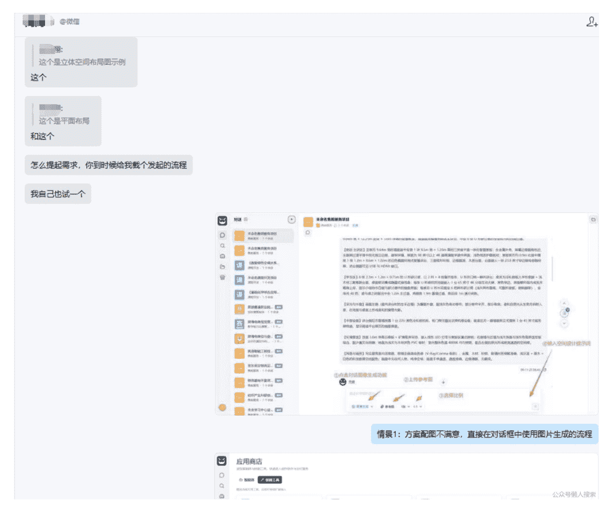
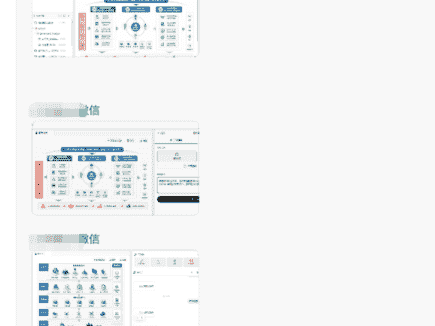
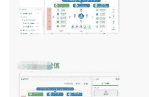
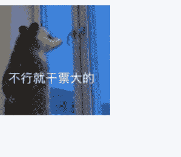
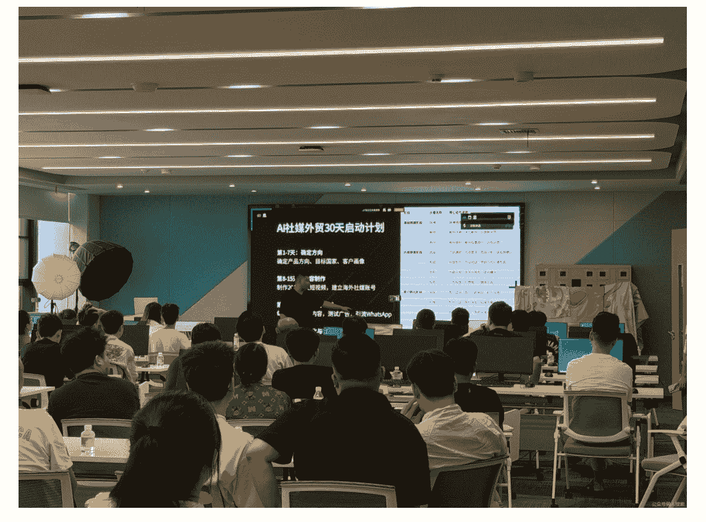
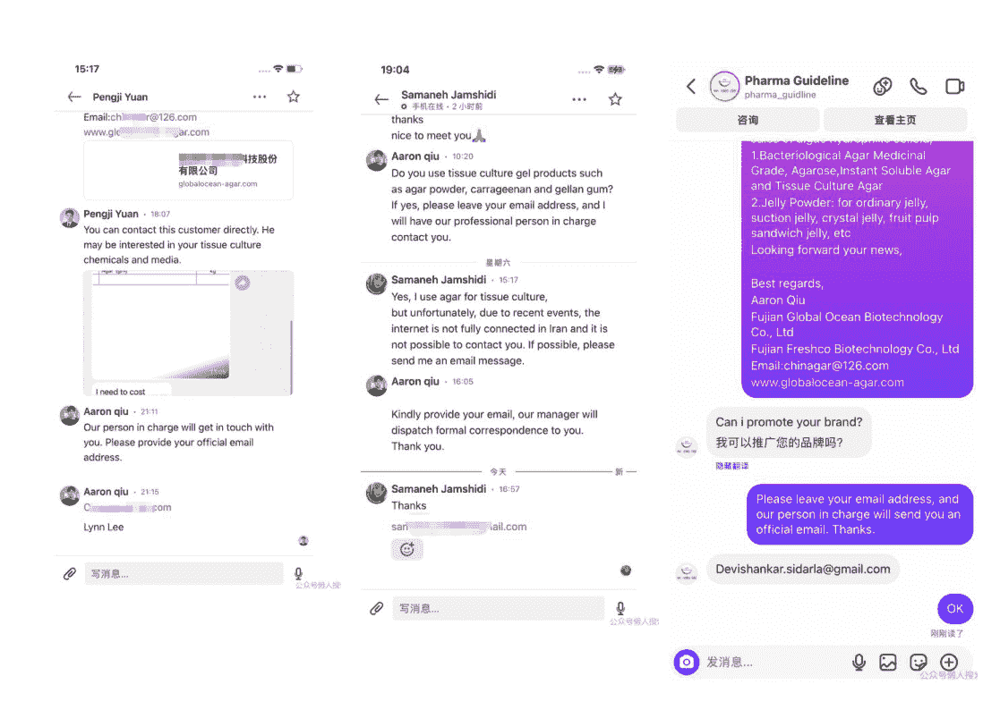
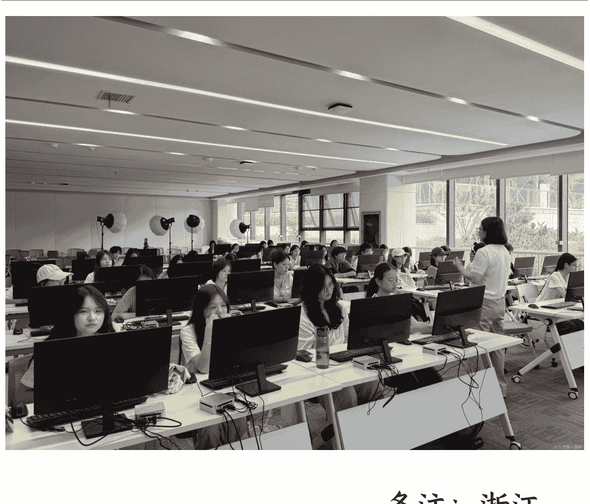
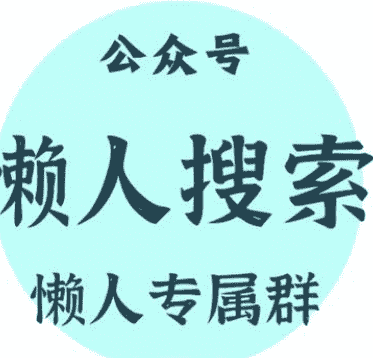

# 有十几年 ToB 服务经验后，一个老板如何开始做企业 AI 服务

**整理信息**
260923 副业 SC 精华
整理：公众号懒人搜索，懒人专属群精选
懒人微信：lazyhelperl




> **小懒判断**
> 适合有 ToB/ToG 客户资源、想做企业 AI 服务但不知从哪切入的老板；纯技术出身没有行业沉淀的先别硬上。最值得关注的是 5 万 token 免单磨合期协议：先服务一个月，不满意只收 5 万终止，客户决策门槛极低。坑在于按询盘结算的代运营也有两个月不足 10 条的，结果付费不保证所有品类都跑得通。

## 一、从 ToB/ToG 到企业 AI 服务

大家好，我是安与宁，目前在厦门，入圈快 9 年，第一次发帖。

早期在华为做过几年，服务三大运营商；大概 2014 年左右进入互联网行业，在国内一线云厂商，做过研发、产品、解决方案等；最近几年连续创业围绕云计算服务泛互娱、政务、学校等客户群体，属于一直在 ToB、ToG 领域，所以我手头里有部分这些行业的资源。

那企业 AI 服务也是 ToB 服务，只不过是我今年才开始零星接一些 AI 相关的项目，目前主要服务外贸、跨境电商、职业院校等行业客户。

到现在为止，我们公司都还没正式的 FDE 团队，前期属于柔性生产、柔性服务。什么意思呢，就是先有订单，我再组织“生产”，我再协调内部团队去做交付。所以获客、聊需求、方案、报价、产品开发，是我一个人在做，运营和交付让公司里同事配合。

## 二、第一单是怎么成交

我先讲一个案例。我们在今年四月份的时候，服务了一家做教育的公司。他们是一家比较传统的公司，老板上了年纪，然后做的业务是帮助一些中高职院校开发课程、承接比赛。老板比较焦虑，然后看我们在 AI 方面探索了比较久，也有一些成果，就找到我们。

其实我们对接过很多传统行业的老板，这些老板的年纪相对会大一些，四五十岁，五六十岁的，他们的心态可能你想不到，就是外面 AI 再怎么变化他们其实感知不明显的，但是他一旦听到同行在用 AI 降本增效了多少，他就会非常焦虑。

这种现象跟我在十几年前互联网那一波服务于传统行业时见到过的一样。也是现实中很多老板的一个共同现象，就是你跟他聊技术、聊不相关的成果，他们没兴趣。但是你拿同行业内其它公司做的案例并取得了什么样的成绩，他就会有反应。

这是一种老板生存策略，就好像如果你跟几个朋友都去森林里玩结果碰到一只棕熊，这个时候你不需要打得过棕熊，你的生存策略是比其他人跑得快就行了。

然后找到我们后，我们其实之前是没有专门接这种 AI 服务项目的，虽然我们公司 AI 有探索了一些，但是我们的经验不一定能套在他们公司上；虽然我做了十几年的 ToB 服务，我也清楚的知道其实现在企业 AI 服务跟之前的企业数字化业务流程，基本上都是一样的。

但我一开始还是有顾虑，我顾虑的点是：客户认知能不能跟上，预期会不会太高最后没达到他想要的效果；我们要是后面交付节奏要是没把控好，公司可能要投入不少人手，最后没利润不说，有可能会影响公司其它项目的进度，公司其它股东会怎么看。

最后种种原因，我们最终还是签定了一份类似这样的协议：先服务一个月，这一个月客户充值 5 万当作 token 费用，我们免费做智能体给客户用，客户使用 token 消耗他这 5 万的额度，这一个月是磨合期，一个月期满后，如果双方不满意，就只付这 5 万块，项目自动终止无需付尾款；如果有意向进一步合作，再付剩余尾款，到时 token 另行充值。

这是我们的第一个企业 AI 服务单子，客户公司有五十号人左右，这是老板直接决策的。然后签定后，我们安排了两个同事全职对接，现场到客户公司，教他们如何开发课程。

补充下，客户开发课程业务逻辑是这样的：

假设某个高职院校要开设一门跨境电商的专业，那么这个专业接下来的三年，可能要上 40 多门课，这些课程要怎么设计、怎么搭配、怎么组课，人才要怎么培养、如何结合当地的产业等等都是要在课程里体现的。一门课程，是有包含教材、教案、工单、工作页、案例、课件 PPT、MG 动画等，整门课程包含的内容很多很多。

以前人工开发课程，至少需要投入 3 人月全职开发一门课程，那我们现在是帮客户可以做到 3 天开发一门课程，效率提供几十倍，成本下降几十倍。当然这是到了八月份的事，中间有换过技术栈，有纯手工帮他们开发课程、方案，有连续一个多月的智能体稳定性及质量调优，也有过他们老板多次的投诉经历等等。



### 客服群记录

**群信息**：由企业微信用户创建的外部群，含13位外部联系人
**头像**

*文件**：2026.智能技术学化-王老师.docx (34.4K)

**徐静**：[头像] 2026.智能... 3.docx [头像] 这个项目要再跑比赛，你带着李培看一遍流程。

*文件**：3.2026年世界职业院校技能大赛总决赛赛评分要素.pdf (349.3K)

**微信链接**：
教育部关于印发《2026年世界职业院校技能大赛实施方案》的通知 - 中华人民共和国教育部政府门户网站
http://www.moe.gov.cn/srcsite/A07/t57055/202608/t20260820_11447374.html

**成员留言**：
这个是一所中职学校，和高职还有区别。顺便需要统计一下需要多少成本费用。[表情]

### 客服群 [人数图标]

**群信息**：由企业微信用户创建的外部群，含13位外部联系人，[头像] 9月10日 15:42

**IANG:Li 的聊天记录**
IANG:Li: [图片]
IANG:Li: [图片]
IANG:Li: [图片]

**留言**：
各位老师可以参考此材料开发任务的通用流程，分为五个阶段
需求确认—AI理解检查一下达 开始 指令—细节调整—循环任务启动
相比于一次对话-一份材料的交互模式来说可以有效降低成本提高质量 [表情]

*文件**：项目3.空调水系统安装调试.docx (83.54M)

**微信留言**：
喜特的截图就是教材开发AI应用的工作方法，我们可以保存学习，以此类推

**头像** [头像]
**文件**：项目3.空调水系统安装调试.docx
这份是上面操作示例中三次对话—次输出结果（十五分钟）的质量，提供参考
后续会根据大家目前各自项目使用情况，总结通用方法同步到群中 [表情]

### 实施服务群

**群信息**：该企业微信用户创建的外部群，含48位外部联系人 | 群主 [头像] 群成员: 24



*系统消息/错误日志*
```
[code: MODEL_EXECUTION_FAILED, {"message": "模型 [姓名] 调用失败，请检查模型服务配置或稍后重试。"}]
```




**群成员互动记录**

**群主/朱经理**（9月10日）：
@微信
群成员：24
群主：

朱经理、林经理注意一下，汇总数据们我根据现场是专业教师做为评委这一项实施了调整，大家做资源时按照这一版汇报标准来准备

**5月12日 16:28**
回复：好的，我们这里结合这些材料来准备

**5月13日 14:59**
来自微信的格淑慧撤回了一条消息

**5月13日 15:24**
@ 林经理，汇报操作已完成，请据汇报稿中要求的内容，安排咱们的补充资源(补充至 PPT 中)，您就可以结合汇报标准来演练

**图片**

**8月11日 09:27**
**文件**：
数字教材课件_设计方... (0.66M)
数字教材课件_教学方案1... (0.46M)

**留言**：
这是前天输出的两份方案，方案中1.路径不够清晰；落地：2.方案中很大的比较比如像“做得”与“比做得快”更重要；3.图片生成后有点失真，调整了两次

**回复**：
2.我看一下
看1左图到小左图和大图(实际三十多页)的归纳
52 和实施30多 这个怎么谋

4.图片没办法小范围手动修改，替换色修改后，图片的结构又和第一版的好了，感觉越修改就改不了了

好嘛经理，我看下内容

**8月11日 22:55**
**聊天记录**
5.视频是否合理考虑
3 视觉语言还原.pptx
把参考PPT里的内容给成出

**留言**：
嗯，这是老师给过来动的动画效果里，里面有PPT也有视频，我知道咱们现在智能做MG动画用的是动画模板这样回
所以我想一个想法：把用左提的PPT材料和介绍原理的视频字幕（完整动画字幕）用智能体提取出一份文档，然后转成脚本，再去动画

唯一我担心做不到的点是，咱们没办法注入参考画面以及内部结构，这样子我们做出来东西它就不会准确。
咱们能否在技术上做一下调整，做MG动画的时候，能够让参考画面或者参考视频这个选项，达到一个不错的效果。
或者你看到官后尽快给我反馈，如果可行的话，你给我一下技术那边的时间，我们评估一下么单位件事



**8月11日 23:11**
**回复**：
这个我这周试下在本事上做得
看下能否到到什么三成的效果
这个项目交付时间是什么时候

**备注**：中间不断的适配客户业务、质量调优、手工帮他们完成任务等等后来我们又给他们解决比赛的事，比如学校的教学能力比赛、世校赛等等，这个需求是刚需中的刚需，因为比赛这个需求从校长、教务处、二级学院院长、老师都跟他们的利益息息相关，很多厂商拿这个去当敲门砖。当然这是后话。

那回到当时四月份，实际接触下来一个月，我们发现，我们的智能体并没办法融合到他们的业务，所以我们重新帮他们优化了智能体，沉淀了不少 skill，也教他们用了不少外面的工具平台，但是你要说有多深入的去嵌入到他们的业务流程，那并没有。那个时候是四月份，agent 能力还没那么强，不像现在。

但客户不这么想，没达到他的预期，那他就有要求了，要我们给他们定制做智能体，要给人们定期培训 AI，还要我们双周一 PPT 汇报项目情况等等。

然后我们也很重视，一个月会去客户现场两次，一次去三五天时间，我们在厦门，客户在北方，所以也耗了很多时间成本，人力成本。然后我们现场同事要做项目汇报，要对接客户老板、中层、基层，要收集各方平时的工作业务流程，要在现场写 skill，要收集产品信息反馈，还要跟我们公司的各个同事衔接。

所以你看，基本上把项目经理、售前、产品、交付等工作都给干了，这就是 FDE 的工作。

## 三、企业 AI 服务会不会变成外包

那我就在想，对我们这种小公司，会不会很容易干着干着，变成了一个高级驻场外包。

外包的生意逻辑是，公司可能要去尝试一项新的业务，或者我临时有个非公司主营的业务，这时我如果自己接下来的话，我要组一个团队，可能五六个人，然后花半年时间去探索去交付，老板一算这个账，这个成本差不多是五六十万块，那外包的话，可能一二十万就搞定，那老板就会找包外，所以这是外包的逻辑。

所以企业 AI 服务会变成外包驻场吗，我觉得如果你是做轻量服务交付的，比如你给企业交付一场培训，帮客户提高 AI 认知，帮客户使用 AI 工具，那这种是轻量的服务。

如果你是帮客户做成 AI Native 的升级，那这个靠外包是做不到的，得授之以渔，你得提升一把手的认知，你得培养这个企业的 FDE，然后让企业内部自己去做组织变革。

如果你是帮客户做几个 Agent，帮他们解决公司的大部 分业务流程，那是有可能变成驻场外包的，因为得去现场深入了解他们的业务，你要看他们日常是怎么工作的，不仅重人力交付把自己耗尽，而且有可能只是做一个项目，不一定能沉淀出来东西。

所以这不是我们想要的，我们团队就 20几个人，解决方案团队 10 个不到，如果要做这种定制化开发，定制化现场服务的，我们的带宽能力有限，我们服务项目数量也是有有限，营收没法往上走，人效不高。

## 四、企业 AI 服务如何提高人效

那往下怎么走，我想了下，有这么几条路：

首先是提高客单价，把深度服务卖给真正愿意为结果付费的客户。那这种大 B 会比较常见，小 B 有但比较少，大 B 就是那种可能 500 人以上规模，或者年利润在几个亿的这种，比如我今年看到很多这种国央企有这个预算，一年有好几百万的 AI 数字化预算，像厦门本地的建发、国贸，其实手头是有这么一笔钱，但不知道怎么花，但是这种大 B 得有很深的商务关系，而且不是单点搞定，搞定大客户是需要一套体系去配合的。

另一个是小 B，小 B 的生意逻辑就是决策链短，公司就一二十个人，要解决什么问题老板有明确，但是客单价不高，可能就是几千块到几万块。所以小 B 要高客单，主要取决于这个业务问题的经济价值、解决的紧迫程度、预算，以及他对结果的信任程度。

第二条路是把我们在交付里沉淀出来的行业经验、流程和工具，慢慢做成培训产品，用更低成本去复制。这里边又分两种，一种是直接帮企业解决业务问题；一种是帮助企业建立 FDE 人才培养体系。这是目前市面上跑得最多的也被验证过的，就是给企业做培训、提供顾问服务。那这种模式做出来后沉淀一批客户，后面再往深了切去做这些行里更深的一些 AI 数字化项目，是有很大概率的。

第三条路是做标准产品，也就是你做一套产品，专门服务一个或少数几个行业，这种属于 SaaS 订阅的模式，但是这条路目前还属于早期，后期一定会有这种模式出现。这个有两种模式，一种是你自己做产品去推；另一种是入驻到 workbuddy 等大厂的生态。

第四条路是建立交付网络。我来抓获客、成交、方案、关键节点和验收，外部合作团队承担部分交付、方案等，这需要你去建立你的合作伙伴网络。我今年也拒绝了几个项目单子，要么是交付太重，要么是跟我的主线不一样，后来拒绝多了也觉得可惜，所以我在上个月开始找合作伙伴，甚至我还把厦门办公场地空余的一部分，拿来做免费的 OPC 空间提供给 OPC 创业者，我优先考虑从 OPC 空间里筛选出来的合作伙伴，主要原因也是线下有充分接触可以互相了解，有利于筛选。

## 五、企业 AI 服务跟以前的数字化有什么区别

我认为现在还是处于早期阶段，各行各业是有时间差，是有认知差的，所以是比较好切入的，做做内训、做做顾问，甚至卖工具、卖智能体、项目陪跑等都能走的通。

但是现在 AI 业务场景落地，还存在各种各样的问题。所以可能再过一年时间，又会到了跟过去数字化阶段并没有本质不同的阶段，依然是要卖结果，依然是要有说服力。你给客户演示一个系统，你拿着 PPT 去介绍，肯定不太管用，你要拿具体的案例去说服他，还得拿捏人性。老板依然会算账，这件事能帮我增加多少收入、减少多少成本，要投入多少精力，他也依然需要信任。

依然是一样的项目全生命周期，要经历立项、POC、招采购、交付、验收、回款等阶段。政务、学校、医院、国央企等基本是按照上面一套流程下来。这种大B或G端的，领导决策与一线痛点常常是两张需求皮；产品要考虑到数据合法合规、安全、信创等问题；交付除了产品，还有一堆材料准备；甲方强势，需求漫延严重；采购方与验收方是两拨人；回款周期久等等问题。

中小型民企则没有上面这些条条框框，更多的是企业一把手或部门一把手直接决策，但是依然要处理前期需求沟通、方案对接、报价、合同、交付、验收等关键节点问题。对人的要求是，依然要懂业务，依然要扛住甲方各层级人物的施压。

不同的是，现在交付的结果跟过去GUI的产品存在不一样，就是结果可能存在不确定性，同一个任务换一批资料，或者换一种问法，甚至换个模型，输出质量都可能发生变化。面对这种情况，你怎么顺利验收这个项目需要突破客户认知、产品质量、服务能力等多重因素。

还是说回前面教育项目，从四月份开始合作，到八月份才做到前面提到的效果，验收标准满足跟过去不太一样。我们现在经常听到说不要只拿AI当工具，而是要用AI Native思维在做事情。

什么是 AI 原生思维。我举个硅谷的 CURSOR 公司，它是被认为一家典型的 AI Native 公司，它的特点是：

- 1、公司内没有划分前端、后端、测试、产品等固定的岗位；
- 2、AI 智能体被当成团队正式成员，也会被表扬、被批评；
- 3、公司内组织架构极度扁平化，没有标准化 KPI，依靠目标结果驱动；
- 4、所有的员工都在调度、约束、调教 AI 智能体，都在管着一堆的智能体。

那如果你长期在 AI Native 公司下做事，你跟人的协作，你处理任务的方式等等就会变成 AI 原生思维。那一个组织，要变成 Ai Native 是很难很难的，历史包袱越重越难，这件事情一定是个一把手工程。同样的，一个人要有 Ai Native 思维也是很难的，我今天不展开讲如何要有 Ai Native 思维，因为可能对我这个老登来说，我也有历史包袱。我借用一个例子来说明。

纽约港曾经是全世界最大的港口，当年发明集装箱的时候，纽约港也引进了集装箱，但最终真正崛起的是新泽西港。为什么？因为靠集装箱驱动的港口和靠人力搬运驱动的港口，它的道路结构、码头形状以及接驳方式全都不一样。只有新泽西港做到了集装箱时代的彻底重构，而纽约港并没有做到。

但是恰恰相反，我见到不少人，甚至我同事，经常会认为会用了一些 AI，会有种俯视众生俯视客户的感觉，按我经验，你这样很容易绕到了技术思维里边，导致你可能在跟客户沟通时很容易用技术的思维去沟通。而客户其实要的是结果，甚至你是不是用 AI 给他赋能他都不是关心，他只关心能不能提效多开拓一些客户，多节省一些成本。所以，跟客户沟通，还是要站在业务角度，站在结果去聊，不要套太多 AI 的在里边，你也不要在客户面前炫你的 AI 技术，也不要讲这是 AI 目前就是存在不确定性等幼稚的话，老老实实关注业务结果，用什么技术解决只是手段。

## 六、老板愿意为什么买单

那我们做企业 AI 服务，除了你要了解一线具体员工他们平常怎么工作，怎么处理业务，他们的诉求是什么之外，你也要关注老板的想法，因为企业 AI 服务一定是一把手工程。

这里的老板不仅是小 B 的老板，一些大 B 的决策人也在此范畴。老板关心几件事情。

首先，外面同行他们走在什么程度了，如果同行用 AI 降本增效了多少，而他没有，他会很焦虑，所以你跟这些老板聊，要拿同行案例，案例要准备充分，这个前面有提到，就不再展开了。

其次，老板关心这些企业员工在大量用 AI，token 花了，工具用了，但是公司的整体能力有没有提升。大多数企业现在的 AI 使用，还是散的、浅的、个人化的。员工会用 AI 做精美的视频，但这个方法没有沉淀成团队 SOP 或 skill，市场人员会用 AI 出解决方案，但优秀员工的行业判断、客户理解、方案结构，还是留在个人脑子里，一旦这

个员工离职，经验就跟着走了。公司花的钱，最后只是提升了某个员工当下的效率，没有变成组织能力。

所以这个问题老板关心的是，AI 有没有进入业务流程？有没有沉淀组织经验？有没有变成可复用、可验收、可持续迭代的生产力系统？所以你要协助企业做组织变革，你要跟他讲他真正关心的点，你要拿出对应的解决方案。

最后，老板也关注 ROI，就是我今年在 AI 上投入了多少，我能省多少成本，我能多赚多少钱。再细化到个人，他会关注，公司里哪些人用 AI 真正放大了，哪些人用 AI 只是增加成本，他想要透明的数据，老板想要的是一个掌控感、安全感。

## 七、另一个外贸案例

如果说前面那个案例，是我们有了产品后，刚好也匹配客户的业务场景，才有了订单。而第二个案例则是我们先有了业务，再去做产品，也又验证了我开头说的，AI 时代柔性生产的重要性。

我们公司在浙江有个团队，原先是帮金华政府的某个基地在做运营，运营有两个指标，带全国学校的老师、学生去参观、培训；另一个是招商。

前几个月我们与义乌一个做外贸的 KOL 合作，组织了一场线下招商会，原先目的是想招几家外贸企业过来，结果现场演示我们的一些 AI 成果后，有不少外贸企业表示感兴趣可以用 AI 来结合。



备注：现场招商，以 AI+外贸为主题，需求精准

于是我开发了第二款产品，外贸智能体，主要用来做海外社媒获客。AI 给外贸带来的变化，它可以帮助企业分析海外市场、寻找潜在客户、制作多语言内容、生成产品介绍、辅助回复询盘、整理客户信息等等。过去一个业务员只能维护有限数量的客户，现在借助 AI 和数字化工具，可以同时覆盖更多国家、更多渠道和更多潜在客户。

但由于前期大家信任基础还不够，让客户先花一笔钱购买产品，然后再自己摸索怎么用，客户大概率不愿意去尝试。

所以我们当时出了一个方案：
- 先做代运营，有有效询盘了，再按询盘数量结算；
- 如果没有有效询盘，token 费用我们自己承担，运营费用也不收。

我们把一部分前期风险接了过来，让客户先看到与业务有关的结果，再为这部分结果付费。

外贸有个特点是它是一个客户信任成本很高的行业，所以导致成交周期比较长，但客户价值也比较高。一条询盘不一定马上成交，有的客户可能要跟三个月、半年，甚至一年。但一旦进入客户的供应链，后面就可能持续复购。

这些老板会在心里计算一笔账：我花 6000 块招一个外贸业务员，算上社保费用、办公杂费用等一个月的成本要在 8000 以上，而且不一定有效果。如果有人帮我把手中的产品直接推广，有询盘了我就付一部分钱，相当于花钱直接买结果。老板们是愿意尝试的。

那我们有个客户案例是，他们原先是卖琼脂糖的，做了十几年，客户群体一直是行业内圈子那些。后面我们帮他们把产品推到各个海外社媒，发现来询盘的有很多是医院、实验室、科研机构等原先没接触的客户。



备注：琼脂粉客户的部分询盘

当然我们也也有代运营了两个月，有效询盘不足 10 个的客户，所以这边我们又了解到外贸里边还有细分领域，跟不同品类、不同国家区域、不同账号等很多因素都有关系。

所以按结果收费能帮助成交，但能不能长期做，还要看结果是否可控、成本是否算得过账。有些客户可以继续验证，有些客户则要调整方案或者及时停下来，不能只因为已经投入了，就不断往里面加人加时间。

后来代运营我们做了升级，我们现在在浙江的 OPC 基地对接了一些高校学生，我们已经尝试按 4000 块/月向外贸企业收费，token 客户自己另外充值，并把这些代运营工作交给这些学生来做。同时我也根据这两个月的运营经验在产品上重构，往外贸智能体 2.0 迭代。



备注：浙江OPC基地带领学生承接外贸代运营、跨境电商代运营

## 八、一个人做企业 AI 服务需要什么能力

讲完这两个案例，大家可能会问，一个人能不能做企业 AI 服务？按我的经验，要看你准备提供什么服务、承接多大的项目，以及哪些环节有人配合。前面我举的项目都是偏重的，由我主导获客、方案和 IP 产品，运营、交付有公司同事参与，一个人可以从范围比较小的服务开始，比如做些培训、咨询顾问等。

现在都在提 OPC，但是真正的 OPC 是不可复制的，而如果你是一名优秀的 FDE，那你大概会成为一个优秀的创业者。所以我觉得 AI 时代，我们都要朝这几个方向努力：
- 影响力
- 产品力
- 工程力
- 服务力

首先是影响力就是做 IP。当很多内容都能用 AI 做出来的时候，信任就变得重要，AI 会让做内容这件事更容易，但它不会自动帮你变得更值得信任。所以我现在开始做短视频（抖音视频号：AI 落地说），我以前是不好意思在镜头前露面的，现在也是逼着自己去做，我更多的是做案例分享、AI 认知、组织变革、企业 AI 服务等方向。同时我认为还有一个重要的点是，你要多去做一些公益的线上、线下分享，让更多的人知道你。

第二个是产品力。AI 时代的产品力，是你能不能充分理解一个业务场景的闭环。用户是谁，客户是谁，他为什么买单，他的痛点是什么，他的爽点又是什么，他的心理是怎么想的。这些问题不搞清楚，你做出来的 AI 产品，很容易做一个自嗨的产品，我认为 AI 产品不是从功能出发，而是从任务闭环出发。如果再进一步，产品力还体现出你能不能抽象出各个客户背后的共同诉求，找到规律进行产品化。

第三个是工程力。现在 AI 时代，代码本身的生产门槛已经被大幅降低了。但是这仅意味着你做一个 demo 的门槛降低了，你要做一个能满足生产运行的产品，你还要解决很多卡点：多用户并发、数据隔离、安全权限、性能、稳定性、记忆系统等等诸多工程问题。如果没解决工程力的问题，你的产品大概只是一个 demo，进不了生产。

第四个是服务力。我之前做过产品，也做过市场，对我的感悟就是：产品要做减法，服务要做加法。因为很多 AI 业务里，客户买的是结果，买的是服务。这个服务包括很多，你能快速响应客户，这是服务；你为客户提供情绪价值这也是服务；你能快速精准理解客户需求，高效沟通，这也是服务；你跟客户一起用 AI 攻坚某些业务场景，体现出你的专业度，这也是服务。所以服务不是当舔狗。

## 九、一个人如何启动业务

那现在，如果你是一个人，或者是一个很小的团队，你要怎么启动企业 AI 服务。

如果你是有行业经验和客户资源的人，你已经在一个行业待了很多年，能接触到老板或业务负责人，比较适合先从业务问题入手。先收集这个行业的一些案例，再给企业做一些公益分享，了解他们的具体业务，尝试先接一个单子练练手。

如果你是有技术和工程能力的人，但手里没有客户，我更建议找一个熟悉行业的人配合，拿到一项真实任务，再做演示，第一单可以不赚钱，先把商业模式摸熟，先把整个业务链路搞明白，看哪些环节各会有什么具体问题。如果你觉得这条路子比较慢，你也可以去扫楼，拿着做好的工具，一栋栋去扫，前提你做的是真正老板需要的东西。

如果你擅长组织活动或社群运营，可以组织一些公益分享会，慢慢建立影响力，让大家知道你，你可以做一些资源整合的事情，整合行业方、技术人员等。

如果你实在既没有客户，也没有交付经验，可以先参与别人的真实项目，负责其中一个能验收的小环节。先积累一次完整交付的经验，再逐步扩大自己能够承担的范围。

## 十、深耕业务闭环

AI本质上是一个放大器，也就是说，如果你本来就有一项技能，或者你本来就有某种资源，AI会把它快速放大，让你更容易规模化；但如果你本来没有基础，也没有积累，那 AI 其实很难凭空帮你变出结果。

所以在 AI 时代，要去持续积累那些本来就具备复利效应的东西。比如客户关系，老客户越多，复购、转介绍、交叉销售越容易；比如个人 IP，被认知次数越多，信任建立越快，转化也越容易。复利的本质，不只是钱生钱，而是你过去的积累，能不能让你未来的增长变得更容易、更快。

我认为做企业 AI 服务，前期你可能为了生存去接各种类型的项目，去组建一支小团队，去建立你的合作伙伴网络；到了中期后一定是开始收敛，做标杆、做精品案例；到了后期你得在某几个适合你的特定行业赛道去深耕。所以我认为做企业 AI 服务就是在做一件复利的事，它让你跟上这个 AI 时代，提高你的认知；它让你构建一个生态网络，建立伙伴关系；它让你沉淀客户关系，深耕业务价值，这些都是复利的事。

全国有 6600 多万家企业，可能有 80%以上的企业都需要做 AI 转型，这个市场大到足以容纳各种各样的企业 AI 服务公司。只不过现在还处于很早期的阶段，我们称之为思科时刻。就是目前还属于基础设施先繁荣，应用层还没真正长出来。互联网早期，最赚钱、最被追捧的是光纤、路由器等思科这类帮大家修路的公司；今天也是一样，钱先流向 GPU、光模块、PCB 元器件、存储、云、模型和数据基础设施，所以我们看到的是英伟达，“易中天”等硬件公司在赚钱。

但这恰恰说明 AI 还很早，机会还没有结束。等底层能力逐渐商品化、成本下降、组织流程被重新设计，价值一定会从基础设施继续往上迁移，流向那些把 AI 用进真实场景、改造具体流程、解决高频问题的应用公司。

创业者现在最该做的，不是焦虑自己有没有追上最新模型，不是去蹭热点做短期项目生意，不是三天两头换赛道没有积累，而是找到一条适合你的路，这条路就是你需要对行业的理解程度、对你身边的客户资源盘点、对你的团队结构等都综合评估后，去深耕你的某几个具体行业业务，耐心等基础设施成熟后的复利。

---

看完这篇 SOP，你觉得你懂了。但 90%的人一到实操就会卡在第一 步。

工具和教程只是最低级的壁垒，真正的壁垒是“立刻动手”和“圈层信息差”。

如果你想看全网最新的变现玩法，并且和一群执行力极强的极客一起下场拿结果，欢迎围观我的核心私域：【懒人专属群】。

我们不聊虚的，只做商业闭环的拆解与 AI 效率的压榨。系统内已沉淀 1000+ 跑通的套利实战局。

□ 查阅圈子完整数字资产与上车门槛：

[https://lazyso.com/insider/](https://lazyso.com/insider/)

认同价值、准备好下场干活的，扫码加我微信（lazyhelper1）

备注：【实操上车】，不闲聊




微信：lazyhelper1
