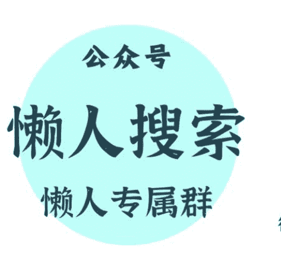
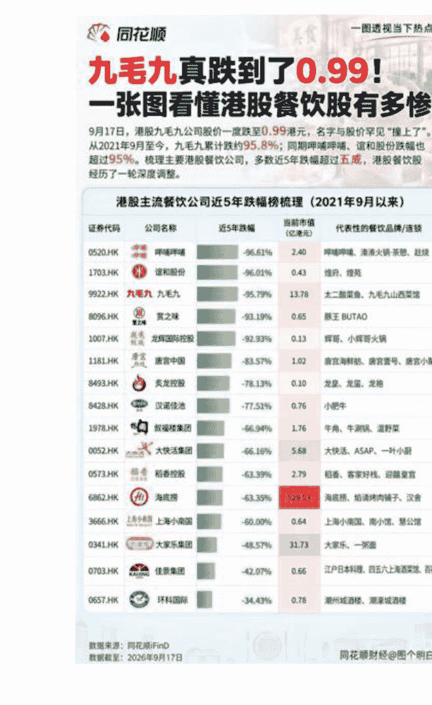
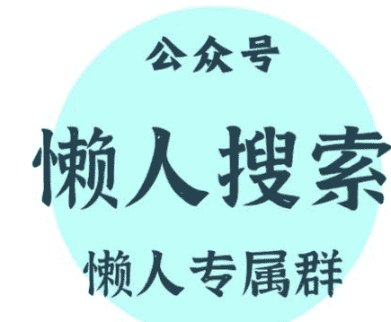

## 碳基衰退，硅基猛进，年轻人必然越来越丧

260920 瑞宏斌  
整理：公众号懒人搜索，懒人专属群精选  
懒人微信：lzyhelper1

> **小懒判断** | 适合持有白酒家电这类“便宜但就是不涨”消费股、想搞明白为什么的人，也适合想理解 AI 行情底层逻辑的。不适合反感“丧文化”这种词、想看鸡汤的人。最值得记的是一个视角转换：年轻人躺平不是消费降级那么简单，是碳基消费撞上生理天花板，而硅基生物（数据中心）的消费没有上限——白酒个位数 PE 没人接，AI 算不清天花板反而享估值溢价。坑在于：作者自己也提醒 AI 回报率故事一旦证伪同样重估，别拿这篇当 all in AI 的依据。

> 老瑞注：本文约有 15% 的内容为 AI 生成。

大约从 2022 年开始，中国的年轻人就越来越“丧”了，表现出颓废、悲观、自嘲的生活态度。相当多的人开始信仰“躺平”和“摆烂”，他们还拿“葛优躺”当作自己的头像。这些人的口头禅是：“我差不多是个废人了”、“其实并不是很想活”、“漫无目的的颓废”、“什么都不想干”、“躺尸到死亡”以及“颓废到忧伤”。

之所以会出现以上这些怪现象，你光要求年轻人振作是没有用的，因为这背后的根源，是“中国梦”越来越做不下去了。自从改革开放以后，整个中国社会一直向年轻人兜售一种非常明确的人生叙事：小时候好好读书，长大以后会有好工作；努力工作，就可以买房、买车、结婚、生孩子。今天吃一点苦，明天就会越来越好。

这套逻辑过去确实成立过，起码对 70后-80后的大部分人是成立的。

就拿我来说，我记得小时候家里只有两个电器——电灯和收音机，当时我家住在黄浦江的江边，门口竟然还是烂泥路，用水泥铺路那是后来的事情了。后来逐渐有了黑白电视、彩电、冰箱、洗衣机、空调、热水器、微波炉、电脑、手机，再后来有了汽车和更大的房子。

对我们这代人来说，我们的人生经验不断在证明一件事：只要努力，生活就一定会越来越好，所以延迟满足是一笔非常划算的交易。牺牲今天，可以换取更好的明天。

问题是，这套故事讲不下去了，现在越来越多年轻人开始怀疑，这笔交易能不能兑现。

当下的年轻人，面临的是：高中拼命，大学继续卷，毕业以后发现，就算 985 照样一半人找不到工作；就算找到了工作，工资增长慢，房价和生活成本仍然不低；即使进了公司，也要面对加班、竞争和职业不稳定。就算你成功攒了一大笔钱，也可能被骗光彩礼，最终人财两空，打官司又遭遇春风法官。这和我当年可完全不一样，我当年平均一年就可以跳一次槽，跳槽成功工资立马涨 50%-100%。因为我那时候是经济高速发展期，新的就业机会到处都是。更重要的是，当年的女性和现在的女性已经完全是两种人了。

那些悲伤的年轻人，早就意识到一件显而易见的事情：如果未来并没有承诺中的那么好，那我现在吃的苦还有什么意义？这样一来，你觉得他能不丧吗？

丧文化，本质上是年轻人的非暴力不合作运动，潜台词是，既然投入没有回报，那我就尽量不投入，所谓“没有买卖就没有伤害”。于是开始少消费、不买房、不结婚、不生孩子、不为升职无限加班，也不再相信老登的成功叙事。把自身的消耗降到最低，我都葛优躺了，连饭都可以少吃。

70后-80后相信：我要获得更多，所以我要更加努力。

90后-00后相信：只要我把需求压到最低，那我就不需要再努力了。

这种丧文化最终必然会传到资本市场，因为一个社会最强大的消费主体，绝对不可能是老人，虽然老登拥有最多的财富，但他不喜欢消费。任何社会，消费的主力一定是年轻人，因为年轻人拥有各种消费场景，比如租房、买房、装修、结婚、买车、生孩子、换房、教育和旅游。以上这些消费场景，老人是没有的，老人主要是打针、吃药、看病、住院。年轻人每一次进入新的人生阶段，就会出现新的消费需求，一个新家庭的建立，背后可能同时对应房地产、家电、家具、汽车、婚床、餐饮、母婴、教育等一整条产业链。以上这些，对老人是不存在的。

你想想，当一个社会的年轻人越来越丧的时候，以上这些消费还会出现吗？你可以看看现在的股市，给碳基生物服务的公司一跌再跌，给硅基生物服务的公司竟然还能继续涨。这背后的逻辑是，传统消费行业已经没有故事可讲了，现在能讲出来的都是鬼故事。

谁还喝白酒？年轻人最痛恨酒桌文化。奶茶店还有增量吗？房地产还能反转吗？还有多少人有第一次购车需求？家电、服装、餐饮、广告，未来还能从哪里获得高速增长？

这些行业中不少公司市盈率已经跌到个位数了，公司也很赚钱，现金流也相当不错。但问题是，增量看不到啊。资本市场最喜欢奖励的是能讲出新故事的公司，今年赚 10 亿，明年能不能赚 20 亿？后年能不能赚 30 亿？如果无法证明未来还能增长，即使现在只有个位数市盈率，市场也未必愿意给更高估值。

以上就是我说的，碳基生物消费股困境。

你再想想，碳基生物（人类）的消费，具有非常明显的生理上限。你再有金，你一天也不可能吃六顿饭后，汽车再智能，你也不可能同时开四辆车。奶茶再好喝，一个人的胃也有限。房子、汽车、服装、餐饮、白酒，本质上在受到几个非常硬的限制：人口数、收入水平、时间成本和身体容量。

传统的碳基消费，一旦成熟之后，最终的天花板就是人口总数。当总人口越来越少，老人越来越多，碳基生物的消费天花板就是现在了。

可就在此时，一个完全不同的消费者出现了，那就是硅基生物。

一座数据中心不会因为已经安装了十万张算卡，就产生一种类似人类的心理：差不多够用了。如果再增加一万张 GPU 仍然能够产生更多收入，资本就会继续投入。如果竞争对手正在训练更强大的模型，自己也必须扩算力。如果 AI 推理调用量增长十倍，那么服务器、存储、交换机、电力、冷却、PCB、铜缆、光纤都必须跟着扩张。说白了，硅基生物的消费是无上限的。

于是出现了一个非常有意思的经济现象：碳基生物正在消费降级，硅基生物却在消费升级。人的需求存在生理极限。AI 的需求没有上限，它的上限只有三个：电力、资本和投资回报率。

只要投资回报率还能算得过来，资本就会持续投钱。

如果一个行业被人看穿了消费天花板，这个行业的估值就会越来越低，就拿港股的连锁餐饮来说，股价一跌再跌。而如果一 个行业连未来需求是现在的十倍还是一百倍都无法确定，那么这种“不知道天花板在哪里”，本身就会产生估值溢价。AI 现在就是这个状态。因为投资者算不清未来 AI 的市场规模会有多少，是十倍还是一百倍还是一千倍？那么股价就有想象空间了。

如果要用一句话概括今天的变化，我认为是：碳基世界正在经历人口老龄化，而硅基世界正在经历人口大爆炸。这也决定了未来一段时间资本市场最值得关注的方向。

投资重点不应该简单理解成“凡是 AI 都买”，而应该继续寻找那些真正受益于硅基消费扩张、同时供给又不容易快速增加的环节。真正有吸引力的是满足这样一条链条：需求持续增长——下游愿意接受涨价——供给扩张缓慢——利润率开始上升——但股价和估值还没有完全反映。如果需求高速增加，而供给短期扩不出来，那么价格上涨、利润率扩张和业绩超预期才最容易发生。

当然，硅基消费也绝不会无限增长。AI 投资最终约束是：这些算力到底能不能创造足够多的经济价值？如果未来发现大量 AI 资本开支无法产生相应回报，或者模型效率提升导致单位任务所需算力大幅下降，那么今天的硅基消费故事同样会遭遇重估。所以，只要 AI 资本开支的回报率故事还没有被证伪，那么这个游戏就没有结束。

而传统消费面对的，却是完全相反的目标。它必须不断证明：年轻人还愿意消费，人口下降以后仍然能够增长，市场饱和以后还能找到新增需求。特别是当年轻人越来越丧之后，他们都不婚不育了，下一代也没有了，人类的消费品还能卖给谁？更要命的是，当 AI 取代了越来越多的初级智力岗位，年轻人连工作都没了，就算想消费也力不从心了。

> 分割线

在这个 AI 能替你写代码、写文章的时代，基础技能正在迅速贬值。绝大多数人正被淹没在海量的免费垃圾信息里，陷入低效的体力内卷。

当“努力”不再是壁垒，人与人之间唯一的护城河，只剩下“信息过滤”的效率与“认知系统”的维度。

圈子已稳定运行 7 年。我们每天利用 Python 爬虫与大模型算力，过滤全网最顶级的政经内参和搞钱风向标，做你最冷酷的“外部大脑”。

如果你认同这种“重塑认知防线”的极客主义，欢迎围观我的个人情报智库：【懒人专属群】。

https://lazysa.com/insider/

认同信息过滤价值、想省下每天 3 小时无效阅读时间的读者，扫码加我微信（lazyhelper1）

