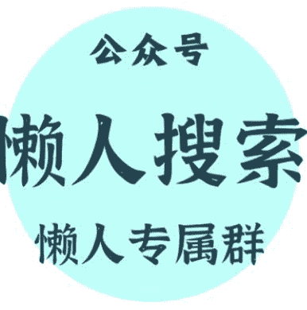
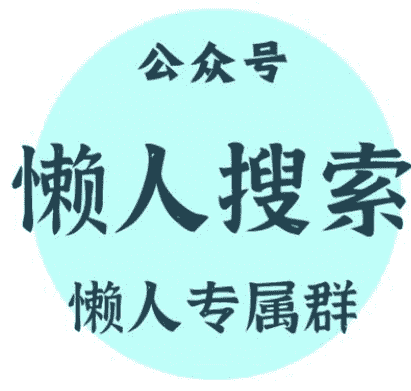

# “某鱼涉黄”的讨论可能走偏了，关键词应该是电诈

260924 文/卢克文工作室 概略北方
整理：公众号懒人搜索，[懒人专属群](#)精选
懒人微信：lzyhelper1

> **小懒判断**｜适合关注互联网治理和社会热点的人，不适合想看某鱼八卦细节的人。最值得关注的是电诈产业链上中下三层——境外盘总发包，境内工作室用色粉引流，单个有效色粉佣金数十到上百元，终端狗推全网撒网。坑在于被“涉黄”标题带偏后看不到真问题，平台无执法权只能封号，真正的电诈源头在境外。

9月21日一早，各大媒体热搜榜都挂了四个字：某鱼涉黄。

报道用词一个比一个吓人，“某鱼暗藏完整涉黄产业链”“涉及未成年人”“处宝可约”“最小仅14岁”。

说实话，任谁刷到这样的内容，都要义愤填膺。毕竟都触及未成年人了，那还了得？

于是大家纷纷痛骂某鱼不作为，不监管，甚至要求关停某鱼。

愤怒情绪完全可以理解，但是，这些年看多了反转的我们，恐怕也需要思考一个问题，这个瓜，保熟吗？

先看记者的报道。记者搜索“模特约拍、上门健身、游泳教学”，看到大量账号，配图都是女性照片，商品标题表面完全正常，但私信沟通后，卖家就会引导跳出某鱼，加外部社交账号，然后说可以提供特殊服务，甚至“处宝可约”。

于是，记者认为某鱼涉黄。

但仅凭几条聊天记录，就认定某鱼涉黄，到底严不严谨慎？

记者也许的确得到了可以特殊服务的说辞，如果后续真去暗访了（哪怕随后借故离开），那没什么说的，某鱼涉黄，板上钉钉。

另一种可能是记者没去暗访，但仅凭招揽的话术，怎么就知道对方到底是卖淫，还是诈骗呢？

事实上，某鱼事后的调查，也的确澄清了一些报道中的信息。

第一，被作为“涉黄铁证”展示的商品中，大部分在报道之前，就已经被平台风控系统发现，主动下架了。

第二，另外3个商品，在某鱼的商品描述页面、详情图以及买卖双方的站内聊天记录里，自始至终没有出现任何违规、色情或者涉黄的字眼。

而引爆舆论的“处宝可约”，其实并没有出现在某鱼的任何信息中，是记者在第三方聊天软件中得到的。

但这么一炒作，给公众的印象，好像变成了卖家以“处宝可约”的噱头在某鱼招嫖，而某鱼坐视不理一样。

说实话，记者还是太年轻了，哪怕稍微有一点点社会经验，就知道“处宝可约”大概率就是骗机票钱的骗局，真以为有那么多未成年干这个么？

至于“宝贝很特殊”，完全是个乌龙。

在报道中，有个写着“宝贝很特殊”的商品被扣上了涉黄的帽子，结果某鱼一调查才发现，特殊的原因，是因为每一张画都是根据客户照片定制的，没法像标准商品那样支持无理由退货。

所以，咱们承认记者怀揣着揭露罪恶的初衷，但在调查水平上，可能还的确差一些。

澄清这几点，并不意味给某鱼洗地。就算违规行为是在站外，但引流信息是发在某鱼上的，某鱼把关不严、初筛有漏、对引流暗号的敏锐度迟钝，难辞其咎。

但是，如果只骂某鱼不作为，或者觉得某鱼能解决所有问题，那就只能说想简单了。

因为某鱼，乃至所有网络平台，都面对着同一个难题：

灰产业链。

请大家注意，我说的是灰产，而不是涉黄。

如果你有朋友是反诈刑警，他们大概率会告诉你，这些所谓的涉黄信息，绝大部分背后连一个真的性工作者没有。

涉黄毕竟要线下交易，顺藤摸瓜，一抓一个准。

所谓的“涉黄”不过是诱饵，而它的真正名字，叫信息入口，它的背后，其实还是电诈产业链。

整个链条可以分为上、中、下三层。

处于最顶端的发包方，一般都是境外的电诈园区，那些搞电诈的金主和盘总们，每天最头疼的事情只有一件：流量从哪儿来？

他们的传统引流手段，早被反诈宣传打得千疮百孔，转化率极低，那怎么办？他们瞄准了人性中最原始的弱点——色欲。

在灰产圈子里，这种靠色情引诱拉来的客户，叫“色粉”。

而色粉，是全网转化率最高、防备心最弱、最容易被收割的群体。

于是，电诈骗总开始在境外社交软件上大肆下发“悬赏订单”，只要能把一个人骗得添加他们的客服账号，就能拿到一个人的佣金，一般来说，一个有效“色粉”的引流佣金，能达到数十元甚至上百元。

于是，链条的中游应运而生——境内二三级代理工作室。

这些工作室很简陋，几个人，几台电脑、几部群控手机就行，他们的工作只有两个：第一，境外接单，把大任务分解成引流指标；第二，生产投流物料。

所谓物料，包括从网上扒的各种女孩生活照，然后配上各种精心设计的暗示性文案，做成发布模板。

当然，他们也会专门研究各大平台的风控策略，今天某鱼封禁了“同城私教”，明天他们就换成“上门精油”，后天再改成“二手硬币”。

总之，只有你想不到，没有他们想不到，你能想象连苹果取卡针也能成为色情引流的代名词么？

而产业链的最底层，就是一些终端推广的狗推了。

中介给他们提供虚拟手机号、接码平台的账号、包装好的图片和文案，他们所要做的，就是在各大应用市场上疯狂撒网，且目标绝不仅仅是某鱼一个平台，几乎无孔不入。

在某书，你能看到各种求“爹系男友”的文案，在某音，你能看到配文“一个人在这个城市好冷”的视频，乃至在外卖平台，也有各种衣着性感的“私教”活跃。

某鱼是重灾区，不是因为某鱼的管理比别人差，而是因为它是个非标交易的 C2C 平台。

在正规电商平台，买卖双方的行为模式是标准化的，看商品、下单、平台担保、发货、确认，你几乎不用和店家沟通。

但在某鱼上，二手商品的属性决定了，买家必须跟卖家聊：成色如何？能不能小刀？自提还是邮寄？

这种非标沟通，恰恰成了灰产分子最好的引流机会，只要三言两语，就把买家从某鱼的监控中引出去，一旦引出去了，那某鱼就算有天大本事，也管不了了。

这就是为什么记者的暗访中，真正的劲爆内容无一例外全发生在站外。

受骗者以为加了对方能得到特殊服务，其实收割才刚刚开始。

第一步，收所谓的门槛费、定金或意向金，99元、199元，金额不大，专门用来测试受害者的服从度。

付了？好，第二步，客服会告诉你，为了保证小姐姐的安全，防止钓鱼，必须下载一个所谓的专用预约软件。

只要受害者把软件安装到了手机上，剩下的事情我们就很熟悉了，这些APP会读取手机各种信息，要么是假意裸聊，然后进行敲诈，要么要求三次刷单认证，或者在博彩平台完成资金支付，才能解锁线下见面资格。

于是，几十万甚至上百万的血汗钱，就在受害者一次又一次为了挽回本金、为了能够约见的执念中，被骗得一干二净。

最关键的是，你还不敢报警，因为你一开始做的事就是违法的！

所以，色粉是电诈集团最喜欢的客户群，报案率很低。

这就是整个产业链的真实面目，而当这样一条产业链，被记者简化为“某鱼涉黄”时，其实所有人的视线，都被带偏了。

这时候有人可能问了，某鱼为什么不管？为什么不把这些人全封了？

其实吧，不是某鱼不想，是某鱼做不到。

网络生态治理，始终回避不开两个问题：

第一，能力范围。第二，职权范围。

先看能力，大家想想，某鱼日活约 6000 万-8000 万，某鱼能有多少员工，能逐个审核帖子涉不涉黄？

那交给 AI 呢？更不现实了，因为黑产团伙永远走在算法的前面。

AI 识别依赖的是既有规则和样本学习，今天 AI 认为“按摩”“同城”高敏，那灰产明天就能换成“上门健身”“游泳教学”，AI 继续封，那黑产就开始卖二手硬币，二手硬币不行了，又开始卖二手捷安特自行车和苹果取卡针。

如果 AI 不论青红皂白统统都封了，那对那些真的卖二手硬币，卖自行车的人公平吗？

更要命的是，黑灰产的账号非常廉价，平台封掉他们一个号，他们马上就能上十个新号。

某鱼只是一家商业公司，既没权限监控他们的聊天内容，更没有权力强行阻断用户在外部工具上的交流，因为这是侵犯公民的通信自由和个人隐私。平台能发一个“请勿脱离平台交易，谨防上当受骗”就不错了，再多的，某鱼真的做不了。

就算某鱼判断某个行号是灰产，能用的最严厉手段，无非也就是封号而已，因为某鱼没有执法权，最多是把线索提交给公安机关。

办案资源面对每天数以十万计的虚假账号和引流线索，累死也办不完。

某鱼这件事的本质，是境外电诈发包，境内代理撒网，平台被动成为流量入口，然后媒体曝光，平台被问责，平台开展整治封号。看似正义得到了伸张，但灰产团伙换个马甲卷土重来，电诈集团继续发包，始作俑者毛都没伤到一根。

这种头痛医头、脚痛医脚的模式，是不行的，靠某鱼一家，也是不行的，所以某鱼在官方声明中，特别强调提议“各方联合起来，共同打击”。

那么，怎么联合，怎么打击呢？

某鱼没说，但我们也许可以推动各个大厂打通数据孤岛，建立跨平台的黑灰产联防机制，一个手机号在一个平台被发现涉黄涉灰，其他平台也都要进行风险阻断。

或者，追根溯源，摸到这些手机号，到底是通过什么渠道办出去的？号主是谁？如果不从源头把这种批量供卡的渠道连根拔起，各大平台就算累死，违规账号也会春风吹又生。

除此之外，我们的媒体，也应该更理性一些。

舆论监督权利无比珍贵，但这一切的前提，是必须建立在尊重客观事实、尊重技术逻辑、探究真相本质的基础之上。

如果只是想搞个大新闻，搞几段暧昧不清的聊天记录，就把怒火引向平台，那么这种监督所带来的，往往不是问题的解决，而是舆论监督的公信力被消耗。

最后平台为了自保只能收紧风控，而那些为了生计在平台上合法交易的普通用户，却不得不承受误伤和代价。

所以，打击色情引流肯定要打击，但光靠平台一家是不够的，需要整个社会的共同努力，才能推动问题有效根治。

绝大多数人只盯着眼前的工资，却不知道一次远在中东的冲突、一次降息的决议，就能在一夜之间洗牌普通人的财富。

看懂宏观，是为了在周期切换时，不被当作代价。

如果你认同这种“抬头看路”的长期主义，欢迎围观我的个人情报智库：【懒人专属群】。

圈子已稳定运行 7 年。我们每天利用 Python 爬虫与大模型算力，过滤全网最顶级的政经内参和搞钱风向标，做你最冷酷的“外部大脑”。

https://lazys0.com/insider/

认同价值的。扫码加我微信，备注：【进群】

