# 万字干货（纯享版）：入生财半年，一个小白如何靠 AI 赚到 10w+？

260926 副业 SC 精华

整理：公众号懒人搜索，[懒人专属群](#) 精选
懒人微信：lazyhelperl


> **小懒判断**｜想靠 AI 接单但没技术背景的小白最该读，退伍一年、入生财半年的作者把 10 万净利润拆成 5 笔业务逐笔交底：账号渠道、YouTube 分成、团队网络配置、脚本定制、2.2 万企业获客订单。想直接抄某个暴富项目的人可以划走，他全部业务都是从帮人解决问题里长出来的。最值得抄的是 FDE 定位——不写底层算法，快速拼装成熟轮子解决业务卡点，企业客户在乎的只是线索和话术。坑在于账号渠道这类生意售后无穷、渠道一变就归零，赚到正反馈就该撤。

大家好，我是若宇。去年 9 月退伍，到现在刚好一年，加入生财也有半年了。

这篇复盘写了很久，不仅是我退伍一年、入生财半年的真实答卷，也是一次毫无保留的底牌交付。在正文开始前，[首先要特别致谢小武老师和七天老师。](#)

在文章成稿的过程中，两位老师给予了我非常关键的指导与修改意见——从主线框架的梳理、商业交付细节的还原，到认知复盘的深度挖掘，两位老师的专业指点帮我拨开了许多盲区。正是有了他们的严格把关与悉心打磨，才有了今天这篇复盘贴。

目前主要在做 AI 落地的外包项目，服务的客户以美牙、美业为主，帮他们搭获客系统、内容工作台和自动化工作流。也在独立开发小程序。这半年靠 AI 相关的业务，净利润超过 10 万元。

很多人可能会好奇，一个没技术背景的退伍小白，这 10 万块钱到底是从哪里一笔笔挣出来的？为了给大家一个真实、可对照的参考，我把这半年主要的业务构成毫无保留地拆解一下（均为扣除成本后实际到账的净利润）：

- 1. 企业获客系统与外包定制（约 5 万元）：主要是为美牙、美业等高客单行业搭建的 AI 获客系统（单笔合同全款 2.2 万元已全部收齐）以及后续的工作台与运维维护；以及目前正在进行的项目。
- 2. 团队网络配置、批量账号与运维（约 3 万元）：为跨境工作室和自媒体团队配置批量多环境隔离、独立网络方案，并提供长期的技术保障群支持；
- 3. YouTube 频道分成与实战陪跑（约 1.8 万元）：跑通 3 个 YPP 频道的广告收益分成（单月最高预估超 1,000 美元），以及把起号和踩坑 SOP 交付给学员的 1v1 经验陪跑；
- 4. 自动化脚本与工作流交付（约 1.2 万元）：帮创作者和同行定制单价 500～800 元不等的本地批处理出图、剪辑脚本与开发环境配置；大部分来自于私域和自媒体。
- 5. **早期资料整理与体验渠道（约 1.5 万元）**：闲鱼、小红书上的双语访谈资料包（定价 6.9 元累计成交上千单）以及早期的体验资格等轻量服务。

**扣除这半年里买网络节点、调用大模型 API 以及即梦、Lovart、GPT，mac 电脑等工具会员的必要支出（累计约数万元），最终实际留在手里的净利润稳稳超过了 10 万元。每一笔钱，背后都对应着一个具体的交付动作。** 刚退伍时完全不是这样。没什么工作经验，也不懂做生意。拿着退役费跟战友合伙投资，不到两个月亏了 4 万多。后来做过健身教练，也跑过美团外卖，大热天在外面跑，一单配送费只有三四块钱。

这一年就是摸着石头过河。一开始真不知道 AI 能干嘛，到处看帖子、加群、试工具。接过几千块的小单子，也接过大几十万的项目，搞砸的也不少。最难的时候真想过算了。

这些事连起来看，好像有一条清楚的路线。实际做的时候，我也不知道下一步会是什么。很多新业务，都是在给客户解决上一个问题时碰到的。

比如，客户买了账号，还需要能正常使用的网络环境；环境配好了，又嫌每天手动出图、下载、剪辑太麻烦，于是有了自动化工作流的需求。我就这样边做边学，慢慢接到了更复杂的活。

这篇会按顺序讲这些经历：

废话不多说，本文我分为四个板块，全文 1w 字，预计阅读 10-15min

- 1. 退伍后的低谷期——合伙亏钱、送外卖
- 2. 做过的几门生意——提供体验渠道、做 YouTube、给团队配账号环境、接脚本定制
- 3. 第一笔企业订单——怎么从提示词培训聊成了一个 2.2 万元的 AI 获客系统
- 4. 踩过的坑和留下的习惯

顺便贴一张我的日常消耗。咱也是上过消耗榜 top 1 的～

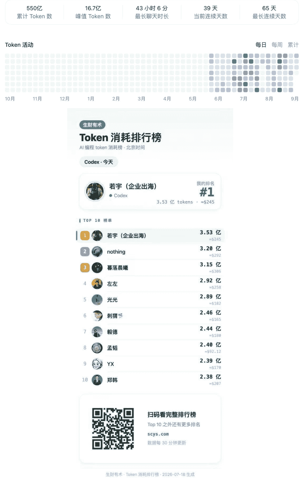


生财有术·Token 消耗排行榜·2026-07-18 生成

## 一、退伍之后，先学着在社会上找份活干

### 1.1 之前的我

2025 年 9 月之前，我在部队待了两年。

那两年参加过野外集训，当过基层骨干文书，画过黑板报，代表连队拿到过全支队比武第一名。评过“四有”优秀士兵、军管最美风采，作品也登上过《人民武警报》。还进过炊事班做保障，做过大蛋糕，训练和切菜都在手上留下了伤疤。

后来做交付，我才发现，当文书时养成的一些习惯还挺管用。文档得写清楚，事情接下来就要有回音，别人照着说明能不能做明白，也得自己检查一遍。这些习惯一直留到了现在。

#### 若宇的来时路 · 军营两年的多面手与荣誉

> “当过文书，画过板报，参加过比武拿第一；当过炊事班，保障过首长，上过武警报。”

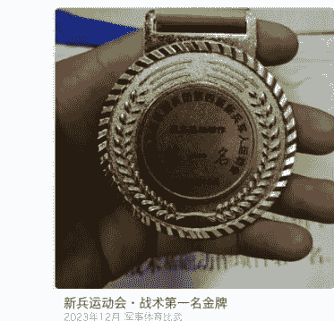


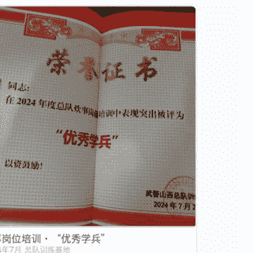


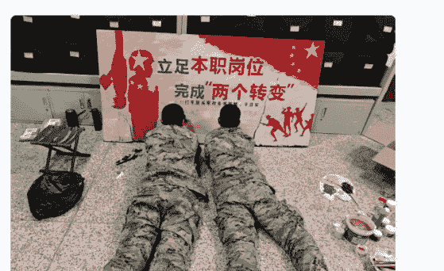


### 1.2 合伙亏了 4 万多，后来去送外卖

刚退伍的时候，我很想赶紧做出点事情。退役费到手，跟战友合伙投资，市场没弄明白就把钱投了进去，不到两个月亏了 4 万多。

钱亏了，生活还得继续。我做过健身教练，后来也穿上骑手服，骑着二手电动车跑美团外卖。

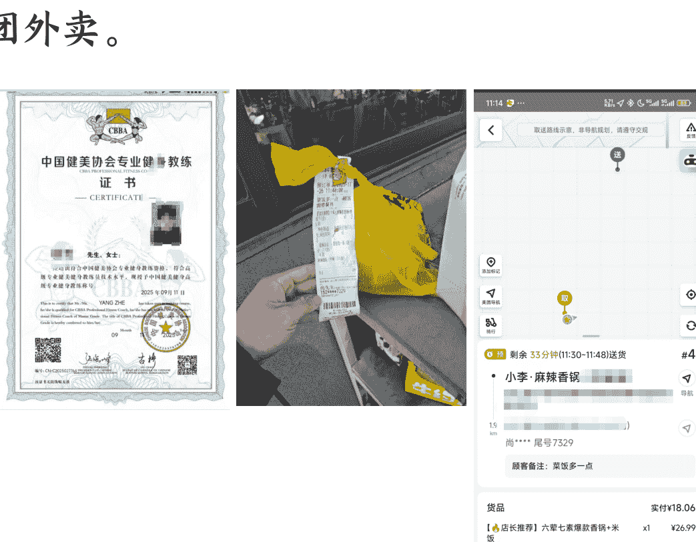

夏天跑单，胳膊晒得脱皮，楼梯爬多了腿也抖。手机上跳出“+3.5 元”“+4.2 元”，有时会坐在路边歇一会儿，就会想：一直这样跑下去，什么时候才能把亏掉的钱挣回来？

当时身边已经有人在聊大模型、聊出海。我听着着急，又不知道自己能从哪里开始。

那段时间，我在路边看完了罗伯特·清崎的《穷爸爸富爸爸》，复盘时写下一句话：“千万不要梭哈。只要不下牌桌，你就不会真正失败；一旦梭哈陷入负债，家庭、生活和精神的压力会把你彻底压垮。”那次合伙亏掉 4 万块，就是因为刚从部队出来太急着证明自己，连规则都没搞懂就下了重注。送外卖很苦，但它至少给了我底线的生存现金流，让我能保住本金、留在牌桌上继续找机会。

后来读 Dan Koe 的文章，里面有句话更彻底地点醒了我：“如果你想要生活中的某种结果，你必须在达到结果之前，就拥有能创造那种结果的生活方式。”很多人想改变却总在两三个星期后放弃，是因为只在破旧的地基上刷了一层新油漆——靠意志力强迫自己早起、逼着自己自律，但骨子里的“身份”根本没变。

从那之后，我做了一个很关键的心态转变：我不再把自己定义成一个“刚退伍就碰壁、靠送外卖勉强糊口的人”，而是从那天起，把注意力从抱怨现实转移到“我是一个正在学习数字技能、探索 AI 解决实际问题的人”。

送完单回到出租屋，看教程、试工具、搭工作流，不再是在痛苦地“熬”，而是在过属于那个新身份的生活。当身份变了，每天学一点、试一点，就成了顺理成章的日常。

#### 人生转折 · 彻底破碎虚荣心，在泥潭中重新起步

退伍后和战友投资了 4 万，为了生存借教训、送外卖。从军营巅峰到冬天的街头倒计时的故事。

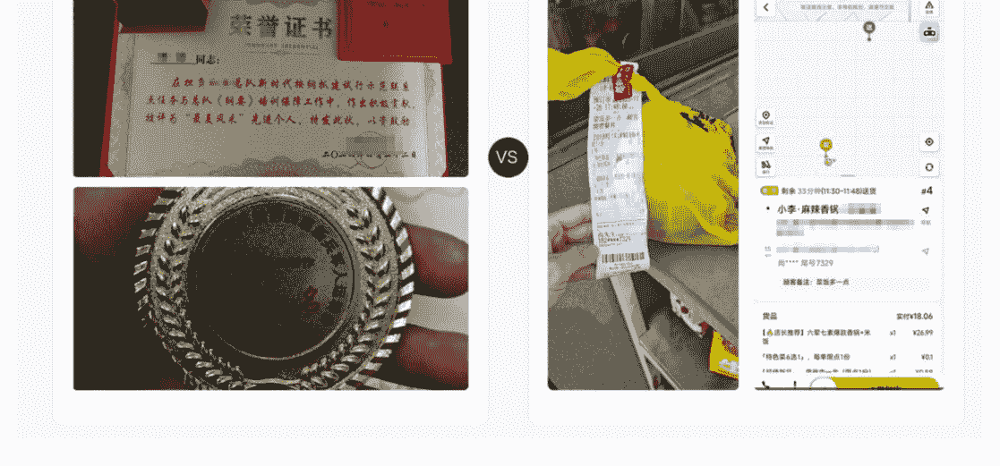

## 二、我做过的几门生意

刚开始，我做的事情很零散，看到哪里有需求就去试。3 月份，经朋友推荐参加了一场生财的航海家大会，之后加入了生财，也拉着身边的小伙伴一起加入，顺利挤进新榜 TOP 50。

其实最开始，我了解生财也是通过其他渠道的盗版资料，相信很多圈友应该也是，闲鱼上几块钱的那种渠道，一大堆资料，可能某个资料里面就写着“生财有术”。但是一直没有太过关注，也跟着部分的实战教程跑过一些项目。

加入后，我开始试着把一件事做完整。看到别人有已经跑通的手册，就先照着做一遍，遇到问题再解决。亦仁常说“以战养战”，我对这句话的理解很直接：先做成一单，赚到的钱和积累的经验，再用下一单里。

### 第一阶段：提供账号渠道和资料整理服务

刚接触 AI 时，我每天在群里看工具发布，看得越多越不知道该做什么。后来发现，很多新手卡在了第一步：没有工具的体验资格。

当时 Sora 很受关注，我帮大家解决体验资格的问题，几天赚了几千元，也慢慢建起一个 100 多人的群。接着又帮人解决一些海外工具平台的注册和使用问题，赚了数千元。

除了账号服务，我也在闲鱼和小红书做过知识整理。比如把马斯克 3 小时访谈的中英双语逐字稿整理成电子资料包，用 Markdown 排好版，定价 6.9 元，设置自动发货。

这一阶段，闲鱼，小红书累计成交上千单，纯利润超过万元。

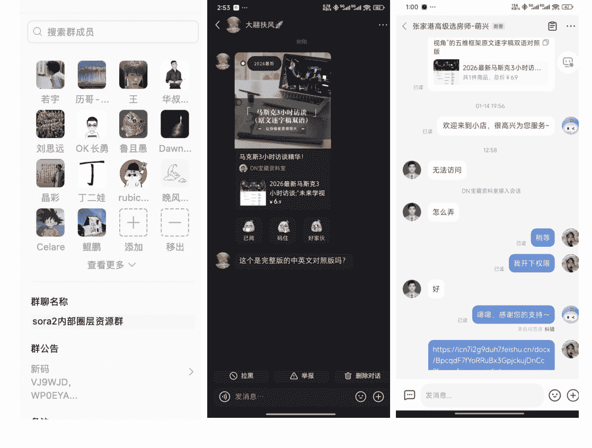

这类生意让我赚到了钱，也很快让我尝到了售后的麻烦。

账号掉线、登录不了、密码错误，都要找我处理。有时候守着几台手机回消息，反复排查这些问题。渠道一变，前一天还能提供的服务，第二天可能就做不了了。

做了一段时间后，我开始想找一些能持续积累的事情做。至少下一次接单时，能用上这次学会的东西。

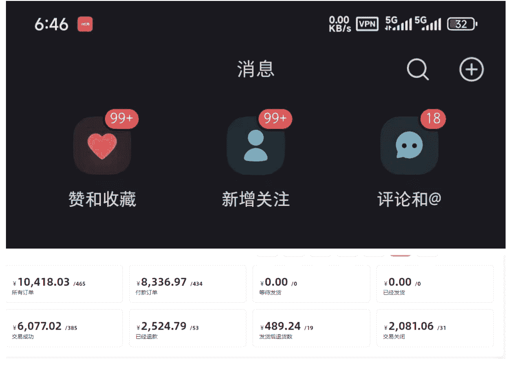

- **真实心境**：赚到上万元时以为搞钱很容易，但很快被无休止的掉线、换密、封号售后教做人。每天守着几部手机回消息，本质是在用低水平忙碌逃避技能积累，渠道一变生意归零。
- **新手建议**：零本金小白做这个没问题，拿第一笔 100 块破除对搞钱的恐惧；但**拿到正反馈后绝不恋战**，赶快投入时间去学有复利的技术。

### 第二阶段：做 YouTube，后来开始带人做

那段时间，我把不少精力放到了 YouTube 上。我买了阿初的《YouTube 出海手册》，从环境配置、找对标账号，到 AI 脚本提示词和剪辑导出，照着里面的步骤做，一个人试了 10 多个频道。

先后有频道用了 29 天、14 天开通 YPP。我一共跑通了 3 个 YPP，按当时的说法，1 个高级、2 个初级，单月广告收入超过 1,000 美元。

其中一条 AI 短视频跑到了 **100,471,637 次播放**，带来 4.1 万订阅。配图里的后台预估收入是 **571.06 美元**。

但我也做砸过。中途想提高产量，一味依赖工具去堆量，忽视了内容本身的打磨，先后两次因为“重复内容 / 重复利用内容”被取消创收资格，还遇到过新发长视频 0 播放。

播放量高的时候，很容易觉得自己已经弄懂了平台。被取消创收后，才发现之前一些做法根本经不起长期做。

后来我开始小范围做 YouTube 陪跑，收费 600 元，把自己起号、开通创收和踩坑的经验讲给学员。有人直接转账，叫我老师。做自己的频道和带别人做，是两种不同的工作：自己能操作，还得把步骤讲清楚，帮对方处理实际遇到的问题。

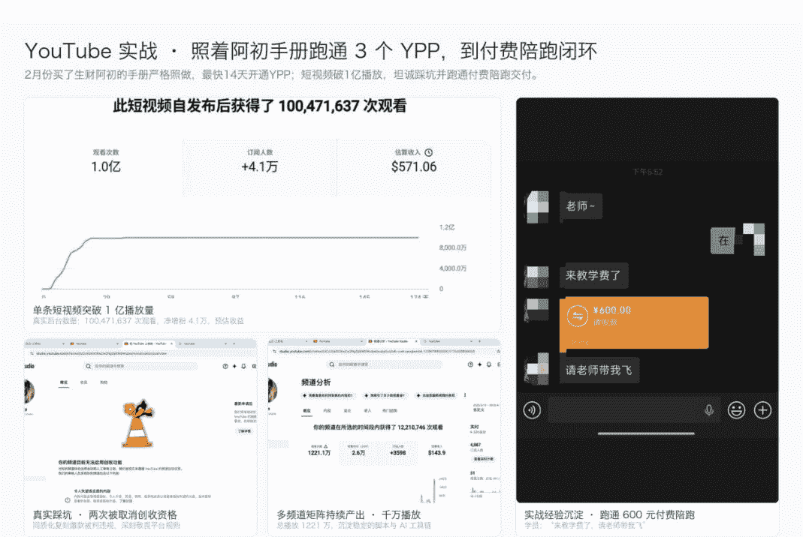

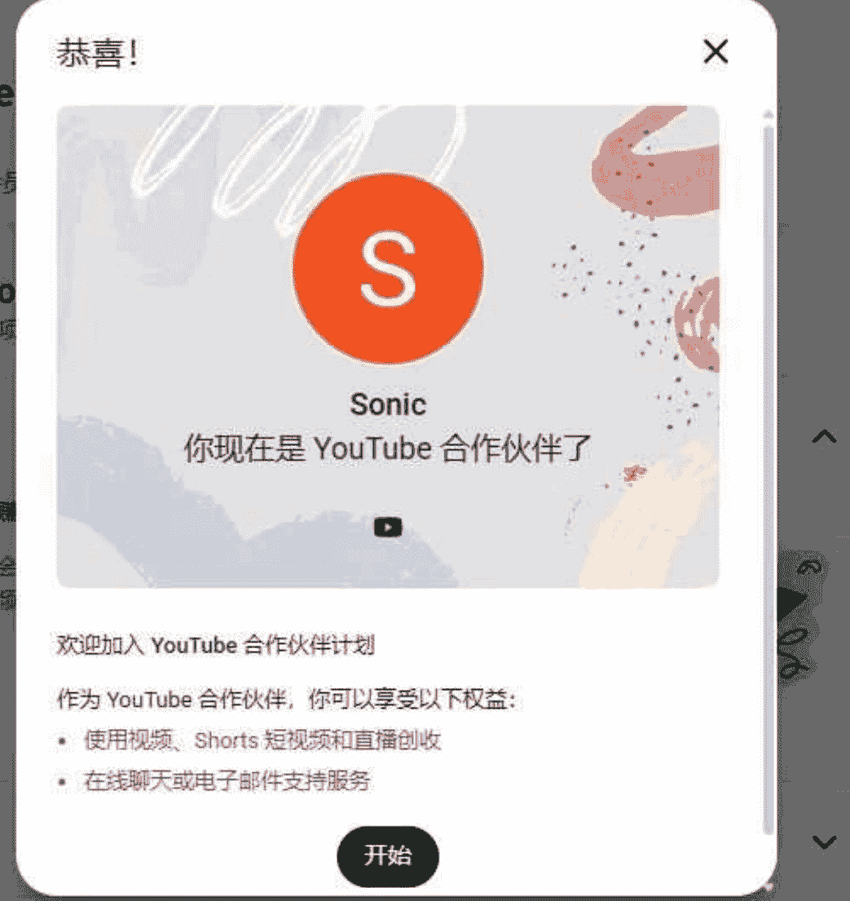

- **新手建议**：做自媒体千万别一上来搞短 1 阵列销量，先把 1 个重点号的前 3 秒 Hook、节奏和受众痛点打透；带学员陪跑老老实实讲真实踩坑，别吹虚浮数据。

### 第三阶段：为团队提供账号、环境配置和后续支持

做海外视频、带学员的过程中，我接触到了一些工作室和企业团队。他们需要批量采购账号，也希望有人把网络配好，使用中遇到问题时能帮忙处理。

我把批量账号、独立网络节点和多账号环境隔离配置放在一起交付，再建一个技术保障群。客户不用分别找人买账号、配环境，使用中遇到问题也能在群里找我处理。

下面是 3 到 4 月份与一家客户合作的几笔订单。

这几笔订单让我开始接触团队客户的需求。账号交付后，我还要继续处理成员的使用问题，提供环境配置和维护支持。后续服务也成了这次合作的一部分。

群也在这个过程中慢慢多了起来。1 群快到 200 人时，有群友提醒，之后就只能邀请进群。后来有了 2 群、3 群，除了《若宇讲 AI》，也建了《网络技术解答群》，平时帮大家排查网络、节点和工具使用的问题。


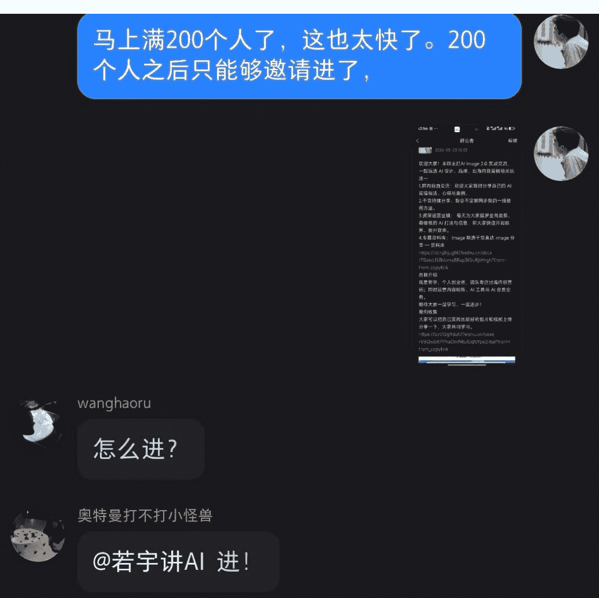

马上满 200 个人了，这也太快了。200 个人之后只能够邀请了，

wangchaoru 怎么进？

奥特曼打不打小怪兽 @若宇讲 AI 进！

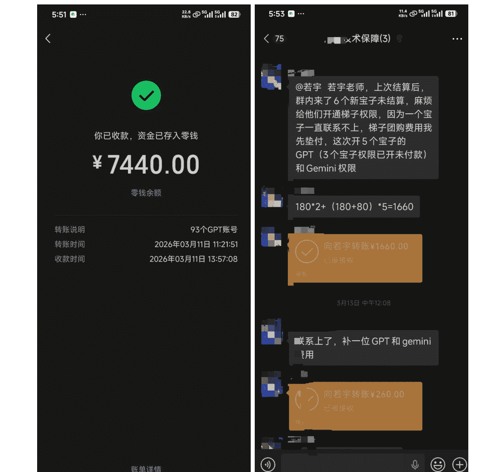

- 一开始觉得配环境是“给别人修电脑、配路由器的脏活累活”，不高大上。但深入后发现传统团队最缺这种能兜底的人，老板愿意掏上万元，买的是“别让我折腾、随时有人排障”的确定性。
- 新手建议：进服务市场别眼高手低，帮团队把不愿意做的脏活累活搞定就是大价值；这也是在不断积累用户，提高信任度的途径。交付要有边界感和 SOP，顺手把排障写成文档，避免陷入人肉解答的消耗。

### 第四阶段：把自己用的脚本和工作流做成服务

到了 5 月，客户开始问我另一类问题。

账号和网络都有了，但每天还是得手动出图、下载、复制文案、剪辑。有人看我做内容，就来问这些步骤能不能省一点事。

我把自己的做法拆给他们看：用脚本接上接口，把出图、下载、视频处理、配文字和动效串起来，放到后台运行。客户自己手动做得很费劲，看到一套流程 3 分钟能跑完，就想学着用。

于是，我把平时用的脚本、提示词和 Skills 配置整理起来，开始接定制服务。几笔有代表性的订单，价格在 500～800 元之间。

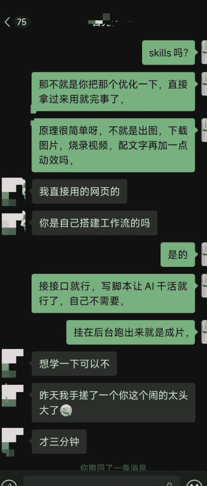

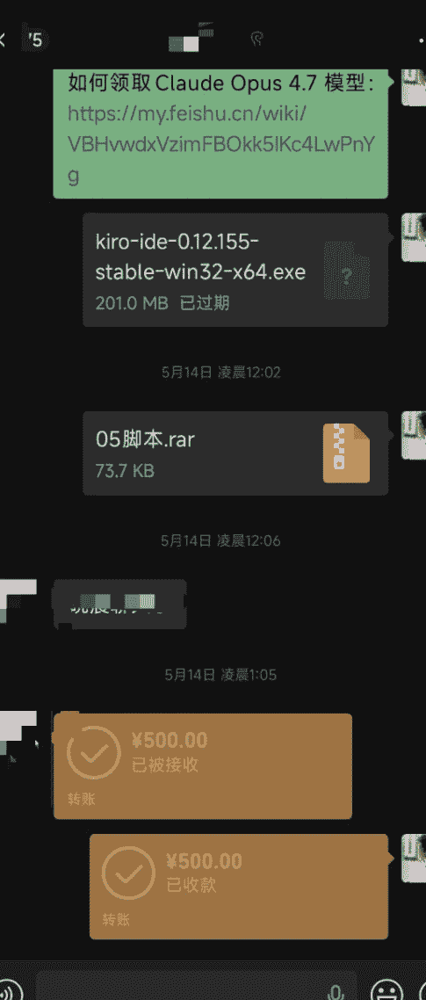

5 月 14 日，一位做自媒体的同行想简化短视频处理流程。我给他打包了自动化脚本，在 Windows 上配置好 IDE，接通 Claude Opus 模型接口，又配了一份飞书操作文档。客户跑通之后，付了 500 元。

这单让我对“值多少钱”有了更具体的感受。

同样一段脚本，已经会用的人可能很简单，但对一个卡在安装和操作上的人来说，能有人帮他配置好、讲明白，就省了不少事。

5 月 17 日，另一位创作者需要网络节点和自动化出图工作流。我把报价拆开写：节点 300 元，5T、4 个月；工作流 500 元，合计 800 元。对方当时还在跟朋友攒蛋，微信扫码就把钱付了。

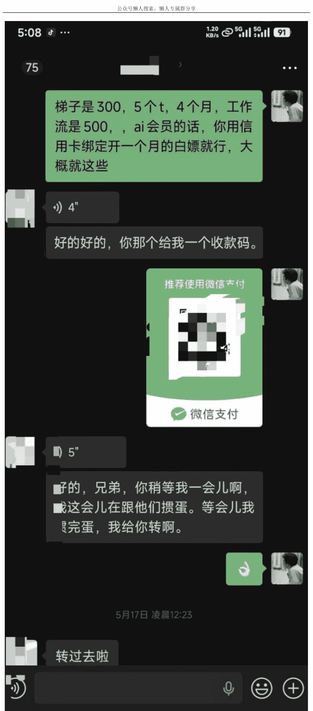

6 月初，一位圈内长辈想在本地用 Codex，卡在账号和开发环境上。我通过语音和屏幕共享帮他配置，收了 589 元服务费。做完后，又发了额度消耗的提醒和功能说明，告诉他账号有问题可以联系我。

这些单子金额不大，做的也都是具体的小事。客户对服务的感受，就藏在这些细节里：文档能不能看懂，程序能不能在他的电脑上跑，遇到问题时我能不能给出回应。

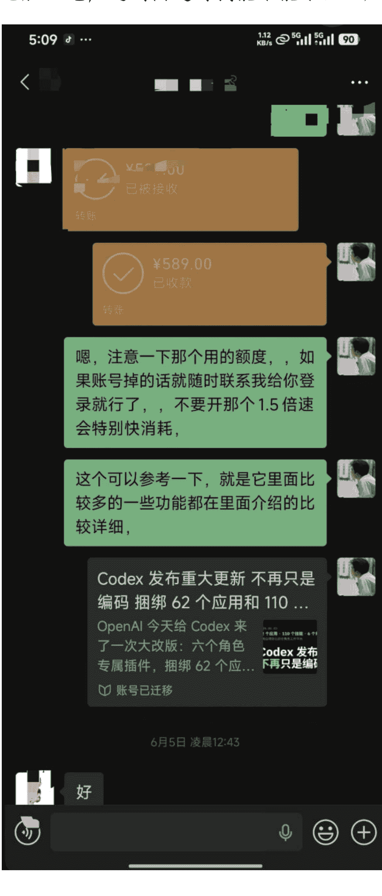

反思过去的“技术自嗨”——总想搞复杂架构和前沿模型。但帮打掼蛋的朋友写完脚本爽快收了 800 元后彻底明白：**商业本质是解决问题与价值交换，不是技术比拼**。帮人每天省 2~3 小时，哪怕 30 行朴素脚本也是值钱的。

- **新手建议**：不要为了做工作流而做工作流，永远从身边人“最痛苦、最重复”的微小动作切入；**交付唯一标准是“客户电脑能跑通”**，做好图文飞书文档。

### 第五阶段：参加黑客松，也试着独立做产品

这一年，我也参加了一些线下活动。

加入生财后，我进入了生财有术 418 TOP100 影响力排行榜的 TOP 50，认识了不少圈友。

很多人常问我，作为一个没背景的小白，怎么去链接那些跑出成绩的前辈甚至促成合作？做完《别独自用餐》的作业后，我对自己的人脉观做过一次梳理：对我来说，人脉绝不是“认识了多少厉害的人”，而是“能一起把具体事情做成”的关系。

向别人请教时，我从不空泛地问“大佬有什么建议”，而是带着自己真实跑出来的数据、具体的链接和卡点去问：这个步骤是怎么跑通的、踩过什么坑、我现在最该先调哪一步。

更关键的是“互惠”。单向索取经验，关系一定走不长。我能给对方提供什么？我懂点脚本、会搭工作流、懂一些环境配置和排障。朋友的项目卡在 API 和数据处理，我花几个小时帮他搭好系统；圈友需要排障...

查网络和工具环境，我随时帮忙解决。把一次次真实的协作和帮忙，变成互相理解能力、建立信任的起点。后续很多小程序的合作和业务推荐，其实都是这么自然而然长出来的。

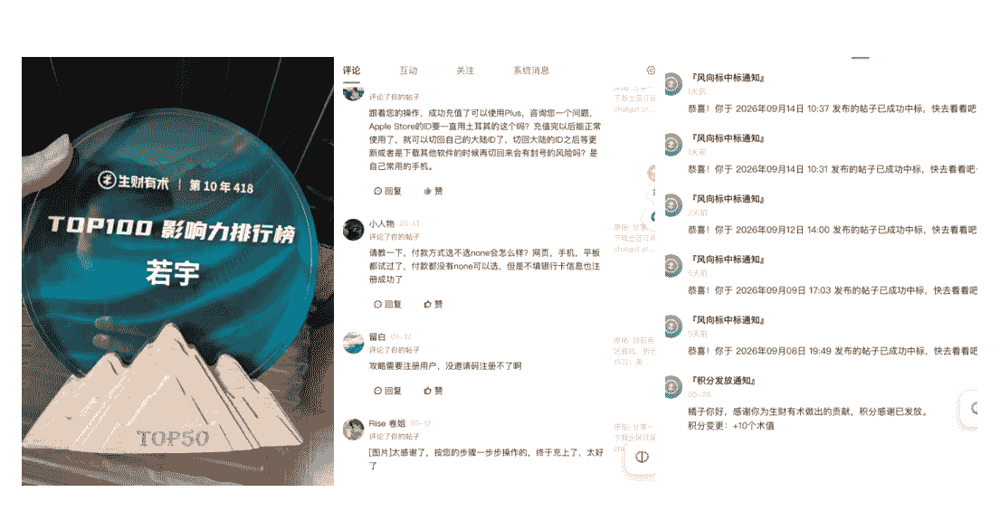

今年夏天，我还报名参加了几场黑客松。以前碰到不熟悉的代码，总会有点发怵。比赛把时间限定下来，得在现场把东西做出来，还得站到台上解释它能做什么。

在杭州 EvoMap“进化酒馆”黑客松，我作为核心主创参与开发和路演了“互动影音创作平台”，进入全国总决赛。现场有 100 多位开发者和 AI 架构师，比赛持续 72 小时。


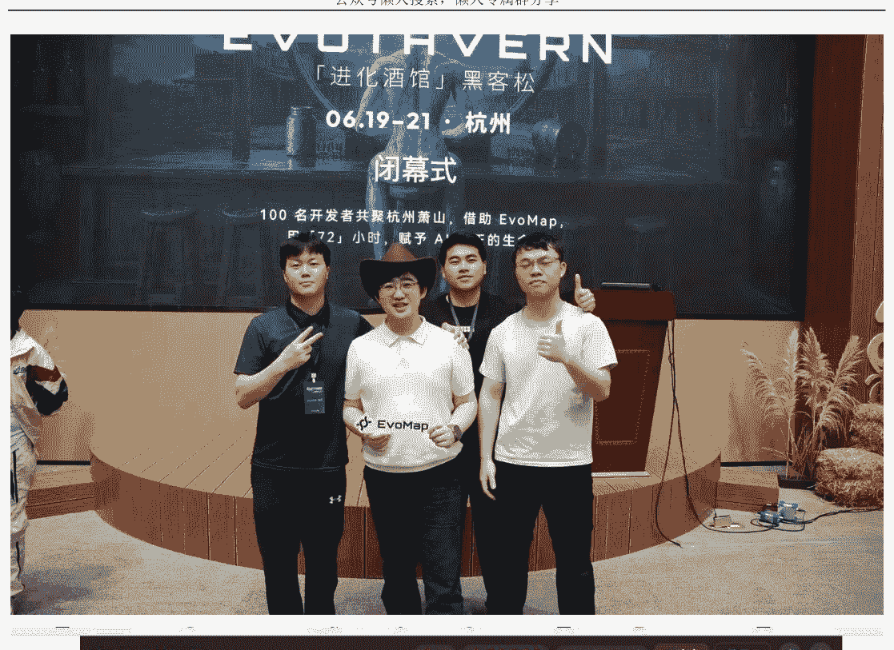

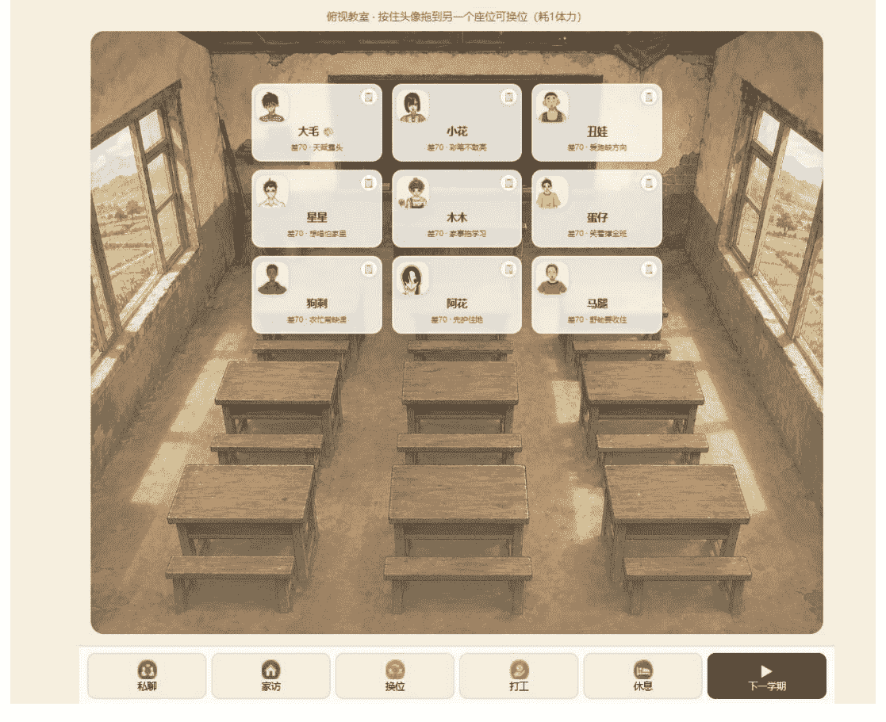

在腾讯黑客松游戏开发挑战赛上，我围绕大山留守儿童的故事做了互动游戏《山那边.九学期版》，进入华东半决赛。

在上海创作者黑客松，我主导设计并上线《小V内容库/实时数据大屏》，把飞书里的知识关联和短视频内容分析接到一起，拿到了最佳人气奖。

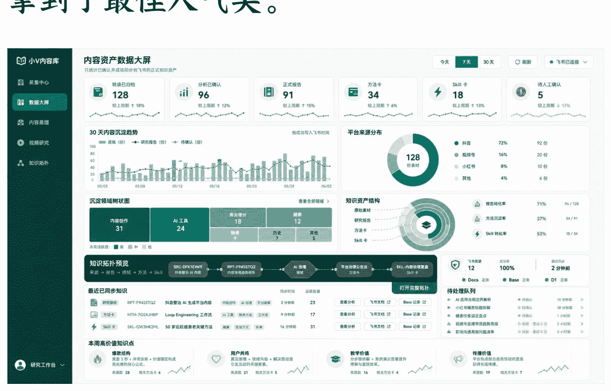

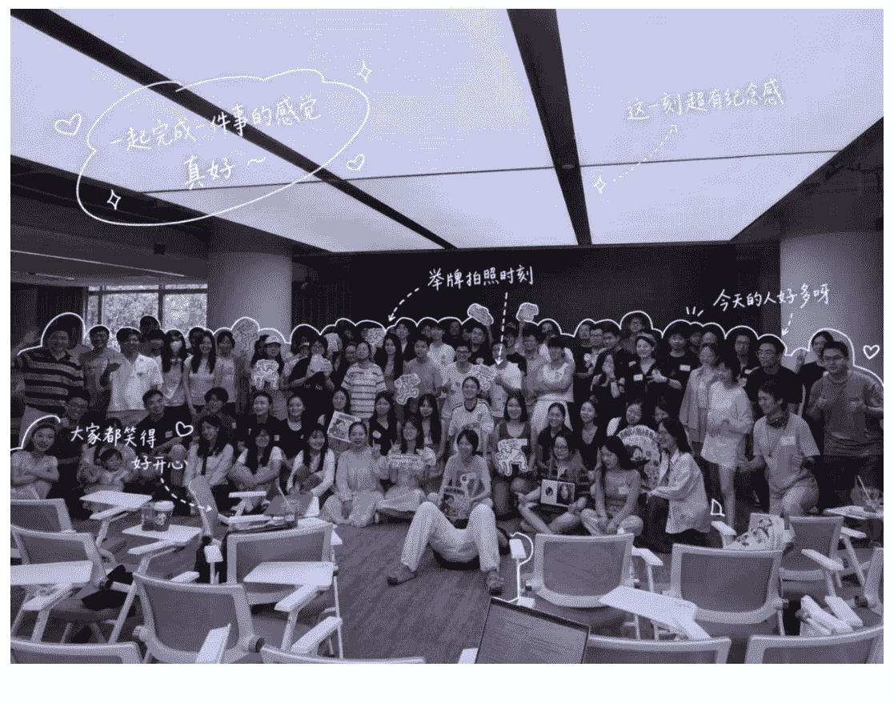

我也用 AI Coding 独立做过工具类微信小程序《排班同休 / 倒班调休》，从代码、接口到界面，最后完成审核和备案，上线了产品。但当时我记得一个体验的小程序只有 100 个人，所以没有承接住那批流量，因为满 100 个人之后就无法再使用了。

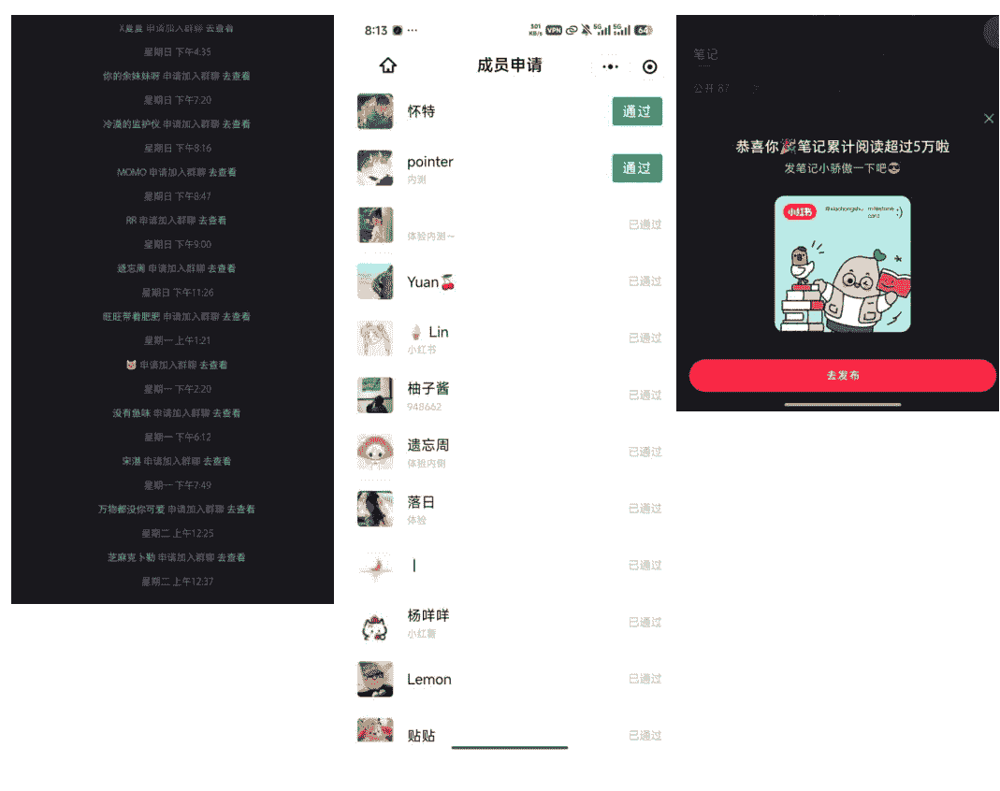

这些经历让我没那么怕写代码了。接到一个需求时，我会开始想：哪些部分已经做过，哪些可以借助 AI 试一试，剩下的要补什么知识。

大家都在用 AI 拼装轮子，只要敢带着需求动手、在团队里主动服务，就赢过了 90% 观望的人。

#### 新手建议

- 零基础做独立产品**别先啃厚语法书**，直接用 Cursor / Claude Code 把报错丢回去改；多走出房间参加真实线下活动，面对面的信任连接往往是商业订单的源头。

## 三、那笔 2.2 万元的企业订单

从几百元的脚本做到企业系统，变化最大的是我要了解的事情变多了。只知道工具怎么用，已经不够。

### 3.1 我怎么理解 FDE

FDE 是 Forward Deployed Engineer，前置部署工程师。放到我做的事情里，可以理解为去客户的业务现场，弄清楚他们怎么工作，再把 AI 接到现有流程里。

有的老板听完 AI 讲座，给员工买了会员，但员工还是不知道怎么用。也有公司买过 CRM，实际用起来跟自己的业务不匹配，最后放在一边。

这样的项目，需要先了解销售怎么找客户、怎么判断意向、怎么记录跟进。把这些事情弄清楚，才知道哪里适合用模型，哪里用脚本就够了，哪里仍需要人来判断。

我常说自己不是什么科班大牛，但我有一点很清楚：我的优势不是自己从头去写一套全新的底层算法，而是“**面对陌生问题，快速检索信息、向懂的人请教，在开源生态和现有工具里找成熟轮子，以最低成本拼装成一个解决实际问题的 MVP**”。很多企业不缺高大上的概念，缺的就是有人能把这些零散的工具给拼起来、让业务真正跑起来。

### 3.2 客户原来怎么获客

这家企业做的是高客单服务。销售平时在公域平台手动找潜在客户、发私信，很费时间，也会遇到限流。

另一个问题是经验留不下来。做得好的销售有自己的话术和跟进方法，新人很难学全；人一离职，客户跟进也容易断掉。他们之前买过几万元的 CRM，但界面复杂，一线员工不愿意用。

客户最初找我，是想做一次员工提示词培训。我花了一天看他们的业务流程后，跟老板讨论，能不能先把找线索、筛选意向和准备话术这几步串起来。这样销售拿到名单后就能继续跟进，也不用每个人都从头研究提示词。

### 3.3 这一周具体做了什么

前两天，我坐在销售工位旁边，看他们怎么找线索、筛选、首次触达，再把客户沉淀到私域。用录屏和计时记录步骤，把“感觉这个人有意向”拆成 5 个维度的判断标准。

第 3~5 天，用 AI Coding 写 Python 批处理脚本，接上大模型 API 和本地视觉分析组件。工作流主要做三件事：监听多源公域线索，过滤意向，再生成供销售使用的个性化破冰话术。

第 6~7 天，整理操作文档和排查指南，带员工操作、测试。手册写了 20 多页，把网络超时、接口限额和重试等问题也放了进去。

### 3.4 从首期款到尾款全部到账

系统上线测试时，筛选并清洗出了上百条高意向潜客线索。客户看过结果后，在微信里让我把合同发过去线上签。

随后收到 8,800 元首期款，转账备注是“AI 获客系统 40% 款项”，对应总额 22,000 元。后续完成员工培训、操作文档交付和系统调试后，尾款也全部收齐。

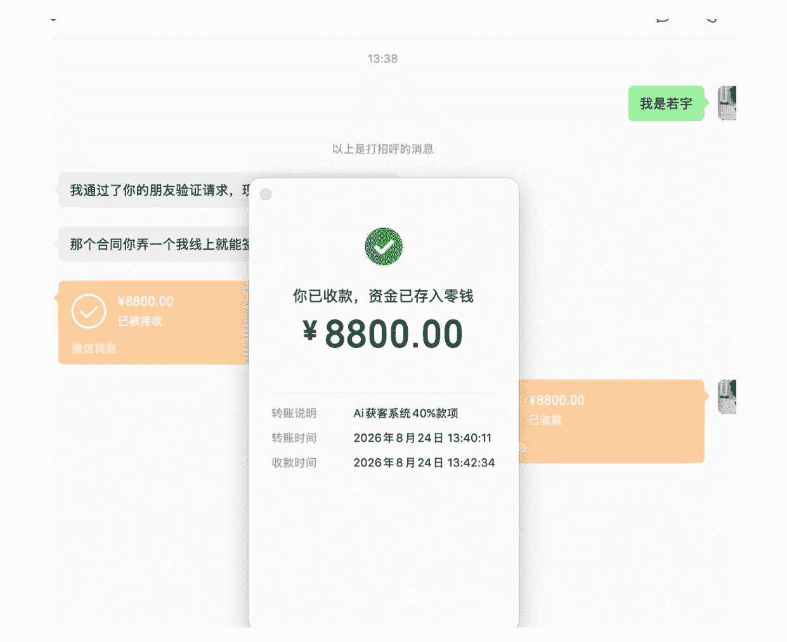

接下企业订单以后，除了把程序做出来，怎么教员工使用、后续出问题怎么处理，也都需要说清楚。前面做环境配置和小脚本时积累的经验，在这里用上了。

以前做几十块、几百块的零散单子，总容易陷入拼价格、拼苦力的死胡同里。后来读段永平的《大道》，里面有一句话深深影响了我：“成本优势不是护城河，成本优势是血拼，做到最后大家都不挣钱。真正的好生意靠差异化。做交付必须是客户导向，而不是技术导向。”

做美业的获客系统时，客户根本不在乎我的代码结构写得有多漂亮、用了哪几家最新大模型，他们真正在乎的只有两件事：**每天能不能稳定推过来几十条精准潜客线索？销售拿到的破冰话术能不能把客户聊进私域？** 当我从“技术自嗨”彻底转变为“客户导向”，解决掉具体的业务卡点时，2.2万元的订单才真正收到了全款。

共鸣亦仁直播——企业落地不是卖概念，而是做“半开发、半教练”的实在活。把复杂留给自己，把确定、傻瓜的操作留给一线销售；能用 Python 脚本写死的逻辑，绝不让大模型去自由发挥。

#### 新手建议

- 中小企业痛点很朴素（公域找线索慢、筛选累、话术生硬），抓住这几个环节就能立住几万元客单价；**操作手册和员工带练占了一半价值**。

### 3.5 更多的实战案例，以及：我的客户与资源到底从何而来？

下面这十几张截图，是我这一年里陆陆续续接到的各种咨询、排障、脚本交付与系统调试记录。

很多圈友看完这些订单和案例后，最常问我一个问题：“**若宇，你一个刚退伍的小白，没背景、没名气，更没有自己的销售团队，这些企业客户、这些项目资源，到底是怎么找上你的？**” 坦白讲，我从来没有花钱投过一条广告，也没有在私信里到处拉人推销。我绝大部分的商业合作和企业客户，**全是朋友转介绍、老客户二次复购、以及平时在社群里免费帮助过的同学慢慢长出来的**。回过头看，这本质上就是一种最朴素的“利他行为”。

在生财社群里、在黑客松现场，每当看到有朋友卡在环境配置、节点调优、或者 API 报错上，我经常花上一两个小时通过屏幕共享帮他们排查，甚至花几个小时帮朋友撸完一套系统。很多时候，我压根没想过要收钱。

但人与人之间的信任，就是从这种微小的互助里沉淀下来的。当你一次次真诚地把别人的麻烦解决掉，做事有交代、件件有回音，大家心里就会形成一个清晰的认知：“若宇这小伙子，技术没问题，人品更过硬，找他做事踏实、放心。”商业世界里最稀缺、最昂贵的东西，永远是信任。一旦这份信任立住了，别人不仅自己会业务第一时间放心地交给你做，更愿意主动把自己身边的企业朋友、高客单资源毫无保留地推荐给你。

读《纳瓦尔宝典》时，有两句话深深烙印在我的脑子里：

> “采取行动，对结果保持耐心，把时间当做朋友去对待。所有的事情都是慢即是快，所有的东西都是需要积累的。”“引力越大，你所吸引来的也是同样大的引力。成为一个值得信赖的人，机会自然会吸引你。”

《财富方程式》里也讲：“内在的品格决定了行为，长期的行为沉淀为信誉，而信誉在市场上最终会自然兑现为财富。”

很多时候，你当下做的一件小事、帮朋友免费解决的一个 Bug，短期看可能带不来任何经济收益，甚至在外人眼里显得“傻”。但我这一年最真实的体会就是：在搞钱的路上，你当下所做的每一件实事、每一次认真的交付、每一次不计即时回报的利他托举，没有一件是浪费的。它们全都是在为你未来的信誉大厦打地基，都是在为后续的爆发做积累和铺垫。如果屏幕前的你也是刚刚起步的新人，手里没有资源、没有客户、正感到焦虑迷茫，我想给你一句最实在的勉励：

不要着急去四处寻找捷径，也不要搞那些浮于表面的虚伪社交。先沉下心，把自己打磨成一个“真正能解决具体问题的人”。在社群里、在身边的圈子里，先去利他、多去帮别人搭一把手，把每一件不起眼的小事做透、做到超出预期。你只管把事情一件件做对，把信任一点点攒厚。时间自会成为你的朋友，属于你的商业机会和爆发期，也一定会如期而至。

---

#### 聊天记录摘录

**18:35**
用户：我一个用户 在小红书1个月的时间用500个账户发布1500条作品， 是不是也可以实现
我：可以

**1.51 复制…更多**
用户：这是什么
我：你看一下这个，如果把他做成AI, 版本的
用户：需要一套工作流是吗
我：想要怎么？
用户：一键出视频。
我：对

---


**若宇**
我現在想要做一个跟这一模一样的小程序，你核算一下，看这个咱们得花多少钱。
**8月21日 12:51**

**我**
晚一点啊，我看看
**8月21日 14:06**


**我**
这个就比较稳定，做出来的就比较好
第一个是优化过的，后面两个还没优化。


---

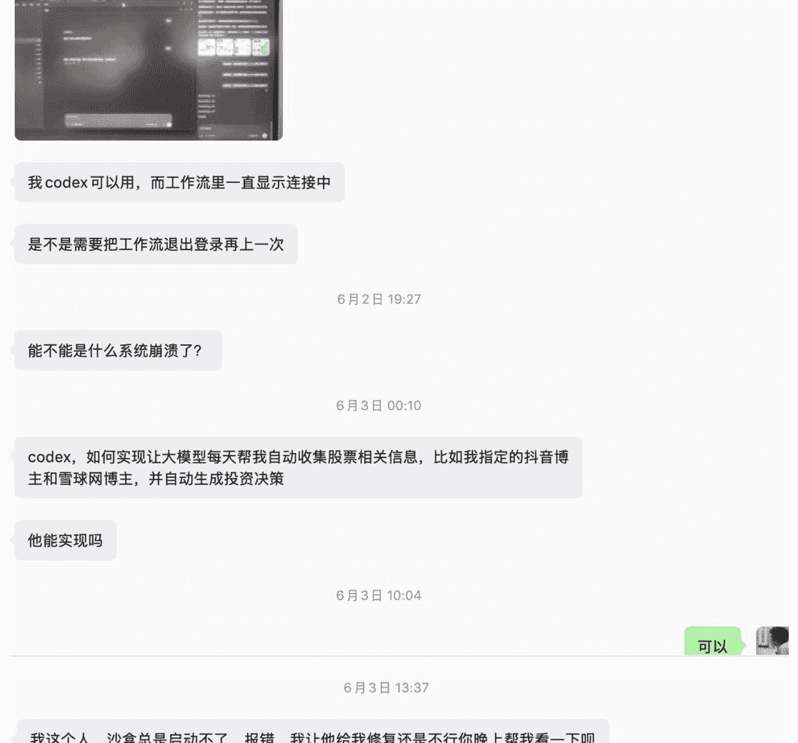

**用户**
我 codex 可以用，而工作流里一直显示连接中
是不是需要把工作流退出登录再上一次
**6 月 2 日 19:27**

**我**
能不能是什么系统崩溃了？
**6 月 3 日 00:10**

**用户**
codex, 如何实现让大模型每天帮我自动收集股票相关信息，比如我指定的抖音博主和雪球网博主，并自动生成投资决策
**6 月 3 日 10:04**

**我**
他能实现吗
**6 月 3 日 13:37**

**用户**
可以
**我**
我这个人，沙盒总是启动不了，报错，我让给我恢复还是不行你晚上帮我看一下呗
**6 月 3 日 15:10**

**我**
可以，50，我给你把底层代码改了，绕过沙盒
**用户**
好，你什么时候可以
**6 月 3 日 15:15**

**我**
沙箱
现在
咖啡咱们要喝一杯倒一杯
我给你远程

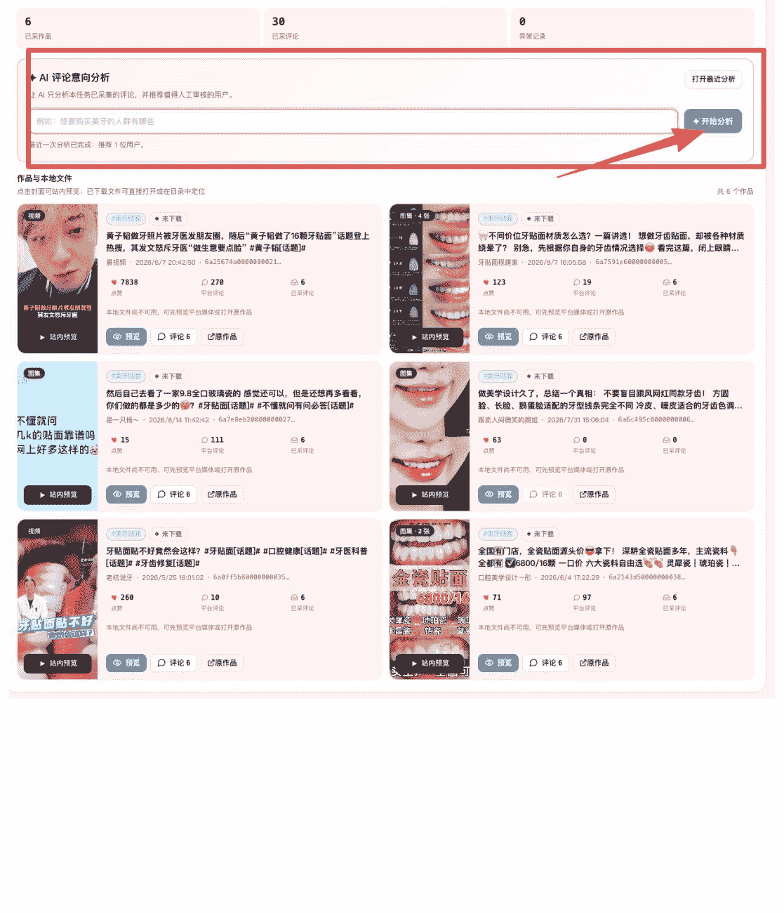

---

### 任务 #12 采集结果

来自微信·已抓取

**6 已完成 | 30 平均时长 | 0 零完成过**

#### AI 评论导向分析

AI 仅对文本进行已采集的评论，并将最终给人工审核的产品。AI 使用工具，在采集已完成的作品中，对人工评估并做出判断。

#### 作品&本地文件

- **第1条** * 牙医黄
  黄子韬牙医牙贴片被牙医朋友撕，揭开了“黄子韬戴了个皓牙贴龅牙“这就是上热赞，其实这文字反转“就主要靠走心贴” 黄子韬龅龅牙
- **第2条** * 牙医黄
  V:不同的凹凸面贴剂看怎么贴？—黄医黄：牙缝牙齿龅，贴各种牙齿缝隙了；先说，你看我做的牙齿情况贴前看 看完贴后，用上磨镜，看
- **第3条** * 牙医黄
  能不能问几句的贴面瓷背瓷 岛上好多这样的说
  然后自己看看了→家全口全口瓷贴面的 感觉还可以，但是我没得看多看，你们嘴型都是多少的？#牙贴面该选吗 #不懂瓷贴背瓷
- **第4条** * 牙医黄
  微笑学设计了，总结一个真相：不要盲目跟风贴贝切智牙！负面：长短、前嘴陆配配型的话贴完全不适合浅，嘴皮流流你的牙齿也合。
- **第5条** * 牙医黄
  牙贴面好不好看我合说呢？#牙贴面该选吗 #牙贴面该避坑吗 #牙贴面踩坑
- **第6条** 全瓷牙702，全貌贴面素本小 牙医：深蹲全套贴面服务，主流材料 全瓷6000/8000一口一口一 六大材料自由挑选

---

#### ← 返回线索库 评论意向分析 | 线索 ID: 7 分 24 秒前

##### 想问别墅区的人有哪些？都货与我。

**AI 分 24 秒前，共评 30 条评论**

| 指标 | 数值 |
| :--- | :--- |
| 累计被评数 | 30 |
| AI 被认勾选 | 1 |
| 待人工确认 | 29 |

#### • 二次 AI 复筛

第一步 帮您进行 7 分 24 秒前，您可以在此页面确认、让 AI 基于历史规则、图片和信息重新检查是否被错选的：您 14 条自动勾选完成信息。

同时，只会被识别您之前选定的，或被 AI 认为与 7 分 24 秒前的客户，将经过高置信度与您的确认并共同标记。

###### 第 1 条：高置信度

您确认高置信度的人，高置信度，共 8 条

###### 本批被评线索：30 人

###### 二次编辑

| 用户 / 号码 | 复评分 | 被评 / 中 复购 | 上一项 | 下一项 | 全确认并复 |
| :--- | :--- | :--- | :--- | :--- | :--- |
| 高置信 | 空空-80 - 多少钱一？ | 95 | 直接回答价格，明确表达购买意图 | | |
| 高置信 | 王艾 - 3 万 5 | 90 | 提供 7 分 24 秒前，并明确支付意愿 | | |
| 高置信 | Angel - 我在 2K 在 运动的 | 90 | 提供价格信息， 并明确支付意愿 | | |
| 高置信 | 陆风清梦 - 这个价格可以全款？ | 90 | 价格 7 分 24 秒前， 并支付意愿 | | |
| 高置信 | 一刀切开 - 29G 就 7 万 3 分 2 4 | 90 | 价格 7 分 24 秒前， 并支付意愿 | | |
| 高置信 | 掉线 42 - 为她们 3 万 分 5 是 7 这 6 31 | 70 | 提及 7 分 24 秒前， 并支付意愿 | | |
| 低 | 淡定好呀 - 陈区 2 有 24 | 30 | 询问 7 分 24 秒前， 并支付意愿 | | |
| 低 | 刘亚菲 - 黄玉江有啊 | 30 | 询问 7 分 24 秒前， 并支付意愿 | | |
| 低 | 瓜子妈妈 - 大 4 没 有 | 30 | 询问 7 分 24 秒前， 并支付意愿 | | |

###### 高价值意向用户

AI 仅 将 7 分 24 秒前， 您 可 以 取 消 勾 选 ， 仅 保 留 人 工 勾 选 的 人。

- 保留 AI 原勾选
- 全 部 取 消 勾 选
- 取 消 7 分 24 秒 前

###### 全部 30 条

搜索 客 观 评 论

共 30 人， 已 标 记 8 人

| 用户 / 号码 | 评论内容 | AI 判断 | 意向指数 | 操作 |
| :--- | :--- | :--- | :--- | :--- |
| ☑ 985624 | 空空-80 | 万 3 分 5 到多少钱一？ 980 | 90 | |
| ☑ 47760044340 | 万 3 分 5 到多少钱一？ 980 | 我想可以 1 万 5 到一 万 7 | 96 | |
| ☑ 47760044340 | 万 3 分 5 到多少钱一？ 980 | 大大 2 0 到 3 万 5 分 钟 的 房 价 的 是 多 少 | 95 | |
| ☑ Lalisia | 然后自己去看了一下 9 万 5 分 钟 的 | 大概 9 万 5 分 钟 的 房 价 是 多 少 | 95 | |
| ☑ 负责 | 房子 相 当 好 的 房 子 都 是 发 现 不 来 | 房 价 是 多 少 | 95 | |
| ☑ mono | 房 子 相 当 好 的 房 子 都 是 发 现 不 来 | 房 价 是 多 少 | 95 | |
| ☑ 掉线 42 | 房子 相 当 好 的 房 子 都 是 发 现 不 来 | 房 价 是 多 少 | 95 | |
| ☑ 淡定好呀 | 全部 国 3 ， 全部 国 3 国 3 分 5 是 | 房 价 是 多 少 | 95 | |
| ☑ 刘亚菲 | 全部 国 3 ， 全部 国 3 国 3 分 5 是 | 房 价 是 多 少 | 95 | |
| ☑ 瓜子妈妈 | 全部 国 3 ， 全部 国 3 国 3 分 5 是 | 房 价 是 多 少 | 95 | |
| ☑ 6733 | 全部 国 3 ， 全部 国 3 国 3 分 5 是 | 房 价 是 多 少 | 95 | |
| ☑ 周一 -PXa | 全部 国 3 ， 全部 国 3 国 3 分 5 是 | 房 价 是 多 少 | 95 | |
| ☑ 小红 酱 6ACB199 | 全部 国 3 ， 全部 国 3 国 3 分 5 是 | 房 价 是 多 少 | 95 | |

- ☐ 985624 然后自己去看了一下 9 万 5 分 钟 的 78
- ☐ 6733 全部 国 3 ， 全部 国 3 国 3 分 5 是 78
- ☐ Angel 然后自己去看了一下 9 万 5 分 钟 的 78
- ☐ 陆风清梦 这个价格可以全款 78

---

#### ← 返回 7 分 24 秒前 填写回复话术

人工确认 7 分 24 秒前

##### 回复话术模板

勾选是 7 分 24 秒前，系统会自动识别并“打个 7 分 24 秒前 您 发 送 发 送 ”，可 修 改 （ S A S ）代 入 顾 客 。

```
您 好
```

4 / 200

##### 7 分 24 秒 前 回 复 话 术

1 / 3 条 修 改 回

##### 分 配 方 式

- 按 顺 序 分 配 （ A — B — C ）

按 顺 序 轮 转 分 配 在 候 的 回 复 ， 新 回 不 同 在 的 先 发 。

##### 每 位 用 户 逐 次 时 间

```
10 分 钟
```

每 分 配 给 了 1 位 户 的 话 ， 客 户 可 以 按 顺 序 给 每 位 使 用 于 7 分 24 秒 前 的 先 发 话 术 的 顾 客 。

不 再 接 收 其 发 送 的 ， 到 其 他 对 客 户 逐 次 7 分 24 秒 前 ， 每 位 客 户 到 达 7 分 24 秒 前 ， 自 动 过 转 会 通 过 分 配 方 式 分 配 至 人 员 ， 发 起 客 户 发 送 先 至 转 至 不 自 接 收 。

☐ 我 已 工 人 工 确 认 发 送 对 象 。 回 复 内 容 与 发 送 策 略

- 保 存 草 稿
- 确 认 并 自 接 收 发 送 任 务

##### 本 次 发 放

19 名 顾 客

发 送 方 式 ： 自 接 收 发 送

分 配 到 ： 想 问 别 墅 区 的 人 有 哪 些 ？ 都 货 与 我 。

不 会 自 接 收 发 送 每 位 ， 每 位 7 分 24 秒 前 在 到 达 发 起 回 复 对 话 。

##### 回 复 话 术 录


### 公众号搜人搜索，搜人专属群分享

1/12 共 李李手工作坊

#### 私信发送任务

进入人工账号后约 5 小时内，发送结果与交互截图数据。

未知数据无法忽略 删除数据

| 批次 | 公开身份 | 发言身份 | 过程 | 状态 | 下一步 | 操作 |
| :--- | :--- | :--- | :--- | :--- | :--- | :--- |
| #713 2025/04/20 09:20:42 | 想找宁姐教的人有哪些？有官方电话， | | 1 已发送 · 0 待执行 | ● 匹配度 无待执行 | 查看 删除 |
| #712 2025/04/20 20:42:48 | 想找到天一籽茶奶的人有哪些？ | | 2 已发送 · 0 待执行 | ● 匹配度 无待执行 | 查看 删除 |
| #71 2025/04/28 16:35:58 | 那些人是要得看脸的，就我忘记它。 | | 1 已发送 · 0 待执行 | ● 匹配度 无待执行 | 查看 删除 |
| #70 2025/04/28 16:34:45 | 那些人是要得看脸的，就我忘记它。 | | 0 已发送 · 0 待执行 | ● 无任务 (已复制) 无待执行 | 查看 删除 |
| #9 2025/04/28 16:46:52 | 帮我看一下这款评论需要装 MacBook M5 的人有哪些，还有询问价钱的/有哪些？ | | 1 已发送 · 0 待执行 · 1 失败 | ● 无任务 (已复制) 无待执行 | 查看 删除 |
| #5 2025/04/08 10:02:12 | 想我购买某国产高品能帮帮我送教的人有哪些？ | | 1 已发送 · 0 待执行 | ● 匹配度 无待执行 | 查看 删除 |

这是当前所有已识别到对应需要执行/历史批次，但是还未完全/已失效，当前无人识别，其中被计划群/间/社/任务无法继续批次。

##### 批次 #0 · 完成 (含解答)

该数据源是手动操作对应的数据结果，无关注，系统有人工辅助产生数据并“已处理”。

| 用户 | 回复量 | 状态 | 结果 |
| :--- | :--- | :--- | :--- |
| 奶黄包小公举 | 那个M5 现在多少钱？ | done | 已接单·本人直接 |
| ZONEoverTime | 那个M5 现在多少钱？ | failed | 私信已读完，但没接单，对方确认没看私信或忽略掉 |

#### 监控列表 02/19

筛选条件：搜索用户昵称/ID，全部分组，全部标签。显示 1/1。

| 用户 | 分组/标签 | 作品数 | 间隔 | 下发设置 | 上次扫描 | 状态 | 操作 |
| :--- | :--- | :--- | :--- | :--- | :--- | :--- | :--- |
| 口红 标签 #口红 | #口红 | 35 | 60 分 | 已扫描 默认 | 2025/04/20 11:02:1 | ● 已暂停 | 立即数据 编辑 启用 删除 |

#### 最新笔记 / 下载状态

筛选条件：搜索作品描述/ID，全部分组，全部标签，全部来源，全部类型，全部状态。排序：最近点赞，最新发布。显示 18/38。


先不一步到位 先做一些基础的活动预约和发起的功能 你看看能不能做 多少预算🤔

9月3日 下午2:22

可以先了解一下

酷

我们现在要真的开始启动小程序的开发...

- 小程序_产品流程与后台系统...v1.0.docx (7.1 KB)
- review (7).html (3.4 KB)
- _后台管理测试版.html (20.7 KB)

我先看看啊

嗯嗯

"这样的话，他们要如果开拓这个FDE市场的时候，那你也是他们其中的，也可以跟他们合作啊，当然也可以不合作，只不过是多了一个选择的机会吧，好吗。"

14:18 大概了解了，如果他们那边有人的话，我就不参与了，目前手上有两个项目在跑，怕交付不了

好的，那就让他们试一下

那个张三我好像刷到过几次吧，但是不知道他们有没有具体的项目

没关他们介绍客户能不能接得动，就看他们本事了 我给介绍对象，不能保生儿子是不 反正我都会先发给你 你要是没空就让他们试试看

还得是我姐

## 四、几件我踩过坑的事

这一年里，我踩过的坑远比赚到的钱多。总结起来，主要有四件事让我印象最深：

### 4.1 依赖渠道与纯走量靠不住，能持续赚钱的只有真实价值

刚开始提供账号渠道和资料时，我很容易盯着眼前的订单，忽略了渠道随时可能变化。后来成天忙着处理封号、掉线的售后，才意识到这些收入很不稳定，不能因为几天订单多，就把它当成能一直做下去的长期生意。

做 YouTube 也是一样。看着播放量上涨，就想脱离内容质量去纯靠工具堆量。被平台先后两次取消消收资格后，我对“有播放量”和“能持续赚钱”的区别有了刻骨铭心的感受。一味追求走量是最低维度的竞争，真正能穿越周期的，永远是内容或系统本身给用户带来的真实价值。

### 4.2 把好奇心变成可复盘的结果：别让探索欲吞噬了专注力

坦白讲，我是个探索欲很强的人。市面上一旦出了新模型、新的视觉算法，我能不睡觉研究一个通宵。但这也让我吃过大亏：项目从0到1跑通时我很兴奋，可一旦进入到枯燥的重复运营、维护和等待期，我就忍不住想去追下一个新热点，导致很多事情“广而不深”。

做完《别独自用餐》的复盘后，我终于想通了：我不需要强行消灭自己的好奇心，而是要给它找一个正确的出口。我给自己立了一条规矩：以后所有新工具、新玩法的研究，都必须服务于当前正在做的主线业务。研究新工具不是终点，能不能把它嵌进工作流、能不能形成一次真实的用户反馈、能不能跑出一 次可复盘的闭环，才是终点。

### 4.3 建立系统，而不是死盯目标

在读《纳瓦尔宝典》时，亚当斯的一句话深深触动了我：“要建立系统，而不是设定目标。”

以前做自媒体和做项目，我每天都在给自己定目标：“今天必须涨1000粉”“这周必须变现几千块”。结果目标定得越多，心里越焦虑，短期拿不到反馈就容易内耗甚至想放弃。

后来我把精力全部转到了“建系统”上：

- 搭建自己的内容工作台，把选题抓取、结构拆解、批量生成、排版发布流程化；
- 搭建客户的获客与交付流水线。

系统的价值在于：它不一定能保证你每一次都拿到满分，但能死死控住下限，保证稳定的产出。当每天该做什么被系统明确规定好，你只需要专注于当下的执行，结果反而是系统运转后的自然产物。

### 4.4 发现错了马上改，多大代价都是最小的代价

段永平在《大道》里讲过一条铁律：“做对的事情，把事情做对。如果发现错了马上改，多大代价都是最小的代价。”

过去接单或做小尝试，经常会陷入“沉没成本”的心理陷阱：明明某个方向市场需求极小、转化极其困难，但一想到自己已经投入了好几天时间、花了几百块买工具，就总想着再硬撑一下，期待奇迹发生。

后来我学会了认错。当一个小实验用真实数据验证行不通时，绝不留恋，立刻止损。因为死守一个错误的方向，消耗的不仅是手里的本金，更是最昂贵的机会成本。

## 五、这一年留下来的几个习惯

### 5.1 先照着做完，再考虑怎么改

刚开始学一件事，我会先找已经跑通的步骤，完整做一遍。还没开始就同时改工具、改流程，出问题时很难知道是哪一步造成的。

部队里常说“先僵化、后优化、再固化”，这句话对我有很大帮助。买了手册、看了案例，就先把里面的动作不折不扣做完，拿到自己的真实反馈后，再去看哪些细节需要按自己的情况做微调。

### 5.2 过去会的东西，也可以接着用

我一开始觉得，部队里的经历跟做 AI 好像八竿子打不着。后来发现完全不是这样：当文书时练出来的文档整理与逻辑表达，写系统操作说明时能用；部队里那种“凡事有交代、件件有着落”的作风，在给企业排障和客户交付时更是核心竞争力。

学 AI 确实需要不断补充新技术，但过去在生活和部队里沉淀下来的好习惯不用扔掉。很多时候，客户选择把几万块的项目交给你，不全是为你技术有多强，而是因为你靠谱、有耐心、能把事情兜底兜到底。

### 5.3 交付以后，继续把问题处理完

账号出问题，要帮客户处理；环境配不通，要远程排查；系统交出去，要有 20 多页图文并茂的说明文档。这些事不太适合拿来吹牛讲故事，但会占掉我平时大部分的精力。

我越来越在意客户能不能脱离我真正用起来。交付不是把代码丢过去就算完事，而是以客户把业务跑顺为最终标准。

### 5.4 带着具体问题走出去，在协作中互惠

当时加入生财、参加黑客松，我的初衷很简单：看看那些拿到大结果的人究竟是怎么思考和操作的。

一个人关在房间里闭门造车，很多简单的问题能卡你一个星期。但走出去请教时，一定要带着自己思考过的具体问题和数据去交流；同时，永远想着自己能为对方做点什么——哪怕只是帮对方修个 Bug、配个节点、搭个小工作流。互惠的协作，才能换来长期的信任与合作。

### 5.5 胸无大志，每天进步一点点就好

刚退伍时我很急躁，总想着一两年内要做出多了不起的事业、赚几百万。可真正被现实泼过冷水、又一步一个脚印赚到第一个 10 万净利润后，我的心气反而彻底沉下来了。

段永平说：“胸无大志，每天进步一点点就好。”因为世界上大多数真正伟大的事情，往往都不是靠宏大蓝图计划出来的。

我现在不再去画那些虚无缥缈的三年、五年大饼，而是把所有注意力集中在接下来的三到六个月里：跑好手头每一个具体的业务闭环，保持规律的作息与健身，保持每天阅读和复盘，解决好客户遇到的每一个具体问题。

慢即是快。只要不下牌桌，把时间当成朋友，每天踏踏实实往前挪一步，日复一日的复利自然会把你会带到想去的地方。

## 六、写在最后

退伍这一年，经历过投资亏光的窘迫，经历过烈日下跑外卖的迷茫，也体验过靠自己的双手搭出系统、拿到客户尾款时的踏实。

从最开始倒腾账号渠道、做资料整理，到后来做视频出海、接脚本定制，再到今天深入到美业一线做获客系统和小程序独立开发，回过头看，没有任何一步是白走的。

感谢这一路上所有毫无保留经验分享的前辈，也感谢那些愿意相信我、把业务交给我去落地的一线客户。

在 AI 这个浪潮里，我依然是一个正在路上的探索者。后面我还会继续在具体业务里泡着，做成了就把实战过程拆分分享出来，没做成的，也把踩过的坑坦诚讲清楚。

这是我退伍一年来最完整、最坦诚的一次复盘。不谈宏大叙事，全是一个普通人如何不下牌桌的真实记录。

如果这篇文章里的某句话、某个案例触动了你，或者对你的业务哪怕有一点点参考价值，恳请大家随手点赞、投个鱼锚/投我一票。

你的每一票和每一次鼓励，都是对我最大的支持。评论区我也随时在线，大家实操中有任何疑问，随时交流探讨。

路还长，我们牌桌上见。

## 附：这一年，重塑我认知的 5 本案头书

很多朋友经常问我平时看什么书。

如果说 AI 和编程是我的“外在武器”，那下面这 5 本书，就是真正重塑我商业认知、陪我走过最低谷的“内在心法”。在文章的最后，毫无保留地推荐给大家：

1. **《穷爸爸富爸爸》—— 罗伯特·清崎**
   - 为什么推荐：这是我退伍后的第一本商业启蒙书。当时合伙亏了4万多、顶着大太阳跑外卖，在路边树荫下休息时，我用手机看完了它。
   - 对我最大的触动：它不仅帮我彻底分清了“资产”和“负债”的区别，更让我刻下了这辈子最重要的一条纪律——“千万不要梭哈，只要不下牌桌，你就不会真正失败。”它帮我戒掉了急于赚快钱的赌徒心理，懂得了守住生存现金流、等待机会的重要性。

2. **《大道：段永平投资问答录》—— 段永平**
   - 为什么推荐：这是我这一年里反复翻阅次数最多的一本书。段永平不仅是顶级的投资家，更是顶级的产品经理和商业实干家。
   - 对我最大的触动：书里全是极度质朴却字字见血的大白话：“做对的事情，把事情做对”、“成本优势不是护城河，客户导向才是差异化”、“发现错了马上改，多大代价都是最小代价”、“胸无大志，每天进步一点点就好”。我在做美业获客系统时，能彻底摒弃技术自嗨、沉下心死磕客户体验，底层的商业常识全部来自于这本书。

3. **《纳瓦尔宝典》—— 埃里克·乔根森**
   - 为什么推荐：AI时代每一个想成为超级个体、一人公司的人，都应该反复通读的指南。
   - 对我最大的触动：“要建立系统，而不是设定目标”、“利用代码和媒体这种不需要他人许可的无杠杆力量”。纳瓦尔让我理解了为什么要把每一次写好的脚本沉淀为自动化工作流，为什么要通过系统控制不良率，以及为什么“慢即是快，要把时间当成朋友”。

4. **《别独自用餐》—— 基恩·法拉奇**
   - 为什么推荐：彻底颠覆普通人对“人脉”狭隘理解的一本书。
   - 对我最大的触动：它让我明白，人脉绝不是认识了多少牛人，而是“能一起把具体事情做成”的关系。请教别人要带着具体的链接与思考，建立关系必须建立在真诚利他的互惠上。我这一年绝大部分的企业客户和朋友转介绍，都是践行这本书做人做事理念的结果。

5. **《遥远的救世主》（电视剧《天道》原著）—— 豆豆**
   - 为什么推荐：一本能把商业本质、客观规律和人性弱点剖析得淋漓尽致的经典。
   - 对我最大的触动：它破除了我内心所有的“等、靠、要”幻觉。这世上从来就没有什么神仙和救世主，真正能拯救自己的，唯有按客观规律办事、实事求是地深入现场下苦功。

### 堪比龙珠咨询的 4 小时：少则得，多则惑：在亦仁开放日，我想明白了一件事

[生财有术·会员主题贴](#)

个人博客： [https://blog.outageai.xyz/](#)

————分割线————

看完这篇 SOP，你觉得你懂了。但 90% 的人一到实操就会卡在第一步。

工具和教程只是最低级的壁垒，真正的壁垒是“立刻动手”和“圈层信息差”。

如果你想看全网最新的变现玩法，并且和一群执行力极强的极客一起下场拿结果，欢迎围观我的核心私域：【懒人专属群】。

我们不聊虚的，只做商业闭环的拆解与 AI 效率的压榨。系统内已沉淀 1000+ 跑通的套利实战局。

查看圈子完整数字资产与上车门槛：
https://lazys0.com/insider/

认同价值、准备好下场干活的，扫码加我微信（lazyhelper1）

备注：【实操上车】，不闲聊


