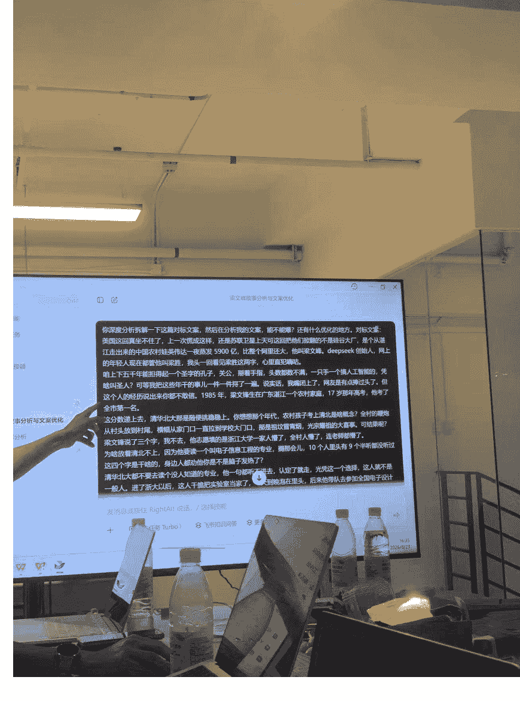
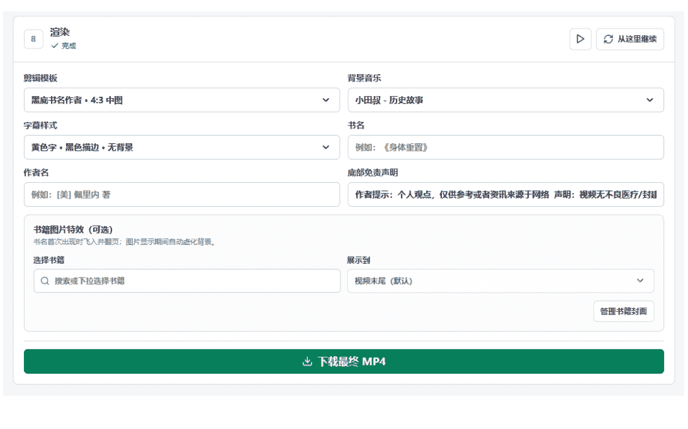
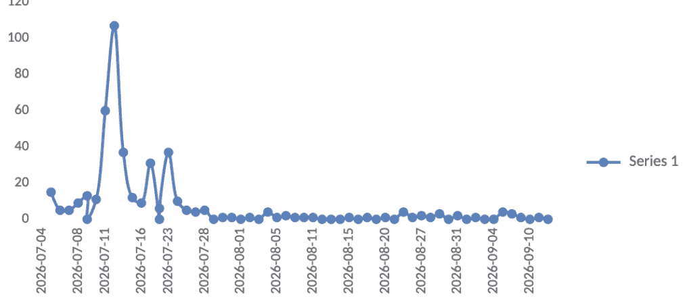
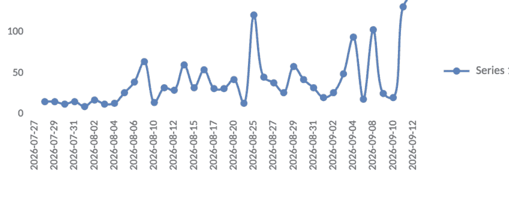

# 从几乎不出单到单日 GMV 6000+：我做视频号书单带货踩过的 4 个坑（新人可参考）

**260923 副业 SC 精华**

整理：公众号懒人搜索， [懒人专属群](懒人专属群)精选
懒人微信：lazyhelper1

> **小懒判断** | 憋不出单的视频号新人最该读，这篇把踩坑讲到了颗粒度：她的爆单视频被判违规后，别人用原声搬运跑出 10w+GMV，反向证明内容能打、账号承接废了。已有稳定出单号的老手可以划走。最值得抄的是选品版本调研 4 维度——给中老年人卖书先排除口袋书，开本字号优先于价格。坑在于投鼠忌器：爆款后不敢用小号跟进，一次就亏掉一个月的努力。

哈喽各位，我是瓜瓜，在厦门探索自由职业，之前在硅谷互联网公司做几年产品和交互设计，裸辞回国后一头扎进视频方向。

主做视频号图书带货，赚 C 端的佣金。从一个人瞎摸索到跟着航海和教练线下学习，目前跑出了单日 GMV 6000+ 的小成绩，也踩了做视频号以来最贵的几个坑。

之前一直靠看精华帖自学，走了不少弯路。最近参加航海和萧炎教练组织的聚会以后，思路一下子清晰了很多，所以把这几个月的实操和踩坑整理成这篇，给刚起步的朋友做个参考。

本篇只讲我自己真金白银踩过的坑和验证过的方法。基础操作类的内容可以看往期的精华帖和航海手册。

本篇文章用于解决下面几个问题。

- 一、怎么从不出单，找到真正能出单的方向和品类？
- 二、怎么选品？判断一本书能不能爆看哪几个维度？
- 三、爆款来了怎么接？怎么防止被别人搬运原声？
- 四、怎么降低退货率？挂链接选版本有什么讲究？
- 五、怎么搭建内容生产流程，把做视频的时间压到最低？

## 一、起步与转机

大家好，我是瓜瓜。本文是我做视频号几个月的血泪教训及踩坑集锦。

先自我介绍一下。之前在硅谷互联网公司工作了几年，产品、交互设计是我的老本行。

前两年裸辞回国以后开始探索自由职业，去年底到现在做的都是视频方向。先做了几个月油管，不幸赶上项目的尾巴。

三月开始做视频号图书带货，一开始做的是健康书籍，当时没有报名航海所以就只是跟着航海手册自己瞎做，几乎没有出单。

五月份我自己摸索到了历史类、人物类的视频带货方向，GMV 接近两万。（退单率偏高，也是我踩的坑之一，下文展开）

**成交数据筛选指标**

统计时间 2026/05/01 ~ 2026/05/31

| 成交金额 | 成交订单数 | 成交人数 | 客单价 | 退款订单数 |
| :--- | :--- | :--- | :--- | :--- |
| ¥18,307.4 | 261 | 257 | ¥111.16 | 30 |
| 较上周值 0.00% 高于90.00%同行 | 较上周值 0.00% 高于95.00%同行 | 较上周值 0.00% 高于95.00%同行 | 较上周值 0.00% 高于90.00%同行 | 较上周值 0.00% 高于93.46%同行 |

| 下单金额 | 成交退款金额 | 下单订单数 | 下单人数 |
| :--- | :--- | :--- | :--- |
| ¥20,136.6 | ¥2,369.2 | 291 | 281 |
| 较上周值 0.00% 高于90.00%同行 | 较上周值 0.00% 高于94.22%同行 | 较上周值 0.00% 高于93.31%同行 | 较上周值 0.00% 高于93.52%同行 |

然而好景不长，这个账号六月开始流量下滑，此时孤军奋战的我只懂得吊死在一棵树上，到了八月航海开始的时候，我仍然死死抱着手上的一个历史/人物类账号和两个已经断更的健康书号。

可能因为账号的原因，21天航海我只出了个位数的订单。

转机发生在航海之后的聚会，抱着对视频号的一线希望我从厦门赶到广州参加萧炎教练的组局。命运的齿轮从此开始转动。

*活动现场教练展示*

教练在聚会上先回答了每一个人带来的问题，然后现场展示，带着我们做了一个视频。相信所有到场的小伙伴都学到了很多。希望教练以后多多组织活动，多多带我们一起飞！

我个人得到的最有价值的一条建议是把手上的老号注销重开。在此之前我已经蹉跄了两个月，无论如何流量都做不起来。重开两个新号以后我才发现，获取流量又像呼吸一样简单了。

聚会之后不到一周，我就在还没有开通挂车的情况下靠橱窗拿到了单日 GMV6000+的小成绩，但同时也踩中了几个月视频号生涯中最大的坑。

下面的数据看起来很不错是不是？但我如果告诉你，有两个账号用我的原声跑出了总计 10w+ 的 GMV，你又当如何？

**成交数据**
统计时间 2026/08/30 至 2026/09/30

| 指标 | 数值 | 环比 | 同行对比 |
| :--- | :--- | :--- | :--- |
| 成交金额 | ¥6,383 | +0.04% | 高于 99.00% 同行 |
| 成交订单数 | 83 | +420% | 高于 99.00% 同行 |
| 成交人数 | 83 | +820% | 高于 99.00% 同行 |
| 客单价 | ¥167.74 | +10.96% | 高于 99.00% 同行 |
| 退款订单数 | 15 | 0.00% | 高于 96.39% 同行 |
| 下单金额 | ¥7,207 | +195% | 高于 99.00% 同行 |
| 成交退款金额 | ¥1,324 | 0.00% | 高于 99.00% 同行 |
| 下单人数 | 92 | +110% | 高于 99.00% 同行 |
| 下单人数(另一维度) | 91 | +100% | 高于 99.00% 同行 |

## 二、踩坑集锦

### 踩坑一：投鼠忌器

先把时间线完整还原一遍。

这条爆单的视频是健康类的，用一个还没开小黄车的号。

下午发出去，第二天早上突然起量，早上五点到十点卖出了 40 多单，然后开始进一步加速，到接近 12 点的时候冲到十万播放，那是我当时见过涨得最快的视频。

结果刚到十万，就被平台判定违规，视频没了。违规原因是滥用医疗身份背书。

当时我的第一反应是：违规就说明健康类还是不能碰，认栽。结果过了几个小时，就看到一个账号用我的原声发同一条内容，出了一百多单。我迅速举报。

第二天，这个账号继续用我的原声发，直接卖出700多单。另一个账号如法炮制，连发两次。这两个账号同IP，我怀疑就是同一个人，总计卖出应该有一两千单，GMV轻松超过十万。当然了，这两个号都挂车了，所以出单效率肯定比我的橱窗高。

那几天我每天都在捶胸顿足。可见人类对于自己失去的东西，要比得到的更在意得多。

但冷静下来复盘，这个坑反而给了我最重要的一个信息：别人用我的原声，都能跑出十万 GMV。这说明什么？

说明内容本身是能打的，是我的账号承接出了问题。这个反向验证，让我彻底确认了方向是对的，也让我看清自己最大的失误在哪。

失误有两个。

第一，爆款出现以后，我没有迅速用小号跟进，把流量拱手让人。当时手上的号不多，加上前两个月几个账号违规限流不断，这次又吃违规，有点投鼠忌器，不敢动。现在回头看，投鼠忌器是最贵的情绪。

第二，我对“爆款之后怎么办”完全没有预案。流量来了接不住，才是真正的浪费。

如果重来一次，我会这么做：

爆款出现后的24小时是黄金响应期。看到播放异常的信号，比如播放突然加速破万、评论区开始有人问链接，马上做三件事。

一是用3到5个小号跟进。平时就准备好一批养过号开通了小黄车的号，别等爆了才想起来注册，新号上来直接发橱窗出单效率是比较低的。

二是同一段原声，自己先用所有的号保存一遍。

三是主号趁热继续发同题材的下一期，让流量留在自己池子里。

防搬运和申诉也要前置。发视频前，素材留好时间戳证据，比如源文件、创作过程截图；出了爆款第一时间开原创声明；发现搬运不要只靠举报，按平台的申诉路径走，保留证据链。

一句话总结这个坑：内容能力可以慢慢练，但流量来了接不住，一次就能亏掉一个月的努力。情绪归情绪，预案必须提前做好。

### 踩坑二：因小失大

五月份我出过一个爆款，退单率比较高。当时正好《主角》电视剧开播，我很快跟进卖原著，先做了一个二创的爆款，又发了一个孙浩的原创爆款，流量都不错。

问题出在挂链接这一步。当时我先挂了99块钱的版本，脑子一过觉得偏贵，怕影响转化，就换成了85块钱的版本。爆单以后才发现，这个便宜的版本是口袋书类型，尺寸小、字号也小，非常不适合老年人。

退货率一下就上去了，流量白烧了一大截。

复盘下来，我犯的错误不是"选便宜了"，而是"换版本之前根本没调研"。我当时只比了价格，没比开本、字号、装帧、出版社、适合人群。给老年受众卖书，开本和字号就是第一优先级，我却完全忽略了。

现在我做选品会过一遍版本调研清单，4个维度：

1. **开本**：16开、32开还是口袋书。卖给中老年，首先排除口袋书。
2. **字号**：翻开详情页看实拍图，字大不大，是不是老人能直接读的。
3. **装帧**：精装还是平装，精装重、贵，平装好翻好拿。
4. **价格带**：对标目标人群的支付习惯，但不要因为便宜牺牲前两条。

一句话总结：选品选的是题材，挂链挂的是人群。题材对不对决定能不能爆，版本质量决定退货率。两步都得筛，缺一环都白干。

### 踩坑三：闭门造车

我开始做视频号的时候基本上就是看航海手册和精华帖自学，因为从小书习惯了看书自学的学习方式，加上我是个i人，很不好意思去请教优秀的圈友们，只有在极度困惑的情况下请教过九月教练几次，特别感谢他当时给我的帮助。

后来看了自在圈友的精华贴我鼓起勇气加了他的联系方式，他建议我要多找人学习交流，我才终于走出自己的舒适区，第一次去参加了生财的线下活动，然后才有了我的又一次爆单。

### 踩坑四：患得患失

前面说到我新开的两个号刚开始流量就很不错。

但是这两个新号的蜜月期分别都只维持了一周左右，很快新视频的流量从几千上万掉到几百。这时候我又开始焦虑痛苦了。然后被萧炎教练一棒子打醒：视频发少了。

做互联网项目就要接受流量波动，不能太玻璃心。多做账号、多发视频、多攒经验，这才是制胜之道。

## 三、经验分享

### （一）选品

选品我现在的做法分两条线：一条是跟供应商要信息，一条是自己判断。

跟供应商建联，别等爆款出来了才去找人，平时就要多聊。我的做法是主动问最近哪些书在跑量、有没有新上的爆款，他们的朋友圈也经常直接发爆款和新书，看到就跟进。

第二条线是自己判断。尽量不要选从来没有爆过的书，不爆的品一定有它不爆的原因。我现在判断一个品，会看四个维度：

1. **题材**：是不是大众情绪能接住的题材，比如亲情、命运、成长、怀旧。
2. **受众**：目标人群够不够大，老年人、宝妈、职场人，选人群基数大的。
3. **价格**：是否在目标人群的冲动消费区间内。
4. **历史出单**：平台里有没有同款爆过的痕迹，一个都没爆过，大概率有问题。

拿我自己那个反面案例来说：我原创过一条接近二十万播放的带货视频，最后只出了一单，选的就是一本几乎没出过单的书。播放量证明我的素材没问题，出单率证明选品和塑品都不行。流量是有机会成本的，一条视频的时间砸在死品上，等于白白浪费一次起量的机会。当时我选的品是《帝王陵寝》，用的素材是武则天。它让我意识到，对人物故事感兴趣，不代表愿意购买这本书。究竟是题材、价格，还是我没讲清书的购买价值，目前还不能确定。但在自己的测试资源有限时，我会优先选择已经有成交验证的书，再研究怎样把内容兴趣连接到购买理由。

**播放数据与互动**

| 指标 | 数据 |
| :--- | :--- |
| 完播率 | 6.01% |
| 平均播放时长 | 123.01秒 |
| 播放 | 18.5万 |
| 点赞 | 1911 |
| 转发 | 1319 |
| 评论 | 81 |
| 关注 | 666 |
| 分享次数-转发聊天和朋友圈 | 1071 |
| 分享次数-设为铃声 | 0 |
| 分享次数-设为状态 | 0 |
| 分享次数-设为朋友圈封面 | 0 |

**商品数据**

| 指标 | 数据 | 转化率/占比 |
| :--- | :--- | :--- |
| 商品曝光次数 | 108968 | - |
| 商品点击次数 | 522 | 0.03% |
| 商品下单次数 | 0 | 0.18% |
| 商品成交金额 | ￥0 | 100% (点击转下单), 100% (下单转成交) |

### （二）向同行学习

我做了一个每天抓取 40 个出过大爆款的同行账号的系统，主要原因是懒得手动截图填表记录。

用的是 python 脚本，通过 mac 控制 iphone 镜像实现。因为 api 有点贵，所以采用了这种原始的方式。并不是什么高深复杂的技术，但足够省出逐个账号截图填表的时间。

每天在同一时间跑一次，一边跑我一边手动刷爆款，完全不耽误时间。跑完之后自动更新飞书多维表格。

这个表格现在简化到只抓取每日橱窗出单数据，之前还有抓取账号主页和橱窗商品，后面发现用处不大。

**销售增长榜示例 (2026-09-19)**

| 排名 | growth_key | sales_growth | account_id |
| :--- | :--- | :--- | :--- |
| 1 | 2026-09-19\account_31 | 41 | account_31 |
| 2 | 2026-09-19\account_33 | 33 | account_33 |
| 3 | 2026-09-19\account_52 | 28 | account_52 |
| 4 | 2026-09-19\account_54 | 23 | account_54 |
| 5 | 2026-09-19\account_53 | 19 | account_53 |
| 6 | 2026-09-19\account_05 | 16 | account_05 |
| 7 | 2026-09-19\account_36 | 15 | account_36 |
| 8 | 2026-09-19\account_51 | 11 | account_51 |
| 9 | 2026-09-19\account_27 | 10 | account_27 |
| 10 | 2026-09-19\account_25 | 9 | account_25 |
| 11 | 2026-09-19\account_43 | 9 | account_43 |
| 12 | 2026-09-19\account_50 | 8 | account_50 |
| 13 | 2026-09-19\account_02 | 7 | account_02 |
| 14 | 2026-09-19\account_16 | 7 | account_16 |
| 15 | 2026-09-19\account_11 | 5 | account_11 |

这套系统有时候也能发现小众的品。之前有一个号从卖书转向卖足贴，爆了两千单。我顺着跟进，也出了一些单。这种信号，光看供应商数据是看不见的，得靠盯人。

数据只是辅助，真正重要的是判断。我的经验是：多个账号同时打一个题材，这基本就是近期爆点；盯住做得好的账号的新动向，他们换品、换形式，都是在替大家试错。这种观察只需要多关注一些账号，每天打开微信扫一眼就能看到。

### （三）爆款素材收集

五月份我找到《主角》这个爆款素材是通过小红书，当时我刷到了孙浩演技大爆发的切片，评论区满屏都是“哭嘻了”。

我马上意识到这是一个值得做的素材，让ai搜集材料开始写原创稿，很快就爆了。

现在我做素材判断，会看三个信号，避免凭感觉：

1. **评论区情绪浓度**： 有没有大量"哭了""看哭了""感动"这类词，情绪浓度决定转化。
2. **播放增速**： 素材本身在平台上的播放是不是还在快速涨，说明热度没有透支。
3. **话题窗口期**： 是不是刚发生、正在发酵的事，窗口期内的素材效率最高。

热点结合的公式我也琢磨出来了：时事事件 + 原有爆款内容。最近健康类的一个新爆款，就是结合敬一丹去世的消息，把时事和原有的健康爆款内容结合得很好，情绪和时效都有。

另外阿潘教练分享的微博、头条热搜法也很好用，每天固定时间刷一遍热搜榜，把强情绪的选题记下来。

我的总结： 素材收集不是攒运气，是攒信号。看到强情绪素材，判断窗口期，快速做出来，这个流程跑顺了，爆款就有一定概率性。

### （四）制作流程

我采用的是半自动化的方式，写稿用豆包桌面版（把航海分享的提示词做成 skill ），配音用配音蜂，配图用 chatgpt 网页版。

写稿这步最关键。我把提示词做成 skill 以后，输入元宝转写的逐字稿，能直接出一版接近成稿的文案，我再花一些时间改不合适的地方、补细节。

配音有一些注意事项，一是 ai 写的稿子很容易用破折号，但是配音蜂对待破折号是不停顿的，听感会很奇怪。二是配音蜂有时会无法正确念出罗马数字的年份（2026）。所以我在上一步的写稿提示词里会加入约束，禁止用破折号和罗马数字。

配图我用 ChatGPT 网页版，我会在一个对话框里面让 gpt 记住我的偏好，然后每一次直接发送我的稿子和我要的分镜数量，让 gpt 先出分镜提示词，再出图。一次性应该是最多能出 10 张图。

剪辑方面我参考自在圈友的帖子做了一个自动化剪辑系统，纯脚本驱动，不用消耗 token，但是功能会比剪映手搓弱很多，主打一个够用就好。

毕竟这个项目里文案比画面要重要得多。这套流程和全自动化的效率比不了，目前一个视频还是要花 30 分钟左右。

我还在优化流程，目标是再省一半时间，理出一套更高效的 SOP，之后会更新给大家。

## 四、当下困惑与未来展望

目前我已经证明了自己有创作爆款的能力，但还是没有经营出能稳定出单的账号。

我观察过很多账号, 有一些号在出过超级爆款以后就沉寂了(账号A), 也有一些号在一段时间里都能维持相对稳定的出单量(账号B)。

究竟怎么做才能让自己的账号成为B而不是A? 这是我接下来要探索的主题。

下一步我打算开一个新号, 像素级模仿出单稳定的账号。

也想借这个机会请教各位前辈, 是不是每个账号有它自己的周期, 走完了就差不多该放弃这个号了?

**账号A**

**账号B**

## 五、写在最后

首先要感谢亦仁老大创建了生财有术这个社群, 让我学到很多; 也感谢视频号航海期间所有教练和志愿者的无私付出。

特别感谢萧炎教练, 没有他在广州组织的...

那次线下聚会，就没有我后来的爆单。

也要感谢九月教练，在我做视频号最早期、最迷茫的时候给了我关键的指引。

也感谢所有视频号精华帖的作者，让我能站在巨人的肩膀上前进。

希望下一次能有更好的成绩和大家分享！

——————分割线——————

看完这篇 SOP，你觉得你懂了。但 90% 的人一到实操就会卡在第一步。

工具和教程只是最低级的壁垒，真正的壁垒是“立刻动手”和“圈层信息差”。

如果你想看全网最新的变现玩法，并且和一群执行力极强的极客一起下场拿结果，欢迎围观我的核心私域：【懒人专属群】。

我们不聊虚的，只做商业闭环的拆解与 AI 效率的压榨。系统内已沉淀 1000+ 跑通的套利实战局。

- 查阅圈子完整数字资产与上车门槛：
  [https://lazsyo.com/insider/](https://lazsyo.com/insider/)

认同价值、准备好下场干活的，扫码加我微信（lazyhelper1）

备注：【实操上车】，不闲聊

公众号
懒人搜索
懒人专属群

微信：lazyhelper1
