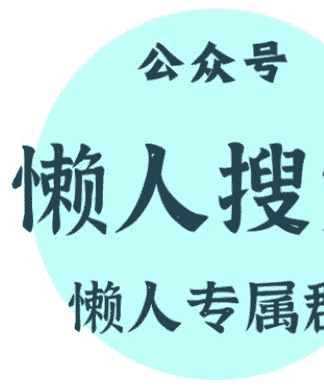
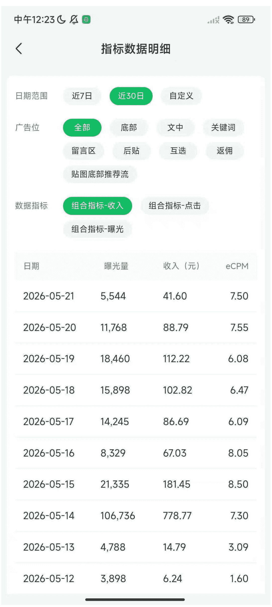
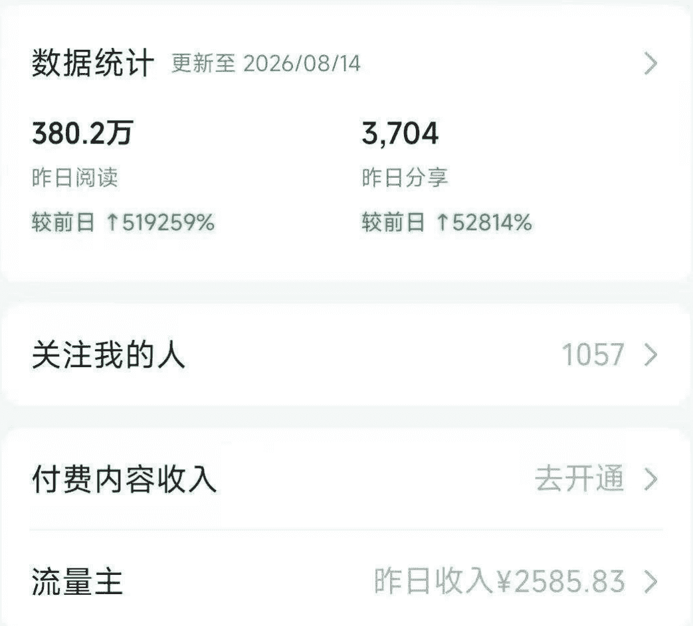
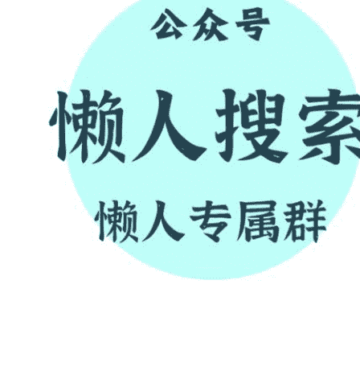

## 公众号贴图一天 380 万阅读、收入 2585 元：我做公众号半年的 0—1 复盘与完整流程

260923 副业 SC 精华
整理：公众号懒人搜索，懒人专属群 精选
懒人微信：lazyhelperl

微信：lazyhelperl

**小懒判断** | 时间被切碎的新手妈妈/上班族最该读，作者带两岁娃每天只有零碎时间，靠贴图短链路做到单日 380 万阅读收入 2585 元。想快速做大收益的人可以划走，她前半年流量主总收入并不高。最值得抄的是选图三个词——异常、好奇、讨论，遮住一张图整条内容不受影响就是凑数图。坑在于新手太急着给结果下结论，同一次换账号换赛道换标题换图片，数据变好了也不知道哪步起了作用。

大家好，我是新天，坐标杭州，今年刚加入生财。这是我第一次在生财认真写一篇完整复盘。

我是前年了解到生财的，知道生财是搞钱社群的头部。三天体验营让我看各种精华帖，已经看得眼花缭乱，这里的利他的价值观也深深影响了我。这两年 AI 发展太快，有时候感觉自己快跟不上了，所以加入生财一起学习最先进的搞钱玩法。

先把我做贴图的结果放在前面：上个月，我有两篇公众号贴图在同一天跑到了 380.2 万阅读，当天流量主收入 2585.83 元。

这个结果当然让我开心，但如果只写“我爆了两篇”，对正在从 0 到 1 的人其实没有太大帮助。因为 380 万阅读是结果，不是方法。2585 元是某一天的收益，也不代表以后每天都能复制。

真正值得讲的，是这两篇内容出现以前，我经历了什么：为什么重新选择公众号、为什么从长文章转到贴图、前期没有反馈时怎么熬过来、我怎样找选题和素材、怎样看数据，以及半年下来，我对“副业”“爆款”和“长期积累”发生了哪些变化。

我之前做了很多年外贸，最近因为种种原因辞职了。做公众号之前，我也有一些其他的副业经验。前两年自己琢磨做二手电商，前前后后变现大概 80 万。后来也做过小红书商单、闲鱼无货源，都能完成从 0 到 1 的过程，每个项目都能达到五位数收益。

听起来好像做过不少项目，但重新开始的时候，我一样会焦虑。甚至因为以前拿到过结果，我会更习惯先算：“这个项目多久能赚钱？天花板高不高？值不值得投入？”越想找一个完美答案，越容易迟迟不开始。

公众号让我重新理解了一件事：普通人真正需要的，往往不是一个看起来最厉害的项目，而是一个能嵌进自己生活、能持续做、做完以后还能留下东西的项目。

### 一、我为什么重新选择公众号

今年 2 月底，我重新选定了公众号。

当时我的现实情况很具体：白天要工作，晚上和周末还要带一个不到两岁的孩子，新手妈妈真的很不容易。每天真正完整属于自己的时间不多，很多时候是这里 20 分钟、那里半小时，等孩子睡着以后再做一点。

所以我选项目的时候没办法只看哪个收益高，还要看做这件事时间能不能被切成小块。我能不能利用十分钟找一个选题，利用另一段时间整理素材，再抽时间把内容发出去？如果一个项目必须每天连续投入四五个小时，哪怕它再好，也不适合当时的我。

一开始，我找到辰风老师学习写公众号文章，也确实产生了不错的收益。下面这些都是我自己的真实后台数据。

| 日期 | 曝光量 | 收入（元） | eCPM |
| :--- | :--- | :--- | :--- |
| 2026-03-20 | 5,294 | 125.92 | 23.79 |
| 2026-03-19 | 5,880 | 122.42 | 20.82 |
| 2026-03-18 | 5,078 | 116.36 | 22.91 |
| 2026-03-17 | 4,683 | 89.16 | 19.04 |
| 2026-03-16 | 3,490 | 51.15 | 14.66 |
| 2026-03-15 | 3,101 | 49.03 | 15.81 |
| 2026-03-14 | 2,301 | 41.58 | 18.07 |

| 日期 | 收入（元） |
| :--- | :--- |
| 2026-03-30 | 1,753.55 |
| 2026-03-29 | 82.11 |
| 2026-03-28 | 3.48 |
| 2026-03-27 | 0.59 |
| 2026-03-26 | 0.81 |
| 2026-03-25 | 0.15 |
| 2026-03-24 | 0.00 |

对我帮助最大的一点，不只是辰风老师教我“怎么写一篇文章”，而是他让我开始从项目视角看公众号：一篇内容为什么会被点开、什么选题值得连续做、流量为什么会波动，以及怎样把偶然的结果沉淀成可以重复的动作。

后来辰风老师建议我可以尝试贴图。5 月份，我正式开始做公众号贴图。

从长文章切到贴图，并不是因为贴图“更高级”，而是它当时更适合我的时间结构。长文章通常要经历找选题、整理素材、写正文、改稿、配图、排版；贴图的链路短一些：确定一个切口，准备图片，写标题和短文案，检查后发布。

这件事带给我的第一个变化，就是从“找最赚钱的项目”，变成了“找我能稳定执行的项目”。稳定输出以后，数据才会慢慢变成样本，样本才会变成判断。

### 二、从文章到贴图，我不是突然会了，而是重新跑了一遍 0—1

刚做贴图时，我并没有一套完整的方法。

看到别人发得好，我也会想跟着做；一条只有几十、几百阅读时，也会怀疑是不是账号不行、赛道不行，甚至是不是自己根本没有网感。后来发得多了，我才发现，新手最容易犯的错，不是不会用工具，而是太急着给结果下结论。

一篇数据差，可能是选题不够具体，也可能是首图没有吸引力，可能是标题和图片没有对上，也可能只是这一次没有被继续分发。如果我每次都同时换账号、换赛道、换标题、换图片，就算下一条数据变好了，也不知道到底是哪一步起了作用。

所以我后来不再问“这一篇为什么没爆”，而是开始问三个更具体的问题：

- 它有没有让人一眼看懂这条内容在讲什么？
- 图片里有没有一个值得停下来看的细节？
- 评论区里，大家有没有围绕同一点表达经历、观点或情绪？

这个变化看起来很小，但它让我第一次从“凭感觉发内容”，走向“根据反馈调整内容”。

后来有一天，我像平常一样打开公众号后台，看到一个号的数据：

阅读量：380.2 万。流量主收入：2585.83 元。两篇贴图，在同一天跑到了 380 万阅读。

刚开始做公众号时，我可能会把这个结果理解成“终于找到流量密码了”。但做了半年以后，我反而更冷静。

这两篇内容里一定有运气，有平台分发的偶然，也有当时选题、图片、标题和用户情绪刚好叠在一起的原因。爆款不能直接证明我已经掌握了规律，但它给了我一个很好的样本：我可以回头看，哪些动作值得保留，哪些只是碰巧。

### 三、加入生财以后，我真正学会的是：不要只收藏答案，要把答案变成动作

加入生财以后，我会看航海手册、精华帖，也会留意风向标里的新信号。

以前我看一篇帖子，最容易被收益数字吸引。现在我会继续思考分享者做这个项目以前是什么状态？第一步到底做了什么？中间卡在哪里？哪一次调整真正改变了数据？哪些方法只适合他的资源，哪些动作普通人也能照着做？

这也是我从生财精华帖里学到的一个很重要的阅读方法：**不要只抄结论，要拆过程**。航海手册给我的帮助，是把一件看起来很模糊的事，拆成明确步骤。比如贴图，不再只是“找张图、写几句话”，而是：

> 选赛道 → 找对标 → 拆图片和情绪 → 整理素材 → 写标题和正文 → 人工检查 → 发布 → 记录数据 → 下一条只改一个变量

风向标给我的帮助，则是让我保持对变化的敏感。新的内容入口、平台最近反复出现的题材、用户开始讨论的新问题，都可以成为观察信号。但风向标不是一张“照抄就赚钱”的答案卡。看到信号以后，还是要回到自己的账号，用真实内容验证。

精华帖更像别人已经走过一遍的路。比如我会认真看圈友从 0 到 1 的复盘，看他们为什么选这个赛道、第一批内容怎么发、没有流量时怎么判断、出现爆款后怎么接住。看得越多，我越确定：真正能帮到新人的，不是拿“坚持”“执行力”来搪塞大家，而是那些看起来很小、但能马上照做的细节。

我看澄心老师从线下教培转到线上贴图的复盘，记住的不是他 20 天左右拿到多少收益，而是他把注册、选赛道、选图、标题、发布和踩坑一项项写到了动作层；看清歌老师用贴图起号、再用长文章扩大收益，我开始明白贴图的文章不是二选一，它们可以承担不同任务；再看辰风老师把多账号、多维表格和内容工作流连起来，我才逐渐理解：矩阵不是简单地“多开几个号、多发几遍”，而是把采集、判断、制作、人工检查、发布和复盘拆开，让每个账号仍然保留自己的方向和内容差异。

辰风老师对我的影响也在这里。他没有只让我盯着一条爆款，而是让我看到公众号背后完整的内容生意：选题、内容、流量、变现、复盘，以及后面怎么用多账号和工具放大。对当时还在寻找方向的我来说，这种“把一件事讲完整”的能力，比给我一个所谓的爆款模板更重要。

### 四、我现在做一条贴图，会完整走完这 7 步

下面这套流程，是我从自己的实践、生财航海手册和精华帖里不断对照以后，慢慢整理出来的。它不是保证爆款的公式，但能避免我每次都从零开始。

#### 第 1 步：先定一个方向，不在推荐页里到处乱跑

刚开始我也会觉得，什么有流量就做什么。后来发现，如果今天发怀旧，明天发婚姻，后天又发养生，账号的数据根本没办法放在一起比较。

现在我会先保留 2—3 个候选方向，每个方向看 3—5 条近期仍有真实互动的内容。看的不是一条内容有多爆，而是这个方向有没有持续出现以下信号：

- 不同账号都在持续更新，不是只剩一条很久以前的爆款；
- 评论区真的在围绕主题讨论，而不是只有几个泛泛的表情；
- 素材能够持续找到，不需要依赖一张偶然出现的神图；
- 我能说清它服务哪类人、触发哪种情绪。

一轮测试里，我只确定一个主方向，再留一个备选方向。这样不是永远锁死赛道，而是先让样本可比较。

#### 第 2 步：找对标，但不照搬对标

我现在看对标，主要拆五件事：人群、场景、情绪、首图和评论区。

比如同样是一张旧物照片，我会看它打中的是哪一代人，勾起的是怀旧、遗憾还是生活变化；标题有没有把答案全说完；第一张图为什么能让人停下来；评论区里大家是在讲自己的经历，还是在争论。

找到一条值得参考的样本后，我会留下原始标题、原文、来源链接和 1—2 张参考图，再写三句话：

1. **话题：** 这组图最适合讲什么事？
2. **图片吸引力：** 它和日常同类图片有什么不一样？
3. **情绪切口：** 读者看到后最容易产生什么感受？

做到这里就停止继续刷。以前我经常把“找素材”做成了“刷内容”，看了很多，最后一条也没有发。现在材料够用，就马上进入制作。

#### 第 3 步：选图不是选最好看的，而是选最有信息的

贴图看起来以图片为主，但好看不等于有内容。

我现在选图会看三个词：**异常、好奇、讨论**。异常，是画面里有没有和平时不一样的地方；好奇，是第一眼没有完全看懂，愿意多停留几秒；讨论，是用户看完以后有没有一句话想说。

如果是一组图，我还会检查后一张有没有补充新的场景、新细节、新证据或新对比。遮住其中一张，如果整条内容完全不受影响，那张图很可能只是凑数。

我也会提醒自己：从对标里可以学习题材、构图和表达结构，但不能直接搬走别人的图片、原文、人物经历和独家事实。关掉参考内容以后，这条成品仍然能够独立成立，才算真正做完。

#### 第 4 步：标题只做一件事——让人愿意继续看

以前写标题，我总想一次把事情讲明白。后来发现，标题讲得太完整，读者就没有继续看的理由。

现在我的判断很简单：标题先抛出一个清楚的异常点或具体细节，让读者大概知道发生了什么，但不要把答案一次说完。

**标题负责让人停下来，图片负责让人看明白，正文负责把情绪接住，评论区负责让读者继续表达。** 标题不用故意夸张，也不需要堆很多情绪词。一个真实、具体、能被图片证明的细节，往往比空泛的“太震惊了”更有用。

#### 第 5 步：正文像真人聊天，但必须比闲聊多一个有效细节

贴图的正文不需要写成长文章。我的目标通常是把“我看到了什么、哪里不一样、为什么值得说”讲清楚。

比如：

> “今天刷到这张图时，我第一眼还没看出哪里不对。”
>
> “放大以后，才注意到下面这个细节。”
>
> “这种场景以前很常见，现在反而很少看到了。”

这些话没有复杂技巧，但有观察、有画面，也像一个真人在分享。需要注意的是，不知道的事情不要硬编。图片不能证明人物年龄、收入、家庭和真实经历，就不要把推测写成事实。

结尾的问题也不要太大。与其问“大家怎么看”，不如问一个用户能立刻回答的问题：“你们小时候见过这种东西吗？”“如果是你，会保留还是拆掉？”问题越具体，评论越容易发生。

#### 第 6 步：发布前，我会做一次人工检查

不管内容是自己写，还是借助工具生成初稿，发布前都要回到人手里。

我会检查：

- 标题、图片和正文是不是在讲同一件事；
- 有没有把推测写成事实；
- 图片来源和版权风险是否可控；
- 有没有医疗功效、夸大收益、擦边、引战等风险表达；
- 删掉套话以后，是否还有一个清楚的观察或信息点。

AI 和 Skill 对我来说是提效工具，不是替我做最终判断。它可以帮助我整理样本、生成多个标题、出文案初稿，但选题值不值得做、事实是否可靠、成品像不像真人，最后仍然要由我决定。

#### 第 7 步：发布后留下记录，下一条只改一个主要变量

以前我复盘，基本只看阅读量。现在我会把一条内容至少记下这些信息：

- 赛道和细分方向；
- 素材从哪里来；
- 标题用了什么结构；
- 阅读、推荐来源和互动变化；
- 评论区真正讨论的是什么；
- 工具初稿到最终发布稿，我人工改了什么；
- 下一条准备延展、换标题、换首图，还是暂停。

每次复盘，我只要求自己回答三句话：

1. 今天最好的数据或真实反馈是什么？
2. 当前最明显的问题是什么？
3. 下一条只准备修改哪个变量？

复盘不是写一篇长感想，而是给下一条内容一个明确动作。

### 五、贴图真正难的不是制作，而是建立自己的选题判断

做贴图几个月，我越来越确定：形式越简单，越考验选题。

工具可以把一张图做得更精致，也可以很快生成十个标题。但如果我不知道用户为什么会停下来，不知道这张图提供了什么新信息，生成得越快，只是更快地产出平庸内容。

我现在看选题，不再只看“这条阅读量高不高”，而是看它为什么值得被讨论：

- 有没有具体的人群，而不是所有人；
- 有没有具体场景，而不是空泛观点；
- 有没有一个可见的矛盾、反差或变化；
- 评论区能不能告诉我，用户真正被哪一点打动。

很多所谓的网感，不是天生的。它是看过足够样本、发过足够内容、拆过足够评论以后形成的条件反射。

以前我看到一张图，只会觉得“挺好看”。现在我会继续问：它能讲什么人？发生在什么场景？哪一个细节最值得放大？评论区会围绕什么说话？这就是我半年里最明显的成长之一。

### 六、为什么我不再因为一条数据，马上换账号或换方向

贴图数据本身就有波动。同一个账号，上一条可能没什么水花，下一条也可能突然起量。

所以我现在不会因为一篇数据差就马上换方向，也不会因为一篇爆了，就觉得自己完全找对了。

我的做法是：同一个方向连续发 3—5 条，每次尽量只改变一个主要变量，再看类似反馈有没有重复出现。

如果曝光偏低，我先看选题是不是太泛、方向是不是跳得太快；如果有人看但不愿意点开，我先检查标题和首图；如果有人点开但很少互动，我就看正文是不是缺少具体场景，问题是不是太空；如果同类内容连续有人评论、分享，我就把其中重复出现的人群、场景和情绪提取出来，继续做成系列。

这个过程让我从“猜平台喜欢什么”，变成了“用自己的账号积累证据”。

### 七、我越来越相信“量”，但量不是盲目多发

我说的量，不是一天机械发很多条，也不是用工具批量生成以后不检查就发布。

量真正的价值，是给判断提供足够样本。

发 10 条时，很多感受还是猜；发到 50 条以后，开始知道哪些图片更容易让人停留；发到 100 条以后，才可能慢慢看出自己账号的人群、题材和表达偏好。

看的多了、发的多了、拆的多了，才会慢慢形成条件反射。

所以我更认可的节奏是：先发，再看数据，再调整；保留有效部分，只改一个变量，再发下一轮。多号不是为了把同一条内容复制十遍，而是把已经跑通的流程放大：不同账号有清楚的人群和方向，素材、标题、图片和表达保持差异，最后统一记录和复盘。

如果单号的内容判断还没有形成，多开账号只会放大混乱。如果单号已经能稳定完成选题、制作、发布和复盘，多号才可能放大产能。

### 八、公众号到底教会了我什么

半年下来，公众号带给我的不只是某一天 2585 元的收入。

第一，它让我重新理解了从 0 到 1。从 0 到 1 不是先学完所有方法，而是先完成一条内容、拿到第一次真实反馈，再带着问题继续学。很多答案不是准备好了才出现，而是做着做着才出现。

第二，它让我接受了不确定性。我可以提高选题、图片、标题和表达的质量，但不能控制每一条内容的分发。能做的，是通过连续测试，让自己越来越少靠运气。

第三，它训练了我看用户，而不是只看自己。我觉得好的内容，用户未必关心。评论区里反复出现的问题和经历，比我自己想象的“用户画像”更真实。

第四，它让我知道工具应该放在哪里。没有判断时，工具只能帮我更快地产出；有了判断以后，工具才能帮我扩大。真正值得做成工作流或 Skill 的，不是一个偶然爆款，而是已经被验证过的找题、整理、写作、检查和复盘步骤。

第五，它让我更愿意长期积累。公众号积累的是内容、账号、用户反馈和流量经验；我同时在做的虚拟资料，积累的是产品、需求和转化能力。这些东西不会因为某一条数据不好就全部归零。

### 九、接下来，我会继续做什么

接下来，我的主要精力会放在公众号和虚拟资料上。

公众号这条线，我会继续做三件事：

1. **继续找素材，但不只收藏**。每条样本都要说清人群、场景、情绪和图片信息点。
2. **继续发布，但不追求无效数量**。同方向连续测试，把有效题材做成系列。
3. **继续复盘，并逐步做多号**。先把单号流程稳定下来，再用工具提高整理和制作效率，让不同账号保持明确定位和内容差异。

我也会继续看生财的航海手册、风向标和精华帖。对我来说，生财最有价值的地方，不是让我永远追下一条信息，而是让我看见很多真实的人怎样从不会到会、从第一条内容做到第一笔收入，再把一件小事慢慢做深。

特别感谢辰风老师带我入门公众号，又在关键节点提醒我尝试贴图。回头看，他给我的不只是一个项目方向，更重要的是一种做内容的思路：不要迷信单篇爆款，要看完整链路；不要只谈工具，要把选题和用户放在前面；不要等全部想明白，先用真实数据把路走出来。

### 写在最后

现在我终于有了一套遇到新项目时可以重复使用的方法：

> 先找到适合自己的方向，完成第一条；再从真实反馈里找问题，把有效动作留下来；最后才...

#### 结语与总结

以前我总想先找到正确**答案**再开始。现在**我越来越接受：很多答案，本来就是做着做着才出现的。粗糙也得先开始做起来吧~

所以接下来，我还是会继续找素材、继续发、继续复盘、继续积累。

也希望能在生财认识更多伙伴。一起交流，一起成长，也一起把一件看起来普通的小事，慢慢做出结果。

**谢谢大家！一起生财有术！**

---

##### 实操建议与社群邀请

看完这篇SOP，你觉得你懂了。但 90% 的人一到实操就会卡在第一步。

工具和教程只是最低级的壁垒，真正的壁垒是“立刻动手”和“圈层信息差”。

如果你想看全网最新的变现玩法，并且和一群执行力极强的极客一起下场拿结果，欢迎围观我的核心私域：【懒人专属群】。

我们不聊虚的，只做商业闭环的拆解与 AI 效率的压榨。系统内已沉淀 1000+ 跑通的套利实战局。

- 查阅圈子完整数字资产与上车门槛:
  https://lazys o.com/insider/

- 认同价值、准备好下场干活的，扫码加我微信（lazyhelper1）
  备注：【实操上车】，不闲聊

微信：lazyhelper1
