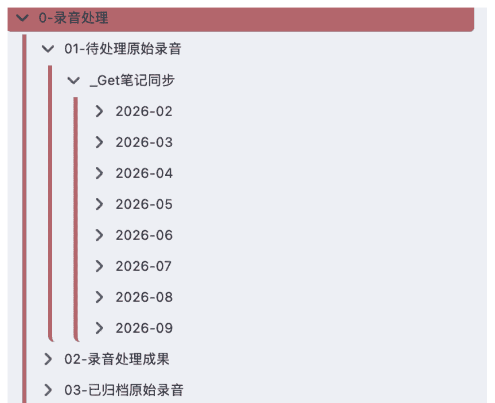
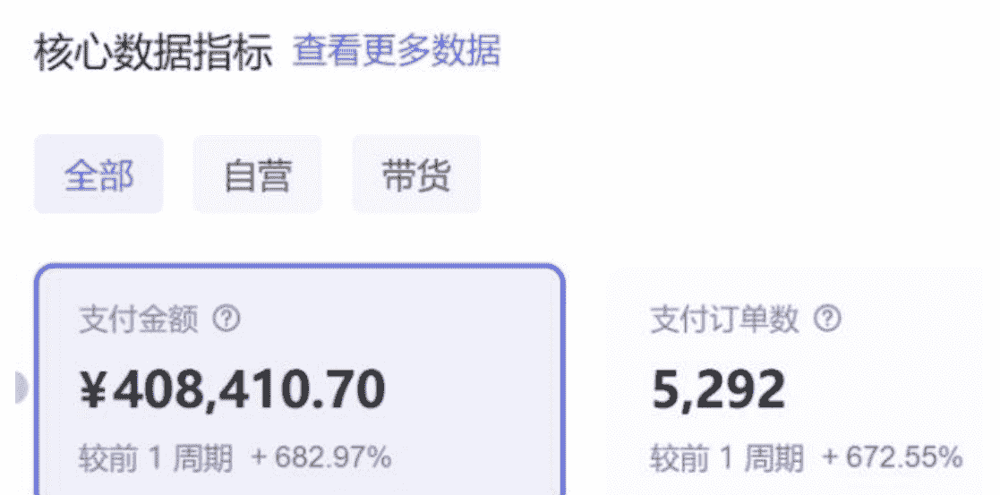

# 创业一年赚到 6 位数，却换了八九个项目，我終於开始面对真正的问题

260924 副业 SC 精华
整理：公众号懒人搜索，懒人专属群精选
懒人微信：lazyhelper1

> **小懒判断** | 反复换项目、总觉得下一个更好的创业者最该读，作者一年换了八九个项目、虚拟产品卖 7000 单赚到六位数还是停了，问题不在项目在停止标准。方向稳定的人可以划走。最值得抄的是把"我不擅长"和"我不愿意"分开：能力能补，意愿补不了，别用自我改造掩盖选错赛道。坑在于把优势、价值观、复利这些三五年才验证的问题，压到连用户反馈都没拿到的项目上，怎么选都会被否决。

这是我的 7 月项目复盘（想写很久了）。

准确地说，7 月的一整个月时间，我都在试图阻止自己立刻开始下一个项目。

这篇复盘不是要证明我已经找到了长期答案。我想写清楚的是：

- 一个人明明能够把很多项目从 0 跑到 1，为什么还是会不断更换方向？
- 我总结的，选择创业项目的四条选择标准。

如果你也在反复寻找项目，总想提前选中一条不会后悔的路，希望这篇文章能给你一个参照。

这个月我留下了 35 份录音，能统计出来的输入内容接近 46 个小时。我去听鲁细细的线下课，研究小红书内容、直播、私域成交和高客单产品；我参加了一人公司的业务诊断，学习并使用 AI 搭建我的 Agent 助手；我还意外的接触了数字生命和易经，做了线上的优势教练和事业咨询。

从表面上看我像是在同时研究并开展了很多支线任务，但把这些知识输入重新梳理了一遍，我才发现，整个 7 月我反复追问的其实只有一个问题：

一年时间尝试了八九个项目以后，我为什么还是没有找到一件自己愿意长期做下去的事？

我曾经以为是因为之前的项目不够好。

后来我才意识到，问题可能根本不在项目...

## 01 我不是没有拿到过结果，只是每一次都没有持续下来

在正式出来创业以前我做了八年产品经理，2024 年 3 月份我决定裸辞，离开了熟悉的产品经理岗位转到新媒体行业，在一家百万粉丝博主的公司里做知识付费教练，开始做自己的账号，也以教代练带了两百多名学员。到了 2025 年初，我决定从公司离开开始独立创业。

从那以后的一年多里，我先后做过 AI 博主、AI 智能体知识付费、直播带货、小红书实体电商/虚拟电商和 IP 知识付费。算下来大大小小做了八九个项目，而且这些项目并不是只是我在脑子里想过，也不是做了一个账号发几篇内容就算做过，而是我确确实实研究过产品，做过内容，跑过流量，接触过用户，也真实进入过成交和交付。

如果只看项目从 0 到 1 的启动能力，我其实执行力不差的。一个新的方向出现以后，我通常可以很快得理解项目的基本逻辑，也能够用以往的产品经理的思维拆出最小闭环要做哪些事情，并且从零开始把项目跑起来。可我的问题也恰恰出在这里：

*我一次次证明了自己能够从 0 开始，却始终没有证明自己能够在一个项目里持续的留下来。* 创业一年多，目前我的个人 IP 在全网累计有大约 15 万粉丝，之前做的三个小红书电商项目也都拿到过一些结果。其中一个跟朋友合作的虚拟产品项目做了五个月，共卖出近 7000 单赚到六位数。IP 知识付费也在刚启动一个月赚到 5 位数。

这段经历我回顾它的同时我在想：我并不是因为完全做不成某个项目，才不断换项目；相反，有些项目已经跑通了从内容、流量到成交的闭环，也给过我足够明确的正反馈。按理说，当一个人验证过自己的能力，还真实赚到过钱，接下来应该做的是继续放大。

但这些结果并没有让我变得更笃定。项目越多，我心里的困惑反而越具体：

为什么有的事情已经证明能赚钱，我还是不想继续？

为什么我能看懂一个项目的商业逻辑，却没有办法说服自己长期留在里面？

如果只是某一个项目因各种特殊原因停止，我可以把原因归结为平台、利润或者合作问题；可当同一种情况反复发生，我就不能再把所有答案都推给外部，排除个人的原因。

回头看，每一次停止其实都有理由，而且每个理由单独拿出来都成立。

做 AI 博主的时候，接商单的来回摩擦让人心累；做短视频带货时，我需要呈现一些自己并不真正认可的效果，内容发出去以后没有成就感，反而觉得越来越累；做小红书蓝海电商，又和同时推进的另一个项目发生冲突，只能暂停其中一条线。

最接近“做成 1-10”的那一次，是合作的小红书虚拟产品项目。它带来了 超过 5 个月的订单和收入，也让我确认自己确实具备选品、内容和电商闭环的能力，但平台的规则总是在不断的变化。产品违规以后项目随之终止，我前面几个月积累的内容、销量和经验没有自然地沉淀成一份完全属于自己的资产，因为私域并没有沉淀在我这。

再后来，我去学习商业重新设计自己的知识 IP、产品和成交路径，并且实际执行了三个月。方法本身未必有太大的问题，但当我真的进入私域的销售成交、销售沟通和交付以后，我发现那套模式对当时的我来说消耗太大。于是我又一次停了下来。

合理的理由越来越多以后，我终于看见了一个更难回答的问题：如果平台、产品、合作关系、利润空间和个人状态都可以成为停止的原因，那下一次换一个项目，这些问题就真的不会再出现吗？

当每个项目都能找到停止的理由时，我不得不开始怀疑，真正需要被研究的可能不是项目，而是我自己。

## 02 我把 7 月定成学习月，其实是在寻找一个确定答案

所以到了 7 月，我给自己定了一个看起来很合理的安排：先不急著开始新项目，把这个月当成学习月。我想先把之前没有想明白的问题补齐，再决定下一步做什么。

7月4日和5日，我参加了鲁细细的线下课密集学习知识IP的商业闭环。从IP定位、差异化、小红书内容和爆款选题，到直播开场、销售话术、私域顾问式成交，再到引流品、社群、训练营、私教以及AI智能体如何辅助内容生产，几乎把一个知识IP从前端获客到后端交付的路径重新过了一遍。

产品能不能卖出去，对我来说不是一个没有被验证的问题，已经有学员在交付中。真正让我犹豫的是：我是否愿意长期用这样的方式过以后的生活。

“这套模式能赚钱”。这一点已经有太多人证明过了。

我想知道的是： **这套被验证过的商业模式，能不能成为我愿意长期生活在里面的工作方式。** 两天的课程并没有让我缺少方案，恰恰相反，它让我脑子里的方案迅速增加。不想承担销售和交付时，我又会觉得，也许最适合我的方式是与成熟后端合作，自己只负责流量和内容。

每一条路径都有逻辑，也都能解释我当时的某一部分需求。社群相对轻，训练营已经有基础，私教收入更集中，知识库可以沉淀内容，电商离现金流更近，合作模式又能避开不擅长的环节。正因为每一个方向都说得通，我才更难做出选择。

## 学习增加了我的知识，也增加了我的选项。

我原本以为，知道得越多就越接近正确答案，后来才发现，每学会一种方法，我的脑子里就会多出一条新的商业路径。原来的问题没有消失，只是被更多看起来可行的答案包围了。

到了后半个月，我开始把问题往更底层的地方推。我去接触了一人公司业务诊断和北极星工作坊，也重新去看自己的盖洛普优势。我还接触了数字生命、星盘、易经和八字，希望从不同的体系里交叉理解自己的性格、优势，以及什么样的事业方向更适合我。

我并不是想证明这些体系一定正确，也不准备把未来交给一份测评或一次咨询。可如果诚实面对自己当时的状态，我确实希望它们能给我一个答案。最好有一个足够权威的人、一套足够完整的框架，能够把我过去的经历全部解释清楚，然后明确告诉我：你适合做什么，不适合做什么，接下来就沿着这条路走。

这和我前半个月学习商业方法时的心理其实没有区别。前半个月，我想从成功者的路径里找到答案；后半个月，我想从性格、优势和命理体系里找到答案。表面上我在研究不同的方法，实际上一直在做同一件事：

把选择的压力交给一个外部标准，希望它替我排除错误，保证我下一次不会再停下来。

可选择本身没有因此变得更容易。外部的答案越多，我越能看见每一种路径成立的条件，也越能看见它可能带来的代价。

我越想找到一个不会出错的方向，就越不敢真的选一个方向。

## 03 我以为自己缺方向，后来发现我缺的是停止标准

7月的一次咨询里咨询师跟我说：“我很喜欢反思，但是反思的过程太多，想太多、做太少。想太多就会想得太深，而且容易自我攻击。”重新听到这句话时，我发现它几乎解释了我过去一年频繁切换方向的整个过程。

我很擅长发现问题，一个项目刚开始我会研究它的商业模式；进入执行以后，我会观察流量、利润、交付和自己的感受；发现卡点以后，我不会只停留在表面，而是继续追问更底层的原因。产品是不是不够好？人群是不是不够准？商业模式是不是太重？这个方向能不能形成复利？它和我的优势、价值观以及未来想要的生活是否一致？

这些问题都不是错的。

问题在于我的思考没有终止条件，当我发现一个问题以后，我会继续寻找更深刻的问题；对当前方法产生怀疑以后，我会再去找一套更完整的方法；新方法出现以后，我会重新设计产品和方向，原来正在进行的行动也随之被打断。

单看每一步，我都在认真思考、主动学习、降低风险；把它们连起来，我却一直在“发现问题、重做选择、重新开始”。我以为这是审慎，实际结果却是，我把思考变成了一套可以无限运行的系统。

真正让人停滞的，不是没有思考，而是思考没有停止标准。后来我把自己选择项目时的要求写下来，才明白为什么每个方向都会被我否定。我希望它符合自己的优势，能够长期做三到五年，不需要频繁更换；希望交付不要太重，销售不要太强，收入又不能太低；希望它能积累个人资产，符合我的价值观，做起来最好还能有心流。

这些要求拆开看都合理，甚至可以是一个创业者应该考虑的问题。可当我把所有条件同时压到一个还没有经过充分验证的项目上，任何方向都会显得不够好。离现金流近的项目，我会担心它没有长期价值；能沉淀长期资产的事情，我又会担心变现太慢；高客单模式有利润，我不喜欢它对销售和交付的要求；轻交付模式让我舒服，我又会担心需要更大的流量。

我不是在判断下一步值不值得测试，而是在试图提前判断它能不能承载未来三到五年的人生。可一个项目连第一轮用户反馈都没有拿到时，我已经要求自己回答它是否符合优势、价值观、收入目标、理想生活和长期复利。

这不是选择标准太高，而是我把不同阶段的问题挤在了一起。0到1阶段本来应该验证有没有用户、能不能成交、自己是否愿意继续，三到五年的长期问题应该在有了真实反馈以后再判断。可我总想在行动之前把它们一次性解决。

我不是在选择下一个可以测试的项目，我是在要求自己提前选中一个不会后悔的人生。

这个问题在我面对高客单商业时表现得尤其明显。我看到很多成功者都在强调高客单、优质客户、私域成交，也知道这套模式已经被市场反复验证。从商业效率看，它可以用更少的客户获得更高的收入，也能把服务资源集中到付费意愿更强的人身上。

但我同时也能察觉，这些观点并不是悬空的知识，它们往往和讲述者自己的产品、能力以及商业目的连在一起。一个擅长销售、拥有成熟交付团队的人，当然更容易从高客单里获得正反馈；而当我把同一套模式搬到自己身上时，顾问式成交、持续沟通和重交付会直接消耗我的精力。

所以我一直处在一种“既想相信，又无法完全相信”的状态。我会因为对方已经拿到结果而怀疑自己是不是不够执行，又会因为真实体感不对而不断后退。后来我才明白，这不是我不够听话，也不是成功者的方法不值得学，而是任何方法都必须经过自己的条件重新判断。

当把决策权交给权威时，自己的感受并不会消失。它只会在行动过程中重新出现，变成疲惫、抗拒和无法持续。

别人的成功只能证明那套方法对他成立，不能替你证明，愿意用那种方式工作很多年。

## 04 真正需要调整的不是项目，而是我和工作的关系

我发现自己的低效并不只是不会安排时间。当生活作息、饮食、身体状态、情绪和工作节奏是连在一起的，当身体和情绪没有进入稳定状态时，再清晰的目标拆解也很难被执行。

过去我很容易用任务数量衡量自己有没有努力。想做的事情一多，我会把它们全部列出来，同时研究内容、产品、销售、AI 和新的项目方向。清单看起来很完整，真正能形成结果的动作却很少。完成不了时，我又会把低效解释成意志力不足，继续给自己增加要求。

那次复盘以后，我给出的方案反而很简单：每天只完成一到两件最重要的事，从目标反推当天能够落地的最小动作，剩下的时间用来恢复身体和情绪。不是因为创业可以放松要求，而是因为一个人的状态本来就是业务系统的一部分。

> **一人公司的生产系统就是创始人本人。身体和情绪失去稳定，业务也不可能稳定。** 如果我继续用透支换执行，再好的项目也会被我做成一份无法持续的工作。

在优势教练的对话里，我重新看了自己的盖洛普结果。我的第一优势是“审慎”，但很长一段时间里，我并不认为它是一项优势。它更像一根鞭子，会检查项目、检查风险、检查别人，也会不停地抽打我自己。审慎让我很少不经思考就投入一件事。我会提前看到利润、平台、合作关系、交付和道德风险，也会在别人还兴奋的时候先问一句，这件事能不能持续。它确实保护过我，让我避开了一些不认可的做法，也让我不愿意为了成交做过度承诺。

可当审慎没有使用边界，它也会拥有对所有行动的无限否决权。一个方案只要还有问题，我就觉得不能开始；一次尝试只要无法确定长期结果，我就想继续研究；行动中只要出现不舒服，我就会怀疑方向本身。最后，它保护我的方式变成了不让我真正进入任何不确定性。

教练引导我把脑子里的那根鞭子换成一条警戒线。需要判断风险时，我可以把警戒线拉起来，认真检查最坏结果和承受范围；完成基本判断、进入小范围测试以后，我也可以主动把它打开，不再让同一个问题反复否决行动。

这个画面对我很重要。它没有要求我变成一个冲动的人，也没有否定审慎的价值，只是把使用它的权力重新交还给我。**审慎真正成为优势的前提，是我可以决定什么时候使用它。** 当我把问题从“哪个项目最好”转向“我愿意承担哪一种成本”以后，很多矛盾才开始变得清楚。我不喜欢强销售，不想把大量精力放在反复说服用户上；我也不想被没有边界的答疑和交付消耗，更不接受为了成交做虚假承诺。可与此同时，我需要恢复现金流，也希望自己的工作能够产生足够的收入。

过去我会把这些要求放进同一个产品方案里，希望它销售轻、交付轻、客单价高、转化容易，还能让用户拿到结果。现实里没有这样的组合。选择轻交付和大流量，就要接受较低客单价以及持续获取流量的压力；选择高客单和重交付，就要接受服务人数、沟通成本和时投入；选择依靠内容长期积累信任，就要接受它不会立刻解决现金流问题。

真正的选择不是把缺点全部消除，而是确认哪一种代价更接近自己的能力、状态和价值观。对当时的我来说，这也意味着不能只看别人赚了多少钱，还要看那份收入背后需要怎样销售、怎样交付、怎样生活。

商业模式不是把所有好处装进同一个产品，而是决定自己愿意承担哪一种成本。如果一种工作方式需要我长期违背自己的价值观，或者持续透支身体和情绪，即使它能够赚钱，也不代表它适合成为我的长期方向。

## 05 7月没有帮我选出项目，却帮我建立了四条选择标准

**第一条标准，是优先相信真实结果，不优先相信新鲜感。**

过去一年，我很容易被新方向吸引，因为新项目还没有暴露问题，它呈现出来的总是可能性；已经做过的项目却留下了疲惫、卡点和不完美，很容易让我误以为新的方向更适合自己。可新鲜感只能证明我对它有兴趣，不能证明我能把它做成，更不能证明我愿意长期做。

真正值得信任的是已经发生过的结果。我做过内容，也积累了全网约15万粉丝；我跑通过三个小红书电商项目，知道怎样理解平台、选择产品和组织内容；八年产品经理和后来的知识付费经历，也让我具备产品设计、知识拆解、流程组织和带学员的基础。最近一段时间，我又在持续把AI融入内容和业务流程。

这些能力未必会直接告诉我下一个项目是什么，却已经划出了一个更可靠的范围。未来的新方向，应该尽量从内容、流量、电商、产品、知识组织和AI这些已经被结果证明的能力向外生长，而不是每次都另起炉灶，再从零证明自己。

**第二条标准，是区分能力问题和意愿问题。**

以前遇到不舒服的环节时，我常常会把它解释成“我不擅长”。不喜欢顾问式成交，就觉得自己销售能力不够；不想做重交付，就觉得自己缺少服务用户的耐心；一想到长期直播和私域沟通会消耗能量，就会怀疑自己是不是不适合做知识IP。

可“我能不能做”和“我愿不愿长期做”是两个完全不同的问题。我已经卖出过产品，也带过学员，说明销售和交付并不是绝对做不到。真正需要确认的是，为了提升这两项能力，我愿意投入多少时间；即使最后做得不错，我是否愿意把它们长期放在工作的核心位置。

能力不足可以通过学习、练习、工具和合作补足，意愿不足却不能只靠自我要求解决。如果我明明不愿意长期承受某种工作方式，却一直把问题定义成能力不足，就会进入永无止境的自我改造。把两者分开以后，我才能决定什么需要练，什么可以交给别人，什么根本不必成为自己的主营业务。

**第三条标准，是在开始之前问清楚：这件事做完以后，会留下什么？**

过去的项目并不是完全没有价值，它们让我确认了自己的能力，也让我逐渐看见不能接受的工作方式。但从业务积累的角度看，有些项目一旦停止，收入、流量和合作关系也一起归零，下一次开始时仍然要重新找产品、重新做账号、重新建立用户信任。

以后再判断一个项目，我希望它至少能沉淀一种长期资产。它可以是一批持续产生价值的内容，可以是更具体的用户需求样本，也可以是私域信任、方法论、知识库、可复用产品、稳定供应链或者一条被验证过的获客路径。这样即使项目没有按照预期继续，做过的事情也不会全部消失。

这条标准也改变了我在个人IP的理解。7月在线下课后，我记录过一句话：“做IP就是输出经过自己判断力产生的内容，去建立信任、积累信任，相当于存钱，未来的某一天再取钱。”对我来说，内容不该只是为了某一次发售临时生产的流量工具，它也应该成为能够穿过项目周期、持续积累信任的个人资产。

如果一件事停止以后什么都留不下来，它带来的就不只是试错成本，而是一轮很难复利的消耗。

**第四条标准，是不再提前解决尚未发生的问题。**

以后再出现一个新方向，我不准备先在脑子里推演它能不能做三到五年，也不要求自己立刻判断它是不是终极事业。我会先问几个离现实更近的问题：它离现金流有多远，能不能在小范围内完成一次验证，是否有真实用户愿意付钱，第一轮做完以后，我的身体和情绪处在什么状态。

这些问题看起来没有“人生方向”那么宏大，却更可能产生有效答案。用户是否付钱，需要通过产品和成交验证；工作方式是否适合自己，需要进入真实执行以后感受；一个方向能不能长期积累，也要看第一轮做完以后留下了什么。只靠思考，我最多能排除明显不合适的选择，无法替代现实反馈。

小范围验证也不意味着逼自己坚持到底。它需要同时设置继续和停止的条件：拿到什么反馈就继续，出现什么问题就调整，触碰什么边界就停止。这样，停止不再是情绪耗尽后的逃离，继续也不再是因为不甘心而硬撑，两者都可以成为一次有依据的决策。

到这里我才真正明白，稳定不是永远不换项目，而是每一次选择都有一套相对稳定的判断依据。我需要的不是一个永远正确的项目，而是一套让我可以不断做出下一步选择的系统。

# 06这个7月没有答案，但它不是白过的

7月结束时，我依然没有确定下一阶段究竟是继续做知识IP、判断力社群、数字产品，还是重新回到更熟悉的小红书电商。这个月出现过的很多方向，也还停留在思考和规划阶段，没有完成新的商业验证。

但我现在觉得，7月真正发生的变化，并不是我比以前更确定了，而是我终于不再要求下一个选择承担未来几年的全部答案。一个项目能不能赚钱，我愿不愿意长期做，它会留下什么，我需要为它承担什么成本，这些问题不必在开始之前一次性回答。

我只需要判断，它是否值得我完成下一轮验证。

还有一个我在7月越来越清晰的感受：AI越强，我们人类反而越需要回到自己。

现在的AI已经可以帮查资料、整理信息、搭建框架、拆解任务，也可以在很短的时间里给出很多条看起来都能成立的商业路径。过去需要花很长时间才能获得的方法、知识和建议，正在变得越来越容易得到。可选路径并没有因此变简单，因为AI可以告诉我们一件事有哪些做法，却不能替我们决定哪一种生活是真正想要的。

当外部的方法越来越多，如果我没有自己的判断标准，工具越强，反而越容易放大混乱。我可能更快地看见一个新机会，更快地设计出一个产品，更快地投入下一个项目，但如果我不知道自己为什么开始、愿意承担什么、又有哪些东西不能接受，那么更高的效率只会让我更快地跑向一个并不真正想去的地方。

所以我现在思考的，已经不只是下一个项目应该选什么。我更想慢慢回答一些关于自己的问题：

- 我到底想过怎样的生活，
- 想成为什么样的人，
- 愿意长期为哪一类人创造价值；
- 我想坚持什么，又反对什么；
- 有哪些钱即使可以赚，我也不想用那种方式赚；有哪些事情即使短期看不到结果，我仍然愿意继续投入。

这些问题，我现在也没有全部想清楚。但它们会逐渐成为我的筛选条件，帮助我判断哪些机会只是短暂的新鲜感，哪些方向更接近我真正想走的路。只有当这些东西慢慢清晰以后，AI 才不会替我做决定，而是帮助我把自己的选择更快地变成现实。

接下来，我想带着这些问题继续行动，在真实反馈里慢慢回答，也慢慢长成那个我想成为的人。PS：这次的 7 月复盘其实是我在 9 月初写的，过去很多思考只停留在脑子里，现在我想开始把它们记录下来了。

把一个念头写下来的最好时机，是它刚刚出现的时候；第二好的时机，是你终于愿意认真面对它的现在。

看完这篇SOP，你觉得你懂了。但90%的人一到实操就会卡在第一步。

工具和教程只是最低级的壁垒，真正的壁垒是“立刻动手”和“圈层信息差”。

如果你想看全网最新的变现玩法，并且和一群执行力极强的极客一起下场拿结果，欢迎围观我的核心私域：【懒人专属群】。

我们不聊虚的，只做商业闭环的拆解与AI效率的压榨。系统内已沉淀1000+跑通的套利实战局。

- 查阅圈子完整数字资产与上车门槛：
https://lazyso.com/insider/

认同价值、准备好下场干活的，扫码加我微信（lazyhelper1）

备注：【实操上车】，不闲聊

