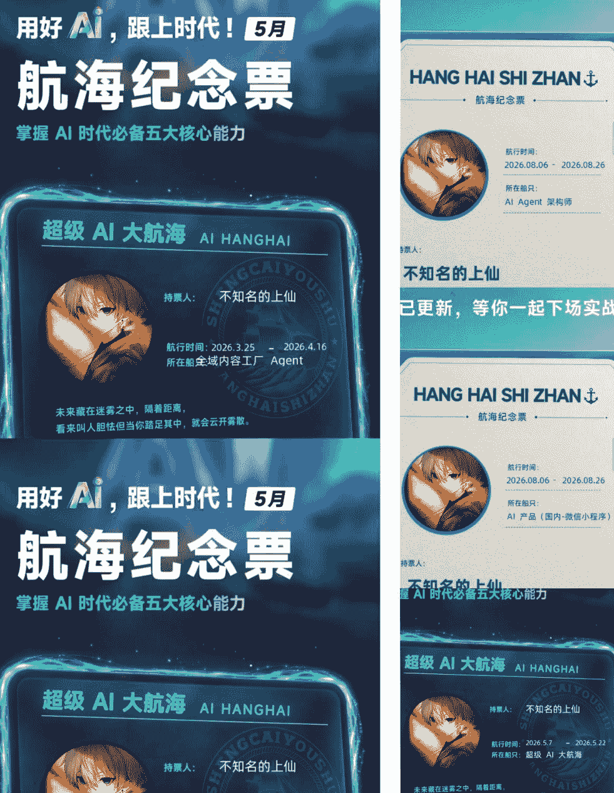
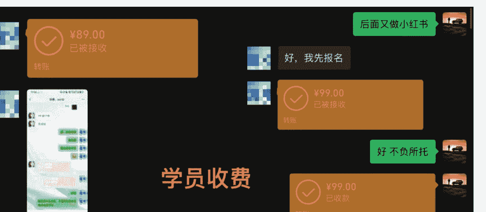
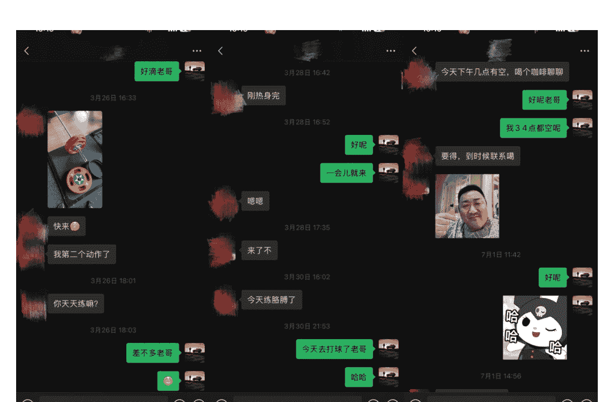
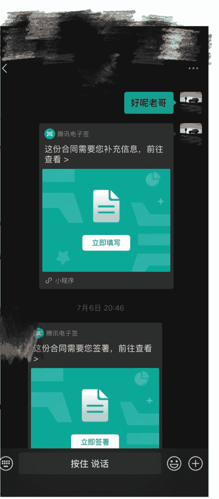
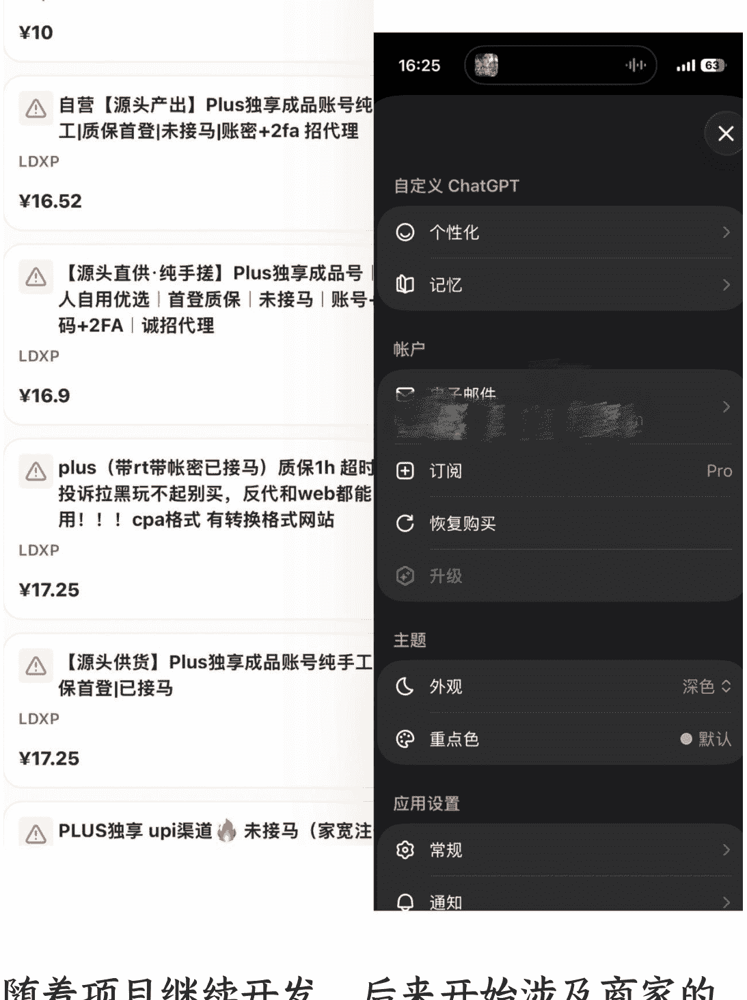
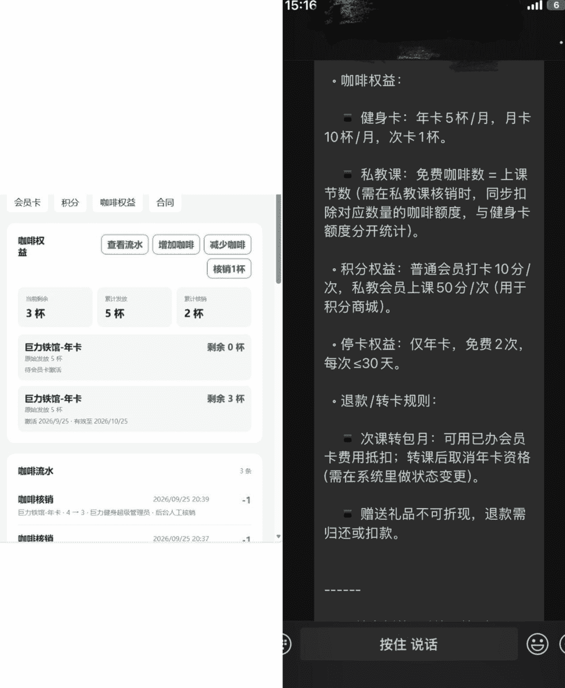

# 单品收入 7000+从 AI 编程航海到真实小程序上线：我第一次用 ChatGPT + Codex 跑通真实商业小程序

**260926 副业 SC 精华**

整理：公众号懒人搜索，懒人专属群精选

懒人微信：lazyhelperl

**小懒判断** | 学完 AI 编程卡在"不敢接真实项目"的人最该读，00 后不会编程的大学生用 ChatGPT 当项目大脑、Codex 当开发工程师，第一单就从健身房的微信熟人里成交 7000 元。想学 Codex 技巧的可以划走，这篇只讲商业链路不讲技术。最值得抄的是模块验收制——一个板块开发完立刻真机人工验收，再配可回滚存档点，改崩了知道退到哪。坑在于备案：ICP 备案和小程序备案是两回事，域名、服务器、主体、支付权限要在开发前就备齐，他硬生生拖了两周。

大家好，我是不知名的上仙，一位 00 后的生财 2 年级学生，参加生财以来第一次真正意义上的发帖。之前在生财处于半潜水的状态，前面我自己写过一篇大学校园流量变现的帖子，参加生财以来一直在不断学习，虽然没赚到过什么大钱，好在努力不会白费，一个不会编程的大学生又如何在眼光挑剔的 b 端老板手里赚到那一份技术钱呢？接下来我为大家细说这是我第一次把 AI 从一个学习工具，变成了一种真正能够创造现实成果的杠杆。

从参加 AI 编程航海，到接触 Claude、Codex，再到自己做 AI 内容、发朋友圈、接到第一个真实客户，最后真正把一套健身房小程序送上微信。

这条路其实没有我现在写出来这么顺。

中间经历过模块崩盘、AI 额度不够、支付安全、需求遗漏、备案踩坑，甚至因为我把 ICP 备案和小程序备案弄混，整个项目硬生生往后拖了两个星期。

但也是在这一整个过程中，我第一次真正跑通了：

> 学习 AI → 展示能力 → 链接客户 → 谈需求 → 报价 → 做 PRD → AI 开发 → 人工验收 → 修 Bug → 部署 → 上线 → 交付

这一整条链路。

所以这篇文章，我不准备讲“10 个 Codex 技巧”。

我更想完整复盘一次：

> 一个没有传统软件开发团队的人，是怎么利用 AI，把一个真实商业小程序一点点做出来的。

## 一、真正开始 AI 编程，是从航海开始的

我真正比较系统地接触 AI 编程，是从参加今年 3 月份的 AI 编程航海开始的。也是在这个阶段，我开始大量接触 Claude、Codex 这些 AI 编程工具。先是 Claude，到后面的 Codex，最后 Codex 基本变成了我手里最常用的一把工具。

在跑通 3 月份 AI 编程航海以后，我发现我

对这个东西有很大的兴趣，所以我直接用 Codex 和 Claude 去把当时 3 月 AI 类目航海里涉及的一些项目真正跑了一遍。

这个过程对我影响其实挺大的。

以前看到一个网页或者一个小程序，我的第一反应可能是：

> 这个我不会写。

但是实际跟着 AI 一步一步做过一些项目以后，我的思考方式慢慢变了。

我开始发现，现在很多时候，真正的问题已经不只是：

“我会不会手写这段代码？”而是：

“我能不能把需求说明白？”“我能不能判断 AI 做出来的东西对不对？”“出了问题以后，我能不能继续把问题找到并解决？”这给了我后来真正去碰商业项目的一点底气。学完以后，我其实没有马上出去接软件开发的单子。

当时我先尝试的是小红书 AI 类目的虚拟知识库。我的做法大概是通过 YouTube 找内容，再配合 NotebookLM、IMA 知识库去整理、学习和生产内容。

当时想得也挺简单。既然 AI 这么火，能不能先从内容和知识产品这条路开始试一下。

结果说实话，效果并没有特别好。

流量没有达到预期，知识库也没有马上给我带来什么明显收入。但这段经历并不是完全没价值。因为在做内容的过程中，我反而认识了一些同样对 AI、编程和产品感兴趣的人。还收了几个学员，

我也慢慢开始有另外一个想法：

与其一直想着怎么“卖 AI”，为什么不直接用 AI 帮别人解决现实里的问题？于是后来，我开始在自己的朋友圈里发一些我能够承接的业务。

比如：小程序，网页。以及一些利用 AI 编程可以完成的定制开发需求。

那个时候，我其实也不知道会不会真的有人找我。

只是觉得：

既然我已经能把这些东西做出来了，那就先让身边的人知道，我现在在做这件事情。

没想到，真正的第一个客户，就是这样来的。

## 二、我的第一个客户，其实就在身边

联系我的老板，是一个刚从外地回到普洱的本地人。他准备在普洱开一家偏铁馆类型的健身房。我们本地虽然也有不少健身房，但是用微信小程序去真正承接会员服务的健身房并不算多。

所以老板一开始就有一个比较明确的想法：

> **他想为自己的健身房量身做一套小程序。**

而不是直接买一套现成模板。说起来，我们认识得也挺巧。我平时性格比较活泼，也比较喜欢和别人聊天。之前我和老板正好在同一家健身房练过，也加过微信。后来他回普洱准备开健身房，又刚好看到了我朋友圈里发的一些 AI 编程、小程序、网页相关的内容。

所以当他真的产生这个需求的时候，他第一时间就想到了我。然后主动联系了我。

现在回过头看，我觉得这里有一个挺有意思的点。我并不是先成立了一个多么成熟的软件公司，再去疯狂找客户。而是先掌握了一点能够真正落地的能力，然后持续

让身边的人知道：

我最近在做什么。

我现在能够解决什么问题。当需求真的出现的时候，别人才有机会想到你。我的第一单，就是这样来的。老板联系我以后，我们直接约了当面聊。其实那个时候，我并没有太强的底气。

虽然我已经用 AI 跑过不少项目，但是我还没有真正独立完成过一个商业软件项目。所以问题就来了，手里没有成熟的案例我们怎样获取老板的信任？

我总结了这三点：

- 合同规范
- 价格优势（软件报价怎么来呢？）
- 待人真诚

我直接跟他说：我目前没有属于自己的完整商业开发案例。但是我愿意少收一点钱，也愿意尽我所能，把这个东西真正做出来。

我没有跟他说：我有多少年经验。也没有把自己包装成一个成熟的软件开发团队。因为我知道，这种东西骗不了多久。项目真的开始以后，老板迟早会看到你的实际交付能力。

我们当面把大概的想法和范围谈了一遍。

最后最初商讨下来的项目价格是 7000 元（纯开发技术费用）。这一刻对我来说其实挺奇妙的。

因为以前我用 Codex，想的是：

> 这个东西到底能不能跑起来？

而到了这一步，问题已经变成了：

> 现在真的有人愿意为这个东西付钱，我要对结果负责了。

从这里开始，它就不再是一个练习项目。

这里最重要的是敢于成交和对结果负责的勇气，这个东西要是当时我对自己的能力犹豫一天，这个单子可能就不属于我了。

事情真正确定下来以后，我做的第一件事情，并不是马上叫 Codex 开始写。

而是先整理需求。

因为老板说：“我要做一个服务健身房会员的小程序。”

这句话离真正开发还差得很远。到底有哪些页面？会员能看到什么？后台能管理什么？预约怎么做？积分怎么做？哪些功能属于这一期？哪些以后再做？

如果这些问题一开始不明确，项目后面很容易无限膨胀。

项目大脑的选择：Codex 可以帮我们解决代码问题，那把我们的大白话转化成 Codex 更能听懂的技术语言，负责统筹项目的角色我要怎么选呢？

经过筛选项目大脑我有两个选项 ChatGPT 或者国内的元宝，元宝的优势是背靠微信生态，ChatGPT 优势我眼里最好用的聊天 AI，测试了两天后我最终还是选择了 ChatGPT，OpenAI 当时的 Work 合并真的太有杀伤力了。

所以我先把已经和老板沟通过的信息交给 ChatGPT。

让它帮我整理：PRD，也就是产品需求文档，开发范围，开发边界，以及合同中应该明确的交付内容。

## 附件二
《项目需求确认书》
(Project Requirements Document，PRD)

### 一、项目基本信息

- 项目名称：《助力健身微信小程序开发项目》
- 甲方：
- 乙方：
- 确认日期：年 月 日

### 二、项目目标

为甲方建设一套微信小程序会员管理系统，并配置管理后台，用于满足健身商会使用及基础运营管理需求。

本项目采用阶段性交付方式，本次交付为第一阶段（V1.0）。

### 三、项目建设内容

本次项目包括以下内容：

**（一）微信小程序（会员端）**

实现会员登录、会员卡、课程预约、人脸签到、积分签到、积分商城、微信支付中心等功能。

**（二）管理后台**

实现会员、教练、课程、商品、预约、积分、签到、基础数据统计及系统配置等功能。

**（三）系统部署**

- 完成：
  - 微信小程序部署
  - 后台部署
  - 微信支付配置
  - 人脸设备接口对接
  - 系统上线协助

### 四、项目角色

本项目第一阶段涉及以下角色：

| 角色 | 使用内容 |
| :--- | :--- |
| 会员 | 微信小程序 |
| 管理员 | 管理后台 |

之后我再和老板当面继续对接需求。

老板提出新的想法以后，我再把新的信息重新交给 ChatGPT，让它帮助我更新需求和开发边界。

整个过程慢慢变成了：

- 老板提出业务需求
- 我理解他的真实意思
- AI 帮我结构化
- 我重新确认
- 再进入开发

也是这个时候，我第一次发现：

AI 编程真正有价值的地方，不只是在“写代码”。

它其实可以在代码出现之前，就参与整个产品的整理。

**ChatGPT 作为整个项目的开发大脑。**

理解新的业务需求。判断会影响哪些现有功能，拆解下一步应该做什么，控制本轮开发边界，整理给 Codex 的执行提示词。

Codex 完成以后，再帮我判断结果和下一步。

而 Codex 更像真正的开发执行者。

负责：

- 读取代码。
- 修改代码。
- 运行测试。
- 检查问题。
- 输出结果。

于是慢慢形成了一个很稳定的结构：

**老板负责提出业务需求。**

**我负责产品决策和最终验收。**

**ChatGPT 是项目大脑。**

**Codex 是开发工程师。**

这也是整个项目后面能够越做越大的核心方式。

## 三、我的开发流程及卡点

我没有选择让 Codex 一口气把整个小程序全部做完，然后最后统一测试。

而是给自己定了一条规则：

一个板块开发完成，就人工验收一次。比如一个页面或者一个功能开发完成以后，我会自己真正打开微信开发者工具，甚至到后面直接拿真机去测试。

我不是只看：代码有没有报错，而是实际站在用户角度去操作。这个按钮能不能点？页面是不是正常跳转？数据显示得对不对？异常情况下会发生什么？是不是老板当时想要的那个效果？

只有这一块确认基本没问题以后，再继续做下一块。如果发现问题，我通常不会直接自己进代码里乱改。而是把问题现象、截图、报错反馈给 ChatGPT。让 ChatGPT 先从项目整体判断：这可能是哪一层出了问题？

再让它给 Codex 整理一个针对性的排查任务。

于是我们的流程经常会变成：

1. 我发现问题
2. 反馈给 ChatGPT
3. ChatGPT 分析并约束排查范围
4. Codex 进入代码检查
5. 修复并测试
6. 我重新人工验收

如果还有问题，再循环。

现在回头看，这其实已经不是简单的“让 AI 写代码”。

更像是在管理一支很小的 AI 开发团队。

项目往前走以后，我很快遇到了各种以前做练习项目根本不会遇到的问题。

比如：

- AI 额度。
- 支付安全。
- 模块崩盘。
- 版本回滚。
- 平台备案。

这些东西任何一个单独看都不复杂，但是当它们同时出现在一个真实项目里的时候，事情就完全不一样了。

这里给大家展开说说，我遇到的坑以及处理方式：

### 1. AI 额度

最开始使用 Codex 的时候，我用得非常猛，早期因为 Plus 没有出现 5 小时额度限制我也折腾过一些通过多个临时账号分摊 AI 使用量的方法。那个阶段确实开发成本很低一天可以让多个 AI 一直跑，而成本并不高。

但是随着平台额度机制不断变化，特别是 OpenAI 提出了 5 小时限制后这种方式很快就不适合一个需要长期稳定推进的商业项目了。

后来我直接选择了 Pro，现在写出来应该没意思了哈哈，因为现在的 Plus 在真正用来开发的用户手中确实只有 ChatGPT 聊天的功能了，怀念当时没 5 小时限制的日子。

### 2. 支付安全

随着项目继续开发，后来开始涉及商家的真实支付能力，这里就和普通功能完全不一样了。支付配置、密钥、证书这些东西，都属于非常敏感的信息。

这是开发中我个人认为要重视的一点，所以我把敏感信息和普通开发上下文进行分离。敏感配置保留在本地文件或对应环境中，需要的时候由工具按照明确范围读取。

而不是直接暴露在长期聊天上下文里。这一点其实是被真实项目逼出来的。

自己做 Demo 的时候，你可能觉得：

能跑就行。

但是一旦开始涉及真实商家、真实支付、真实用户以后，就不能再只考虑“方便”。

你必须开始考虑：

什么信息 AI 可以知道。什么信息根本不应该出现在普通对话里。

### 3. 可回滚方案

现在的 AI 写代码真的很快。但它并不是每一次修改都是正确的。项目开发过程中，我也经历过修改一个功能以后，原来正常的模块反而出现问题。

如果一直在错误代码上继续往前修改，事情会越来越危险。因为我本身不是传统开发出身。如果连续改了十几轮，最后可能连问题到底从哪一轮开始出现都不知道了。

所以后来，在和 ChatGPT 的几轮沟通中我才用了一种开发方式：

**可回滚开发。**

简单来说，就是每做完一个比较稳定的阶段，就留下一个明确的“存档点”。

比如，当前版本已经验收通过。然后再开始开发下一个功能。新功能开发完成以后：

1. 先测试。
2. 再人工验收。
3. 确认没问题，再形成新的稳定版本。

如果后面的开发真的改崩了，我们至少知道：

> 自己还能退到哪里。

我后来特别喜欢把它理解成玩游戏里的存档。我们可以继续往前打。但是不能连存档都没有。

### 4. 最重要的能力

项目刚开始的时候，我最关心的是：

> 这个功能能不能做出来？

但是随着会员、会员卡、预约、课程、积分、合同、支付、后台这些东西慢慢连接到一起，我越来越发现：

我与 ChatGPT 的沟通质量影响了整个项目的质量和进程。

老板说：“这里加一个状态。”

站在用户角度只是多了两个字。

但是进入系统以后，它可能意味着：

- 数据库要改。
- 接口要改。
- 后台要改。
- 小程序要改。
- 历史数据还必须继续正常。

所以到了后期，我给 Codex 的任务越来越少出现：

“帮我把这个功能优化一下。”

而越来越像：

- 本次只允许修改 A 模块。
- B、C、D 不得改动。
- 不允许修改数据库结构。
- 如果发现必须修改数据库，立即停止并报告。
- 必须执行指定测试。
- 出现某种情况必须 STOP。

怎样提升与聊天 AI 的沟通质量是我觉得唯一一个拉开 AI 编程能力的界点（模型相同的情况）。

### 5. 备案问题

如果让我选整个项目里踩过最大的坑，其实不是模块崩盘，也不是支付，更不是 AI 额度。

而是备案。

当时我把 ICP 备案和小程序备案弄混了。我原本以为前面的 ICP 备案处理完成以后，小程序就可以顺利进入正式上线流程。我记得当时是元宝给我的解释，这也给大家提个醒了，不能盲目相信 AI 哈哈，最好就是两端验证。

所以开发完成，不等于产品可以上线。开发前我们就需要提前准备好：

- 域名。
- 服务器。
- 主体。
- 备案。
- 微信公众平台。
- 支付权限。（涉及支付）

这些全部属于产品的一部分。

任何一个地方如果前期没有确认，都可能让已经写完的代码只能停在那里等。

## 四、但备案延期的两周，最后反而让我因祸得福

当时因为备案问题，小程序明明已经基本开发完成，却不能正式上线。

一开始肯定很烦。

老板在等。我索性重新把整个产品从头走了一遍。

也正是在这个时候，我突然发现：

我们居然漏掉了一个比较核心的需求——咖啡权益。老板的健身房本身还有咖啡相关的会员权益。

但是因为前面功能比较多，一路开发下来，这个需求居然被漏掉了。如果当时备案没有卡住，我们很可能直接就上线了。那这个问题就有可能等到健身房真正开始营业以后才暴露出来。

于是我重新把这个需求交给 ChatGPT。重新梳理，再重新交给 Codex 实现。

与此同时，我也利用这两周重新检查了一遍整个小程序。

一些原来没有明显暴露出来的 Bug，也在这个阶段被陆续找出来并修掉。

所以这两周后来从：

> 什么都做不了，只能等备案。

慢慢变成了：

> 既然现在不能上线，那就把能发现的问题尽可能留在上线之前解决掉。

现在回过头看，这当然不能说明：备案晚一点是好事。好在老板那边表示理解，不然可能面临违约。

## 五、真正上线的那一刻，我有一种“如梦初醒”的感觉

等到备案、功能、Bug、上线条件这些事情一点一点收口以后，小程序终于真正上线了。

那一刻我的感觉其实很奇怪。

有点像：

**如梦初醒。**

在这之前，我做过很多 AI 相关的事情。学习工具。跑项目。做知识库。发小红书。研究各种新的 AI 软件。每天好像一直都在学。

但是它们和这一次的感觉完全不同。这一次，现实世界里真的出现了一个东西。一家真实存在的健身房，有了一套属于自己的小程序。

它不是某个课程里的 Demo。也不是我电脑上跑起来以后，就没人再打开的练习项目。它是真的要被老板拿来经营自己的生意。

真实会员会打开它。真实业务会经过它。而我，要为这个东西负责。

我以前也看过《纳瓦尔宝典》。里面讲独特知识、杠杆、创造、责任这些东西。以前看的时候，我觉得自己能够理解。

但是更多还是一种：“我懂这个道理。”

直到这个小程序真正上线以后，我突然有了一点不一样的感觉。

**我好像第一次真正做出了一份属于自己的独特产出。** 它不是照着教程复制出来的。里面有老板真实的经营需求。有我自己的产品判断。

## 线上版本

| 版本号 | 发布时间 | 审核备注 |
| :--- | :--- | :--- |
| 2026.09.25 | 2026-09-25 16:09:45 | -owner1: Final Owner Acceptance: 4-digit pickup, overlapping schedules, image normalization, Store/About localization; Human Proven PASS |

## 六、做完第一单以后，我对“AI 编程变现”的理解彻底变了

整个项目跑完以后，我越来越觉得：

AI 编程真正有意思的地方，并不是让每人都去当程序员。而是它在不断降低：

一个人把想法变成真实产品的门槛。 以前一个小程序项目，可能需要：

- 产品。
- UI。
- 前端。
- 后端。
- 测试。
- 运维。
- 多个角色一起协作。

而现在，我虽然仍然不可能在每一个专业领域都比专业从业者强，但是 AI 让我有机会去组织这些能力。

我真正需要做的事情开始变成：

- 客户的问题是什么？
- 这个需求到底有没有价值？
- 应该怎么拆？
- AI 做得对不对？
- 什么地方存在风险？
- 什么时候继续？
- 什么时候停止？
- 最终到底交付什么结果？

所以如果现在让我总结这一单，我大概会留下几个很真实的感受。

### 第一，不要只想着“卖 AI”

老板从头到尾其实并不在乎我用的是 Claude、Codex 还是 ChatGPT。

他真正关心的是：

他要的小程序能不能做出来。会员能不能用。健身房能不能用。所以 AI 本身并不是产品。解决问题的能力才是老板真正看中的。

### 第二，第一单最大的价值不只是赚了多少钱

第一次真正做项目以后，你才会知道：找客户，沟通需求，报价，合同，求边界，开发，测试，部署，上线，售后。

它们其实是一整条链。

如果一直停留在学习阶段，你对“接项目”的理解永远都只是想象。

完整跑过一次以后，很多东西才真正属于你。

### 第三，AI 最大的价值不是替代我，而是放大我

我不需要自己成为代码写得最快的人。但是我必须知道：现在应该做什么。做到什么程度？什么结果才算通过？

AI 可以把我的执行能力放大很多倍。

但前提是：

我判断力和决策能力必须合格。

### 第四，未来真正重要的能力，可能越来越不是“会不会写某一段代码”

能不能发现真实问题，并组织现有工具把问题解决掉。这也是为什么我现在越来越愿意把自己的工作理解成：不是一个人在写代码。而是在管理一支由 AI 组成的小团队。

## 写在最后

今年 3 月份接触 AI，连 Claude 都不知是什么的我到如今地接定制类项目，而且这个老板还有明确的第二版第三版需求，甚至他还要帮我链接其他的老板。开发之前，因为年龄阅历较小，当时还一直忧虑万一小程序出现问题怎么办，会不会面临违约呀这些。当真正踏入开发后我发现，不管什么 bug，新需求只要我和 AI 的沟通合理它知道我想要的是什么我就可以把它实现。在此以我为例希望懂 AI 的圈友放开手脚的干我与大家共勉，觉得有帮助可以点个赞哦。

看完这篇 SOP，你觉得你懂了。但 90% 的人一到实操就会卡在第一歩。

工具和教程只是最低级的壁垒，真正的壁垒是“立刻动手”和“圈层信息差”。

如果你想看全网最新的变现玩法，并且和一群执行力极强的极客一起下场拿结果，欢迎围观我的核心私域：【懒人专属群】。

我们不聊虚的，只做商业闭环的拆解与 AI 效率的压榨。系统内已沉淀 1000+ 跑通的套利实战局。

- 查阅圈子完整数字资产与上车门槛:

`https://lazyso.com/insider/`

认同价值、准备好下场干活的，扫码加我微信（lazyhelper1）

备注：【实操上车】，不闲聊

微信：lazyhelper1
