# 封了 30 多个号换来的 Claude Max 防封保姆级教程

+ 260925 副业 SC 精华
+ 整理：公众号懒人搜索，[懒人专属群](#) 精选
+ 懒人微信：lazyhelperl

> **小懒判断** | 要给 Claude Code 上强度的人必读，作者封了 30 多个号换来的教训浓缩成一句话：封号只看环境像不像美国本地用户。已经用随手梯子在白嫖的轻度用户可以划走。最值得抄的是花 60 块买美国静态住宅 IP 只用于注册那几天，日常用反而随便；Pro 正常用 5 次隔一天再升 Max。坑在于 Apple 邮件验证链接千万别在日常浏览器点开，环境配得再好也白搭。

Opus 5.5 出来以后，我的感觉是又回到 Anthropic 一统天下的局面了。

这是我用过最爽的模型，协作起来有一种真的「被稳稳接住的感觉」，可对国内用户来说，模型再好，号一被封也用不上。

**我从年初到现在，前前后后封过三十多个 Claude 号，有一部分是帮同事开的。** 苹果内购、安卓 Google Play、海外卡订阅，这些路我基本都走过，你能踩的坑我都踩过。

而现在我手上有 4 个号：三个 Max 20x、一个 Pro，其中两个在 7、8 月那两轮大封号潮都扛过来了，到今天都在正常用。

这篇把我稳定不封号的整套做法，每个细节全写出来了。

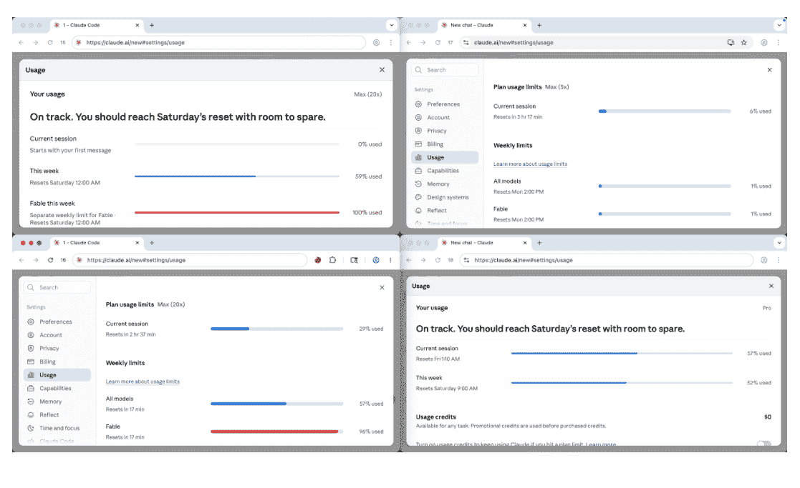

从买 IP、注册、收拾电脑和网络、付款、接 Claude Code，一直写到升 Max 20x 和续费，KYC 如何处理都包了，关键步骤都配了我自己的截图。篇幅比较长，建议先收藏，做到哪一步再回来翻哪一步。

# 目录

- 一、Claude 封号底层逻辑
- 二、提高注册时账号权重
- 三、用指纹浏览器装成美国用户
- 四、把电脑收拾干净
- 五、不暴露自己的 IP
- 六、订阅 Claude 账号
- 七、接上 Claude Code
- 八、Pro 升级 Max

## 一、Claude 封号底层逻辑

踩了这么多坑下来，我觉得网上那些防封教程，大多数都抓错了重点。真正决定你会不会被封的是什么？

其实 Anthropic 已经明明白白写在用户条款里了，就三条：

你是不是来自他们不支持的地区；你有没有拿账号搞蒸馏、高并发，或者接到不该接的第三方工具上；你有没有发违规内容。对大部分人来说，**后面两条你不主动作死就不会死**。所以说白了，**Claude 封号只看一件事：你像不像来自它不支持地区的人**。

问题就变成了：注册、订阅、使用的时候，**怎么让平台觉得你就是一个它支持地区的正常用户？** 后面每一步，其实都在回答同一个问题：**一个正常的美国用户，会这么做吗？**

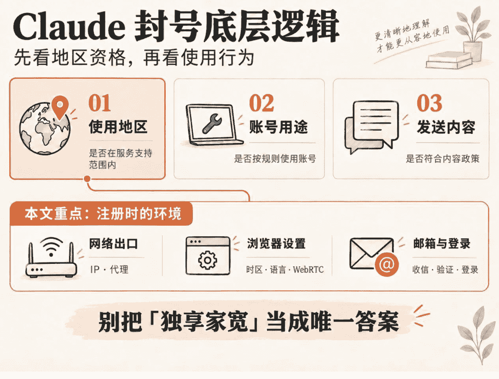

而这里面最关键的是注册。

**注册后的头几天，平台会判断你是不是高风险用户**。

看的主要是注册那一刻的环境：浏览器有没有暴露你的真实位置和 IP，注册用的 IP 在不在海外、有没有被人滥用过。

如果平台觉得你风险稍微高一点，开会员的时候就会弹 KYC 身份验证，弹了怎么处理，第三章注册那里会细说。

要是再高一点，号直接就封了。

我遇到过的一注册就封的号，基本都是环境暴露了自己来自不支持的地区。

反过来，注册时环境干净、行为正常、用的是正经邮箱，这个号一开始就是干净的，后面怎么用都不容易出事。

不过，IP 也不是唯一的因素。

你想想，一个美国人在咖啡店连着公共 Wi-Fi 注册 Claude，或者本来就习惯开着 VPN 上网，他就不是正常用户了吗？

## 二、提高注册时账号权重

那为什么还要单独买一个 IP？

因为你平时用的梯子节点，大多是那种万人骑的 IP，谁也不知道之前被多少人拿去注册过、封过多少号。

注册又是整个流程里平台看得最严的一步，所以这一步最好单独用一个干净的 IP。说到家宽 IP，这里面的生意就复杂了。

我觉得没必要一上来就花几百块一个月，去追商家宣传的「纯净、独享、真家宽」，几十块一个月的就够用。

买的时候看三点：

1. 地区选美国。
   后面浏览器的时区、语言都要跟它对上。
   买的时候顺便看一眼商家写的城市，比如 IP 在加州，后面时区就选洛杉矶；在纽约，就选纽约。
2. 选静态，不选动态。静态 IP 的出口地址是固定的；动态（也叫轮换）IP 会按时间或者按连接换出口，具体怎么换看商家。
   一个正常的美国用户，总不会每刷新一次页面就换个城市。
   选静态，注册过程里出口始终是同一个地址，配置和排查也简单。

商家页面上一般会把这几种分开卖，像下面这家，分了动态住宅、静态住宅、静态机房三种，我选的是箭头指的「静态住宅代理」。

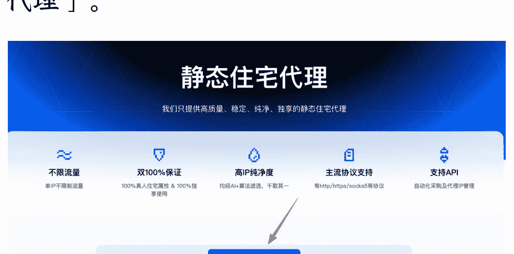

买完商家会发给你一份连接信息，下面这张是我之前随手买的一个，拿来举个例子。

里面的 IP、端口、账号、密码这四行，就是后面要填的四样东西。

这四样后面要用两次，一次填进指纹浏览器注册，一次填进手机的小火箭登录 Claude App，先存好。

至于去哪买，我就不点名推荐了，免得像在打广告。

你去油管搜「美国静态 IP」这类关键词，看看别人的教程和推荐，挑一家就行。

价格上，60 块一个月以上的，基本就没什么问题。

（X 上有好几个反馈买了 30 块一个月的，实际上机房 IP，注册立马就封了）

注册、手机登录、订阅 Pro、升级 Max，都在这一周里做完，之后这个 IP 就可以不续了。

日常用 Claude 和 Claude Code，走你自己的梯子就行，我日常用的就是普通机房 IP，用 Claude 完全没问题。

因为，海外本来就有大把人都把 Claude Code 放在机房服务器上 24 小时跑，所以日常使用根本不需要家宽 IP。

## 三、用指纹浏览器装成美国用户

还是那个问题：一个正常的美国用户打开浏览器注册 Claude，他的环境长什么样？

IP 在美国，时区是美国的，浏览器语言是英文的。

比特浏览器这类指纹浏览器能把这些一次性配好，而且整个窗口的流量都强制走你填进去的代理。

代理一断，这个窗口直接断网，不会偷偷用你的真实网络去连。打开比特浏览器，先点左上角的「创建窗口」。

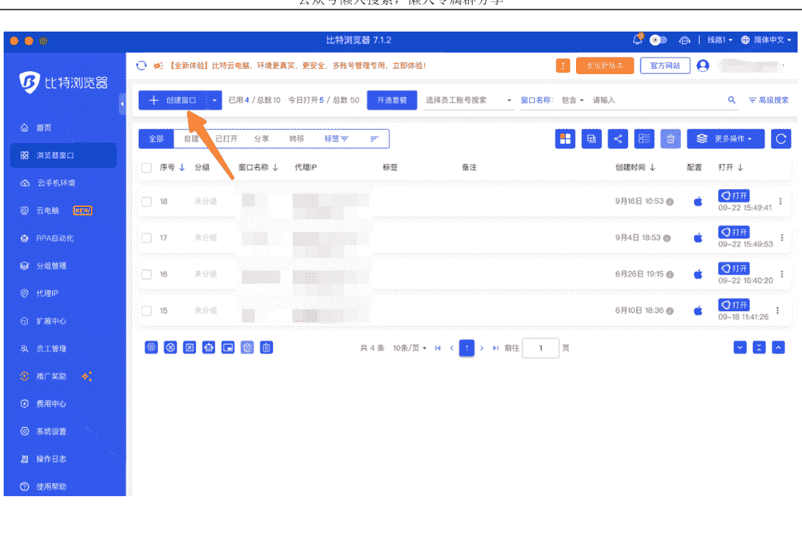

弹出来的设置页里，先看代理这一块。

「代理方式」保持默认的「自定义代理」，箭头指的「代理类型」选 Socks5，然后把上一章拿到的 IP、端口、账号、密码，分别填进红框里的「代理主机」「代理端口」「代理账号」「代理密码」。

最下面的「刷新 URL」空着就行。

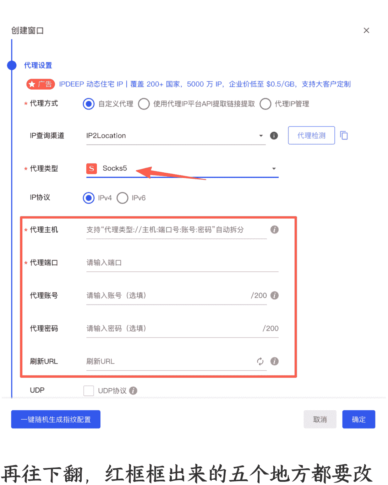

再往下翻，红框框出来的五个地方都要改语言和界面语言都选英语。

时区跟着 IP 走，图里我选的是 America/Los_Angeles，对应加州的 IP；你的 IP 要是在纽约，就选 America/New_York。

WebRTC 和地理位置，都选最右边的「禁止」。

旁边那几个「基于 IP 生成」的开关我都关着，直接手动选，选的是什么自己心里有数。

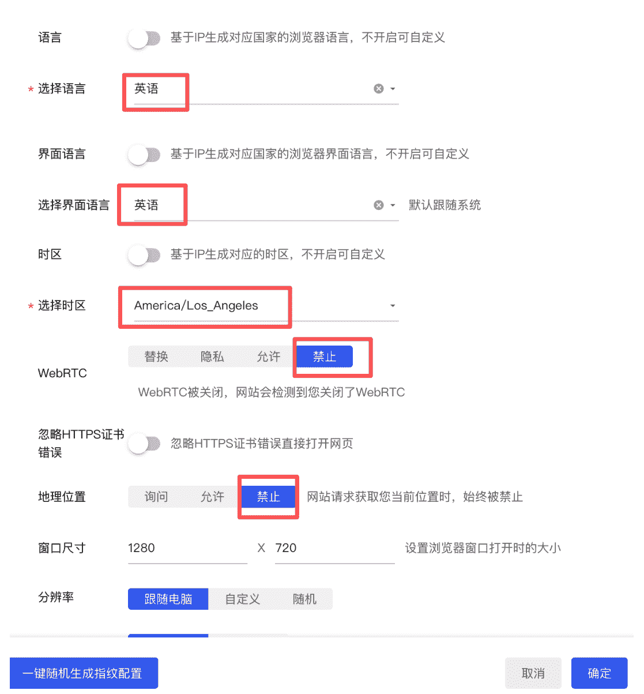

### WebRTC 为什么要禁止？

它是浏览器用来做实时音视频的，它有可能绕过代理，把你的真实 IP 暴露出去，所以直接关掉。

你看图里选了禁止之后，下面还会提示「网站会检测到您关闭了 WebRTC」。

被检测到会不会显得可疑？

海外很多注重隐私的人本来就会关，不是什么稀奇事。

剩下的硬件、设备这些指纹参数，不用一个个调，直接点左下角箭头指的「一键随机生成指纹配置」，再点右下角的「确定」保存。

配完打开任意网页，能正常加载，说明代理通了再打开 [ipinfo.io](http://ipinfo.io) 看一眼：出口 IP 在不在美国，城市跟你选的时区对不对得上。

窗口配好了，接下来准备一个海外邮箱。

我推荐用 Proton，原因很简单： Anthropic 还真在邮件里放了跟踪器，而 Proton 会自动把它拦掉。 你看下面这张图，是我在 Proton 里打开一封 Anthropic 的邮件，顶上直接提示「 已屏蔽 1 个跟踪器」，来源是 [Sendgrid.com](http://Sendgrid.com)，展开的链接开头就是 [mail.anthropic.com](http://mail.anthropic.com)。

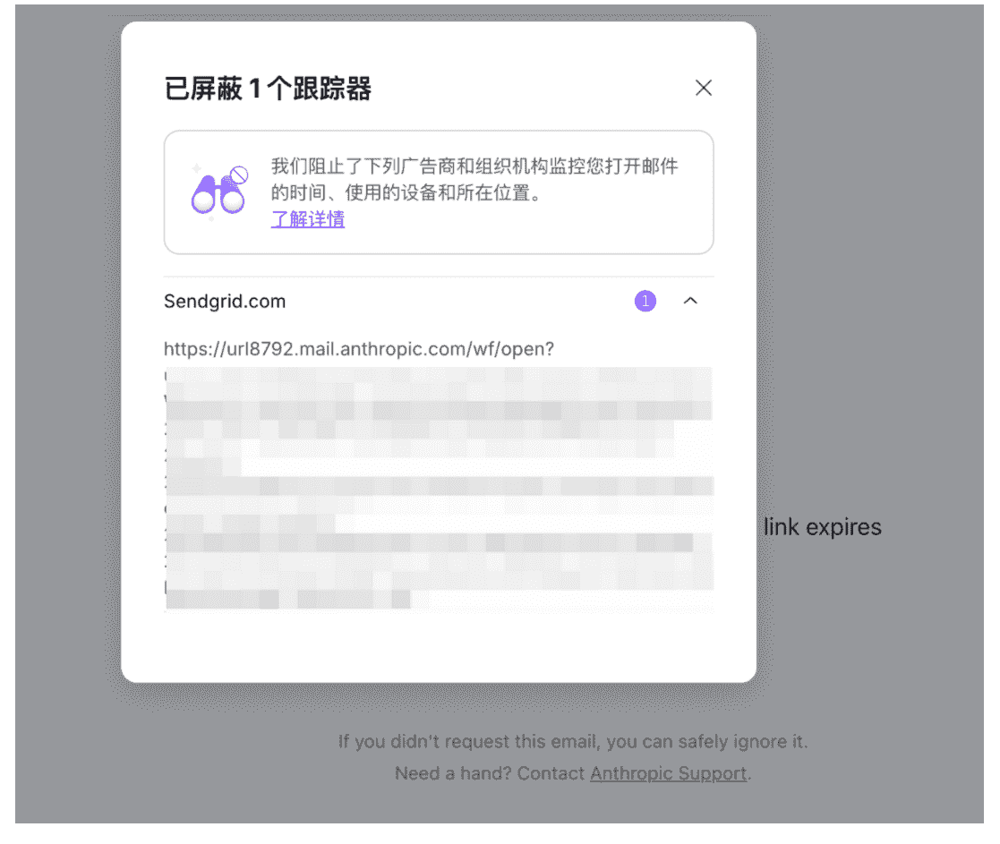

这类跟踪器会在你打开邮件时加载， 附带就能拿到你当时的 IP Proton 它拦的就是对方监控「 您打开邮件的时间、使用的设备和所在位置」。

Proton 拦掉跟踪器，比特浏览器又全程走代理，这样就是双重保险了。

注册 Proton 选最左边的 Free 就够，一分钱不用花。

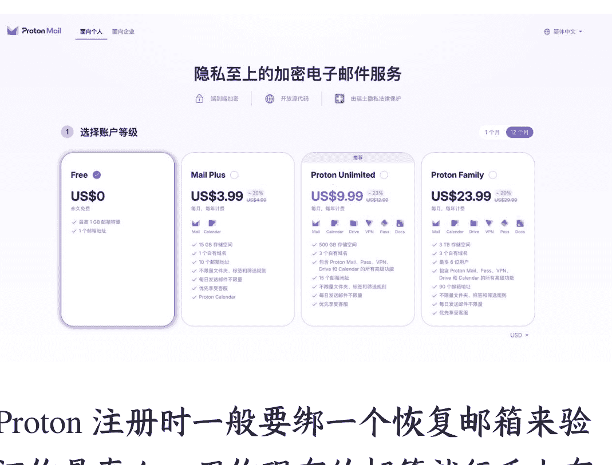

Proton 注册时一般要绑一个恢复邮箱来验证你是真人，用你现有的邮箱就行手上有多余的 Gmail 也可以直接用。

别用来路不明的野鸡邮箱，我觉得那会拉低你的账号权重。

不管用哪个，这个邮箱只在这个比特浏览器窗口里登录、收信，这样打开邮件时露出去的也只是代理的 IP。

还有些验证链接会发到别处，比如 Proton 发到你恢复邮箱里的验证信，这封信是在你的日常邮箱里收的。

别在日常浏览器里直接点，像图里这样，在「 Verify email 」上点右键，选红框里的「 复制链接地址 」，再粘到比特浏览器里打开。

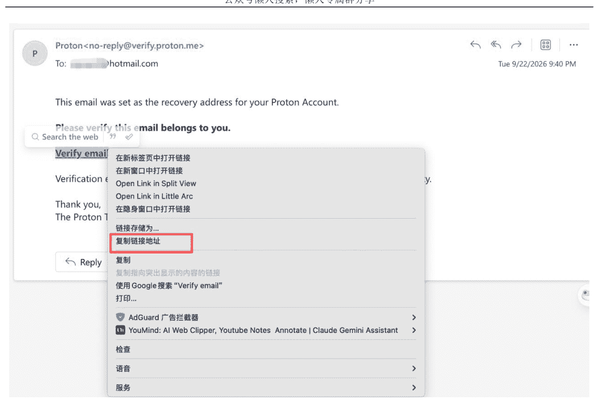

邮箱也准备好了，就可以注册 Claude 了。

在比特浏览器这个窗口里打开 claude.ai，上面 Google、Apple 那两个按钮都不用管，直接在箭头指的输入框里填你的邮箱，点「Continue with email」，就是下面左边这张图。

然后回 Proton 收 Claude 发来的邮件，里面就一个黑色的 Sign in 按钮，链接 10 分钟就过期，收到了尽快点。

点完回到 Claude，就是右边这张，勾上同意条款的复选框，点「Create account」。

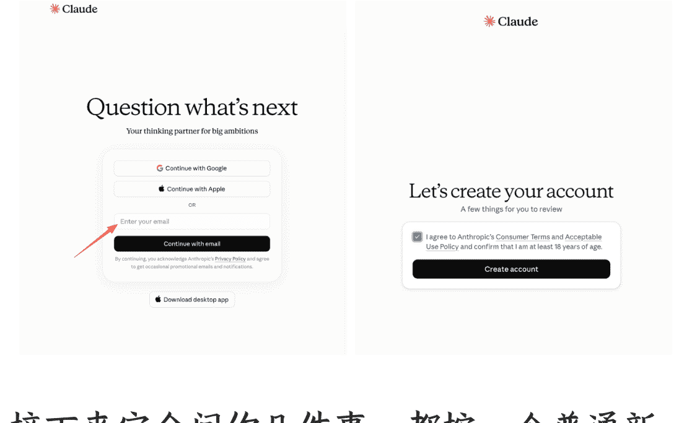

接下来它会问你几件事，都按一个普通新用户的反应来。

先是让你选套餐。

你的目标是 Max 20x，但正常人不会注册完第一分钟就掏 200 美元，大部分人都是先免费用用看，所以点最左边箭头指的 「 Use Claude for free 」。

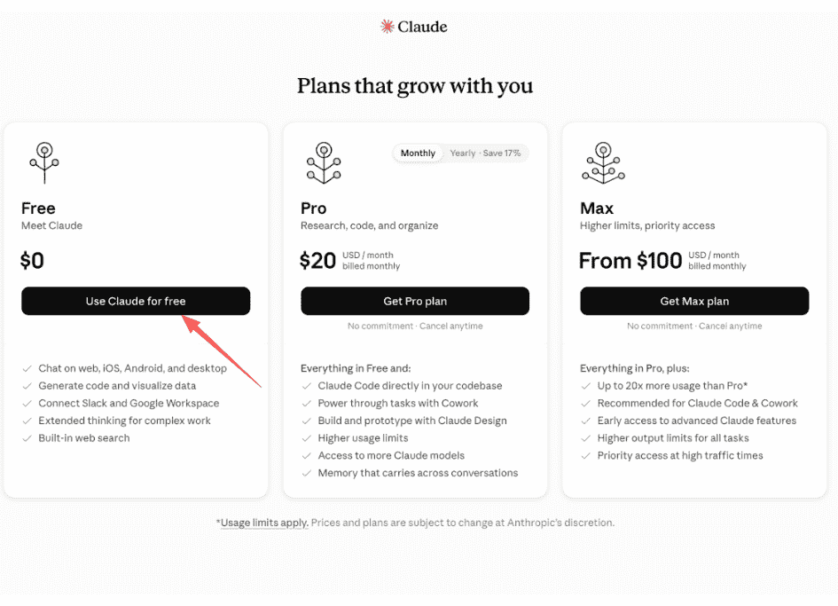

之后它会推荐你下载桌面客户端，点最下面那个很小的「 Skip 」跳过；问你职业，也跳过。

称呼随便写个像英文名的，我这里随手填了个重置哥大名 tibo。

角色选择也跳过，就进到首页了。

进来之后，像个新用户一样随便聊几轮。

中文英文都行，海外用简体中文的华人和留学生多的是，不用刻意全用英文。

这一步最容易翻车的，是在日常浏览器里点开 Claude 的邮件链接。

前面环境配得再好，一点开就把真实 IP 交出去了。

注册这一步做得干不干净，直接决定后面付款时会不会弹 KYC。

要是付款时真弹了 KYC 身份验证，说明注册时的环境不够干净，原因无非这几种：

IP 不行，之前被人滥用过；指纹浏览器哪里没配好，比如时区跟 IP 对不上、WebRTC 没关；邮箱被风控了；也可能刚好那会儿 Claude 把风控系数拉高了，不是你哪一步做错了。碰到这种情况，**我的建议是直接重新注册一个新号**：新开一个指纹浏览器窗口、换个新邮箱，按前面的流程排查后再走一遍。

## 四、把电脑收拾干净

号注册好了，先别急着付钱。

后面订阅、接 Claude Code，都要在你自己的电脑和手机上完成，所以先把电脑本身收拾干净，有两件事。

第一件，把系统时区改成新加坡。

新加坡跟北京一样是 UTC+8。

改过去，**电脑显示的时间一分不变，但系统时区不再是中国**。

Claude Code 跑在你的电脑上，读得到系统时区，能少暴露一点是一点。

改法很简单，跟你的 Agent 说一嘴「把系统时区改成 Asia/Singapore」就行，就像下面这样，它会自己查、自己改、自己确认生效。

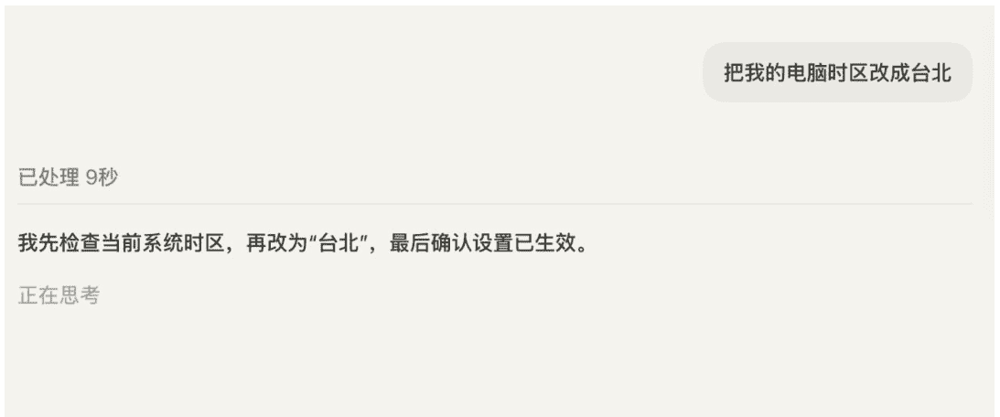

下面那个清理 Skill 里也带了这一项。

第二件，清掉本机记录。

这台电脑之前被封过 Claude 号的话，**不用换电脑，把本机残留的记录清掉就行**。

我两台封过号的 MacBook，清完都在正常用。

我把清理流程写成了一个 Skill: [https://github.com/suyuan2022/suyuan-skill/blob/main/claude-cleanup/SKILL.md](https://github.com/suyuan2022/suyuan-skill/blob/main/claude-cleanup/SKILL.md)

目前支持 macOS，Windows 我还没测试。

它是这么干活的：

动手之前，先完整备份 ~/.claude，你的 Skills、Hooks、会话记录都在备份里；缓存和日志它会自动清。换本地 ID、清钥匙串和桌面端的登录状态、改系统时区这些改动比较大的，做不做由你自己选；删掉的东西只进一个带时间戳的废纸篓目录，不会永久删除；你输入一次 CONFIRM，它才开始动。注意要让 Codex 或者普通终端来跑它，**别让正在运行的 Claude Code 清理它自己的目录**。

用起来就像下面这张图：把链接丢给 Agent，说一句「执行这个 skill 帮我清理」。

它会先做一遍只读审计，告诉你找到了哪些缓存、备份要占多大空间、哪些是高风险操作，一样都还没动。

只读审计完成，尚未清理任何 Claude 数据。脚本检测到 10 个正在运行的 Claude Code 进程：按 skill 的规划，它们退出前会跳过缓存清理。

审计找到 7 项缓存和日志，合计约 8 MB。脚本要求先完整备份约 8.2 GB 的 ~/.claude，目前可用空间约 28.6 GB。另有约 1.4 GB 的 Desktop 持久数据，清理它会重置登录态。

我已审查 skill 的全部 4 个文件：9 个测试通过，并在工作副本中修复了进程列表的解码错误。脚本没有外联：钥匙串删除和修改系统时区是可选的高风险操作。

请回复：是否会先正常退出这 10 个 Claude Code 会话，以及要清理哪些项目（只清缓存和日志、重置 Desktop 登录态，或连 Desktop 应用一起移除）。收到后我会继续运行脚本；写盘前仍需在终端核对清单并亲自输入 CONFIRM。

你确认要清哪些之后，还得自己在终端里输入 CONFIRM，它才真正开始清

## 五、不暴露自己的 IP

电脑收拾干净了，接下来是网络。

这一章就两件事：配好分流，再让梯子一断，Claude 也跟着断网。

先说分流。

最容易让你暴露的，往往是梯子没开全局。

为什么？

Claude 收集数据不一定只走 [claude.ai](https://claude.ai)、[anthropic.com](https://anthropic.com) 这几个域名，它可能调用第三方服务。

你只给这几个域名配代理，其他连接照样走你的中国 IP。可开了全局，国内网站又慢得没法用。

我的办法是反过来配：从 GitHub 上拉国内域名和国内 IP 段的白名单， 名单里的走直连，剩下的全部走海外出口 。

哪怕 Anthropic 再厉害，它也不可能找中国境内的数据服务商来收集数据，因为数据必须存在中国境内，它几乎不可能把数据存到中国的服务器上。

所以只要不是国内的域名和 IP，一律走海外，它再怎么检测，你也始终是个海外 IP。

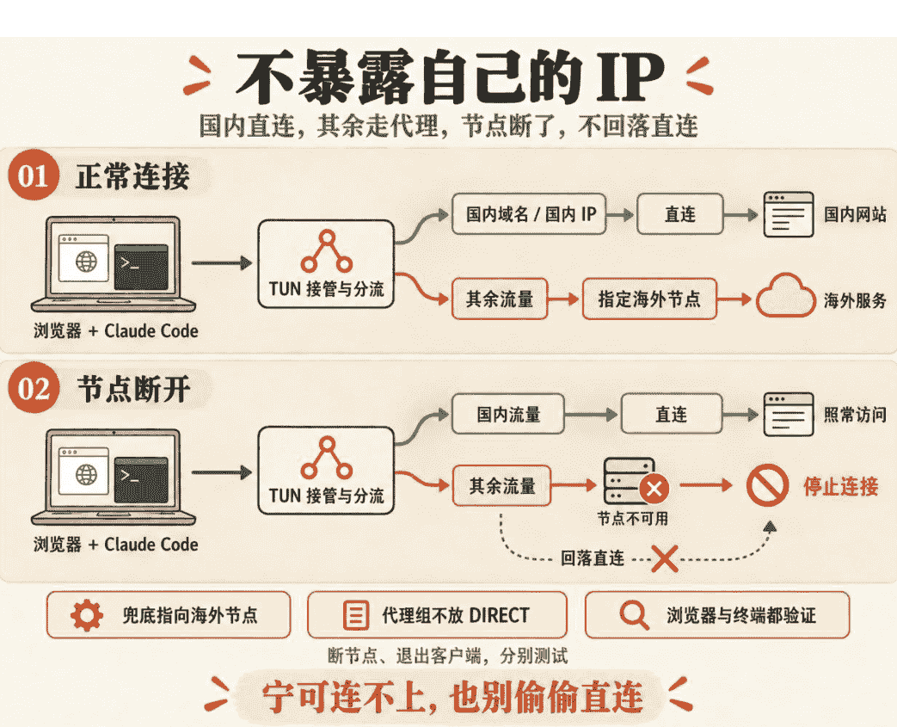

还有一点：Clash 默认的「系统代理」，终端里的命令行程序不一定走，而 Claude Code 正是跑在终端里的，所以要开 TUN 模式，让梯子把所有程序的流量都接管过去。

光配好分流还不够，还得让梯子一断，Claude 也跟着断网。

梯子总有掉线的时候，节点挂了、Clash 崩了、电脑睡醒还没重连上。

这时候要是流量自动改走直连，Claude 就会拿你的中国 IP 连上去，你自己还完全不知道。

所以宁可断网，也别让它偷偷直连。做法是：梯子开好 TUN 模式，分流规则最后的兜底指向海外节点，代理组里也别放「直连」。

这样节点挂了，海外的流量就是连不上，而不是改走直连。

验证也简单：在 Clash 里把海外节点断掉，[claude.ai](https://claude.ai) 打不开、国内网站照常能上，就对了。

分流和断网这两件，配置都不用自己手写，把下面这段话直接丢给你的 Agent：

帮我改 Clash 的分流规则。目标：国内域名和国内 IP 直连，其余所有流量走我指定的海外节点；节点断了的时候宁可断网，也不要回落直连。

- 1. 先找到我正在用的 Clash 客户端和当前生效的配置文件，完整备份一份，告诉我备份在哪。
- 2. 保留我原有的节点订阅和局域网直连规则，不认识的节点不要删也不要换。
- 3. 加入国内域名和国内 IP 段的规则集（国内域名来源：https://github.com/pfwf/china-domain-allowlist；国内 IP 段来源：https://github.com/Loyalsoldier/clash-rules 里的 cncidr 规则集），命中的走直连。
- 4. 规则最后的兜底指向海外节点，不要留默认直连；海外节点所在的代理组里不要放 DIRECT。
- 5. 检查规则顺序和 DNS 设置，别让国外域名被国内 DNS 解析后走了直连。

6. 开启 TUN 模式，确认终端里的命令行程序也走代理。

7. 改完帮我验证：国内网站走直连；claude.ai 走海外节点；在终端里查一下出口 IP，确认在海外；再把海外节点断掉，确认 claude.ai 打不开、国内网站照常能访问。

8. 最后告诉我怎么一键恢复到改之前的配置。

缺什么信息先问我，不要猜。

## 六、订阅 Claude 账号

电脑和网络都收拾好了，接下来付钱。

付钱有两条路，走哪条看你手上有什么：

### 网页订阅 + 海外卡

你需要：一张能在海外付款的卡，我用的是 Starryblu，但是开卡要有护照才行。

Max 20x：200 美元一个月。被封了：不退款。麻烦程度：低。

### 苹果内购 + 美区礼品卡

你需要：一台 iPhone、一个美区 Apple ID、美区礼品卡。

Max 20x：249.99 美元一个月。被封了：付款走苹果，售后也走苹果。麻烦程度：高，升 Max 时大概率要找苹果客服解除风控。

先说网页路线。

我用的是 Starryblu，这张卡最近在 X 上挺火的，实测用于订阅 Claude 不会被拒。

开卡的时候，很可能会卡在排队审核，可以找到客服，直接说你要付费开卡，麻烦帮你加快审核，这样很快就开下来了。

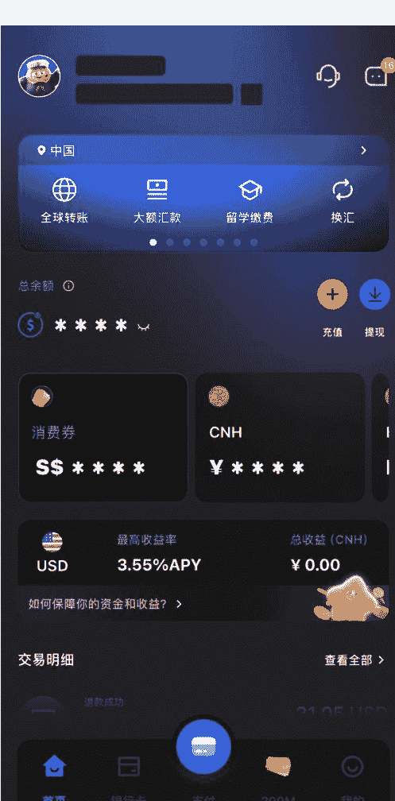

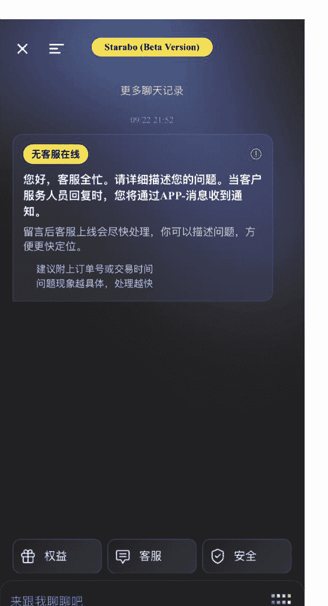

卡开好以后往里转钱，最方便的是有一张香港卡；没有的话，也可以找人代充付款前有一件事比卡本身更重要： 你的 IP、账单地址、卡，这三样得对得上。比如你 IP 在加州，账单地址就填加州的。

要是 IP 在加州，账单地址却在别的州，卡又是新加坡卡，这样风险就高了不少。

手里有干净的新加坡 IP，也可以整套换成新加坡：浏览器时区、语言按新加坡配，账单地址填新加坡的。然后在 Claude 里选 Pro，进到结账页。

你看左上角两张卡片，选蓝色那张「Pro monthly」，也就是月付，每月 20 美元。

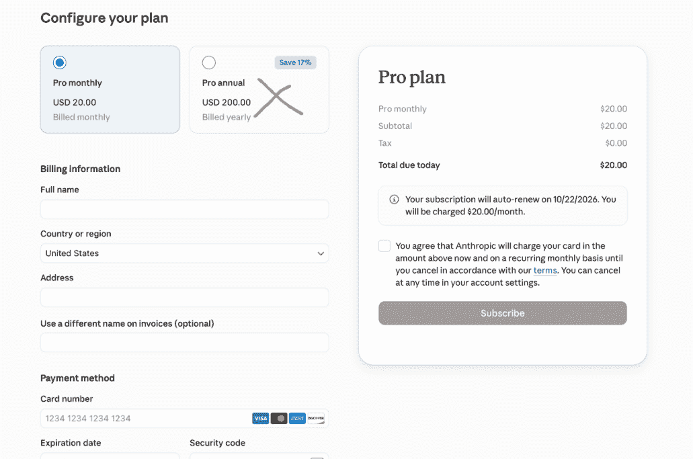

旁边我打了红叉的那张「Pro annual」是年付, 网页上 Pro 年付是 200 美元一年, 跟 Max 的 200 美元一个月长得很像, 买错了就是一整年的 Pro。

付款的时候要是弹了 KYC, 处理办法第三章结尾讲过: 别硬过, 直接重新注册一个新号。

接下来, 再说苹果 App Store 路线。

苹果那边每个月多出来的 50 美元的「苹果保护费」, 换来的是不用海外卡, 还有被封之后找苹果退款的机会。

苹果美区的服务条款里写的是「所有交易均为最终交易」, 但它留了申请退款的入口。

登录 reportaproblem.apple.com , 选「申请退款」, 勾上要退的订阅提交就行。

批不批由苹果审核, 条款里也写了, 它认定有欺诈或滥用, 可以直接拒绝。

网页上申请不下来的话, 退款的办法跟后面升 Max 时找苹果客服一样。

我的经验是第一次申请基本能过，第二次就难说了。

退款本身也有风险，**<u>我有一次申请退款，苹果直接把我的 Apple ID 也封了</u>**

所以有能力的话，还是自己注册美区 Apple ID，真被封了，至少没白花买号的钱。

其实安卓机用**<u>安卓的 Google Play 也是 250 美金订阅，但这个方式我不推荐，风控太严了</u>**

我在小米手机和谷歌安卓模拟器上都试过，号刚注册、还没怎么使用就封了。

走苹果，先得有一个**<u>美区 Apple ID</u>**。

可以自己注册，油管上搜「美区 Apple ID 注册」，教程很多；也可以直接买现成的。

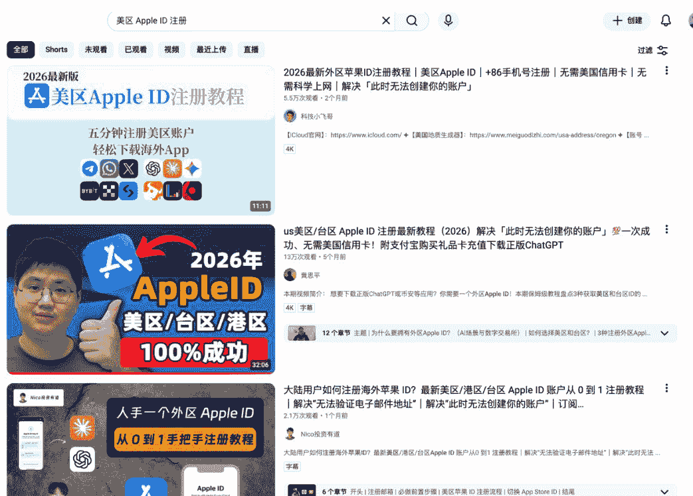

买的话建议买贵一点的，**<u>到手立刻把认证手机号改成你自己的，防止卖家申诉找回</u>**

买来的账号只在 App Store 里登录。

**<u>别登 iCloud</u>**，也别在系统设置里退出你自己的 Apple ID 去换，那样有锁机的风险。

有了账号，还得有美区礼品卡，美区账号只能用美区的。

最省事的是直接在支付宝里买，人民币付款，不用换汇。

先打开支付宝首页，点左上角，它默认显示的是你现在所在的城市。

城市列表是下面左图这样：切到上面的「国际/港澳台」，左边选「北美洲」，热门城市里点「旧金山」，美国任意一个城市都行。

切过去以后首页就变成了右图，往下翻到「超值抢购」，点第一张「大牌礼卡低至9折」下面我圈出来的「立即抢」。

进去是一整页品牌礼卡，一直往下翻到最底下的「更多大牌 折扣礼卡」，点下面左图里圈出来的 Pockyshop。

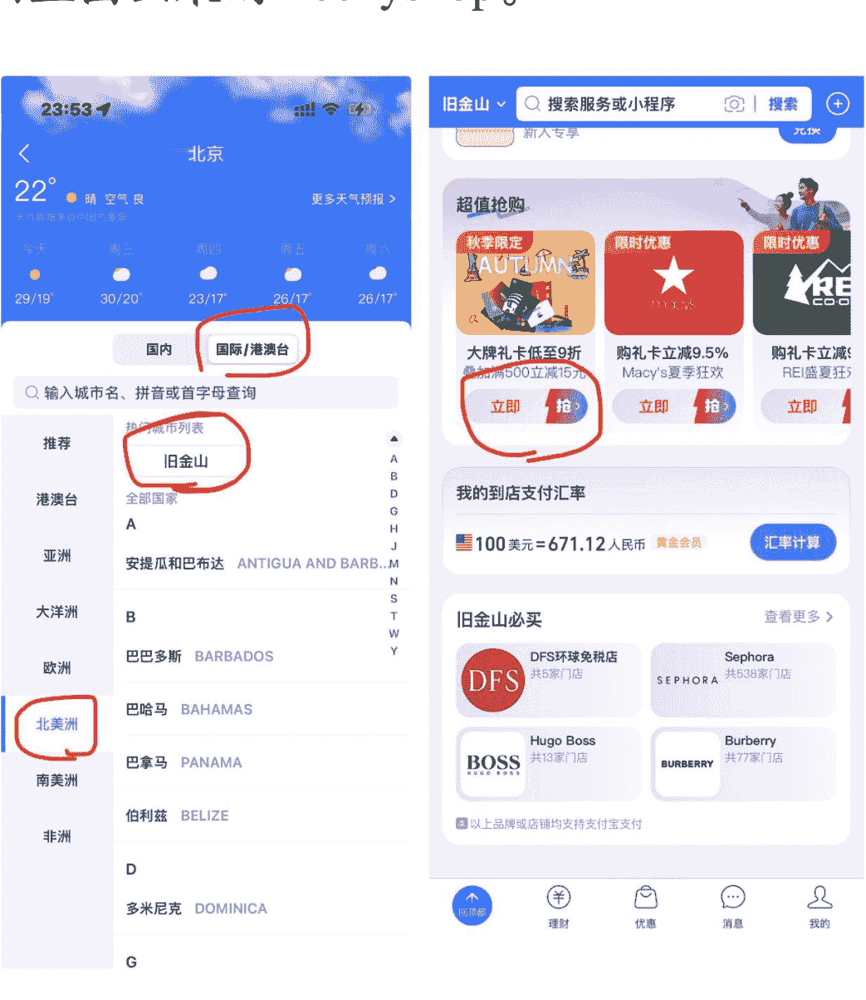

它会打开一个叫 Pockyt Shop 的小程序，地区选「美国」，右图里圈出来的「App Store & iTunes USA」和「Apple Gift Card US」都能用，充进去都是美区 Apple 账户的余额。

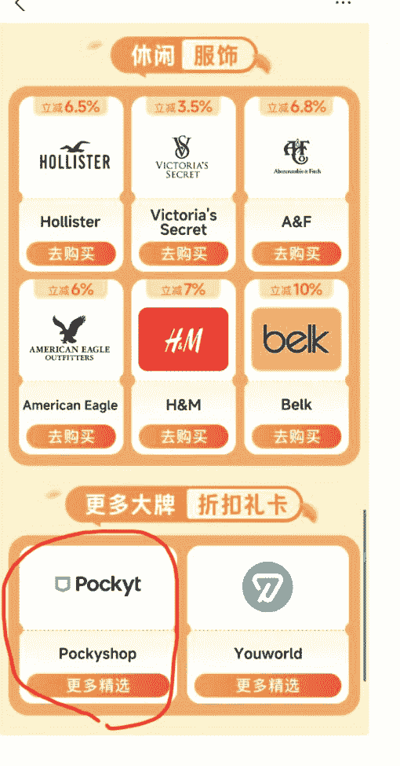

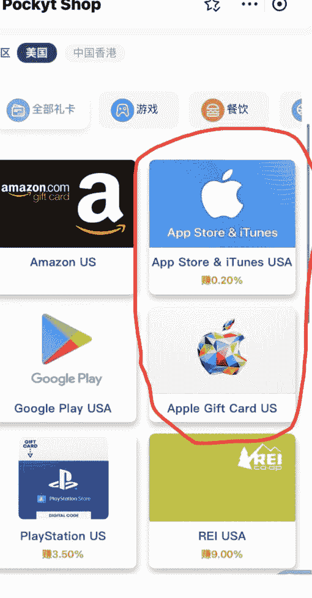

点进去选面额，用支付宝付款，付完去底部的「订单」里找卡密。

但支付宝的这个渠道买的人太多了，偶尔会缺货，如果缺货了可以在 SEAGM 平台上买，会有一些手续费，但也比找人代充便宜。

注册登录之后，首页「热门游戏点卡」第一个，就是箭头指的「iTunes 礼品卡(美国)」。

同一行右边的「Apple 礼品卡(美国)」也能用；中间那个土耳其区的别点错，区不对充不进美区账号。

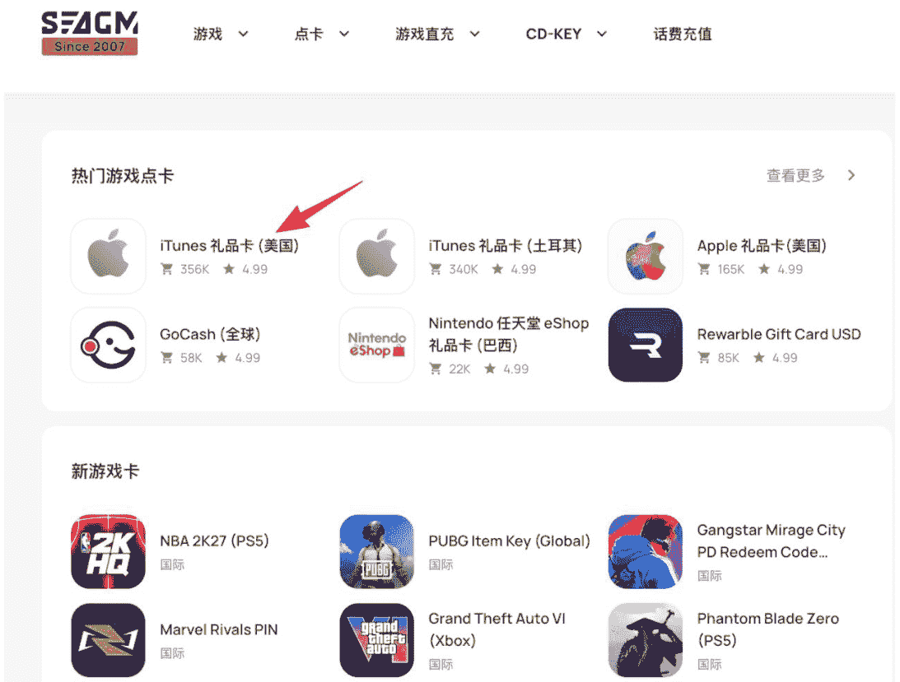

点进去选金额。

你看左边这两列，灰掉、带红色「售罄」标签的就是缺货的，我截图那天 10、20、25 美金这几档都没货，所以要用就提前买。

选好以后看右边的「总计」，这是你实际要付的钱，比如 15 美金的卡要付 15.28 美元，确认没问题再用支付宝付。

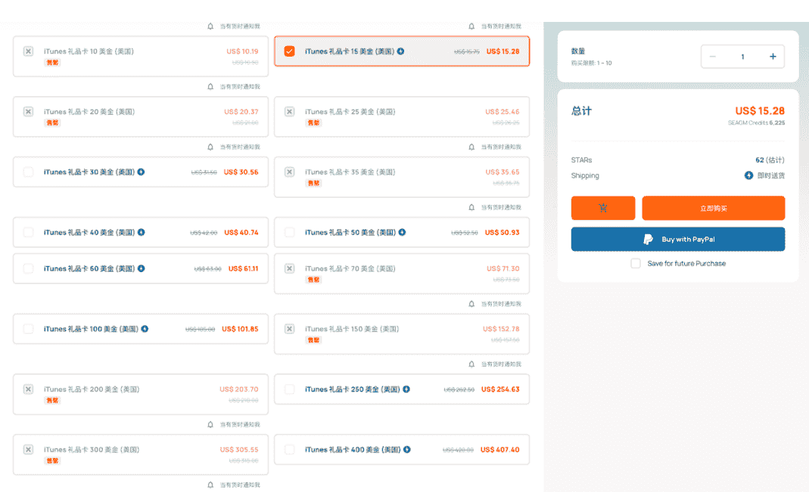

订单发货后，点「获取卡」拿到卡密。

这时要你输的是 SEAGM 的登录密码，不是 Google 密码。

卡密先存好，等手机上登好 Claude 再兑换。

手机的梯子用跟注册时同一个出口：在小火箭里加上你那个 SOCKS5，开全局模式，这部分也可以让 Codex 帮你创建一个配置文件。

国区 App Store 里搜不到 Claude，得先换成美区账号。

打开 App Store，点右上角头像，拉到最底下退出你自己的账号，再登录美区 Apple ID。

然后在 App Store 下载 Claude，用邮箱登录。

手机上填完邮箱，回到比特浏览器收 Claude 的登录邮件，就是下面左边这封，点中间黑色的 Sign in。

点完之后，比特浏览器里会出现右边这个 6 位数的验证码，标题下面写着让你把它填到「最初发起登录的地方」，也就是你的手机。

把它填回手机就登上了。

验证码下面那个「Sign in here instead」别点，点了就变成在电脑上登录了。

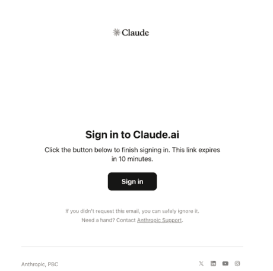

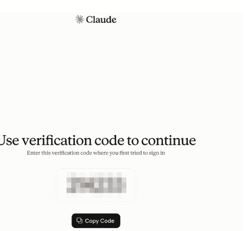

登上以后，**先充 20 美元，开 Pro**。

充值在 iPhone 的 App Store 里弄，点右上角头像，就是下面第一张图，我圈出来的「兑换充值卡或代码」，把 20 美元那张卡的卡密输进去，确认余额到账。

然后用一会儿 Claude，再在 App 里订阅 Pro。

第二张是订阅页，里面左边是月付 20 美元，右边我打了红叉的是年付 214.99 美元，**选左边的月付**，别看错。

订阅成功后进 Settings，就是第三张，Billing 这一行我画红圈的地方显示 Pro plan，就说明开好了。

**苹果路线最容易翻车的，是新号到手当天就充 200 多美元的礼品卡、马上订阅。**

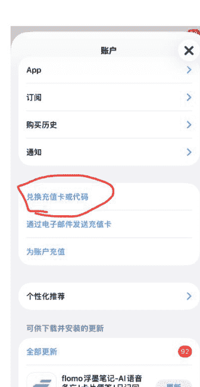

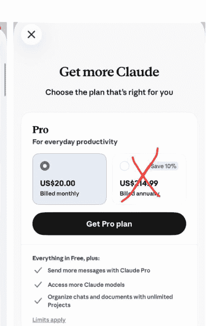

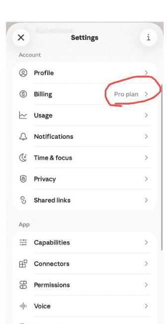

苹果自己的风控在这件事上比 Claude 还恶心，**大额充值紧跟着大额订阅，很容易被苹果限制购买。**

所以才要先充 20 美元开 Pro，稳了再上 200 多美元的 Max。

## 七、接上 Claude Code

Pro 开好以后，就可以把 Claude Code 接上了。

我建议用命令行（CLI）版的 Claude Code, 不太建议用桌面客户端。

一来 Claude 客户端也不太好使，二来客户端权限更高，能拿到的本机信息更多。

安装不用自己敲命令，直接跟 Codex 说一句「帮我安装 Claude Code 命令行版」，它会按官网 code.claude.com 上的方式帮你装好。

装好之后在终端里运行 claude，跟着浏览器提示登录。

登录方式选 Claude 账号，也就是你的 Pro 订阅。

浏览器授权那一步，跟邮件链接一个道理：把授权链接复制到比特浏览器里打开，在那个已经登录好 Claude 的窗口里点授权。

接上之后，日常怎么用才不出事？

回到第一章那三条红线，后两条靠你自己守住：

- 不开一堆会话高并发地跑；
- 不把订阅反代成 API，也不接各种中转站；
- 不聊违规内容。

## 八、Pro 升级 Max

什么时候升？

Pro 正经用个五次左右，隔上一天，再升 Max 20x。你想想，一个正常用户会怎么升级？

他不会刚开 Pro 就立马换成 200 美元的 Max，而是先用一阵，觉得额度不够了才加钱。

这才是正常人用一款新软件的逻辑。

五次、一天都只是参考，不用卡得那么死。

走苹果路线的话，隔上一天，苹果号也不至于在短时间里连着大额充值。

网页路线最简单，在网页的订阅设置里直接升级 Max 20x 就行。

苹果路线要多几步。

走苹果的话，**先兑换 250 美元的礼品卡，余额够了再升级**。在 App 里找不到升级按钮的话，进「管理你的订阅」，点「查看所有方案」，找 **Max 20x 月付 249.99 美元**。

认准名称和金额，别选成 Max 5x。

然后余额一定要备够，因为苹果的升级是立即生效的：**先全额扣 249.99 美元，Pro 还没用完的天数，再按比例退回原支付方式**。

不是只补个差价。

钱备好了点升级，大概率会弹出一个「无法完成购买」的提示，让你联系 Apple 支持。

这一步我没留截图，下面这张是网上找的示例，弹窗长得差不多。

这时候：

**别反复点购买**。点多少次都没用，等客服处理就行。

别点弹窗里或 App 里的 Apple 支持。你手机的 iCloud 登的是你自己的 Apple ID，那边显示的是你自己的账号，不是这个美区号。要在比特浏览器里打开苹果的在线支持：[getsupport.apple.com](https://getsupport.apple.com)。

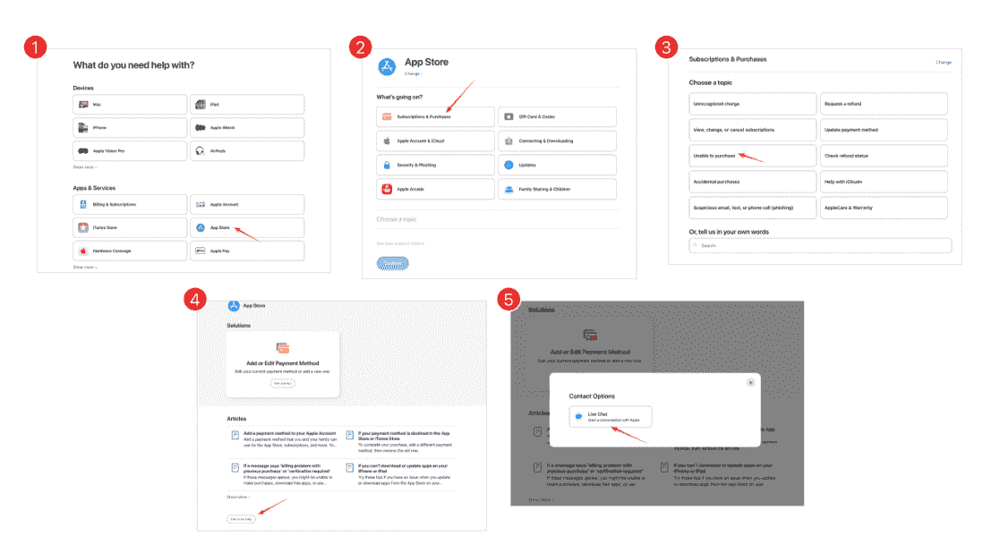

进去是一页分类，下半部分「Apps & Services」里，箭头指的就是 App Store。

点进去它问你出了什么事，选左上角第一个「Subscriptions & Purchases」。

右边紧挨着的「Gift Card & Codes」别点错。

然后在话题列表里，选左边第三个「Unable to purchase」，就是「无法购买」。

这一路全是英文。

看不懂的话，给比特浏览器装个沉浸式翻译插件，或者直接用微信截图：框住页面以后，点工具栏里箭头指的这个「翻译」按钮，整页就翻成中文了。

接着它会先推荐几个解决方案，都不用看，直接点左下角那个「Get more help」。

弹出来的「Contact Options」里只有一个选项「Live Chat」，点它，就进到苹果的在线客服了。

客服一般会先要你的 Apple 账户邮箱，再让你报一个 Support PIN。

这个 PIN 在 Apple 账户网页（account.apple.com）左侧导航的最底下，就是箭头指的那个灰色小字「Support PIN」。

点它拿到 PIN，发给客服就行。

这张图右边你也能看到，我这个号最后升上去的订阅就是「Claude Max 20x - Monthly」，249.99 美元一个月。

接下来就是怎么跟客服说。

我当时跟客服说的大概是这个意思：我就是正常在 App Store 买个订阅，不明白为什么被拒；我用了这么多年苹果，每次发布会都熬夜看，结果连个订阅都买不了，真的挺失望的。

英文不用自己憋，我是把这个意思丢给 ChatGPT 写的。

你看图里，我就跟它说了一句「跟对方动之以情」，又补了一句自己买了很多苹果设备、每次熬夜看发布会，它就写出了两段挺自然的英文，复制过去就能发。

你也照这个路子，把自己的情况跟 AI 讲清楚就行。

客服大概率会说：已经提交审查，请等 72 小时。

这时候别听完「已经在审查了」就走，一定要追问一句：「So I understand that after 72 hours I will definitely be able to complete this purchase, right?」

让他给你一个确定的答复。

跟他多磨一下，成功率会高不少。

然后就是等。

这 72 小时里什么都别碰，别去反复尝试购买。

等满了，再从 Claude App 里升级。

大多数时候，等完就能买了。

但也别把 72 小时当成保证，我就遇到过连着等了四次还是买不了。

下面这张是我当时把客服聊天截图丢给 ChatGPT 的记录。

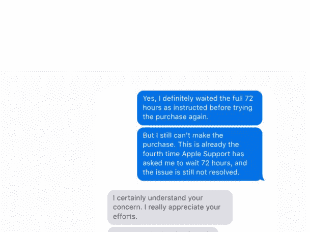

看到了。客服现在说的是：

> “我完全理解你的担忧，也非常感谢你的配合。相信我，这一次会成功的。”

也就是说，他现在还是让你再等一次 72 小时，而且他说 “Trust me this time it will work.”，相当于比较明确地向你保证“这次会成功”。

我建议你马上把这个保证确认下来，发一句：

> Okay, thank you. Just to confirm, after waiting another full 72 hours, I should be able to purchase the $250 plan successfully this time, correct?

这样让他明确回答 Yes。万一 72 小时之后还是不行，你下一次找客服就可以直接说：上一位客服明确告诉我这次等待 72 小时后一定可以购买，但依然失败。

没成就接着找客服，别在 App 里一遍遍点购买。

升上去以后，还要注意续费别断。

苹果订阅是自动续费。

每次扣费前 5 到 10 天，检查一下余额，提前把礼品卡买好、兑换好。

礼品卡偶尔缺货，别等到扣款当天才想起来。

走网页的也一样，扣费前把 Starryblu 的余额充够，不然扣款失败，订阅就断了。

## 最后

整套走下来大概一周，最磨人的是等苹果客服，其他步骤照着截图点就行。

走完以后，你就能跟我一样用上 Max 20x，Opus 5.5 敞开用。

回头看，这篇里的每一步，其实都在回答同一个问题：

一个正常的美国用户，会这么做吗？以后碰到文章里没写到的情况，你也拿这句话问问自己，基本就知道该怎么做了。

> 分割线

看完这篇 SOP，你觉得你懂了。但 90% 的人一到实操就会卡在第一步。

工具和教程只是最低级的壁垒，真正的壁垒是“立刻动手”和“圈层信息差”。

如果你想看全网最新的变现玩法，并且和一群执行力极强的极客一起下场拿结果，

欢迎围观我的核心私域：【懒人专属群】。

我们不聊虚的，只做商业闭环的拆解与 AI 效率的压榨。系统内已沉淀 1000+ 跑通的套利实战局。

- 查阅圈子完整数字资产与上车门槛：

[https://lazyso.com/insider/](https://lazyso.com/insider/)

认同价值、准备好下场干活的，扫码加我微信（lazyhelper1）

备注：【实操上车】，不闲聊

微信：lazyhelper1
