# 小红书虚拟产品 X 公众号垂直小号，20 天累计变现收入上 5 位数，分享两个热门项目的结合玩法

260925 副业 SC 精华
整理：公众号懒人搜索，懒人专属群精选
懒人微信：lazyhelper1


> **小懒判断** | 做虚拟资料总被平台违规下架的人最该读，作者把小红书学科卡片和公众号教程串成一条流水线：店铺卖资料攒素材、公众号写实操引来 883 个关注、私域再卖 199 元教程和 999 元陪跑，20 天变现过万。想抄某一步的人可以划走，这篇的精髓在齿轮咬合——每一环的产出都是下一环的素材。最值得抄的是 39.9/199/999 三档分层，39.9 纯教程不做答疑，让自学强的人直接店铺下单，一篇笔记没发的教程店铺卖 31 单。坑在于类目，电子资源收紧说没就没，资料店铺随时可能重演他的下架结局。

大家好，我是心海的猫，坐标浙江宁波，加入生财第三年，这是我的第一篇复盘。

最近，我把小红书虚拟产品和公众号结合起来，做了一次尝试。

从 9 月 4 日开始，陆续发了 7 篇文章，新增微信好友 200 多人。公众号新增关注 883 人。累计变现收入超过 1 万元（店铺销售+私域）。

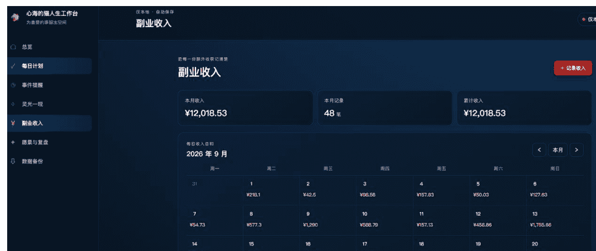

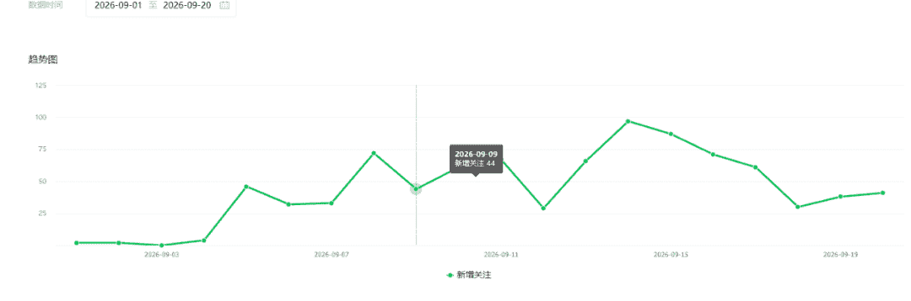


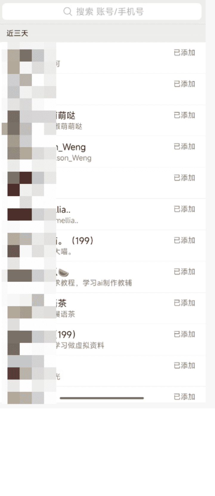

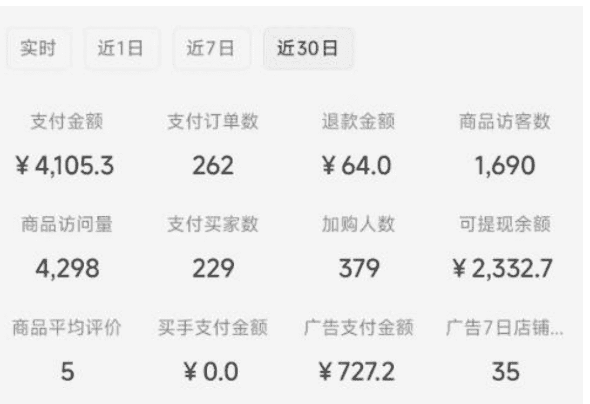

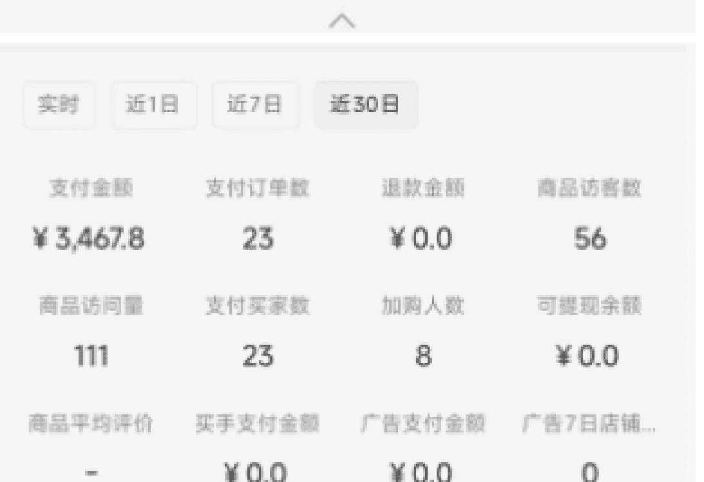

这次尝试中，我把几件原来分开做的事慢慢接到了起：用 AI 制作学科知识卡片，发布到小红书上售卖，再把实操经验写到公众号来进行私域引流。

想借这篇文章，和圈友聊聊这几个部分是怎么配合的，中间做了哪些调整，以及接下来还有哪些问题需要继续验证。

## 一、找到自己愿意持续做的方向

过去几年，我一直在探索不同的项目，特别是那种能快速获得反馈的。

跟着航海做过闲鱼二手书、公众号爆文、抖音 CPS 等项目，也陆陆续续赚到过一些钱。

2026-03

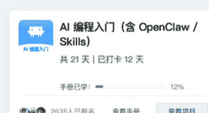


2026-01

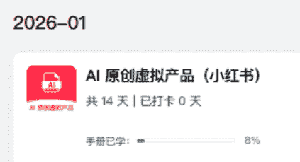

2025-12

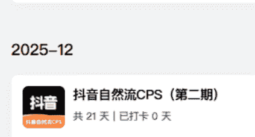


但是每次都坚持不了多久，因为这些项目想继续扩大收入，往往就需要增加账号、批量生产内容，走矩阵化等等。那不是我想走的路。

直到今年年初，我接触到了小红书虚拟产品，跟着航海开始做原创知识库，客单价 99 元，卖了将近 300 单。

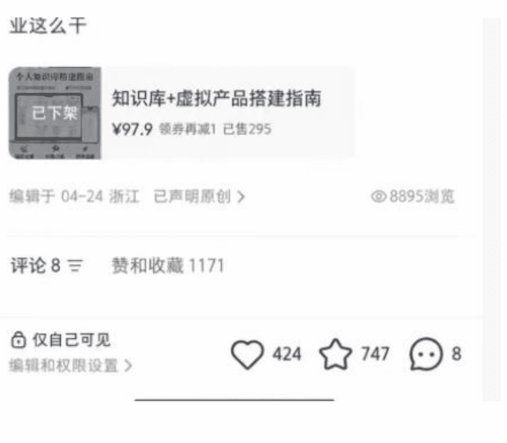

- 📘 小红书-带图视频产品｜转投指南 2.0
- 🧐 认知营销｜24 年再升级
- 💡 深度定位｜锁定爆分市场
- 🔔 爆品洞察｜认证市场需求
- 💲 账号定位｜专业赛道人格
- 🛠️ AI 智能产品｜引爆商品产出
- 🚀 商品上架｜打造高转化
- 📝 笔记制作｜掌握底层能力
- ⚖️ 运营策略｜提升竞争力
- 🧗 变现路径｜跨方私域
- ⓪ 干货模块

奖励活动：商品 5 条 ＋50 好评送《小红书运营秘籍和高效技巧汇总》，截图发我 **小红书号** 或微信。

但更重要的是，我通过这个品链接到了很多想通过虚拟产品变现的用户，通过不断的深入沟通，也在私域成功成交了好几单。

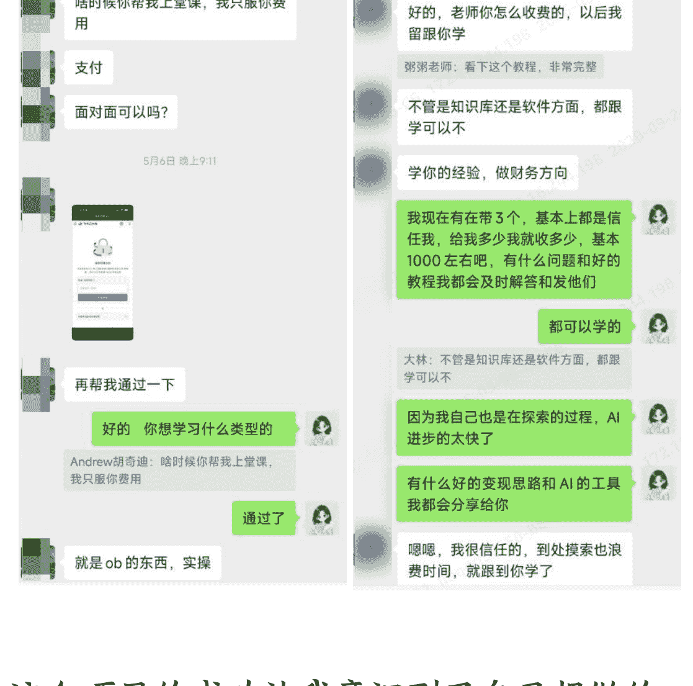

这个项目的成功让我意识到了自己想做的方向。

我更愿意做个人 IP 和内容表达，希望自己投入的时间，能逐渐积累成作品、经验、以及别人对我的信任。我发现在和别人的高频沟通中，不会觉得消耗很大，还能逐渐积累自己的势能。所以没有哪个项目适合所有人。每个人在不同阶段的精力、目标和需求都不一样，最终还是要靠自己在不断尝试中才能做出判断。

但是好景不长。

随着小红书的规则变动，电子资源类目收紧，大量知识库产品被违规。

我的产品也惨遭下架，来不及多想，我又开通教育类目，转向教师 AI 教程，但做了约两个月，再次遇到下架。

那段时间打击确实不小。连续做的两个赛道都惨遭夭折，而且付出了很多心血做的品和笔记都白费了。

平台的规则调整是我们无法对抗的事，我们能做的只有自己去调整，去做私域，去做确定性强的项目。修整了一段时间后，我就继续研究 AI，做小程序、搭工作台，重新寻找机会，直到 8 月偶然看到学科资料的需求，才重新开始继续做虚拟产品。

## 二、AI 学科知识卡片的整体流程

这次我主要做的是英语学科资料赛道，用 AI 辅助整理知识内容，制作成知识卡片，再通过小红书店铺售卖。


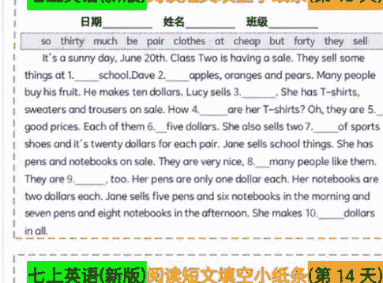

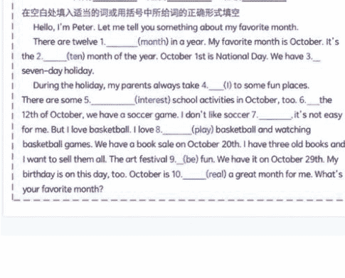

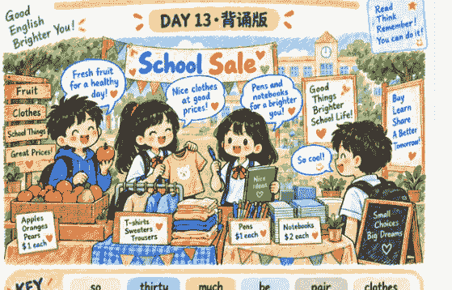

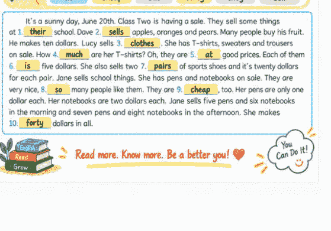

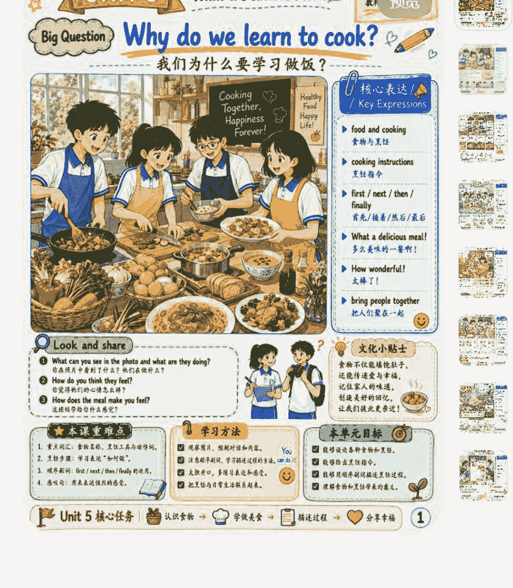

Worked for 8m 13s

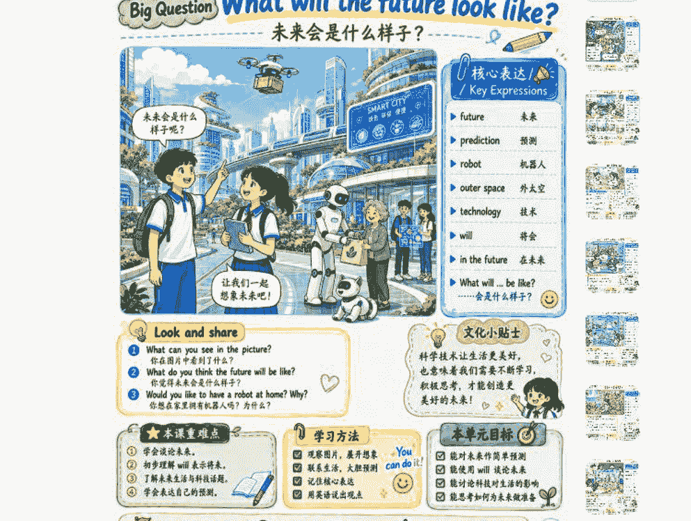

整体流程是直接通过 GPT 网页版来进行整套产品的生成，大概流程是：

- 找到对应的参考资料和参考图传到 GPT
- 把内容重新整理排版
- 修改确认模版
- 批量生成彩色知识卡片
- 合成 PDF
- 制作主图商详
- 写小红书笔记
- 全部资料打包归档
- 完成商品上架和小红书笔记发布

这一整套流程都在一个 GPT 聊天框里实现。

每一个步骤都有相应固定的提示词，一个 30 页的产品大概耗时 20-30 分钟就可以完成写笔记+上架。

| 名称 | 修改时间 | 类型 |
| :--- | :--- | :--- |
| 00_项目说明与文件清单 | 2026/9/17 21:57 | 文件夹 |
| 01_知识卡片原图 | 2026/9/17 21:57 | 文件夹 |
| 01_知识卡片原图_clean | 2026/9/17 21:59 | 文件夹 |
| 02_支付 PDF | 2026/9/17 22:44 | 文件夹 |
| 03_商品主图 | 2026/9/17 21:57 | 文件夹 |
| 04_商品详情页 | 2026/9/17 21:57 | 文件夹 |
| 05_小红书笔记文案 | 2026/9/17 21:57 | 文件夹 |
| 06_商品上架信息 | 2026/9/17 21:57 | 文件夹 |
| 07_可复用提示词 | 2026/9/17 21:57 | 文件夹 |

尝试多个方法后，我目前总结的这一套流程是对比下来出图最稳定也是最有效果率的。用 CODEX 的话很浪费额度（聊天模式的额度是单独区分开的），且 CODEX 出图经常宕机，特别是复杂的图经常出不来。

也尝试过搭个工作台用 API 模式来进行提效，但发现出图的质量和美观性还是差一点。

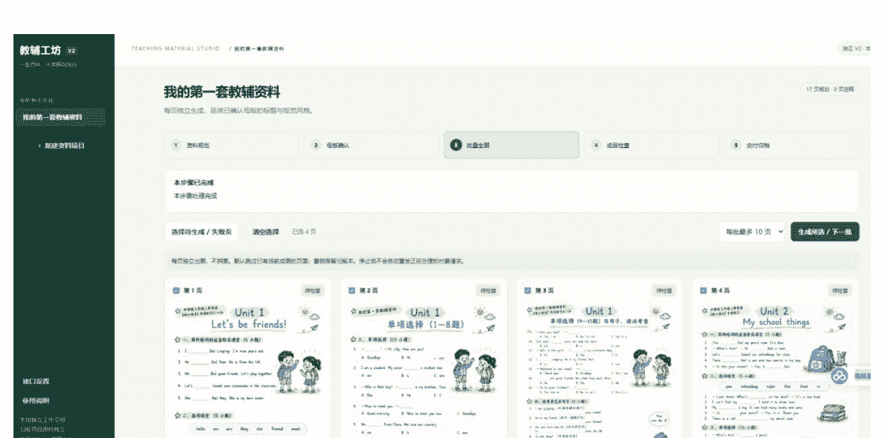

因为工作台主要依赖每次提交的提示词出图，很难把前面的内容分析、确认过的样卡和修改记录衔接好，因此需要额外整理和传递这些信息。

网页版可以在同一个对话里接着做。确认好的内容可以继续用于商品图和笔记，不用每个环节都重新介绍一遍。

而且对于很多小白来说，用惯了豆包等国内 AI 工具，聊天框的模式也是最容易上手和接受度比较高的（为我后面带人作铺垫）。

大概流程可以跟圈友说一下，有兴趣的圈友可以对应着去尝试一下。

### 1. 上传参考图和原始资料文档

让 GPT 看懂资料的结构，判断适合拆成多少张卡片，每单元做几张。

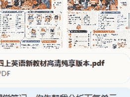

我想把 PDF 制作成考察图形式的彩色课堂笔记，你先帮我分析下每单元几张，如何规划？

思考了 43s

我看你这版《四上英语新教材尚德纯享版本.pdf》的整体结构了。它一共 87 页，正文是 Unit 1 ~ Unit 6 共 6 个单元，每个单元基本固定 12 张教材内容，后面还有 4 页 Revision + 10 页 Appendix。Unit 1 从 PDF 第 2 页开始，Unit 2 从第 14 页开始，Unit 3 从第 26 页开始，后面的单元也都很规律，12 页一个单元的节奏。

结合你发的参考图，我不建议“教材 1 页=笔记 1 张”，参考图其实是把教材新词练成 主题场景 + 重点词汇 + 核心句型 + 图示/语音 + 文化/阅读 + 任务总结，这样成品会更像真正的“彩色课堂笔记”，而不是教材版说。

我建议：每单元做 8 张，共 48 张。

这个数量最合适。6 个单元的教材结构高度统一，做 8 张既能把知识点讲完整，又不会为了凑页数把内容拆得太碎。

| 单元 | PDF 页码 | 教材主题 | 建议笔记张数 |
| :--- | :--- | :--- | :--- |
| Unit 1 | 2~13 | Helping at home | 8 张 |
| Unit 2 | 14~25 | My friends | 8 张 |
| Unit 3 | 26~37 | Places we live in | 8 张 |
| Unit 4 | 38~49 | Helping in the community | 8 张 |
| Unit 5 | 50~61 | The weather and us | 8 张 |
| Unit 6 | 62~73 | Changing for the seasons | 8 张 |
| 合计 | | | 48 张 |

### 2. 把拆页方案变成可以执行的目录

GPT 给出各单元张数后，最好再往下确认到“每一张放什么”。

只有总张数，没有每页内容范围，后面连续生成时仍然可能漏内容或者重复。

**每单元统一的 8 张结构**

这样后面批量生成的时候最稳定，也最容易保持你参考图那种“整套资料”的感觉。

- 第 1 张 | 单元总览 / Big Question
  - 完全参考你发的 Happy Birthday 第 1 张。
  - 内容固定包括：UNIT X - 单元英文标题。
  - 大标题可重新提炼一个更有课堂笔记感的主题，比如：Helping at Home 家庭成员与家庭劳动。
  - 下面放：单元主题 / Big Question、本单元学习目的、核心表达 / Key Expressions、本单元重难点、学习方法、Unit 核心任务路线。
  - 中间必须有一幅对应单元主题的大场景插画。
  - 这一张主要负责“进入单元”。

- 第 2 张 | Part A 核心情境 + 重点词汇
  - 参考你发的 Birthday & Dates。
  - 结构：Part A 主题、一幅教材场景最重视觉化、Part A 核心词汇、核心对话、重点表达、3 个本页重点。

### 3. 先生成第一张，确定整套卡片的模板

拆页方案确认后，先做一张样卡。

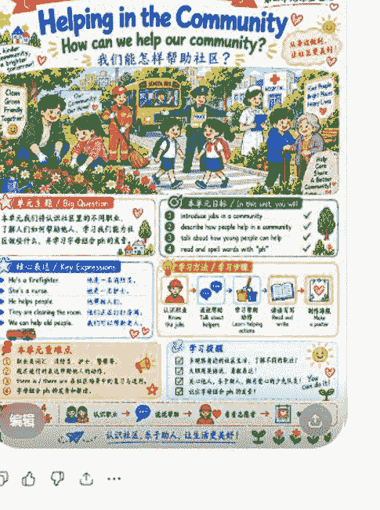

好的，先生成第 4 张看看。

### 4. 批量生成图片

样卡确认后，可以在当前对话里继续生成，这样可以继续引用已经上传的资料、确认过的拆页方案和样卡，不需要每次从头解释。

好的，按你的建议夹，先生成 UNIT1 的 8 张，8 张单独生成，不要拼图。

Worked for 7m 8s

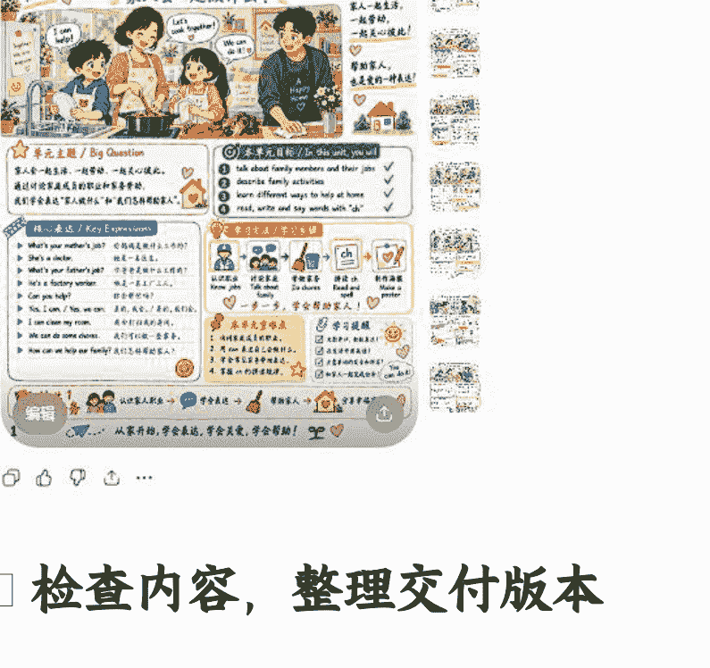

### 5. 检查内容，整理交付版本

让 GPT 检查内容完整性和正确性。

不仅要检查内容是否正确，还要确保整套没有漏页。

**【任务】**
请帮我对这套最终成品做一次“完整性+内容准确性”检查。
我会提供：
1. 原始资料（Word / PDF），这是本次核对的唯一内容依据；
2. 根据原始资料制作的最终版图片或最终 PDF。
请不要凭记忆补充、改写或优化资料内容，只负责检查最终成品是否完整、是否与原始资料对应、有没有制作错误。请逐页、逐项核对，不要只抽查。

**【一、先检查页数和图片】**
先分别统计：
- 原始资料实际包含哪些单元 / Day / 专题；
- ...

### 6. 按照顺序整理成 PDF

图片检查通过后，就可以按照顺序整理成 PDF。

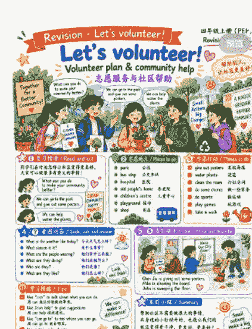

请将上面生成的最终版图片按代码顺序和图片排序，合成一个 PDF。每张原图占一页。保持原图 3:4 比例，不拉伸、不裁切，也不要重新生成或改写图片中的文字。

已经按 Unit 1 → Unit 6 → Revision 2 张 → 全局总结 1 张 的顺序整理完成，共 52 页。

每张原图单独占一页，保持原始 3:4 比例，未拉伸、未裁切，也没有重新生成或改写图片中的任意文字。

下载：四上英语彩色课堂笔记_Unit1-6_Revision_全部总结_52 页.pdf

### 7. 制作商品主图和详情图

前面已经在同一个对话中完成了资料分析、卡片制作和 PDF 合成，接下来可以直接继续制作商品展示图。

请根据这个对话中刚刚完成的最终版知识卡片和 PDF，为这套资料规划 1 张商品主图 + 5 张商品详情页，全部采用 3:4 竖版。

先规划，不要立即生成图片，等我确认后再生成。

请沿用前面已经确认的教材版本、年级、单元目录、内容范围和文件数量，不要混入旧版或试做卡片。

- 先简要复述你准备使用的商品信息；
- 如果有信息缺失，或者无法正确读取前面的文件，请明确指出来，不要猜测。

这套图用于商品展示：
- 主图让用户一眼看懂“这是什么物料、适合谁”；
- 详情页依次讲清“包含什么、内页示例、怎么使用、收到什么”。

视觉上延续前面卡片的配色和学习资料气质，但排版要更适合商品展示，不要只是再堆一张知识卡片。
- 主图要突出商品名称和真实卡片，详情页每张只讲一个重点。
- 标题大而清楚，文案简短，手机上容易阅读。

请用表格规划这 6 张图，分别列出：
1. 页面用途；
2. 主标题；
3. 实际放到图上的短文案；
4. 使用哪些已完成的卡片或 PDF 页面；
5. 构图和文字位置。

只写实际提供的内容，不要添加虚构的销售、好评、提分保证、赠品或更新承诺。

可以，我先只做规划，不生成图片。

我准备使用的商品信息是：**26 版人教版英语四年级上册 | Unit 1 + Unit 2 预习复习汇总整理**，目前最终版为 **Unit 1《Helping at home》9 张 + Unit 2《My friends》9 张**，共 18 张 3:4 彩色知识卡。Unit 1 覆盖 ch 发音、重点词汇、职业/家庭活动句型、can/重点词、Unit 1 26 版新人教版英语四年级上册 | Unit 1 单元预习复习汇总。

按照刚才确认的方案，先生成商品主图，最终输出一张 3:4 竖版图片。沿用前面知识卡片的配色，以浅色系干净背景和轻微纸张质感为主。顶部放置商品的名称和适用信息，中部以已完成的真实卡片为主体，底部放少量内容标签和电子资料的说明。标题使用清晰的粗体，辅助文字简洁，四周留出安全边距，只使用已确认文案，不增加新卖点。不要把所有详情内容塞进主图，不要添加过多装饰。卡片不要拉伸，不要遮挡重要内容。不要重写卡片中的知识文字，优先使用原图合成；如果无法保留原图，请先说明。先只生成主图，等我确认后再生成 5 张详情页。

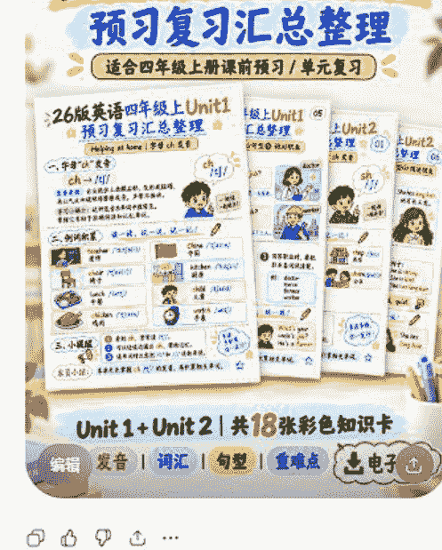

主图确认，按照自己已经确认的 5 页商详方案继续生成详情页 1—5。保持与主图一致的背景、配色、字体和标签样式，但每页根据自己的内容采用不同构图，不要重复同一个模板。所有页面均为 3:4 竖版，标题简短，正文简短，保留足够留白。每张分别生成、单独输出，不要把 5 页拼成一张长图或九宫格。主图不需要重新生成。涉及内容展示时，使用已经沉淀的真实卡片，不要重新编造知识内容。涉及数量、格式和交付说明时，严格使用已确认信息。按详情页 1 到详情页 5 的顺序生成。如果一次未完成，请说明已经完成哪些页，不要重复生成。

### Generated detail images

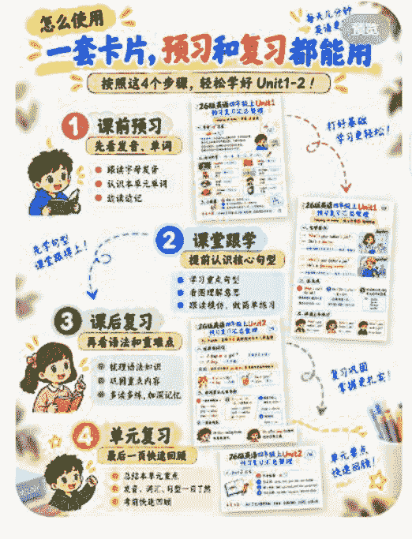

### 8. 生成小红书笔记、标题及话题

继续在该对话框输入以下提示词，直接接在卡片、PDF、主图和商详完成后的同一个对话里使用。

```
不要重新要求我提供已经能够读取的材料，
先给我真实和要点，设计不同的搜索入口，
完成上述过程后，输出5条独立的小红书搜索笔记。
ok?
```

- 人教版四上英语 Unit1 自我介绍集卡牌
  人教版四上英语 Unit1 复习时，可以按发音、词汇、句型、重点四块整理。卡片里有 ch /t/ 发音、job、doctor、farmer、nurse、worker 等词汇，也覆盖了问职业、Can you help? 等活话题，适合课前先浏览，再用卡片写句训练背诵。
  #四上英语 #人教版四上英语 #Unit1知识点 #四年级英语 #英语预习 #英语速记 #HelpingAtHome #英语知识卡 #小学英语

- 四上英语 Unit1 职业句型句问速集卡牌
  四上英语 Unit1 职业句问内容主要围绕 job、doctor、farmer、nurse、worker 展开，并配 There's your mother's/father's job? 和 She's a doctor、He's a factory worker 这两类句，复习时可以把职业词和句型放在一起，再练习句型回答。
  #四上英语 #Unit1职业问句型英语句型集 #人教版四上英语 #HelpingAtHome #英语问句型 #英语句型集 #四年级英语 #英语复习

- 四上英语 Unit1 家务类速速整理
  四上英语 Unit1 里 can 和家务表达可以一起复习：Can you help? 对应 Yes, I can. / No, I can't。后面还会用到 clean my room、do some chores、sweep the floor、look after 等短语。卡片把问法、答法和动作表达放在一起，适合按例题练背。
  #四上英语 #Unit1Can问句型速英语 #人教版四上英语 #CanYouHelp #英语句型 #四年级英语 #英语复习 #英语知识卡

- 人教版四上英语 Unit2 描述朋友识整理
  人教版四上英语 Unit2 里 friends 描述朋友主题展开，卡片按 esh 发音、外貌性格词汇、学习动词、姓名词汇、人物描述、问句和回答重点分类整理，strong、kind、quiet、best friend、read books、play football 等内容都能快速识记，适合预习前浏览或四年级复习。
  #四上英语 #人教版四上英语 #Unit2朋友 #四年级英语 #英语预习 #英语速记 #描述主题英语 #英语知识卡 #MyFriends

- 四上英语 Unit2 人物描述巳外速性速整理
  四上英语 Unit2 人物描述重点有两类：He's/She's + for 形容词，用来描述外貌特征；He/She has + 形容词＋名词，用来描述持有的特征。卡片里用 He's tall and strong、She has long hair 等例句，复习时可先分清 be 句和 has 句，再帮助词汇练熟。
  #四上英语 #Unit2人物描述 #英语外他性 #人教版四上英语 #英语 #MyFriends #英语类型 #has用法 #四年级英语 #英语复习

### 9. 整理全部成品，打包保存

知识卡片、PDF、商品主图、详情图 和笔记文案全部确认后，这个制作对话的主要任务就完成了。


最后，不要只把文件留在聊天记录里。可以继续让 GPT 按用途分类，打包成一个 ZIP，方便以后上架、发布笔记、交付资料或修改产品。

### 这里要特别区分

> 项目压缩包是自己留存的完整工作包；买家交付包只包含对应商品承诺提供的资料。不要把笔记文案、商品主图、内部定价等文件一起发给买家。

请在 00_项目说明与文件清单 中写明：
- 产品名称、适用版本、年级、学科和内容范围；
- 本次实际包含哪些文件及数量；
- 每个文件的用途；
- 哪些资料可随已确认商品随帖用于买家交付；
- 哪些文件仅供自己运营使用；
- 当前仍未完成或需要人工确认的事项。

## 五、完整性检查

压缩包检查：
- 卡片是否缺页、重号或混入旧版；
- PDF 数量和页数是否与已确认信息一致；
- 主题、评测题和笔记是否齐全；
- 文件是否实际存在且能成功读取；
- ZIP 内是否存在空文件或失败链接/代指的成品。

如果前面的文件已经过期或无法访问，请明确列出缺失文件，不要声称已包含旧打包。做完整性的大整理，就缺先内容补全其他文件，所有图片均保留原始 PNG，1张知识卡和8张商品展示图均为 1086×1448，3-4 张版；ZIP 检查无损坏、无空文件、无失效链接。

最终创建ZIP后，请重新打开检查目录和文件数量，提供实际可下载的压缩包，并需要说明是否完整。

已实际整理并创建 ZIP 项目归档，并重新打开检查目录与文件。

本次为部分归档：共 45 个实际文件，包含 18张最终知识卡 + 1张商品主图 + 5张商品详情图 + 8条小红书笔记单元文及 1份合集 + 2份商品上架信息 + 6的可复用提示词 + 4份项目说明/检查文档。1张知识卡和8张商品展示图均为 1086×1448，3-4 张版；ZIP 检查无损坏、无空文件、无失效链接。

唯一缺失的是与当前18张最终卡片完全一致的那些PDF，我检查原到 19个/Unet12 IDPDF是8页版本，与本次最终的 Unit 9张 + Unit 2 9张 不一致，因此没有列入压缩包，并在当前归档里缺失说明。

下载：26版上4类词Unit1-2复习汇总整理 项目归档_部分归档.zip

这个项目大约跑了 3 天就开始出单。

并且我专注做初中英语，后续把单品整理成合集，提高客单价。

目前已经上架 30 多个产品，且日 GMV 稳定在 150—200 元左右。

> 这时候我就突然想：能不能把我的这套流程整理起来，作为一个产品来售卖

但是小红书上类似的教程太多了，而且规则很严，我就想把阵地转移到公众号试试

## 三、从实操里找公众号选题

因为之前做过流量主的航海，所以有现成的公众号可以直接发。公众号大致的定位就是讲小红书虚拟产品的制作思路和一些实操经验。9月4号我发布了第一篇文章，主要写开学前后的销售情况以及虚拟产品在制作时的一些干货。


没想到，第一篇就爆了。

有人在留言里问资料怎么做、用什么软件，也有不少人直接加微信咨询。


其实在写公众号时，我还有一个考虑：平时看到不少用AI生成的文章，篇幅不短，真正有用的信息却不多。

所以我想在文章里多放一些自己的实操过程和截图，把怎么做、遇到了什么问题、最后做成什么样，尽量写清楚。

我的文笔其实比较粗，基本就是把自己做过的事直接写出来，没太多修饰。

可能也正因为这些具体的过程，读者更容易感受到真实，也愿意进一步了解和信任我。

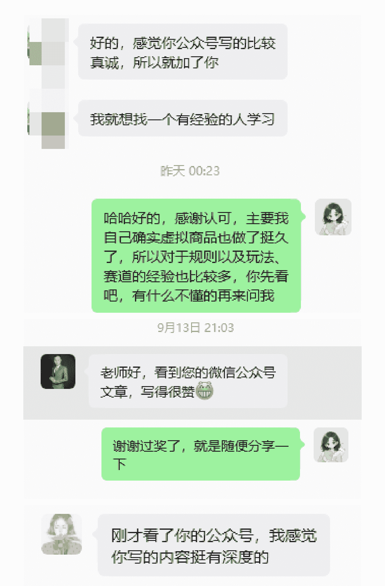

## 四、根据咨询需求，推出教程和陪跑

收到第一篇文章带来的咨询后，我当晚就开始整理教程。

我先做了一个基础版本，定价 199 元，包含完整教程和答疑，并说明后续会持续更新。同时提供 999 元/月的单人陪跑，先做了两个收费档位。

接下来几天，我又陆续发了几篇公众号文章，数据都还不错，也继续带来关注和微信咨询。

| 日期 | 阅读 | 点赞 | 在看 | 留言 | 转发 | 取消 | 净增关注 | 比率详情 |
| :--- | :--- | :--- | :--- | :--- | :--- | :--- | :--- | :--- |
| 06月17日 已发表 | 3,617 | 9 | 317 | 72 | 12 | 0 | 0.00 | 点赞率1.66% 在看率0.75% 留言率0.27% |
| 06月17日 已发表 | 4,507 | 78 | 459 | 54 | 50 | 9 | 0 | 点赞率1.02% 在看率0.71% 留言率1.00% |
| 06月07日 已发表 | 2,618 | 14 | 74 | 9 | 6 | 39 | 0 | 点赞率0.53% 在看率0.15% 留言率1.54% |
| 06月04日 已发表 | 466 | 1 | 10 | 0 | 7 | 9 | 0 | 点赞率0.27% 在看率0.2% |
| 06月04日 已发表 | 3,529 | 25 | 121 | 12 | 30 | 9 | 0 | 点赞率0.75% 在看率0.30% 留言率1.17% |

很快，199元的教程成交了好几单，私域里还成交了2单999元的陪跑。

做到这里，我确认了这套制作流程确实有人愿意付费学习。

接下来的问题是，随着咨询增多，怎么把介绍和答疑安排得更高效。

## 五、把重复介绍整理好，让用户可以自助了解

来问的人越来越多后，我发现，很多问题都需要重复回答。每次从头介绍项目，很占时间。

于是，我在公众号自动回复里放了一个飞书链接，把项目介绍、前期准备、部分教程试看，以及完整教程的小红书店铺自助下单方式放在一起。

后面有了学员反馈和出单报喜，也陆续补充进去，增强信任感。

同时，我增加了一个39.9元的纯教程档位（不做答疑），降低购买门槛。有些用户自主学习能力比较强，拿到教程就能自己研究、照着操作，遇到这样的用户，我会直接推荐他们买教程文档。

这个调整效果不错。有些读者没有加微信，看完介绍就直接去店铺下单了。这个做教程产品的店铺一篇小红书笔记都没发，目前销量已经到了31单。

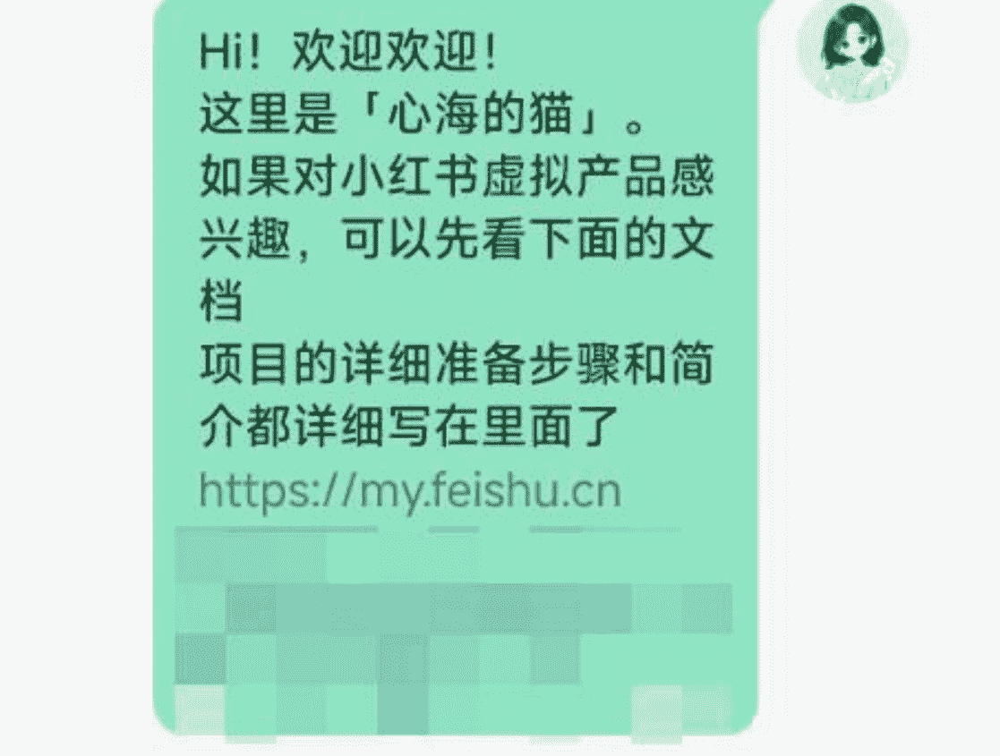

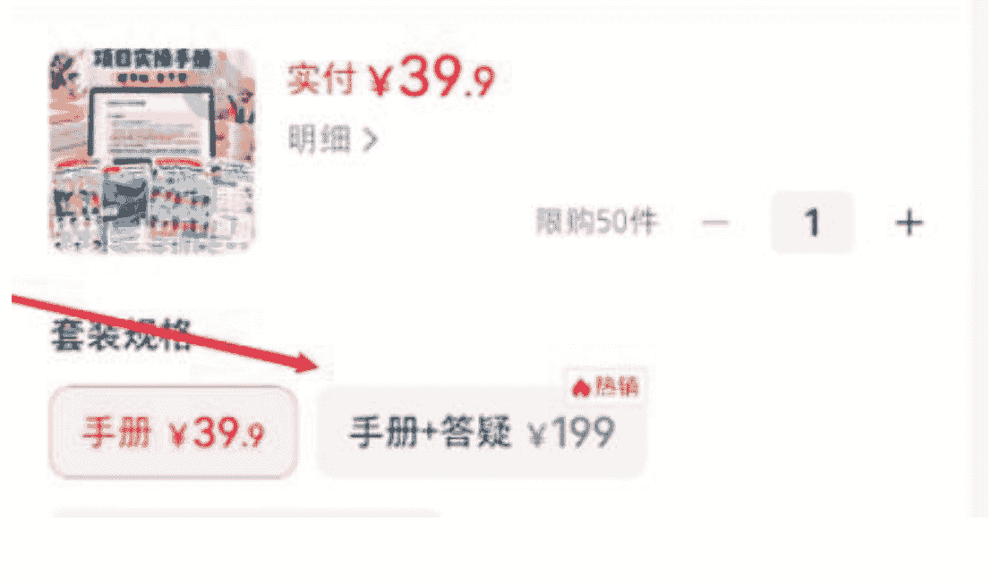

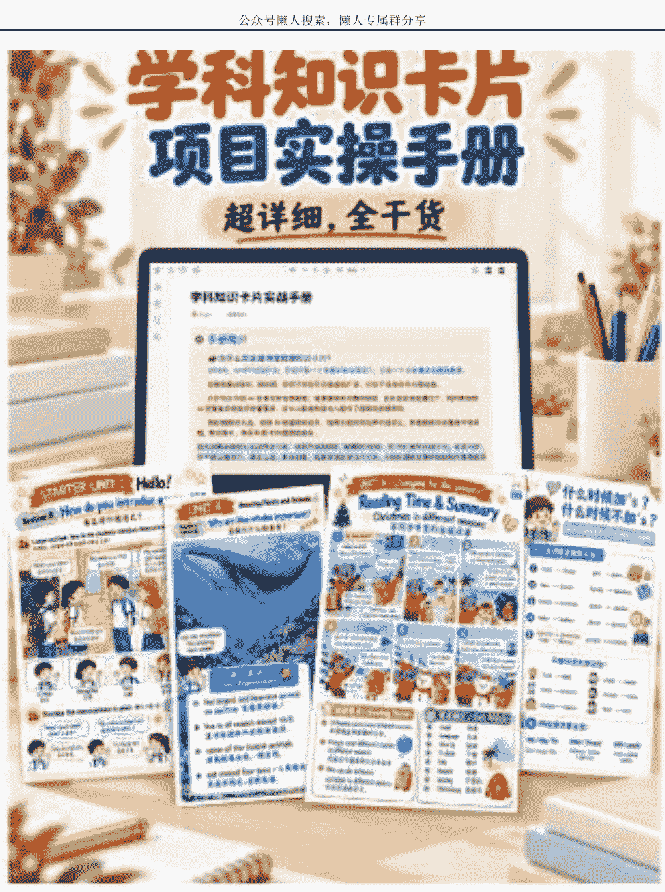

后面两天随着内容补充，手册整理到了约 2.5 万字、80 页，覆盖前期准备、选品、制作、商品包装和笔记发布。还会根据大家遇到的问题继续更新。

- 1. 两大内封的成品产品
- 2. 封底，设计封底的风格
- 3. 插图的风格参考
- 4. 需要制作什么内容？
  - 封面，封底的文字参考什么？
  - 封面，插图的风格参考什么？
  - 封底，插图的风格参考什么？
- 5. 封底，插图的风格参考什么？
  - 封面，封底的文字参考什么？
  - 封面，插图的风格参考什么？
  - 封底，插图的风格参考什么？
- 6. 两大内封的成品产品

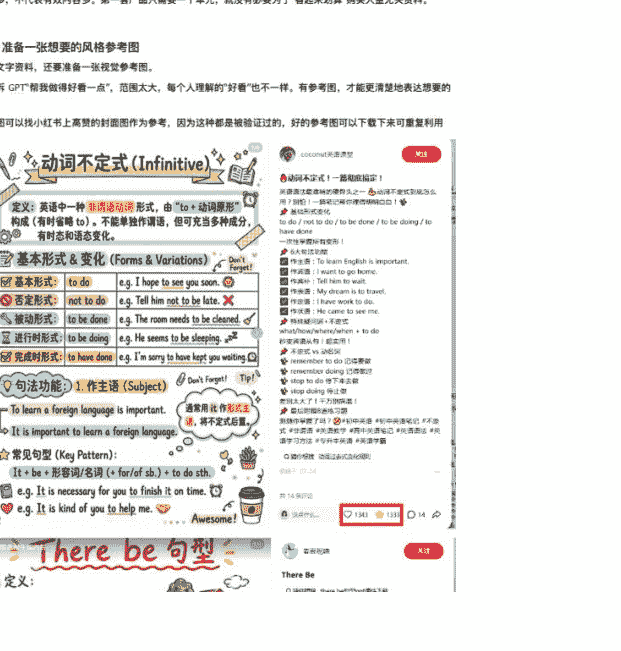

随着接触的用户越来越多，我也逐渐明确了这三个档位各自适合谁、重点提供什么：

- 39.9 元主打教程，适合自主学习能力强、愿意自己动手尝试的用户。
- 199 元主打社群，包含教程和答疑。我也会在群里分享一些好的选品和实用技巧，让大家做的过程中能持续交流。
- 999 元/月主打规划和推进。通过单人陪跑，帮学员理清接下来要做什么、安排具体任务，推动他们一步步往前做。

### 学习方式

目前一共分为 3 种方式，可以根据自己的需求选择：

**1. 完整版教程 | 39.9 元**
适合想自己研究、跟着教程一步步实施的朋友。
我会把自己实际跑通这个项目的完整流程整理进去，包括：
- 资料产品怎么做、具体操作流程截图、我实际使用的提示词、需要用到的 AI 和工具、以及小红书发布、运营和 AI 使用过程中的一些实操技巧。
- 不是只讲思路，而是尽量把每一步拆开，你可以直接对照教程边看边做。
- 教程后续有新的玩法、工具、提示词和实操经验，我也会继续更新。

**2. 完整教程包 + 专属社群 + 长期答疑 | 199 元**
包含上面的完整版教程，以及后续持续更新的内容。
同时会拉你进入我的专属社群。
你在实际操作过程中遇到问题，比如不知道怎么选资料、提示词怎么写、AI 生成效果不对、商品怎么做、小红书笔记怎么发等，都可以在群里问。
我看到后会尽量结合你的具体情况帮你分析和解答。
比较适合不想完全自己摸索、希望在实操过程中有人可以随时交流、少走一些弯路的朋友。

**3. 1V1 项目陪跑 | 1000 元/月**
包含上面的全部教程、工具、社群和答疑。
最大的区别是：不只是给你教程，而是直接带着你做。
我会根据你的实际情况，从前期选品、产品制作、商品上架，到小红书笔记发笔记、数据反馈、后续优化，一步一步带你往下推进。
每天会根据你目前做到哪一步，给你安排对应的任务和作业。
你做完后我会帮你看：
- 哪里做得不对、哪里需要修改、接下来应该做什么、数据不好应该怎么调整，再继续带你进入下一步。
也就是说，不需要你自己拿着教程研究完整个流程，而是我会根据你的进度持续跟进和调整。
以至少 1 个月为一个陪跑周期，目标就是把整个项目真正跑起来，并围绕出单持续测试和优化。
你负责认真执行，我负责根据你的实际情况不断帮你调整方向。

- 都需要提前准备好【小红书店铺】和可正常使用的【GPT】
- 如果你习惯自己探索，尽量选择第 1 种和第 2 种；希望过程中有人具体指导并且和群友交流成长、就

把这些信息集中整理好之后，省去了不少重复解释，也让用户在购买前能先看清楚内容和范围。

私聊时，我就可以更集中地讨论对方的实际情况，不用每次都从“这个项目是什么”开始讲。

## 六、两个店铺和公众号怎样配合

这里补充说明一下，我用的是两个小红书店铺：一个是销售学科资料的，另一个是卖教程产品的。

目前的整体配合的过程是：

学科资料店铺每日实操发笔记上品 → 积累制作经验和用户需求 → 发布公众号文章 → 读者进入私域或教程店铺 → 购买教程或指导服务。资料店铺本身有销售收入，也为公众号提供持续的写作素材。

制作时遇到的问题、销售情况，以及用户的需求反馈，都能写进公众号文章里。

公众号让想学习的人看到我的实际操作，教程店铺和私域再承接学习需求。

学员开始操作后，又会带来新的问题和反馈，帮助我继续修改教程。

比如，大家最常卡住的地方，就是批量生成的图片会跑偏。针对这个问题，我在教程里单独补了一段提示词，方便大家在批量生成时使用。

还收到了不少学员的反馈和报喜，也让我觉得，这件事值得继续做下去。

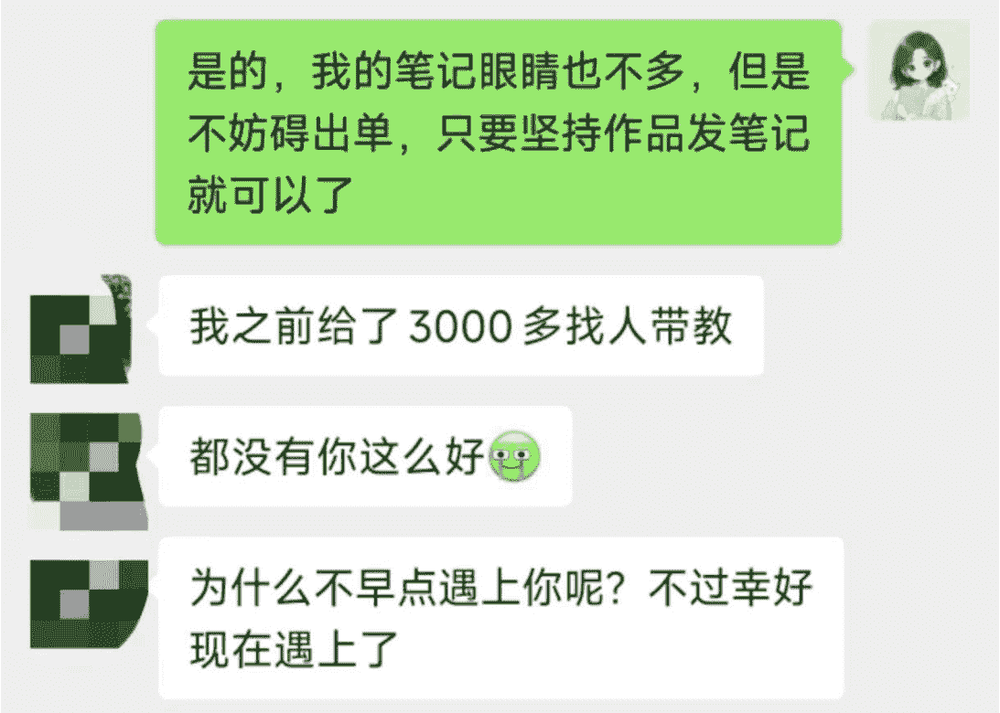

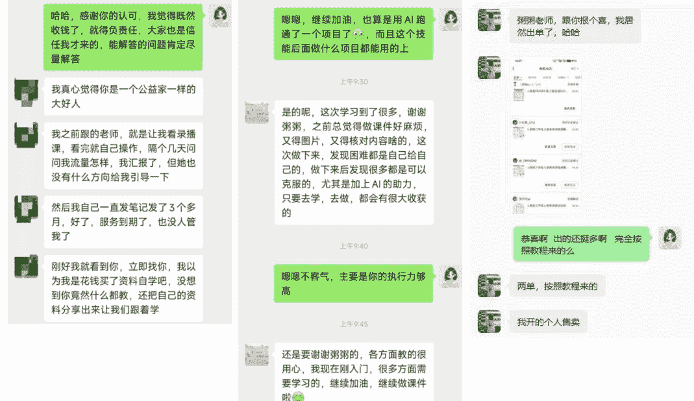

这样，做项目、写文章、整理教程就像齿轮一样卡在了一起，围绕着同一件事不断推进。

## 七、配套需求带来的额外收入

除了资料、教程和陪跑，我还有一部分公众号流量主收入，以及合作推荐的佣金收入。

来咨询的用户中，有些还没有准备好使用GPT的网络环境和账号，也有人需要电子资源类目申请方面的协助。

针对这些需求，我找了相应的合作方，介绍成交后，按约定获得返佣。这也是目前项目收入的一部分。

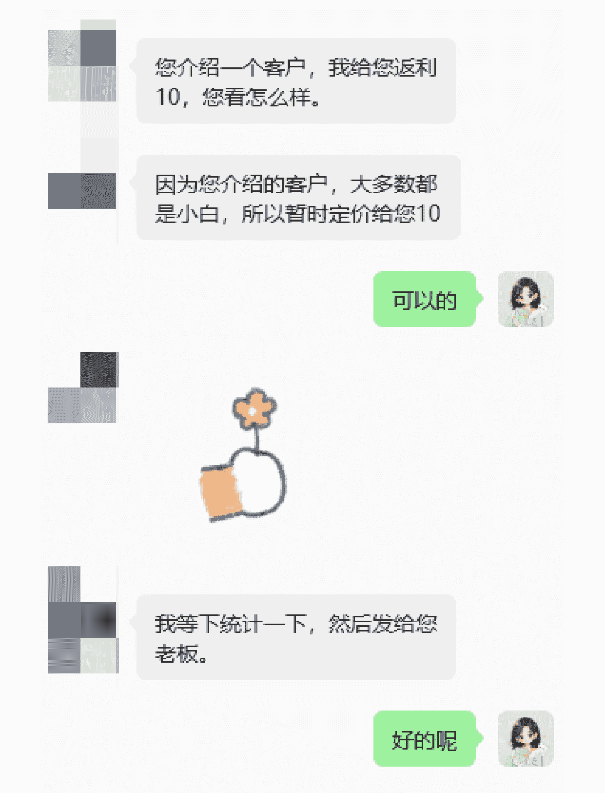

## 八、这次尝试，让我更确定了自己的方向

回头复盘，这次的私域项目能做成功，并且我觉得能长久做下去，和前面的积累有很大关系。

做知识库的经验，帮助我整理和交付私域教程；做教师 AI 项目的经验，用在了学科资料制作上；之前遇到的平台问题，也成了后来答疑时能分享的经验。

如果圈友想借鉴这套打法，我觉得可以先从几个具体的动作开始。

> 先选一个自己能判断质量的产品，完整做一遍。过程中把数据、用户反馈和遇到的问题留下来，再写成几篇公众号真实记录。当有人反复问到同一个问题时，再考虑是否值得整理成教程或服务。

工具方面，先选自己用得顺手、能完成工作的方式。我试过不同工具，最后还是留下了更适合当前流程的聊天框模式。

内容方面，先讲清楚一个具体问题。我这次的公众号选题，基本都来自自己正在做的事，也更容易拿出实际过程和反馈。

用户咨询多起来之后，再把重复介绍整理好，让大家先了解项目和服务内容，再决定要不要购买。

这次做下来，我确实愿意继续研究、继续写。

每天做过的事能留下产品和内容，积累的经验也能帮助到有相似需求的人。

这和我最初想做个人 IP 的方向，更接近了一些。

这是我加入生财第三年的第一篇复盘。和很多圈友相比，这次的成绩还很小，但对我来说，能找到一个愿意持续投入的方向，已经是很大的收获。

把这段经历写出来，也是想和大家多交流。

项目还有不少需要完善的地方，欢迎各位圈友大佬帮我指出问题，多提建议。

————分割线————

看完这篇 SOP，你觉得你懂了。但 90% 的人一到实操就会卡在第一步。

工具和教程只是最低级的壁垒，真正的壁垒是“立刻动手”和“圈层信息差”。

如果你想看全网最新的变现玩法，并且和一群执行力极强的极客一起下场拿结果，欢迎围观我的核心私域：【懒人专属群】。

我们不聊虚的，只做商业闭环的拆解与AI效率的压榨。系统内已沉淀 1000+ 跑通的套利实战局。

- 查阅圈子完整数字资产与上车门槛：

[https://lazyyso.com/insider/](https://lazyso.com/insider/)

认同价值、准备好下场干活的，扫码加我微信（lazyhelper1）

备注：【实操上车】，不闲聊


