## 医生、教师、科研人员：“荣誉性职业”市场化的死路与未来

260928 大浪淘沙付费
整理：公众号懒人搜索，懒人专属群精选
懒人微信：lazyhelper1

> 小懒判断 | 医生教师科研一线从业者值得读这篇续篇，它把越干越累的根源算到分配头上；想找转行攻略的可以划走。最扎眼的是美国联合健康把 AI 拒赔当盈利核心，算法错误率 90%照用，65 岁以上老人拒赔量三年涨 9 倍。坑在于照搬北欧古巴模式的前提是财政有钱加政府清廉，文中没给实现路径，只能当参照系不能当路线图。

由于字数超过单篇推送的上限，因此分为两篇文章更新，本文继续《医生、教师、科研人员：“荣誉性职业”共同的困境》所探讨的内容。在上一篇文章中，主要分析了同一职业外壳下存在着截然对立的阶级分化：掌握资源分配权、学术权力和定价权的学阀、院长、校长、学科带头人，与承受超负荷劳动、被畸形规培和晋升制度束缚的基层医生、普通教师和青年科研人员，分属不同的阶级阵营。

所谓的“医患矛盾”“家校冲突”本质上是被转嫁的阶级矛盾——规则的制定者和资源的掌控者通过制度设计，将服务过程中的负面后果转移给一线执行者，同时保留了解释权和修改权。

在此基础上，这类“荣誉性”职业还具有“市场调节失灵”的共同特征：一方面，生命健康、子女教育和基础研究的需求具有刚性，价格无法有效调节供需，需求曲线近乎垂直；另一方面，这些服务的质量和结果高度依赖从业者的个人素养，且难以被外部验证，导致市场无法通过优胜劣汰机制进行有效筛选。

因此，这些职业既无法完全依靠市场逻辑运转，又难以建立纯粹的行政指令体系，陷入了“既要市场经济的效率，又要计划经济奉献”的制度拧巴之中。这二者叠加就是当前“荣誉性”职业的困境。

怎么办？是本文需要探讨的内容。

首先我们需要明确：当前的一切问题都是资源分配的问题。

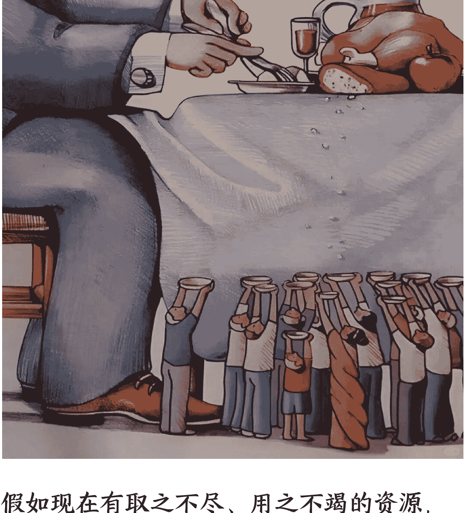

假如现在有取之不尽、用之不竭的资源，给每个医生老师工资加一百倍，自然就会源源不断新人涌入这个行业，来解决人手不足、工作时间饱和无法精细化服务的问题。亦或是幻想随着生产力的发展，AI+机器人可以替代大量的人类服务，让他们去当医生老师，以后医闹去找AI闹、家长投诉去投诉AI。

但是，就算我们当今给医疗、教育、科研行业增加了大量的预算，依然要经过“分配”这一环节，掌握权力关键节点的院长、校长、学阀们，究竟是会做出有利于既得利益团体的决策，还是真正把资源用来为全社会谋福祉，这个结论不用我明说了吧？

我反复举这个例子：如果不讲分配，宁德时代已经做成了全球第一，每个大股东分红以亿为单位，员工依然996、依然只涨寥寥无几的工资。

如果不讲分配，比亚迪已经成为了新能源汽车的霸主，但是上下游供应商依然被压款，他们依然被极端压缩利润空间以满足地位更高、能力更大的上游厂商的利润，这些中小企业依然举步维艰。

如果不讲分配，福耀玻璃早就是汽车玻璃领域全球第一，市场份额比第二第三加起来还多，但是福耀玻璃生产工人依然是十二小时两班倒，老板曹德旺宁可把钱捐给寺庙也拒绝给工人涨工资。

如果不讲分配，美团已经垄断外卖市场大部分份额，但依然是“一鱼三吃”：吃商家、吃骑手、吃消费者。商家和骑手叫苦不迭，消费者也没有享受到真正的实惠，反而互联网垄断企业却可以把利润悄悄分散隐藏进诸多“关联企业”之中，完成巧妙的财务报表“苦肉计”。

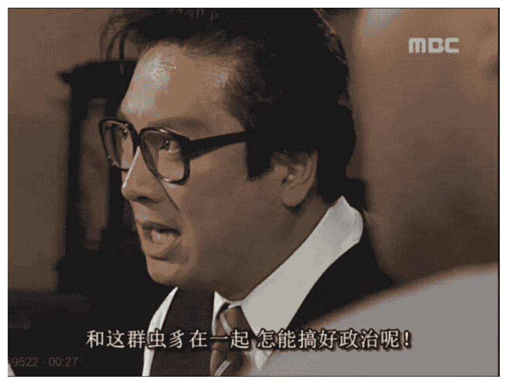

反观胖东来，它没有什么互联网+尖端科技叙事，它没有什么星辰大海的愿景，它没有宣扬什么只要干翻了美国一切都会好转起来的，但是它讲分配，它就能造福几万员工和一方百姓。

我们作为唯物主义者，从来不反对生产力的发展，生产力决定生产关系，科学技术代表着未来的方向。但是，建立与生产力匹配的分配制度，是在生产力发展之后的第二个关键性问题，否则生产力发展将无法落地。

这就好像现在很多人天真地寄希望于 AI+机器人能够带来生产力无限爆发的新时代，很多问题就可以迎刃而解，然后自己就可以躺着不工作了。但是如果不讲分配，AI和机器人带来的超额利润完全变为了资本增殖的工具，变成了垄断资本更好地渗透经济方方面面的助手，变成了资本家更好地操控工人的帮凶。

在本文的分析中，我将采取实证分析法，介绍美国、日本、北欧、古巴、以及新中国前三十年，具体在医疗、教育、科研领域“分配问题”的正面经验和反面教训，见贤思齐焉，见不贤而内自省也，为解决当下的问题提供一些思路。

### （七）福利国家

于是，结论也就呼之欲出，要解决这一困境，就必须呼唤政府职能的回归。若说要回到计划经济，再用荣誉去激励医生和教师，那是胡说八道。国家要承担起社会福利相应的责任，财政要发挥应有的作用，而不是要把这一项成本变相转嫁给基层医生、护士，再进一步转嫁给基层老百姓。

很简单的道理，财政支持给足，医疗工作者待遇提上去，还怕医疗行业人力短缺吗？医生护士还用得着连续几十个小时加班不合眼吗？我们要继续向前看，前方的路途中，福利国家是一个必然的选择。

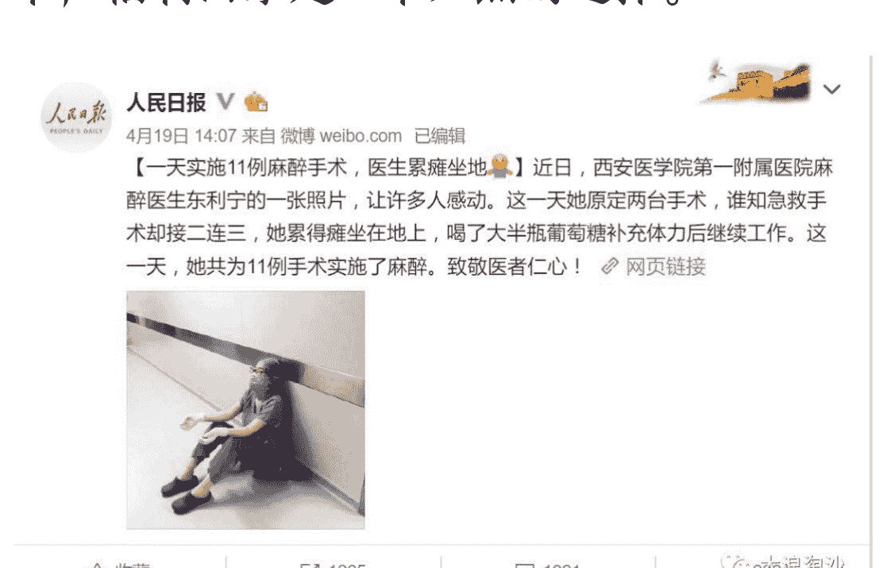

我在之前的文章里讲过我国社保制度的历史，早在 1997 年建立社会保险制度的时候，大量已经退休或接近退休的人从来没有缴纳过养老金、医保金等社保费，这时无论是企业还是个人都无法补缴以前并未缴纳的费用。但⽽国家经济体制改革，已经退休和正要退休的职⼯，必须⽴即纳⼊社保体系，享受相应的权⼒，领取真⾦⽩银。

由于退休的⽼⼈数量庞⼤，资金需求量非常⼤。为了使现收的钱够⽤于现付，社保费率被设计得非常⾼，⽽领取养⽼⾦的替代率则相对低，也就是征收的⾼费率和支付的低保障。但是即使这样，钱仍然不够，⼜将职⼯个人账户积累的基金挪⽤于当前的发放，形成所谓“个人账户空转”。这就是说，虽然当时设计的是“统账结合”，但是在执⾏中有许多不得不解决的迫切问题挤占了优先级。

另外还是要说的是，虽然我的祖辈没有缴纳社保，但是他们完全是为国家奉献了⼀辈⼦，他们享有的只有荣誉，没有经济利益。他们也贡献了⾃⼰的“剩余价值”，然⽽在当时的语境下这是全民所有，国家代替你们积累，国家包你们⼀辈⼦的所需所求。虽然说老⼀辈⼈往⾼风亮节，只想为国家为民族做奉献，⾃⼰的待遇福利不争不闹；但是市场化时代养⽼就是⼀个非常现实的问题，就是得花钱。

问题在于，我们祖辈三⼗年积累下来的国有资产，有多少被⽩菜价卖掉了，有多少官商勾结下的美其名曰“带来有竞争性的先进模式”事实上就是抢劫。换句话说，我们祖辈的养⽼⾦本来在国有资产里面，但是已经被贱卖了，只好靠当⼤年⼈缴纳的社保来补。

国有资产私⼈化是⼀段漫长的历史，这其中的例子举不胜举。说一个几年前的例子大家感受一下，2019年5月9日，新华社消息，云南省委原书记秦光荣“主动投案”，正在接受中央纪委和国家监委纪律审查和监察调查。

据《中国经济周刊》的报道，秦光荣此番主动投案，是因为他的儿子秦岭已经在数日之前被带走调查。秦岭曾任华融投资股份有限公司董事会主席，该公司属“华融系”旗下。2018年4月17日，华融系一把手、中国华融资产管理股份有限公司党委书记、董事长赖小民落马，其后华融系多位高管被带走调查，秦岭也是其中之一。

关于秦光荣的“光荣历史”，离不开国有资产贱卖，《侠客岛》有一篇报道中写道：

> 曾任云南省政协副主席的杨维骏，曾向中央纪委实名举报白恩培和秦光荣……烟与矿，云南GDP的支柱。在杨维骏的举报信中，白恩培主政期间，云南发生多起贱卖矿案，包括将“价值五千亿的兰坪铅锌矿，让刘汉以10亿就控股60%，一举掌控了这个亚洲最大、全球第四大的超级矿区”。

据媒体《廉政瞭望》透露，2003年初，全球第四大锡矿——文山都龙锡矿在改制过程中，以增资扩股形式被贱卖，一家地产公司以1900余万元控制了这个潜在价值数千亿元的矿产。“该公司董事长蒋政江，籍贯湖南永州，有一个异姓兄长都在都龙锡矿改制期间任职云南省委常委”。秦光荣就是湖南永州人。秦光荣1999年调任云南后的15年时间里，有不少湖南商人尤其是从事房地产行业的商人来到了云南；他们没押错室，赶上了十几年大拆大建的好时光。

> > **凤凰财经 V** 5月10日 10:17 来自 微博 weibo.com 已编辑
> 【云南白药创始人在“哭泣”：凭什么把我捐给国家的宝藏卖给私人老板？】云南白药借混改之名行私有化之实？1956年2月，全国解放后，曲焕章遗孀缪兰英把白药秘方献给了新中国，由昆明制药厂生产，并且将曲氏白药更名为“云南白药”。工商资料显示，2018年7月@云南白药 控股宣布福建前首富陈友树接任公司法定代表人，并出任公司董事长。人们才猛然发现，这家著名的老字号医药企业也落入了私人手中，而这一次，是以“混改”的名义。为什么要将不缺钱、盈利能力很强、效益很好的优质国企私有化，背后有什么利益输送？@云南白药创始人在“哭泣”：凭什么把我捐给国家... 收起全文 ^

所以说有一些“先富起来”的人，他们占了时代和政策红利，廉价赚取了包含着一辈养老金的国有资产，现在为了全民的社保、福利、医疗，出一点血于情于理也都说得过去吧？

关于福利国家的建设，有两个正面的例子和两个负面的例子，还有一个历史的例子，都可供我们参考、学习反思。两个正面的例子是北欧和古巴，两个负面的例子是美国和日本，我们综合全世界各国政府和政府的经验教训，来看一看“解药”在哪里。

### （八）资本主义的社保困境

美国医保体系的问题很多，之前的文章里也或多或少分析了不少，简而言之就是：公立医院能等死人，私立医院能贵死人。穷人，是“不配”活下去的。最典型的例子就是我最近创作的《当代三义士》系列的其中一位义士路易吉。

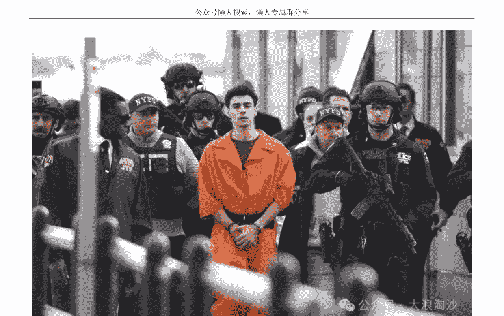

他射出了三枚子弹。

- 第一枚子弹上刻着“delay”（拖延）：这是保险公司最经典的拖延战术。他们用繁杂的流程、永远需要补充的材料，将理赔拖入漫长等待，许多人在耗尽时间与耐心后，最终被迫放弃。
- 第二枚子弹上刻着“deny”（否认）：保险公司总能从厚厚的合同条款中，找到诸如“不在承保范围”或“属既往症”等理由，干脆利落地拒赔，将经济风险瞬间转回患者身上。
- 第三枚子弹上刻着“depose”（驳回）：这是保险公司最坚固的法律后盾。当少数投保人坚持诉诸法庭时，公司庞大的法务团队会利用取证、听证等一切程序，在宣誓证词中捍卫其决定的“合理性”，用高昂的成本和漫长的诉讼拖垮挑战者。

这三枚被义士“附魔”的神圣子弹，射向了一个吸血鬼——美国最大的商业医保公司联合健康集团 CEO 布莱恩·汤普森。

# Thompson's Murder Sparks Debate Over Healthcare Inequality

The GiveSendGo fundraiser was launched on 9 December 2024, the day Mangione was arrested at a McDonald's in Altoona, Pennsylvania. He was charged with first-degree murder and terrorism-related homicide but has pled not guilty.

Authorities revealed that shell casings found at the crime scene were inscribed with the words 'delay', 'deny', and 'depose'—terms often associated with insurance company tactics used to reject claims and avoid payouts.

This discovery has intensified speculation that Thompson's murder was politically motivated, with some viewing Mangione's alleged actions as a desperate response to systemic injustices in the US healthcare industry.

布莱恩·汤普森职业轨迹本身就是一部“吸血致富”的教科书。他长期负责公司财务与成本控制，核心工作就是“优化理赔规则”其 2017 年，他开始执掌利润最丰厚、争议也最大的 Medicare Advantage（联邦医保优势计划），主要针对 65 岁以上老人的保险理赔。

2021 年，当他坐上联合健康保险 CEO 宝座时，他已完全精通如何从医保体系中榨取最大利润。在他的任内，公司净利润从 120 亿猛增至 160 亿美元，而他个人的年薪也超过 1000 万美元。

2021 年 6 月，汤普森上任仅 2 个月，就推出了一项引发全行业抗议的政策：对急诊就诊费用实施回溯性拒赔。简单来说，患者在紧急情况下以为自己是急症、去了急诊室，事后保险公司会根据最终诊断结果，判定这次急诊“非必要”，拒绝报销全部费用，让患者独自承担动辄上万美元的急诊账单。

这项政策推出后，立刻遭到了美国医院协会的公开谴责，协会在给汤普森的公开信中直言：“患者不是医学专家，不可能在突发状况下判断自己的病情是不是急症，你的政策会让患者在生死和破产之间两难，直接危及患者的生命安全”，并强烈要求他立刻撤回政策。但这封抗议信石沉大海。

汤普森最核心的“功绩”，是将保险业的拒赔潜规则，变成了系统化、规模化的盈利核心。他直接推动公司的整体拒赔率达到32%，是行业平均水平的两倍。这意味着，近三分之一的理赔申请被拒绝。他尤其针对最脆弱的老年群体，大幅提高专业护理和康复治疗的授权拒赔率——针对65岁以上老年人的拒赔量从2019年到2022年暴涨了9倍；针对术后康复护理的授权拒赔率，从2020年的10.9%飙升至2022年的22.7%。

2024年10月，美国参议院国土安全常设调查委员会发布的官方调查报告明确指出：汤普森治下的联合健康，系统性地滥用事前授权规则，大量拒绝医生明确判定为必要的治疗与护理，直接导致大量老年患者延误治疗、病情恶化甚至死亡。

为了实现效率最大化，汤普森力主引入AI系统来主导拒赔流程——这套系统的核心是名为nH Predict的算法，只需输入患者的年龄、身体机能等信息，就能自动预判患者需要的护理时长与赔付额度，一旦超出算法预判值，就会自动拒赔，完全无视主治医生的专业判断。2023年的集体诉讼文书显示，联合健康内部明知这套算法的拒赔错误率高达90%，却依然在全公司推广使用——因为每一次自动拒赔，都能为公司省下一笔赔付金，而绝大多数老年患者根本没有能力、没有精力去申诉。

在个人层面，汤普森也将贪婪践行到底。2024 年，他被股东指控涉嫌内幕交易：在得知公司将面临司法部反垄断调查的利空消息前，精准抛售股票，套现 1510 万美元以躲避股价下跌。

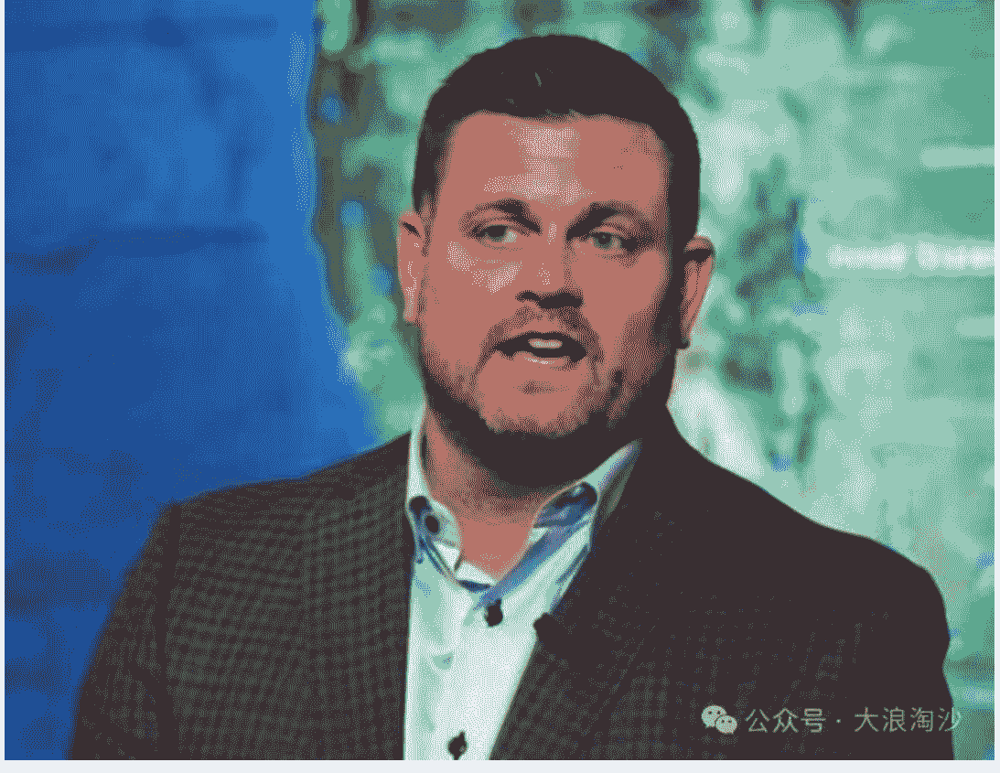

因此，在无数受害者眼中，布莱恩·汤普森就是这个吸血体系中最大的吸血鬼：他将无数家庭的医疗焦虑、患者的痛苦呻吟、老人的临终尊严，转化为财务报表上跳跃的利润数字，再注入自己的天价薪酬与股票账户。

讽刺的是，汤普森这种顶层精英，是规则之外的特权者，他手握规则生杀大权，自有顶级私人医疗随侍左右，连医保体系的门槛都不必触碰。这套“拖延、拒赔”的吃人规矩，从来只困得住挣扎求生的底层百姓，困不住制定规矩的吸血权贵。

这世间本没有正义，但是有英雄来执行正义。

“delay, deny, depose”——英雄专门刻在子弹上的这三个词，是对吸血鬼们的诉状，是判决书，最终也成了墓志铭。布莱恩·汤普森，这位保险帝国的高阶吸血鬼，最终以一种极具讽刺意味的方式获得了另一种“不朽”——他将不再作为亿万市值的商界精英被记住，而是作为“delay, deny, depose”这三重诅咒的化身，被永久钉在关于这个时代之病的叙事里。

那三枚附魔的子弹，成为了刺穿资本金钟罩的附魔利刃，也是英雄留给这个扭曲世道的一封血色浪漫战书。

2 of 4 | Bullets lie on the sidewalk at the scene outside the Hilton Hotel in midtown Manhattan where Brian Thompson, the CEO of United Healthcare, was fatally shot, Wednesday, Oct. 4, 2024, in New York. (AP Photo/Sefatin Jeremiah)

美国前任总统奥巴马在竞选时，最引人注目之处除了他的种族和肤色，就是他的医改方案了。奥巴马的医改方案其核心关键词有两个：“广覆盖”和“低成本”，最终目的是为美国全民提供“可以负担得起”的医疗保险。在美国，有 4600 万左右的人缺乏医疗风险保障——他们属于既买不起商业保险又得不到政府资助的中低收入阶层。其比例占美国人口的 15% 以上，其中 80% 为工薪家庭——奥巴马医改计划的核心就是要为这 15% 的美国人建立起保障体系。

为此，奥巴马政府推进的法案包括并不限于：建议成立公管医疗保险，管制私人市场转保，由私人健保转到公营健保。现时法案建议限制美国全民买健保，并不容许保险公司因疾病等借口对受保人拒保，或擅自增加保费等等。

但是，奥巴马的医改计划触及了精英阶层的利益。精英阶层有着成熟的商业保险体系，并不需要国家提供的相对低效率和廉价的医疗服务，但是他们还要为这一项普世的计划多缴纳税收和保费。共和党 and 民主党 of the rule of law differences in the healthcare bill fight has been reflected to the extreme: On January 20, 2017, the 45th U.S. President Donald Trump took office, signed the first executive order in the Oval Office, which was to abolish the relevant policies of the Obama's healthcare reform. It can also be seen that this issue is highly controversial and difficult to advance. So it has been in limbo, returning to the original starting point, and the problems that should exist in American healthcare are still unresolved.

很多文艺作品中都有对美国医疗市场问题的客观展示。比如经典作品《绝命毒师》中，担任高中化学教师的“老白”就因为巨额的医疗费用，才产生了制毒贩毒赚钱的想法，从此走上了一条不归路。

虽说老白这个角色非常经典非常复杂，推动他前进的动机也有多重，但是不可否认的是，他最初制毒的原动力就是因为没钱看病、想活下去，而且他还不是贫穷阶层，是有着固定职业、温暖家庭的小康之家。

《绝命毒师》中还有一个情节更加赤裸裸：老白的连襟——缉毒警察汉克，被毒贩袭击身受重伤，但是就连因公受伤的缉毒警察都无法得到最好的治疗，而且很可能因此落下终身残疾。最后老白用他贩毒的钱去支援汉克一家，才让汉克得到了最及时、最好的康复治疗。缉毒警察用毒贩赚来的脏钱才能得到及时的治疗、恢复健康，这就是最滑稽也是最露骨的讽刺。

在好莱坞大片《阿凡达》中，也有着类似的情节：士兵杰克·萨利的脊椎伤无法治愈，必须要到遥远而危险的潘多拉星当雇佣兵才有钱能治愈。这个台词也很精炼，就是我们上面提到的美国医疗两大问题：要么等死人，要么贵死人。

虽然《阿凡达》是一部未来世界的架空题材作品，但是这依然能反映出编剧和导演在他们的潜意识中，即便到了星际殖民的时代，美国依然无法解决医疗问题，这比电影本身所体现的更加有趣。

有人说《阿凡达》里的男主本来是人类，结果叛变到了外星人那里，做了“人奸”，这个情节太过于环保主义政治正确。我说不对，还有更深层次的问题。雇佣兵萨利在人类社会是个底层的“虫子”，奉献青春为国征战但身体残疾却无钱医治，被跨星际资本当成工具，他从来没有找回过真正自己。但是在潘多拉星、在纳威人的部落里，他被真正地当成了一个“人”——他不再是被蔑视的老鼠、不再是杀戮与掠夺的工具，所以他宁可抛弃星际文明而拥抱原始部落，因为在这里他才没有被压迫被剥削被异化，他才成为了真正的杰克·萨利。

电影一开头就有在酒吧里，杰克出手教训了一个殴打女性的人，在座的多少七尺男儿无动于衷，而只有一个坐轮椅的残疾人拍案而起；最后打女人的人没有事，杰克被保安扔出了酒吧。这就证明了他有一颗金子般的心，也证明了一个金子般的心无法存在于污浊的社会。卡梅隆的电影细节信息非常之多，没有一秒钟是白给的。

言归正传，我们简略地谈了谈美国医疗和社保的问题，再来看一看另一个发达资本主义国家：日本。日本在 1961 年就建立起了全民社保，其覆盖范围之广、福利待遇之高在当时世界都是数一数二的。但日本人引以为傲的社保体系仅仅维系了三十多年就已经分崩离析。NHK 的纪录片《日本社保危机》就给我们全面展现了这一危机下日本人民生活的图景。

日本的社会保险分为四种，其中年金就是养老金，生活保护就是失业保险、最低生活保障，大致相当于我们的五险一金。日本的社保号称是全民覆盖、全民免费医疗，但是仅在 2008 年就有 475 人因为没有保险、无法承担医疗费用而死亡，纪录片的摄制组跟踪了这些案例，发现没有交付社保的唯一理由就是——穷。

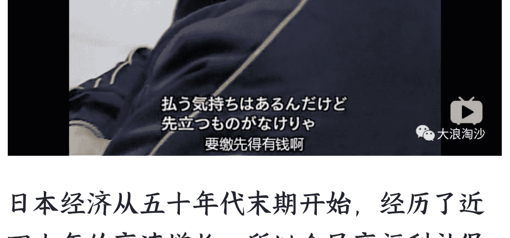

日本经济从五十年代末期开始，经历了近四十年的高速增长，所以全民高福利社保还是可以人口红利、经济发展红利来维系的。但是随着经济泡沫破裂，尤其是老龄化的加剧，日本社保体系显得不堪重负。

老龄化的负担主要体现在医疗保险上（因为他们的养老金都是自己独立的账户，相当于国家帮他们存着帮他们理财，所以昭和时代的老人如果不生大病，普遍过得很富有）——看病的人多了，交钱的人相对少了。那么国家做的只能提高社保缴纳金额。

在社保加码之后，一方面劳动者的生活出现了困境，纪录片中就记录了一个受访者，为了交齐社保被迫租更小的房子；另一方面，对于企业的压力也大大增加。据调查，有83%的企业认为日本社保负担过重。纪录片中也展示了一个因为拖欠社保金而面临破产的企业。但是，企业面对国家是弱势群体，劳动者面对企业是弱势群体。

企业的负担，还是通过种种方式转嫁到了劳动者身上。日本企业的做法就是通过雇佣大量“临时工”的方式避免交付社保。纪录片中就展示了，许多劳动者干得好好的就被莫名解雇，再以临时工的方式雇佣，企业还利用法律的空子避免解雇赔偿金。近十年来，日本非正规雇佣员工数量飞速增长，与之相对应的是正规雇佣逐年下滑。

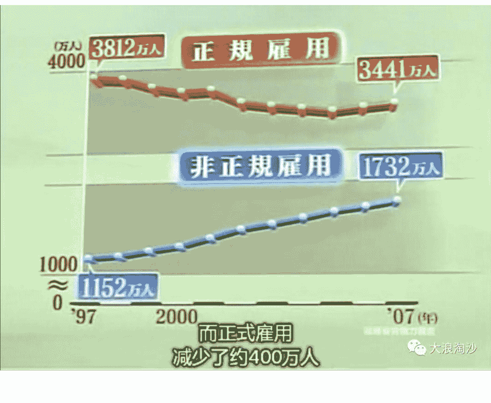

在 1995 年的日本经济白皮书中，更是赤裸裸地给企业提出建议：只给中层管理人员交社保，其余的工作全部雇佣临时工。这就相当于企业把国家甩给它的锅又甩在了劳动者身上。而劳动者们只有两个选择：要么找不到工作，要么就只能成为临时工——不享受社保。

所以说弱势群体为什么叫弱势群体，就在于很多时候他们没得选。纪录片中也展示了很多人间惨剧：许多“临时工”因为负担不起医疗费用而无法得到有效医治，甚至连工伤也不能得到应有的保障。前一阵上映的日本电影《小偷家族》中，就有正式员工被解雇、临时工工伤情节。

对于日本劳动者面临的现状，纪录片中采访的这位教授基本都在喷企业。说企业这种中层管理人员交社保、体力劳动工人没社保，仿佛让日本回到了封建等级制的年代，还要搞出一个贵族武士阶层。

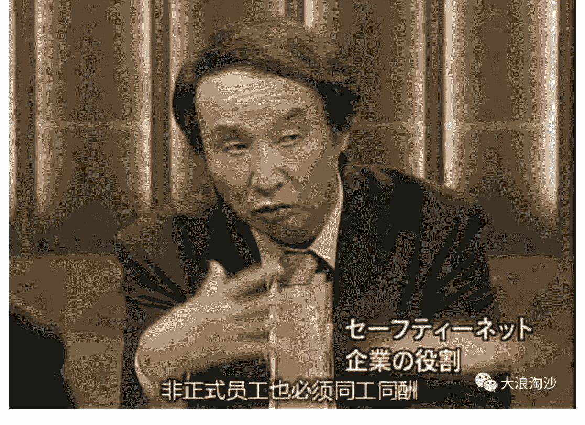

这位教授不但头发往左梳，立场也挺左的，比众多微博上的精神资本家不知道高到哪里去了。其实了解一下全世界就可以发现，精英像我们这么“右”的其实挺少见的。

危机的影响是全方位的，一方面劳动者被高额保险压得不堪重负；一方面企业也担上了沉重的负担，经济愈发丧失活力；另一方面国家也不好办，巨额的账户亏空只能让国家选择削减社保开支：

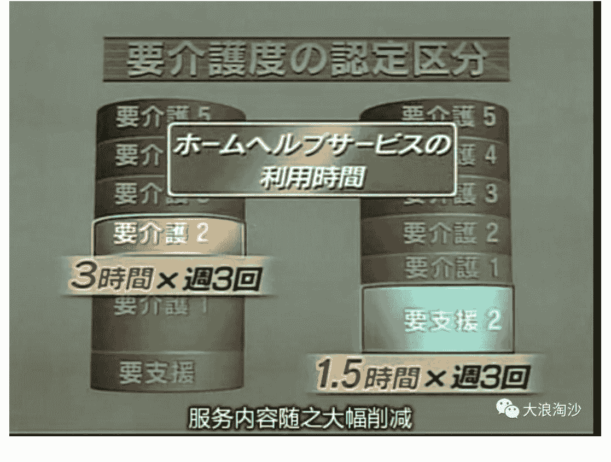

于是，本来能报销的费用、能提供的服务，都随之削减。这样一来，依靠社保的老人、病人、失业者的生活都受到了灾难性的影响。纪录片中就有一位脑溢血的老人，本来在正常的康复疗程中，但因为服务内容的削减，只能依靠自己康复，健康状况瞬间恶化；还有一位单亲妈妈，因为失业保险的削减，大儿子被迫退学打工；而二儿子因为每天无法带午饭去学校而开始厌学。

所以我们看到了发达资本主义国家关于社保的两种模式，一种是美国的明修栈道：直接放弃了中等以下收入工薪阶层的医保；一种是日本的暗度陈仓：削福利、削待遇、企业雇佣临时工。这两种例子都不值得我们学习，相反需要我们引以为戒。那么正面的例子有没有呢，北欧就是一个。

## （九）来自斯堪的纳维亚的先进经验

北欧诸国无论是人均 GDP、贫富差距（基尼系数）、人类发展指数（HDI），还是国民幸福程度、政府清廉程度、自然环境保护都居于世界前列，是有很多值得学习和借鉴的地方。

首先必须要明确的是，北欧的发展是基于资本主义全球发展的基础，西方社会殖民世界三百年，这其中收益它们是共享的。所以北欧的成就，首先是源自于一个先发制人的优势，直接站在了金字塔体系的顶端。这样一来“先富起来”就變得尤为重要了。举一个例子，诺贝尔把约合 920 万美元的遗产作为诺贝尔奖金，那么诺贝尔奖每年发六个，每个 1000 万克朗（约合 140 万美元），发了这么多年，怎么还没发完呢？原因就在于这笔遗产一直在做理财、在增值，就好比一个雪球从山上滚下去越滚越大、越大越滚。以小见大，北欧诸国的财富积累也是这个道理。再如瑞典、丹麦两国，利用先发优势积累了大量科技专利，申请专利就是把技术“资本化”，专利的使用费就是资本利息。可见及早站在金字塔的顶端获得“体制红利”有多么重要。

这个“红利”还包括在经济全球化中的持续获利。众所周知，我们初中课本就讲过“剪刀差价”的原理，资本主义发达国家可以通过这个不平等贸易持续全球吸血。但有人会问，北欧诸国并不太多与第三世界直接发生贸易，他们怎么获取剪刀差价呢？米歇尔·波德的《资本主义的历史：从 1500 年至 2010 年》专门分析过这个问题，他在书中给出了几个不同的模型，结论就是美英法德日这些国家，有一种模型从全球吸血；而欧洲的小国寡民，同样也在全球吸血，只不过他们的价值流动方式多了几道弯而已。有兴趣的朋友可以去看，这里就不再赘述。

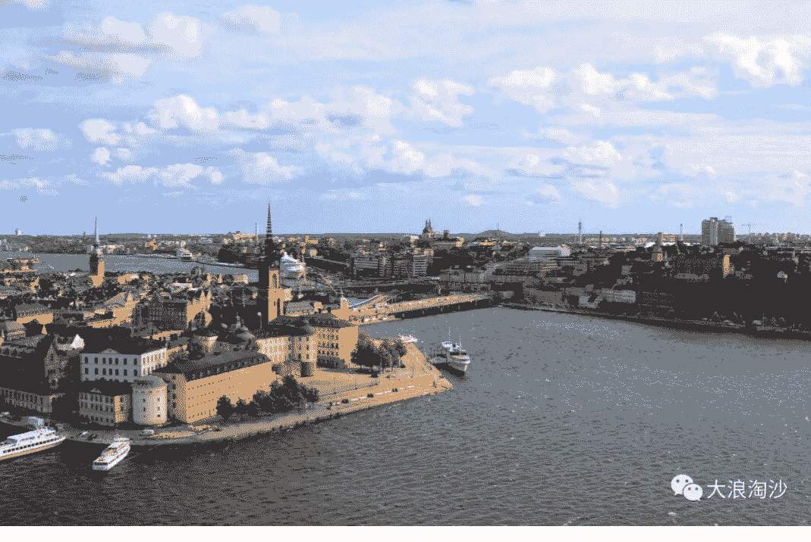

北欧的发展，可以说是“天时地利与人和”缺一不可。但除却“天时、地利”这些无法复制的客观条件，其国家建设、社会发展、制度文化等都是有许多宝贵经验值得我们去学习的。

挪威的经济发展与石油密不可分，但有了很好的自然资源基础，也得能很好地利用才行。像中东地区也是“富得流油”，但基本都是一些皇室在“流油”，绝大多数普通人还在温饱线上挣扎，国家的经济结构也非常不健康。而同样有用丰富油气资源的挪威，很早就建立了基于石油的主权基金 Government Petroleum Fund，这笔基金一直在增值，甚至出乎许多唱衰者意料，扛过了 08 年金融海啸和前几年的油价崩盘。同时，这笔基金的收益大量服务于公益事业、科技创新和教育产业，形成了一个良性循环。

除了国家主权基金，北欧诸国大量行业都是国有资产垄断的，尤其是事关国计民生的基础性行业。所以说公有制就是好，这不是虚话。但前提是公有制是真的能够惠及于全民的“公有制”。要单纯依靠特权和垄断收割大量利益，却仅仅服务于少数家族和团体的特权；抑或对内压榨基层员工，对外通过权力寻租将公有资产廉价转让于个人，这种“公有制”和垄断资本主义有什么区别？看起来垄断资本主义还更可爱一些，至少人家不立牌坊。

另外能够维系北欧高福利基础的是高税收。丹麦、挪威、瑞典的税收与 GDP 比值都在 40% 以上，远超欧美其他国家。税收的问题与上面国有企业的问题类似，如果政府足够的清廉和效率，那么通过财政代为进行资源分配是有显著正面效果的。此时的重税非但不会成为经济的负担，反而让资源分配更具效率，促进经济发展。

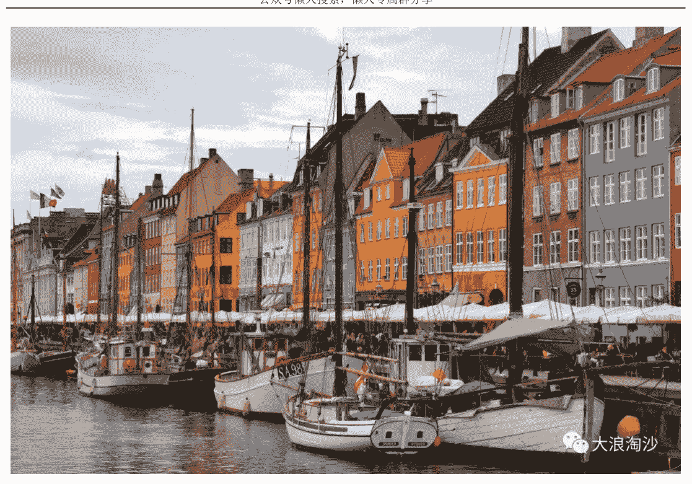

高税收同样带来的是贫富差距的趋近化。贫富差距的危害不仅仅是“公平”，更有带来社会效率的低下和对经济发展的负面影响，这个分析我整本《生而贫穷》都在讲，这里就不再赘述。

众所周知，我国的基尼系数早已经“赶英超美”。我有一位朋友是做室内设计的，在国内工作了十几年现在已经移民瑞典了。他因为工作的特殊性接触了大量的“上流社会”，他讲中国的有钱人那是真有钱，都是“巨富”“超富”，你难以想象得到——“贫穷限制了想象力”从来不是一句空话。相反来到了北欧之后，发现大家都很富裕很平均，很难再找到一个远趋于其他群体之上的数量还如此客观的阶级。

北欧诸国平衡贫富差距的方式，除了税收之外，更有一系列完善的法律法规制度，去限制资本收益。例如你买卖房屋盈利，那么盈利这部分要交一笔重税；相反如果你卖房亏本了，那么国家会补贴一大部分你卖房的中介费和手续费。如我前文所述，资本主义社会资本收益是高于劳动收益的（房屋就是土地资本），所以就平衡贫富差距来讲，限制资本收益要比针对于劳动的征税更有效。

北欧诸国还有一系列针对公司兼并、股权流通、金融衍生品收益的政策。一方面可以限制这些“巨富”“超富”们的滚雪球；另一方面也可以鼓励劳动创造，降低经济风险，形成良性循环。相比于我们国家的个税制度，劳动收益是累进叠加的，资本收益是固定税率，许多资本收益甚至不征税，给了巨富阶层大量的避税空间，可以说是背离了“按劳分配”的出发点。

此外，平衡贫富差距很重要的一个方面，就在于对劳动者权益的保障。一个新员工入职公司，他是有很大的跟公司议价薪酬的权力的，政府同样有干涉公司对员工福利的权力。这样，在政府清廉的大前提下，对公司有了很好的制衡，劳动者收入高，资本家出了点血，贫富差距自然就会趋近。这个正向的循环效应正如我前文所说：劳动者有钱更多消费、企业卖出更多产品服务、增加就业、劳动者收益继续增加……我国社交网络上有一群“精神资本家”非常有趣，明明自己从来没拿到过加班费，却总是叫嚣着企业负担过重，“再这样下去就没人开公司了，你们都得饿死”。我之前就说过这问题，我们的企业确实穷，但是我们企业家可不穷。你们平时加班不给加班费这些剩余价值，最后进了谁的口袋为基尼系数添砖加瓦？我不清楚，但数据比谁都清楚——一个三十年前资本积累为零的阶层，三十年后造就了基尼系数居于世界前列，怎么做到的你猜猜看？我们的劳动者真的是任劳任怨啊。

我们前几篇文章中所探讨的医疗问题、养老问题、年轻人生育意愿低的问题，其实归根结底都是经济和分配问题。北欧诸国的做法，让金字塔顶层的巨富、巨贵们出了些血，让老百姓的生活的大为改善，也让整个社会的活力大幅提高。值得一提的是，根据 2017 年联合国人口基金会的统计，瑞典生育率 1.85，丹麦生育率 1.79，冰岛 1.74，挪威 1.71，均高于中国的生育率 1.63。

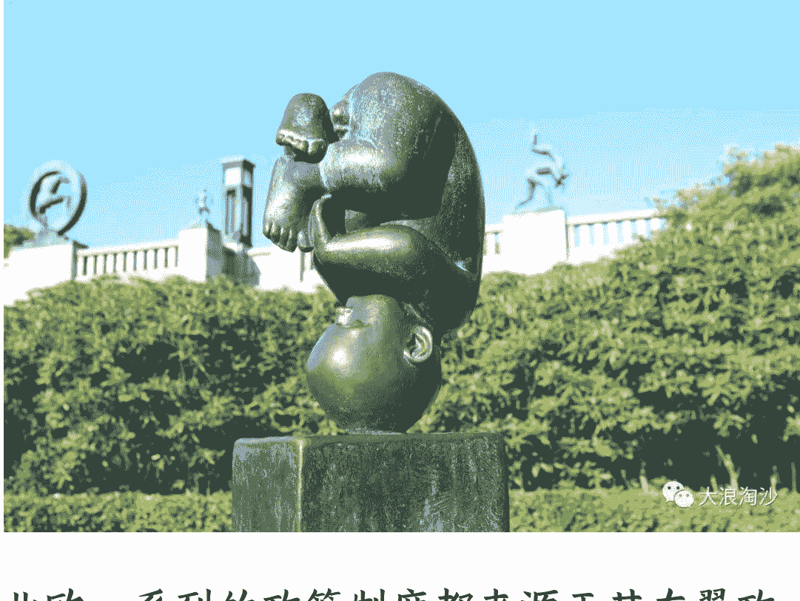

北欧一系列的政策制度都来源于其左翼政治传统。瑞典自 1914 年以来，都是左翼政党社会民主党执政，今年因为难民问题的冲击，右翼政党抬头，但刚刚大选的结果社会民主党依然获得了胜利。

挪威则是自 1924 年以来，每一届大选都是劳动法党获胜。左翼理想、制度保障、人文关怀，共同构筑了人类社会发展的排头兵。下图是奥斯陆市政厅一幅大壁画，在主厅和平大厅的正上方，我们可以鲜明的看见这样几个形象：工、农、兵、妇女、知识分子，展现的就是北欧的社会运动历史。北欧左翼政党，都有着近百年的执政历史：

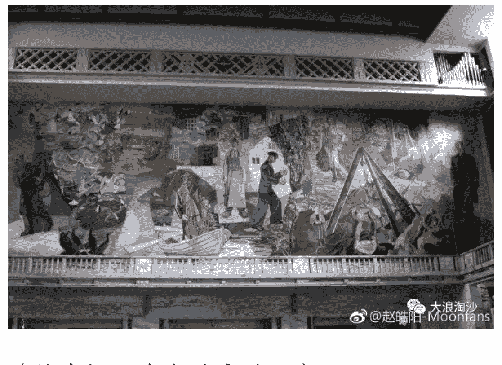

（笔者摄于奥斯陆市政厅）

说了这么多好处，再说两个关于“福利国家”的普遍误区。第一个误区就是：高福利会养懒汉，“鼓励”人们不去工作，让经济不堪重负。事实正好相反，在有合理制度保障下的高福利往往会对就业和经济起到促进作用。通俗一点解释，我们国民的储蓄，除了买房就是医疗和教育了，如果医疗和教育全部变成社会福利，那么我们就不会为此“预备”那么多储蓄，这些钱就可以拿去消费，去购买商品和服务，就让更多的企业获得更过的利润，就业随之增加，劳动者的工资也就水涨船高——这就是经济的正向循环。关于“福利社会养懒汉”的谬论，不过是八九十年代欧美新自由主义政府为了削减社会福利的洗脑产物，近年来学界有相当多反驳这一论断的研究成果，详细的内容在《“看不见的底层”和被污名化的穷人》这一章里论述过。

第二个误区是：全民福利制度让国家财政不堪重负，欧美国家纷纷降低国民福利标准就是证据。事实上，这二者并不具备相关性。大卫·哈维在其著作《新自由主义简史》中说得很明白，不是福利国家难以为继才取消福利，而是在上世纪八十年代，西方国家普遍发动了一场“新自由主义政变”，为了顶层富豪的利益，取消了广大民众的众多福利。用哈维的话讲这是一场少数新自由主义精英对全体国民的“抢劫”。相关内容也在《生而贫穷》中有更详细的论述。

北欧的福利国家建设为我们提供了宝贵的经验：限制贫富差距、重视税收调节作用、倡导全民福利的理念。那么我们再来看看来自社会主义兄弟国家——古巴，在医疗、教育、科研、养老等领域的出色成就。

## （十）古巴虽败犹荣的社会主义建设

拉美地区的发展有一个天然的诅咒：离美国太近，离天堂太远。

古巴就是典型的例子。最初古巴遭受西班牙的殖民统治，西班牙衰落后美国趁虚而入。总有很愚蠢的网友质疑古巴凭什么跟美国搞意识形态对立，而不是跟美国合作，这样被封锁不是咎由自取么。我来告诉你凭什么，因为古巴跟美国“合作”是这样的下场：

美国势力独占古巴后，古巴基本上就成了美国蔗糖生产基地。1929 年大萧条期间，美国为了转嫁危机，开始实行关税壁垒政策，古巴的糖厂和种植园纷纷倒闭，美国用了三四年时间就从危机中缓过劲来，随即美国资本趁机进入古巴大规模抄底。到了 1945 年，被美国资本家直接或间接霸占的土地占古巴全国土地面积的 25%，高产土地的 75%。例如，“古-美糖业公司”就占有约 14 万公顷的土地，比古巴全国 126 个市中的 96 个市面积还大；美国垄断组织“金化妆厂”的土地面积比奥连特省和卡马圭省还大。

这些大的跨国公司成为了古巴的“国中之国”，它们组成了“联合果品公司”，雇佣了当地大量生活贫困的奴工作为廉价劳动力，攫取了惊人的利润，并用获得的利润不断购买新的土地，同时还修铁路修港口，甚至自订法律自设军营，任意逮捕和枪杀工人。联合果品公司还同加勒比各国反动势力相勾结，操纵各国政治，活脱脱就是拉美的东印度公司。这些被联合果品公司控制的国家被叫做“香蕉共和国”，它们经济结构单一、政治严重腐败、国不将国、民不聊生。

面对美国的压榨，古巴人民从没放弃抵抗，历史也在“起义-镇压”“选举-政变”“独立-附庸”中匍匐前进。到了二十世纪四十年代，美国“钦定”的代理人巴蒂斯塔在一次军事政变中上台了。在整个巴蒂斯塔执政期间，美国对古巴投资达到 10 亿美元以上，与此同时古巴失业率也在飞涨，在农村古巴农民中的 70% 只占有全国 12% 的土地，还有 50 万农民没有任何土地。巴蒂斯塔还同美国签订“军事互助条约”，无论是从经济、政治、军事上古巴都成了美国完全意义上的附庸国。在巴蒂斯塔的领导下，古巴成为了美国上层社会的避税天堂、毒品天堂、卖淫天堂、度假天堂，同样也是下层社会的贫困地狱、愚昧地狱、疾病地狱。

就像毛主席说的，国家要独立、人民要解

放、社会要发展，这是客观规律，你想挡也挡不住的。古巴下层人民不甘心做畜生，要站起来做人，要争取属于自己的那份权益，这是必然要发生的事情，卡斯特罗只不过是站在历史风口浪尖，被人民选择的领袖。

古巴革命成功后，是曾经想跟美国建立平等独立自主的外交关系的，卡斯特罗又不是一个热血冲脑的蠢货，古巴离美国这么近，肯定优先考虑与美国的关系。等革命后国内局势稍稍稳定，卡斯特罗就第一时间踏上了美利坚的领土。在这里美国给他准备了一卡车的糖衣炮弹，一场又一场有好莱坞明星、选美冠军参加的舞会、酒会，妄图搞定卡斯特罗。美国的想法很简单嘛，收买这家伙——在美国佬的心目中提着头造反不是为了钱、色、权、名嘛，不过美国这一次太小看这一位特殊材料制成的人了。

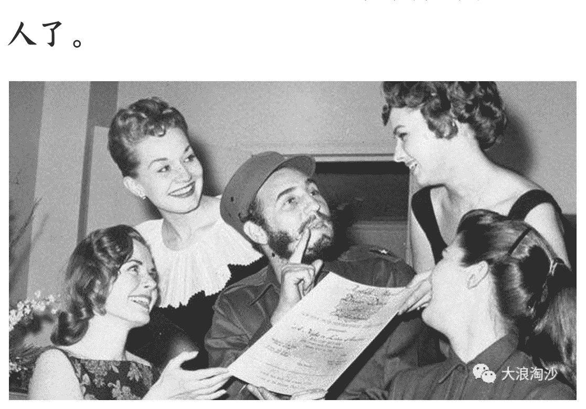

美国的意图很明显：你打败了巴蒂斯塔，无所谓，在我看来这只是食物链底端的优胜略汰，那你来做我的代理人，古巴继续做我的半殖民地和附庸国，古巴上层人可以在把屁股卖给美国中牟一点利，古巴下层人继续当我的奴工和牲口。卡斯特的原则也很简单：独立、自主、平等、互惠。那么自然就谈不拢咯，开打。

有不少人，受到了来自美国意识形态的洗脑，抹黑古巴人民革命成果、抹黑古巴革命政权建设成果。那我们来对比一下，做美国“小弟”会是一个什么下场：洪都拉斯、萨尔瓦多、危地马拉等中美洲国家，与古巴有着类似的地缘环境、自然气候，古巴当年被称作“糖果共和国”，这些国家都被称作“香蕉共和国”，听这名字就知道这个国家有多苦了。以萨尔瓦多为例：20世纪30年代开始，美国农业跨国资本和萨尔瓦多本地买办家族就掌控了全国几乎所有的土地，大量农民破产沦为种植园雇工，美国公司控制了全国超过80%的咖啡产量和60%以上的农作物产量，成为了一手遮天的集土地、金融、行政管理、军事镇压为一体的巨型托拉斯集团。

“香蕉共和国”人民的反抗夜以继日，来自美国和它所扶植的军政府的镇压也从未停止，只不过古巴取得了革命成功，而这些国家的左翼游击队在国内外反动势力的联合镇压下纷纷失败了。现在这些国家的人民怎么样呢？特朗普要在美墨边境修建高墙，防止非法移民，而这些非法移民绝大多数都是来自“香蕉共和国”的几个国家。他们徒步上千公里，从南到北穿越了整个墨西哥，就是因为他们处在战乱、贫穷、饥饿以及被美国跨国农业资本和本地黑帮共同压迫的生活中，他们想寻一条生路。在这一场被称作“饥饿行军”的过程中，他们穿越了墨西哥炙热的沙漠，忍受着饥饿、干渴和当地黑帮的骚扰与侵犯，他们其中将近一半都是妇女和儿童，最后在美墨边境墙边见证了最后的绝望。

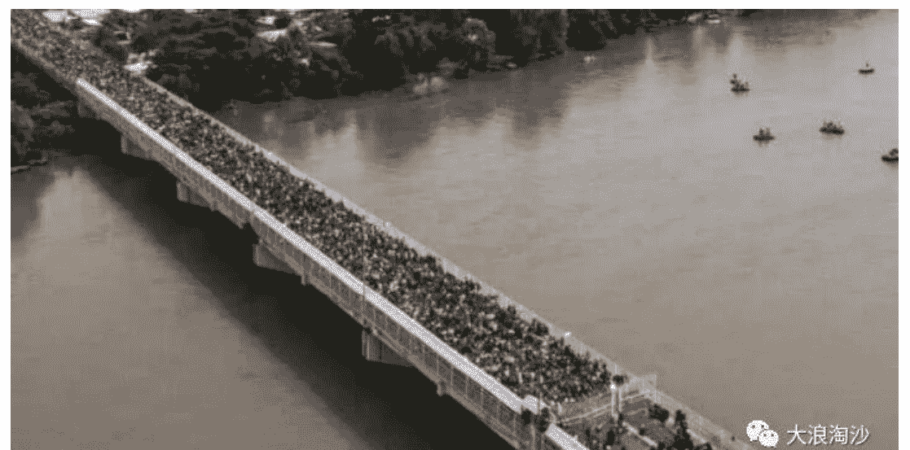

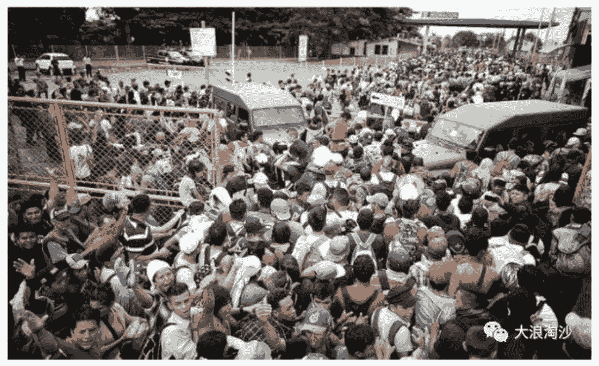

看一下拉美“兄弟国家”的现状，还有人质疑古巴人民独立自主建设国家的选择么？古巴独立自主的社会主义建设虽然一波三折，但也好过给美国当狗。社会化大生产是经济发展的内在要求。经济融合规模越大越好、要素流动越顺畅越好，各种公共服务的跨域外溢效应越来越突出，这些都越来越体现一个统一大市场的作用。

从根本上说，这个市场越大越好、最理想就是全球是一个无差别的大市场。马克思指出资本主义的根本矛盾就在于社会化大生产和生产资料私有制之间的矛盾，就是从发展生产力的根本出发点得出的。理解了一个大市场有多么重要，就能理解为什么七十年代到八十年代古巴的经济形势比较理想，也能理解美国的封锁会带来怎样毁灭性的影响，以及古巴经济能够维系至今的不易之处。

苏联解体后，因为没有了一个统一的大市场，社会主义小国的好日子就到头了，朝鲜就发生了严重的大饥荒。要知道，在1989年以前朝鲜在粮食生产方面至少是自给自足的，而古巴则有57%的粮食要靠进口，这是因为其农业，尤其是国有农业部门主要集中于大规模供出口的食糖产业化大生产。然而古巴却相对成功地扛过了这一波危机。实事求是地讲，这一点要给卡斯特罗和古共领导层记上一功。

古巴建立起的现代农业体系包括有机农业、永续农业、城区菜园、畜力以及生物性肥料和害虫管理等等。就国家的层面而言，古巴现在可能拥有世界上生态和社会可持续性最好的农业——这就是社会主义集中力量办大事的体现。苏联解体后短短四年时间里，古巴人均卡路里摄入量已经恢复到苏联解体以前的水平，而且更加健康：古巴生产的农产品，80%左右是有机的，同时人们的饮食结构更加多样化，包括更多的蔬菜水果。1999年，瑞典国会因这些成就而向古巴一个农民组织颁发了优秀民生奖，即人们所讲的“另类诺贝尔奖”（Right Livelihood Award，这个奖项每年在诺贝尔奖颁奖前夕在瑞典颁发，表扬在全球对民生最有建设性贡献的实践经验）。

我们再来看一看古巴在医疗、社保领域所取得的成就，这是非常值得我们去学习、参考、借鉴的。先说社保体系：古巴的社会保障开支从 1959 年的 1030 万比索，1985 年的 10.15 亿比索，到 2001 年的 18.62 亿比索，历年递增，近年来约占政府总支出的 11%。加上文化、教育、卫生等项开支，古巴社会福利支出占国家财政总支出的 35.5%，如果把国有企业亏损和国家对普通民众的价格补贴计算在内，则占 70%。对于普通人民来说，这样大的福利从来都是广受欢迎的。

1963 年 4 月古巴颁布第一部《社会保障法》，即“第 1100 号法”，按照社会主义的原则和理念，建立了统一的社保制度。古巴的社会保障覆盖了经济生产体系的方方面面：包括劳动者及其家庭享受疾病、生育、工伤、职业病和老年、遗属等保护，同时取消工资劳动者缴费义务，建立雇主承担所有费用的制度。这些社会保障不仅涵盖了生产领域，同样包括家庭再生产领域：具体有面向所有人的免费教育，面向所有人的免费医疗，以及面向所有人的实物补贴。在住房方面的福利更为突出：先是减免劳动者 50% 的房租，后来又通过支付固定费用使承租人成为所居住住房的所有人(当前 85% 的古巴家庭是所居住住房的所有者)。

1979 年 8 月古巴颁布新的《社会保障法》，将社保制度进一步扩展和完善，这部法律一直实施到 2009 年 1 月。这期间，古巴社保制度进一步扩展和完善。这部法律中，不仅古巴的劳动者能够享受到社会保障，一些残疾人、老人、孤儿等丧失劳动能力的“社会救济群体”，同样能享受到匹配的社会保障。

再来看教育：古巴实行全民免费受教育，古巴人的平均学历和文化素质在拉美地区独树一帜，甚至在全世界的范畴都属于领先行列。古巴人民从学前教育直至大学毕业学费和书本费全部由国家负担。据 2002 年联合国教科文组织、联合国儿童基金会、经合组织的联合调查报告显示，古巴在有关教育的 7 项指标中，除一个分项：小学四年级学生数学成绩略低之外，其余均居世界第一或与发达国家并列优先地位。按人口比例计算，古巴教师最多，每 42.23 人中就有 1 名教师，绝大多数教师具有大学以上水平，数万圣小学数学教师具有硕士学位，数千大学教师具有博士学位。（《古巴的社会保障制度：发展、挑战与改革》，袁东振，2009）

古巴的医疗领域可以说是享誉全球，屡次获得联合国教科文组织嘉奖。古巴 1100 多万人，拥有 6.9 万名医生，8.2 万张病床。1984 年建立健全了“家庭医生制”，全国分 381 个医疗保健区，接受保健的居民占居民总数的 98.2%，家庭医生为每个居民建立了健康状况。看下图，横轴是经济发展水平，纵轴是儿童存活到五岁以上的比率——代表了一个国家的卫生水平，圆的面积代表人口。图中那一个与众不同的小点就是古巴，可谓独树一帜：

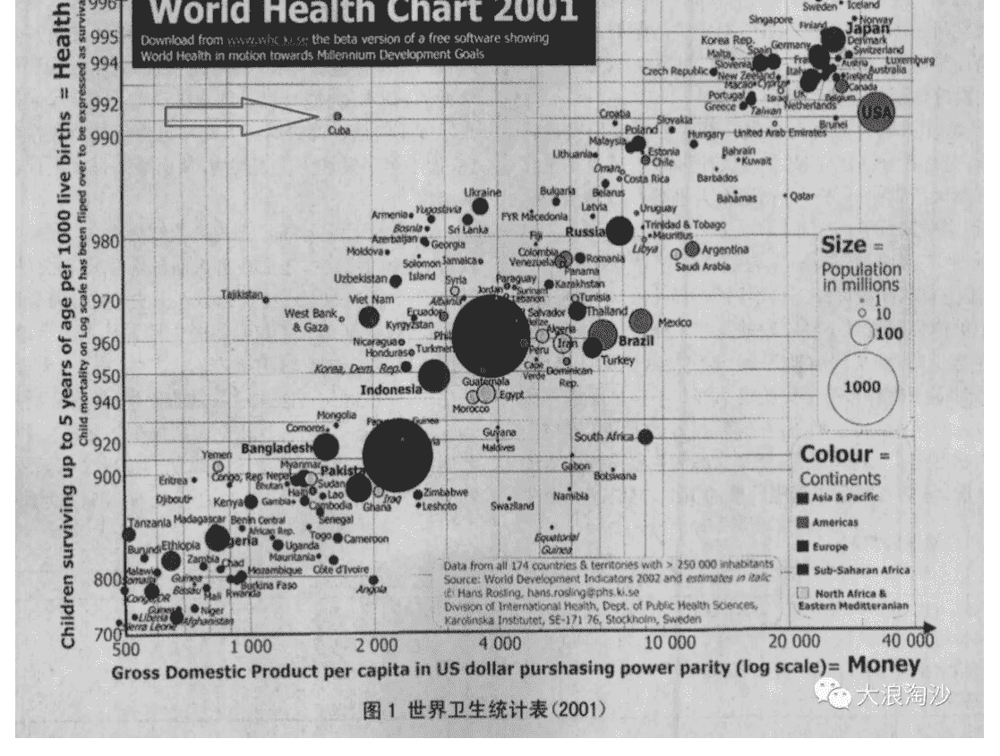

必须承认，古巴当今社会主义建设困难重重，也到了不改不可的当口。这就是我在《当你在凝视朋友圈时，朋友圈也在凝视着你》这篇文章里说的，这就是个资本的时代，你不可能独善其身地活下去，要么拥抱资本要么自杀。古巴也一样，可以说苏联解体之后就注定了古巴“独善其身”的道路走到尽头了。

卡斯特罗逝世的时候我说过一句话：“20世纪最后一位理想主义者走了，21世纪是精致利己主义者的天下。”无论怎样，古巴对社会主义道路的探索与坚持都称得上“虽败犹荣”四个字。当未来的人类在锐意进取探索前进的方向时，再回望曾经的历史，卡斯特罗和他的古巴会是一份伟大的经验和财富。

古巴社保、医疗、卫生、教育等产业的发展很好的证明了社会主义的优越性。即便在美国封锁的困难环境下，古巴经济发展和工业建设虽然步履维艰，但是社会贫富差距不大，没有两极分化现象，失业率低于2%，人均预期寿命、婴儿死亡率、人均识字率、儿童入学率、大中学生普及率、居民卡路里摄入量和人均拥有医生数等等人文指数，都居于世界前列，有的甚至高于美国。现在，古巴每年还向拉美和非洲地区派出数万名医生从事医疗服务。

很多时候就怕货比货，新自由主义在拉美推行了30年，经济增长却远远低于没有采用新自由主义政策的20世纪50——60年代，2002年甚至出现了负增长。有的国家经济上即使有一点增长，也不是靠产品的升级换代，而是依靠出口初级产品和原材料实现的，结果造成生态环境的严重破坏，并使经济的对外依赖性和外债负担越来越大。新自由主义还给拉美的社会领域带来灾难性后果，贫富差距越来越大，两极分化严重。根据联合国拉美经委会统计，目前拉美的基尼系数为0.43，高于亚洲和非洲。

早在1980年，拉美地区1.36亿人处于贫困线，占人口的40.5%，其中6200万人低于贫困线。而26年后的2006年，拉美地区贫困人口已增至2.05亿人，7900万人低于贫困线，失业率高达9%，非正规就业人数占就业人口的7/10。与此同时，10%的富人控制了45%的国民收入，1%的土地所有者控制了56%的土地。可以明显看出，拉美诸国新自由主义化后，普通人的生活明显恶化了。

这一对比恰恰证明了，很多时候市场化、资本化、新自由主义化并不是解药，而是毒药。有的时候解决方法，要从这之外去寻找。

## （十一）社会主义荣光

其实为了说明一个问题，就必须牵扯到相关其他一些问题，所以本文也如此之长。筒而言之，美国和日本这种不让底层人民活下去的政策是我们需要避免的，而北欧和古巴的福利国家与社会主义福利建设，是值得我们学习的。筒而言之，现在是市场经济，对于医生、教师、科研工作者不可能待遇不给足，但这就需要国家、政府和财政的大力支持，构筑覆盖全民的行之有效的社保体系，而不是指望医生教师们从患者、学生身上赚钱；同时社会主义的荣誉激励、优良风气、奉献精神、高尚道德以及全民福利的理念，是要呼唤回归的。这才是“不可怕的老龄化”的解药。

既然讲到了古巴的社会主义优越性，就来谈一谈我们自己国家的历史，“社会主义荣光”这几个字也不遑多让。

二十一世纪初，我国居民人均期望寿命为73.0岁，与建国前的35岁相比，大幅提升一倍有余；全国孕产妇死亡率已由建国之初的1500/10万下降至2008年的34.2/10万，婴儿死亡率由建国初的200‰下降到2008年的14.9‰。同时，严重威胁群众健康的重大传染病得到有效控制，全国甲、乙类法定传染病发病率从1949年的20000/10万下降到2008年的268.01/10万。

中国成功地消灭了天花和丝虫病，实现了无脊髓灰质炎目标，在总体上消除碘缺乏病阶段目标，有效控制了麻风病、血吸虫病、疟疾等曾经严重威胁人民群众健康的疾病。这些数据可以让我们的骄傲的宣称，中国虽然是发展中国家的经济水平，但是医疗卫生领域所取得的成就，已经到到了中等发达国家的水准，在第三世界国家中一枝独秀。新中国的医疗成就，是值得大书特书的伟大成就。

1950年公共卫生局颁布《传染病预防及处理暂行办法》，确定了14种法定传染病，同时将鼠疫、霍乱、天花列为3大烈性传染病，随即展开全民灭鼠、灭蝇运动（后发展为“除四害”）。对城市中阴沟、污水池、粪坑、粪场、垃圾堆和56000余户住宅，喷洒杀虫药剂灭虫，在农村中开展全民打鼠运动。新中国至今未爆发大规模鼠疫、霍乱。

从1955年底和1956年春开始，有计划、有组织、大规模的防治血吸虫病的群众运动，在各个疫区蓬勃开展。江西省余江县是血吸虫病流行区，有6000多病人，近十几年死于血吸虫病的就有三千多人，1956年起，余江县，开新沟、填旧沟，开新塘、填旧塘，消灭钉螺修建新的良田。1958年6月30日，经过两年苦战，余江县宣布彻底消灭血吸虫，6000多病人也全部治愈。听闻此消息伟大领袖无比激动，赋诗两首：

> 绿水青山枉自多，华佗无奈小虫何！
> 千村薜荔人遗矢，万户萧疏鬼唱歌。
> 坐地日行八万里，巡天遥看一千河。
> 牛郎欲问瘟神事，一样悲欢逐逝波。
> 春风杨柳万千条，六亿神州尽舜尧。
> 红雨随心翻作浪，青山着意化为桥。
> 天连五岭银锄落，地动三河铁臂摇。
> 借问瘟君欲何往，纸船明烛照天烧。

1960 年 11 月，全中国最后一例天花被消灭。1952 年，卫生部发出指示要求实行全民普及种痘，经过八年的努力，曾经的烈性传染病、无药可治的绝症、至少造成 1 亿人死亡、另外 2 亿人失明或留下终生疤痕、被称为“文明杀手”的天花病毒，在人口最多、贫穷人口最多的国家里，销声匿迹。

1964 年中国政府宣布“基本消灭性病”，此后十几年中国无性病历史。直到 1977 年湖南出现一例男性淋病患者，这一纪录才宣告终结，此后性病再次在中国蔓延。性病的消灭是伴随着挽救和改造妓女运动展开的，有资料显示，当时国家为了给身患性病的妓女治病动用财政经费支持达一亿元之巨。

1965 年，重回一线工作的毛泽东主席听取了时任卫生部长钱信忠的工作汇报，当他得知彼时中国“140 多万卫生技术人员中，有 90% 分布在城市或县城，而只有 10% 在农村，占中国人口大多数的农村依然处在缺医少药的窘境之中”时，愤怒的当面斥责了钱信忠：“卫生部的工作只给全国人口的 15% 工作，而且这 15% 中主要是老爷，广大农民得不到医疗，一无医，二无药。卫生部不是人民的卫生部，改成城市卫生部或老爷卫生部，或城市老爷卫生部好了！”

并做出最高指示：“应该把医疗卫生工作的重点放到农村去！”毛进一步提出方案，要求：“培养一大批农村也养得起’的医生，由他们来为农民看病服务。”毛泽东发怒的这一天是 6 月 26 日，所以这一指示也称作“六二六”指示，被看做是“赤脚医生”的由来。这也是毛从退居二线到重回一线之后，对前几年“重视城市、牺牲农村”“工人贵族主义”的路线方针的一次拨乱反正。

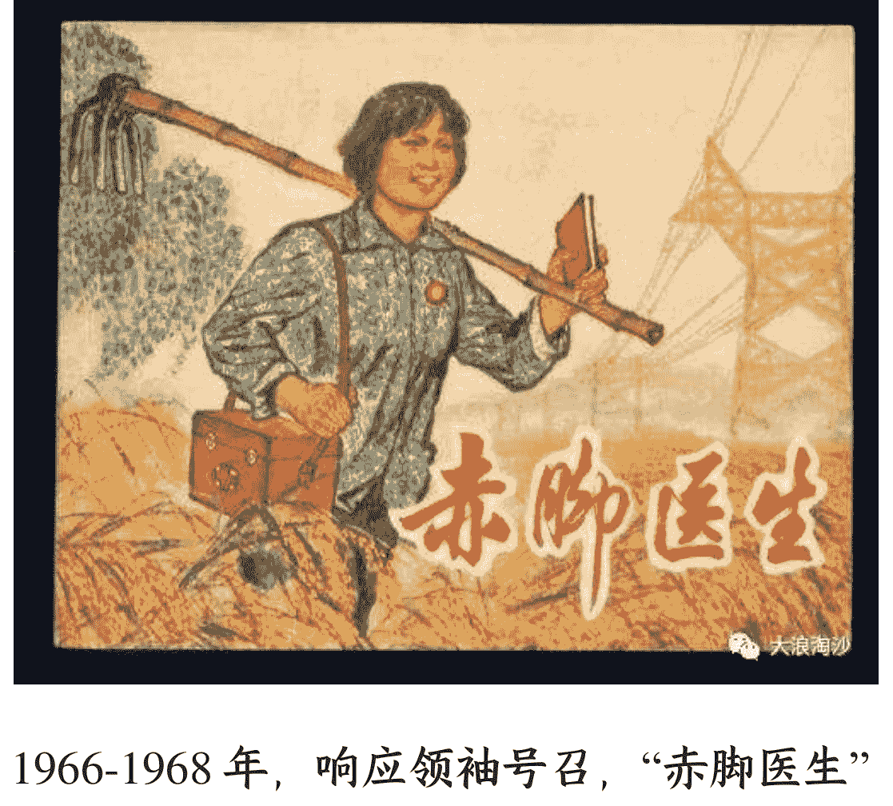

1966-1968 年，响应领袖号召，“赤脚医生”的乡村医疗形式在全国推广，到 1977 年底，全国有 85% 的生产大队实行了合作医疗，赤脚医生数量一度达到 150 多万名。赤脚医生为解救中国一些农村地区缺医少药的燃眉之急做出了巨大的贡献，他们最普遍的形象是两脚泥巴，一身粗布衣裳，也没有过硬的专业知识，但确确实实是当时社会经济条件下能够选择的最好的制度。简简单单的青霉素、破伤风、助产知识、消灭四害、防疫知识，甚至于最基本的洗手习惯，都让农村人口的健康状况、死亡率、婴儿存活率大大改善。

从土地改革开始，农业合作社、村办小学、成人识字班、赤脚医生等等一些列伟大的变革，五千年以来第一次将活力与生机散播在泱泱中华最底层的土壤上，千千万万的乡村教师、赤脚医生，他们就像是宗教神话里福音的传播者，汇聚成一股巨大的力量，推动着这个民族大步向前，在华夏大地上完成了一次无声的革命。赤脚医生的历史可以说是“社会主义荣光”最完美的体现之一。

这些政策可谓立竿见影：1965 年时，中国的人均预期寿命 49 岁，低于世界平均水平的 55 岁；大致与缅甸、巴基斯坦相当，超过印度约 5 岁。到了 1975 年，中国的人均预期寿命 64 岁，高出世界平均水平的 61 岁，已经超过巴基斯坦 9 岁，超过缅甸 11 岁，超过印度 13 岁。

1969 年 1 月，屠呦呦领导课题组从系统收集整理历代医籍、本草、民间方药入手，在收集 2000 余方药基础上，编写了 640 种药物为主的《抗疟单验方集》，1972 年，屠呦呦和她的同事在青蒿中提取到了一种分子式为 C15H22O5 的无色结晶体，他们将这种无色的结晶体物质命名为青蒿素。世卫组织认为，青蒿素联合疗法是当下治疗疟疾最有效的手段，也是抵抗疟疾耐药性效果最好的药物。根据世卫组织的统计数据，撒哈拉以南非洲地区超过 2.4 亿人口受益于青蒿素联合疗法，约 150 万人因该疗法避免了疟疾导致的死亡，非洲人民把中国医疗队给他们使用的这种疗效明显、价格便宜的中国药称为“来自遥远东方的神药”。

…………

本文到此结束了，但是故事结束了吗？应该还没有。

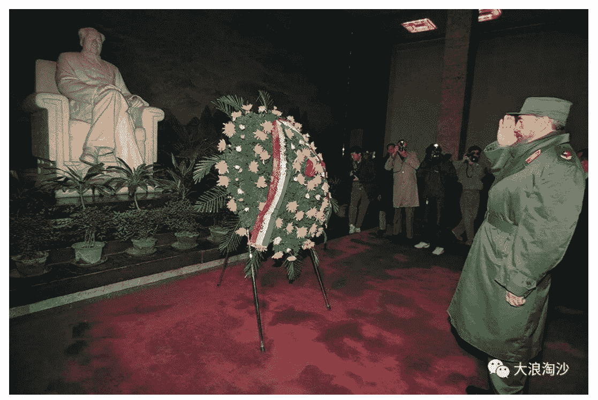

分割线

在这个 AI 能替你写代码、写文章的时代，基础技能正在迅速贬值。绝大多数人正被淹没在海量的免费垃圾信息里，陷入低效的体力内卷。

当“努力”不再是壁垒，人与人之间唯一的护城河，只剩下“信息过滤”的效率与“认知系统”的维度。

圈子已稳定运行 7 年。我们每天利用 Python 爬虫与大模型算力，过滤全网最顶级的政经内参和搞钱风向标，做你最冷酷的“外部大脑”。

如果你认同这种“重塑认知防线”的极客主义，欢迎围观我的个人情报智库：【懒人专属群】。

https://lazysо.com/insider/

认同信息过滤价值、想省下每天 3 小时无效阅读时间的读者，扫码加我微信

## （lazyhelper）

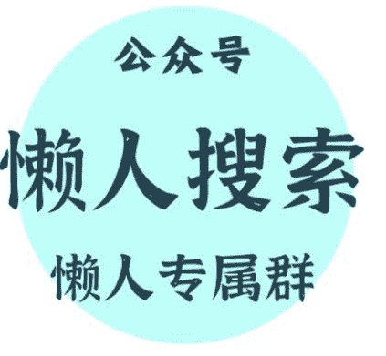

微信：lazyhelper
