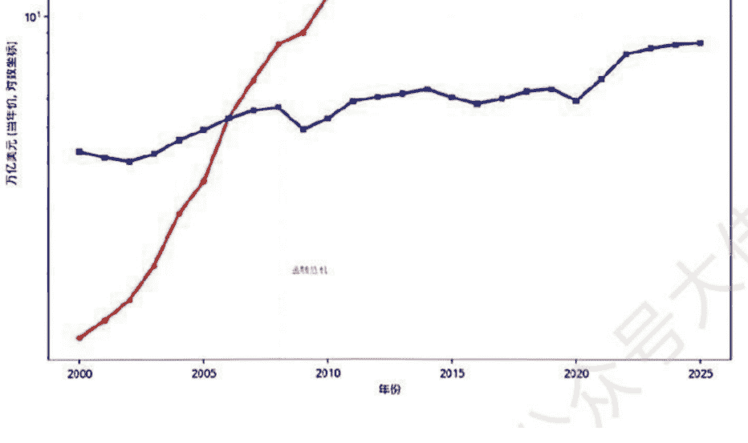
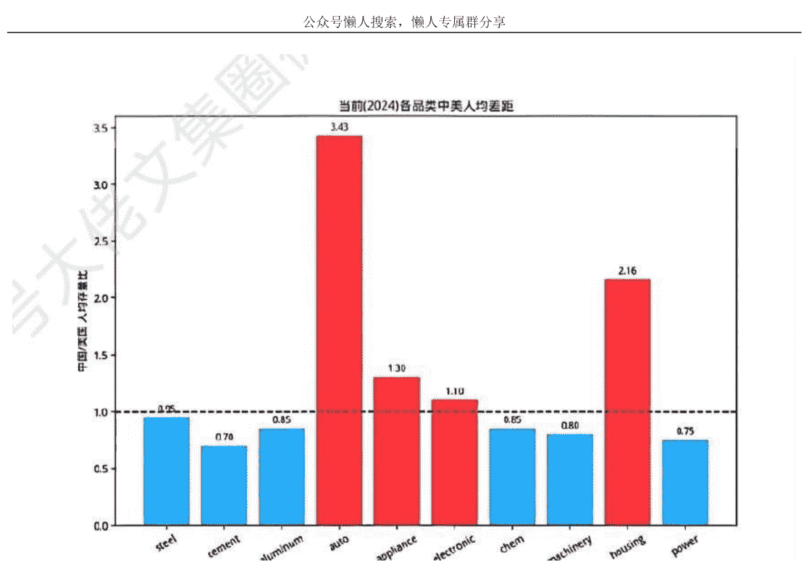

# 盘点"贸易战、关税战"战果——破冰远航的中美关系

**整理**：龙牙的一座山
**来源**：公众号懒人搜索，懒人专属群精选
**懒人微信**：lazyhelper1

> **小懒判断** | 适合关心中美关税战到底谁输谁赢、想理清大 A 后面逻辑的人，尤其是被“GDP 第二但体感更穷”绕晕的。不适合想看盘面黑话和短线代码的。最值得关注的是那个弃用口径：按工农业生产总值，中国实物产出 2008 年超美、人均 2025-2028 年也要超美，这才是懂王低头的原因。坑在于：折旧期估算属作者自算，口径争议大，别直接当真理引用。

我不知道 2026 年 9 月 23 日是不是又诞生了一张历史照片。

这是 1972 年 2 月 21 日尼克松访华，周恩来总理亲自前往机场迎接。其中有一个值得注意的细节：尼克松人还在舷梯上，还有三步才能到达地面，就抢先伸出了手。

这是一场迟来的道歉：1954 年日内瓦会议期间美国国务卿杜勒斯下达死命令，禁止美国代表团成员与中国代表团握手。当周恩来理所当然地向杜勒斯走过去准备握手的时候，杜勒斯却傲慢地拒绝并转身离去。

你可能认为这种细节无关紧要，但身为资深外交专家的周总理却远比你敏锐很多。

尼克松这种示好，他几乎是在一瞬间就领悟到了，立刻就说：“你的手是伸过世界最辽阔的海洋来和我握手。”如今，懂王放下一切傲慢，亲自前往机场接机，说明中美贸易战结束了。

中美关系破冰，几乎是立即改变了世界格局。关于这一段历史我谈过很多次了，这里不再过多重复，只提其中的几个标志性事件：

- 一是越南战争结束。
- 二是中国不再输出革命，转向发展经济。
- 三是冷战格局正式从“两强争霸”走向了“三国演义”。
- 四是西方世界正式对中国敞开大门。

美国总统亲自前往机场迎接，毫无疑问是开创了先例，这种行为其实已经超越了“外交礼遇”的范畴，在未来历史中代表的象征意义不亚于尼克松这一次主动伸手。当然，本次中美关系的突破没有 1972 年幅度那么大，两国是在有外交关系的基础上再次推进关系进步，很多人暂时还没有对这一重大历史有清晰的感知。

以史为鉴可以知兴替。
以邻为鉴可以知荣辱。

让我们看看另外一边的待遇：老苗砸，你这是冲谁挥手呢... 不要说你是去联合国发言的，这个不重要，好歹是个盟友哩，派个科长撑个场面也是好的嘛，就算不能锣鼓喧天鞭炮齐鸣唢呐悠扬哀乐低回，至少不能弄出一个盟友国家领导人访美，对着空气挥手的破事儿。忒不体面。

在中国人中秋月圆、阖家团圆的日子里，世界格局已经彻底变了：

历史，我主张是要明确分为史料、史观两个部分的。

史料相对具有客观性，虽然总说"历史是个小姑娘，想怎么打扮就怎么打扮"，但是多多少少具有一定的客观性的，是有各种办法去互相印证最终得到一个相对真实的结果的。

史观不一样。

史观这东西真的是公说公有理婆说婆有理，比如 1972 年中美破冰。

我国史学界对此一直存在极大的误读误解，严重低估了中国在冷战中举足轻重的作用，将中国的独立自主外交强行说成"投靠美国"，这本身是一种居心叵测的构陷。正确解读 1972 年破冰，对于排除学界内部这种莫名其妙的逆向民族主义倾向有很大的帮助。

这里我们要分别站在三个国家的立场上去构建三条时间链：

1、**美国视角**。1972 年访华，1974 年水门事件，1975 年越南战争结束。这里面具体过程略过不表，史料多得是也不需要我来重复。

为什么主导中美关系破冰的尼克松已经因为水门事件倒台了，中美关系并没有因此受到影响？一大原因就是越南。并不是因为在越南战争这一件事情上美国需要中国，而是基辛格认识到美国在很多事情上都需要中国。

2、**中国视角**。1972 年破冰，1976 年四人帮倒台，1979 年改革开放。这里的历史我们相对更为熟悉一些，但解读也就更加千奇百怪。

改革开放的历史机遇正式到来，建国 30 年的建设成就孕育成熟了改革开放的条件，外部环境也在这个时候走到了恰当的时机，一切都水到渠成。

关于这一点，很多人不理解，喜欢把“前后三十年”对立起来，这是缺乏综合看待史料能力的体现，一会儿我们会单独论述这一点。

3、**苏联视角**。1972 年中美破冰，1979 年对越自卫反击战打响，1989 年“两山轮战”结束，同一年中苏关系正常化，1991 年苏联解体。中美破冰之旅在苏联看来是冷战的转折点，在此之后，苏联输掉冷战就已经成了历史的必然，当然，苏联解体本身并不是中美两国期待看到的一种“黑天鹅事件”。

这一段历史中，有一个国家贯穿始终：越南。

它先是成功拖住美国、严重消耗美国国力、制造大量国内矛盾并直接催生了一个困扰美国长达数十年的社会问题：越战老兵。

接着它成功拖住了苏联，与阿富汗一起严重消耗苏联国力，导致苏联国民经济结构严重失衡、轻工业和民用工业彻底崩溃，冷战难以为继。

如果说冷战是一场台风，那么越南就是冷战的“热战台风眼”，断断续续打了快 50 年。从抗战打到独立，从抗法战争打到南北分裂，从越南战争打到入侵柬埔寨，从我方自卫反击打到 1989 年。这 50 年功夫就没有一年完全没有战争的，可以说打成了全世界整个冷战的热战策源地。

忽视这个“热战试验场”是不合适的。

我们可以明确的把冷战中的越南战场分为三大历史时期：

- 1、在中国的帮助下，抵抗法国，成为全球反殖民主义斗争的旗帜；
- 2、在中国和苏联的帮助下，抵抗美国，成为全球反帝国主义斗争的旗帜；
- 3、直接和中国开战，结果彻底摧毁了苏联的大国沙文主义。

这根铜柱子真不白立，“铜柱折、交趾灭”的谶言不白说。汉光武帝的时候东汉大将马援立起这根柱子，越南的历史定位就已经摆在那里了，当中国需要的时候，会拿出来用的。当历史走到 20 世纪的时候，当中华民族需要复兴的时候，既可以成为摧毁战后全世界殖民体系的抓手，也可以成为拖住敌意最大的一个国家的把柄，甚至可以成为拖垮现实威胁最大的一个敌国的武器。

前两年还有人在炒作所谓的"中美新冷战"，随着特朗普亲自跑去机场，这种炒作就成了个笑话。中美之间的争端自始至终我没看到有什么传统媒体真的说透过，甚至连时间线都是理得一塌糊涂。

中美贸易争端的开端是在 2008 年。

为什么是这一年？

按照更为客观并真实的"物质产量"估算，大概就是在这一年，中国的物质产出超过了美国。我们现在喜欢用 GDP 来对比跨国经济数据，实际上这是非常不可靠的一种对比方法，在 GDP 里面注水太容易了，甚至会出现"GDP 涨得越快国家越完蛋"的神奇现象。

本文受篇幅限制，不展开讨论 GDP 统计存在的问题，这里只采用一个被废弃的经济学统计方法：工农业生产总值。

美国从未进行过"工农业生产总值"统计，中国也在 2000 年之后停用了这一统计方法，但"工农业生产总值"的统计方法在排除金融业空转干扰的情况下是有很大作用的，货币与货币战争、金融与金融收割，在工农业生产总值这种统计方法面前无所遁形。

按照这一统计口径看，中美两国历史数据如下：

在 2005 年至 2010 年之间某个年份，因为是估算数据，并不是真实的统计数据，因此这个年份相对比较模糊。但我们如果不看糊弄老百姓和外国人 GDP 数据，"假设"美国真实存在一个认真负责不管金融空转炒热的假 GDP，为美国国家战略决策机构提供真实情况的智囊团，那么他们一定会意识到两国国力在这个时间段发生了翻转。

为什么我说是 2008 年中美贸易战开战？

因为这一年美国发生了华尔街金融风暴。

也许是在 2006 年，也许是在 2007 年，中国真实物质的国力超过美国。你要是说"包括金融业在内的第三产业也很重要啊"，那么我问你，为什么这个金融业没有发挥它原本的作用：提高工农业生产水平呢？

华尔街金融风暴意味着美国"脱实向虚"严重依赖金融收割的办法第一次失灵了。不管是收割东南亚还是收割日本韩国，成果是显著的：美国资本渗透并控制主要产出，维持国内经济运转。

2008 年之后的收割都没有成功，包括但是不限于：挑唆高原某群人制造混乱、挑唆西域某群人制造混乱、利用奥运会施压、利用南海仲裁案施压、利用印度在边境制造事端施压、利用新冠疫情施压，全部都没有成功，资本并没有逃离中国，反而出现了全球制造业资本扎堆往中国跑的咄咄怪事。

这个现象我解释过，这就是“避难效应”。一个恶霸欺凌一群人，打一个趴下一个；这时候有一个打不趴的，聪明人都知道站这个人背后才会安全。

前几天去了趟太湖——上海一片，我滴个天… 这是把欧洲所有工业区都搬过来了吗？

到 2024 年，按照“工农业生产总值”估算的数据，中美两国已经来到了 21 万亿美元 : 8.4 万亿美元。你换一个货币计价也没有关系，比例不会变，按照实物产出计算，中国已经是美国的 2.5 倍。你把股票炒到天上，把自有住房也算一遍租金，把牛粪也给算进 GDP，请律师打官司也算 GDP，顺便把医疗费用炒到世界第一，拱起来一个“全球第一 GDP”，没有任何卵用。

这个世界毕竟是物质的。

我们假想一个极端情况：一个国家全国都是疯人院，每个人都发了疯，然后把心理医生“话疗”价格定到天上去，那么每个人都得为这个花老大一笔钱。

这跟你日子过得好不好有个毛关系？

特朗普上台之后实际上还是延续了 2008 年之后的既定政策，想方设法“收割”中国，关税战什么的。实际上他跟拜登政府的政策是有一定延续性的，都是想办法收割中国，只不过具体执行策略不一样。

老拜登琢磨的还是传统"施压"那一套，颜色革命、新疆棉这些；懂王主要琢磨的是"剑走偏锋"，印度、菲律宾，看有没有非传统办法奏效的可能性。

当然，没有可能的..

面对一个实物产出是你 2.5 倍的对手，做什么都无济于事。

当然，我们的实物产出要到美国的 4 倍才算是大功告成，那时候我们人均实物占有量也即将赶上美国了。革命尚未成功，同志仍需努力。按照 10 种常见商品的平均实物资产折旧率来估算，我们实物产出需要达到美国的 3.8~4.2 倍之间，注意这里不是"增长率"，是"盘存现有"，也就是实际手上持有的（已扣除折旧）物质总量。

以下是 10 种常见商品及其折旧率：

| 品类 | 折旧率 | 服役寿命 |
| :--- | :--- | :--- |
| 住房建筑 | 2.5% | ~39 年 |
| 水泥/基建 | 3.0% | ~33 年 |
| 电力设备 | 4.0% | ~24 年 |
| 钢材（嵌入建筑） | 3.5% | ~28 年 |
| 铝制品 | 5.0% | ~19 年 |
| 化工 | 6.0% | ~16 年 |
| 工程机械 | 9.0% | ~11 年 |
| 汽车 | 8.0% | ~12 年 |
| 家电 | 10% | ~9 年 |
| 电子/手机 | 30% | ~3 年 |

以下则是当前这些商品的中国/美国数据对比：

再次强调不用跟我念"存量"、"老钱 old money"的经，至少在数量层面、看得见摸得着的层面，当前中美两国实物人均占有量已经到了即将追平的当口。

这里和前面总产值 2.5 倍的数字产生了矛盾，主要是因为产品售价的问题，两国汇率波动以及中国产品出售价格会影响表面数字对比，但是按照产量来估计的话，你会发现一个令人惊奇的事实：

中国在 2025 年~2028 年之间，人均物质占有量将会超过美国。

把这个数据分析出来，你就知道特朗普巴巴的跑去机场是为了什么了。

2008 年，2026 年，分别是两个代表性的时刻：中美贸易战开打、结束。

## 打个比方：

你跟人打仗，你的武器好、对方兵员多，你们还有一搏；打着打着吧，你的武器、兵员、士气、地形、后勤全面比不过对方，我觉得明智的选择是投降。

现在是美国向中国投降的最好机会；特朗普抓住了这个机会。

十几年贸易战打下来美国几乎失去了一切有利因素，不光是物质生产，还包括最有真实价值的实业资本、工厂、技术人员、有经验劳工，甚至是市场。即使是还有点现实意义的 AI 竞赛，美国也不可能取得全面胜利了，中国会一直以极小的代价咬死美国不放。

美国已经失去了一切反抗的可能性。

我相信美国确实存在一个客观、冷静的独立智囊团，只统计真的能够产生实际作用的物质生产与分配，不统计虚空造钱的股票、医疗、诉讼、学费，给美国决策机构呈上一份干巴巴的《真实国力报告》。

我也相信特朗普看到这份报告里 "中国人均物质占有超过美国" 的时候，两眼一黑。

MAGA 喊了前后 10 年了！10 年啊，从 2016 年他正式提出作为竞选口号，到今天整 10 年了，great again 到哪儿去了？

你总不能跑中国去了吧？

还真跑中国去了。

当前美国实际上已经没有了任何逼迫中国就范的手段，包括但是不限于军事、地缘矛盾、颜色革命、金融战、生物战。相对和缓的盟友结盟封堵也失去了意义，你说巧了不是，这次还是通过越南。

越南为代表的东南亚转口贸易让一切所谓的“经济同盟”成了纸糊的笑话。

老苗子挥手的那不是空气，那是日本岁月静好的历史，拜拜了您呢。

最近两天在吹“AI 降温”的风，也很可能与这一次访问有关，美国强行通过 AI 来推高的股市可能已经到了不得不崩盘的时候了，以 AI 硬指标为风向标的 AI 竞赛打不下去了，中国在背后致命的开源追赶，让这种竞赛继续下去越来越危险、代价也越来越大。

中美贸易战以美国有条件投降告终，中美关系开启新的篇章，未来中美关系运行的基本轨道只能沿着互相尊重、互不侵犯运行，过去的霸权主义做法没有可能了。总量是你的 4 倍、人均跟你差不多、这两个还会越来越多，你还想欺行霸市那多少是有点儿失了智。你可以在你的国家内部搞贸易保护，横不能中国也搞“仗剑经商”嘛；但你还想逼着别人听你的，需要你拿实力说话。

小弱鸡可以叫嚣，但小弱鸡叫嚣会挨打，这个世界就是这么冷酷无情。

（本文完）

在这个 AI 能替你写代码、写文章的时代，基础技能正在迅速贬值。绝大多数人正被淹没在海量的免费垃圾信息里，陷入低效的体力内卷。

当“努力”不再是壁垒，人与人之间唯一的护城河，只剩下“信息过滤”的效率与“认知系统”的维度。

圈子已稳定运行 7 年。我们每天利用 Python 爬虫与大模型算力，过滤全网最顶级的政经内参和搞钱风向标，做你最冷酷的“外部大脑”。

如果你认同这种“重塑认知防线”的极客主义，欢迎围观我的个人情报智库：【懒人专属群】。

https://lazyso.com/insider/

认同信息过滤价值、想省下每天 3 小时无效阅读时间的读者，扫码加我微信（lazyhelper1）

