# 毕业一年，我是如何通过搭建 AI 一人公司，在 FDE 赛道从 0 变现六位数的（完整踩坑复盘）

**副业 SC 精华**
整理：公众号懒人搜索，懒人专属群精选
懒人微信：lazyhelperl

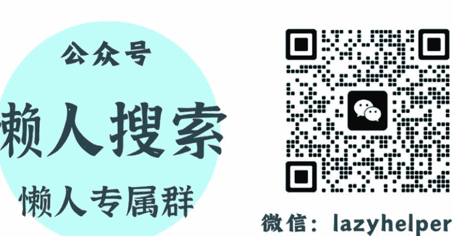

> **小懒判断** | 想进 AI 赛道但不知道从哪下手的新人值得通读，想抄现成项目的用不上。最值钱的是他的路径顺序——操盘练点、定制练解决问题、自营练经营，别一上来就憋产品；企业数据治理把链接错误率从 30% 压到 10%，靠的是把 AI 嵌进客户流程而非炫技。坑在于把学 AI 当目标，工具学一堆不如先找到一个愿付费的具体问题。

## 前言

大家好，我是乔川，02 年，文科生，非技术科班出身。

毕业这一年，我从最开始连代码都不会写，到后来做 AI 操盘、工作流定制、企业数据治理，再到搭自己的 AI 一人公司，累计靠 AI 相关业务变现做到了六位数。

现在我主要在做两件事：一边继续深挖一人公司和 FDE，帮自己和客户把 AI 真正接进业务；一边把过去跑过的项目、工作流、案例和方法整理出来，变成可以重复使用的产品和体系。

如果你现在也想进入 AI 赛道，大概率会遇到和我以前一样的迷茫：知道 AI 是机会，也怕错过这波红利，但真正轮到自己时，又不知道该学什么、做什么项目、从哪里开始变现。工具学了不少，方向反而越来越多，最后迟迟拿不到第一个结果。

这篇文章，我想用自己这一年多的真实经历，把这条路拆开讲清楚：我是怎么靠 AI 赚到第一个 1 万、5 万、10 万，又是怎么从单点技能、定制服务一路走到自己的自营盘。

如果你也想搭建 AI 一人公司，找到一个适合自己的垂分方向，快速跑出一个正反馈，并持续深耕，逐渐做成一门能积累的生意，希望我的这条路，至少能给你一个可以参考的真实样本。

## 01 | 契机：我和 AI 的第一次交手，是一场翻车的数学建模比赛

我和 AI 真正结缘，是在 2022 年，那时候我大二。学校刚好说有个数学建模比赛，拿奖有几干块奖学金。我缺钱，就报了。

报完才发现，这比赛又要写论文、又要写程序、又要建模型，还得和另外两个队友配合。我本身是文科背景，数学和编程经验基本等于 0，这些东西我一样不会，也从来没组队打过这种比赛。本来就准备打退堂鼓了，结果好巧不巧，刚好撞上 ChatGPT 横空出世。

我用了之后，第一时间产生了一个现在回头看挺天真的想法：**既然 AI 什么都能干，那我是不是一个人也能 carry 全场？** 不会建模，可以问 AI；不会写代码，可以让 AI 写；论文不知道怎么组织，也可以交给它。甚至一些自己完全没接触过的数据分析方法，看起来问几句话，也能瞬间“会做”。

那一刻是真的热血沸腾。我甚至觉得，这波要掀桌了，游戏规则要在我这里变一变了。以前要三个人配合完成的比赛，现在我带着一个 GPT，说不定真能一个人顶一支队伍。

比赛开始以后，这种感觉更强。题目一发下来，我直接扔给 GPT，它很快就能拆思路、列模型、写代码，遇到不会的继续追问，又能给我一段段看起来特别专业的解释。别人还在讨论怎么分工，我已经让 AI 开始往论文全文上干了。

那真叫一个高歌猛进。

我第一次特别强烈地感觉到，AI 好像真能把一个普通人的能力边界一下拉得特别远。

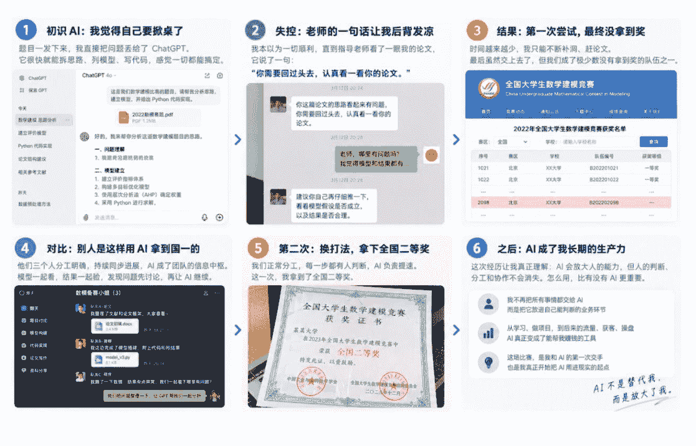

可很快，局面开始失控。

比赛过程中，另外两个队友因为不知道自己该做什么，陆续退赛了。指导老师觉得情况不太对，看了一眼我已经写出来的论文，只提醒了我一句：

“你需要回过头去，认真看一看你的论文。”

这一看，我后背开始发凉。

AI 给出的东西确实都很像那么回事，模型有名字，公式完整，代码甚至也能跑。可真正静下来一点点往回推，就会发现很多地方根本经不起验证。有些模型假设和题目条件完全对不上，有些代码跑出了结果，可那个数字明显就不合理。

如果最开始的数据和假设就是错的，那后面的分析、图表、结论，甚至整篇论文，其实都只是在沿着一个错误继续往下走。

更让我窒息的是，老师后来又问了我一句：

“那你有能力判断它到底错在哪里吗？”

我当时是真的崩溃了。

因为答案是，没有。

我不懂模型，所以它给什么模型，我都觉得挺专业；我不懂代码，所以只要能跑，我就默认差不多。AI 写得越像真的，我越容易相信它；越依赖它往下做，前面那些自己根本没判断过的东西就积得越多。最后整个项目已经乱成一团，可我自己又没有能力脱离 AI，从头把它重新判断一遍。

时间越来越少，我只能不停补洞、拼数据、赶论文。最后论文虽然还是交上去了，但我自己心里很清楚：整个东西已经做成了一坨。结果也不意外，我们成了极少数没有拿到奖的队伍之一。

更扎心的是，我后来四处打听，发现很多没怎么用 AI 的同学反而拿了奖。还有一支同样大量使用 GPT 的队伍，最后拿到了全国一等奖。

我专门去问他们怎么做的，我发现差别特别大。

他们三个人正常分工，一个负责论文，一个负责建模，一个负责程序，同时把各自的进展和关键信息持续同步给 GPT。模型合不合理，几个人一起看；代码结果不对，当场讨论；AI 跑偏了，人先形成判断，再回去纠正。

最后三天的比赛，他们两天不到就把主要工作做完了。

| **失败案例** | **成功案例** |
| :--- | :--- |
| **路径**: 1 人 + GPT → AI 全包 → 无人校验 → 翻车 | **路径**: 3 人分工 + GPT → 实时反馈 → 互相校验 → 2 天完成 |
| 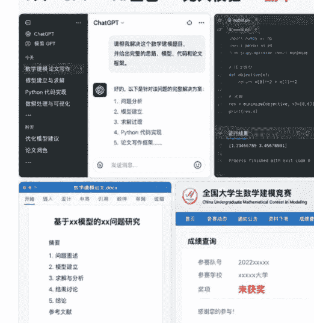 | 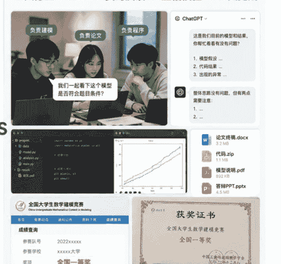 |
| **结果**: 没有拿到奖 AI 给出的方向看着都很有道理，但很多地方不敢验证，最终写上去，成了最少获奖的队伍之一。 | **结果**: 全国一等奖 三个人分工，持续验证 + 合理使用 AI，两天就完成了主要工作。 |

这一波打脸，直接把我道心灭了大半。我躺了差不多两个星期，才开始慢慢复盘。

这个锅还真不能甩给两个退赛的队友。真正的问题，是我一开始就觉得 AI 是万能的，觉得 AI 一来，人就没那么重要了，甚至觉得一个人加一个 AI，就可以碾压一支正常协作的队伍。

那次以后，我第一次意识到：AI 会放大人的能力，但人的分工、判断和协作并不会因此消失。恰恰相反，这些东西越清楚，AI 越能发挥作用。但当时这个结论毕竟还是从别人身上看到的，我心里多少有点不服气。总觉得第一次输得这么惨，也有自己太菜、太急的原因。

所以后来，我又参加了一次数学建模比赛。

这一次我老实多了。

我们正常分工，有人盯模型，有人盯程序，有人盯论文。AI 还是照样用，而且用得比第一次更多，只是每一步都有人负责判断。GPT 给出模型，我们先看它和题目条件对不对；代码跑出结果，也会有人检查数字是不是合理；前面发现问题，马上同步，不让一个错误一路滚到最后。

我慢慢发现一件特别有意思的事情：人的协作越顺，AI 好像反而越强。因为它不需要替所有人瞎猜，每个人都在自己的位置上给它信息、反馈和纠正，它只需要把这些能力继续放大。

那一次，我最后拿到了全国二等奖。

说实话，拿到结果的时候还是挺爽的。第一次连奖都没摸到，第二次直接干到了国二。但这个奖对我最大的意义，不是多了一张证书，而是我亲自验证了第一次失败以后想明白的事情。

第一次，我想让 AI 替我完成所有自己不会的东西；第二次，我们把人该做的分工和判断做好，再让 AI 去提速。

结果完全不一样。

**这是我第一次被 AI 狠狠教育** 现在回头看，第一次翻车反而是一份很好的“见面礼”。如果第一次用 AI 就一路顺风，我可能会一直相信，只要模型足够强，什么都可以直接扔给它。

所以后来我越来越确信一件事：

**AI 把我的能力放大了，也把我的无知一起放大了。** 你本身知道什么叫对，它可以把效率拉得很高；你自己都没有判断标准，它也能非常高效地带着你一路跑偏。

这个问题后来一直跟着我。做流量、做定制、搭工作流，包括现在做一人公司，我都会反复问自己一句：这件事，我到底知不知道什么叫做对？大学那时候，我当然还没有把它想得这么系统。我只是隐约知道，AI 这个东西很猛，但怎么用，比“有没有 AI”更重要。

后来毕业进入社会，我开始真正做流量、做获客、做操盘，逐渐发现这和数学建模其实挺像。

只不过这一次，评委不再是老师，题目也不再是一篇论文。有没有人回复、有没有人加微信、最后有没有成交，市场每天都会直接给我答案。

也是从这个阶段开始，我慢慢换了一种用 AI 的方式。以前我总想让它替我处理那些自己根本不会的事情，后来开始把 AI 放进那些自己已经做过、能判断好坏、知道结果应该长什么样的业务里，再让它帮我提速、扩思路、做测试。

AI 第一次从一个“看起来特别牛的工具”，真正变成了能帮我赚钱的生产力。而我靠 AI 赚到的第一笔钱，也就是从这里开始的。

## 02 | AI + 操盘：我靠一个单点技能赚到第一个 1 万

毕业以后，我因为一些契机加入了一个做社群 CPS 的项目。项目当时已经跑得比较成熟，靠代理体系在 2024 年做到了七万人左右的规模，客单价几百块，分润也不错。

这种模式对当时的我其实很友好。产品、成交、交付都已经有人跑通，我不用一上来就学会怎么做一门完整的生意，只需要先找到一个自己能做明白的环节。我看了一圈，最后选了反馈最快的流量打法：截流。

所谓截流，就是去同行已经聚集精准用户的地方找需求。有人在评论区问“这个怎么做”“有没有资料”“哪里可以学”，说明需求已经发生了，我要做的就是通过评论或者私信建立第一次联系，再把人承接进微信私域。

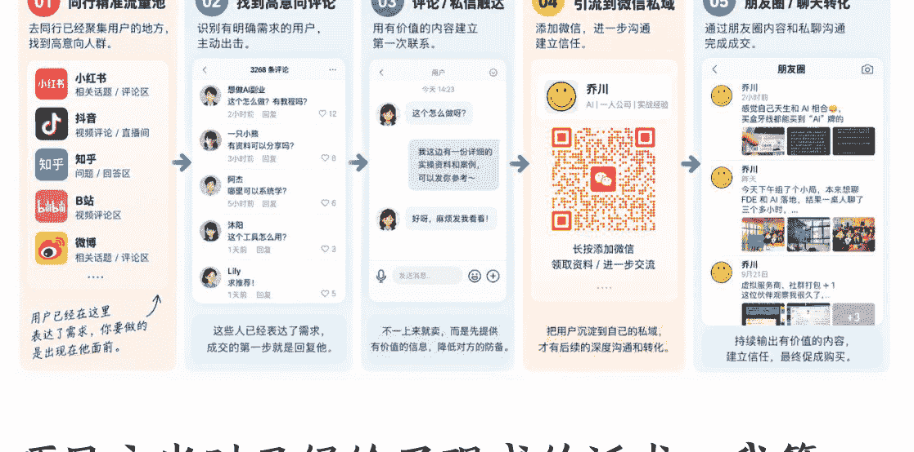

项目方当时已经给了现成的话术，我第一天直接照着发，类似“我这里有资料，需要可以加我”“有交流群，可以拉你进去”。忙了一天下来，却没几个人回复。

我把自己发出去的几十条私信重新看了一遍，突然理解用户为什么不回了。这不就是互联网版的路边小广告吗？换个平台、换个头像，核心还是“我这里有东西，你来加我”。

既然话术不行，我很自然想到了 ChatGPT。我挑了一条自认为很精准的评论丢给它，让它帮我把私信写得更自然。第一版看起来确实比模板舒服，我拿出去测，没反应；继续换语气、换开头、换表达，折腾了一大圈，数据还是没什么变化。

后来实在没招，我去问一个做流量很厉害的朋友。他听完以后给我来了一句：“你现在只是在用 AI，把你过去已经见证过的错误动作重新做一遍。”

这句话一下把我点醒了。

我一直在问“怎么把这条话术写得更好”，可真正的问题是：**一个陌生人凭什么愿意回复你？** 前一个问题只能让我继续改文案，后一个问题才开始碰到真正的用户行为。

我重新回去找 GPT，这次不再让它直接写话术，而是告诉它，我现在只知道两种吸引用户回复的方式，一种是给资料，一种是拉群，除此之外还有什么？

这次答案一下被打开了。

后来我把这些答案借助 GPT 整理成了六类钩子。比如“物”，资料、模板、工具都算；“人”，群聊、同行圈、资源对接都算；“判断”，帮对方看一眼、诊断一下、给个方向；还有情绪、机会、好奇。

整理后我才发现，自己之前脑子里的选择实在太少了。我以为“钩子”就是送资料或者拉群，所以不管我自己写，还是让 AI 帮我写，最终都只是在这两个框里来回折腾。

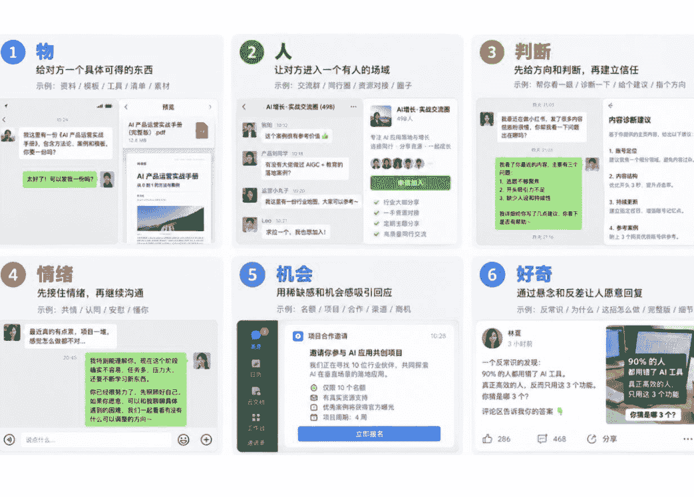

后面我就开始像做实验一样测。六类钩子按比例往外发，每天花几个小时做评论和私信，再看回复率、加微率和最终成交。AI 帮我不断扩出新的可能性，我负责筛选，市场负责告诉我哪些是真的。

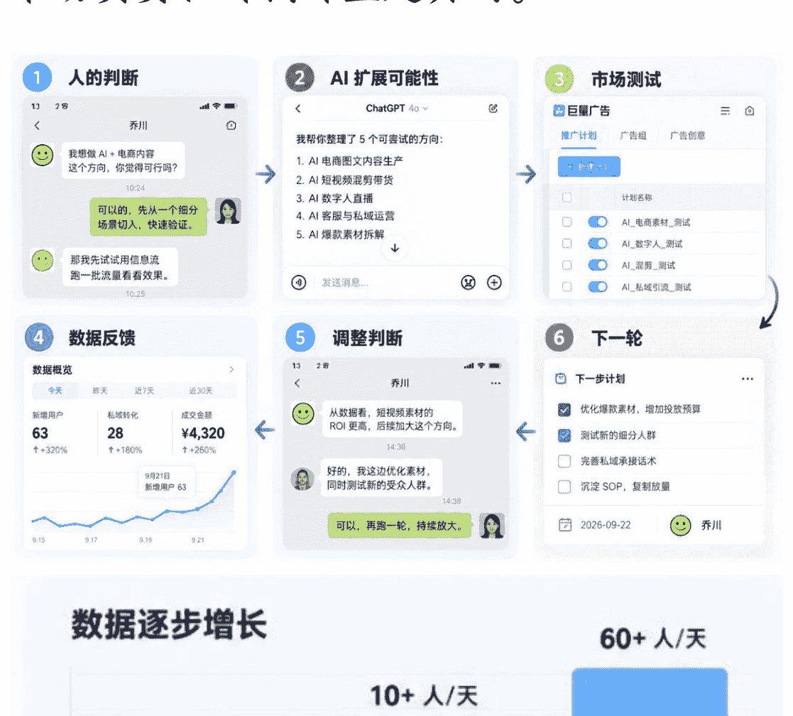
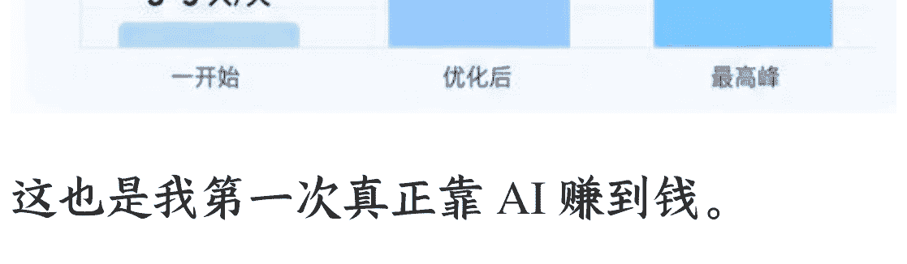

这也是我第一次真正靠 AI 赚到钱。

也是从这个阶段开始，我形成了一个后来一直在用的习惯：先用自己的业务判断圈出方向，再让 AI 帮我扩大可能性，最后拿到真实市场里验证。现在回头看，我也很认可这种进入市场的方式。对刚起步的人来说，先进入一条已经跑通的业务，只负责一个明确环节，比一开始就想把产品、流量、销售、交付全部包圆容易得多。操盘这个阶段，让我第一次真正把“流量”这个点练了出来。

但一个点做熟以后，我开始忍不住往后看。

流量进来了，为什么有人买，有人不买？客户真正需要解决的问题是什么？流量之后的承接、成交和交付又是怎么发生的？

我慢慢不满足于只对“今天进来多少个人”负责了。我开始想，如果自己已经可以用 AI 帮一个业务找到更精准的客户，那能不能再往前走一步，真正进入客户的业务，直接帮他解决一个具体问题？

这个念头，把我带进了下一阶段：AI + 定制服务。

## 03 | AI + 定制服务：从自己研究一个点，到真正走进别人的业务

### 自己做自己的 FDE

前面靠 AI + 操盘赚到第一个一万多以后，我第一次明确感受到，AI 真的可以进入业务，并且和收入产生关系。但现在回头看，那时候我的使用还很“单点”：我研究的是一句话怎么让陌生人回复，什么钩子更容易让人加微信，再让 AI 帮我扩思路，拿到市场里测试。用户愿意回复、愿意加微，我负责的那一段基本就结束了。

到了 2025 年 7 月，原来的业务开始往下走。我那段时间挺焦虑，又回到生财里天天刷项目，刚好看到了闲鱼上的 AI 服务。代写、数据分析、程序课设，一单几百到几千都有，AI 和流量又都是我碰过的东西，于是我想着，先下场跑一圈再说。

真正做起来以后，我才发现，这跟以前只负责流量完全不一样。最后我切进了“大学生程序课设”这个垂类，从起号、找对标、找素材、做内容，到用户咨询、加私域、跟订单，整条线都落到了我自己身上。每一个动作拆开都不难，可一旦同时发生，人马上就开始被撕成很多块：内容一慢，流量就少；咨询一多，内容又顾不上；订单一多，前面所有事情都得往后排。

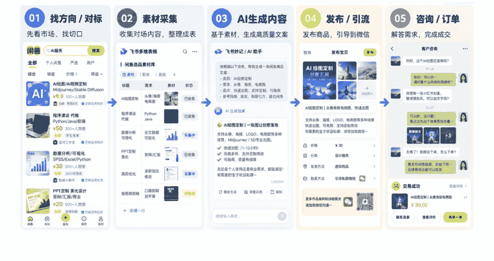

我最开始以为自己效率不够，就想着再快一点、晚上再多干两个小时。后来才发现，真正消耗我的并不是那些需要判断的工作，大量时间都花在复制、搬运、改格式、切窗口这些已经做过几十遍的动作上。

那时候我第一次认真问自己：我每天做的这些事情，到底是怎么连在一起的？素材从哪里来，中间为什么必须经过我，生成内容以后为什么还要手动搬，用户进来以后又经过哪些固定步骤。越往下拆，我越发现，整条业务一直需要我站在中间，用自己的注意力把每一棒往下传。只要我停，很多地方就一起停。

于是我第一次产生了“搭流程”的念头。当时没想着以后做什么 AI 工作流定制，更没什么宏大规划，动机特别简单：我只是想救救我自己。

### 为其他超级个体做 FDE

我先拿闲鱼内容生产开刀。以前素材散在浏览器、聊天窗口和本地文件里，哪条做过、哪条没做全靠脑子记。我先把它们统一放进飞书多维表，标清楚待处理、已生成、待发布、已发布，再慢慢把 AI 生成和后面的固定动作接进去。

很有意思的是，一个重复动作被拿掉以后，下一个重复动作马上就会露出来。素材都自动进来了，为什么还要我一条条复制给 AI？文案已经生成了，为什么不同账号不能提前排好？同一份素材已经处理过了，为什么换个平台还得从头再做？

那段时间我有点像在给自己的业务做“微创手术”。白天继续跑业务，晚上看今天哪里最烦，连续几天都觉得烦的动作就想办法往流程里搬。最后一条内容从原来的五分钟左右压到几十秒，一天从二十条左右做到五十条，同时跑的订单也从三个提高到了五个左右。

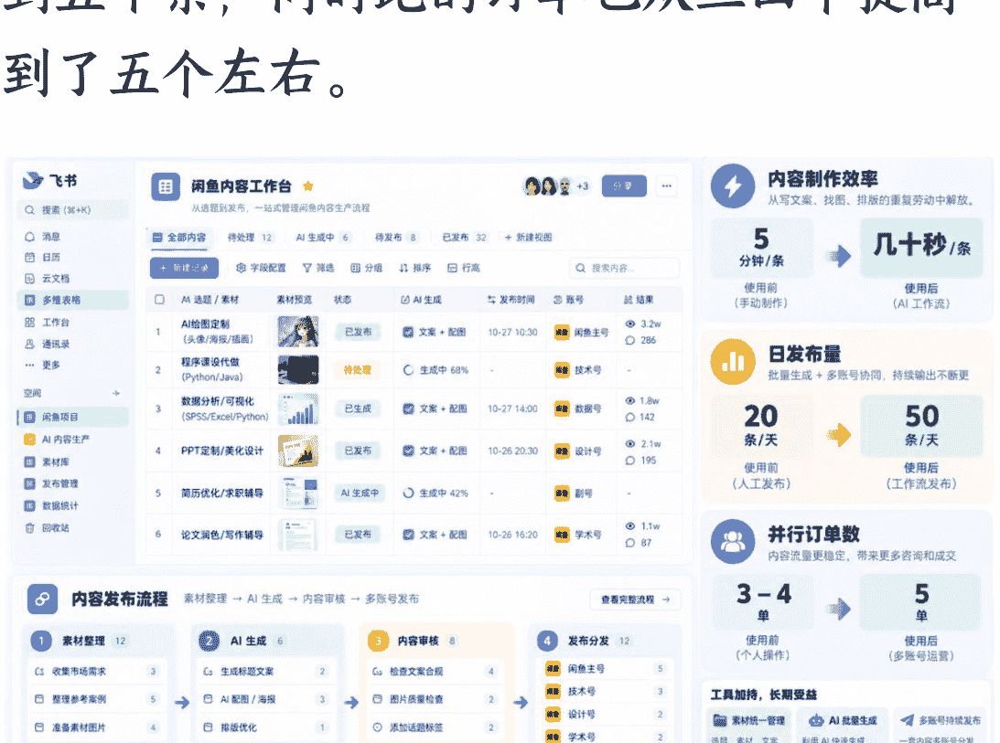

也是在这个时候，我看业务的方式开始变了。以前我学飞书、AI 编程、自动化，会先研究工具能干什么；后来我开始先看业务走到哪一步，这里需要生成、整理、判断还是执行，哪些东西已经重复到没必要继续占人的注意力，哪些地方哪怕技术上能做，也最好继续留给人。

工具开始往后退，业务本身站到了前面。

这套东西在自己身上越跑越顺以后，我第一次冒出一个很具体的念头：**既然能给自己搭，那换成别人的业务，我能不能也看得懂？** 刚好那时候我去了生财有术 2.0 联合办公空间。身边很多人和我很像，都是一人公司、超级个体或者小团队，而且不少人的业务已经跑得 很好，真正卡住他们的是下一步：生意还能增长，人却快扛不住了。

后来我服务的一位伙伴就是很典型的例子。她本身的知识付费项目，月利润已经突破十万，产品、内容和变现路径都被市场验证过了。她需要解决的是放量：账号还想继续铺，内容还要持续生产，但原来的方式已经接近产能上限。

> 具体服务的流程，我写在这一篇帖子里了，大家感兴趣的可以自行查阅
> [「AI 工作流定制服务商」超级标实战：5 天搭起小红书全自动获客工作流，我如何用飞书多维表格插件+AI 编程做到的]

第一次面对面聊，我们谈了差不多两个小时。我现在回想，那场沟通特别像一次“赛博中医问诊”。我没有上来就推 AI 工具，而是一直顺着她的业务往下问：内容从哪里来，一条内容要经过哪些步骤，一天能做多少，如果账号再翻一倍，哪里会先撑不住。

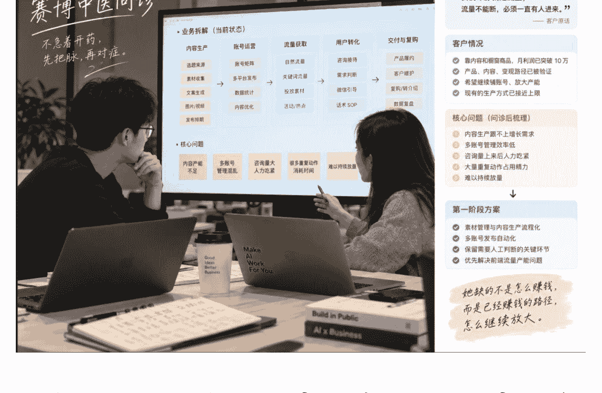

她中间说了一句话，我一直记得：“我们命脉就是流量，流量不能断，必须一直有人进来。”这句话出来以后，优先级一下清楚了。我们没有一次性改所有东西，而是先处理前端内容，素材管理、内容生产、多账号发布先跑通，需要她判断的地方继续保留，重复和稳定的部分再交给 AI 与自动化。

两周以后，第一阶段交付完成。她原来一天做一条内容已经比较吃力，后来开始可以同时管理十几个账号。这一单，我第一次收到了 1 万块服务费。

以前做操盘赚到一万，更像是证明我把“流量”这个点练出来了；这次则是第一次有人把一段已经赚钱的业务交给我，我先看懂它，再找到真正卡住的地方，最后把东西做出来交回去。

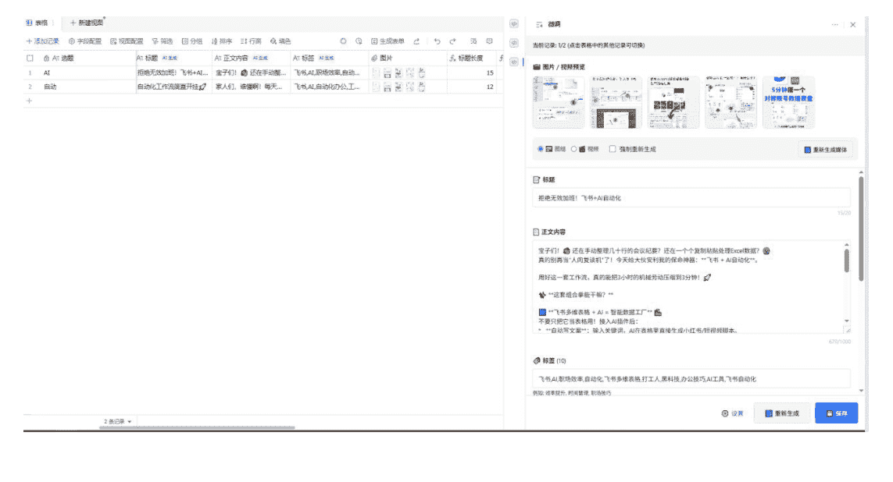

20251128-021124.mp4 【在线播放】

后来我把整个项目写成生财长文，拿到了全生财精华帖第七名，文章又带来了新的咨询。有人看文章来找我，有人在线下认识以后再聊，也有朋友帮忙转介绍。后面的定制单就是这样一点一点进来，这个阶段我靠 AI 工作流定制，也做出了第一个 5 万。

## 2 去企业内部做 FDE

定制服务做了一段时间以后，我服务的大部分还是一人公司、超级个体和小团队。这类业务做多了，我已经越来越熟：老板本人往往就是信息中枢，只要愿意坐下来把业务讲清楚，我基本都能顺着需求一点点往下拆，再找到适合 AI 和自动化介入的位置。

但也正因为越来越熟，我心里开始冒出一个新的疑问：如果把场景复杂度继续往上拉呢？如果不再是一两个人的小团队，而是一家真正运转起来的企业，数据量更大、规则更多、协作链路更长，我前面练出来的这套能力还管不管用？更重要的是，我也很想亲眼看看，当时企业内部真正的 AI 落地到底走到哪一步了，老板和团队究竟愿意为什么样的结果付钱。

所以那段时间，我做了一个主动选择：去企业一线待一段时间。我当时并不是想给自己找一份稳定工作，更多是想把自己放进一个更复杂的真实业务现场，做一次 FDE 式的入驻验证。外在形式上确实是入职，但我给自己设定的目标很明确：进去看业务、看数据、看组织怎么协作，也看看离开自己熟悉的一人公司场景以后，我还能不能真正把问题解决掉。

筛企业这件事，我也没用了以前做流量的思路。我先通过 BOSS 直聘采集了杭州大概 2000 家公司，再根据行业、业务方向、岗位需求和自己的能力匹配度做数据清洗。两千家一路筛下来，最后只留下 30 家我觉得真正值得深入聊的企业。每家公司我都会提前研究它在做什么、现在可能卡在哪里、我过去哪段经验能和它接上，再针对性准备沟通内容。

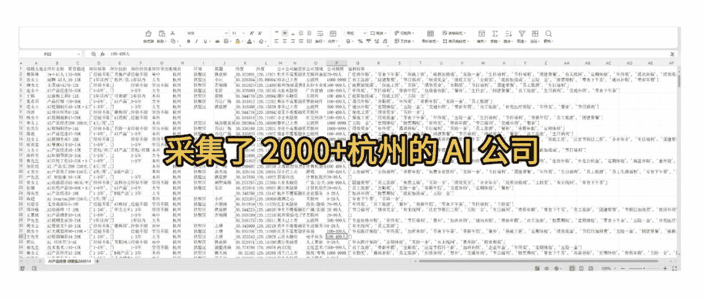

最终，30 家里面有 10 家给了我 offer，我只挑了一家，起薪 15K。

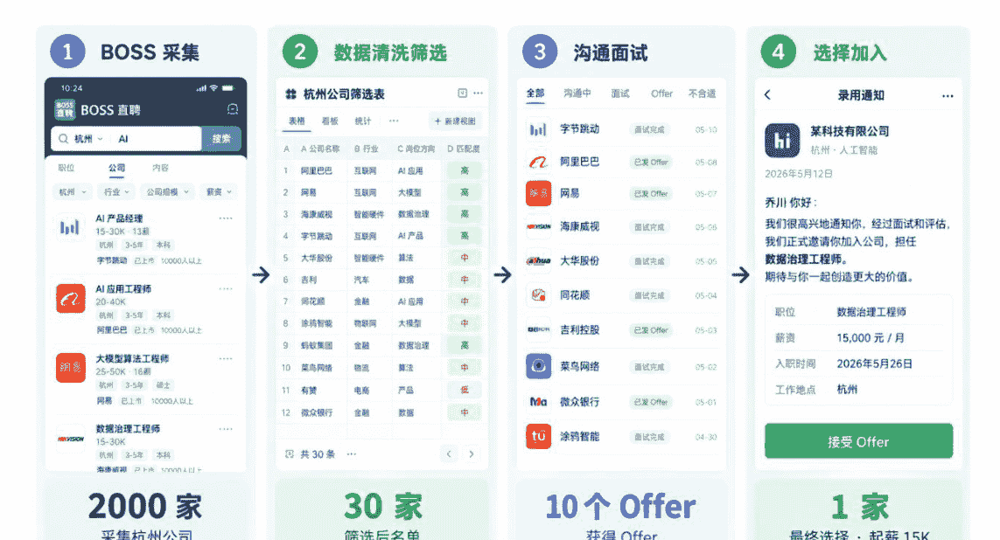

这进去以后，我负责的核心问题是商品数据治理。公司有大量商品数据和商品链接，当时链接错误率大概在 30%。真正扎进去以后才发现，不同数据来源、字段格式、平台规则全不一样，而且错误会一路往后传，前面的数据不可信，后面的发布和运营结果也会一起受到影响。

那一刻我又想起大学第一次数学建模。模型写得再漂亮，只要前面的数据和假设错了，后面做得越多，错得越远。只不过当年影响的是一篇比赛论文，这次影响的是一家公司的真实业务。

我开始把异常一类一类拆开，哪些能直接用规则识别，哪些需要结合上下文，哪里可以让 AI 辅助，哪些情况必须人工兜底。大概一个月以后，原本 30% 左右的商品链接错误率，被压到了 10% 以下。

### 3 主动进入企业
- 找哪类企业？
- 岗位需求？
- 业务落地在哪？

#### 4 企业现场实战

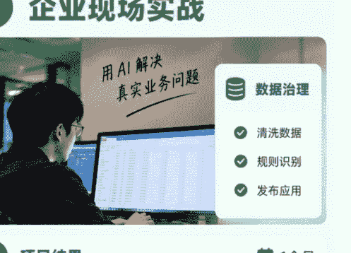

- 清洗数据
- 规则识别
- 发布应用

##### 筛企业样本

| BOSS直聘 | 目标企业 | offer |
| :--- | :--- | :--- |
| - 大公司：阿里、百度等 | - 中厂：快手、网易等 | - 小厂：XX科技等 |
| - 行业：电商、互联网、AI等 | - 阶段：初创、成长、企业出海等 | - offer：XX年薪、XX月薪等 |

2000+ 企业 > 30 家 深入沟通 > 10 个 收到 offer > 选 1 家 入职验证

##### 项目结果

| 治理前 | 治理后 |
| :--- | :--- |
| 错误率 30% | 错误率 < 10% (1个月) |

从真实场景
看到真实价值

最后出结果之后，我更多是一种踏实。因为之前那个问题终于有了答案：换一个完全陌生的行业，把复杂度拉高以后，前面一路练出来的能力依然成立。

老板后来也认可这个结果，我准备离开时实际已经愿意给到 20K。但进企业这一趟，我最想验证的问题已经验证完了。长期坐班的节奏又确实不太适合我，我更在意自己对时间和方向的主动权，所以最后还是选择出来，继续做自己的项目盘。

## 直到 FDE 出现，我才看清自己真正积累的是什么

也是在这个阶段，我越来越频繁地接触到 FDE 这个词。第一次认真去理解的时候，我越看越觉得熟悉：进入真实业务现场，把问题搞清楚，再把 AI、数据和工程能力接进去，最后对一个具体业务结果负责。

也是在这个阶段，我开始越来越频繁地接触到 FDE 这个词。第一次认真去理解的时候，我有一种很强的熟悉感：进入真实业务现场，先搞清楚问题到底发生在哪里，再把 AI、数据和工程能力接进去，最后拿业务结果说话。

我那时候才突然反应过来，过去几年看起来很散的经历，其实一直在把我往同一种能力上推。

最开始做截流，我练的是理解用户和市场反馈；到了闲鱼，我第一次开始把内容、流量、私域和订单放在一条业务链里看；后来给生财里的超级个体做定制，我开始真正走进别人的业务，判断什么地方值得改、什么地方最好别动；再到企业里做数据治理，我碰到的已经是数据、规则和系统稳定性这些更底层的问题。

表面上，我一直在换项目。可真正沉淀下来的东西没有怎么变：*先看懂业务，再定义问题，然后调用合适的 AI、数据和工程能力，把结果做出来。* 这时候我才开始意识到，我真正积累的从来都不只是某一个工具、某一套工作流，甚至也不只是“会做 AI”。我越来越像是在训练一种连接能力；一头是业务，一头是快速变化的 AI 技术，我要做的是把两边真正接起来。

后来亦仁老大又连续提出了两个让我印象很深的超级标：「AI 工作流定制服务商」和「企业 AI 学习与服务」。我看到以后，反而更加确认了自己的判断。工作流和 Agent 定制、企业 AI 培训陪跑、AI 能力和算力服务，具体交付形态可以完全不同，但市场正在出现一个越来越清晰的需求：企业缺的已经不只是“知道 AI”，而是有人能够帮助它把 AI 真正落进业务。

亦仁 11/11 关注 精华 【超级标16】企业AI学习与服务 听全文 全文朗读 · 18:08 #超级标# 016 这一条超级标是：企业 AI 学习与服务 中国中小企业一共 6000 万家，所有的企业都要转型 AI。这是一个让所有圈友都转型去做，都满足不了的持续高速增长的市场。 给大家先分享下，我看到和听到的几个故事以及一些想法： 1. 26年1月份，我在 CES，碰到同一个团的同学，干 SaaS 服务的，说本来就觉得快干不下去了，结果来了 AI，所有的企业都让他们提供 AI 的培训和服务，忙到根本停不下来。 2. 有一个圈友，给某大型企业提供 AI 服务，客单大几十万； 3. @大树 之前访谈了一期电商公司如何用 AI 的访谈，后台私信都在问如何学习，意愿强烈； 4. 我身边的老板，几乎培训预算都转移到 AI 相关，除了 AI，其他都不想看看，不想学。只要是 AI的，都可以花点钱试一下

亦仁 11/7 关注 精华 【超级标12】AI工作流定制服务商 听全文 全文朗读 · 09:59 #超级标# 012 原本想着周末来写，没想到一晚上到1000赞，早上起来先把几个会开了，立刻来写这条超级标。 这是第 12 条超级标，过去发的超级标，几乎每一条都带动着整个生财星球的内容及航海走向，也影响了很多圈友的项目与事业方向，所以，对于超级标的发布，我是比较慎重的，但每一条发布，也代表着我看真实的机会和趋势。 当然，我会看走眼，我会犯错，所以，包括我在内的所有圈友发布的信息，供你参考。 今天，我要和大家分享超级标是： AI 工作流定制服务商 即面向中小企业的 AI 工作流/智能体培训和定制服务。 下面，我详细讲讲，为什么我看好这个机会： 1/ 8月中下旬那条 n8n的AI工作流 超级标发出后，航海者接近 4000人开始了工作流的探索，让很多圈友感受到了 AI 工作流的魅力。

# FDE 对我最大的意义，也是在这里。它让我第一次给自己过去那些零散的经历找到了一个更清晰的坐标：我真正想继续做深的，是 AI 从技术能力走到业务结果之间的“最后一公里”。

可走到这里，下一个问题也越来越明显。定制服务让我赚到了第一个 5 万，也积累了大量真实业务经验，但这些能力依然很大一部分长在我自己身上。客户来了，我得亲自聊；业务要拆，我得亲自判断；方案最后还是得我亲自参与。

我前面一直帮别人解决“老板本人就是业务瓶颈”的问题，做到最后才发现，我自己也慢慢成了自己业务里最大的瓶颈。

于是下一个问题出现了：

这些已经被反复验证过的经验，能不能从我的脑子里拿出来，变成方法、模板、工具和产品，不再每一次都从“乔川亲自上”开始？ 这个问题，把我带到了下一个阶段。

## 04｜AI＋自管盘：从卖自己的能力，到第一次经营自己的生意

### 我开始想，把那些只能靠我亲自做的东西留下来

从企业出来以后，我对自己能不能解决问题这件事，已经没那么焦虑了。前面一路从流量操盘、闲鱼，到给超级个体做工作流定制，再到企业里做数据治理，我至少验证了一件事：换一个业务、换一种场景，只要让我真正进去看一遍，我大概率能找到那个最卡结果的地方，再想办法把 AI、数据和流程接进去。

可做得越多，我越明显地感觉到另一个问题。以前担心的是自己没有能力，现在是能力越来越多，但这些东西大部分还长在我自己身上。客户来了，我得先聊需求，再判断他说的是表面问题还是真问题，然后拆流程、想方案、搭系统、调试、交付。很多问题其实已经见过不止一次，换一个客户，还是得重新坐下来过一遍。

有时候一天甚至会遇到三四个类似的问题。第一次我会认真打一大段，第三次、第五次再看到，心里就会冒出一种很熟悉的感觉：**这个问题，我是不是已经回答过很多遍了？** 这种感觉和以前做闲鱼的时候很像。那时候让我难受的是动作重复，素材要搬、文案要复制、内容要一条条发；到了这个阶段，开始重复的已经不是动作，而是我的经验。一个问题已经想明白一次了，为什么还要对十个人重新讲十遍？一套流程已经跑通过了，为什么下一个客户来了还得从一张白纸开始？

于是我开始有意识地这些东西从脑子里往外掏。以前跑过的工作流重新整理，看看哪些只是某个客户的特殊需求，哪些在很多业务里都会反复出现；做过的案例重新复盘，为什么当时这样拆，哪一步真正影响了结果；客户反复问的问题也开始记下来，因为一个问题出现一次可能是个例，连续几个人都在问，背后大概率就是一类需求。

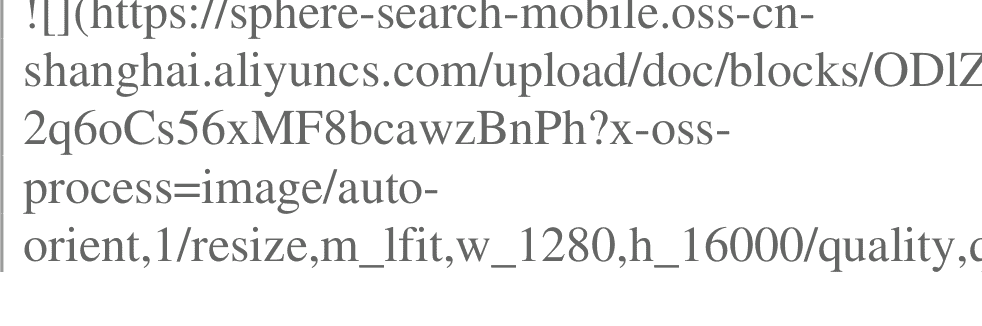

整理到后面我才发现，过去一年多其实已经积累了不少东西。只是以前我一直把它们理解成“我会的能力”，没有意识到它们也可以成为被复用的资产。比如怎么判断一个流程值不值得 AI 化，怎么从一个模糊需求里找到真正的效率瓶颈，一人公司哪些环节适合先自动化，这些判断听起来不复杂，背后却都是自己踩过坑、交付过、拿过结果以后才长出来的。

这时候我第一次认真想了一件事：如果这些经验已经被验证过很多次，能不能让更多人直接拿走，而不是每个人都付一笔定制费，再等我亲自给他做一遍？一开始我甚至没把这件事理解成“知识付费”。我只是想找一个容器，把过去跑过的工作流、案例、模板和方法慢慢放进去。有人刚接触 AI，可以直接看真实业务里别人是怎么用的；有人已经有自己的生意，也可以拿这些案例回来对照，看自己的流程里有哪些地方值得改。

后来，这个容器慢慢变成了社群。

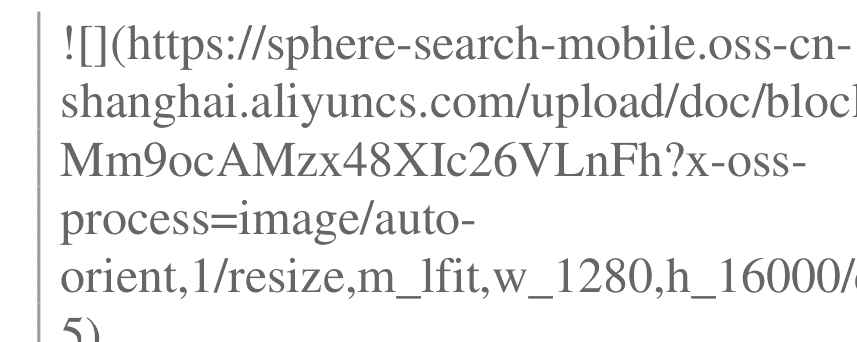

但只有社群还不够。我还需要一个更靠近交易的入口，让一个刚认识我的人，不需要一上来就买定制、买陪跑，也能先和我产生第一笔交易。所以那时候我开始做自己的贴牌网站，把算力、AI 工具这些更标准化的东西先放进去。

算力对我来说一直不是终点。它更像一个很轻的前端产品：用户先因为“马上能用”的 AI 能力和我产生连接，我也能借此看到他到底是单纯缺工具，还是后面还有工作流、获客、社群、定制这些更深的需求。算力代理也是同样的逻辑，先让一个人“有货可卖、有东西可做”，尽快跑出第一笔正反馈，再慢慢往更深的能力和服务升级。

到这里，我的产品开始有了一点层次：网站承接交易，算力完成第一次连接，社群沉淀方法和案例，后面的训练营和定制再解决更深的问题。

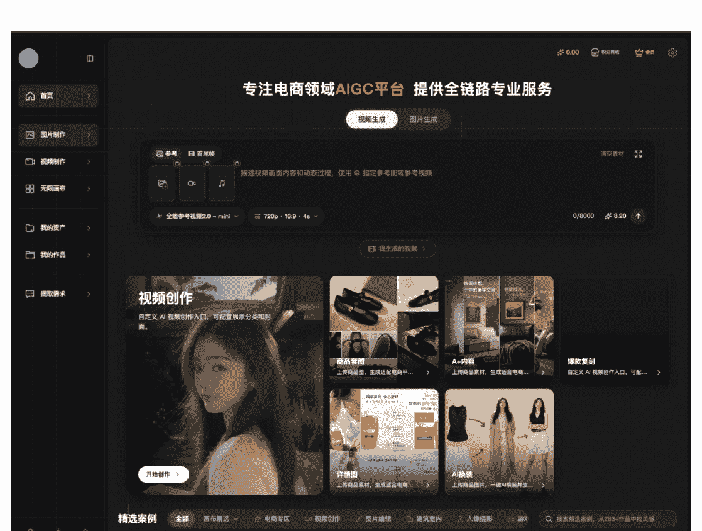

我一开始只是把自己跑过和整理过的工作流往里面放，后来慢慢积累到两百多套。再往后，我又加了训练营，因为很快发现，只给模板其实解决不了太多问题。很多人收藏了一百个工作流，回到自己的业务里还是不知道该选哪个、怎么改。

所以相比继续堆资料，我开始更想带着大家自己跑一遍。从真实场景出发，先把问题搞清楚，再选择工具，让他们真正体验一个工作流怎么从需求里长出来。

也是从这里开始，我第一次认真思考另一个问题：以前做操盘，我在别人的项目里负责一个环节；做定制以后，我开始直接服务自己的客户；到了这个阶段，我很想完整跑一次属于自己的生意。我自己做内容、找用户、经营私域、设计产品，再自己面对用户反馈。我想知道，没有现成产品给我卖，也没有客户先把需求摆到我面前，我自己到底能不能从市场里发现需求、做出产品，再让别人主动为它付钱。

知识付费只是当时最适合承载这些经验的一种形态。真正把我推到这个阶段的原因其实很简单：**我不想再让所有价值，都只能依赖“我亲自做一次”才能产生。**

### 真正做自己的盘以后，我才发现一人公司有多容易失控

自营盘真正跑起来以后，最爽的地方是所有事情都能自己决定；跑久以后，我才发现，最麻烦的地方也是所有事情都得自己负责。

以前流量出了问题，我只研究流量。现在一个产品卖得不好，我得自己判断，到底是内容不对、流量不精准、朋友圈信任不够，还是产品本身没有打中需求；社群里有人进来说话，我要想是不是交付出了问题；用户提出一个新需求，我一边觉得这是产品机会，一边又要考虑手上的东西还没做完。

最明显的变化，是脑子越来越满。每天微信里会进来大量信息，有人问产品，有人反馈问题，有人聊合作，也有人顺说出一个特别有价值的需求。当时看到会觉得“这个一定要记下来”，忙几个小时以后，再回头就找不到了。

有时候晚上我会突然想起，白天有个人说了一个特别好的点，可再回微信里翻，已经不知道在哪段聊天里。明明每天都发生很多值得表达的事情，真正坐到电脑前准备写内容的时候，却又像什么都没有。

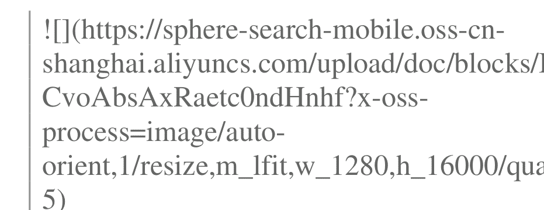

我最开始的解决方式还是找AI。朋友圈建一个Agent，社群建一个Agent，产品再建一个，客户分析也来一个。看见什么问题就做一个助手，结果工具越来越多，新的问题又出现了。同一个用户在客户助手里有一份信息，到了内容助手里又像完全不认识；产品定位刚在一个窗口解释完，换个窗口又得重新讲。

那种感觉特别熟悉。以前做闲鱼，我在不同软件之间搬素材；到了这里，我开始在不同AI之间搬脑子。

我这才慢慢意识到，问题已经不只是某一个动作效率低了。内容是一条线，客户是一条线，产品是一条线，交付又是一条线，而且它们之间还会互相影响。客户聊天里出现的新需求应该回到产品，产品变化又应该变成新的内容，内容再带来新的客户。

如果所有东西只靠我本人记，它们迟早会重新散掉。

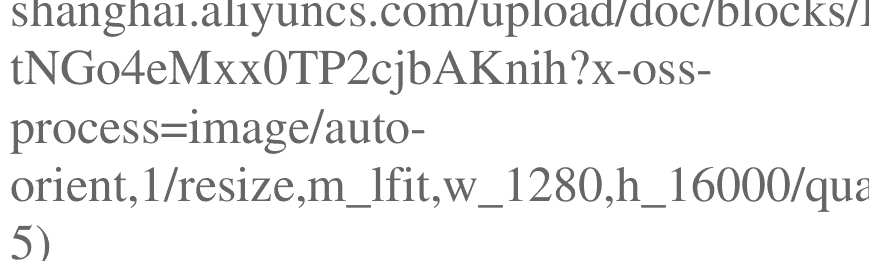

这时候我才真正意识到，一人公司要解决的问题已经不是“再找一个更强的 AI 工具”，而是怎么让整家公司本身有一套稳定的运行方式。规则放在哪里，数据怎么沉淀，任务怎么流转，不同 AI 怎么共享上下文，需要人判断的时候怎么把人接回来。

这也是我后来开始搭自己 AI 一人公司体系的真正原因。

### 我第一次真正理解，什么叫做自己的生意

走到这个阶段以后，我才慢慢发现，前面几种赚钱方式真正的差别，不只在收入数字，更在每做完一件事情以后，手里到底留下了什么。

做操盘时，最直接的是现金流，今天把流量做好，今天就能看到结果；做定制以后，除了钱，还会留下案例、项目经验和对不同行业的理解；到了自己的盘里，一件事情开始可以同时留下很多层价值。

一次客户沟通，可以留下对用户需求的理解；一次真实交付，可以沉淀案例、流程和方法；一个客户反复问的问题，可以变成朋友圈、长文，甚至新的产品模块；一场训练营结束以后，用户跑出来的结果又会回来影响下一轮交付。

以前很多事情做完就结束了。到了这里，它们开始互相喂养。

这也是我现在理解“复利”的方式。知识付费本身不会天然复利，真正能复利的是：

> 今天做过的事情，有没有给明天留下东西。

一篇长期有人看的内容，一个真实案例，一套以后还能继续使用的方法，一批愿意持续跟你产生连接的用户，这些东西都不会随着当天结束而归零。

也是到了这个阶段，我越来越相信一句话：

> 财富很多时候真的流动在人和人的关系里。

这里的关系不是认识多少人，而是对方知不知道你能解决什么问题，愿不愿意相信你，过去有没有持续看到你把事情做好。

一场线下认识、一篇长文、几个月朋友圈、朋友的一次推荐，这些东西叠在一起，最后才可能变成一笔真实交易。

所以回头看，从第一个 1 万到 5 万，再到 10 万，对我来说更重要的变化，其实是我开始从“靠一个技能换钱”，慢慢走向“经营一套可以不断积累的东西”。

而这些积累最后又把我推向了下一个问题：当内容、用户、产品和交付都已经跑起来以后，怎么把它们真正组织成一家能长期运行的一人公司。

## **05 | 如果重新走一次，这三种赚钱方式我会怎么选**

走到现在再回头看，AI + 操盘、AI + 定制、AI + 自营盘，很难简单说哪个更好。它们更像是不同阶段的解法。

刚开始的时候，我最缺的是第一次正反馈，所以操盘对我很有帮助。产品、成交、交付都已经有人跑通，我只需要先把流量这个点练出来，尽快证明自己的能力有人愿意买单。

后来做定制，我开始真正面对客户的问题。客户不会告诉我该用什么模型、搭什么 Agent，我得自己听懂需求、判断哪里值得改，再把结果交出来。这个阶段虽然重，却是我业务判断长得最快的时候。

再到自营盘，我第一次开始同时面对内容、流量、私域、产品和交付，也第一次真正感受到“积累”：一篇文章可以持续带来客户，一次交付可以变成案例，一场训练营又会产生新的需求和产品素材。

所以现在让我总结，我会这样理解：

- 操盘，适合练一个点；
- 定制，适合练解决问题；
- 自营，开始真正练经营一门生意。

它们也不需要互相替代。现在我的业务里，同样可以同时存在代理、定制和自己的产品。真正重要的是，你要知道当前阶段最缺什么。

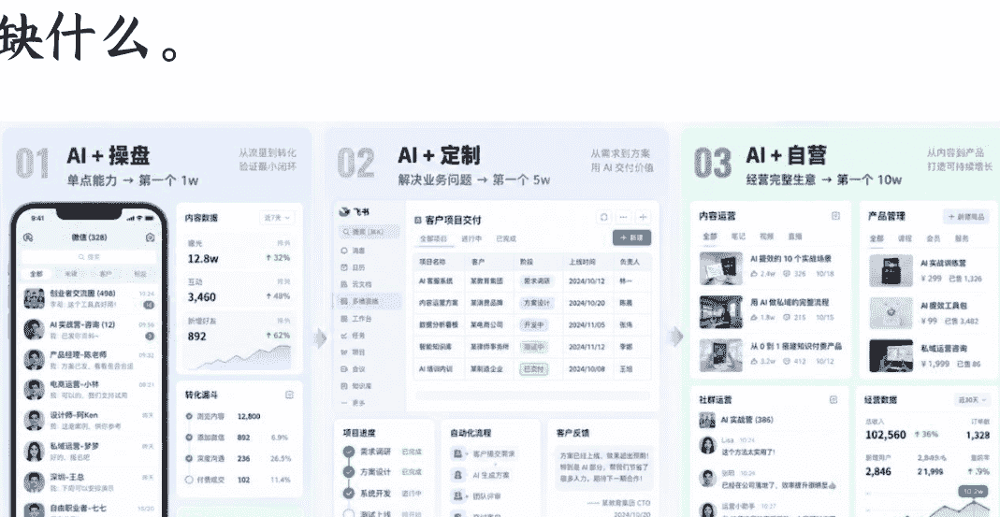

## 避坑一：一人公司，不等于孤军奋战

这个坑，我大学第一次用 AI 的时候就踩过。

当时觉得一个人加 GPT，可以把三个人的事情全干掉，最后比赛直接翻车。后来第二次重新做好分工和协作，反而拿到了全国二等奖。

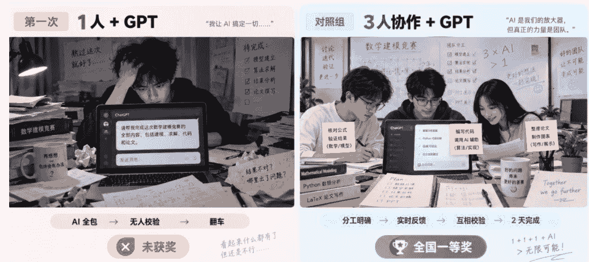

进入社会以后，这种感受越来越强。做截流卡了半天，是一个懂流量的朋友一句话把我点醒；后来去生财、联合办公、线下局，我又开始看到大量自己业务之外的样本。很多我自己研究几天的问题，一个真正做过的人可能十分钟就能帮我校准。

所以我现在理解的一人公司，是组织可以很轻，但认知不能封闭。

AI 可以帮你扩思路，可如果你看到的样本本身就很少，它也会把你原本站的局限继续放大。老师、同行、客户、合作伙伴和真实商业场域，最大的价值就是不断扩大你的样本，让你知道世界上还有哪些打法已经有人跑通过。

一个人可以经营公司，但不要一个人理解世界。

## 避坑二：不要把“学 AI”本身当成目标

这个坑也很容易踩，因为你每天看起来都特别努力。

今天学一个模型，明天研究 Agent，后天又去看工作流、MCP、AI 编程。收藏夹越来越满，可几个月以后回头看，真正解决的问题可能没有几个。

我后来进步最快的阶段，几乎都有一个共同点：**先有问题，再学技术**。做截流，是因为用户不回复，我才去研究钩子；做闲鱼，是因为内容生产把自己折磨惨了，我才开始学工作流和自动化；做定制，是客户真的有业务问题，我才继续补 AI 编程；进入企业，也是因为数据治理摆在面前，才开始真正研究规则和数据。

手上有一个非解决不可的问题时，学东西反而特别快，因为你知道为什么学，也知道学到什么程度就够了。

所以现在看到一个新的 AI 工具，我已经不太会先问“我要不要学”，而是先问：

它能不能解决我现在一个真实存在的问题？

暂时没有，就先放着。

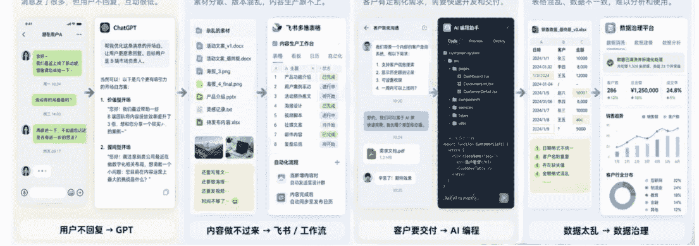

## 避坑三：不要只看今天赚多少钱，要看做完以后留下什么

刚开始的时候，我最关心的也很现实：这个项目一个月能赚多少，多久能回本。

0→1 阶段这么想没有问题，因为人首先得拿到正反馈。

但项目做多以后，我开始多看一个东西：

**今天干完，明天手里到底多了什么？** 有些事情赚完一笔钱就结束了，下个月想继续赚，还得重新找流量、重新找客户、重新交付。

有些事情当下不一定最赚钱，却会留下案例、SOP、代码、内容、用户和关系。一篇长文可能几个月以后还在带来客户，一次交付可以变成下一次成交的证明，一个认真服务过的用户，未来也可能带来合作和转介绍。

所以现在判断一个方向，会特别看三个东西：

**客单价够不够支撑交付，做完以后能不能沉淀，未来有没有重复放大的空间。** 前一个决定现金流，后两个决定复利。

如果一件事做完以后只多了一笔已经花掉的钱，它可能只是一笔收入；如果还能留下案例、方法、用户和关系，它才更有机会慢慢长成一门生意。

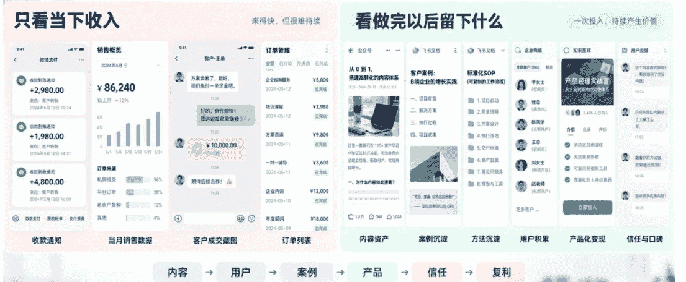

## 06｜如果还在 0→1，我会怎么走

如果现在让我重新从零开始，我不会先花几个月把各种 AI 工具学一遍，也不会一上来就设计一个特别完整的产品。我会先解决一件最现实的事情：**怎么尽快进入真实市场，拿到第一个正反馈。** 很多刚进入 AI 赛道的人，很容易把准备期拖得特别长。今天学提示词，明天研究 Agent，后天又去看 AI 编程，懂的概念越来越多，却始终没有真正面对过客户，也不知道谁会为什么东西付钱。最危险的是，学久以后很容易产生一种“我差不多准备好了”的错觉，可市场其实一次都没有验证过你。

所以如果你还在 0→1，我反而建议先找到一个离钱够近的场景。做代理、做操盘、接一个小定制都可以，甚至先免费帮身边的老板解决一个具体问题也行。这个阶段最重要的，是亲自跑过一次完整闭环：**有人有问题，你提供价值，问题真的被解决了一点，对方愿意因此付钱。** 一旦这个闭环跑过一次，后面很多东西才有参照物。

### 先去找流量，别先把自己训练成 AI 百科全书

如果一定给 0→1 排优先级，我会把流量放得很靠前。

这里的流量不只是小红书多少曝光、抖音多少播放。我更愿意把它理解成：**你有没有能力持续被一群潜在客户看见。** 没有真实用户，很多事情都只能靠猜。你做了产品，不知道有没有人要；学了一个能力，不知道市场愿不愿意买；觉得某个方向有前景，但身边连一个客户都没有，最后很容易一直停留在自己脑子里推演。

我前面的很多成长，其实都是被真实用户逼出来的。做截流时，有人不回复，我就回去研究钩子；客户提出一个我不会解决的问题，我再去补能力；一个场景连续出现几次，我才开始研究怎么把它标准化。

所以哪怕你现在的 AI 能力只有 60 分，只要已经能解决一个具体问题，我都更建议先出去找人。剩下那 40 分，真实市场会告诉你应该补在哪里。

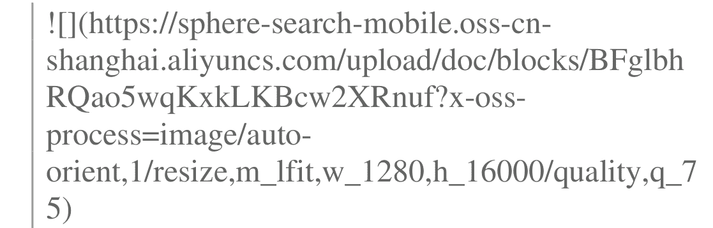

### 可以借船出海，但要开始学会挑项目

0→1 阶段，我其实很支持先进入一个已经跑通的项目。

新人最缺的往往不是想法，而是对一门生意到底怎么运转的认知。一个成熟项目已经有产品、有用户、有成交，你可以先进去负责其中一环，比自己从零把所有东西都造出来快很多。

但这里有一个前提：别看到项目就冲。AI 赛道更新太快，每隔一阵子都会冒出新的工具、新的平台红利、新的“机会”。如果没有自己的判断标准，很容易每个月都觉得上一个方向不行，再去追下一个。

我现在看一个项目，会主要看三件事：

- 有没有足够的客单和利润空间
- 做完以后能不能留下资产
- 未来有没有被继续放大的可能

0→1 的时候不要求三项全部满足，毕竟第一目标还是先拿到正反馈。但你得开始训练这种判断。因为早期做项目真正留下来的，不应该只有那笔钱，还有你以后独立做生意时判断机会的能力。

先赚钱，再看能不能留下和放大。

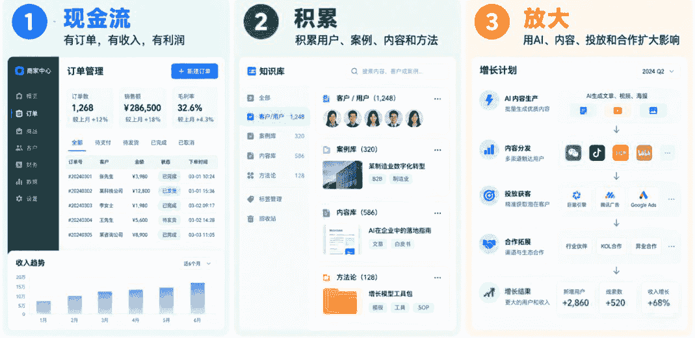

### 找一个真正跑出过结果的人，深度跟一遍

我自己还踩过一个坑，就是特别喜欢到处学。

这个老师听一点，那个社群买一个。每个人讲的都有道理，可十套正确答案同时放在脑子里，真正轮到自己执行时，反而不知道该听谁的。

所以如果重新从零开始，我会更愿意找到一个和自己目标足够接近、也确实跑出过结果的人，先完整跟一段时间。

这里最值钱的往往还真不是课程本身，而是校准。

真正开始做以后，你会遇到很多没有标准答案的问题：这个方向还要不要继续测，这个客户值不值得接，产品没人买到底卡在哪里。这些问题自己可能绕三天，一个真正做过的人，十分钟就能告诉你现在最该解决的是什么。

早期最缺的不是更多知识，而是有人在你跑偏的时候，把你拉回来。等自己真跑出第一个结果以后，再去吸收更多人的方法，你已经有了自己的判断标准。那时候信息越多越有价值；在此之前，信息太多反而容易变成噪音。

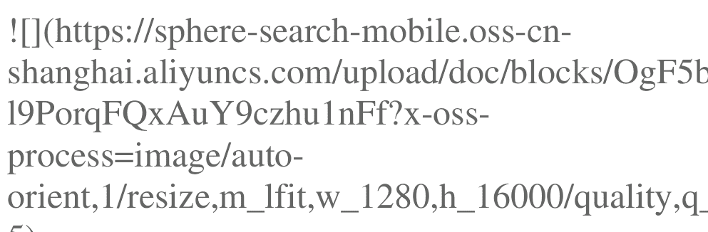

### 进入一个高密度商业场域，扩大自己的样本

最后一个我特别建议 0→1 去做的事情，是主动进入一群真正正在做业务的人里面。

以前我把这个叫“抱团取暖”，后来觉得还是说轻了。它真正的价值是：**扩大你的商业样本**。一个人做项目时，你看到的样本只有自己。这个月赚到了，就觉得这条路无敌；这个月没赚钱，又怀疑整个行业都不行。很多判断其实只是被自己的单一样本带着走。

后来进入生财、联合办公空间和各种线下局，我才开始同时看到很多完全不同的生意。有人内容很强，有人产品很强，有人技术很好却不会卖，也有人 doing 一个看起来很普通的小项目，现金流却稳定得离谱。

样本一多，人就没那么容易随便下结论。

更重要的是，很多机会本来就发生在人与人的连接里。你会 AI，对方正好懂行业；一个老板看到你做的案例，可能直接把自己的业务拿给你试；一次线下分享，也可能变成下一次合作的起点。

所以如果你还在 0→1，我会建议自己少一点闭门研究，多一点进入真实市场。

- 找一个具体场景，让目标客户持续看见你；
- 找一个已经跑通的人深度跟一遍；
- 再让自己长期待在一个有大量真实商业样本的环境里。

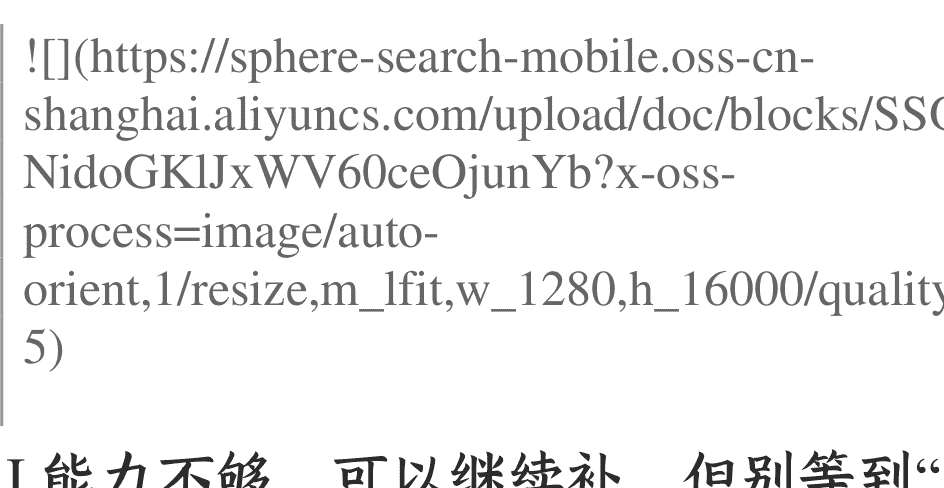

AI 能力不够，可以继续补，但别等到“准备好了”才开始。

因为对 0→1 来说，最重要的从来不是你会多少 AI，而是：

你能不能尽快进入市场，拿到第一个真实结果，再从那个结果开始往前长。

## 07｜如果已经从 1→10，我会怎么做

如果你已经靠一个项目、一个技能或者一个产品赚到过钱，那接下来最难的，往往已经不是“能不能赚到”，而是**怎么让这个结果稳定下来，并且越来越不依赖运气和自己死扛**。这个阶段很容易出现一种状态：这个月客户很多，下个月突然断档；一条内容爆了，接下来又不知道发什么；项目明明能赚钱，可每次都得重新找流量、重新成交、重新交付。你已经证明这条路能走，但还没有真正把它变成一门会积累、会增长的生意。

所以从 1→10，我会开始把注意力从“今天还能多赚多少钱”，慢慢移到另外一件事上：

### 今天做的事情，能不能让下个月比这个月更容易一点。

### 第一件事：建立自己的用户池，长期待在用户身边

到了这个阶段，我会非常重视私域。

但私域对我来说，不只是把人加到微信里，然后每天发朋友圈卖东西。它更像一个长期的用户研究场。一个人为什么加你，为什么一直看却没买，最近反复在问什么，什么时候突然愿意付钱，这些东西都会直接告诉你，市场到底在发生什么。

很多产品其实不是坐在办公室里想出来的，而是从聊天记录里长出来的。一个问题连续三个人都在问，就值得重视；客户愿意花半个小时跟你讲一个痛点，背后大概率有需求；有人看了你半年朋友圈，突然有一天来付钱，这条成交路径本身也值得复盘。

所以 1→10 以后，我会把“经管用户”放得比单纯“搞更多流量”更靠前。流量负责把人带进来，私域和持续表达让你真正理解他们，也让他们慢慢理解你。

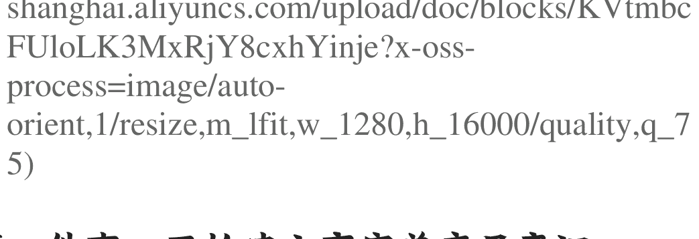

### 第二件事：开始建立高客单产品意识

低客单很适合扩大样本。你可以快速接触很多人，知道他们在关注什么，也能让更多人低门槛和你建立第一次关系。但真正想深入理解一个用户的业务，很多时候还是要进入更深度的服务。

一个人愿意花几百块买资料，和愿意花几千、几万让你帮他解决问题，给你的信息完全不一样。后者会把真实业务摊开给你看，你也得真正为结果负责，而这个过程反过来会快速提升你的产品和判断。

所以我现在不会简单理解成“低客单不好，高客单才高级”。我更愿意让它们承担不同作用：低客单扩大用户池、筛选需求，高客单创造利润、深入业务、产生案例。两边再互相反馈，产品才会越来越贴近市场。

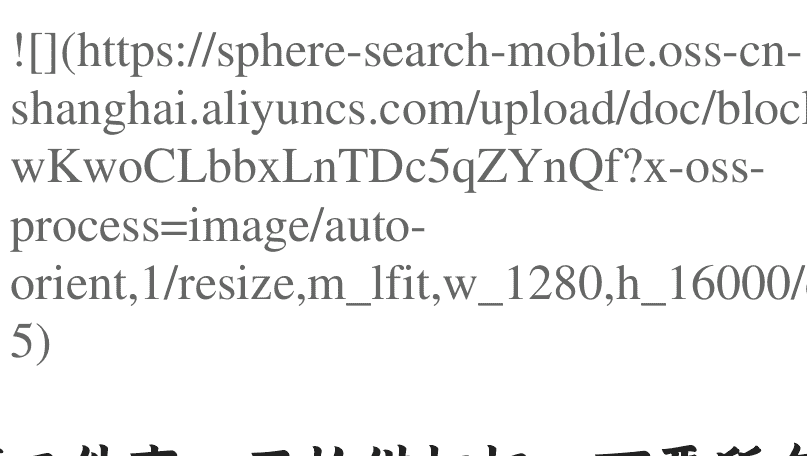

### 第三件事：开始借杠杆，不要所有事情都自己干

0→1 时，很多事情亲手做很有价值，因为你得先知道它到底是怎么发生的。但到了 1→10，如果还是什么都自己做，很快就会重新撞到产能上限。

我现在最关注的几种杠杆，一个是内容。一篇真正写透的长文，可能半年后还在给你带客户；一个案例认真讲清楚，可以替你重复解释很多遍。第二个是 AI，那些已经验证稳定的内容、数据和流程，可以逐步让系统接过去。第三个是投放，如果产品和转化链路已经跑通，用钱放大流量，和一开始什么都没验证就烧钱，是完全不同的两件事。还有一个就是人和关系，你会 AI，对方懂行业；你擅长交付，对方擅长流量和销售，很多一个人做起来特别重的事情，通过合作会一下变轻。

但杠杆有一个前提：**底下那条路得先手动跑通。** 如果连一单都没跑明白，就急着自动化、投放、招人，很多时候只是把错误更快放大。

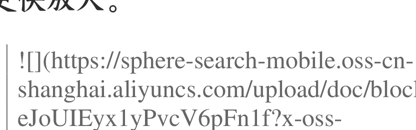

### 最后，真正拉开差距的是业务判断

走到后面，我越来越觉得，单纯的 AI 技术能力会越来越平权。

今天少数人会做的工作流，过几个月可能就有现成模板；以前要会编程才能实现的东西，现在 AI 已经可以帮普通人完成大部分。工具会越来越简单，所以“我比别人多会几个 AI 产品”这件事，很难一直成为真正的壁垒。

最后更值钱的，是判断。

- 哪个需求值得做，什么用户值得服务；
- 一个项目虽然赚钱，为什么不值得继续投入；
- 什么时候应该做定制，什么时候应该开始产品化；
- 现在到底应该继续加流量，还是先把交付补好；
- 一个流程到底适合自动化，还是应该继续让人负责。

这些事情 AI 可以给建议，但最后还是得有人做决定。

从我大学第一次数学建模翻车，到后来做流量、做定制、再到自己的盘，其实一直都在重复一个问题：

我到底知不知道，什么叫做对？到了 1→10，这个问题只会越来越重要。因为你的杠杆越大，一个正确判断产生的收益越大，一个错误判断的成本也会一起被放大。

## 写在最后：AI 越强，人越要知道自己要什么

写完这篇文章，我又回头想了一遍大学第一次参加数学建模比赛的自己。

那时候我拿到 GPT，最兴奋的事情是：以前不会的东西，好像突然都会了。不会建模，让 AI 做；不会代码，让 AI 写；不会论文，让 AI 帮我拼。我当时理解的 AI，是一个可以不断替我补能力缺口的东西，甚至觉得只要模型足够强，一个人就可以把原来一群人的事情全干掉。

几年以后，我真的走上了一条“AI + 一人公司”的路，反而越来越不相信这件事了。

AI 确实把一个人的能力边界拉得很远，但它并没有让人的价值消失。恰恰相反，模型越强、工具越简单，很多以前需要技术门槛才能做到的事情越容易被抹平，剩下真正稀缺的东西会越来越清楚：你能不能看懂一个问题，知不知道什么结果才算对，敢不敢为自己的判断负责。

现在回头看，我前面赚到的第一个 1 万、5 万、10 万，其实也不只是三个收入数字。

- 第一个 1 万，我学会的是对一个环节负责。我把流量这个点跑通，第一次知道自己的一个具体能力可以被市场买单。
- 到了 5 万，我开始对客户的结果负责。客户不会告诉我该用哪个模型、搭哪个 Agent，我得自己走进他的业务，判断真正的问题在哪里，再把结果交出来。
- 到了 10 万，我第一次开始对一门完整的生意负责。流量从哪里来、用户为什么相信我、产品怎么设计、交付能不能接住、过去做过的事情能不能沉淀下来，这些问题再也没有别人替我兜底。

所以表面上，我这几年一直在换项目、换赚钱方式；实际上，我一直在扩大一件事情的边界：

我到底能对多大的结果负责。而 AI，一直在放大这个过程。

这也是为什么现在的我越来越不执着于“哪个工具最强”“下一个风口是什么”。工具一定还会继续换，今天复杂的工作流，明天可能就是一个按钮；今天很稀缺的技术能力，过半年可能人人都会。

但只要真实的商业还存在，就永远会需要有人需要判断：什么需求值得解决，什么产品值得做，什么客户值得服务，什么地方应该交给 AI，什么地方必须留下人的判断。

FDE 对我来说也是这样。我后来才发现，自己过去那些看起来很散的经历，其实一直在训练同一种能力：**站在业务和技术中间，把一个真实问题变成一个真实结果**。再往后，我越来越在意的则是另一件事：一个结果做完以后，到底留下了什么。

如果一次交付结束，只剩一笔钱，那下一次还得从头开始；如果它还能留下一个案例、一套方法、一篇内容、一批用户，甚至一段长期的信任关系，那今天付出的时间，才有机会继续在未来产生价值。你前面所谓的“复利”，最后复利的其实不是知识付费这个形式，而是这些被留下来的东西。

所以如果现在再让我理解“一人公司”，我会觉得“一人”从来不是孤军奋战，也不是靠 AI 把所有人都干掉。

它更像是：**你拥有自己的选择权，也承担最终的判断；然后尽可能借 AI 的能力、别人的经验、长期的关系和过去积累下来的资产，把一个人的时间放大**。

大学第一次比赛的时候，我想的是：

**有了 AI，我是不是就什么都不需要别人了？**

走到今天，我的答案刚好相反。

真正厉害的一人公司，不是一个人能做所有事。

而是他越来越清楚，**什么事情必须由自己判断，什么事情应该交给 AI，什么能力可以向别人借，什么东西必须长期留在自己手里**。

如果你现在还站在 AI 赛道门口，也许暂时不用急着想清楚未来五年要做什么。

先入一个真实市场，解决一个真实问题，拿到一次真实反馈。

然后再做第二次、第三次。

慢慢地，你会开始拥有自己的判断、案例、用户、方法和关系。等这些东西一点点连起来以后，你可能会发现，所谓抓住 AI 红利，从来都不是追上每一个新模型。

而是在这个技术快速变化的时代里，逐渐找到那些真正属于你、并且会随着时间越来越值钱的东西。

如果你看到这里，刚好也在做一人公司、超级个体或者小团队，已经有自己的业务，但卡在内容、获客、私域、交付这些效率问题上，想看看 AI 到底能怎么真正接进业务；或者你正在切入 AI/FDE，手上已经有一项能力，却还没跑通自己的第一个商业闭环，都欢迎来和我交流。

另外，如果你本身深耕某个行业，手里有真实业务场景和客户资源，也在找 AI 落地的可能性，我也很愿意一起碰一碰，看看有没有机会共同跑出一个垂直案例。

——分割线——

看完这篇 SOP，你觉得你懂了。但 90% 的人一到实操就会卡在第一步。

工具和教程只是最低级的壁垒，真正的壁垒是“立刻动手”和“圈层信息差”。

如果你想看全网最新的变现玩法，并且和一群执行力极强的极客一起下场拿结果，

# 欢迎围观我的核心私域：【懒人专属群】。

我们不聊虚的，只做商业闭环的拆解与 AI 效率的压榨。系统内已沉淀 1000+ 跑通的套利实战局。

- 查阅圈子完整数字资产与上车门槛：
[https://lazysO.com/insider/](https://lazysO.com/insider/)

认同价值、准备好下场干活的，扫码加我微信（lazyhelper1）
备注：【实操上车】，不闲聊

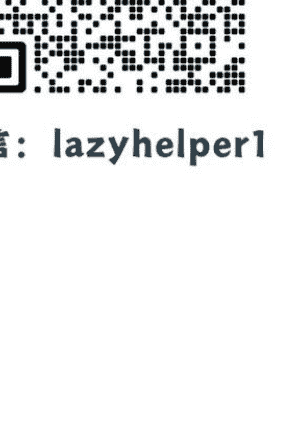
