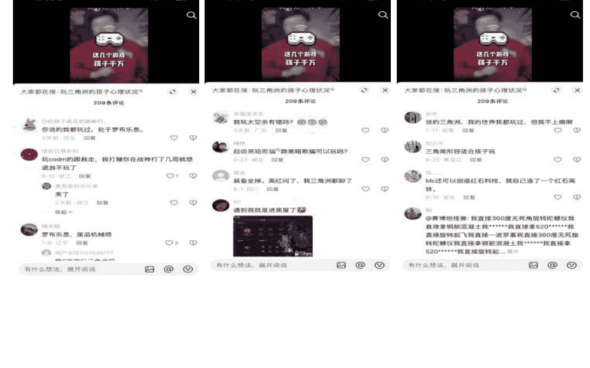
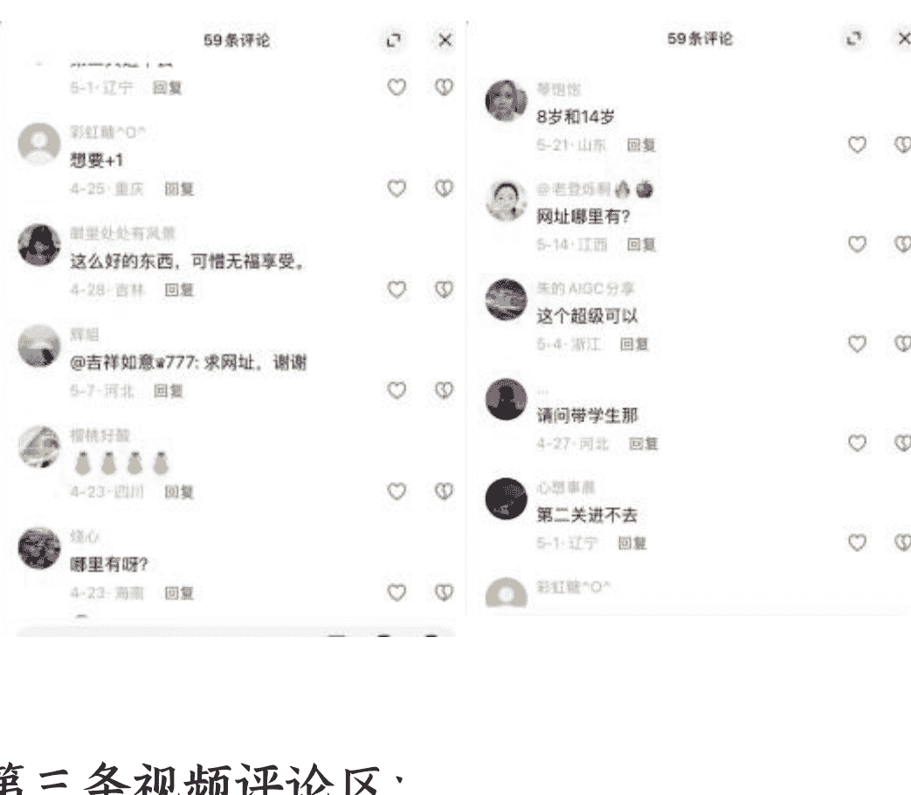
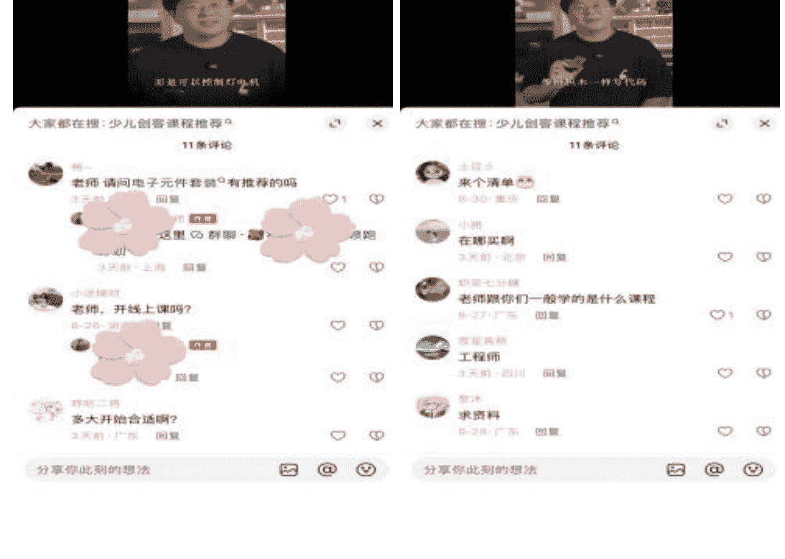
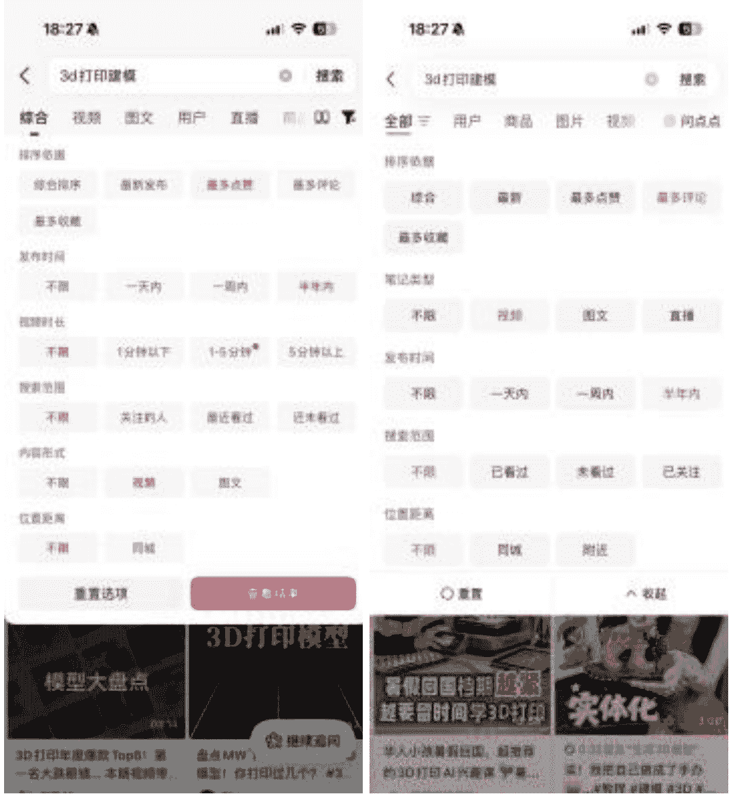
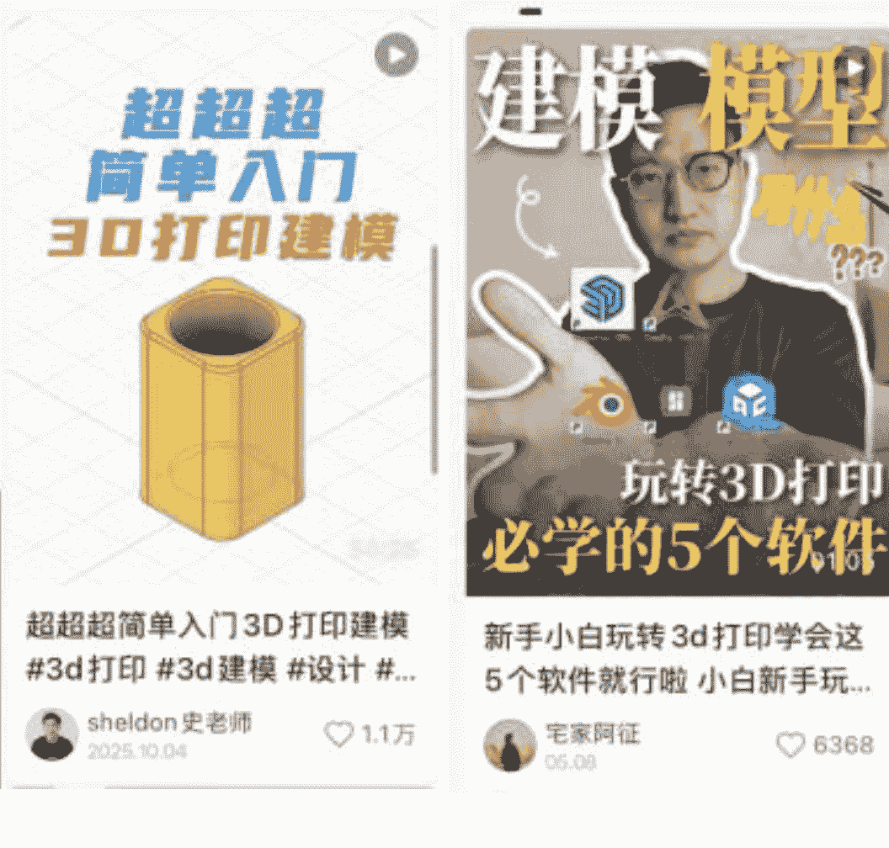
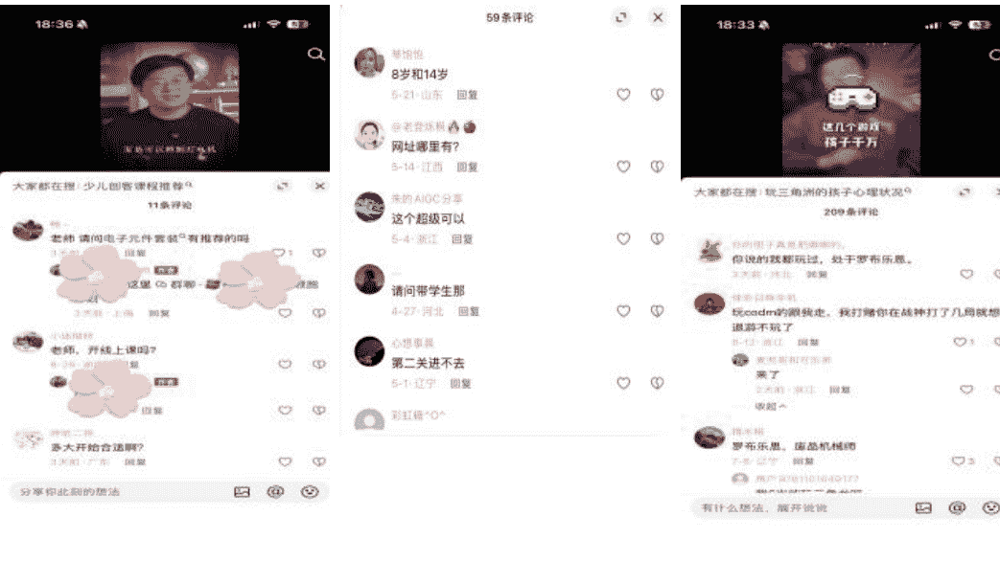

# 裸辞后，我怎么把一个代运营账号 3 个月从 0 到 1.1 万粉，加微信 1000+，分享我做个人 IP 精准获客经验

260930 副业 SC 精华
整理：公众号懒人搜索，懒人专属群精选
懒人微信：lazyhelperl

> 小懒判断 | 在抖音做自然流获客、苦于播放高加微少的副业玩家必看，想涨粉做泛流量账号的用不上。最值得抄的是 C/B/A/S 选题分层，S 类"学了 3 年编程不走信奥赛怎么办"这种选题直接筛出马上要花钱的人。坑在于数据反直觉：20 万播放的选题加微 130，7 万播放的加微 0，粉丝量和获客是两套逻辑。

大家好，我是柠檬，4 年短视频流量操盘手。去年年底裸辞后，我接到了自己的第一个代运营合作项目——少儿科创，我主要负责流量部分。这是一个相对小众的教培赛道，和大家熟悉的少儿编程、机器人乐高有些关联，但大众认知度要低得多。

抖音从 0 粉纯自然流起号 3 个月时间做到 1.1 万粉丝，3 个月导流 1000+，今天想分享自己做这个账号过程中关于精准获客的一点心得。（下图是 3 个月的时候发的朋友圈）

合作的第一个项目，3月底起号，纯自然流2个月多时间，1.1万粉丝，好像还可以

## 这篇内容分为 3 个方向：

- 一、找对人：精准获客的短视频是什么样的？
- 二、找对需求：如何找到离成交更近的选题？
- 三、接住用户：如何通过钩子+路径，把公域流量承接到私域？

### 一、找对人：精准获客的短视频是什么样的？

首先想给大家看 3 条这个赛道的视频，都是我给这个少儿科创账号做的，大家可以猜测一下播放量、以及加微信数据以及成交数据第几条视频最高？

我想先给大家看一下不同视频的评论区，3 条视频有什么区别呢？

第一条视频的评论区如下：

第二条视频的评论区如下：

第三条视频评论区：

看完大家应该能够很明显的对比出来：

第一条视频的评论区全是小孩在讲自己的游戏，但其实我们的目标用户是家长，那吸引的用户完全不精准。虽然视频播放量还行，但播放量≠精准流量。第一层判断：来的是不是目标用户？第二条视频的评论区用户不再是孩子，全部是家长，说明目标人群是对的。但再仔细看他们问什么：“网址哪里有？”“第二关进不去”。大家的注意力集中在 IP 推荐的工具和资源，而不是课程本身。也就是说：人群对了，不代表需求就离你的业务足够近。第三条评论区用户在问的是老师有怎么跟着你们上课、开线上课吗，用户的关注点在课程。

所以，判断一条视频是否“精准”，看这两个问题：

1. 人对不对？这条内容吸引的是不是我的目标客户？比如：少儿科创赛道 → 家长；
2. 需求近不近？这些目标客户，是随便看看，还是正在找解决方案？

所以精准获客，不只是“找对人”，还要看这个人的需求离成交有多近。

### 二、找对需求：如何找到离成交更近的选题？

搜索选题的最快筛选选题的方法（可以按照图片操作），可以选择点赞最多，也可以选择评论最多

#### 找对标，别只看谁的数据最高

先看两个东西：

① 时间近不近

优先看最近 3—6 个月已经验证过的内容。

（咱们以我合作的少儿科创业务的选题 3D 打印建模为例进行搜索出来了下面的 2 个选题）

比如上面的这两个都是讲 3D 打印建模的选题，我们在选择对标的时候，虽然第一个的点赞量更高 1.1 万，第二个只有 6000 多，但我们依然选择第二个去作为我们的对标内容，因为他离我们的时间更近。

为什么建议优先选择发布时间在最近 3-6 个月的爆款内容：（2 个底层原因）

1. 平台的审核规则是动态的，尤其是某些行业，之前可能松，现在审核可能严，如果按照很早之前的对标内容去做，容易违规。
2. 用户的状态在变化，比如教培行业刚开始学和假期中家长的心态就完全不一样；比如我之前做的求职行业，年底找工作和金三银四找工作的人心态也不一样。

② 评论区用户准不准

数据高只能证明这个选题容易火，**评论区才能帮你判断它容易吸引谁**。评论区吸引的到底是同行、想白嫖的人、单纯要资料的人、还是想要了解课程的人。（刚刚给大家展示的 3 条视频的评论区其实就很明显的对比）

**所以咱们找对标不要只看谁播放高点赞多，更要看谁的评论区里出现了真实需求**。我会重点留意评论区里这 3 类信号：

- 求资料的：怎么加，求资料，我需要，求回复，已私信，麻烦帮我联系，私了没回
- 求推荐咨询业务相关的：在哪买的，多少钱，怎么跟着你们学习，有课吗，你们地址在哪里

**如果一个选题下面不断出现这类评论，说明它不仅有流量，还有真实需求。因为：没有陌生人莫名其妙在你的评论区求买求带求联系。** 举个我真实找选题的过程：

我要找“3D 打印”相关选题，直接在抖音/小红书搜索 3D 打印。我不会直接选点赞最高的，而是先筛最近半年内的内容，分别选择点赞最多、评论最多的去看。

有些视频点赞很高，但评论基本都是“好酷”“收藏了”或者是用户吐槽的，这种会更偏流量型；另外一些播放量没那么高，但评论里已经出现：求资料、怎么联系、孩子几岁可以学、有课吗、地址在哪，且这类评论不低于 5 个，这种需求明显离我们的业务更近。

最后我会根据这条内容的目的来选：*这次要流量，就选前者；这次要客资，就优先选后者*。所以我现在找选题，不是找“数据最高的”，而是找**最符合这条内容任务的**。

*总结为一句话：找爆款，看数据；找客资，看评论区*。

#### 但“有需求”还不够，要判断需求离成交有多近

看到评论区有人有需求，是不是就代表这个选题离成交很近？*还不一定*。同样都是目标用户，有的人只是“觉得有意思”或者单纯想“要个资料”，有的人已经在主动找解决方案或者对你的课程感兴趣了。

所以我会用一个很简单的 *C/B/A/S 分层*，判断一个选题吸引来的用户，距离成交还有多远。

- C 类：有点认知，需求弱
- B 类：有点兴趣，暂时不急
- A 类：有明确问题正在找方案
- S 类：需求明确，近期准备行动

同一业务可以做出不同用户需求的选题，以少儿编程为例：

- C: 3个免费少儿编程学习网站！ -> 先看看、先收藏
- B: 家长不懂编程，怎么带孩子入门？-> 有兴趣、想开始
- A: 学完 Scratch，下一步 Python 还是 C++？-> 有问题、找方法
- S: 学了3年编程，不走信奥赛，下一步怎么办？-> 需求明确、找方案

**所以选题其实就是一道筛选器。**你选择什么问题来讲，就决定了什么阶段的人更容易被你吸引过来。大家做选题的时候也可以用这个方法来判断你吸引的人到底处于哪一步？

既然 A/S 类的选题吸引的用户精准，咱们是不是只做 A 类、S 类就好了？

答案很明显：其实并不是。因为不同类型的选题承载的作用是不一样的。

- C/B 类：扩大人群，建立认知
- A/S 类：筛选需求，承接转化

对于咱们的账号而言：既要有流量型内容也要有精准转化型内容，既要有人进来，也要有人留下来，更要有人愿意往下一步走。（这里建议根据销售的承接能力来调控比例，比如销售少承接能力有限可以精准型内容占比高一些，但如果销售多都属于资源不够的情况下其实可以 C/B 类选题占比高一些）

最后给圈友一个能直接用的「选题 3 问」，每次准备做选题，先问自己 3 个问题：

- ① 这个选题吸引的是谁？是不是我的目标用户？
- ② 他现在处于 C/B/A/S 哪一层？只是感兴趣，还是已经在找方案？
- ③ 这条内容承担什么任务？我要流量、建立认知，还是筛选需求、承接转化？

不要再只问“这个选题能不能爆”，而要多问一句——“它会给我带来什么样的用户？”

### 三、接住用户：如何通过钩子+路径，把公域流量承接到私域？

前面我们解决了两个问题：**来的人对不对，以及他的需求离成交有多近。** 但还有一个很容易被忽略的问题：用户有需求，可能会来找你，但是你的联系方式不明显，回复时间间隔太久或者操作很麻烦，都会导致用户在中途放弃了，影响添加率。比如：同样的选题，都是 1 万播放，有的人只能加几个微信，有的人却能加几十甚至上百个。为什么？我把它总结成一个公式：**选题精准度 × 钩子匹配度 × 路径顺畅度 = 获客效率** 所以这一步咱们解决：**给用户一个找你的理由 + 给用户一条方便找到你的路。**

#### 先给用户一个“找你的理由”——钩子

说到引流不少小伙伴的第一反应是：**视频最后放个资料**。但我觉得钩子的本质不是“送资料”，而是：**当用户看完内容以后，你有没有给他一个值得继续找你的理由？**

所以我把钩子分成两类：明钩子和暗钩子。

明钩子：用户明确知道“找你能得到什么”，比如：资料 / 清单 / 规划表 / 测评 / 模板 / 方案 例如我做的少儿科创，视频内容讲：“1-3 年级孩子怎么开始 AI 启蒙？”结尾可以给：《1—6 年级 AI 科创学习规划表》

用户为什么愿意进一步找你？不是因为我说了“来找我”，而是因为他刚好需要这个东西。所以好的钩子，不是你有什么就送什么，而是用户看完这条内容后，下一步刚好需要什么。特别提醒：明钩子如果是像我合作的这个客单价偏高的，建议一定要加上一个规划类型的，这样方便跟用户沟通，而不是要个资料就结束了。

#### 还有一种钩子，用户甚至意识不到——暗钩子

暗钩子不是直接告诉用户：来找我。而是在内容里让用户慢慢产生：这个人好像真的懂，而且真的做过。比如开头立人设的句子；中间学员的案例；校区/学员的视频素材；这些暗钩子其实也是带有目的的，比如人设句“带过大几百个……学员”也是在给用户说明自己是**有带学员的还带了多少个**。中间的学员案例其实也是在展示自己的成果；学员/校区的素材代表 IP 是**有**线下课或者有课程的。当然啊钩子也不**要过于刻意**，一定是前后逻辑通顺，在适当的位置出现，也不要为了加钩子而钩子。

明钩子给用户一个“找你的理由”，暗钩子给用户一个“相信你的理由”。

#### 有理由找你以后，还得让他“找得到你”

但钩子做好了还不够。用户看完觉得：“这个资料我需要”“这个老师好像挺专业”，结果——找了半天，不知道如何加你。那前面的流量还是浪费了。

所以第二件事就是：路径越短操作越简单，用户越容易完成下一步。路径=用户从内容走到私域的完整过程。触点=这条路径里，用户可以找到你的关键位置。接下来咱们拆解一下抖音的引流触点+路径：

| 触点 | 路径 |
|---|---|
| 私信 | 让用户主动留微信/电话（私信不要主动留联系方式，尽量避开微信/电话用谐音字替代） |
| 评论区 | 评论区-->回复群聊-->群内导流（小助理消息/跳转卡片） 评论区关联群聊【蓝V】-->点击直接进群-->群内导流（小助理消息/跳转卡片） |
| 主页 | 群聊-->群内导流（小助理消息/跳转卡片） 艾特小助理-->小助理简介/小助理图文 |

这几条路径我自己都跑过，目前感受很明显：

#### 第一种：评论区→回复群聊→群内导流。

1. 这种会有一定的时间差，但是相对安全，群内的引导加微率整跳转卡片会优于直接发导流的图片/视频，但是跳转卡片毕竟是第三方的大家需要酌情考虑。
2. 前段时间抖音抓群内导流比较严格，图片发出去容易被吞，可以尝试把图片加个音乐改成 10 秒以内的视频，多换一些背景，不容易被吞。这是我目前比较常用的方式。

#### 第二种：评论区→关联群聊→用户直接进群。

路径更短，用户少一步操作，直接点击即可进群，用户操作门槛低，核心在于要把评论区群聊引导的那十几个字设置好让用户感兴趣，且需要蓝 V。

#### 第三种：主页→群聊/小助理→进一步承接。

这个就属于用户到主页了然后有下一步动作所以导流可以多条路径，把**评论区、主页、群聊/小助理**几个触点同时铺好，万一某一个出现异常用户也可以找到你。核心不是路径越多越好，而是用户产生需求以后，尽量少让他多找一步。

补充：私信承接时也要注意账号安全：

1. 每条回复的内容尽量不要一模一样，同样的话术批量复制粘贴容易触发风控
2. 私信量大时，不要一次性回复完，可以一批一批的回复，比如单次 8-10 个，每次间隔 30 分钟再回（这个是个人经验非平台政策，不同行业账号可能会有差异）

最后也给大家公布一下视频的数据，第一条播放量 7 万+，第二条播放量 20 万+，第三条播放量 1 万；加微信【统计了视频发布 3 天左右的数据】第一条 0，第二条加微信 130，第三条加微信 30+视频号挂车成交试听课 6 单，且第三条的成交率远高于第二条；

———————— 分割线 ————————————

看完这篇 SOP，你觉得你懂了。但 90% 的人一到实操就会卡在第一步。

工具和教程只是最低级的壁垒，真正的壁垒是“立刻动手”和“圈层信息差”。

如果你想看全网最新的变现玩法，并且和一群执行力极强的极客一起下场拿结果，欢迎围观我的核心私域：【懒人专属群】。

我们不聊虚的，只做商业闭环的拆解与 AI 效率的压榨。系统内已沉淀 1000+ 跑通的套利实战局。

- 查阅圈子完整数字资产与上车门槛：

[https://lazyso.com/insider/](https://lazyso.com/insider/)

认同价值、准备好下场干活的，扫码加我微信（lazyhelper1）

备注：【实操上车】，不闲聊

