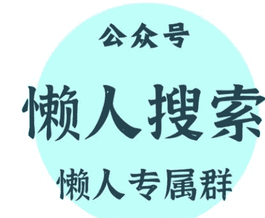

## 退圈港星集体回国，有什么难言之隐？

260930 文/卢克文工作室 概略北方
整理：公众号懒人搜索，懒人专属群精选
懒人微信：lazyhelper1

**小懒判断** ｜ 关心海外华人资产动向和跨境资金安全的人必读，吃明星瓜的会失望。最值得看的是IUL套利崩盘链条：2%借美元买 7%收益寿险，美联储一加息利息从 30 万涨到 150 万美元，断供退保后本金剩四分之一。坑在于地下钱庄换汇 1%~3%手续费的低成本时代结束了，账户风控一锁全断。

最近，微博上突然挂出了个热搜，#陈*希吴*祖王*贤被指圈钱！

说的是这三个港星，最近突然密集回国开展商业活动，从拍戏到开店再到上综艺，甚至连直播卖沙发的事都开始干了。

很多人觉得，明星出来挣钱，不是很正常么？

但网友觉得奇怪的是，这三个人早就淡出娱乐圈了，重心都放在了北美，为什么现在突然回国了？而且时间这么集中？

张娜拉当年说过一句话：没钱的时候，去一趟中国就有钱了。

退圈港星集体回国，恐怕不是闲不住那么简单。如果不是遇到财务问题，要不然这个岁数了，谁还要出来拼这个命？

可他们早年挣了多少钱啊，怎么可能没钱？

于是有网友猜测，北美华人圈，可能出金融大事件了。

当然，这个猜测目前还没有任何依据，不过联系华人圈近年来出的事，可能还真不是空穴来风。

很多人不知道，华人在美国，是除了犹太人之外最有钱的一个群体。

美国那边的统计数字，达到超高净值家庭标准（2亿人民币）的，大约2400个华人家庭，千万美元家庭就更多了，大约3.5万个。

而业界普遍认为，真实的数字，可能还要多出数倍。

之所以不为人知，是因为华人的灰色金融活动多在华人内部进行，堪称华人灰产圈子的内循环。

华人灰色金融起源于早年间的偷渡活动，代表人物是福建人郑翠萍，她不仅垄断了八九十年代中国到美国最大的偷渡网络，还承接了几乎所有的侨汇金融。

偷渡客是不敢通过正规银行往国内寄钱的，只能通过郑翠萍，在美国收美元，中国这边付人民币。

同时，国内的一些犯罪分子，也喜欢通过这种方式向外转移资金，在中国收人民币，美国付美元，两边账本对冲轧差，至于差额部分，用虚假贸易补差就行了。

这种跨国换汇手续费很低，通常只有 1%-3%，非常受华人喜欢。

就这样，随着中国经济的发展，华人金融也开始慢慢做大，再加上蓬勃发展的大麻种植园、电诈黑灰产需要洗钱渠道，大批华人地下钱庄横空出世。

地下钱庄多了，难免良莠不齐，于是收割手段也就跟着多起来了。

最典型的就是 MIC 私贷机构，是一种加拿大特有的按揭投资公司。

MIC 的玩法是这样的，先利用帮助新华人落脚的机会取得信任，然后看谁人傻钱多，就忽悠他们把闲置的资金凑在一起，找地下钱庄挂个牌子，操作个私贷项目，承诺给 8%到 12%的年化收益。

这些钱会交给华人开发商去搞房地产，比如加拿大柯罗曼德尔地产的 Jerry 钟。

过去十年，Jerry 钟是温哥华最出名的华人新贵，他专门在温哥华西区这些好地段购买“拼合土地”，然后包装成高档公寓项目，卖给那些刚到加拿大急需安家的新华人。

在温哥华房价暴涨期，Jerry 钟赚得盆满钵满，也吸引了无数华人富豪明星乃至中产往里面哐哐砸钱。

大家坚信，温哥华西区的土地只涨不跌，跟着明星走绝对稳赚不赔。

万万没想到，2023 年 2 月，柯罗曼德尔地产突然申请破产保护，旗下16个开发项目全线停工，楼盘烂尾，紧接着是MIC连环爆仓，许多把养老钱投进去的华人，不仅利息没了，本金也被清零了，华人群体的流动性瞬间被抽干。

大家有兴趣去加拿大的华人论坛逛逛，到现在还能看到维权帖子。

但他们又能怎么样呢？论势力，论对当地法律的了解程度，他们哪比得上这些地头蛇？

某些出席华人商会、名流晚宴上的所谓华人领袖，其实就是杀猪盘操盘手。

那你如果不愿意凑钱呢？没关系，一样有办法收割你。

大概在2015年到2021年之间，加州尔湾、温哥华等华人聚集区，出现了很多华人财富顾问，他们都属于华人独立理财中介。

他们专找那些有钱的华人新贵、国内退休人员以及明星，给他们吹得天花乱坠：

“你手里有五百万美元？不要直接买房，也不要存银行。我告诉你稳赚不赔的理财方案：你把这五百万作为抵押，找私人银行借两千万美元出来。当时美国的基准利率只有1.5%到2%。然后，你用这两千五百万美元，去我们代理的指数型万能寿险IUL，保底年化收益有6%到7%。”

借钱的成本只有不到2%，给你的利息有7%，躺赚5%的利差！

而且等你百年之后，留给孩子的赔偿金高达几千万美元。更妙的是，这笔钱不仅免遗产税，也不受国内债权人和官方追索，你懂的。

于是，很多手里有点积蓄的华裔明星、老板、贪官，纷纷抢购这种寿险去套利，有的甚至把自家房子卖了都要加杠杆。

结果美联储一加息，华人圈子的天就塌了。

原本一年只要付三十多万美元利息的贷款，后来涨到了 150 万美元，而同时保单资金投资的股市并没有按照设想大涨，分红远低于预期。

银行一看抵押物缩水，马上要求追加保证金，要么拿出几十万美金现金填坑，要么银行直接清盘止损。

可那些投奔美国很久的人，哪有那么多现金流？

一旦断供，保单被银行强行退保，扣掉退保手续费和利息倒挂，原本投进去的几百万美元本金，能剩四分之一就不错了。

不仅低认知华人群体逃不掉，高智商华人一样会掉陷阱，要么被 Pre-IPO 股权骗局收割，要么被币圈收割。

比如震惊北美创投圈的 Straight Path Venture Partners 股权欺诈案，涉案金额高达 4.1 亿美元，受害者基本都是华人。

起因是近些年，随着 AI 风口如火如荼，一些超级独角兽估值狂飙，但因为这些公司迟迟不上市，市面上就出现了一大批号称能拿到“原始股、老股转让”的 SPV（特殊目的载体）基金。

一些深谙华人心理的金融中介，开始通过华人圈子、校友会，大肆兜售所谓的 SPV 基金份额。

他们宣称自己有内部渠道，拿到了 SpaceX 的折价老股，每份 5 万到 20 万美元起投，只要 SpaceX 上市，瞬间就能财富自由。

于是很多华人码农把大厂股票变现，甚至拉上国内的亲戚朋友一起入局。

结果直到 SEC 下场，他们才得知，绝大部分中介压根就没 SPV 股票，他们那些托管账户凭单和认购协议都是假的。

投给他们的钱，都被他们拿去填其他项目的窟窿了。至于那些拿来做诱饵的 SPV，连募集资金的十分之一都不到。

最后 SEC 直接冻结了涉案基金的所有资产，但是，就算最后清盘，华人的钱也大概率拿不回来了。

还有币圈，更是收割华人的大头。

大家可以回忆一下，冠希当年艳照门事件后长居北美，以什么为生？NFT 虚拟币。

他天天推数字艺术品，办线下潮流展，门票只收 NFT。

以至于加州华人圈，从工程师到留学生，大家讨论最热的话题就是哪个虚拟币涨得多。

在他们看来，虚拟币好像专门为华人量身定制的（事实上，华人的确撑起了虚拟币半边天）。它去中心化，既能绕开国内的外汇管制，又能躲避美国国税局的收割，哪怕熊市了，也可以靠着五花八门的“质押挖矿”，拿到 15%以上的稳定币利息。

但问题在于，虚拟币是脱离监管了，但也意味着暴雷了没人管。

比如著名的 H-Coin 骗局，总金额高达 10 亿美元，骗了数万华人，至今都还没缓过来。

眼看着涉及虚拟币经营的 FTX 暴雷、三箭资本破产，美国 SEC 也开始大幅收紧政策，时任主席 Gensler 公开表态，绝大多数加密货币（比特币除外），都属于投资合约（证券），未经注册发行和交易属于违法。

此话一出，整个华人币圈瞬间崩溃。

那既然虚拟币不靠谱，投给虚拟币矿场咋样呢？

2017 年前后，随着国内政策收紧，大批国内的矿机出海，得克萨斯州、怀俄明州由于电价便宜、政策宽松，成了华人资本扎堆建矿场的热土。

无数华人凑钱买下整片农场，拉上高压电线，成千上万台矿机昼夜轰鸣，源源不断地挖出虚拟币来。

然而，2024 年 5 月，拜登亲自下令，关闭怀俄明州夏延市的 MineOne Partners 矿场。

理由很搞笑，说矿场的位置距离弗朗西斯.沃伦空军基地只有不到一英里，矿场内的大量“外国先进计算设备”存在国家安全风险。

紧接着，得克萨斯州和阿肯色州迅速跟进立法，禁止华裔持有涉及电网、数据中心和矿场的关键基础设施。

许多华人老板投资几千万美元建成的矿场，一夜之间成了非法的，无数华人的投资更是灰飞烟灭。

本来吧，这些华人有个不同于美国人的bug，北美的投资亏了，可以从国内调资金过来补仓。

可是，现在这条路，也越来越难走了。

2019年，加拿大启动了历史上规模最大的洗钱调查，挖出了加拿大最大的华人地下钱庄金保罗。

金保罗和郑翠萍差不多，也是一边收人民币，另一边出美元，但随着加拿大警方的打击，数十个地下钱庄据点被抄，巨额涉案资产被民事没收。

紧接着，美国那边同时收网，重拳打击跨国无牌照汇兑公司。

现在只要涉及这种资金往来，美国银行的风控系统立刻锁死账户，紧接着就是IRS的传票：请你解释这笔资金的合法完税证明，以及这笔钱在境外的原始完税凭证。

开啥玩笑？搞地下钱庄转的，有几个是干净钱？哪来的完税凭证？

结果，华人地下钱庄资金过桥通道彻底断裂，美国国税局又严查FBAR（海外银行与金融资产申报），一旦查实罚款账户余额的50%，更是把无数华人折腾得死去活来。

春江水暖鸭先知，明星永远是消息最灵通的，当其他华人还在收割中挣扎的时候，他们已经意识到，北美华人的金融生态，已经彻底崩溃了。

那些二代留学生、华人地产商、跨境金融、侨界名流，暴雷的暴雷，打官司的打官司，被调查的被调查，全部进入了流动性陷阱。

皮之不存，毛将焉附，如果部分华人圈子的灰色金融活动出问题，那些身处这个圈子靠影响力赚钱的明星就算有积蓄，但坐吃山空也是行不通的。

某种意义上说，他们比北美大部分华人要幸运。

他们在国内还有粉丝和影响力，还能轻松赚到钱，但绝大部分人是回不来的。

只能说，时代变得太快，在北美华人圈子靠汇率差、信息差和地缘红利轻松套利的美好时光，已经彻底结束了。

只是不知道这些华人，有没有后悔当年的选择？

———分割线———

绝大多数人只盯着眼前的工资，却不知道

一次远在中东的冲突、一次降息的决议，就能在一夜之间洗牌普通人的财富。

看懂宏观，是为了在周期切换时，不被当作代价。

如果你认同这种“抬头看路”的长期主义，欢迎围观我的个人情报智库：【懒人专属群】。

圈子已稳定运行 7 年。我们每天利用 Python 爬虫与大模型算力，过滤全网最顶级的政经内参和搞钱风向标，做你最冷酷的“外部大脑”。

https://lazysso.com/insider/

认同价值的。扫码加我微信，备注：【进群】

