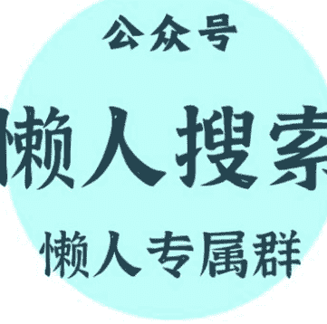
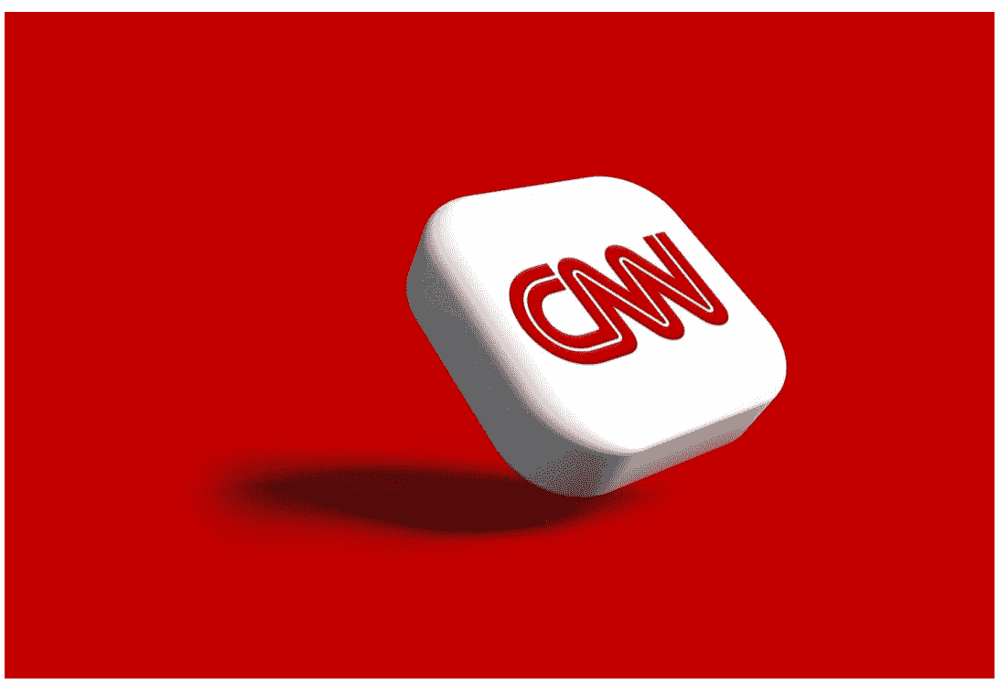

## 川习会期间“失踪”的美国媒体

260930 新闻实验室

整理：公众号懒人搜索，懒人专属群精选

懒人微信：laz helper1

微信公众号：懒人搜索（圆框内）

懒人搜索

懒人专属群

微信：laz helper1

> **小懒判断** | 想搞懂美国媒体怎么集体对抗白宫采访禁令的人必读，想看川习会实质内容的会落空。最值得看的是五大台联合抵制：法院临时限制令下来当天，CNN 记者从早 6 点试到 11 点仍被拒，而恢复合作靠的竟是一封白宫邮件而非正式协议。坑在于限制令只管大门采访证，椭圆形办公室、空军一号照样能挡你，右翼媒体正趁机补位，独立镜头在变少。

如何反抗政府对采访权的限制，同时继续向公众提供信息？

2026 年 9 月 23 日，习近平抵达美国安德鲁斯联合基地，川普以罕见的姿态亲自迎接。但在这场重要外交活动开始前，美国几家主要电视网的摄制组却收起设备离开了现场。

当然，现场并非完全没有媒体。美联社拍摄并向订户提供了视频，一些较小的右翼媒体也在场。但通常承担美国总统日常电视采访任务的五大电视网（ABC、CBS、NBC、CNN 和 Fox News），集体缺席了这次拍摄。

这几家主流媒体为何缺席？答案藏在此前几天川普与美国媒体的又一次激烈冲突之中。这次冲突随后经历了联合抵制、法院干预、短暂恢复和再次排斥，可谓跌宕起伏。冲突也把新闻机构推入一个艰难处境：如何反抗政府对采访权的限制，同时继续向公众提供信息？

本期新闻实验室会员通讯，我们就来了解这场冲突的来龙去脉。

### 总统赶走 CNN，其他电视网拒绝补位

冲突始于 9 月 18 日下午。川普在他的社交媒体 Truth Social 发布一则声明，以持续报道“假新闻”为由，宣布立即禁止 CNN、MS NOW 和 Politico 进入白宫。这几家媒体在政治上都是左倾的，其中 MS NOW 前身是 MSNBC。

大约一小时后，NBC 记者 Kelly O'Donnell 问川普如何看待第一修正案对新闻自由的保护。川普回答，不必让这些媒体进入“我的……人民的房子”。

白宫（White House）到底是川普的 house 还是美国人民的 house？白宫的采访资格，究竟是总统可以按个人好恶分配的待遇，还是公众监督政府所需的制度安排？

白宫的电视联合采访机制被称为“TV pool”。由于总统的办公室、专机及部分活动现场空间有限，不可能容纳所有电视台的摄制组。因此，ABC、CBS、CNN、Fox News 和 NBC 这五大台轮流派出团队，再把拍到的画面提供给其他成员及全球媒体使用。竞争激烈的新闻机构，依靠这一机制共同维持日常报道。

川普的禁令名单中包括五大台之一的 CNN，也就直接影响了这一轮转机制。如果其他电视网选择补上 CNN 被禁之后的那一天空缺，总统便可以在保留电视曝光的同时，惩罚其中一家媒体。但是，9月21日，其他四家电视网拒绝接替 CNN，联合采访因此暂停。五家电视网在共同声明中强调，政府不应因为反对一家新闻机构的报道内容，就限制它的采访。而且，它们对于这项抵制行动的范围很明确：只是不做总统的报道，对于副总统、国会议员等，继续报道。

右倾的 Fox News 也参与到了这项抵制当中，这尤其引人注目。它说明，即使政治立场和受众差异巨大，新闻机构仍可能在采访权受到威胁时找到共同利益。据《哥伦比亚新闻评论》梳理，声援还扩展到电视媒体以外：49家媒体组织提交法庭之友意见书，公共广播电台 NPR 宣布暂不使用白宫活动音频，《纽约时报》《华盛顿邮报》也与新闻图片机构一起暂缓发布川普活动的照片。

这种团结很快让川普感受到了代价。9月21日，他在白宫南草坪举行仪式，为新建的直升机停机坪揭幕。电视网联合采访已经暂停，白宫官方视频信号偏偏又出现音频故障，观众只能看见川普讲话，却听到一片噪声。

一个高度依赖电视曝光的总统，因为试图控制谁可以采访自己，暂时失去了最熟悉的传播渠道。当晚，他通过与纽约市长Zohran Mamdani 共同出席记者会，重新进入当地地方电视台的镜头，还指着摄像机宣称，媒体说要抵制他，却从来没有真正抵制。

两天后，习近平抵达前的采访安排，考验了几大电视网是否会坚持这一立场。CBS、Fox News 和 NBC 的工作人员当天下午已经在安德鲁斯联合基地架好了摄像和音频设备，同时等待华盛顿一家联邦法院的消息：如果法官及时叫停川普针对部分媒体的采访禁令，电视网便可能恢复联合采访，直播习抵达的画面。

然而，法官表示需要更多时间考虑。于是，摄制组拆掉设备，在飞机抵达前撤离。即便是中美元首会晤，也没有让电视网自动恢复运作。

### 中国媒体进入白宫，CNN 却被挡在门外

9 月 24 日凌晨，联邦地区法院法官Timothy J. Kelly 发布为期 14 天的临时限制令，要求恢复 CNN 等三家媒体记者的采访证件。

Poynter 的分析指出，虽然该案涉及第一修正案所保护的新闻自由，但这次临时裁定主要着眼于第五修正案中的正当程序问题：政府在撤销长期采访证之前，没有给予记者事先通知和陈述意见的机会。法官也对政府提出的国家安全理由表示怀疑，因为川普宣布禁令时，强调的是报道不实和负面，而非具体的安全威胁。

但是，法院下令，并不等于这三家媒体的记者立即获准进入白宫。

那是一个混乱的上午。白宫方面称，采访证件已经在清晨恢复，特勤局也确认其重新生效；但CNN记者 Betsy Klein 从早上6时起多次尝试进入，到上午11时仍然被拒。记者们直到中午前后才陆续入内。媒体律师因此指责政府没有遵守裁定，要求召开紧急听证。《华盛顿邮报》的报道也指出，政府提供的时间线与记者实际恢复通行的时间并不一致。

这一切发生时，习正在白宫访问。CNN记者 Kaitlan Collins 跟同事说，中国官方媒体可以进入白宫，CNN却仍然被挡在外面。对美国记者来说，这个场面的象征意义可谓巨大而讽刺。

当晚的国宴采访又出现新的限制。CNN记者 Kristen Holmes 说，白宫允许摄像和音频人员进入，却不允许她和制片人参加。这样的安排，使“允许媒体拍摄”和“允许记者采访”之间的区别变得格外清楚：政府欢迎电视镜头记录仪式，但同时限制负责观察、提问和解释的新闻人员。

9月25日，局势似乎缓和。CBS 拍摄了川与习在白宫会面的画面，CNN 则负责两人参观国家档案馆的联合采访。促成恢复的，并不是一份全面保证 CNN 采访权的正式协议，而是一封包含拍摄安排的白宫邮件。电视网把它视为 CNN 获准履职的实际确认。

当天，在 CNN 的镜头前，川普向习展示了美国宪法和《权利法案》的原件。

然而，局面的缓和只维持了很短时间。白宫随后通知 CNN，该台不能承担周六随川普前往田纳西州的联合采访任务。其他电视网再次拒绝补位，联合采访又一次暂停。

这次反复暴露了临时裁定的边界：恢复允许进入白宫区域的长期采访证，并不自动解决谁能进入椭圆形办公室、登上空军一号，或者参加某一次小范围活动的问题。记者可以重新跨过白宫的大门，却仍然可能被挡在真正需要报道的现场之外。

### 撤走摄像机以后，谁来记录总统？

习抵达时摄制组撤离的场景，既展示了媒体联合行动的力量，也把这种行动的代价摆在了眼前。外交活动仍然进行，值得记录的细节不会等待争议解决后再发生。如果遇到突发事件，新闻机构能否继续让自己的摄像机缺席？

电视网管理层已经开始讨论调整策略：其他四家电视网恢复各自轮值，轮到 CNN 时，再决定是否安排替代团队；如果不补位，就让那个时段空缺。CNN 的 Brian Stelter 也在当天的节目中谈到了其他电视网恢复轮值、但不接替 CNN 班次的可能方向。

这是一种尚在形成、随时可能变化的安排。

它反映了新闻机构面临的两难：长期退出，会削弱自身观察政府的能力；在 CNN 仍遭排斥时恢复运作，又可能让白宫获得更大的空间，接下来可能更加肆无忌惮地干预哪些媒体能够近距离采访总统。

而且，主流电视网留下的空缺，并不会一直空着。

据报道，右翼媒体 Real America’s Voice 与 LindellTV 已经联手提供另一套总统活动视频信号。LindellTV 由川普的坚定支持者 Mike Lindell 创立，两家机构把自己的行动描述为传统媒体退场后主动补位。它们发布的声明也把这一点作为宣传重点。

这套替代安排的起步并不顺利。Real America’s Voice 播出了川普车队离开联合国大会后的行进画面，前白宫记者协会主席 Weijia Jiang 指出，这可能带来总统安全风险。该台管理人员同时抱怨，没有主流电视网申请使用他们提供的信号。

这些细节说明，联合采访机制的价值还包括长期形成的专业惯例与相互信任。现场有摄像机，并不意味着独立采访就得到了同等替代。当政府可以排除不喜欢的记者，再由政治上更友好的机构填补画面供应，公众看见的总统仍然可能很多，独立观察总统的渠道却可能减少。

顺带提一嘴，除了在白宫被排斥之外，最近 CNN 面临的压力还来自公司所有权的变化——派拉蒙天舞 (Paramount Skydance) 已同意以约 1100 亿美元收购华纳兄弟探索公司 (Warner Bros. Discovery，包含其旗下的 CNN ) 全部业务。这项交易将使 CNN 与 CBS 这两大台处于川普盟友 Ellison 家族控制的同一企业体系之下。

在各州检察长批准的和解方案中，将会设立“编辑独立委员会”保护新闻业务。委员会由五名资深记者组成，但任命权掌握在由 David Ellison 担任主席的合并后公司董事会手里。《哥伦比亚新闻评论》提出疑问：由大老板任命的机构，能在多大程度上抵御大老板的干预？一位 CNN 前高管向该刊表示，员工担心这只是一种表面安排，难以成为真正的保护屏障。

总的来看，在政治和商业的双重压力之下，这又是美国主流媒体坠落路上的难堪一周。

分割线

在这个 AI 能替你写代码、写文章的时代，基础技能正在迅速贬值。绝大多数人正被淹没在海量的免费垃圾信息里，陷入低效的体力内卷。

当“努力”不再是壁垒，人与人之间唯一的护城河，只剩下“信息过滤”的效率与“认知系统”的维度。

圈子已稳定运行 7 年。我们每天利用 Python 爬虫与大模型算力，过滤全网最顶级的政经内参和搞钱风向标，做你最冷酷的“外部大脑”。

如果你认同这种“重塑认知防线”的极客主义，欢迎围观我的个人情报智库：【懒人专属群】。

[https://lazyso.com/insider/](https://lazyso.com/insider/)

认同信息过滤价值、想省下每天 3 小时无效阅读时间的读者，扫码加我微信（lazyhelperl）

