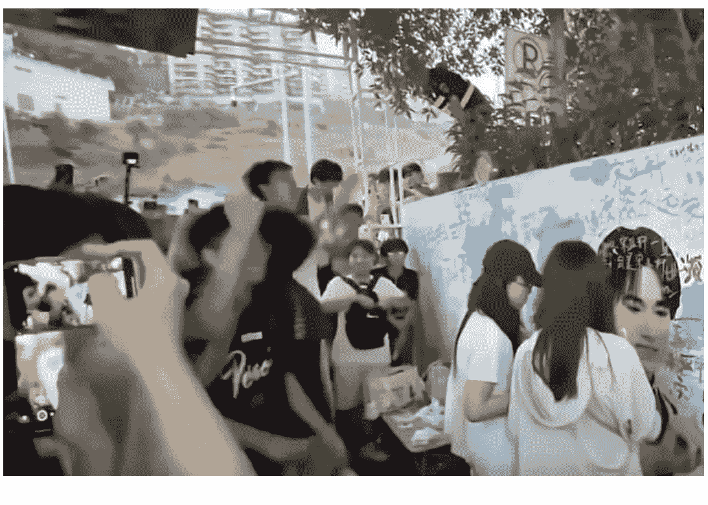

# **时代峰峻冲突事件**

260930 新闻实验室

整理：公众号懒人搜索，懒人专属群精选

懒人微信：lazyhelper1

> **小懒判断** | 关心网络舆论如何演变成线下行动的人值得细读，想看男女对立吵出结论的会失望。最有价值的是一手调查推翻两大热传叙事：“外卖员被骂”其实是现场男孩；泼水抓人视频系剪辑，男性先扔纸盒、砸女性头部才被捕。更大的坑是网上喊“放人”的和线下参与者并非同一批人——现场几乎全是没统一诉求的初高中生，拿线上叙事套线下会全错。

在网上支持男性一方的人，跟线下实际参与的人，并非同一批。

上个月，重庆发生了一起线下的男女冲突事件。事件发生的地点是时代峰峻公司所在的长江国际楼下。时代峰峻以打造“TF家族”品牌闻名，在中国内地首次大规模试水并推行日韩模式的养成系艺人培训制度。

这起事件在很多维度上都有显著意义：它是网络舆论中常见的性别冲突蔓延到线下的案例，它与“饭圈女孩”、“挫败的年轻男性”等复杂议题相关。但也正是因为事件的敏感性，我们能够得知的公开信息非常少，内地媒体除了口径类似的评论外几无报道。即便是瑞传媒的[深度报道](#)，也是总结舆论现象为主，并没有来自现场或参与者的一手信息。

最近，新闻实验室的一位读者来信询问，能否就此事投稿。在和 ta 沟通的过程中，我表达了希望能有一手采访的建议，ta 也的确花了不少工夫做调查。虽然在最终的受访者当中，只有一位是当天真正去过现场的，但这已经胜过了我读到的所有媒体报道。

因此，我在今天的新闻实验室会员通讯中与[大家](#)分享 ta 的调查发现。以下文字由[蒜蓉鱿鱼须](#)撰写，方可成编辑。

## 调查的缘起

2026 年 8 月 16 日，重庆长江国际大厦的楼下来了几个男性，一边开着直播，一边对着时代峰峻练习生和追星的女粉丝大喊“嘉豪”（一种对 idol 的嘲讽式称呼）。随着舆论发酵，17 日晚现场的男性数量大幅上升，冲突也快速升级，出现了泼水和飞踹等暴力行为，警方也开始介入。到了 18 日，冲突已经向着抗议演变，现场有人举着国旗和毛主席语录，唱着国歌和军歌，参与者的矛头开始从现场的女性粉丝转向警方。

根据推特上李老师不是你老师的说法，由男女对立所引发的群体性事件据他所知是首次。同时他也认为，网传的两个导火索都经不起核查：一个是抖音上盛传的“外卖员被骂”，其实当事人是一个在现场的男孩，根本不是外卖员，他后续自己把完整的视频发出来了，也并不是流传的故事版本；另一个网络上流传很广的故事是，女性往男性那边扔充电宝，男性随后向女性泼水，结果男性被警察带走了。但李老师指出，当时传播的视频是被剪辑过的，另一个视角的更完整视频显示，一名男性先往女性那边扔了一个纸盒，一名女性把这个纸盒捡起来扔回去，然后男性就过去用水瓶向女性泼水，并用这个瓶子砸了女性的头，这才是警察逮捕那名男性的原因。

虽然不符合真相，但这些叙事形成了最广的传播，尤其是后者，导致大家认为警察执法不公，也成了随之而来的抗议缘由。

在中国的网络舆论中，男女对立问题已经不是新鲜事，但此前的线上冲突很少直接发展为这样的线下聚集。为什么这一次，一部分男性从网络上的围观者变成了现场参与者？我很想调查出答案。然而，由于我开始调查的时间较晚，简中互联网平台上第一方视角的记录几乎都已经被清理干净了。我联系了李老师，在各个海内外平台寻找蛛丝马迹，在官方新闻浩如烟海的评论底下找可能去过现场的人，但依然困难。

国内平台显示 IP 地址的政策在这个时候帮助了我，让我得以筛选出特定地区的 IP。但这件事情依然比想象中的更困难。男性当事人的网络痕迹似乎消失了，被证实或很可能去过现场的人要么不回应，要么拒绝，而我要等到深入调查了之后才知道这是为什么。

最终，我还是找到了几个愿意回答我问题的人。我想知道的是两个具体问题：他们是谁？他们为何走上街头？由于样本数量所限，这些采访无法代表所有参与者，我也不试图据此概括整个群体。

# 走上街头的年轻人

随着调查深入，我逐渐认识到一个事实：在网上支持男性一方的人，跟线下实际参与的人，并非同一批。

有一则流传较广的展现警察和现场男性冲突的视频，弹幕里密密麻麻打满了“放人”两个字。这会让人以为，“放人”是现场一个很明确的诉求点。但是当我向现场当事人求证的时候，他表现出了迷惑——他不记得现场有如此明确的诉求。在他的描述中，现场极其混乱。有人唱歌，有人举国旗，有大量对警察和练习生的咒骂，有人“开着跑车摩托车炸街”。所有人都非常激动，他们的不满是真实的，但诉求是更进一步的东西。他们想要的是什么？他的感受是，大家都是一群非常混沌、“没有明白自己诉求”的人。

为什么会这样？一种很有说服力的解释是，参与者们的年纪比想象中要更小。

根据现场参与者的说法，现场抗议的几乎全是未成年人，主要都是高中生甚至是初中生，到了后期清理涂鸦的时候才有一些大学生和成年人。这一点也与我对现场影像和社交媒体账号的观察相吻合：仔细辨别现场视频中出镜的人，绝大多数人都极其年轻，没有发育完全的小孩也相当常见；我在社交媒体和视频直播平台搜寻参与者的时候，那些看上去高度关联的疑似参与者中有一半甚至直接在个人简介中就写着“XX 中学”。就算没有写，从他们的自拍、笔记和动态中也很容易判断他们的年龄。

如果现场参与者的确主要由未成年人构成，那么还能对应上事件发生的时间（暑假）。我后来找到的多名疑似参与者的公开账号几乎没有留下与事件直接相关的记录。开学、家长管理以及警方的干预，都可能让这些痕迹迅速消失。

年龄可能也能解释他们为何走上街头。抗议在中国极其敏感，但是一群中学生对此事的后果有多少了解就很难说了——他们非常不满、充满愤怒又极其激动，到了现场却不知道自己要做什么，甚至都找不到一个有辨识力的口号。

这个发现在一定程度上也说明，网络舆论对此事存在过度解读：十几岁的中学生能感受到女性困境和男性“incel”群体的挫败感吗？我的受访者说，他们的不满大多聚焦在追星女孩、练习生和警察的区别对待上。如果我不问，没有一个人主动提到女权或者跟女权有关的理念。当我问起他们是更反对女权还是反对粉丝的时候，他们都没有表现出明显的对女性或女权的仇恨：“追求平等是没有问题的，现实是男女确实不平等”，“（我们）大部分人反对的都是极端粉丝”。这些想法或许不能代表所有人的意见，但或许可以让我们思考，在这个事件中，男女对立和厌女并不是一个已经被证实的主题。网上发表评论的人和真正站到线下的并不是同一批人，前者的想法不能简单地套在后者的头上。

总之，真正走到现场的，可能是一群年龄很小、彼此未必认识、情绪高度同步、没有形成统一诉求的年轻人。然而，网络上的人在替线下的人解释他们为什么行动，并引入了过多的概念和议题。

# **镜头之外的暴力**

我调查的方法非常原始。因为一手信息几乎都被清理干净了，所以我就在官方新闻的评论里面，根据IP地址、时间戳和评论相关性，给疑似参与者们发私信。

要得到一群中学生的信任并不容易，尤其我看上去确实有点可疑：我的抖音和快手账号都是刚注册的，因为我此前从未使用过这两个 app，但偏偏这又是他们最活跃的平台。他们身处于舆论风暴之中，他们自己也知道这一点，而我问出的又是敏感问题。很多人都会发出相同的质问：你的大号是什么？你的目的是什么？

虽然我根本没有“大号”，也没有什么不可告人的目的，但一些人毫不掩饰对我的怀疑：“太假了，你是时代妹假扮的吧”；“这事情早就翻篇了，你究竟想干什么？”大多数人没有回应，也可能是因为学生们开学之后使用手机的机会有限。

但这种谨慎或许是有道理的，他们可能同时受到了两方面的压力。其中之一来自警方。根据李老师和现场参与者的说法，走到线下的人拉了很多群用于沟通。从8月18日开始，警方先从较为激进的组织者开始约谈，让他们认识错误、自行解散群聊。活得较久的群，到22日前后也被清理了。

另一方面的压力来自饭圈。其中一名受访者表示，他因为在17日事件的官媒新闻底下发了一条“哪个回事”的语音之后，“私信就炸了”，“至少有一千条（骂人的私信）”。我不知道他的说法里有多少夸张的成分，以及他的评论是否真的如他所说的那般中立。但从他提供的截图来看，他确实收到了海量、有组织性的私信轰炸。我向他求证，其他人也是这样吗？大家都被骂过？他回答“对”，然后向我展示了他的群聊截图。

还有一个与之相关的风险是“开盒”。他说，“之前有个小学生私信我，一直套我的住址，后面在网上找了几张被公开的开盒照片来威胁我”。我问他如何确定对方是小学生，他说“因为她提到她太小了，警察管不了她，所以肯定是14岁以下”。这两点同样难以验证，不过有几个其他的方法可以佐证。早在去年3月，《南方都市报》就报道过一起十三岁未成年人开盒一名孕妇的新闻；而我自己也在调查时代峰峻事件的过程中也接触到了这个开盒网络，虽然完全是意外——因为我在海外某平台搜索了太多跟时代峰峻有关的话题，所以推荐算法把我误认为是时代峰峻粉丝们的一员，开始给我大量推送开盒信息。

这个开盒网络相当庞大，我没有费心去找，就能随随便便刷到几十条已经被开盒的人员信息。大概连续一周，我每天第一次打开 app，第一条推送都必是一条新的开盒。

我看到的公开内容中，被开盒的受害者甚至不乏 14 岁以下的小孩。而开盒理由可能非常随便。比如，有人在网上跟人产生了争执，把争执内容截图发出来，评论里就把当事人开盒了。而这条内容在一天之内就获得了一千多赞和两百多条评论。在开盒内容的底下，大家还纷纷晒出是自己骚扰受害者的视频和图片。据我的观察，这些账号的使用者大多以女性身份活动，且确实展现出与时代峰峻或者饭圈的巨大相关性。我看到的多名相关账号，都能在简介、头像或历史发言中找到时代峰峻练习生或其他偶像的应援痕迹。

在这些压力和风险之下，愿意和外界交流、接受访谈的人自然是凤毛麟角。

# 回到教室之后

如果跳出男女对立的框架去理解，这件事或许可以被放进一个更大的历史背景里。世界各地都曾出现过以中学生为重要参与者的抗议运动，它们的政治立场和具体诉求差别很大，却存在一些值得注意的共同点：极其年轻；意识形态模糊且混乱，好几种不同的思潮派别揉杂在一起；反建制、反警察；有一定的暴力属性。

智利 2006 年的企鹅革命具备一定的代表性。“企鹅”指的是智利高中生的黑白校服。运动最开始的导火索是学生公交卡的使用政策引发争议，一些高中生开始抗议。抗议导致警察逮捕学生，而逮捕又导致抗议升级，警察成为不满的来源。很快，学生们的诉求就从具体的交通卡政策转向了政府和整个教育体制。蒙面的学生们向警察投掷石块、砸毁公共设施。驱使抗议者行动的共同点是愤怒，而不是一个明确的意识形态。时代峰峻事件很像是场企鹅革命本土化早期形态。他们没有太多理论，但是他们愤怒于警察执法不公（虽然这种不公很可能是互联网构建的虚假叙事）。到了事件第三天（18日），这些人已经展现出一定的组织性——拉群聊，清道涂鸦，在我们不知道的地方讨论今后何去何从。只是这种组织性很快就被掐灭了。

这些年轻人在网上被建构成一群厌女者、极端男权主义者，也在另一些叙事里被建构成执法不公的受害者、被镇压的抗议者。两种叙事都急于给出一个答案，但我很怀疑他们自己有没有想清楚。

他们确实走上了街头，喊了口号唱了歌，也确实动了手。这场抗议有暴力，有被剪辑和捏造的叙事，行为上也可以称得上幼稚——一群十几岁的未成年人，借用了自己并不理解的符号，去回应一种自己也说不清的愤怒。开学了，群解散了，动态也被清理了，他们想必又回到了教室，回到了事件发生之前的生活。

这篇文章能回答的也仅止于此。我联系到的只是非常少数愿意开口的那几个人，不能代表现场参与者，更不能代表互联网上更广泛的讨论者。在我看来，这更像是几百个中学生人生中的一个插曲，至于他们今后会更厌女，还是更仇视警察，还是迅速遗忘，现在还没有答案。

> ——分割线——

在这个 AI 能替你写代码、写文章的时代，基础技能正在迅速贬值。大多数人正被淹没在海量的免费垃圾信息里，陷入低效的体力内卷。

当“努力”不再是壁垒，人与人之间唯一的护城河，只剩下“信息过滤”的效率与“认知系统”的维度。

圈子已稳定运行 7 年。我们每天利用 Python 爬虫与大模型算力，过滤全网最顶级的政经内参和搞钱风向标，做你最冷酷的“外部大脑”。

如果你认同这种“重塑认知防线”的极客主义，欢迎围观我的个人情报智库：【懒人专属群】。

https://lazyso.com/insider/

认同信息过滤价值、想省下每天 3 小时无效阅读时间的读者，扫码加我微信（lazyhelper1）

