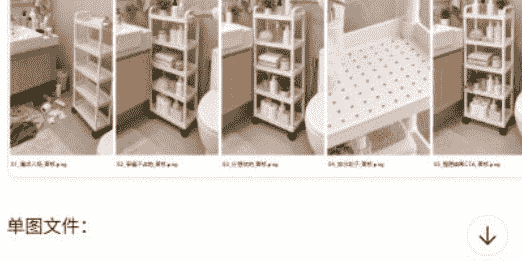
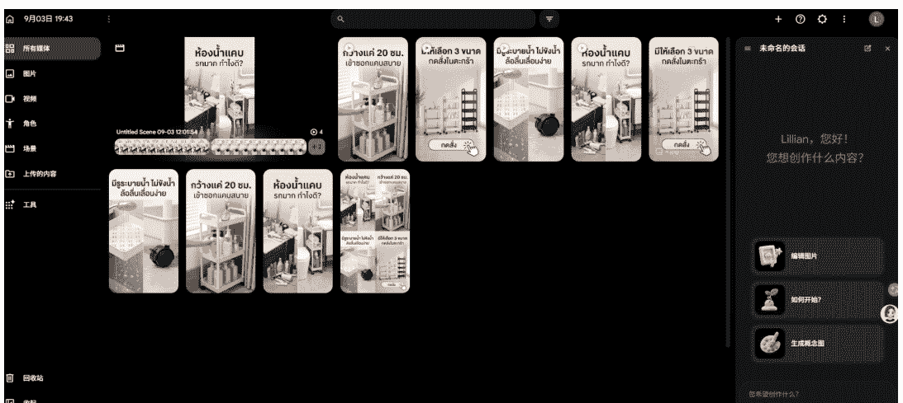
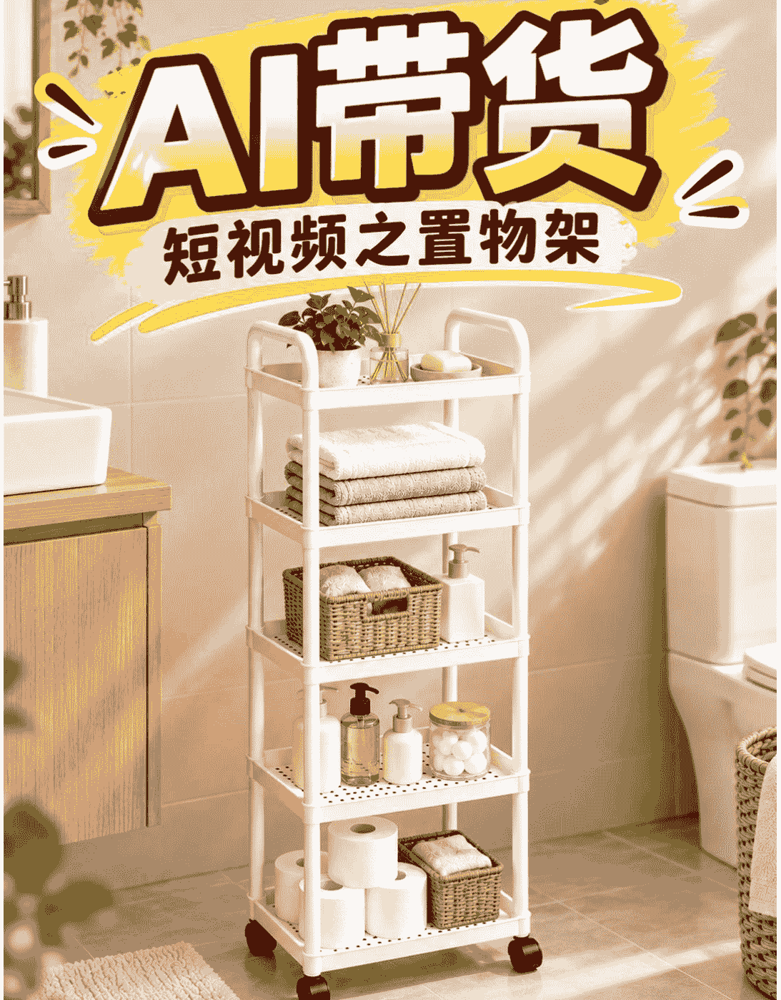

# 一条 AI 带货视频卖出 1596 单：内含如何制作批量 AI 带货视频 skill 详细步骤

260918 副业 SC 精华

整理：公众号懒人搜索，懒人专属群精选

懒人微信：lazyhelperl


> 小懒判断｜适合有货源且想通过 AI 批量制作带货视频降低成本的跨境电商或短视频带货从业者；不适合没有产品也对自动化工作流不感兴趣的人；最值得关注的是将图生视频、文案和配音拆解成标准 SOP 并封装为 Skill 的“10 步法”流程；坑在于前期提示词的调优和首帧画面的审核需要极大的耐心，如果直接扔给 AI 而不做验收复盘，很容易产出变形的废片。

这篇想分享一下，我怎么把产品图、对标视频、AI 生图、视频生成和后期剪辑，整理成了一套可以反复使用的带货视频工作流。

并且通过一条 AI 短视频卖出 1596 单。如果你手里有产品，想用 AI 做视频，但经常卡在产品变形、镜头没内容、配音语种不对，或者做完一条，下次还得重新跟 AI 解释一遍，这篇应该能帮你少走一些弯路。

我会把实际做出来的东西、踩过的坑、具体操作和迁移方法一起写出来。内含详细步骤提示词，可以换成自己的产品资料开始试。

先交代一下分工：我用 Codex 整理资料、写方案和提示词，并调用 Codex 工具生成图片、泰语音频；视频片段通过图生视频平台 Google Flow 生成，最后在剪映里处理字幕、声音和节奏。最后封装成可复用的 skill。

## 我是谁，为什么做这件事

大家好，我是雪花，在义乌做了 8 年跨境电商，做过速卖通、Temu、SHEIN、TikTok、Ozon 等平台。通过电商经营，我做到了日出万单。

这些年，选品、做图、上架、核算利润、查产品资料，很多事情我都自己在一线亲身做过。现在研究 AI，我也是以重构电商工作流程出发：把重复度高的事情，借助 AI 实现降本增效、自动化、可复用。

目前我已经做过电商定价 Agent、女装虚拟模特棚拍工作流、批量商品图流程，还有公司产品资料调用工作台等一系列实用 Agent。带货视频是我最近继续往下拆的一项工作。我想把 AI 带货短视频做成一份可自动化的工作。

## 单条短视频带货 1596 单

先说结果。

| 链接 | 达人 | 带货商品 | 视频链接 | 播放量 | 数 | 数 | 点赞数 | 评论数 | 粉丝数 | 视频数 |
| :--- | :--- | :--- | :--- | :--- | :--- | :--- | :--- | :--- | :--- | :--- |
| | | | | | | | | | | |

*注：原文表格数据缺失，仅保留表头结构*

我把短视频批量制作流程根据我的视频制作实操步骤，做成了可复用的 skill。任何产品调用这个 skill 进行产品匹配都可以做出。

以下是我制作 skill 的过程大公开，你可以根据我的流程制作出自己类目的带货短视频 skill。

### 第一步，我先让 AI 看懂商品

**第一步：先创建文件夹**

对标视频

产品实拍图或主图/网图（能够展示产品真实结构，细节，各角度的图片）

文档：产品卖点，产品尺寸，应用场景

给 Codex 指令：请查看这个文件夹，里面是我要做视频的产品图和对应产品的对标视频以及产品卖点说明：【文件路径】

然后 Codex 就会给你一条针对于对标视频你的短视频分镜建议。

```
用时 3m 54s

我看完了。这个文件夹里有：
* 产品图：21 张
* 对标视频：5 条，都是竖屏 576 x 1024
* 我生成了缩略图拼图和一份盘点报告，放在：
    □ 素材盘点报告.md

我的初步判断：这批产品很适合做 TikTok 泰国站的“浴室/洗手台/牙缝收纳”类带货视频。现有素材支撑的核心卖点是：

* 多层收纳、窄缝不占地、底部滑轮、原版排水孔、白/黑两色、3/4/5 层版本。

5 条对标视频可以借鉴的方向主要是：

1. 黑色浴室架实拍：适合借“摆放物品 + 喷水排水 + 近拍轮子/层板”的证明逻辑。
2. 化妆品抽屉收纳：产品不一样，但可以借“乱 → 分类 → 整齐”的视频结构。
3. 鞋架家居氛围：产品不一样，但可以借暖光、家居角落、生活方式氛围。
4. 白色浴室置物架真人整图：最接近你的产品，适合借“真人整理浴室场景”的演示方式。
5. 另一条白色浴室整理视频：同样适合做 15 秒短视频模板。

我建议第一条样片先做这个方向：
浴室乱糟糟 → 摆入置物架 → 洗护用品分层放好 → 展示窄缝不占地 → 排水孔 → 浴室变整齐

这个方向最稳，因为你的产品图和对标视频都能支撑，不需要硬编卖点。下一步我可以直接帮你把它拆成 15 秒泰国 TikTok 带货视频脚本、分镜和 AI 生成提示词。
```

### 第二步：检查输出的内容是否是你想要的效果

如果想修改就直接和他说修改要求。

如果没有，就只需要回复：“好的”，他就会帮你写出带货脚本提示词。

做好了，第一版 15 秒泰国 TikTok 带货视频脚本和 AI 生成提示词已经放在这里：

`15秒泰国TK带货视频脚本与提示词-v1.md`

这版主线是：
浴室东乱西 -> 推入置物架 -> 分层挑洗护用品 -> 近拍排水孔和松子 -> 浴室角落落整齐 -> 点击商品

我给你做了三层东西：

1. 15 秒镜头表：每一秒拍什么、卖点是什么、泰语字幕是什么。
2. 剪映执行版：用你现在的素材怎么拼第一条样片。
3. AI 视频提示词：整条视频版 + 分镜逐段版，逐段生成会更稳。

我建议你先第一条别追求全自动，先按这个脚本做一版样片。最稳的方式是：用真实产品图做参考图，AI 生成 5 个短片段，再进剪映拼成 15 秒。这样比一次性生成整条视频更容易控制产品结构不跑偏。

### 第三步：写出每一个镜头的提示词

把视频分成 5 段生成，每一段首帧画面镜头出一个提示词，然后按照提示词+实拍参考把首帧镜头先画出来。人工审核首帧图片没有问题后，再用这个首帧镜头+视频提示词去生成视频。并注明图片和视频尺寸或者比例。

我已经按你的思路升级成 v2 文稿了：
`首帧图加分段视频工作流-v2.md`

这版流程变成：
5 段脚本 -> 每段先生成首帧图 -> 人工审核首帧 -> 用首帧图 + 视频提示词生成该段视频 -> 剪映拼接

我也在里面明确了尺寸：
- 首帧图：1080 x 1920 px，9:16
- 视频：1080 x 1920 px，9:16，建议 30fps
- 每段视频：2-4 秒
- 最终成片：约 15 秒

我还把每一段都拆成了：
1. 首帧图提示词
2. 首帧审核点
3. 视频生成提示词
4. 后期泰语字幕

这个流程比直接生成 15 秒整条视频稳很多，尤其适合你这种"产品结构不能跑偏"的电商视频。第一轮就按这个跑，后面我们再根据生成结果迭代提示词。

### 第四步：检查是否资料齐全可以开工

让 AI 自己检查，再根据他的回复补充缺少的信息。

排查一下是否具备了最小开工条件。

### 第五步：沟通好后，开始制作每个镜头的首帧图

`产品事实锚定卡.md`
`首帧图加分段视频工作流-v2.md`
`最小开工条件检查报告.md`
`素材盘点报告.md`
`15秒泰国TK带货视频脚本与提示词-v1.md`

现在最小开工条件更完整了：可以直接开始做 5 张首帧图。结尾可以用这句泰语表达发货优势：

```
àwàwtanm dotn
```

意思泰：泰国发货，快速到达。

用时 8m 21s
> 已完成 5 张首帧图，全部放在这里：
> D:\\Codex-专属文件夹\\商品图输出\\20260914-浅置物架首帧\
>
> 总览图如下：



单图文件：

最后我得到了这样几张分镜图，如果你对哪张图不满意可以单独让他修改。

### 第六步：生成接下来需要使用的所有文件

帮我输出以下文件，方便我去视频软件生成视频：
1. 第一个，就是直接可以复制的生视频提示词 5 段。
2. 第二个是需要配音的口播稿文案。
3. 第三个是视频上需要后期加的字幕/字幕文件，三个文件夹单独输出，以便于使用。

### 第七步：生成外语配音

帮我根据现在的口播稿生成泰语口播音频。

### 第八步：把视频提示词放到 Google Flow 生成视频

使用 Google Flow 的原因是，它很便宜，效果也很哇塞，适合批量出视频。不心疼算力。网址是这个：

https://flow.google.com/



把之前生成好的图和画面提示词直接丢进去，就能批量出视频了。

### 第九步：把视频放到剪映里把画面和音配搭配起来，简单剪一下废镜头

看一下成片。

视频见在线版：

https://hk57gvlx7u.feishu.cn/docx/T2ewdn87ooJG4kx10xDc2chn tg



### 第十步：把剪好的视频发回给 Codex，让他做一个验收和复盘

这是我剪辑好的带货视频，接下来你总结一下，我们这一整套流程有什么可沉淀下来复用的工作流。

我把这套流程沉淀成了两份可复用文档：

1. `AI电商带货视频普制转视频闭环工作流.md`
2. `新品AI带货视频开工检查清单.md`

这套工作流的核心可以概括成一句话：

> 不要让 AI 一口气生成成片，而是把它拆成：产品实货锁定 -> 镜头功能规划 -> 首帧控结构 -> 分段生视频 -> 口播字幕后期控制 -> 成片抽帧复盘 -> 下一版迭代。

这次真正沉淀下来的关键经验是：

1. 首帧比视频提示词更重要，首帧结错了，视频大概率继续错。
2. 每个镜头必须有销售功能，不是为了多镜头而多镜头。
3. 5 镜头做少，6-8 镜头更适合 13-15 秒的 TikTok 带货短视频。
4. 字幕、口播、背景乐放在剪辑后期控制，别交给视频模型自由发挥。
5. 产品事实边界要一直锁住，不写没确认的包邮、价格、COD、承重、刹车轮、认证。
6. 成片后一定要抽帧复盘，才能看出字幕遮挡、镜头重复、结构变形、卖点不清这些问题。

这个流程以后可以直接迁移到其他 TikTok 带货产品上。

## 最后的 SOP 文件样式，然后封装成可复用的 Skill

先分成三份文档：通用 SOP 写制作流程，检查清单防遗漏，案例记录保存这次具体产品的经验。

现在交付材料主要分成：
01_生视频提示词
02_口播稿与音频
03_后期字幕与剪辑标注
04_定帧图
05_视频片段
06_成片
00_项目记录.md

前三个文件夹对应我最常拿去用的东西：复制给视频平台的提示词、文稿和 MP3、剪映里要加的字。

项目记录则写清楚，哪些图已通过、采用哪版文案、音频在哪里、哪段还没生成。换一个 Codex 窗口时，先读记录，再核对文件，就不用靠一句“继续”让它猜。

实际调用 skill，可以这样调用：

请使用【SKILL的名字】。素材目录: [产品文件夹]。本次做一条同款新视频，先核对资料，复用已经通过的素材。

整个流程跟下来，你就可以做成一个符合自己产品的批量生成带货短视频的 skill。以后调用这个 skill，你就可以直接提供原始文件，就能帮你根据对标视频做出分镜图和配音。

再用剪影简单剪一下，即可发布。

这样做出来的视频具有爆款视频基因。更容易打爆。

如果大家对整个系列感兴趣，也可以留言告诉我。我会多多在生财分享我后面的阶段性成果。

> 分割线

看完这篇 SOP，你觉得你懂了。但 90% 的人一到实操就会卡在第一步。

工具和教程只是最低级的壁垒，真正的壁垒是“立刻动手”和“圈层信息差”。

如果你想看全网最新的变现玩法，并且和一群执行力极强的极客一起下场拿结果，欢迎围观我的核心私域：【懒人专属群】。

我们不聊虚的，只做商业闭环的拆解与 AI 效率的压榨。系统内已沉淀 1000+ 跑通的套利实战局。

- 查阅圈子完整数字资产与上车门槛：

[https://lazyso.com/insider/](https://lazyso.com/insider/)

认同价值、准备好下场干活的，扫码加我微信（lazyhelper1）

备注：【实操上车】，不闲聊


