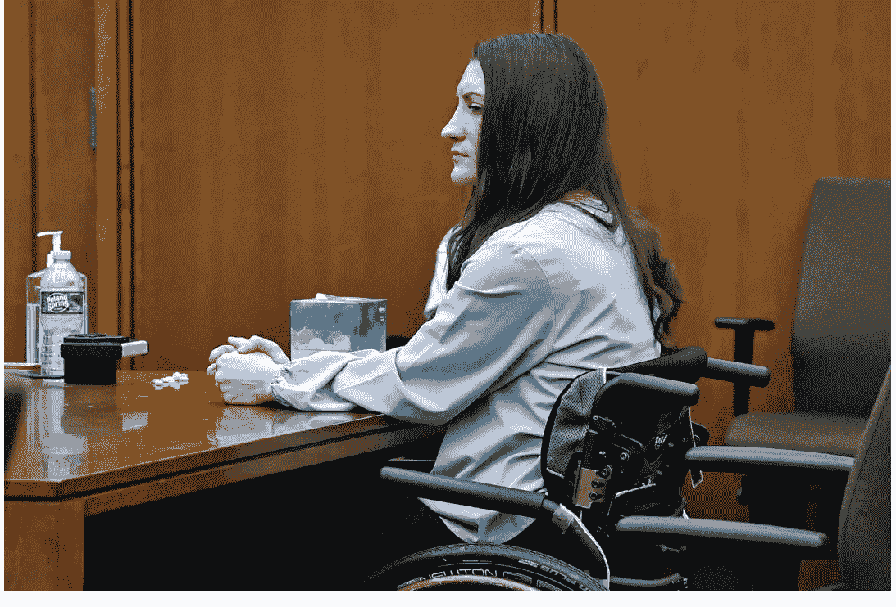

# 母亲杀死三名子女之后

- 260917 新闻实验室
- 整理：公众号懒人搜索，懒人专属群精选
- 懒人微信：lanyhelper1

> 小懒判断｜想看懂热点事件怎么被舆论撕成两半的，这是现成样本；只想吃瓜猎奇的别点，通篇压抑。最值得关注疯母亲和坏母亲这套媒体叙事框架，同一个杀子案往疯里讲收获同情、往坏里讲收获谴责，框架一换结论全变。坑在TikTok上16万条视频里的阴谋论，不少人咬定丈夫才是真凶，情绪越饱满的解读越多留心眼。

# “疯狂的母亲”，还是“坏母亲”？

2023年1月24日下午，帕特里克·克兰西（Patrick Clancy）应妻子林赛（Lindsay）的要求出门买了食物和药品，随后回到位于马萨诸塞州海滨小镇Duxbury的家中。他们一家五口已经在这里共同生活了数年。到家后，他看到楼上的窗户开着，妻子躺在地上不省人事，脖子和手腕上有自残造成的伤口。他一边与急救人员通话，一边冲进屋内，发现三个孩子——5岁的科拉（Cora）、3岁的道森（Dawson）和8个月大的卡兰（Callan）——都躺在地下室，有遭到勒颈的迹象。在杀害孩子们后，林赛也试图自杀。

孩子们被送往医院后，科拉和道森被宣布死亡，卡兰则在三天后去世。林赛虽然活了下来，但因为高坠产生的伤害而终身下半身瘫痪。苏醒后不久，在意识尚未完全清醒时，她在医院里得到了检方的通知，马萨诸塞州将以三项一级谋杀罪起诉她杀害孩子的罪行。

尽管林赛从未否认自己杀害了孩子们，但她长期存在的精神健康问题，使这起案件迅速变得复杂起来。据她的律师和丈夫称，林赛曾是一名受过专业培训的产科护士，但自第二个孩子出生以来，就一直患有产后焦虑症，这种症状在第三个孩子出生后进一步恶化。为了缓解症状，她尝试了各种治疗方式，并咨询了多位专家，而每位专家都给她开了不同的治疗药物。

在孩子们去世后的三年里，检方构建了一套指控框架，将林赛描绘成一个冷酷、控制欲强且行事缜密的女人。在这套叙事里，她早已策划好杀害子女，当时神志清醒，完全具备刑事责任能力，也因此需要为三名孩子的死亡受到法律的严惩。而另一方面，帕特里克、父母、朋友、前保姆以及她的律师则描绘了截然不同的形象；她是一位充满爱意、疼爱子女的母亲，只是因为精神健康状况不断恶化却未得到妥善治疗，才最终导致精神崩溃，酿成了这起悲剧。

当林赛面无表情地坐在法庭上的轮椅上时，她的人生故事正在被各种人公开讲述，法庭内外的人们都在对她进行着评判。在 11 名陪审员倾向于无罪判决、另一名陪审员坚持认定她有罪的情况下，此次审判以流审告终。

该案已引起全美乃至国际的关注，而其关注度之高在美国刑事审判中实属罕见。近 3.6 万名捐赠者为林赛的父母筹集了 120 万美元，用于支持女儿的法律辩护；TikTok 上带有#Clancy 话题标签的案件相关视频已超过 16 万条。许多林赛的支持者将她视为一个被疏于职守且不完善的法律和医疗体系辜负的人，并选择在法院外集会声援她的清白，甚至因认为检察官对克兰西缺乏同情心而对他们进行挑衅和奚落。

案件流审，仅仅意味着对林赛罪责的法律裁决得到了暂时的推迟，此案引发的情绪余波远未平息。新闻媒体、法学学者、女权主义作家、社会活动家和政界人士在此次事件中，发表了不同的观点，形成了一幅分裂的拼图，展现出美国社会如何在具体议题上日益撕裂。

# 陪审团面临的问题

马萨诸塞州普利茅斯法院内，十二名陪审员听取了数十名证人的证词，实地考察了克兰西的旧居，并被要求回答一个更为具体的问题：既然林赛在杀人案中的角色无可争议，检方是否已证明，在排除合理怀疑的情况下，她在杀害子女时具有刑事责任能力？

在结案陈词时，检方也承认她患有精神疾病且曾真正试图自杀，但双方对该疾病在多大程度上影响了她控制自身行为及认识其行为错误性的能力存在分歧。克兰西的辩护律师凯文·雷丁顿（Kevin Reddington）辩称，她多次寻求治疗，但因误诊和用药不当最终导致精神崩溃。检察官则辩称，克兰西虽然处于绝望之中，但仍具备做出选择的能力，杀害子女是她为消除自杀障碍而采取的手段。

根据马萨诸塞州之前的判例，当精神疾病或缺陷使一个人缺乏认识自身行为错误或使自身行为符合法律要求的实质性能力时，该人不承担刑事责任。在克兰西的审判中，检方必须在排除合理怀疑的情况下证明其具有刑事责任能力。鉴于检方已承认她的精神疾病的确存在，因此必须证明她在杀人时仍具备上述两种能力。在此类案件中，法律判断与医学诊断有所区别：仅凭诊断无法认定缺乏刑事责任。

十二名陪审员必须达成一致，才能作出裁决。在后续接受媒体采访时，一位投下无罪票的陪审员表示，那名表示林赛有罪的陪审员始终对双方提出的论点提出质疑，却拒绝解释为何仍坚持有罪裁决。据他所称，这位持不同意见的陪审员在辩论期间，甚至一度将一条健身带缠绕在水瓶上做出了拉拽的动作——这一举动显然是在模仿林赛杀害孩子们的方式。

# 同样的证据，矛盾的解读

在宣布流审之前，CNN 主播帕梅拉·布朗（Pamela Brown）情绪明显激动起来——她自己也是三个年幼孩子的母亲。当时屏幕上正播放着克兰西孩子的照片，而 CNN 的法律记者正在讨论检方关于“使用健身带杀害孩子们的时间超过一分钟”的指控。

“这简直令人心碎至极。我们现在看到的正是这些可爱孩子的照片，而我……当你描述法庭上展示的关于那些健身带的证据时，真的让人忍不住想哭，”她强忍着泪水说道，“对不起。这太可怕了……这场审判让人很难不感同身受。”

布朗的反应当然不是个例。在任何关于刑事责任的讨论之前，人们直觉上最强烈的反应便是震惊：一位曾被证明悉心照料子女的年轻母亲，一位从事产科护理工作、致力于迎接新生命来到世上的专业人士，怎么会做出杀害亲子子女这种令人发指的行径？这种震惊背后是一种关于“好母亲”应该是什么样的文化预设：天生且充满关爱的母性本能，会克服一切困难。这种预设使得母亲施暴不仅被视为一种罪行，理所应当受到道德谴责，甚至在概念认知上都不可理喻。

在整个审判过程中，检方和辩方分别将她生活的不同方面作为影响其刑事责任的证据提出，勾勒出相互矛盾的形象。同一份证据，在双方手中往往有着截然不同的意义：

- 林赛核查帕特里克去取食物和药物所需的距离与时间，既可以表明她有意制造一个时间窗口以便杀害孩子们，也可以仅仅是为了确认自己需要独自照顾孩子们多长时间。
- 林赛起初记录自己对药物的反应，然后在杀人前几周突然停止记录，既可以解释为放弃治疗的有意识决定，也可以解释为丧失了管理自身精神状态的能力。
- 她虽曾寻求帮助却未能坚持同一治疗方案，而是反复更换专科医生和药物，这既可以解释为医疗系统已对这位不配合的患者竭尽全力，也可以解释为误诊、用药问题及治疗协调不力等因素的综合作用，导致她未能获得所需的帮助。
- 她说自己曾听到一个男性声音命令她杀死自己的孩子然后自杀，这既可以解读为产后精神病的征兆，也可以被视为她为逃避法律制裁而编造的借口。
- 她在医院恢复意识后不久就询问是否聘请了律师，这既可以理解为一名处于巨大压力之下的女性会有的反应，也可以被视为她明白自己行为不当的证据。

此类在法律审判和媒体报道中相互矛盾的刻画，在美国历史上其它涉及被指控杀害亲生子女的女性案件中反复出现。安德烈娅·耶茨（Andrea Yates）将五个孩子淹死在浴缸里；苏珊·史密斯（Susan Smith）将儿子们绑在汽车安全座椅上，任由汽车滑入湖中，随后谎称他们被一名黑人男子绑架；梅丽莎·德雷克斯勒（Melissa Drexler）在毕业舞会上于厕所分娩，将婴儿扔进垃圾桶后又返回舞会——这些案件均引发了广泛关注，并在同情这些母亲的人与谴责她们的人之间，掀起了耸人听闻且意见分歧的争论。

# 媒体构建的母亲形象

记者出身的堪萨斯大学新闻学教授芭芭拉·巴内特（Barbara Barnett）指出，媒体报道往往通过既有的叙事框架来组织此类案件，用震惊、悲剧、恐怖这些标签来框定它们，从而压缩了公众的解读空间。而早在媒体报道之前，这些解读本来就已经受到案件所依据的法律范畴的影响和限制。由于新闻报道中这些女性极少有机会为自己发声，记者们只能通过他人（比如检察官、侦探、家人、朋友和律师）提供的陈述来讲述她们的故事，将她们描绘成“邪恶的”、“精神失常的”，或是“犯了错的好人”。

在“有缺陷的母亲”这一总体形象下，媒体的刻画塑造了两种母亲形象。一种是“疯狂的母亲”，她被视为“道德纯洁”，符合传统的性别角色和女性气质观念，却最终犯下了“非理性”的杀子行为，如耶茨案。另一种是“坏母亲”，被视为忽视子女或家庭责任、性行为放荡、毫无悔意，甚至不够女性化，从而加剧了人们对受害者的同情，如史密斯和德雷克斯勒案。

通过将女性归类为“疯”或“坏”，这些叙事有效地将母亲施暴个体化，将原因归咎于母亲的精神疾病或品性缺陷，却几乎没有留出空间来审视母亲履行母职时所处的经济、医疗、生育及制度环境。女权主义诗人阿德里安娜·里奇（Adrienne Rich）曾在其 1976 年的著作《生而为女：母性作为体验与制度》中说：“无数女性杀害了她们明知无法抚养的孩子——无论是经济上还是情感上——这些孩子是强奸、无知、贫困、婚姻，或是由于避孕和堕胎手段的缺失或受法律制裁而强加给她们的。”

从社会学和心理治疗的角度来看，母亲与子女的关系往往充满矛盾心理——在爱与恨之间摇摆不定。这种矛盾心理在一定程度上因社会对母亲提出的不切实际且自相矛盾的要求而加剧。母亲自身的需要、诉求和挣扎被排在最后，甚至低于人们对其“母性本能”的期待。

这种“恰当的母亲形象”并非植根于女性的自然本能，而是在特定的历史条件下逐渐形成的。社会学家莎伦·海斯（Sharon Hays）将其称为“密集型养育”。这一模式包含一系列相互关联的要求：儿童被视为纯真无价，其需求被置于首位；母亲本人应是主要照料者；育儿必须以儿童的需求为中心；母亲应依赖专家知识；养育子女必须投入大量的时间、情感、劳动和金钱；而母爱则被同时描述为自然、愉悦、无私且本能的。

因此，“好母亲”不仅仅是指不虐待孩子的母亲，而是指承担着极具挑战性的文化角色的母亲：她必须持续地理解孩子、满足他们的需求、保护他们，并将孩子的利益置于自身利益之上。正如身为两个孩子母亲的女性主义心理治疗师罗兹西卡·帕克（Rozsika Parker）所言：“作为幼儿的母亲，你被赋予了‘一吻即愈’的能力，但当伤痛未能痊愈时，却会遭到刻薄的指责。”

对于来自边缘化群体和弱势背景的女性而言，这些期望可能尤为严苛。安德烈娅·耶茨与库阿·赫尔（Khoun Her）之间的鲜明对比说明了这一点。2001年，耶茨在得克萨斯州将五个孩子溺毙后，获得了大量同情与支持，部分原因在于她被描绘成一位生活在稳定、传统家庭中的白人中产阶级母亲，其丈夫，也是孩子的父亲，选择支持安德烈娅，坚称这起杀戮源于产后抑郁症。而1998年，24岁的贫困苗族移民库阿·赫尔在明尼苏达州扼杀了六名子女并企图自杀，而当时她与丈夫关系破裂。在审理过程中，辩护方并未以产后抑郁或精神疾病为由进行辩护，她最终被判处50年监禁。

在林赛案中，关于这种双重标准的质疑再次浮出水面。这一次，许多人通过网络声援林赛，以“疯母亲”的框架理解她时，而四年前，同一检察官办公室却在同一位法官主持的审判中，成功使杀害自己两个年幼儿子的黑人母亲拉塔尔莎·桑德斯（Latasha Sanders）被定罪。今年8月，马萨诸塞州最高司法法院撤销了对桑德斯的定罪，并下令重审，原因是主审法官不当排除了精神病学记录。

桑德斯一案此前获得的全国关注度远低于克兰西案，但通过与后者的对比，该案再次引起公众关注。萨克拉门托加州州立大学的犯罪学家丹妮尔·斯拉科夫（Danielle Slakoff）表达了担忧，指出公众同情和媒体对被指控犯罪的母亲的报道中存在种族差异，并问道：“我也认为有必要退一步思考：究竟是哪些因素导致此案受到如此多的关注？”

# 一场个人悲剧的社交媒体化

在这个内容快速生成、观点层出不穷的时代，林赛·克兰西的审判对那些试图将其与自身联系起来的人来说几乎具有无法抗拒的吸引力。无论在法庭内还是法庭外，每个人都能找到值得讨论的话题。法学学者可以阐释精神病诊断与刑事责任之间的区别；女权倡导者可以批评社会强加给母亲的不平等负担；种族正义活动家可以指出白人被告案件与有色人种被告案件在媒体关注度上的差异；媒体评论家可以质疑这场审判如何演变为强化性别刻板印象的闹剧；心理学家可以探讨产后焦虑带来的、常被忽视的心理负担；而保守派评论员和政客们则将那位坚持己见的陪审员奉为美德典范，坚称“谋杀就是谋杀”。

随着数字平台使庭审过程触手可及且内容易于传播，在刑事判决尚未作出之前，几乎任何东西都可被用作道德判决的依据。一段简短的证词片段、一条孤立的日记条目、辩护律师的一段激情演讲，或是林赛那常常面无表情的庭审截图，都可以被配上自信的解释，说明其揭示了什么自己认为合理的道理。通过这种单方面的熟悉感，零散的信息片段逐渐被视为对当事人的真实了解。反复接触某种解读，则逐渐被视为对该解读的证实。

有时，这种参与甚至已经升级为直接的伤害。尽管林赛及其辩护团队明确承认她杀害了孩子们，但一些网络同情者却提出了反主流的阴谋论，声称帕特里克才是真正的凶手，他利用林赛的精神疾病诬陷她，并说服她相信自己负有责任。他们将帕特里克随后提出的离婚、搬离家庭住所以及再婚列为“证据”。据帕特里克的律师称，这些指控甚至导致他的人身安全受到威胁。林赛的律师公开驳斥了这一理论，而帕特里克的律师则威胁要提起诽谤诉讼。

为什么这类阴谋论在信徒眼中显得如此自然且有理有据？《纽约客》的专栏指出，政治、社会和文化环境为人们对体制和机构产生不信任提供了充分的理由，再加上社会上根深蒂固的怀疑——人们难以相信一位表面上疼爱孩子的母亲竟会犯下母亲所能犯下的最骇人听闻的罪行。这种不信任使得缺乏依据的阴谋论在情感上极具说服力。

而且，对于一些人来说，相信这套没有根据的说法，成了一种有效的道德释怀方式：它化解了他们心中林赛作为慈爱母亲的形象与归咎于她的暴力行为之间的矛盾。

这个案件揭示了许多长期结构性问题，例如产后护理的缺口、对母亲责任的期望、媒体强化性别刻板印象的做法，以及不同社会群体在法律待遇上的差异。虽然也有一些人在讨论，但是大部分声音还是止步于表达愤慨、重申立场或指认责任方，极少深入探讨究竟需要改变什么、由谁负责推动改变，以及需要哪些资源或行动才能促成这种改变。喧嚣之后，公众的关注能不能变成一种持续的关怀和问责，有没有可能超越新闻周期本身，产生能够落到实处的变化？

分割线

在这个 AI 能替你写代码、写文章的时代，基础技能正在迅速贬值。绝大多数人正被淹没在海量的免费垃圾信息里，陷入低效的体力内卷。

当“努力”不再是壁垒，人与人之间唯一的护城河，只剩下“信息过滤”的效率与“认知系统”的维度。

圈子已稳定运行 7 年。我们每天利用 Python 爬虫与大模型算力，过滤全网最顶级的政经内参和搞钱风向标，做你最冷酷的“外部大脑”。

如果你认同这种“重塑认知防线”的极客主义，欢迎围观我的个人情报智库：【懒人专属群】。

https://lazyso.com/insider/

认同信息过滤价值、想省下每天 3 小时无效阅读时间的读者，扫码加我微信（lazyhelper1）

