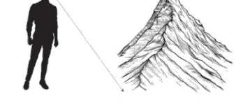
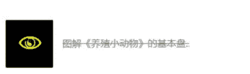
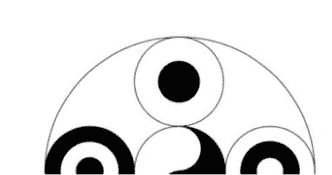
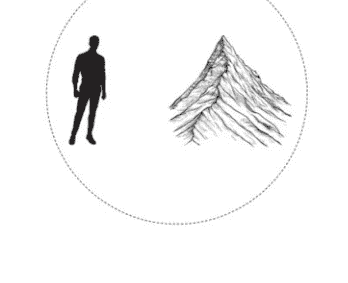
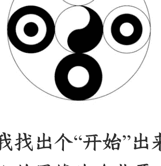
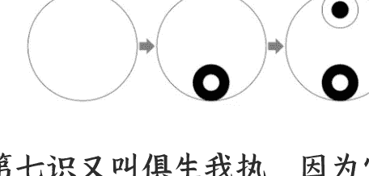
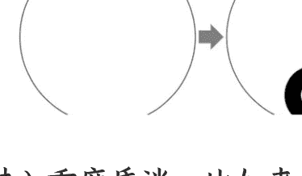
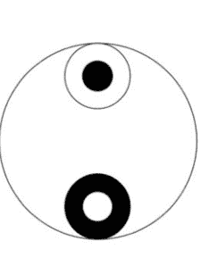

唯气=世界是气化的。唯识=世界是识现的。有的就问了，这些哪个最正确呀？都对！啊？难道世界好几种存在形式？不！世界一直是那个世界，只是人们的认知层次不一样。就好比啥呢？

你去观察识别一个人，一开始看他说什么，深一层看他做什么，更深一层看他的性格习惯，更更深一层看他的业力。从语言到行为，从行为到习惯，从习惯到业力，这是一个“穿透式”的认知观察，观察到的存在模式是越来越抽象的..当人能够穿透层层表象，这就叫做——慧！

所以别觉得世界观不重要，在这上面能思维穿透，你再看各种事物就都能穿透。反之你连世界观都没有，你还能穿透个啥？还扯什么洞穿事物的本质呀？

只能说别人说啥，你就信啥，因为你没得选..那么好了，虚拟的意思是啥？可不是不存在的意思呀，比如一台车过来，不躲那是弱智.虚拟=没有实体性≠不存在！

这就就跟做梦似的，里面的东西存在不？真实不？车过来你躲不？换个带感的说法，世界就是一场投影成相！是啥投影出来的？当然就是你的心识喽..例如：咱俩看到一座山呀一块石头啥的，看到的绝对不是同一个！

啊？明明一模一样呀？错！只是相似度能达到 99.99..99%罢了，但绝对不一样，这叫做共业相”，咱们为了方便理解，现代话就叫它“交叉成相”吧。

### 心空就感到很空虚？

心里就琢磨，哎哟坏了就啥都没了，然后就会感叹，人生就是一场“空”呀！

这里的空和佛家的空可是两码事哟，可千万不能混为一谈。这里的空叫做——断灭空！佛家是专门要破除这种错误知见的..例如：当人以为生命的本质是个意识实体，俗话叫做灵魂嘛，肉体只是个躯壳，这就会给人带来恐惧感。

心里就琢磨，哎哟灵魂将来去哪啊？是不是就产生了对未知的恐惧感？然后，宗教就产生了！因为有“需求”就会有市场，然后给你设定出天堂地狱啥的，但凡不信X教的，统统给你们打入地狱，吓死你们..嗯.宗教就是这么来的，所以最初是政教合一嘛，靠的就是恐惧支配，把小动物们给死死捆绑在一起，最简单的方式就是树立外敌。

但这玩意不好敲字，昨天敲了一篇，然后就这样了..

所以讲五行呀、唯识呀，不仅是要建立世界观，这些是要推导现实事物和应用技巧的。先不说这个..这里有人就疑问了，佛教不也讲天堂地狱吗？

那佛教！佛教都属于——表法。啥叫表法？就是人们认知水平太差，善根种子压根激活不出来，所以就得先迎合“需求”讲点啥玩意，然后再勾搭人们一步步地深入认知，最后形成正知见。

就好比啥呢？你先跟小孩子说，不听话就会被大灰狼抓走喽哟，然后再进一步讲述为什么要听话，你直接上来一顿逼逼叨听话原理，小孩子的认知是接受不了的..佛家是真月，佛教是指月的手指，你不能被手指给迷惑。

所以佛道是不是和通常以为的不一样？佛道可不是迷信哟，反而是——破除迷信！有灵魂也不对，没有灵魂只有物质也不对，客观也不对，主观也不对，信了这些才是迷信，佛道是破除你种种思想上的迷惑.第一步就是——破实体性！

那么好了，既然世界的存在丝毫没有实体性，那世界是咋虚拟出来的？

就是下面这个图了：

别看这个图挺简单的，所有认知都围绕这个图！这个图叫啥呢？

那叫法可就多了，暂且就叫《五行八识图》吧..叫啥无所谓，最关键的是“看图说话”这一效用，因为佛道有好多名词，词汇就是认知的屏障，就跟经济学家一堆词给你搞懵了一样。怎么破除实体性的？

此时，此图可以叫《缘起法》图，也可以叫《混元一气》图，是不是好多名。佛陀的最根本法就是缘起法，道家的根本法就是混元一气。

这些专业词你不用管，爱叫啥叫啥只是个词汇罢了，重点是看图代入思维运动。世界咋就没有实体性了？你看图里有实体嘛..此图要这么看呀：黑白都表示——力！

力的运动是——关系！力有实体吗？关系有实体吗？你能把它俩给掏出来给我看，有多少我吃多少..我们只能感知到——力的现相！

比如你坐车有个推背感，或者看到石头被敲碎了，你通过这些动态过程才能感知到力的存在，但你无法直接掏出个力来。当然，佛道的力≠物理的力！

因为物理学只研究物质之间的力，佛道是心无一物之力。当然了，随着物理学深入研究，对力的定义也不断变化，以后慢慢就会进入佛道的力了，这些暂且不扯远啊..总之，可以借用物理的力来打比方，这样能帮助理解佛道的力。然后，怎么虚拟出世界的？一切存在都是——力的震动成相！

也就是说，不论你把物质还是意识，不断地进行分解，最后在极微观上就没有实体性了，而是只有力的震动。佛陀用了一个带感词——临虚！

用大白话来说，越趋近于极微观层面，物质和意识就越来越虚化了，当突破临虚的卡点之后，就会发现物质和意识原来是同根同源的，大白话就是一个玩意。

那么好了，我们从极微观回到宏观世界。宏观上突破临虚是啥样的？客观——物质。主观——意识。

### 原来主观和客观也是同根同源的，这就是突破认知了！

由此，我们从宏观进入微观，再从微观回到宏观，你就明白“识”是什么了。是啥呀？就是主客一体，相对成相，非一非异，不可割裂！咋就一体成相了？

例如：在上文有个例子：每个人都活在自己的投影世界里。画图表示呀..

投影可不是这样的：

为啥？

这就成了唯心主义了..唯心论误以为在“我们这边”有个实体的东西，叫做主观、我、灵魂都可以，然后这个实体咔咔咔咔投影出世界。例如贝克莱说：感知即存在。

例如笛卡尔说：我思故我在。问题出在哪？误以为有个“感知主体”存在着，把这玩意看成根本实体。而佛道是破除迷信，是坚决否定实体性的！

识现是这样的：

这个识不在主观上和你这边，也不在客观上和外边。佛陀有个“七处征心”嘛，专门跟小表弟辩扯心识在哪，你也不用去看那个辩扯现场了，这玩意先看图说话来理解。

上图啥意思呢？

识现=同时投影出你的主观感知和客观世界，同时生起又同时俱灭！带感点说就好比啥呢？

这个虚拟世界就跟我们玩虚拟游戏似的，识现就好比探索地图似的，探出来一点世界就大一点，就多出了一些存在。

而且呢，是我们自己编出个游戏给自己玩，在游戏里面设定出一个人物建模，再设定出宏大的场景，然后在里面搞互动。或者再换个比方，我们给自己编织了一场梦，是18K高清晰的且因果程序极其完备的梦境，所以就显得无比真实。此时就有人深陷了：识的“投影源”在哪？

如果你说有一个投影源，那还是唯心主义的实体性呀！如果你说没有投影源，那你上面敲一堆字就是胡扯蛋噢.没有投影源，但也非胡扯蛋。为啥？

因为当你问“投影源”的时候，你的思维已经堕入迷信了..这个迷信在哲学叫做——第一因！换个通俗的表达，就是啥玩意存在都必须有一个开头，要不然人的思维就容易懵逼，就没有什么抓手了，思维就运行不起来很迷茫。对不对？而佛陀的回答——无始！

这玩意也不用敲一堆字扯，还是回到看图说话：

在图里你给我找出个“开始”出来？咱们反过来讲啊：人的思维为啥非要有个第一、开始、尽头、终极、永恒等等？因为一直陷在“实体性”错觉里面呀！

例如：最开始的实体错觉就是——一点。当你以为点是个实体，你下一步就会产生——线。线=点的堆呀。然后一步步的产生出三维空间，你就幻以为三维空间是实体的。

对不对？而从最初的错觉看来，这个“点”压根就非实体，不服你给我找出来它的实体性？还是有多少吃多少对赌协议..这么说吧，就是科学家们也找不出来呀！

要不为啥对物质的定义不断改变？在过去两百年里，科学界对物质的定义换了老多花样了，物质定义从直观绝对的概念逐步演变为一个抽象、关系性的概念，且仍在不断演变发展中。

例如：

最开始是唯物主义，定义物质是一个实体，所谓“粒子”的称呼就这么来的，当然现在发现粒子并不是一个“颗粒”物，但依然延续这个传统叫法罢了。

科学不是哲学，科学是通过实践证伪哲学上的假设然后对粒子开始建模，定义物质是任何拥有质量并通过体积占据空间的实体。然后爱因斯坦打破了定义，质能等价原理嘛，就打破了“物质实体不灭”的固有观念了然后又发展出波粒二象性，然后再发展到场论，以后会发展出更多建构..总之，对物质的认识就从“实体结构”逐步升级到“关系规则”的层次上了！

而佛道呢？早在几千年前就已经认识到了，而且不会把“关系”停留在物质现象上，是看待宇宙一切事物都是关系式存在。这就是佛陀的——缘起法！

即：

宇宙万物之存在，都是基于“缘起”这个玩意，当然它也不是个啥玩意..但为了带感方便理解，现代话可以叫做过程，也就是万事万物之存在，都是“过程”的显现。再把现代话换回佛家话——识现！

这回明白“识”是啥了吧？它不是个实体，不是个起源，不是永恒不变物。它就是个过程显现，我们的肉体、意识、所谓外部世界，都是基于这样一个过程显现，而且是同时显现的，而且是无始无终的。

当然，它不是随机显现的。它的显现机制就叫做——八识！八识可不是 8 个识哟，这玩意是道家五行的翻版，所以分成四块。

中间的缘起，就是道家的混元一气，只是叫法不一样罢了。一说翻版了，很多信教的就很生气，那你就出门左拐不送，你压根就没有善根种子。

所以有个“老子化胡”的传说，就是所有的思想都是从中国传出去的，然后各家各派再发展出自己的脉络，可能真有这事..

我们“立”出有什么玩意，那就已经错了。

但是呢，我们为了表达它，还就必须起个名画个图啥的.所以《唯识宗》又叫做《法性宗》和《法相宗》，就是把性（不断破除）和相（建立逻辑）都放到一起来说，因为一直破容易搞成“啥都没有”的错误思维，而但凡建立又会搞成“有个啥实体”的错误思维，所以只好两边都说。

这就是佛家说的——不二！说句实在话，佛家翻版的帮助了道家的延续，因为道家虽然特牛逼，但传道上压根不跟你掰扯这么细，全看个人悟性，那种有点悟性但又不是大利根的，基本就无缘了而且吧，个人感觉有些佛经就是道家人写的，这两家说不清楚之间的关系。

回到一炁：

也就是说，我们每个人类，乃至于猫狗啥的，所有生命体的大背景都是一模一样的。换成佛家，就是我们每个人都本具佛性。不要被名词迷惑呀，佛性就是图里大背景，其实连大背景也没有，但不画点啥没法表达逻辑了。

有时候还叫清净体、真如啥的，爱叫啥叫啥，要会看图说话.佛陀当年菩提证悟：“一切众生皆具如来智慧德相，但以妄想执着而不证得”。

所以严格讲：佛道压根没有“修道”一说，而只有“证道”一说。因为佛性都是本具的，不是修理出来的，只不过我们不知道，所以就要证悟出来。

### 佛道是怎么被玩“埋汰”的？

例如：

一讲“修道”一词，人们就以为有个“实体的道”存在，这样就产生“需求市场”了呀，然后就能开出寺庙呀、道观呀这些社会分工组织了，就跟公务员“在编岗”似的。

说道这玩意可牛逼了，它在哪里呀？哎呀，在道观和庙子里，我们得上那求道去。进门一看，说道具体在哪呀？我的香火钱都交完了，秃子长发你们必须给个说法。

嗯道就在大殿的泥塑上，你们赶紧去跪拜求道吧！说有人实在离得太远的，你也不用来了，弄几条小乌龟放生吧，那就是慈悲之道了。

小乌龟们冷汗直流，说咱们这身子骨下河不就得当场圆寂呀，这帮傻 X.

不管小乌龟啦，那是它的业力..那么为啥一视众生，每个投影的世界不一样呢？

这就是——第八识！方便带感说呀咱们先不说识现，先说其实所有生命都是一个，或者叫一体的大生命。就好比啥呢？量子力学之父普朗克说过，物质本身并不存在，所有物质都源于一种力量，这种力量背后存在一个有意识和智慧的心智，这个心智就是母体（Matrix）。

这个 Matrix 一词就是这老头造的词..当然，

这接近于佛法了，但和佛法还不一样哟，因为 Matrix 还有个实体性！佛法咋看一体大生命呢？

就当宇宙来看吧，这样方便表达，宇宙就当做是个大生命。这个生命也不是固定的、独立的、永恒的存在看的，它也是无始无终不断演化看的，然后呢？

它很想看看自己什么样子，这么“自己看自己”一下，这个大生命就开始演化裂变出来无数的小生命。

这一下子就叫做——觉明为咎！大白话说的话，纯属于“没事找事”的，或者“脱了裤子放屁”的感觉.就好比啥呢？一张纸本来是白的，但白色要依据证明才行，所以白纸就证明自己是白的，然后这么一动就不白了，纸面上就开始各种线条影相啥的。

其实自始至终白纸都是白的，只不过堕入了线条影相，误以为自己不是白的额.有点绕..

总之呢，第八识的产生是由于——误会！生命之存在就是一场误会，轮回就是一场误会..有的人这块就很难理解了，不过先不矫扯这个，简单的事情都需要经过复杂绕一圈才能理解的呀，既然已经有误会了，已然存在世间万物和生命了，那就先看看这些影相如何。

上面说的宇宙生命，就好比人体就是个细胞社会，人体也像大宇宙一样，每个细胞就是个小人。但你的细胞能都一样吗？

现在发现了大约 200 种，理论上是无限种的..那为啥都不一样？因为细胞们想通过“互相看”（即组合）来获知整体大生命呀，这就是——第七识！

所以第七识又叫俱生我执，因为它的目的是“执持”出“我”来呀。黑色——误会（佛家）。黑色——阴力（道家）。

这玩意你咋叫都行，一定要看图说话，如果敲字是不是就被俩词带懵逼了？

一看都不挨边呢.

即：

一切都本来没有主体性，没有“我”这个玩意，但经过第七识的执持，诸多细胞就互相看（组合）在一起了呀。

所以人是咋死的？第七识执持不住了，这一段的业力消耗完了，肉体就开始四散了。然后第八识也就不显现了，俗话说的也走了，即所谓“去后来先做主公”嘛。生命和外物的同时俱生俱灭，都是第八识先动的！

例如：

当人进入重度昏迷，比如来一针全麻吧，此时第六识（意识）和前五识都断片了，

就相当于人已经死了一半了。但还有第七识执持着呀，你的细胞们还在自发的“互相看”呢，所以大夫给你弄醒了之后又活过来了..为啥还能活过来？

因为前五识和第六识，就是第八识和第七识产生的呀，只要后面这俩不灭（不显现）时候，前面那俩就还有的救。

所以对人的死亡定义也是发展的，从心死亡到脑死亡啥的，以后还会有更新的定义。像民俗上人死后要停留几天，那是因为还没完全灭掉呢，第八识还没完全走呢。

虽然说救不回来了，但人在“那边”还是有感觉的.所谓“那边”并不是个“地方”呀，而是说七八两识的力量还残存呢，有的说法是还有极其微细的第六识。

所谓“那边的感觉”并非感知到肉体呀、声音呀啥的，因为前五识（心死亡）和第六识（脑死亡）已经停止显现了，而是就像进入梦中一样的境相感知。所谓“那边”在哪呀？

就在——当下

当下并非时间单位，而是一直在上面那个大圆里呀，它是没有时空性的，时间和空间都是它的化现影相，不能拿孙子（结果或投影）来包袱爷爷（起因或投影仪）。

只不过啥呢？先描述物质侧，这样更容易代入理解思维上啥感觉呢哎哟，所有物质背后确实有一股“力”存在呀！

但是，这股力可不仅震动显现出你的肉体呀，还显现出你的意识呢，啥玩意都是它显现出来的，山河大地都是其所显现。所以呢？

才叫做《五行八识图》呀..

因为先讲五行运力，这样是最简单的切入，用力来聊是最容易理解的，然后再逐渐理解八识，八识可比五行复杂烧脑多了。

对比理解：

上面是五行的火——对应第七识。下面是五行的水——对应第八识。咋个运力关系呢？一切存在都需要“火烧水”才行..用八识来说的话，一切存在都是基于“不断误会”才行..误会用专业词来说是——无明。

所以佛家说这个世界，是无明缘起出来的呀。在星球问答里讲过：火不烧水，存在不了，因为无法运行呀；但火烧水，早晚烧干，最后还是要灭掉。

物理学上叫——耗散！不耗散，万物存在不了，而耗散看，最后就要灭掉。所以：存在即漏洞！

这玩意就跟 BUG 似的..为啥？因为一切本来就都是大圆“没事找事”产生的呀，或者本来就是白纸“没事证明自己”产生的呀。自己给自己编织了一场“必然醒来”的梦境，所以万物存在主打一个没事找事模式。就好比啥呢？

### 就好比什么呢？

人的生活就是如此，自己给自己找点负担，然后再把负担给解除喽。又好比自己给自己缠上一个结，然后再把结给打开.比如说打游戏吧，说一上来就 999 级，咔嚓一下就通关，你还玩吗？

所以好的游戏设计在于度，得弄一层层关卡，然后再一关关过，人们就觉得特别有存在感。存在感的体验是为了啥？为了——成就感！

那么从游戏这个小例子跳出来，看生命和宇宙，从存在体验到成就感是啥呀？就是通过“火烧水”的过程，最终想要证悟出“大圆”呀..也就是说，所谓“修行”是个刚需，每个人都在修行，只不过自己不知道，没有拿这些破词咔咔说出来而已，没有那么强的逻辑性罢了。而且呢，我们被小游戏的成就感给障碍住了，就不停地陷入小游戏当中。这就是庄子说的：道隐于小成！世界观=大游戏。人生观=中游戏。价值观=小游戏。佛道就是让我们认识到游戏，即所谓游戏三昧嘛，活着要有一个打游戏的心态..整体了解了虚拟和识现，然后再慢慢细抠五行八识的机制。

——————分割线——————

在这个 AI 能替你写代码、写文章的时代，基础技能正在迅速贬值。绝大多数人正被淹没在海量的免费垃圾信息里，陷入低效的体力内卷。

当“努力”不再是壁垒，人与人之间唯一的护城河，只剩下“信息过滤”的效率与“认知系统”的维度。

圈子已稳定运行7年。我们每天利用 Python 爬虫与大模型算力，过滤全网最顶级的政经内参和搞钱风向标，做你最冷酷的“外部大脑”。

如果你认同这种“重塑认知防线”的极客主义，欢迎围观我的个人情报智库：【懒人专属群】。

https://lazyso.com/insider/

认同信息过滤价值、想省下每天3小时无效阅读时间的读者，扫码加我微信（lazyhelper1）

微信：lazyhelper1
