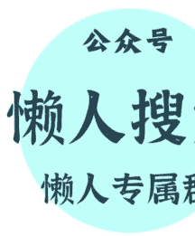

## 近期全球 AI 大事及看法

261028 马红漫
整理：公众号懒人搜索，懒人专属群精选
懒人微信：lazyhelper1

> 小懒判断 | 关注 AI 板块投资方向的人适合看，指望找 AI 泡沫破裂证据的不适合，作者立场是叙事没结束。最值得关注的是 SK 海力士 HBM 产能已被预订到 2027 年、Anthropic 估值谈 3500 亿美元还预计 2028 年盈亏平衡。坑在于第 2 条把海力士财报和 Anthropic 业绩混在一起写，数字要自己分开对号，别张冠李戴。

## 近期全球 AI 大事及看法

- 1、SK 海力士财报远超预期，单季营业利润同比增长超 500%，创历史新高。

这说明 AI 对存储芯片的需求已经强到离谱，三星、美光、海力士没一家供得上货，DRAM 和 NAND 的涨价周期远没结束。但更关键的是，SK 海力士的 HBM 产能已经被称为预订到 2027 年，这说明头部客户的军备竞赛不是短期炒作，是实打实的长期投入。

- 2. Anthropic 实际业绩是：①SK 海力士单季营收近 70 亿美元，同比翻倍，首次突破 10 亿美金净利润，而且 2027 年的产能已经全部被预订，三大客户（微软、亚马逊、谷歌）都签了长约。

这说明什么？说明 Anthropic 的算力需求不是短期炒作，是大厂在 AI 基础设施上的长期军备竞赛。②Anthropic 预计 2028 年就能盈亏平衡。

Anthropic 正在洽谈新一轮融资，估值可能超过 3500 亿美金。

这说明什么？说明市场对 AI 的预期还在往上抬，不是见顶的信号。

- 3、谷歌 Genie4：谷歌发布新模型 Genie4（创世引擎），一句话生成可交互的 3D 世界，世界模型开始加速，商业化路径开始真正有了雏形（看好游戏，传媒等应用）。

同时谷歌在量子计算方面也有新进展（Willow 二代），谷歌发布的前景继续看好。游戏，传媒，影视，是 AI 应用的方向。总结：今天美股 AI 板块继续走强，说明 AI 叙事还没有结束。虽然有波动，但总体来说正常发展中。

——————分割线——————

在这个 AI 能替你写代码、写文章的时代，基础技能正在迅速贬值。绝大多数人正被淹没在海量的免费垃圾信息里，陷入低效的体力内卷。

当“努力”不再是壁垒，人与人之间唯一的护城河，只剩下“信息过滤”的效率与“认知系统”的维度。

圈子已稳定运行 7 年。我们每天利用 Python 爬虫与大模型算力，过滤全网最顶级的政经内参和搞钱风向标，做你最冷酷的“外部大脑”。

如果你认同这种“重塑认知防线”的极客主义，欢迎围观我的个人情报智库：【懒人专属群】。

https://lazyso.com/insider/

认同信息过滤价值、想省下每天 3 小时无效阅读时间的读者，扫码加我微信
（ lazyhelper1 ）

微信：lazyhelper1
