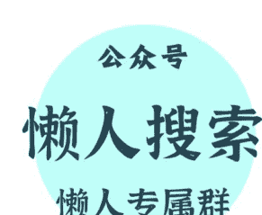
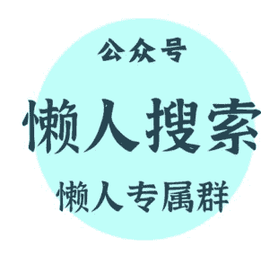

# 为什么"中国人一旦主导某个产业，马上就没利润了"？

261028 专属群
整理：公众号懒人搜索，懒人专属群精选
懒人微信：lazyhelper1

小懒判断 | 做制造、跨境电商或给工厂投钱的必读，它把"规模越大利润越薄"拆成了五个可核对的机制，尤其"技术扩散两三年就被追平"和"地方政府锦标赛式扩产"两条最扎心。不做实业的也可以看，能理解国家为什么连发退税、消费税、能效标准三板斧。坑在于：文中的政策清单是"正在推进"，别当成已经见效的结论去押注。

本文选自《政经参考 2026》第 199 期，完整的课程在专属群内连载中。

最近知名投资人但斌抛出了一个问题，迅速在实业界和投资圈引发热议。他的原话是："中国人一主导某个产业，马上就没利润了，这个是比较要命的东西。"这句话被称为"但斌之问"。它之所以能引起广泛共鸣，是因为它说出了无数中国制造从业者、投资者乃至普通劳动者心里憋了很久的一句话：活没少干，厂越建越大，产量越来越高，销量越来越多，可利润却越来越薄，有的甚至亏钱硬撑。这并不是但斌第一次表达类似的看法。2020 年 11 月在复旦大学经济学院讲课时，他就说过，中国人如果真能做芯片，芯片价格估计会像白菜价一样。

我认为，"但斌之问"真正的价值，不在于那个看似情绪化的结论，而在于它逼我们直面一个严肃的产业经济学命题：为什么中国制造的规模优势、成本优势、供应链优势，没能大规模地转化为超额利润？利润到底在哪里以什么方式蒸发了？以及，出路在哪里？

这个问题，是当下中国经济的关键之问。我们今天来好好谈谈。

我们先看但斌这句话的基础，光伏、新能源汽车等中国已经形成全球主导力的产业，确实大面积出现了"赢了市场、输了利润"的怪象。

先看最典型的光伏。

从硅料、硅片到电池片、组件，中国在每个制造环节的全球产能占比都超过 80%，国际能源署在多份报告里给出过同样的结论。但 2025 年隆基、通威、TCL 中环、晶科、晶澳、天合等六家龙头企业，全年归母净利润合计亏损超过 400 亿，多家龙头企业已连续多个季度大幅亏损。要知道，这些不是技术落后的小公司，反而是全球技术最先进、规模最大、成本最低的企业。

汽车是第二个样本。

2026 年一季度，汽车制造业营业收入利润率降至 3.2%，为 2014 年以来同期最低；2026 年前 8 个月利润总额同比下降 16%，营业收入利润率 3.6%，相当于每实现 100 元营业收入，利润仅留存约 3.6 元，其中，整车制造环节利润率更低，仅有约 1.5%。

份额在涨，利润在跌，这就是但斌所说的"比较要命的东西"。说到这里，你也能理解国家关于新能源汽车的"十五五"专项规划，为什么专门提出要加强产能预警调控，并且未来几年汽车产业要迎来大洗牌。

综合看，利润困境集中在同一类行业里：就是中国企业数量多、产能扩张快、产品高度标准化，现在光伏和新能源汽车是代表，过去的钢铁、水泥、面板也是。

## 背后的深层剖析

为什么？我认为有几个关键的原因和机制在起作用：

第一，技术能力扩散太快，领先会变成行业公共品。

要理解利润的消失，先看一个最简单的模型。假设一家企业率先把产品成本从 100 元降到 80 元。如果别人短时间内学不会技术无法降本，这 20 元的成本优势就能变成额外利润——这是熊彼特意义上的"创新租金"。

但中国制造业有一个极其突出的特点：技术和生产能力的扩散速度特别快。一家企业刚刚建立起来的成本优势，往往在两三年甚至更短时间内，就变成了整个行业的共同能力。这也是中国制造最厉害的地方，这对社会整体效率而言，是个巨大的优势；但对单个企业而言，这意味着你技术再先进，也很快会被追平。

这导致在中国制造业中，单个企业的"创新租金"存续时间很短。技术进步带来的好处，主要通过价格下降转移给了下游客户和终端消费者，企业自己反而没留住多少。

企业当然不愿意面临这个局面，但问题是，这是一个典型的囚徒困境，每家企业的决策单看都是理性的，但整个行业则进入了一个集体非理性的均衡：都在拼命提高效率，行业的利润却被不断让渡出去。

第二，这种过快的技术扩散，恰恰是知识产权保护不足的体现。

这在经济学上意味着，企业研发投入的专属性收益得不到保障。

知识产权保护的不足，会从两个方向摧毁整个行业：

一方面，它加速了前面所说的"技术能力扩散"——技术不是通过合法的许可缓慢扩散，而是通过人才流动、供应商、竞业违约、商业秘密泄露等方式近乎免费地扩散；另一方面，它摧毁了企业投入研发的激励——既然我花了钱、最后别人白拿，那理性的选择就是都不做原创研发，都等着搭便车，最后大家挤在同一条低技术路线上拼价格。

中国现行法律上虽然有保护商业秘密的规定，但实际操作中取证难、周期长、赔偿低，企业维权成本很高，而且各地实际的执行力度往往是打折扣的，从地方利益出发，地方政府都希望别的地方的先进技术扩散到本地企业，实现本地的扩产。这客观上形成了"劣币驱逐良币"的效果。当抄袭者可以以极低成本复制时，行业的技术租金就被清零了。

第三，这种扩散过快和保护不足的结果，就是产品同质化。

许多中国主导产业的产品高度同质化，也就是经济学上说的"技术商品化"，是利润留不住的关键原因。

光伏是典型，硅片、组件都有全球统一认证，能像大宗商品一样交易，企业生产出来的光伏板基本大同小异，只在良率、衰减、转换效率等方面存在细微差别。

这里有一个关键概念：利润的留存，不取决于你做得有多好，而取决于竞争对手多久能做到和你差不多，以及客户换掉你要付出多大代价。当产品高度可替代、技术可以快速复制、客户转换成本很低，领先就变成了行业的新基准，而不是企业的超额利润来源。

这时候，企业之间唯一能竞争的维度就是价格，那么无论企业做到多大，无论市场在中国还是海外，利润都很难留住。

第四，进一步，地方政府的竞争性扩产，加剧了行业供给扩张。

在中国，一些行业的产能过剩风险不只是企业之间的囚徒困境，更是和地方政府之间的竞争性扩产有关。这是当前阶段影响尤为突出的一环。这一现象的背后，是地方政府间存在的"锦标赛体制"。当某一产业被列入鼓励方向时，各地往往会竞相投入，形成政策洼地和补贴竞争。在这种体制因素下，产能决策往往不是由市场需求和投资回报决定的，而是由地方竞争逻辑决定的。企业拿了廉价土地、低息贷款和补贴，扩产的边际成本被人为压低，于是本不该上的产能也上了，本没有竞争力的企业靠外部支持硬撑着，结果就是：产能持续扩张难以出清，价格战常态化，全行业利润消失。这才是无利润的重要根源之一。这两年电动汽车行业就是典型案例。

第五，粗放的出海模式进一步放大了这种处境。

出口有时候并没有改变竞争格局，只是把战场搬到了海外。如果几十家中国企业在同一个欧洲、中东、东南亚市场相互压价，海外采购商的议价能力反而上升。中国光伏行业协会今年在解读出口退税新规时指出，部分企业在出口中把退税额折算成对外议价空间，原本用来抵消国内增值税负担的财政资金，在谈判桌上让给了境外买家。

## 必须从规则着手

正是因为有上述原因，所以你能看到，这几年，尤其今年，中国对这套影响机制的改革越来越大。

我们还是拿光伏和动力电池举例：

财政这条线最直接，1月8日，财政部、税务总局发布公告称，"自2026年4月1日起，取消光伏等产品增值税出口退税"，电池产品的退税先降后停，2027年1月1日起全部取消。中国财政不再替海外买家买单，出口价格必须覆盖真实成本。

同时配合的是税收这条线。

锂离子电池从 9 月 1 日起按 2%征收消费税，一年后翻倍到 4%，光伏电池晚大半年后按同样节奏开征；钠离子电池、固态电池、钙钛矿电池等新技术路线则免征到 2028 年底。就是要把一部分落后产能挤出市场。

同时，还用标准这条线来面对地方保护。

工信部、发改委、市场监管总局推动的三项光伏能效能耗强制性国家标准发布，2027 年 1 月 1 日实施，达不到最低一级的存量产能和产品将被限制流通，也不能参与招投标。这是用技术门槛替代行政命令去产能，你地方政府可以给本地企业续贷、可以让国资接盘，却没法让一条高耗能的老产线凭空达标。

但这些都是细项约束。更长效的机制措施也必须改，其中首先是要管住地方政府的手，这背后的关键就是这两年一直在强推的"全国统一大市场建设"。"十五五"纲要第十七章就专设了一章，要求制定全国统一大市场建设条例；还要规范地方政府经济促进行为，制定地方政府招商引资鼓励和禁止事项清单。还要推广经营主体活动发生地统计，优化生产地和消费地利益分享，来弱化地方拼补贴扩产能的动机。

另外，价格监管端，市场监管总局也在推进《价格法》修订，研究修订低价倾销相关规定、完善低于成本销售认定，并指导相关行业协会制定成本测算标准。

而法治这条线，则指向了知识产权的有效保护。

国务院发布了《知识产权保护和运用“十五五”规划》，最高法发布了《人民法院知识产权司法保护实施方案（2026—2030）》以及相关的司法解释和指导案例，对侵犯商业秘密和惩罚性赔偿都有了新的措施，两高相关解释还降低了窃取技术的入罪门槛。这都是为了保护企业的创新。

不过客观说，上面这些措施，真正落地发挥作用，第一是需要时间，第二是要看落地力度，第三必然要忍受短期的阵痛，而背后是地方利益的重构。这必然需要极大的决心，但却必须要走下去。

### 划重点

- 1. 技术扩散过快、知识产权保护不足和产品高度同质化，导致企业创新优势迅速变成行业公共品，无法形成持续的超额利润。
- 2. 部分地方政府间的竞争性扩产通过补贴、低息贷款和廉价土地人为压低企业扩产成本，加剧产能过剩压力和价格战。
- 3. 国家正通过财政、税收、强制能效标准、统一大市场建设和加强知识产权保护等多条政策线推动改革。

分割线

在这个 AI 能替你写代码、写文章的时代，基础技能正在迅速贬值。绝大多数人正被淹没在海量的免费垃圾信息里，陷入低效的体力内卷。

当“努力”不再是壁垒，人与人之间唯一的护城河，只剩下“信息过滤”的效率与“认知系统”的维度。

圈子已稳定运行7年。我们每天利用 Python 爬虫与大模型算力，过滤全网最顶级的政经内参和搞钱风向标，做你最冷酷的“外部大脑”。

如果你认同这种“重塑认知防线”的极客主义，欢迎围观我的个人情报智库：【懒人专属群】。

https://lazyso.com/insider/

认同信息过滤价值、想省下每天3小时无效阅读时间的读者，扫码加我微信（lazyhelper1）

微信：lazyhelper1
