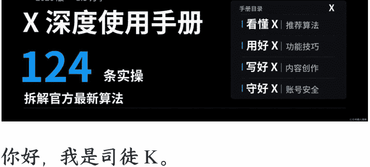
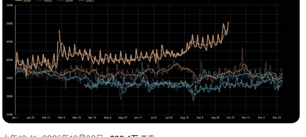
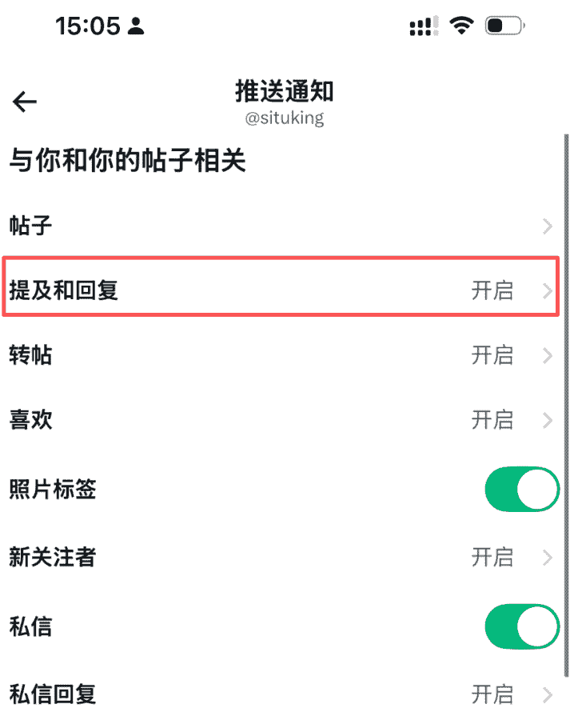
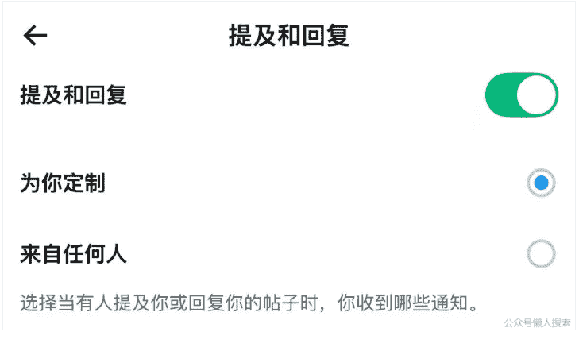
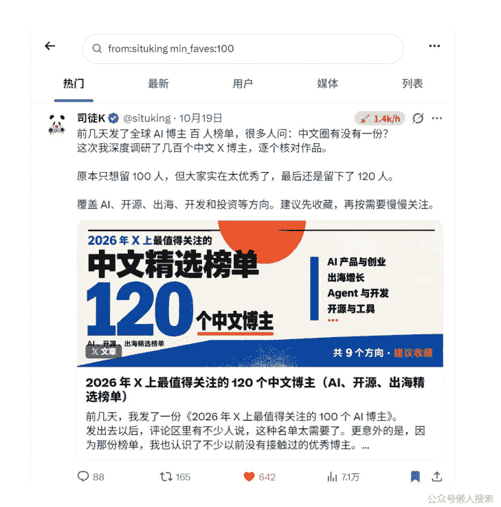
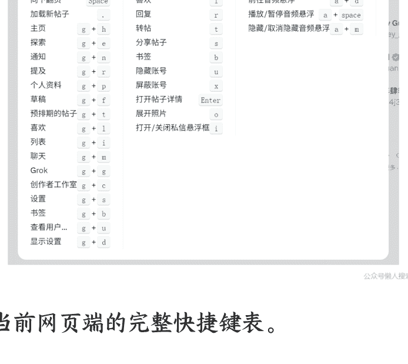
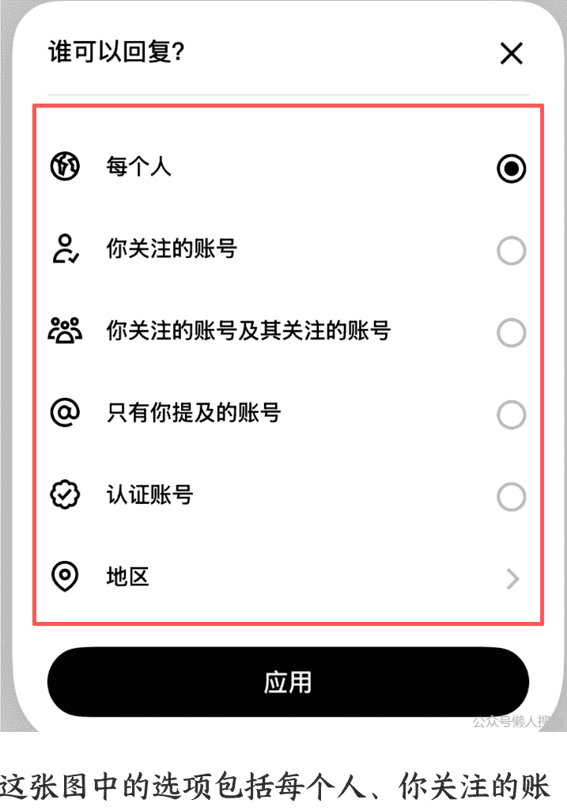
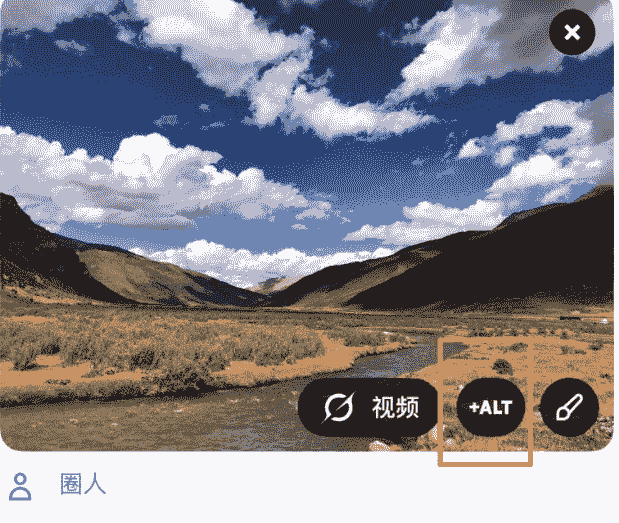

# X 深度使用手册（2026版）：1.5万字、124条实操，拆解官方最新算法

261028 副业 SC 精华
整理：公众号懒人搜索，懒人专属群精选
懒人微信：lazyhelper1

> 小懒判断 | 适合刚上 X 或发了几十条没起色的人，124 条实操按“看懂/写好/用好/守好”四块查看用。不适合指望看完就爆款的，作者明说算法只决定下限。最值得关注的是官方公开的推荐算法逻辑：互动已过半衰期的旧帖会被召回，好内容有第二春。坑在于长文里的@和普通提及不是一回事，写进去对方收不到提醒。

你好，我是司徒 K。

认真在 X 上发内容一个星期，涨了 2000 多粉。

有人让我复盘一下是怎么做的。说实话，我没正经做过复盘，也不太知道该怎么复盘。

但是我有个习惯，接触一个新工具、新平台，都是一边上手，一边学，一边记。做推特也一样。我一边和朋友们交流学习，一边看官方的开源手册研究 X 的操作和官方公布的开源算法。这次写下这篇 X 使用手册，一方面留给自己用，一方面也希望能帮到刚来推特的新人。

这篇手册比较长，内容也比较多，很多知识是我最近才知道的。

比如在 iPhone 上长按转发键，就能找到谁转发、谁引用了自己。这是前几天朋友告诉我，我才知道的。

还有长文正文里的 @，它和普通帖的提及不是一码事。你想让 @ 的朋友看到，不是在长文里写进去对方就可以收到提醒。这类细节，如果不是别人提醒或者去研究官方手册，就很难知道相关的规则。

我做互联网创业十几年，这几年专注做 AI 落地和 GEO 相关的业务。模型发布、研究员的讨论、创业者的第一手复盘，这几年里 X 一直是我获取这些信息的主要信息源。但以前只是用来刷信息，没有发布过内容，所以很少去研究这些按钮和规则。

这次开始在 X 上分享我的内容后，一边写文章发文章，一边从官方帮助中心、官方账号和 Musk 的帖子、开源推荐算法代码，以及中英文社区经验里，整理出 258 条资料，再一条条按实际使用场景核对、归并，最终写出来这一篇保姆级的 X 使用手册。

这篇手册讲的是 X 的基本操作和规则。手册里碰到苹果、安卓或网页端不一样的地方，我都标明了端和适用条件；哪些是平台的硬限制，哪些是我个人的内容建议，也给大家分得清清楚楚。

这个手册你可以这样读：

- 想找入口、改通知、筛选信息，先看「用好 X」。
- 准备发帖、写长文或上传视频，直接看「写好 X」。
- 想理解推荐机制，看「看懂 X」；涉及会员、收益和账号问题，看「守好 X」。

操作和算法的信息核对到 2026 年 10 月 21 日。X 迭代非常快，而且会分批开放功能，手册里的截图是用来给你找到文章内容的相对应位置，实际的操作以你的页面显示为准。

正文共 124 条，按使用场景分成四部分。

## 看懂 X

我把算法放在最前面，是因为在任何一个平台上，如果不了解它的算法和规则，就可能走很多弯路，也可能碰到平台的限制。X 公开了一部分推荐算法，正好可以先看看它怎么推荐内容。

### 1. 推荐是怎么来的

1. For You 怎么挑选帖子 X 公开了 For You（为你推荐）的核心代码。它会先从关注账号和其他来源找出一批可能推荐给你的帖子，再过滤、预测互动、打分排序，最后检查帖子能否向你展示。

所核代码中的这条推荐流程会过滤超过 48 小时的帖子。这个条件属于该推荐流程，不能扩大成整个 X 的所有入口都只展示最近两天的内容。

#### 2. 排序预测的是读者接下来会做什么

模型会预测某个读者回复、分享、点赞或停留的可能性，再把这些预测值组合成分数。同一条帖子，面对不同读者，排序结果也会不同。

#### 3. 哪些负反馈会影响推荐

举报、静音、不感兴趣和屏蔽，都有对应的负向信号。读者持续给出这类反馈，会影响系统接下来推荐什么。

#### 4. 算法权重怎么理解

模型先预测读者点赞、回复等动作的概率，再用相应权重计算分数。权重不直接乘实际互动次数，不能拿两个系数相除，换算成一次举报抵消多少个赞。

公开代码里的默认值，也不等于每个账号线上实际使用的实验参数。

#### 5. 外链需要放到评论区吗

据 X 产品负责人 Nikita Bier 在 2026 年 4 月 9 日的解释，外链从未被刻意降权。过去点开网页会遮住点赞、回复等按钮，影响互动，这个界面问题已经修复。他在 7 月 29 日也表示，不必再特意把链接放到回复里。

发带链接的帖子，可以先在主帖里讲清结论和关键材料，再附原始出处或完整内容。读者不点链接，也能知道这条帖子在讲什么。

#### 6. 书签值几个赞？公开参数里算不出来

在所核版本的公开排序代码中，预测动作没

马斯克在 2026 年 10 月 20 日的帖子中，还谈到停留时长预测，以及在初步挑选帖子时，更偏向读者可能会读完的内容。公开表态与具体代码更新分开看。

Two important changes to timeline recommendations:

- New AI/SI ranking model that predicts probable time spent much better
- Retrieval model trained to surface posts people read all the way through

User active seconds is growing exponentially and hitting all-time highs almost every day:

上午10:41 · 2026年10月20日 · 280.4万 查看

马斯克关于停留时长预测与推荐变化的公开帖文。

## 用好 X

这部分可以边看边点。活动记录、通知、搜索和列表，都是平时能直接用上的功能。

### 转评赞与活动记录

9. iOS 长按转发键，查谁转发、谁引用了你 进入帖子详情页，按住底部的「转发键」，会跳进「发帖活动」列表（不是轻点弹出的普通转发菜单）。切换「引用」和「转帖」标签就能看到明细。

10. 网页端从右上角菜单进活动页 网页上打开帖子，点右上角「…」，选「查看发帖活动」。长文的菜单里叫「查看文章动态」，叫法不同，查的对象也不同。

- 删除
- 推广
- 置顶到你的个人资料
- 添加到亮点/从亮点移除
- 从列表中添加/移除
- 添加/移除内容披露
- 更改谁可以回复
- 查看发帖活动
- 嵌入帖子
- 编辑图片
- 查看帖子分析
- 请求社群附注

我自己的普通帖子菜单。

#### 15. 回复、引用和转发有什么区别

回复是在原帖评论区里聊；引用是带着原帖链接，在自己主页发一条新帖；转发是把原帖原样扩散出去。一条公开帖即使限制了「谁可以回复」，别人仍可以引用它评论。

#### 16. 回复引用帖，原作者不会自动加入对话

A 引用了 B 的帖子，你在 A 的引用帖下回复，B 不会自动成为这段对话的参与者。确实需要提醒 B 时，在相关回复里明确 @ 他。

#### 17. 撤回转发

在已转发的帖子上点绿色高亮的转发键，选「撤销转发」。这只撤回你的转发，不影响原帖。

### 提及与通知

#### 18. 帖子开头写 @用户名，会限制首页分发

官方帮助中心说明，以 @用户名 开头的新帖在关注者首页的展示会受共同关注关系限制。想作为面向粉丝的独立主帖，可以在 @ 前正常写正文，或使用引用。这说的是首页分发，别人仍可能从你的主页等入口打开它。

#### 19. 长帖里重要的 @，放在前 280 个字符内

按官方规则，长帖（Long posts）只有前 280 个字符内的 @提及 会通知对方，后面的目前不提醒。重要的人往前放，字符数看发帖框右下角的圆圈计数。

#### 20. 发长文后，怎样单独 @ 提醒对方

长文 Articles 和普通帖、长帖是不同的发布形式。长帖前 280 字符的通知规则，不能直接套用到 Articles 正文里。需要明确提醒某个人时，可以在文章发布后的相关回复里单独 @ 他一次。

#### 21. 漏看陌生人回复，检查推送偏好

很多非互关读者的回复没弹窗时，在 iOS 里按这个路径找：「设置和隐私 → 通知 → 偏好 → 推送通知 → 提及和回复」。

推送通知里的「提及和回复」入口。

进去后看勾的是「为你定制」还是「来自任何人」。希望接收更广泛的提醒，改成「来自任何人」，确认选中标记已切过去。

图里选中的是「为你定制」。

这里改的只是手机推送范围，不影响帖子本身的可见度。

22. **手机没弹提醒，也可以去通知页查看** 垃圾过滤、系统通知权限或免打扰模式都可能吞掉推送。发了重要内容，直接进底部「通知」标签页看，不要因为手机没响就以为没人回。

23. **开通某个账号的消息通知，开他主页的小铃铛** 进对方主页，点关注按钮旁的「小铃铛」，选通知类型（比如全部帖子或仅直播），同时确认系统设置允许 X 发通知。

24. **通知页里的「优先」和「全部」** 2026 年 1 月官方上线时的说明是：粉丝满 500 人后，iOS 和网页端通知页会多一个「优先」标签，挑出互关好友或大号的互动。你的账号有没有这个入口，以实际界面为准；在「优先」里没看到熟人回复，切回「全部」找。

25. **「隐藏回复」是折叠，不是删除** 点「隐藏回复」后，这条评论会收进帖子右下角的「隐藏回复」图标里，对方不会收到通知。但任何人点开那个图标都能看到它。它适合整理评论区，不能当删除或保密手段。

### 搜索怎么用

#### 26. 按账号搜索： from:、 to: 和 @

- from:situking： 只看某个账号自己发的内容；
- to:用户名： 只看别人回复给某个账号的内容；
- @用户名： 查找所有提到这个账号的内容。

from: 和 to: 后面直接跟用户名，不加 @；只有搜提及时保留 @。搜不出来，先看对方是不是改了用户名（Handle）或锁推了。

#### 27. 限定时间： since: 和 until: 比如

from:situking since:2026-10-01 until:2026-10-21。

since: 是起始日， until: 是截止边界。想包含 10 月 21 日当天，把 until: 写成 22 日。within_time:12h 这类按小时搜的指令有时失效，查重要资料用明确日期更稳。

#### 28. 按互动数筛选： min_faves: 等 加上

min_faves:100，可以只看至少 100 赞的帖子，也能组合 min_retweets: 和 min_replies:。结果太少就降低门槛。互动量只是筛选条件，找研究员或其他一手信息源时，不必把门槛设得太高。

#### 29. 按内容形态筛： filter: 常用的有

filter:images（只看图片）、filter:videos（只看视频）、filter:links（只看带链接的），以及 -filter:replies（去掉回复、只看主帖）。手机端偶尔不灵，就去网页版「高级搜索」里勾选。

#### 30. 精确短语、排除词与语言 英文双引号

"" 是精确匹配；减号 - 排除某个词；大写 OR 表示「或」；lang:zh 只看中文。

例如 "AI 落地" -招聘 lang:zh，搜出聊 AI 落地、不含招聘广告的中文帖。双引号必须是英文半角，OR 必须大写。

#### 31. 在列表里搜：list:列表 ID

整理信息源列表的话，加上 list:列表 ID 就只在这群人的帖子里找。后面跟的是数字 ID（列表网页地址栏里能看到），不是列表名字。

#### 32. 查谁分享了你的网站：url:

输入 url:你的域名 -from:你的用户名，能找出除你之外还有谁在 X 上发过你网站的链接。适合找外部讨论线索，但覆盖不了所有变体短链，也不能代替专业的 GEO 或 SEO 统计工具。

#### 33. 把账号、关键词和日期组合起来搜

要找自己 10 月发的 AI 主帖，可以用 from:situking AI since:2026-10-01 until:2026-10-22 -filter:replies。这个式子同时限定账号、主题、日期，并排除回复。

要再筛互动时，加 min_faves:50。结果太少，先撤掉互动门槛，再放宽日期或关键词。

搜索式与「热门」「最新」结果标签。

回车后把「热门（Top）」和「最新（Latest）」都切着看。「热门」适合找高互动内容，「最新」适合按时间追动态。追刚发生的消息只看热门，容易漏掉第一手信息。

34. **常用搜索页存成浏览器书签** 网页端的搜索参数直接写在地址栏网址里（f=live 是最新，f=top 是热门）。确认当前停在哪个标签，把网址存成浏览器书签，下次点一下就到。

### 书签、列表与静音

35. **书签文件夹用来归档** 书签文件夹是付费会员权益，能不能建看你的订阅档位。帖子放进某个文件夹后，仍会留在「所有书签」里，不是剪切移走。

36. **用「历史」找回看过的内容** 如果你的界面有「历史（History）」入口，可以按书签、喜欢、长视频、文章等分类回顾看过的内容。找刚看过的帖子很方便，但核心资料还是存到自己的笔记软件里，平台入口不是永久档案。

37. **列表（Lists）可以放没关注的人**

把账号加进「列表」不需要先关注他。按主题整理信息源、观察同行动态都很方便。加列表和关注分开用，关注列表就不会越来越杂。

38. **新建列表，先看「私密」开关**

从左侧栏「列表」新建时，填完名字先看下面的「设为私密」开关。

公开列表里的人会收到通知；设为私密，名单只有你自己能看见。保存后看列表标题旁有没有「小锁头」图标，确认没选反。

39. **把核心列表钉在首页**

点列表右上角的图钉图标，可以把常看的列表放到首页顶部标签栏，按时间跟进。

40. **用小列表跟进固定的信息源**

可以先只放模型公司、研究员和你想跟进的创业者。需要追这些人的动态时，先看列表；想发现新内容，再刷 For You。

41. **时间线里也能置顶官方话题**

除了自己建列表，在「时间线」管理面板里也能挑平台整理好的话题，添加后看它是否进了「已置顶」区域，回首页顶部就有对应标签页。

44. **看技术内容，对照原文**

看外文技术帖时，核对模型名称、作者原话或参数，点机翻旁边的「查看原文」对照。设置里的「内容语言」管的是推给你哪些语种，和单条帖子的自动翻译开关是分开的。

### 网页快捷键与链接清理

45. **按 ? 打开完整快捷键表**

电脑上刷 X 时，光标不在输入框里，按 ? 可以打开当前界面的完整快捷键表。按键有调整时，直接查这张表。

当前网页端的完整快捷键表。

46. **常用快捷键：翻帖、互动和发帖**

j、k 分别选中下一条、上一条帖子。确认选中对象后，l 是点赞，r 是回复，t 是转帖，s 是分享。

n 打开新帖编辑框；在发帖框内，Ctrl + Enter（Mac 为 Cmd + Enter）可以发送。 / 跳到搜索，.加载新帖子。光标还在输入框里时，普通字母和标点只会作为文字输入。

当前表里，b 是书签，x 是屏蔽，u 是隐藏账号，i 打开或关闭私信悬浮框。媒体播放场景的按键另看总表右栏。

47. **用 g 组合键跳转页面**

先按 g 松开，再按后面的字母：

- g + h 回首页， g + n 看通知；
- g + p 进个人资料， g + b 看书签；
- g + i 看列表， g + m 进聊天， g + s 进设置。

48. **用浏览器书签保存主页标签页**

主页下的帖子、回复、媒体、长文、精选等标签页，各有独立网址。不用记后缀，点进常看的标签页（比如某个账号的「长文」栏）存成浏览器书签即可。

49. **清理分享链接，只删问号后的参数**

复制出来的帖子链接，？后面常带 s=20、t=xxxxx 这类追踪参数。清理时只删？及后面的部分，不要删掉前面的用户名和 status/ 后面的数字 ID。删完先在浏览器打开一次，确认能回到原帖再发。

## 写好 X

先分清四种发布形式，再看对应的编辑器。回复范围、排期、图片和视频设置按需要查。

### 普通帖、线程、长帖和长文

50. **普通帖能写多少字** 普通帖上限是 280 个加权字符。在 X 的计数规则里，一个汉字（含中文标点）通常算 2 个字符，所以一条大约 140 个汉字。还能写多少，看发帖框右下角的圆圈。

51. **线程（Thread / 串推）：分步骤讲一件事** 一条写不下时，点发帖框右下角的「+」接第二条、第三条，或发完主帖后在评论区继续回复自己，这就是 Thread（线程）。

每一节尽量单独能看懂，再按清楚的顺序串起来。

52. **长帖（Long posts）：在普通发帖框里写** 开通对应等级会员的账号，在普通发帖框里能写最长 25,000 字符的长帖。它是普通帖的加长版，和有独立标题、封面图、富文本排版的「长文（Articles）」不是一个东西。买会员前看清档位是否包含长帖和长文权限。

53. **长文 Articles 的入口和发布权限** 网页端左侧栏点「文章（Articles）」，再点「撰写」，可以进入独立编辑器，设置标题、封面和正文排版。写之前核对套餐是否包含 Articles 发布权限，不能只看侧栏有没有入口。

### Articles 的编辑与发布

54. **Markdown 稿怎么粘进长文编辑器** 把带 ###、** 和表格竖线 | 的 Markdown 源码直接贴进长文编辑器，常常不会渲染成标题、加粗或表格，而是符号原样露出来。要么用编辑器顶部工具栏排版，要么先把

Markdown 渲染成富文本（Preview 视图），再复制，贴完从头滚一遍检查。

#### 55. 长文编辑器支持哪些排版

长文编辑器原生支持大小标题、有序/无序列表、粗体、斜体、删除线，以及插入图片、视频、GIF 和嵌入站内帖子。

它不支持复杂的原生表格。对比数据可以改成带小标题的分项列表（Bullet points）；非用表格不可，就做成图片插入，并用手机预览看字是否太小。单篇能插多少张图，以编辑器的提示为准。

#### 56. 顶部封面和正文第一张图分开检查

长文编辑器最上方有专门的「封面图」上传区。不要按其他平台的习惯，以为正文第一张图会自动变成封面，从外部文档整篇粘贴富文本时尤其要注意。发之前切到预览，看封面区有没有图、裁切对不对。

#### 57. 修改已发布的长文，会先取消发布

这点和普通帖不同。按官方流程，在已发布长文的菜单里选「编辑」，系统会让你确认先将文章取消发布（退回未发布状态），改完再重新发布。哪怕只改一个错别字，也要有这个准备。

#### 58. 发布前看「选择你的受众」

点右上角「发布」时会弹出「选择你的受众」。开通了创作者粉丝订阅，可以选只给付费订阅者看；想全网公开，确认选的是「每个人（Everyone）」。

### 长文写法与分发

#### 59. 复杂内容适合用长文展开 行业复盘、篇章、履历。

### 回复范围、话题标签和位置

#### 65. 发送前看「谁可以回复」

发帖框会显示当前的回复范围，点开按需要选择，选完点「应用」，再看发帖框里的范围是否更新。

这张图中的选项包括每个人、你关注的账号、你关注的账号及其关注的账号、只有你提及的账号、认证账号，以及地区入口。

注意是「你关注的账号」，不是「关注你的人」。限制回复不会同时阻止其他人查看、点赞、转帖或引用公开帖子。

#### 66. 话题标签怎么选、用几个

官方建议每条帖子不超过两个话题标签，这是一项建议，不是技术上限。参加某个活动、集中讨论或固定栏目时，再用相应标签；不必给每个词都加上 #。

#### 67. 位置标签按需加

线下参会、探店等内容，地点有助于读者理解时可以添加。日常行业讨论按内容需要决定，不要把挂某个城市位置当成固定分发技巧。

### 编辑、排期与草稿

#### 68. 修改帖子：发布后 1 小时内，最多 5 次

开通对应会员后，帖子发出去可以改。1 小时从第一次点发送开始算，每改一次不会重置倒计时。

#### 69. 手机发的回原设备，网页发的回网页编辑

手机 App 发的帖子，要回到同一台设备上的 X App，打开「编辑帖子」修改；网页发的，回到 x.com 编辑。

#### 70. 哪些帖子不能编辑

按官方现行规则，这些内容发出后不能编辑：给别人的回复、带投票的帖子、付费推广帖、Thread（串推）、已置顶的帖子、通过第三方工具或 X Pro 发出的帖子，以及粉丝订阅专属帖。

#### 71. 编辑历史所有人都能看

在 X 上改帖子不是无痕的。编辑过的帖子底部会出现小铅笔图标和更新时间，读者点一下能看到每个历史版本，转评赞数据保留。修正事实错误就把更正写清楚，不要指望用编辑抹掉说过的话。

#### 72. 定时发布，在网页端的日历图标里设

网页端写好内容后，点底部工具栏的「日历图标」。选好日期、时间并核对时区后，点日历弹窗里的「确认（Confirm）」；回到发帖框，再点「排期（Schedule）」提交。

设完再点发帖框右上角「未发送的帖子（Unsent posts）」，切到「已排期（Scheduled）」，核对文字、配图和时间。存进草稿和进入排期队列是两回事，在排期列表里看到才算设好。

#### 73. 改排期或撤回，在「未发送的帖子」里操作

网页端打开发帖框，点右上角「未发送的帖子」，里面分「草稿（Drafts）」和「已排期（Scheduled）」。改时间、改字或取消定时，都在已排期列表里点开目标帖子操作。

修改后返回列表核对新时间和内容；取消后确认目标帖已不在排期队列里。

#### 74. 手机 App 找不到定时按钮，用网页版

手机端（iOS / 安卓）发帖框里有没有定时按钮，取决于 App 版本和灰度范围。找不到日历图标，就用电脑网页，或用手机浏览器打开 x.com 并切换「请求桌面版网站」，能保存进排期列表就行。

#### 75. 草稿同步和换设备前的备份

重要的长帖和长文另存一份。拿不准手机与网页的草稿会不会同步，先用两句测试文字试一下，再决定怎么换端继续写。

官方 iOS 文档提醒，退出账号或卸载应用会丢失本地草稿。换手机、退出账号或重装前，先把需要的内容取出来。

### 图片、视频与投票

#### 76. 一条帖子可以混传图片、GIF 和视频

以前是「四张图、一个 GIF、一个视频」三选一；现在一条普通帖最多可以混合 4 个媒体文件（比如 2 张图 + 1 个视频 + 1 个 GIF）。能不能传上去，还要看单个文件的大小、格式和时长，按界面提示来。

#### 77. 多图看预览，文字别贴边

传 1 到 4 张图，时间线里的网格裁切比例都不一样。作图时可以把 1200×675（16:9 横图）、1080×1080（1:1 方图）、1080×1350（4:5 竖图）当参考画布。

这些是经验值，不是平台规定。核心文字和人物主体往中间放，传上去后在手机预览里看有没有被切掉。

需要裁切时，点图片缩略图进入编辑，完成后回到发帖预览。账号若有 Grok 改图入口，先查看结果再决定是否使用。

#### 78. 给图片添加 ALT 描述

手机端点图片角落的「+ALT」，网页端在图片编辑里点添加描述，每张图最多 1,000 个字符。

- 取消
- 发布
- 每个人
- 有什么新鲜事?
- 
- 视频 +ALT
- 圈人
- 添加位置

上传图片后的「+ALT」入口。

ALT 是为无障碍阅读设计的，帮视障读者或图片加载不出来的人理解图片。把主体、截图里的关键文字或图表结论写清楚，保存后缩略图上出现 ALT 标识就加好了。往 ALT 里塞几百个无关热门关键词的做法不要用。

#### 79. 传长视频前，看清端和套餐上限

免费账号视频常见上限是 140 秒。付费会员的上限，官方不同页面口径不一：视频帮助中心写最长 4 小时、最大 16GB，会员套餐对比页里不同档位、不同端（网页 vs 手机）的上限又不同（超长视频常要求在网页端或 iOS 上传）。

传几分钟以上的视频，以当前套餐在网页端的提示为准。转码完成后从头拉一遍，也可以切到小窗，一边播放一边看其他内容。

#### 85. 投票选项和截止时间怎么设

点发帖框底部的投票图标，一般可设 2 到 4 个选项，每个选项最多 25 个字符，有效期最短 5 分钟、最长 7 天。选项要在同一个维度上，不要 A 写原因、B 写结果，让人没法选。

#### 86. 投票是匿名的

X 投票一人一票，投票人投完不能改票。发起人能看各选项比例和总票数，看不到具体是谁投了哪一项。需要了解选择原因，可以另外请读者留言。

#### 87. 投票帖发出后，作者不能编辑

带投票的帖子不在会员可编辑范围内。发送前看清选项有没有漏、措辞有没有歧义、截止时间是 1 天还是 7 天。官方投票说明目前不支持在投票中添加照片。

## 守好 X

买平台会员、参加原创内容奖励、开通粉丝订阅，是不同的事情。先看自己要用哪项功能，再核对相应条件。

### 会员、价格与扣费

#### 88. 新订阅的四档套餐

2026 年 10 月，官方公布了新的统一订阅体系 The X Subscription，把 X 会员权益和 Grok、代码编辑器 Cursor 的额度打包在一起，分 Plus、Premium、Super、Ultra 四个档位。

基准月费分别是 8、30、100、200 美元（实际价格受地区、税费、网页还是苹果内购、按月还是按年付影响）。

#### 89. 会员价格受账号地区、应用商店区服和付款渠道影响

网页、不同地区的 App 商店、税费及付款方式，都会影响最后看到的价格。购买时核对当前套餐与渠道，用自己能控制的账号和支付方式。

第三方代开可能涉及交出密码、未知付款来源和退款处理，不能只比较报价。官方定价页写明，新的统一订阅 The X Subscription 只通过官网直销，不授权第三方转卖，从其他渠道买来的账号可能被暂停或终止。

#### 90. Grok 和 Cursor 共享哪些额度

老套餐可以继续保留。新套餐的合资格第一方用量按周共享，覆盖对应的 Grok 和 Cursor 使用。Cursor 里的第三方模型不包含在这个池子里，要另外计费。

Grok Bot 包含在 Premium、Super、Ultra 中，Plus 不含。切换前对照自己要用的能力，再看旧套餐和剩余时长怎么处理。

#### 91. 有蓝标后改头像、改名字，蓝标会暂时隐藏重审

有蓝标后，换头像、改昵称（Display Name）或用户名（@Handle），会触发重新审核，蓝标暂时隐藏。复核期间，这三项资料不能继续修改，多久审完以系统提示为准。近期有活动需要挂蓝标，要么开会员前把资料改好，要么改完留出缓冲时间。

- 取消
- 保存
- 
- 用 Grok 编辑照片
- 姓名：司徒K
- 在你编辑显示全名或个人资料照片后，你的蓝色复选标记将会隐藏一段时间，直到它通过审查。了解更多
- 简介：用AI做生意，也用AI做点好玩的东西。主业是GEO：让品牌出现在AI的答案里。方法都做成了 skill，有趣的会开源。长文在公众号，全网同名：司徒K
- 位置：添加你的位置
- 网站：http://www.situking.com
- 出生日期
- 编辑专业用户简历
- 系统提示：蓝标暂时隐藏并重新审核，不是取消订阅。通过复核后才会恢复。

#### 92. 取消续费，回付款的渠道去操作

取消续费，回到原购买渠道操作。网页购买的在网页管理，App Store 或 Google Play 内购的到对应商店退订。旧 X Premium 的常规取消通常不退已付费用，法律要求等例外另计；为避免续扣，至少提前 24 小时取消并核对到期日。卸载 App 不会停止扣费。

切换到 The X Subscription 时，参与切换且符合条件的旧订阅按未使用时间比例退款，新套餐扣费和旧套餐退款分别处理。应用商店订阅分几种情况：

- App Store 购买的 Cursor，要自己取消，并向 Apple 申请退款。
- App Store 购买的 Grok、Grok Bot 或 X Premium，切换时会自动取消。未使用时间的退款需向 Apple 申请，是否批准由 Apple 决定。
- Google Play 购买的 Grok、Grok Bot 或 X Premium，切换后到商店检查；如果仍设为续订，再自行取消。

未参与切换的账号订阅不会随之取消，需要另行管理。

#### 93. 蓝标、金标和灰标分别代表什么

现在金色徽章通常代表企业机构认证，灰色徽章代表政府或国际组织，蓝色徽章是付费订阅加基础审核。判断蓝标账号说的话可不可信，看他给出了什么原始材料、能不能交叉核实，不看有没有蓝勾。

#### 94. 会员的回复优先级加成

官方定价页写明，新订阅的 Premium 及以上档位有更高的「回复优先级加成（Reply boost）」。但评论区的实际顺序还会综合作者互动、读者关系、内容相关性和折叠过滤。开最高档会员，也不能保证在任何评论区排第一。

#### 95. ID 实名验证和买会员拿蓝标是两件事

符合地区条件的付费账号，可以申请「ID 验证（政府身份证件核验）」，通常要拍证件加人脸自拍。只从 X 官方设置里的入口进，看清第三方核验服务商的条款、数据用途，以及是否支持你的证件签发地。不要把普通蓝标当成对方做过证件核验。

### 原创内容奖励 OCR

#### 96. 先看所在地区是否能参加 OCR

当前 OCR 官方支持名单有香港、台湾，未列中国大陆。申请前先核对本人所在地区及身份是否符合要求。持有某地银行卡，不会自动替代地区资格。

#### 97. 申请 OCR 要满足哪些条件

原创内容奖励（Original Content Rewards，OCR）只接受个人或商业账号申请，政治组织和政府组织账号不能申请。申请条件包括：

- 年满 18 岁，账号状态良好，且没有反复违反变现规则或服务条款的历史；
- 至少 500 个认证粉丝，过去 90 天至少有 50 万次来自认证用户的首页曝光，回复曝光不计入；
- 持有符合条件的付费订阅，并持续发布原创内容。

符合条件的订阅包括旧 X Premium、Premium+、Premium Business，以及新 The X Subscription 的 Plus、Premium、Super、Ultra。旧 Basic 不在申请所需的套餐清单里。

从「创作者工作室（Creator Studio）」进入 OCR 申请页检查资格。达到数字门槛后仍需申请审核，不保证获批。

#### 98. OCR 的 50 万曝光，不是后台的总浏览量

申请时，过去 90 天至少需要 50 万次来自认证用户的首页曝光，回复曝光不算。

开通后计算收益，看的是「合格曝光」。官方将这里的 Premium 用户列为旧 X Premium Basic、Premium、Premium+ 和 Premium Business 用户；帖子须在他们的首页信息流中至少显示一半。同一账号对同一帖只算一次，付费、推广、人为制造或欺诈曝光不计入。

旧 Basic 套餐不能作为申请 OCR 的订阅资格，但其用户符合上述条件的阅读可以计入创作者收益。

#### 99. 申诉失败后，OCR 等 42 天再申请

按现行规则，第一次申请没通过，页面会给一次申诉（Appeal）机会；申诉也被驳回，只要账号继续达标，过了 42 天冷却期可以重新申请。

开通后收益目前每两周结算一次，满 30 美元起付。申请后多久出结果看审核队列，官方没有承诺固定时限，留意系统通知。

#### 100. 绑定 Stripe，核对实名与收款资料

非美国的合格创作者需连接 Stripe 收款账户，并通过 Stripe 完成身份验证。核验所需的证件、姓名及收款资料应真实一致；资料填写按收款服务的实际要求进行。

获得 OCR 参与资格后，仍要完成收款设置才能接收款项。

#### 101. 哪些内容不计入 OCR 收益

可以正常发布的内容，未必符合 OCR 的收益要求。官方规则排除的情形包括搬运或实质复制、轻改洗稿、误导内容，以及专门聚焦变现教学、变现讨论或最大化收益的内容。

通过自动化方式创建或发布的内容，以及附有被评为「有帮助」的社区笔记的内容，也不符合 OCR 收益要求。使用平台允许的工具，仍要另外核对收益计划对内容的要求。

#### 102. 反复求互动，可能影响 OCR 资格

OCR 规则针对反复要求点赞、回复、书签、关注或转帖，以及人为操纵互动。普通的互相关注、正常讨论，不应直接等同于操纵。触犯规则可能按严重程度被暂时或永久移出计划。

#### 103. 搬运视频加水印，仍然是搬运

把别人的视频下载后加片头、水印、镜像或轻改，不会自动满足原创要求。OCR 是否认定原创，以及你是否有权使用这份材料，要分别核对；有授权也不等于轻改内容就能计收益。

### 粉丝订阅、打赏与推广

#### 104. 粉丝订阅：读者按月付费，和 OCR 是两套收入

粉丝订阅是读者按月为你的专属内容付费，和买 X 会员、参加 OCR 都不同，开通后可以发布订阅者专属内容。

订阅收入到账也不按 OCR 的双周节奏理解。具体到账时间以创作者后台为准。

#### 105. Tips 打赏的入口和收款方式

Tips 是另一种打赏入口，可能连接第三方支付服务。是否显示，取决于账号和地区等条件。

我自己的账号（2026 年 10 月，iOS 中文界面）在编辑个人资料里没有 Tips 入口。

#### 106. 接商单，勾上「付费合作」标识

收到推广费、免费寄测产品或其他商业利益时，按平台政策使用付费合作标识（Paid partnership），让读者知道这条内容存在商业合作。

#### 107. 帖子加推 Boost 属于广告曝光

账号开放了单帖加推（Boost）入口的话，记住买的是广告曝光，不要把它当成内容带来的自然增长。投之前想清楚：是要读者进主页关注，还是点去某个落地页转化。

### 自动化、账号限制与可见度

#### 108. 每天最多关注 400 人

官方帮助页列出每天最多关注 400 个账号；关注达到 5,000 后，还会受到关注与粉丝比例等限制。

#### 109. 私信总上限与陌生消息请求额度不同

官方帮助页保留每天最多 500 条私信的总技术上限，但向没关注你的人发送消息请求，还有按账号和订阅区分的限制。500 条总量不等于每天能给 500 个陌生人发消息。

发帖或私信遇到速率限制时，按具体提示处理等待时间。

#### 110. 没人看、被折叠和被锁，是三种问题

浏览量少、回复被折叠、账号受限，需要分开判断。推荐排序、垃圾过滤、地区规则和申诉。

### 账号安全

#### 114. 怀疑点了钓鱼链接，自己打开官方 App 改密码

在私信或邮件里点进可疑页面后，不要在那个页面填密码或验证码。关掉网页，自己打开 X 官方 App（或在地址栏手动输入 x.com），进设置改密码。

#### 115. 在「会话（Sessions）」里踢掉陌生设备

改完密码后，按「设置和隐私 → 安全性和账号访问权限 → 应用和会话 → 会话」进去，这里列着所有登录你账号的设备。看到陌生型号或异地登录，点进去退出，或选「注销所有其他会话」，再确认只剩自己的设备。踢掉会话不会解绑已授权的第三方应用，第三方授权要在同一菜单的「已连接的应用（Connected apps）」里单独撤销。

#### 116. 检查「已连接的应用」，撤销不用的授权

在「应用和会话」里进「已连接的应用（Connected apps）」，逐个看有哪些第三方网站或工具，点进去看它拿的是「只读」还是「读写+发私信」的高风险权限。现在不用的、不记得什么时候授权的应用，点「撤销应用权限」。改密码和撤销授权是两道门，不能互相替代。

#### 117. 打开「密码重设保护」

在安全设置里检查「密码重设保护（Password reset protection）」。开启后，重设密码需要额外账号信息，可增加一道核对。它不能替代两步验证；绑定邮箱本身的安全也要单独保护。

账号提供哪种登记入口，就按对应向导设置；遇到旧登记的更新提示，再按要求处理。

#### 122. 账号被锁（Locked）或受限，先看弹窗写的原因

账号被锁或受限，先保存并读清第一屏提示。安全异常可能要求修改密码、验证邮箱或手机号；规则限制可能要求处理内容、等待或申诉。按提示对应处理，不把所有情况都归为限流，也不承诺做一次验证就能恢复。

### 账号地区、语言与显示

#### 123. 「关于此账号（About this account）」的地区不是实时定位

账号详情里有一栏显示所在地区或连接来源。官方说明这个地区是根据过去一段时间登录使用的 IP 地址推算的。用网络工具或漫游时常有偏差，它不是实时位置，也不能当国籍或身份证明。

#### 124. 「显示语言」和「内容语言」是两个开关

网页端改界面语言，在「设置和隐私 → 无障碍、显示与语言 → 语言」里改「显示语言」；手机端很多版本跟随系统语言，或在系统的单个 App 设置里切换。

界面改成简体中文，不代表推荐的帖子都会变成中文。推荐什么语种主要看你和哪些语言的账号互动，以及「内容语言」的勾选。深色模式也在这里调，手机端一般跟随系统，网页端可以在「显示」里固定深色背景。

### 发送前看一眼

- 检查重要提及的位置、回复范围、投票选项和视频下载设置。
- 检查图片 ALT、视频字幕、长文封面和手机阅读效果。
- 确认排期日期、时间、时区和长文受众。

## 写在最后

很多时候，阻碍我们的不是算法多复杂，而是迟迟不肯按下发送键。

如果你还没开始，就从记录自己今天解决的一个小问题、或者踩过的一个坑开始。把遇到的问题、处理过程、结果和拿不准的地方写下来——发出去，然后在实操中边看边补。

这本手册就是我边用边学的记录。你以为稀松平常的经验，对刚入局的人往往就是解法。已经开始做内容的，可以直接对照前面的算法和规则，查漏补缺。

这不是一篇让人看完就扔的爽文，而是一本放在案头、随时可以翻阅的字典。

我是司徒 K | 企业服务创业者，专注 GEO 与企业 AI 落地。如果在 X 实践中遇到卡壳的地方，欢迎随时在 X 上找我交流，我们一起少走弯路。

—— 分割线 ——

看完这篇 SOP，你觉得你懂了。但 90% 的人一到实操就会卡在第一步。

工具和教程只是最低级的壁垒，真正的壁
