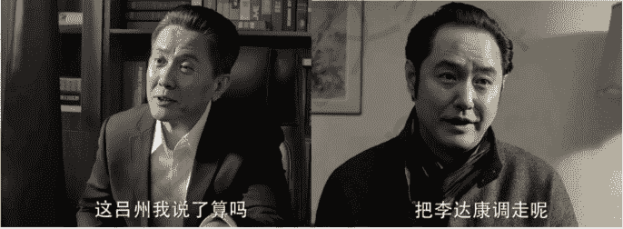

# 1、体制内的草蛇灰线

> 261026 江宁知府
> 整理：公众号懒人搜索，懒人专属群精选
> 懒人微信：lazyhelper1

> 小懒判断 | 适合体制内想搞懂“干部档案结构化改造”背后门道的人，尤其是基层正琢磨晋升路径的，这篇文章把选人用人的底层逻辑讲透了。不适合纯吃瓜的，通篇没有爆点只有趋势推演。最值得关注的是甘肃组织部那篇文章里“干部监督数据池”的提法——数据归集后纪检部门能一键梳理“时间、地点、人物”交集，这是实打实的监督工具。坑在于别指望数据化能给基层带来晋升红利，候选池变大不等于位置变多。

近期体制内有个颇受关注的消息：个别省份开始启动副处级以上干部简历“结构化改造”。在传统的纸质档案年代，组织部门能够一次性筛查的人选范围是非常有限的，即便后来做了“数字化存档”，但那更多是一种扫描录入，并未上升至“数字化管理”和“结构化改造”的高度。

按照最近一次官方公布的数据，2015 年全国县处级副职及以上职务的公务员（按照领导干部来管理）约占公务员队伍总数的 10%，即 70 万人左右。而根据清华大学社会科学学院聂辉华教授在 2025 年出版的《基层中国的运行逻辑》一书中估算，县处级干部、厅局级干部和省部级干部分别有约 60 万人、4 万人和 5000 人，分别占公务员

美国加州大学圣迭戈分校中国数据实验室亦收集了 1976 年以来的省级党委常委群体，用于研究干部任职轨迹，并开发数学模型推演晋升结果，在特定场景下能够取得近 80%的准确率。

# 2、晋升候选群体大大增加

假设现在汉东省财政厅空出来一个正处级岗位，组织部门想了解哪些干部具备担任资格，原先考察的范围很小，基本在厅内完成。可一旦有了全省范围内“副处级以上干部的资料库”，通过任职资格筛查，很快就能物色出若干位候选人。

比如：某地级市财政局副局长（副处），某副省级城市市辖区财政局局长（正处）或副局长（副处），担任过县财政局局长的某位副县长（副处）等。

如此一来，组织部门就可以主动发现一些过去从未注意到的人，而那些原本遭遇“晋升天花板”的基层干部也有可能迎来新的晋升机遇。

现实仕途中，一位应届大学毕业生把仕途起点放在乡镇，熬到副处级往往已年过五十；而同龄人如果在部委、省厅或副省级城市起步，跻身副处最快只需要五到七年。

基层单位因行政级别低，晋升空间非常有限，经常是人为拉长晋升链条，衍生出许多“隐性台阶”。

然而从岗位职责和工作能力上讲，一位担任过县财政局局长的副县长去省财政厅干处长，实际绰绰有余。省厅无非是大点的“条条”，跟市局、县局的工作内容没有本质区别。

# 3、人事关系网络愈发透明

在一位干部漫长的仕途生涯中，会历经多地多个岗位的锻炼，通过“干部数据库”，组织部门能够从履历档案里迅速识别某几个干部什么时间、什么地点、在什么岗位上有过交集。

履历一旦结构化，组织部门看到的就不再只是一份份独立的简历，而是一张带有时间维度的人事关系网络。李达康和高育良是否在同一领导班子任职？

分别担任什么职务？当时共同的上司是谁？历任吕州市委书记后来分别去哪里任职？他们与现任干部队伍里的某些同志存在怎样的连接？

数据结构化之后，这些问题就可以转变成简单的查询和分析。2026 年 9 月 21 日，甘肃省委组织部发表《以信息化建设推动组织工作提质增效》的文章，里面明确提到：“对全省副处级以上干部简历进行结构化改造，建立领导班子和干部的全息信息表”，初步实现干部经历可查、可统计。

汇集干部奖惩信息，并联合纪检监察、审计、信访等单位构建干部监督数据库，实现信息归集与风险预警。”不难体会，这些信息还可以供纪检监察部门使用，如：某某岗位发生案件，很容易梳理出跟其存在“时间、地点、人物”交集的人群。

再比如可以对违纪官员的档案做一番“大模型训练”，筛查潜在共性，有则查之，无则加勉。

# 4、人事权限向上集中

20世纪80年代干部管理体制改革后，由过去的“下管两级”转向“下管一级”。

这一方面是为了缩小上级直接管理干部的范围，层层负责；另一方面也是因为干部队伍日趋庞大，现实所迫。而现阶段在重要岗位上已逐渐恢复“下管两级”的模式，比如：中管正厅、省管县委书记，甚至在某些高校副职上实现了中管副厅（如清华大学副校长）。

过去，上级组织部门对下级单位的人事情况了解有限，很多信息分散在各地，随着干部档案结构化工作的推进，将大大降低跨层级掌握干部信息的成本。

虽然这一技术趋势未必直接改变干部任免权限，但它可以强化上级组织部门对候选人发现、筛选和配置的影响力。体制内的干部提拔有时候很神秘，一些人为什么会走到这个位置上，谁也说不清楚。

有了大量数据样本做支撑，就可以对相似履历的官员做“晋升模型训练”，如果某个城市在特定时间段内反复出现获提拔人员与系统模型不相符的情况，组织部门便可以主动审查是否存在任人唯亲等现象。

技术进步带来的影响往往是有利有弊、利大于弊。具体到上面探讨的组织工作信息化趋势，它最大的问题在于对现行政治责任划分默契带来冲击。

行政治理体系通常被解释为“条条“和”块块”——“条”指的是垂直职能部门，代表了专业化的治理意图，如部委、省厅、市局；“块”则是指地方政府，承担了综合治理责任。

倘若越来越多的人事权遭上收，或者说受上级组织部门影响，那么”块“的自由裁量权必然会减少。此时再把属地责任压高，就容易造成权责不对等。

早些时候，组织部门的干部人事管理以填表、归档等传统方式为主，各个单位都有干部人事档案室，每个干部有一个包含各类纸质材料的文件夹——履历越是丰富，文件夹里的材料就越多。

所谓“调某某人的档案查阅”，主要就是指调这个文件夹在起用一个干部前，组织部门会先审阅你的档案，看专业和职级是否符合岗位选拔条件，同时按《干部选拔任用工作条例》进行一系列考察和审核。

具体来说，这里里面又会分两种情况：第一种是“自上而下”，比如主要负责同志已经有了心仪人选，可能会跟副书记、纪委书记、组织部长等做个简单沟通，形成一个酝酿人选交给组织部，组织部再做针对性考察审核。

第二种是“自下而上”，假如主要负责同志没有倾向，可能会让组织部长根据岗位需求先提几个建议人选，这就要求组织部门对自己管辖的干部群体非常熟悉，能够知人善任。

期间如果涉及政府口的关键岗位，如：政府办主任、市局局长等，还要去征求市长和常务副市长的意见，或者由市长跟书记简单沟通后“自上而下”把信息传递给组织部门。

至于其他一些主要负责同志没有精力覆盖的岗位，其“酝酿环节”就主要发生在组织部内部，根据干部的层级由部长或分管副部长按流程推动考察选拔工作。

当前地方治理其实带有一种“政治责任承包制”的意味，即辖区内一把手事实上要对本地区的所有事务负领导责任。

因此现行政治责任的划分默契是“条块结合，以块为主”，而“块块”里最重要的权力就是人事权和财权。每个地区、每座城市的特定发展阶段，会有不同的选人用人要求，任何统计数据都是以过去为依据的，其呈现出的规律也应有所取舍。

最后还有很重要的一点：百闻不如一见。档案是死的，人是活的，组织部考察了解干部的方式有很多，一种高度重要且形式古老的做法是与被考察对象谈话。

组织上找谈话是一件非常严肃的事情，被考察对象说的每一句话，每一个细微动作表情，都有可能成为上级任免的依据。曾担任过中组部副部长、部长的一位领导同志这样讲过：“熟悉干部是组织部的职业要求，必须亲自接触、亲自谈话。

别的方法都可以研究，但都代替不了亲自接触、亲自谈话这个方法。”

