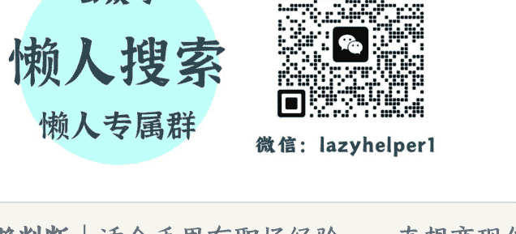
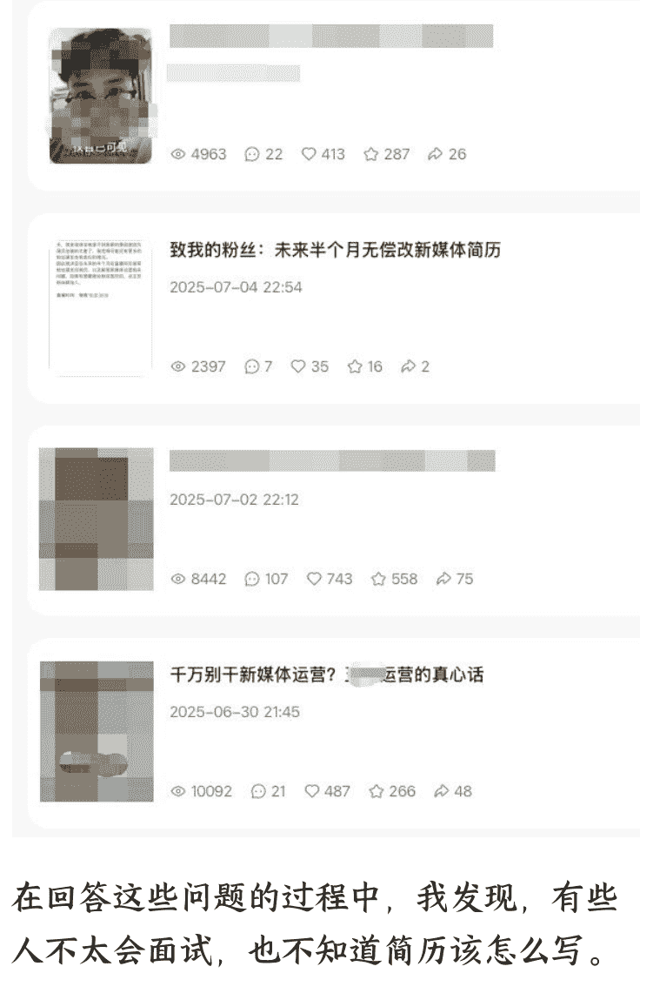
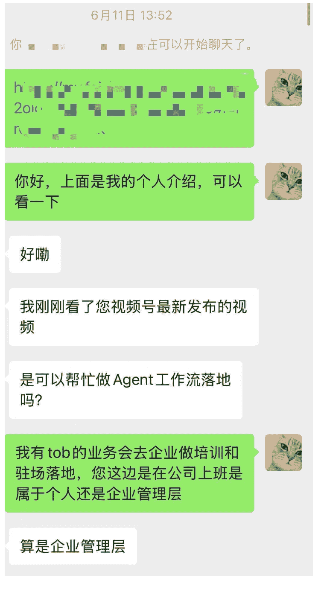
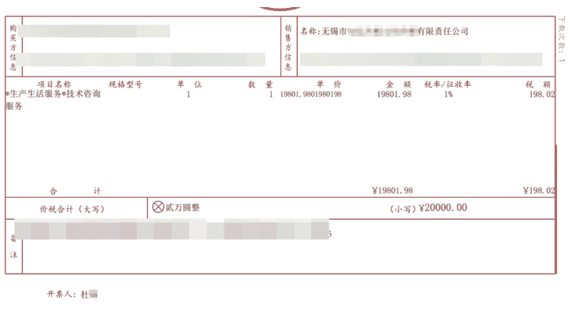
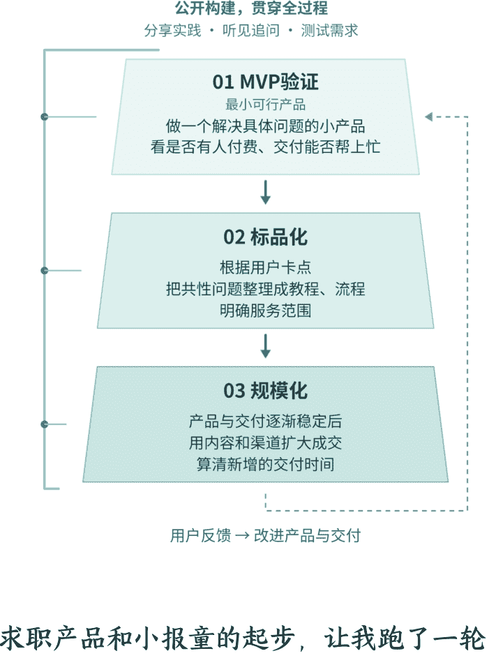
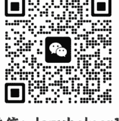

# 从 199 元求职课到单场收费 2 万至 3 万元的企业 AI 培训：我做一人公司的产品化复盘

> 261021 副业 SC 精华
> 整理：公众号懒人搜索，懒人专属群精选
> 懒人微信：lazyhelper1

> **小懒判断** | 适合手里有职场经验、一直想变现但没做成产品的人，四个阶段从 0 到 2 万客单的完整路径很罕见。不适合想速成赚快钱的。最值得看 AI 训练营踩坑：一期 49 次远程协助 856 条群消息还有人没跑完，错在拿自己熟练度估学员难度——教人比做产品难。坑是求职课一对一服务把作者拖垮，定价时服务范围要先想清楚。

大家好，我是杜一。

从 199 元的求职课，到单场收费 2 万至 3 万元的企业 AI 培训，我把过去积累的经验，陆续做成了几种不同的产品和服务。

在开始之前，先感谢生财有术，也特别感谢@小武老师 @七天对这篇文章的反馈和建议。他们提醒我，把每个阶段具体做了什么、怎么赚到钱，以及踩过哪些坑写清楚。这也让我借着这次分享，把过去一年做产品的经历重新梳理了一遍。

从 2025 年 7 月开始，我陆续做了新媒体运营求职课程、求职陪跑和简历服务、小报童专栏、AI 训练营。到 2026 年 9 月，这几类面向个人用户的产品，累计收入超过 15 万元。

点参考。

## 我的起点：有经验，却不会把经验做成产品

2019 年到 2025 年，我一直在做新媒体运营，做过企业运营管理，后来转向企业的新媒体运营培训。

工作经验有一些，但在 2025 年 7 月之前，我完全不知道怎么把这些经验做成面向个人的知识付费产品，更不知道怎么卖出去。

我从 2023 年就开始尝试自媒体。整整两年，一直没有在自媒体上赚到钱。那时候我觉得，先把流量做出来，后面自然就能变现。试了很多次，也失败了很多次。

2025 年上半年，我陷入了迷茫和焦虑，除了有老客户来找我，才会去做相应的培训，其他事情都不太想做。

转机发生在 6 月底。我在小红书刷到一条帖子，忍不住拍了一条视频。后来的一连串事情，让我第一次发现，自己已经会的东西，原来可以变成一个有人愿意付费的小产品。

## 一、求职产品：从免费改简历，到 199 元招到首期 20 人

### 先回答一个真实的问题

那条帖子讲的是新媒体这个行业怎么怎么不好。出于我对新媒体营销岗位的理解，我觉得它讲得不客观，于是发了一条内容，讲我对新媒体运营的理解。

没想到，开始有用户来找我，问新媒体运营到底是一个什么样的岗位，零经验怎么入行，需要具备什么能力。

在回答这些问题的过程中，我发现，有些人不太会面试，也不知道简历该怎么写。

我有一些职场经验，又一直在做企业培训，知道企业招新媒体运营时会看什么，于是开始帮他们改简历。

7 月初，我在直播间免费帮人看简历、改作品集。有人问一个问题，我就把回答整理成一条视频，发到小红书。慢慢地，来问的人多了，我就拉了群，继续在群里和直播间回答。

自己情况处理问题的人，会来找我做更具体的服务。

我把服务里反复出现的问题继续做成内容。短视频和直播带来了咨询，课程、陪跑和简历服务承接这些具体需求。

这段经历后来又成了我写公众号复盘的素材。

以前我总觉得，职场里积累的经验只能卖给公司，要再准备充分一点，才有资格教别人。真正开始帮人改简历，我才发现，自己已经做熟的事，恰好是一些新手正在发愁的事。

先帮人解决这一步的问题，再看哪些问题反复出现，慢慢整理成产品。

### 赚到钱以后，交付也把我卡住了

这个过程并没有一直顺下去。

到了 2025 年 10 月，我越来越明显地感觉到，自己被一对一服务占满了。群里有人问，私聊也有人问，内部学员同样随时来找我，我几乎没有自己的空间。

我试过涨价。课程从 199 元涨到 599 元、699 元、999 元，后来到了 2499 元。但只调整价格，过多的一对一服务仍然让我很消耗。

我还有一个问题：把太多事情都当成了自己的责任。有学员入职之后工作不顺，或者离职了，我也会反过来怀疑，是不是自己哪里没做好。

后来，我把每天直播逐渐减少到每周一次，年底还把课程下架过一段时间。之后再做这类业务，我开始调整产品结构，重新考虑哪些内容可以统一交付，哪些问题需要单独服务。

这件事给我的教训很具体：

价格、服务范围、答疑方式，需要放在一起考虑。

到 2026 年 9 月，虽然从 2025 年底起，我已经基本不再持续更新新媒体运营相关内容，但每个月仍有两三个用户来咨询、购买产品。过去做过的内容和交付，还在被后来的人看见。

## 二、小报童：把营销实验写出来，让愿意围观的人付费

### 一篇复盘，把另一类人带到了我面前

2026 年 1 月，我开始把更多精力转向公众号和 AI 研究。

公众号第三篇内容就获得了 10 万加的阅读。那篇叫《三个月一人公司月入近2万：方法蠢到我不好意思说》，讲的就是我做求职产品的经历。

那篇文章之后，加我的人越来越多。我发现，新来的这批人里，有不少已经有自己的经验和能力，他们更关心的是，怎么把自己会的东西做成产品、营销出去。

当时我也在一个社群里，反复看到有人问，怎么营销，怎么通过自媒体让别人知道自己的产品。

于是，我开始把自己的营销尝试发到群里。我写了什么文章，做了什么实验，有什么反馈，就拿出来给大家看。我也分享过公众号配图的方法和一些自己做的内容材料。

有一次，我在群里说，最近想做一个小实验，想看的朋友可以加我，备注“围观”。陆续来了五到十个想围观的人。

看到这个反馈，我决定把实验过程做成一个可以持续阅读的专栏。

### 卖的是什么，怎么定价

1 月 27 日前后，我把专栏上架到小报童，起价 10.24 元，上架当天就来了四五十个付费用户。

这个产品里，我写自己怎么在自媒体上做营销、怎么探索一人公司的业务，也分享内容制作的方法和材料。它的交付以文章为主，不需要像求职陪跑那样，逐个处理每个人的具体情况，所以价格定得比较低。

后来，专栏涨到了 32 元，用户慢慢接近 200 人。

> **AI 一人公司实验日志**
> 奇迹杜一
> 25年12月我停掉了月入近2万的一人公司——因为那不够系... 更多
>
> | 项目 | 内容 |
> | --- | --- |
> | 读者 | 198 已购买 |
> | 字数 | 63.3k 已更新 16 篇 |
> | 专栏类型 | 买断制 |
> | 履约承诺 | 24h 可退 |
>
> **内容**
> 排序与视图：搜索
> **奇迹杜一** 置顶 · 2026/07/30 14:04:03
> **6-7月的几个关于AI相关的实验**

这次让我记住了一个很具体的做法：

离开公司以后，很多可能需要这些经验的人，起初根本不认识我。我需要把做过什么、能帮上什么忙讲给他们听。大家看见了我的实践，才有机会来交流；他们的追问，也让我知道哪些经验值得继续整理成产品。

这个产品的交付相对轻，但也有我没处理好的地方。后面更新频率慢了下来，从周更变成两个月一更。写一个持续更新的专栏，需要把自己的实践和记录节奏也安排好。

小报童让我有了一个交付相对轻的付费产品，也让我认识了一批关心营销和产品的读者。后来，我把自己使用 AI 的过程持续分享给这批读者和公众号用户，下一门业务的需求就从这些交流里出现了。

## 三、AI训练营：把自己跑通的工作流程，教给想学的人

### 用户的一句提问，变成了招募

2026年2月，我开始用 OpenClaw 搭自己的 AI工作流程。后来逐渐跑通了信息收集、写作、排版、配图和公众号发布等环节，也能把自己的录音和经历整理成文章。

我把这些实践分享给公众号读者和小报童用户，让大家看到，我用 AI具体做成了什么。

接着，就有人在群里问：你这套自动发公众号的工作流程，能不能教我？

我意识到，这可能又是一个产品机会。

3月，我开始在几个已有的群里招募，把这个产品是什么、要帮大家解决什么问题、怎么参加、多少钱，直接讲清楚。

第一期内部价 299 元，公开招募价 399 元，后来有 70 多个人加入。

这时候，我已经把自己的流程跑通了，但课程还需要在教学过程中继续完善。

### 真正开始教，才知道用户会卡在哪里

交付时，我通过直播带着大家搭建，再配合教程、群答疑和远程协助，处理大家在操作中遇到的问题。

> duyi (22点半前睡觉): 有环境, token, vps等业...
> 5月15日 16:59
>
> **群公告**
> open claw 训练营第一期教程
> OpenClaw AI 员工训练营·第二期
> Day 1
> 1. 方舟 Coding Plan 开通与 API Key 配置
> 拿到 API Key
> 方舟 Coding Plan 开通与 API Key 配置教程
> 从...里获取安装包后，按下面教程完成安装。

问题很快就来了。

我自己能跑通的流程，换到学员那里，会卡在账号、安装、命令行、配置等不同的地方。有些朋友白天上班，只能在晚上或者周末挤时间学，进度也跟我不一样。

在一期结束时，我统计过：接近 20 天里，我做了 49 次远程协助，在群里回答了 856 条消息。组长和副班长也回答了很多问题。

即便这样，到第 15 天，仍有一部分朋友没有把整套系统跑完。

后来复盘，我发现自己犯了一个错误：评估难度时，用的是自己的学习能力和熟练程度，没有充分考虑学员的起点。

光把我自己的流程复制给他们，还不够。我得把他们从哪里开始、每一步会碰到什么问题，也考虑进去。

### 二期怎么改

做二期时，我重新设计了一个入门版本，先让大家完成每天定时推送资讯、写公众号这样的具体任务，再逐步往完整系统走。

一期没跑完的朋友，可以参加二期复训。我也邀请一期已经跑通、愿意帮助别人的朋友，一起参与二期的交付，在小组里互相解答问题。

## 四、企业 AI 培训：老客户看到新能力，带来了新的业务

### 需求从哪里来

AI 训练营做到 2026 年 5 月时，一些企业朋友开始来问我 AI 相关的问题，我也逐步转向企业 AI 培训。

这个机会跟我过去的经历有关。我原来就在做企业的新媒体运营培训，身边有一些传统企业的客户和朋友。

当我不断发布 AI 相关的实践，他们也看到了：杜一最近在用 AI 做内容、搭工作流。于是，有人来问智能体怎么做，有人问能不能搭工作流，也有人问，能不能给老师做一个专属的智能分身。

类似的咨询接连出现，我就开始把原来的营销经验和新掌握的 AI 能力，放到企业服务里。

我的服务主要围绕企业营销模块，做 AI 工作流搭建培训。对方带着自己的业务问题来，我围绕这些问题讲解、带着操作。也有从网上认识我的客户，后来找我做了一段时间的企业陪跑。

### 怎么从咨询走到收费

企业客户确认培训需求之后，会向我采购相应的服务。根据服务内容和培训时长不同，每场收费 2 万元到 3 万元。那一阶段，我每个月去线下培训两到三场。

企业业务多起来以后，还有一个很实际的变化：客户需要开票。为了正常承接这些服务，我在 2026 年 9 月注册了公司。

这是其中一笔价税合计 2 万元的企业技术咨询服务开票记录。

原来认识我的企业客户开始采购 AI 相关培训，让我把过去的新媒体营销经验、教人的经验和自己搭过的工作流程，组合成了新的企业服务。

### 客单价上去了，时间仍然有限

企业培训带来了更高的客单价，也让我更清楚地看到了自己时间的限制。

一次培训往往需要我投入几天。手上有老客户，每个月出去两次，业务可以继续做；但如果要增加到更多场，我还是得拿自己的时间去换。

后来跟朋友聊起这件事，我说过，哪怕一个月出去十场，也会很累。我不太想一直靠增加出差和服务场次，把业务做大。

这些经历让我开始把收入和自己的交付时间放在一起考虑：

接下来，我想先把反复交付的部分整理成产品，让更多人按自己的节奏学习和使用。哪些服务仍需要我亲自做，也要把范围和安排想清楚。这样再考虑扩大业务，才知道自己能接住多少。

## 写在最后：先看阶段，再选做法

回头看这四段经历，我现在会先判断产品处在哪个阶段，再决定下一步把精力花在哪里：

求职产品和小报童的起步，让我跑了一轮验证；求职服务中的时间消耗、AI训练营里的卡点，让我回过头来改交付；企业培训又让我看见，往后要扩大业务，还得继续整理那些反复交付的部分。

公开构建贯穿这三个阶段。刚开始分享，是为了接触用户、听见追问、测试需求；产品逐渐稳定后，持续分享实践和案例，又能帮助更多人了解产品。

在这个过程中，我反复在用下面四个做法，也分享给有类似处境的圈友参考。

### 1. 从一个具体的人、一个具体的问题开始

我会从自己做过、帮人解决过的事里找起点，再去和有类似问题的人聊。对方现在想做什么，具体卡在哪里，我的经验能帮上哪一段。先把这件事听明白，第一版产品的范围就更容易确定。

### 2. 把做事的过程，分享给可能需要的人

我会把自己做过的实验、解决问题的过程拿出来：做了什么，怎么做的，有什么反馈，后来怎么调整。再留意别人会追问什么。这些追问会帮我继续了解需求，也给下一条内容、下一个产品留下线索。

### 3. 先在一小批人里，跑一轮付费和交付

我会先把服务谁、解决什么问题、交付什么、多少钱讲清楚，再拿到一小批可能需要的人面前试。这时候分开看两件事：对方愿不愿意付费，买了以后有没有解决具体问题。收到反馈，再决定下一版怎么做。

### 4. 把用户卡住的地方，变成下一版要改的地方

我会把反复出现的问题整理成能重复使用的教程，按大家的起点调整任务；需要个别处理的，再考虑单独安排服务。同时也看自己的时间花在哪里，找出下一版可以补上的步骤，以及需要收紧的服务范围。

现在，我也用这套方法，把自己的产品实践整理成了“一人公司产品化”训练营，帮助有经验的人把经验变成自己的产品。

目前已经开到第二期，有了 40 位付费用户。

这个新产品也让我对这套做法多了一点信心。

接下来，我会继续看大家做出了什么、拿给用户后收到了什么反馈，再据此调整课程和交付。

也希望通过这篇复盘，认识更多正在生财里做产品、做交付的圈友。欢迎交流。

——————分割线——————

看完这篇 SOP，你觉得你懂了。但 90% 的人一到实操就会卡在第一步。

工具和教程只是最低级的壁垒，真正的壁垒是“立刻动手”和“圈层信息差”。

如果你想看全网最新的变现玩法，并且和一群执行力极强的极客一起下场拿结果，欢迎围观我的核心私域：【懒人专属群】。

我们不聊虚的，只做商业闭环的拆解与 AI 效率的压榨。系统内已沉淀 1000+ 跑通的套利实战局。

- 查阅圈子完整数字资产与上车门槛：https://lazyso.com/insider/

认同价值、准备好下场干活的，扫码加我微信（lazyhelper1）

备注：【实操上车】，不闲聊

微信：lazyhelper1
