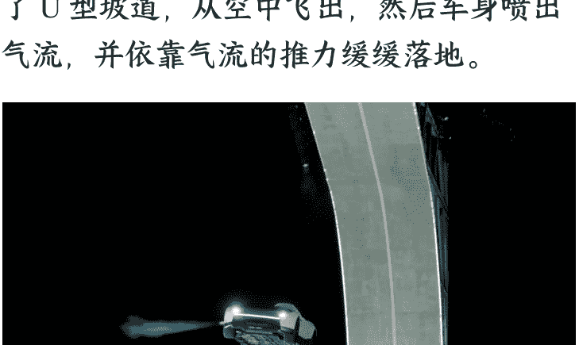

## 马斯克的“飞行汽车”，真正的门槛到底是什么？

261019
整理：公众号懒人搜索，懒人专属群精选
懒人微信：lazyhelper1

> 小懒判断 | 适合看热闹之余想懂点门道的人——
> 这篇真正讲的是"技术互相喂养"这个研发逻辑；推进器来自 SpaceX、气阀电机从 Optimus 机器人脚踝上直接挪用。不适合想下单订车的人，短期普及无望，空域法规都没准备好。最值得关注的是那句反共识判断：最难的不是"能飞"，是同时满足地面要重、空中要轻两套矛盾物理约束，靠风扇+推进器系统级切换解决。坑在于：0.8 秒零百是 0 到 60 英里（约 97 公里），媒体简化表述常误导。

刚刚过去的这个周末，几乎全网都被特斯拉的“飞行汽车”刷屏了。你大概率已经看到了相关的视频。其实，与其叫“飞行汽车”，更贴切的说法应该是“火箭跑车”。

首先，这辆车的定位确实是“跑车”，是特斯拉的第二代 Roadster 跑车，而且它的加速性能已经刷新了量产超跑的纪录。现场做了两次零到百公里加速测试。注意，这个“零百加速”是个省略表述，按照美国的测试习惯，他们实际测量的是时速 0 到 60 英里所用的时间，而 60 英里，大概相当于 97 公里。因此很多媒体报道时，就简化成了“零百”。之所以强调这个数字，因为这类超跑的测试，有时差距就是那么零点几秒，有一点误差都不行。

在第一次测试里，这辆车用了 1 秒，第二次同样的加速，只用了 0.8 秒。作为参考，目前全球最快的量产超跑，布加迪 Chiron 是 2.4 秒，保时捷 918 是 2.1 秒。而 0.8 秒完成时速 0 到 97 公里的加速，几乎可以说是地表最快的跑车之一。

其次，严格来说，这辆车展示的并不是类似飞机的“飞行”能力，而是类似“火箭”的喷射能力。发布会的场所，也选在了美国得州 SpaceX 的火箭测试基地。

发布会现场搭建了一个巨大的，横过来的 U 型坡道。网上传播的现场视频里，这辆车一共爬坡两次。第一次，是爬到了坡道的顶部，然后停住，就像一只壁虎吸附在天花板上一样。第二次，这辆车直接冲出了 U 型坡道，从空中飞出，然后车身喷出气流，并依靠气流的推力缓缓落地。

根据目前公布的信息，这辆车有三个版本。基础版有两个座位，零到百公里加速 1.6 秒以内，订金 5 万美元。中间版同样两座，但加了后部冷气推进器，加速时间提高到了 0.9 秒以内，限量发售，每人限购一台，订金 25 万美元。最高版，也叫“火箭版”，只有一个座位，连副驾驶位都拆掉了，换成了更多的推进器。它可以向上飞、向前飞、空中翻滚。这个版本不公开发售，只开放邀请购买。而这次发布会上演示的，就是这个“火箭版”。

好，发布会上的基本情况就是这些。相关的视频出现在网上之后，引发了大量的讨论。有人认为这个技术很厉害，其他车企完全望尘莫及，也有人说相关的技术并不新鲜，马斯克只是做了整合。还有人说，这辆车实用性并不强，发布的目的，只是为了拉高股价。

今天，我们就聊聊，围绕这场发布会，很多人关心的几个问题。

首先，**发布会上演示的“Roadster 火箭版”，用了哪些关键技术？** 车上最关键的部件，是车后部的四个喷嘴。它们看上去像普通超跑的排气管，但排出的不是尾气，而是高压气流。这套推进系统来自 SpaceX，叫做“冷气推进器”。它在航天领域是成熟的核心技术。SpaceX 的火箭在太空中调整姿态并精确着陆，用的就是这种推进器。

而驱动这些推进器的，是一个巨大的黑色球形气罐，这个气罐叫 COPV——复合材料缠绕压力容器，外面包了一层碳纤维，里面装的是高压氮气，压力高达 10000psi。什么概念？普通轮胎的气压大约是 35psi，这个气罐的压力是轮胎的近 300 倍。就是这股高压气体以超音速喷出，产生了超过 80 千牛的推力，把一辆将近两吨的车推上了天。

注意一个细节：这辆车不烧火箭燃料。它靠的是压缩空气，而且车上装了一台电动压缩机，也就是一个电动气泵。它的作用就是：**把外面的普通空气抽进来、压缩，再灌回气罐。说白了，这辆车理论上可以自己充气。但是，因为这个“充气”的过程消耗的电量很大，不可能一边高速行驶一边充气，因此它就不可能一直飞。** 连接气罐和喷嘴的管道也有讲究。管道用的是钛合金，分流器用的是一种能承受极端温度和压力的镍铬合金，是航天发动机里常用的材料。而且这些管道必须严格等长，哪怕左右两侧的管道长度有哪怕毫米级的差异，气体到达喷嘴的时间就会不同步，车在加速时就会偏航。

这就是为什么 COPV 和冷气推进器虽然是“成熟技术”，但要把它们装进一辆必须在地面高速行驶的汽车里，工程难度完全是另一个量级。在火箭上，推进器的安装空间充裕，管道可以怎么方便怎么走。但在一辆跑车里，每一寸空间都是抢来的，管道的走向、长度、弯折角度都要精确到毫米，同时还得承受路面颠簸带来的振动，而这在火箭上根本不需要考虑。

在推进系统之外，这辆车还有一套底部风扇系统。它能在车身底部产生强大的吸力，把车牢牢压在地面上。这就是它为什么能倒挂在坡道上不掉下来。

除此之外，这辆车的很多技术，都来自特斯拉原本的汽车技术。比如电池，用的是特斯拉自研的 4680 圆柱电芯，化学配方和冷却系统做了专门改进。再比如驱动电机，也脱胎于特斯拉之前的电机平台。

那么，这些技术的难度到底有多高呢？

一辆车“能飞”并不是技术上最难的部分，最难的部分在于，你要让它既能跑，也能飞。这意味着，它要同时满足两套不同的物理约束。首先，在地面上要重、要稳、要贴地。其次，在空中要轻、要灵活、要可控。

这两套需求天然矛盾。做飞行器的工程师希望机身越轻越好，但做汽车的工程师希望车身有足够的重量，因为在地面高速行驶时，重量意味着稳定。

那 Roadster 怎么解决这个矛盾？它创造了一个“可变重量”，也就是那套底部风扇系统。在地面上，风扇把车往下压，制造接近两吨的额外下压力。到了需要飞行的时候，风扇关闭，推进器接管。同一辆车，两种物理状态，靠系统级的切换来实现。

那么，这个技术水准，别的公司能够实现吗？至少目前看，难度不低。因为在某种程度上，这辆车不是某一项单点技术的突破，而是马斯克旗下几家公司之间，形成了一张技术可以互相流通的网络。比如，之前提到的推进器和复合材料缠绕压力容器，来自 SpaceX。SpaceX 今年还专门收购了复合材料缠绕压力容器的制造商，把核心零部件的生产直接放到公司内部。

再比如，车上有个装置叫气阀执行器电机。它是从特斯拉 Optimus 机器人的脚踝关节上，直接挪用过来的。

再比如，车身的碳纤维复合材料工艺，SpaceX 火箭也在用。还有姿态控制的软件算法，SpaceX 猎鹰火箭着陆时需要它，Roadster 在空中翻滚时也需要这个技术。

你发现了吗？这辆车的很多关键零部件，都是从马斯克的另一家公司“借”过来，然后在一个新产品上重新组合。

这才是真正的门槛。你去问任何一家传统车企：能不能造一辆会飞的汽车？答案大概率是：“技术上也许可以，但我们需要额外买火箭推进器，买航天级压力容器。”

不光是飞行汽车，你去看特斯拉的整个产品线，自动驾驶系统 FSD 和 Optimus 机器人用的是同一套神经网络架构、同一种芯片、同一套训练流程。这些产品之间不是完全平行，而是有着互相喂养的关系。

之前曾经有分析师推测，特斯拉和 SpaceX 可能在 2026 年底前合并。如果真的合并，这张技术网络的融合可能会更加顺畅，彼此之间的助推还会被进一步加强。

换句话说，**在今天，一家公司最核心的竞争力，可以是某一项技术做到世界第一，也可以是技术之间能互相“喂养”。每一个产品都是其他产品的“技术供体”，同时也是“技术受体”**。从这个角度看，飞行汽车能不能普及？至少短期内，很难。空域管理、法律法规、安全标准，社会系统层面的配套都远远没有准备好。马斯克自己也说了，“不确定在所有地方都合法”。

但这件事真正值得关注的，也许不仅仅在于“我们什么时候能开飞行汽车上班”，也在于它展示了一类产品研发的逻辑。**当一家公司的技术之间开始互相传染、互相喂养的时候，它的产品边界就会模糊，每一个新产品都可能站在所有旧产品的肩膀上。**马斯克有个观点，说的是工程学和科学的不同，他认为，关键区别之一在于，**科学是在发现宇宙中已经存在的东西，而工程学，是在创造世界上从来没有过的东西。**你仔细想想，这两个目标，其实很不一样。比如，科学家发现，气体向一个方向高速喷射，会产生反方向的推力。这是科学家的发现。但是，把这条规律变成火箭，变成航天器的姿态控制系统，再进一步，把它变成一辆跑车的推进装置，这就属于工程的创造。

这里面不一定产出了什么新的科学定律，但确实做出了一个过去没有的东西。注意，关键在于，你得造出一个“东西”。就像马斯克自己说的，**与其争论一个看似荒诞的目标能否实现，不如去分析它要满足哪些条件，然后再尝试做出来。**

分割线

在这个 AI 能替你写代码、写文章的时代，基础技能正在迅速贬值。绝大多数人正被淹没在海量的免费垃圾信息里，陷入低效的体力内卷。
