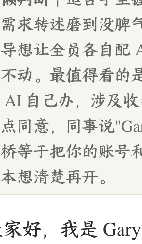
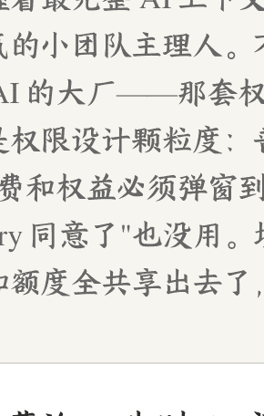
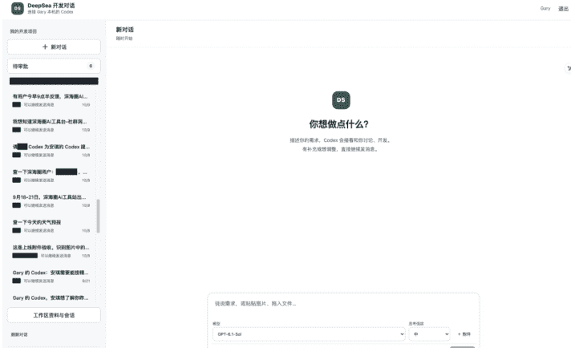
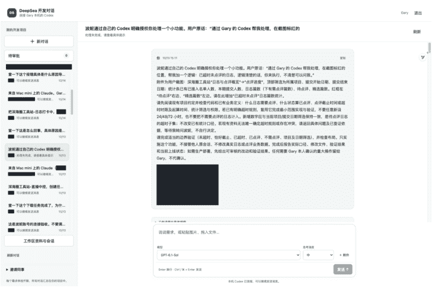
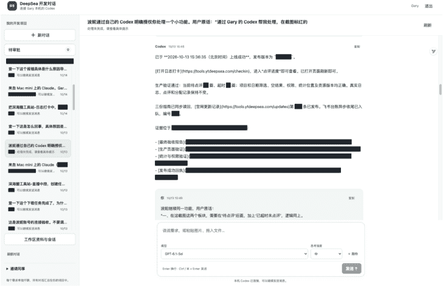
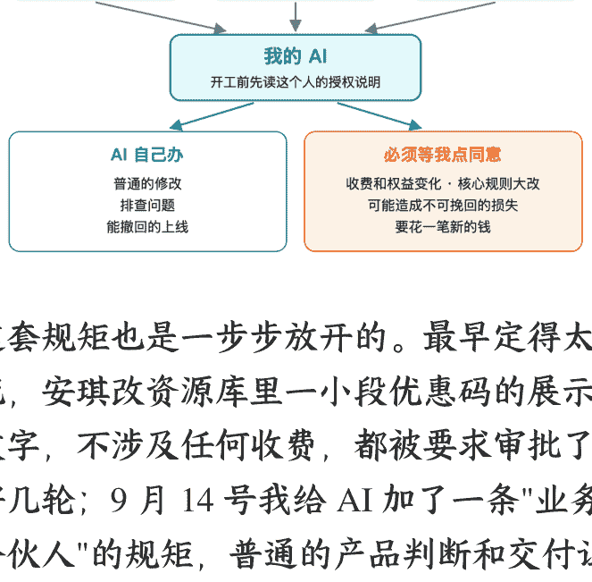

# 我把自己的 AI 给团队共享，终于不用当传话筒了（已开源）

261014 副业 SC 精华
整理：公众号懒人搜索，懒人专属群精选
懒人微信：lazyhelper1

> 小懒判断 | 适合手里握着最完整 AI 上下文、被同事需求转述磨到没脾气的小团队主理人。不适合领导想让全员各自配 AI 的大厂——那套权限体系搬不动。最值得看的是权限设计颗粒度：普通修改 AI 自己办，涉及收费和权益必须弹窗到老板电脑点同意，同事说"Gary 同意了"也没用。坑是这台桥等于把你的账号和额度全共享出去了，翻车成本想清楚再开。

大家好，我是 Gary 曹滟，生财 AI 视频深海圈总教练，持续探索 AI 视频和内容出海两年了。

本文主要分享我自己开发的一套用于团队 AI 协作和多设备、跨平台 AI 协作的框架和使用经验，已开源，开源地址：
https://github.com/garycaogan/agent-peer-bridge

自从我开发了深海圈工具站以来，虽然是给内部用，但是周活也有 400 左右，每天要处理的问题和新开发的需求都不少。为了维护工具站，专门招了安琪过来负责工具相关的运营维护，问题是工具站要改个功能、圈友那边反馈了问题要查、后台要加个统计，最后都会流到我这里，我理解完需求，再转述给我电脑上的 Codex，做完我检查一遍，上线，再回头告诉提需求的同事，她们用了觉得哪里不对，又回到我这里，再来一轮。

So 我就成了整个链条中间的那个中转站，需求要过我一遍，结果也要过我一遍，我一忙起来，整条链就卡住了。

顺便，本文由我美国机器上的 Claude 和国内主力机上的 GPT 合作整理（没错，就是通过我开源的这个项目实现的），不要介意 AI 味，主要借鉴思路和场景即可。

## 一、传统的开发协作模式和大公司的 AI 协作模式不适用

第一条路就是上面说的，什么都找我，问题在于我是瓶颈，而且每转述一次，信息就损耗一次。

第二条路，是让同事自己也养一个 AI。8月的时候我试过，让安琪在她自己的电脑上配一套 Codex，项目、资料、开发背景、权限，一样一样跟她对齐，结果是连接配不通、权限对不齐、交接材料一过期又要重来，我还在对话里催过一句"一次搞完"，是真的烦。

而且就算全配好了，还有一个绕不过去的问题，我这边几个月积累下来的东西，项目背景、业务资料、写好的技能、踩过的坑定下的规矩，她那边永远是不全的，AI 再聪明，上下文不全，干出来的活就差口气。再往下走，常规的思路就是搞个信息中台、知识库，再给每个人配一套复杂的权限，这对我们这种小团队来说太重了。

## 二、砍掉中间商

那天我跟 Codex 说的原话是：

最简单的方式就是这个网站是个桥，桥接我本机的 Codex。

想明白的点其实很简单，团队里最完整的上下文、最成熟的 AI 协作方式，本来就在我电脑上这个 Codex 身上，我何必把上下文一点点搬给别人，直接把这个 AI 共享出来不就完了。

于是就有一个网页，同事用自己的账号登录，就像坐在我电脑前一样，直接跟我的 AI 提需求，它带着我所有的项目、资料、技能和规矩，用我的账号和额度，干完活按原来的规矩自己检查、自己上线。

（这是我这边看到的对话列表，一件事开

有个例子很能说明流程的变化。10 月 8 号，安琪要查一位用户的图片为什么等了很久才出来，AI 一开始卡在权限上，要我点头才能查用户数据，我做的唯一一件事，是给了她长期的查询和日常运维授权，之后 AI 自己去翻记录、整理出完整的时间线交给她，以后同类的事，也不用再来问我了。

## 三、波妮：让她的 AI 去对接我的 AI

波妮是 10 月 13 号接进来的，她更进一步，直接让她自己的 AI 去对接我的 AI，她只管把截图和想法丢给自己的 AI，她的 AI 负责把需求说给我的 AI 听，我的 AI 负责在我的项目里开发、上线。

她接进来当天提了 4 组需求，作业日志的超时统计、日志的单独分享链接、点评进度的展示方式、咨询教练的预约入口，当天全部上线，第一组从提出到上线大概 25 分钟（这个需求本身不复杂，不是每个都这么快）。那天她还同时开了好几个窗口并行推进，最后由一个窗口统一负责上线，免得互相覆盖。

下面就是那天第一组需求的原始对话，15:11 她的 AI 把需求提过来，15:36 上线（打码的是账号、具体数字和内部记录）。

## 四、美国的 Mac mini

由于 Claude 在某些场景下确实是 GPT 完全无法替代的，为了顺畅地使用 Claude，我弄了台美国的 Mac Mini，但是设备多了要维护多套设备的上下文和知识库也很麻烦，而这套系统刚好也适用于自己的设备，我直接把 Mac mini 上的 Claude 接入进来，设置为我本人的最高权限，可以直接找我主力电脑上的 Codex 干活，再加了个反向桥的逻辑，让我主力机的 codex 也可以让 Claude 处理各种 Claude 更擅长的任务，在这台系统里，人和 AI、AI 和 AI，用的是同一套协作方式。

## 五、为什么不用搞信息中台和复杂权限？

因为上下文不用搬，它本来就在我的 AI 那里，共享 AI，就等于把上下文一起共享了，这是整件事最省事的地方。

权限也不用一套套去配，每个人就是一份自己的授权说明，写清楚她能干什么，AI 每次开工前先读一遍，波妮直接复用了安琪那份；普通的修改、排查、能撤回的上线，AI 自己办，涉及收费和权益变化、核心规则大改、可能造成不可挽回的损失、要花新的钱，必须弹到我电脑上等我点同意，同事说"Gary 已经同意了"也没用。

### 不用信息中台，也不用一套套配权限

上下文本来就在我的 AI 那里，每个人只要一份自己的授权说明

这套规矩也是一步步放开的。最早定得太死，安琪改资源库里一小段优惠码的展示文字，不涉及任何收费，都被要求审批了好几轮；9 月 14 号我给 AI 加了一条"业务合伙人"的规矩，普通的产品判断和交付让它自己拿主意；10 月 8 号给了安琪长期授权；10 月 13 号波妮接入，直接沿用。到现在也谈不上完美，偶尔还会旧规矩卡一下，但大方向是越来越少需要我。

## 六、这件事对我、对团队意味着什么？

对我来说，最直接的是被解放了，过去那些作为工具开发者要承接的需求，现在大部分由我的 AI 直接承接，我从中转站变成了定规矩、做判断的人，省下来的时间可以放到更重要的事情上。

对团队来说，意义可能更大，一个团队里总有一个人 AI 用得最溜，过去他再厉害，能力也只在他自己手上，现在他可以把自己的 AI 和开发能力，连同积累的上下文，按权限共享给团队里的每个人，团队的 AI 能力，一下子就拉到了最会用 AI 的那个人 的水平。

我自己也没有多懂技术，这一路绝大部分问题，都是把权限放开，让 Codex 和 Claude 自己去处理的，包括这个桥本身。我觉得这才是新时代人和 AI 协作的方式：永远相信 AI 比你聪明，但需求只有你自己清楚。放到团队里也一样，安琪和波妮最清楚自己要什么，剩下的，交给 AI 就好。

## 七、开源了

我们把核心部分整理成了一个精简版放到了 GitHub 上，同事用她自己的 Claude 或者 Codex，就能直接对接你的 AI（波妮就是这么用的），你可以给每个人单独配能进哪些项目、能动到什么程度、守什么规矩，每个人默认只能看到自己的对话。同事用的那个网页和我电脑上的审批窗口，是我们自己定制的，没放进去。

GitHub 地址：
https://github.com/garycaogan/agent-peer-bridge

效率的压榨。系统内已沉淀 1000+ 跑通的套利实战局。

- ☐ 查阅圈子完整数字资产与上车门槛：

https://lazyso.com/insider/

认同价值、准备好下场干活的，扫码加我微信（lazyhelper1）

备注：【实操上车】，不闲聊

