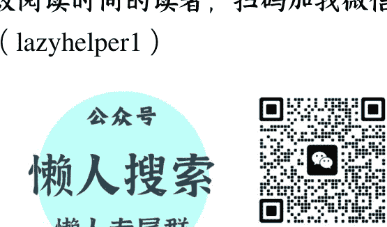

## 特斯拉的飞行汽车，到底有多大价值？

261018 猫哥星球
整理：公众号懒人搜索，懒人专属群精选
懒人微信：lazyhelper1

> 小懒判断 | 适合关注特斯拉和智能电动车行业走向的人；不适合想买飞行汽车或纠结"Roadster 能不能飞"的吃瓜党。最值得关注的是核心判断：Roadster 不是产品是品牌道具，负压爬墙只在光滑平面成立、冷气喷嘴只能飞十几秒，技术落地遥遥无期。坑在于被发布会科幻演示带节奏，把营销叙事当成了产品力。

北京时间 10 月 16 日，马斯克对外展示了新版电动超跑 Roadster。

视频里，车辆依靠负压吸附沿光滑立面倒挂、依靠冷气喷嘴空中调整姿态、腾空飞跃一排车辆，极具科幻冲击力，迅速引爆全球舆论。

如果仅仅聚焦 Roadster 能否实用化，其实没有看懂这场发布会的本质：这不是一台准备大规模交付的汽车，而是特斯拉精心打造的品牌符号。

Roadster 真正的使命不是卖车，而是让特斯拉在电动车内卷的泥潭里，重新立起“来自未来”的科幻形象。

产品只是道具，品牌叙事才是目的。

Roadster 能实现空中倒挂，依靠的是底盘风扇，加上一圈密封裙边，风扇快速抽走车身和玻璃面之间的空气，制造出局部负压，进而形成巨大的吸力。Roadster 能够倒挂，就是被墙面吸力给吸住了。

车子能够腾空、在空中调整姿态，源自 SpaceX 火箭的冷气姿态控制技术。车身四周布置了多组小型喷嘴，搭配碳纤维高压储气罐。

看起来很酷炫，但这些技术短期内很难落地。

> “爬墙”功能只能在光滑、平整的平面上进行，我们平时走的马路是没法用的，空气会不停漏进去，负压系统压根吸不住车子。

飞行功能也有很大局限性，只能飞十几秒，发布会做一下演示还凑合，日常使用就太勉强了，更别说拿来通勤。

同时，只要车子离地腾空，它就不再单纯算汽车，会被当成飞行器来管，这套双重监管在全球都很难搞定。

各国现有的交通法规只管普通机动车，航空条例又是针对飞机设计的，没有适配短距飞行跑车的标准。

想在公共场地腾空，开车的人得拿到飞行相关资质。另外喷气会卷起碎石、噪音偏大，加上高压气罐的安全问题，也很难通过上路审核。想让各国修改法规，难度非常大。

按照晨星分析师的预计，Roadster 的年销量可能在 2000 台左右，要知道，特斯拉的销量是百万级的，区区 2000 台连水花都溅不起。马斯克自己都说，Roadster 不会对营收带来多少影响。

既然不会带来直接的好处，马斯克为什么费半天劲，做这个演示呢？因为特斯拉陷入了困境。

特斯拉过去凭什么征服全球？

靠的从来不是某款车的性价比，而是马斯克塑造的那个“特斯拉=未来科技”的标签。

资本市场在评估特斯拉的时候，往往不是把它看作一个汽车企业，而是推动人类科技发展的先行者，很多买特斯拉的人都是马斯克的铁粉。

正是有了科幻标签，哪怕特斯拉的车配置不高，也总能卖出不错的价格。

但这两年，特斯拉正在肉眼可见地普通化。

Model 3 和 Model Y 全球打价格战，让特斯拉在消费者心里的形象，越来越像一家普通的电动车厂，甚至被拿去和比亚迪比续航、比座舱、比谁更便宜。

当一个品牌开始和对手拼价格，它离普通就不远了。

这一点，反映在了特斯拉的财报上。2026 年二季度，特斯拉的净利润为 11.4 亿美元，同比下滑 5%，营业利润更是不到 4 亿美元，同比暴跌 57%，自由现金流转负。

困境的原因，很大程度上是特斯拉被迫打价格战。

特斯拉的估值和定价逻辑，从来不是普通车企那一套，它靠的是科技想象空间，这个信念一旦崩塌，估值的故事就讲不下去了。

所以马斯克必须做点什么，把“来自未来”的标签重新焊死在特斯拉身上。

而 Roadster，就是特斯拉自救行动的关键。这场发布会的本质，是一次教科书级别的品牌营销。

负压吸附倒挂、空中姿态调整、飞跃车队，每一个画面都自带病毒属性，天然适合在短视频里疯狂转发。

全球几亿人看到了特斯拉的“科幻能力”，这种级别的传播你砸几十亿广告费都买不来。

普通车企根本制造不出这种话题，因为它们的卖点只能是续航、加速、座舱这些别人也在卷的东西，上一次热搜都要非常努力才能达到。

而 Roadster 跳出了整个维度，直接站到了“飞行”这个所有人都做不出来的高度上，重新定义了超跑赛道。

传统超跑的比拼一直局限在地面。各家厂商埋头打磨加速、极速和赛道圈速，依赖轮胎抓地力，Roadster 跳出了这套竞争框架。你们还在地面卷，老子已经能飞了。

这样一来，任其他超跑速度怎么快，驾驶体验怎么好，品牌形象都不会有特斯拉那么硬核，能飞上天，比一切指标和数据都更有说服力。

消费者想起特斯拉，想到的不只是一个电动车公司，而是一个科技先锋。这种印象会反哺到特斯拉全系产品上，用户愿意为了未来多掏钱。这种品牌溢价，所有车企都羡慕，但又复制不出来。

更重要的是，Roadster 讲了一个能够完美融合“特斯拉+Space X”的商业故事。

马斯克一直有把特斯拉和 Space X 进行合并的想法，Space X 的股价都能突破两万亿美元，如果加上特斯拉，那得多大想象空间。

问题在于，Space X 和特斯拉的业务重叠范围不大，两者强行合并的话，资本市场不买账，1+1 不一定等于 2，还有可能拖垮 Space X 的股价。

所以，马斯克需要告诉全世界，Space X 和特斯拉合并究竟能带来什么？

而 Roadster 就是答案。

特斯拉生产汽车，Space X 下放航天技术，赋能特斯拉，变革汽车行业。

Roadster 和我们日常所说的飞行汽车 eVTOL（电动垂直起降飞行器），原理上不是一回事。真正的飞行汽车，必须有稳定的飞行能力。尽管不是真正的飞行汽车，但 Roadster 的出现，对飞行汽车的发展还是有一定的启发意义。

比如，Roadster 毫秒级的车身姿态调整技术，可以用来优化 Robotaxi,当 Robotaxi 遇到打滑,突发侧倾的时候，可以更快稳住车身，减少失控风险。

Robotaxi 正好是无人驾驶的，空间足够大，理论上比较适合采用这套技术，就是成本不知道能否压下来。

这个技术还可以用来在 Optimus 人形机器人身上，帮助机器人在失衡瞬间快速调整重心，不容易摔倒。

这套冷气喷嘴、高压储气、碳纤维罐体的方案，给 eVTOL（电动垂直起降飞行器）的姿态控制提供参考。

很多人只盯着 Roadster 能不能上路飞行，忽略了它本质上是一台移动试验平台。

当航天领域下放来的技术，慢慢迁移到自动驾驶、人形机器人、低空飞行器上，所产生的价值，可能会远远超过这两千台跑车带来的收益。

——————分割线——————

在这个 AI 能替你写代码、写文章的时代，基础技能正在迅速贬值。绝大多数人正被淹没在海量的免费垃圾信息里，陷入低效的体力内卷。

当“努力”不再是壁垒，人与人之间唯一的护城河，只剩下“信息过滤”的效率与“认知系统”的维度。

圈子已稳定运行 7 年。我们每天利用 Python 爬虫与大模型算力，过滤全网最顶级的政经内参和搞钱风向标，做你最冷酷的“外部大脑”。

如果你认同这种“重塑认知防线”的极客主义，欢迎围观我的个人情报智库：【懒人专属群】。

https://lazyso.com/insider/

认同信息过滤价值、想省下每天3小时无效阅读时间的读者，扫码加我微信（lazyhelper1）

微信：lazyhelper1
