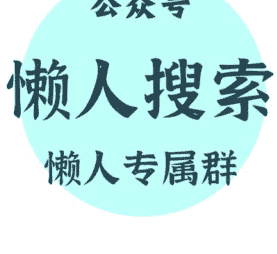

# 中日三次国运对赌

261019 青云读书会
整理：公众号懒人搜索，懒人专属群精选
懒人微信： lazyhelper1

小懒判断 | 适合想系统理解中日千年地缘恩怨底层逻辑的人；不适合想看爽文式中日对比的人。最值得关注的是三个战略前提：日本粮食自给率仅 38%、石油依赖超 99%，本土资源匮乏决定了它必须向大陆或海洋找出路，这是历次对赌的根源。坑在于只看当下新闻判断中日关系，忽略结构性矛盾不随领导人更替而变。

今天我们主要聊聊近代百年中日之间的三次国运对赌，分别是甲午战争、日本全面侵华战争，以及两弹一星。我们围绕这三场博弈，来谈谈中日关系。

首先要理清两个战略前提，第一中日是解不开的地缘对手。日本位于中国正东方，隔海相望，面积约 38 万平方公里，本土资源匮乏：粮食自给率约 38%，能源自给率不到 20%，石油对外依赖超过 99%，地震、火山、台风、海啸频发。

狭小且资源匮乏的国土承载过亿人口，促使日本自古就存在向东亚大陆谋求生存空间的内在诉求。中国大陆是日本数千年梦寐以求的目标，这不是个别统治者的意志，而是其国民集体意志。

白江口之战、万历援朝、元朝征日、甲午

体系，海关税收一度占到清政府财政收入四成以上，多次帮晚清缓解财政压力；二是提供贷款支持左宗棠西征，遏制沙俄在新疆扩张；三是协助建设北洋水师，向清朝出售军舰，接收清朝海军军官赴英学习，聘请英国军官担任北洋水师总教习，打造出当年号称亚洲第一的北洋水师。

看到清朝获得英国支持，日本意识到，如果清朝完成近代转型，日本向大陆扩张的设想就很难实现。当时综合国力弱于清朝的日本，极力向英国示好。

明治时期日本压榨国内民众，还向南洋输出女性赚取外汇，作为国家早期的外汇补充，用来购买英国军舰、派遣军官赴英留学，反复表态日本比清朝更愿意对抗沙俄。

英国奉行离岸平衡策略，不会单方面绑定某一方。在英国眼里，清朝和日本，谁能够承担对抗沙俄的任务，谁就能获得更多外交倾斜。甲午战争的本质，除了反侵略战争属性之外，也是清日两国争夺英国东亚代理人身份的卡位之战。

晚清当时轻敌，朝堂内部党争不断，满汉派系矛盾突出，当时甚至流传一种说法：打赢就是平定东洋，打输反而可以削弱李鸿章的北洋势力。

1895年《马关条约》签订，清廷赔款2亿两白银，割让辽东半岛、台湾及附属岛屿、澎湖列岛。三国干涉还辽之后，清廷额外支付3000万两白银赎回辽东。

甲午战败引发戊戌变法、八国联军侵华和《辛丑条约》，中国彻底沦为半殖民地半封建社会，丧失东亚领导权。日本则借着甲午的巨额赔款一跃成为东亚最强国家。

这第一次国运博弈，清王朝彻底落败。日本既已获胜，英国随后兑现诺言。1902年1月30日，《英日同盟条约》在伦敦签订，英国与日本正式结盟。

当然，英国也是老狐狸，它不可能如此轻易地信任日本。在日本一飞冲天之前，它还必须面对最后一道大考：兑现帮英国对抗沙俄的承诺。

1904年，日俄战争爆发，日本动员百万兵力，伤亡约25万人，军费支出达15亿日元，折合白银约13.5亿两，几乎耗光明治维新多年积累。

甲午战争所得的两亿两白银赔款，连塞牙缝都不够。谈判阶段，日本还想像逼迫清廷那样，向沙俄索要巨额赔款，一开价就要30亿日元，折合27亿两白银。

可沙俄态度强硬，最多只愿意拿出3亿卢布，少一分免谈，不行就继续打。

以日本当时已经透支的国力，根本无力继续打下去，只能接受沙俄的条件。消息传回日本国内，直接引发大规模骚乱。在普通民众眼里，付出巨大伤亡、耗尽国力，最后却没拿到赔款，日本这是吃了大亏。

其实不然，日俄战争带来的长期影响，远比表面得失更深远。日俄战争让西方世界看清了日本作为反俄盟友的价值。从1902年英日同盟签订到1921年该同盟被美国施

在长江流域重创中国的军事力量；为重创中国的军事力量，日本就必须占领整个中国沿海，切断中国的外援通道。

这一套逻辑链条驱动战争不断升级，日本文官政府逐渐失去对军方的约束。插个题外话，就算日本不偷袭珍珠港，中国也能赢得抗日战争的胜利。

说到底，日本只是一个资源匮乏、与大陆并不相连的岛国。即便它拥有某些技术优势，其整体战争潜力也远不能与中国相比。跨海进攻所能动员的国力，与陆上进攻所能动员的国力存在本质差异，其后援、补给和可动员的兵力，两者也根本不在一个量级。

1937 年全面侵华，并不是日本本土单独进攻，而是整合朝鲜半岛、台湾澎湖、伪满洲国的资源，把这些地区的人力、物产一并整合，支撑这场侵略战争。

美国向日本出售的战略物资，对日本的侵略起到了至关重要的支撑作用。钢铁、石油、橡胶、稀有金属这类物资，日本本土几乎都无法自产，只能消耗宝贵的外汇储备从美国采购。

如果缺少这些战略物资，日军的坦克开不起来，飞机无法升空，军舰也没法出海作战。1938 年武汉会战后，日本外汇储备几乎耗尽，很难拿出资金持续向美国采购战略物资。

加上旧中国工业基础薄弱，老百姓的生活大多徘徊在基本生存线，日军无法从占领区获得足够收益。敌后抗日根据地持续作战，不断牵制日军，日本在华北等占领区无法有效实现“以战养战”。

为维持占领区统治、应对敌后武装的袭扰，日本不得不动用本就紧张的外汇，从东南亚获取粮食，运往华北等缺粮地区，保障占领区内劳工与驻军口粮。

它不但难以从中国获得足够收益，反而还要维持侵华百万日军的补给，这不是简单的吃喝补给，而是枪支、弹药、坦克、飞机油料以及石油、钢铁等战略物资，这些几乎都要一船一船地从日本本土运来。

中国当时缺乏这些工业品，日本若想就地生产，就必须从头新建、从头投资，没有十几二十年根本建不起来。对日本来说，全面侵华战争在经济上是一场巨大的消耗战，从爆发第一天起就在不断消耗其本就不富裕的国力。

如果不能持续获取钢铁、石油、橡胶、稀有金属这类战略资源，侵华日军的装备优势与机动能力就会不断衰减，被迫进入长期消耗作战。

一旦陷入这种拉锯消耗，中国军队就可以凭借国土和人口优势，持续消耗日军力量。

这正是毛泽东在《论持久战》中所讲的：抗日战争将经历战略防御、战略相持、战略反攻三个阶段。偷袭珍珠港、进攻东南亚，表面看起来像是日本统治者的无脑行为，但实质上这是给日本回了一波大血。

日本后来之所以能和美国打一场波澜壮阔的太平洋战争，之所以能向远在万里之遥的小岛运送那么多物资补给，之所以能铆足劲打豫湘桂战役，全都是靠东南亚的战略资源支撑起来的。

一旦东南亚的海上补给线被切断，整个日本立即陷入绝境。1945 年冲绳战役就是典型例子：日本搜遍全国库存油料，也只凑够大和号单程航行的燃料。这艘七万多吨的巨型战列舰，只能执行有去无回的自杀式攻击。这种资源短板，是大陆型大国很难遇到的困境。

比如中美俄这样的大国，即便战舰、航母沉没再多，也绝不可能出现因油料不足而导致军舰出不了港的情况。对现在的中美俄来说，即便外援全部断绝，仅靠本土资源，也依旧能够支撑长时间、大规模的消耗战争，而这是日本完全不具备的特点。

日本投降后，如果不是麦克阿瑟主导对日占领和重建，日本本土不知道要饿死多少人，这也是日本至今仍对麦克阿瑟感恩戴德的最核心原因。

当然，中国必胜并不意味着中国就不需要付出惨痛代价。抗战十四年，中华民族伤亡 3500 万人，军队伤亡 380 多万人，其伤亡之多、损失之大，在近代历史战争中都前所未有。

如果没有人民敢于牺牲的精神，中国很可能撑不到 1945 年。经历过惨烈的抗日战争之后，整个中华民族都对日本有了全新的战略认识：昔日的蕞尔小邦已成过去，日本确实有能力对中国造成巨大伤害。

接过历史接力棒的新中国第一代领导集体，具有非常深邃的政治智慧，他们深知这个道理。

## 三、第三次国运对赌：两弹一星

1949 年新中国成立后，前三十年几乎一直没有卸下战备：在朝鲜、越南与美国交手，在北方与苏联对峙，在南部和西南与印度开火，甚至在 1979 年还在南方与越南作战。

无数解放军战士舍生忘死，打那么多仗，最核心的原因，就是想将威胁中华地缘安全的敌人一步步往外推、往远推。中国虽大，但有两个地方非常关键，绝对不能丢。

第一是朝鲜半岛。如果那里丢了，东三省就会受威胁，北京就会受威胁。

第二是中南半岛，尤其是越南。如果越南北部丢了，整个南方就会不稳。台湾的战略价值，相对于东南、相对于朝鲜半岛或中南半岛来说，会低一些，不会对中国大陆造成那么巨大的伤害。

在打这些战争的时候，新中国从来没有忘记日本的威胁。不要看当时的日本好像挺老实，一旦它抓住机会，依旧会是中华的心腹大患。举个例子，1971 年基辛格秘密访问中国，商谈中美关系正常化问题。

连瞎子都看得明白，中美接触在很大程度上就是为了对付苏联，必然要遭到苏联猜忌。可这么大的事情又瞒不住，中美到底应该用什么理由向日本解释呢？

想靠这点核武器就完全阻止美苏对中国发动进攻，是有风险的，是靠不住的。好钢必须用到刀刃上。“两弹一星”最有威慑力的方向，并不是美苏本土，而是日本、是驻日美军。

只要挟制住驻日美军，美国就不敢乱动；只要挟制住日本，美日就不敢对中国发起大规模进攻。中国的东部沿海就是安全的，朝鲜半岛也是安全的。

1960 年代初，新中国进入经济最困难的时期。当时党内有人提出：搞原子弹那么耗钱，一时半会又搞不出来，能不能暂停两年，等经济恢复了再重新上？

但是军方不同意，毛主席不同意。聂荣臻元帅说，如果原子弹下马，我们怎么向后人交代？

这是会犯历史错误的，我聂荣臻死不瞑目。陈毅元帅说，哪怕把裤子卖了，我们也要把原子弹搞出来。毛主席说得更形象：我中国就是个讨饭的，手里也要有根打狗棍。

一代人吃三代人的苦，一代人做三代人的事，绝不能把所有问题都留给后人。1964 年 10 月 16 日下午三点，新中国第一枚原子弹爆炸成功。

5000 年中华文明从此走入有核时代。从这一刻开始，日本再也不能对中国形成战略威胁，日本全面侵华的屈辱历史再也不会重演。也是从这一刻开始，新中国的腰杆真正挺直了；还是从这一刻开始，我们终于有了与美苏平起平坐的最高级别大国博弈的棋手资格，美苏再也不能用以前的老眼光把中国看成一个棋子。

只有理解了这些，我们才能理解原子弹爆炸那一刻，全国人民发自内心的那种千斤重担终于落地的、无愧于祖宗、无愧于后人的欢喜。前人栽树，后人乘凉。

我们今天在享受和平生活的时候，也千万不要忘了前人的披荆斩棘、筚路蓝缕。“两弹一星”成功之后，日本对中国发动全面侵略的战略威胁，从根本上被遏制了。

这并不意味着中日之间的地缘矛盾就全部消失了，中华民族伟大复兴与美国再次伟大，终将走向正面对决，日本很可能是这场正面对决的胜负手。

若日本仍被美国掌控，中国发展始终有后顾之忧。若美军力量逼出日本，沿海安全至少推到第二岛链，朝鲜半岛再无外患，台湾回归顺理成章，亚洲才能真正成为亚洲人民的亚洲。

再也没有任何域外力量可以干涉。从这个意义上讲，将美军彻底赶出亚洲，是中国人神圣的使命，也是中国人对亚洲人民不可推卸的责任。日本就是这里面的关键胜负手。

这就是我今天所讲的内容，感谢大家，大家有什么问题可以一起交流。问：您对中日关系的一个看法？答：中日关系不仅仅是中日两国之间的事情，更是世界主要大国力量在东亚、亚太地区集中投射与博弈的结果。

所以日本嘴上声援台湾，并不是愿意为台湾拼命，只是出于自身安全考量。问：日本这个战略威胁怎么解除？答：我目前能想到的路径有几个。

第一，推动驻日美军撤出日本；第二，促成琉球独立；第三，借力北方四岛问题，不过北方四岛这块变数很大，不好预判。

另外还要看朝鲜半岛局势，如果朝鲜能够进一步壮大，也会形成牵制。要是日本这边的战略威胁解决了，台湾自然就不成问题。

所以当下我们的重心，是啃日本这块更难啃的硬骨头。日本的问题理顺之后，台湾问题也就迎刃而解。

还有一点，民进党高层对日本的信任程度，甚至超过美国。问：我们对日本的定位是什么？它应该处在什么样的位置？答：看看明治维新之前两千多年里日本所处的位置，那才是它本该有的位置。

它是一个 38 万平方公里的小岛，一点几亿人，粮食自给率只有三成多，68%的粮食依赖进口，99%的石油等能源都要靠海外输入。资源禀赋决定了它不具备成为超级大国的基礎。

近代这一百年日本的崛起，放在整个历史上是特例，它不是历史的常态，我们这一代乃至下一代的历史任务，就是让日本回归到历史常态。

问：对于台湾回归的问题，您怎么看？答：

我认为大局已定。赖清德上台前自称“务实的台独工作者“，喊得很凶，上台后有什么实质变化吗？

很多人没讲过的一点是：台湾问题对我们而言，政治意义和历史意义巨大，完成祖国统一，上对祖宗下对子孙。

我们还要清晰的认识到，即便暂未统一，现实层面的影响其实有限。因为台湾哪怕现在没有统一，我们的对外贸易、商船通航、渔业和民间交流，基本没有受到实质干扰；除了那十几个所谓“邦交国”，没有任何国家因为台湾问题拒绝同中国做生意，美国与中国的经贸交流照样频繁。

过去说台湾有军事价值，拿下港口基地可以把防线外推约 200 公里；但在远程打击和无人装备高度发展的今天，这层纵深的价值已明显下降。

所以我的判断是：统一的政治意义、历史意义极为重大，但现实经济利益并不大，甚至微乎其微。

因此不必急于一役，只要实力对比持续朝我们有利的方向变化，节奏就在我们手里。

还有一点，讨论中央政策时不要陷入美国人过去三十年的误区。美国衰弱的深层原因之一就是连年打仗：打伊拉克、打阿富汗、又卷入对伊朗的军事行动。

常在河边走，哪有不湿鞋。很多人羡慕美国“想打谁打谁”，但如果我们今天打菲律宾、明天打韩国、后天打越南，一路打下去，就永无宁日，那和美国式的穷兵黩武有什么区别？

在亚太地区，除了美日是我们真正的战略对手，其他国家哪怕有纠纷、有摩擦，也都是可以争取的对象，尽量不要走到兵戎相见的地步。

真正需要集中应对的主要矛盾在美日方向；这个症结化解了，其他问题大多会顺势而解。

所以真要摊牌，也应是集中力量解决核心矛盾，而不是在周边小方向上消耗自己。

以今天的体量，要么不动，动就要奔着根本问题去。问：蒋介石当时的策略是否有重大失误？答：最大的遗憾在琉球。1943年开罗会议期间，罗斯福曾试探蒋介石对战后琉球的安排，提到中美共管或托管等可能性；但蒋介石顾虑盟国反应，不愿显得中国有领土扩张之嫌，没有积极争取，错失了影响琉球战后安排的机会。

如果琉球独立或者给我们托管了，战后东亚格局会完全不同。日本失去琉球这个西南屏障，战略纵深和前沿支点都会被大幅削弱，我们今天在第一岛链面对的压力也会小得多。

问：美国现在对日本是什么策略，是扶持还是吸血？答：更像吸血。特朗普的思路很清晰：战略上想收缩，先让自己回血，而砍得最狠的恰恰是盟友，无论欧洲还是日韩。

美国曾占领日本、并长期驻军，对日本的政治脉搏把得很准，它清楚日本不敢脱离美日同盟，清楚日本对中国的防范心理远深于对美国的戒心，所以敢于不断加码要价。

只要这种恐惧还在，日本大多会选择满足。德国和日本都曾是战败国，都驻有美军，但两国对美姿态明显不同。德国官员有时还敢顶撞美国，日本从中层到高层普遍姿态更低。

原因在于安全判断不同：德国虽仍视俄罗斯为威胁，但认为自己有更大的回旋空间；日本则认为没有美国撑腰，单凭自身难以应对中国。

安全依赖度不同，对美政策自然不同。问：朝鲜半岛和中南半岛对我们地缘很重要，现在他们是独立的国家，还和越南打过仗，不属于丢掉，也不属于控制？答：对，我是这么认为的。

第一重要是朝鲜半岛，中南半岛第二，台湾第三，严格分先后。抗美援朝的核心，就是把敌对力量往朝鲜半岛外推，不要求全推出去，但38线附近的战略缓冲必须保住。

很多人说美国政府当年没有进攻中国本土的计划，这是事后诸葛亮。别忘了，1931年仅仅过去19年，日本就侵占了东北；面对一个刚在仁川登陆、直逼鸭绿江的超级大国，你凭什么笃定它的战略意图？万一放的是烟雾弹呢？

所以“打得一拳开，免得百拳来”，我们必须把威胁挡在半岛上。中南半岛我们介入得更久：从 1950 年援越抗法，到六十年代的抗美援越，再到 1979 年后的对越自卫反击战，跨度近 40 年。

核心目标就是以越南为抓手稳住整个中南半岛，这块地方不能乱。近代以来，缅甸、老挝、越南、柬埔寨、马来西亚、新加坡都曾沦为西方殖民地，整个东南亚几乎被西方控制。

经过这几十年，域外大国在中南半岛的军事存在基本被清空：美军撤出越南、老挝，缅甸也无美军基地。

这就是第一代领导集体留下的遗产之一，向全世界表明，中南半岛是中国的战略缓冲地带，不容外部势力驻军染指。问：美国在伊美战争中打得这么菜，是能力不行还是没有下手去打？答：美国在美伊战争中表现不佳，我认为有 2 个原因。

第一是美国人心不齐，还有特朗普用于打仗的资金需经国会拨款授权，但他一直未获得国会授权和批款，打伊朗的钱都是从五角大楼其他开支中左挪右凑，凑到钱就打一仗，没钱就停战谈判，形成循环，背后始终有人掣肘他。

第二个方面是军事技术格局变了。无人机和导弹技术的成熟，正在改写现代战争的攻防平衡。美国此次最大的被动，在于其中东军事基地反复遭伊朗导弹和无人机打击——这在以往几乎不可想象。

过去攻击美军基地只能靠自杀式袭击，现在几百到几千公里射程的常规导弹和低成本无人机就能做到。俄乌战争已经证明，这类武器门槛低、扩散快，正把以往美国对弱国的“不对称作战优势”逐步拉向对称。

这对美国霸权的冲击是深层的。美国在东亚的存在建立在驻日、驻韩、驻关岛基地“安全可信”的假设上；而中东基地对伊朗都已不安全，那么西太基地面对中国、欧洲基地面对俄罗斯，其防护神话必然受到质疑。

一旦基地安全这个支柱动摇，美军对己方绝对优势的信念也会动摇。

所以说，在无人机时代，美国即便对伊朗这样的中等强国，也很难再通过有限军事打击达到政治目的。问：中国现在有什么筹码，是美国特别希望中国支持它的？

答：第一张牌是伊朗。伊朗因石油出口遭美国封锁，曾放话要对霍尔木兹海峡通行的船只收费。中国拥有全球规模最大的商船队，造船和海运体量世界第一，海峡一旦收费，受害最大的就是中国。

但中国既不接受伊朗收费，也不接受美国那种以压促谈的方式，双方事实上还在靠中国斡旋维持沟通，这是一张双方都需要中国的好牌。

第二张牌是俄乌问题。冲突初期，美欧曾发起舆论战，宣称“靠中国支持俄罗斯才打到现在”。但这类指责现在基本消失了，因为西方也怕把中国彻底逼到俄罗斯一边，他们清楚，若中俄深度协作，即便西方联手，大国对抗的代价也将极其惨重。

所以美国的真实底线变成了：中国不支持美国可以，但也绝不能支持俄罗斯。中方立场因此游刃有余得多。耿爽在安理会那句“如果中国真的向俄罗斯提供军事补给，战场局势早就不是今天这个样子”，分量极重，此后美欧基本不再纠缠这个问题，只剩乌克兰自己偶尔喊一喊。

至于特朗普，在俄乌议题上争取中国配合的空间有限。俄乌冲突的核心矛盾在欧洲安全架构，中国保持中立劝和促谈，只客观表达中方主张，能否达成和解，关键要看欧洲各方。

俄乌冲突爆发之初，拜登政府的立场是持续援助乌克兰，只是始终避免美军直接下场参战。根据乌克兰谈判代表事后披露，2022 年伊斯坦布尔谈判阶段，俄乌曾形成和平协议草案，距离达成共识非常接近，时任英国首相约翰逊到访基辅，劝说泽连斯基继续抵抗、承诺提供援助。

问：印度的未来会不会成为另一个日本，在实力上突飞猛进，最后威胁中国？答：印度人口基数大，长期发展潜力优于日本，但现阶段日本在工业、高端科技方面实力更强。

长远看，中美印会是全球影响力最重要的三支力量。俄罗斯地大物博，但人口仅 1.4 亿，人口问题会持续制约发展。印度面积 298 万平方公里，南亚邻国除巴基斯坦外体量都有限，其在印度洋北部的海权区位相当优越。

但在对华方向上，喜马拉雅高原造成的地

地形落差，让印度长期处于天然地缘劣势。可以说，除中印方向外，印度在印度洋博弈中拥有明显区位优势；而面对中国时，高原地势造成的地缘短板，很难靠国力提升来弥补。

问：讲讲未来十年的中俄关系？答：中俄关系现在简单了，因为核心矛盾基本消失了。历史上的核心矛盾在东北：沙俄占据外东北，并觊觎整个东北平原，中国必须死守，这是结构性冲突。

但现在的变量是人口。俄罗斯远东地区地广人稀，远东联邦区人口不足千万，其中外东北一带更为稀少；而东北三省虽在流失人口，仍有近1亿人，是俄远东的十几倍。

俄罗斯全国不过1.4亿人，它就算守住外东北，凭几百上千万人口也开发不了、建设不了西伯利亚，最终只能与中国合作。就算真动武，那点人口和补给线也撑不起一场远东战争。

所以中俄之间已经没有不可调和的矛盾。我国主要地缘压力集中在西太平洋海上方向。再一个从地理角度讲，西伯利亚和远东对俄罗斯是苦寒边地，离莫斯科近万公里，木材、矿石运到欧洲成本极高，最现实的选择就是就近卖给中国，而当下只有中国有这个消费力。

因此，即便普京之后换领导人，中俄关系的大框架也不会变。不必再担心“俄罗斯一旦向欧洲靠拢就会回头敌对中国”，那是苏联时期的剧本。

苏联和俄罗斯是两个体量、两种处境：俄罗斯继承了苏联的大部分领土，却没有苏联的实力，它已经不具备在东方挑起全面对抗的本钱。

问：美国不结盟政策与美国盟友政策，哪个对我们更不利？答：对中国来说，不结盟政策更好。美国的盟友政策看似强大，实则隐患重重。

结盟这种事，什么时候的盟友才是稳固的？一方特别强、一方特别弱，这种盟友关系才可能稳固；只要实力接近了，盟友关系迟早出现裂痕。

对于中国来讲，中国走了一个从弱小到强大不断的变化的过程，在这个过程中，因为其实力在不停的变化，你在那个时候搞结盟，一旦你的实力变化了之后，你的结盟关系就肯定会不停地进行调整。

中国自身走了一条从弱小到强大的道路，实力始终处在变化之中。在这种情况下搞结盟，实力一变，结盟关系就必然不断调整。上世纪五六十年代我们不是和苏联等社会主义国家结成过同盟吗？

中苏同盟为什么破裂？一个重要原因就是中国壮大了，苏联压不住了，最后闹掰了。其他盟友关系也是同理，只要一方实力在快速变化，盟友关系就不稳固。

美国同日本、英国等国战后盟友关系相对稳定，核心原因在于美国实力长期远超它们，是“老大哥带小兄弟”的结构。而中国力量变化太快，用结盟把自己捆在别人身上，风险很大。那中国以后会不会结盟？

其实只是个形式问题。不结盟不等于孤立，我们完全可以在具体问题上开展合作、求同存异，发展非常好的关系，没必要套上“盟友”的帽子、签一纸同盟条约。

任何一对盟友也不可能是在所有问题上都是利益一致的。英国跟美国的英美特殊关系，它也不是在所有关系利益上都一致的。中国的政治智慧恰恰在于把国与国关系拆开处理：政治是政治，经济是经济，文化、体育、卫生各是一块，尽量做到互不干扰。

有的国家是关系好就全盘都好、关系坏就全盘都坏，利益捆绑过死；我们则允许在某些领域吵、在另一些领域谈，国与国关系反而更稳固。这就是中国的政治智慧。今天的直播就到这，感谢大家！

——分割线——

绝大多数人只盯着眼前的工资，却不知道一次远在中东的冲突、一次降息的决议，就能在一夜之间洗牌普通人的财富。

看懂宏观，是为了在周期切换时，不被当作代价。

如果你认同这种“抬头看路”的长期主义，欢迎围观我的个人情报智库：【懒人专属群】。

圈子已稳定运行7年。我们每天利用 Python 爬虫与大模型算力，过滤全网最顶级的政经内参和搞钱风向标，做你最冷酷的“外部大脑”。

[https://lazyo.com/insider/](https://lazyo.com/insider/)

认同价值的。扫码加我微信，备注：【进群】

微信：lazyhelper1
