# 从 AI 写作到 AI 服务，三个月变现 30w+；我的转型复盘

261016 副业 SC 精华
整理：公众号懒人搜索，懒人专属群精选
懒人微信：lazyhelper1

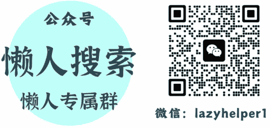

小懒判断｜适合在闲鱼/小红书做服务类项目、正被平台严打逼着转型的人——同一段经历里 50 个同行当老师、投流从 3 天 100 到一天 500 拿确定感，这两招现学现用。不适合纯新手，看不懂“鱼小铺 L7”“非标交付”这些词会很吃力。最值得关注的是把报价文档整理成 skill，5-10 分钟出商业需求文档，降维打击同行客服。坑在于：FDE 部分作者自己也没跑通收费案例，属于判断不是战绩。

大家好，我叫蛋挞，爱吃蛋挞的那个蛋挞。  
熟悉我的圈友，应该知道我一直在做 AI 代写项目，有自己的基本盘，也做陪跑，取得了一些小小的成绩。

任何项目都是有窗口期的，流量也一定是越来越贵的。

AI 代写项目在 23 年的时候还是一个蓝海项目，当时大家最常做的平台就是小红书和闲鱼，随便发发帖子，补补单就能拿到流量，然后再通过 AI 写文章，赚的都是利润，当时被称为对【新手小白】最友好的项目。但是从 25 年开始，小红书冲击 IPO，对代写服务、引流、截流等行为进行严打，当时倒闭了很多小红书获客和截流的团队。

26 年 3.18 之后，闲鱼也开始全面拥抱商业化，很多代写的链接和店铺都直接被删掉了，我自己也注销了一个鱼小铺 L7 的店铺重新开始。屠龙少年终成恶龙，我们当时选择闲鱼没有选择淘宝、拼多多的核心原因就是，闲鱼管得更松一点，冷启动成本更低。现在平台严打，反而淘宝、拼多多的需求会更稳定一点。

也是从今年 3 月份开始，很多之前做代写的朋友开始了新的尝试，有的甚至直接换一个新赛道。创业就是这样，当我们很顺利的时候，就会认为自己是天选之子，老子天下第一。但是当我们遇到困境的时候，反而看谁都像老师，感觉谁的项目都比自己的项目好，选择太多反而失去选择。如果这个时候随便选择一个项目，会更容易掉入失败的陷阱。但一个真正适合自己的好项目，是发掘自己优势后生长出来的，甚至可能会从你的老业务中生长出来。

接下来我就给大家分享我自己从 AI 写作升级到 AI 服务，三个月变现 30W+ 的复盘。

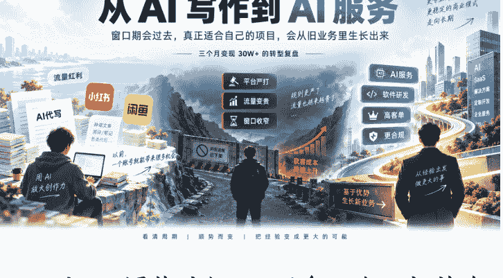

## 一：从 AI 写作升级 AI 服务，全面拥抱合规性

24 年底闲鱼推出【超级擦亮】，开始推进商业化进程，就和当初的淘宝一样，从淘宝到天猫，从白牌到品牌化是一个必然的结果，对于商家和市场来讲也是一个洗盘的过程。26 年初的时候，市场开始出现震动，持续到现在很多熟悉的店铺和朋友或多或少都受到了影响。我自己也注销了一个鱼小铺 L7 的账户，做业务自然是要保持对抗，但是平台直接撤桌子这件事情还是让我很苦恼。

年初的时候在杭州航海家 AI 大会，我就找了一个大哥聊过这个事情。他给我的意见是全面拥抱合规性，可以尝试下软件研发类目，选择一个绿色、高客单、高信息差的赛道。

我回去后就调研了相关赛道，比如相同的一个网站开发的需求，有些供应商会报价 5000，有供应商会报价 50000，项目本身也就满足高客单和高信息差这两个特点，并且软件研发是一个绿色健康并且存在很多年的项目。现在 AI 也越来越发达，这个项目我们可以用 3000-30000 的价格承接下来，这个价格也会成为我们当前的竞争力。

再加上离职之前我做了七年的产品经理，软件研发相关的流程和需求其实我都是非常清楚的。只不过当时 AI 写作还有很多的老顾客回购，再加上自己离职就是为了不做这个事情，所以换类目这个事情就一直拿两个账户测试着，效果自然也是不温不火。

事情的转折点发生在五月份的时候，因为是测试项目，为了能尽快地验证效果，项目最开始的时候我就直接投流，但是账户最开始的权重没有那么高，投流的规则也没有设置得很好。差不多 100 块钱能消耗个 3-4 天，零零散散地出现客咨和成交，这种感觉就像温水煮青蛙，导致原有的代写类目消耗了我的精力，新的软件研发项目又迟迟没有实现突破。

项目无非就是流量、销转、产品交付三个环节，我当时连续找了 50 个同行对比自己的转化率和产品交付水平，发现最大的问题还是在流量环节，咨询量不多，自然很难拿到结果，咨询的时候零零散散的，自然影响你的转化率。

想通了这个问题，我就从两到三天消耗一百提高到一天消耗五百。假设我的转化率为 10%，单个客户咨询的成本是 25 元，我谈 10 个左右的客户才会成交一单。按照之前的投流策略，运气好 3 天左右才能成交一个订单。如果我一天能消耗五百，那我一天最少能成交一个订单。这种确定感和正反馈，对我们做项目来说是非常重要的。所以我的营收很快就开始有突破，从一开始几百块钱的单子，很快就接到了第一个四位数、第一个五位数的订单，也是顺利完成了类目的转型探索。

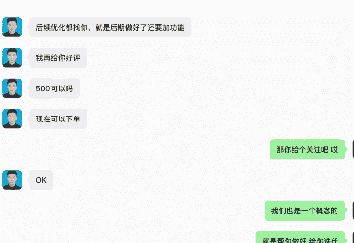

交易成功

| 项目 | 内容 |
| --- | --- |
| 交易成功 | 这款宝贝的服务力怎么样？使用过程无问题 |
| 定制开发 | ¥6.60 × 258 |
| 金额 | ¥1700.00 |

刚刚睡着了

昨天 21:46

中期再补4800就行

¥4800.00 已被接收 微信转账

¥4800.00 已收款 微信转账

## 二：转型后的瓶颈

随着项目的发展，很快我们就遇到了第二个问题，因为软件研发项目相比之前做的代写业务更非标，你需要理解客户真正的需求是什么，要给他提供怎么样的方案，这个报价方案的成本是什么，这个功能是不是可以实现。这些是需要经验，不是短时间内提供一个报价手册和销售话术手册能弥补的。

比如一个大学生创业，想要开发一个寝室零食送上门的小程序，但是不是公司也不是个体户，只是个人，如果硬要去开发个人小程序而不是企业小程序，就很容易被微信平台卡审核，但申请一个公司或者是个体户，对他们来说启动成本会大很多。针对这种场景，用户需要的不是一个非常完善的小程序。

他真正需要的是一个让用户可以线上自动下单，后台生成订单可以及时配送的工具，而不是盯着十几个群，生怕漏掉一个信息。他真正需要的是一个能让他和其他同行区分开来的工具，避开同质化竞争。

我们要学会辨别真需求，给用户预算内最合适的方案，而不是给客户一辆跑得更快的马车。

这些东西不是马上就能学会的，也不是小伙伴用 AI 可以解决的。你如果不了解用户需求，不了解技术实现方案，AI 给你的答案你没有辨识度，很容易为后面的交付埋下雷。想解决这个没有其他的速成方式，只有笨办法，花时间去学习，不过有 AI 之后这个时间可以大范围地缩短。

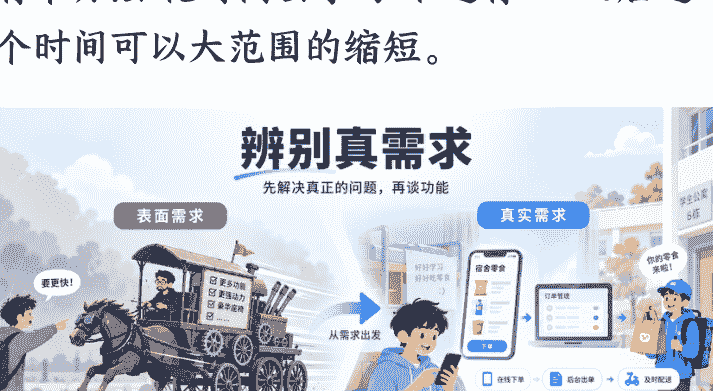

我们当时做了两个事情。一方面是伙伴去淘宝和天猫上去找同行聊天，用我们真实收到客户的需求去看看同行是怎么转化我们的。去扮演那个最刁钻、恶劣，但是又让你觉得我会下单的用户，找 50 个同行，这里面一定会有几个有耐心的同行会告诉你，这个需求背后的真实需求是什么、更好的实现方案是什么、项目的报价多少合适，同行就是最好的老师，学习他们转化我们的方式，我们就可以去转化那些最刁钻的客户。

另一方面，通过 AI 进行更系统的培训和科普。

了解互联网行业的伙伴应该清楚，这种定制化的项目往往和客户沟通完基本需求后是需要提供一份报价说明甚至是商业需求文档的，要讲清楚用户的痛点、解决方案、技术方案、项目报价、付款周期，这些内容往往都是一个成熟项目经理、产品经理 3-5 天的工作量，但是我们将这些信息都整理成了 skill。只要收集完信息，5-10 分钟就可以跑出一个优秀的商业需求文档，对比我们之前调研的那批同行，我们的专业度和响应程度都是降维打击。因为他们对接需求的是客服，而我们的定位是产品经理、项目经理，直接给客户解决问题。

- <<
  - 数据研发案例拆解-加餐课
  - 数据研发流程拆解
    - 应用层
    - 运营层
    - 数据层
    - 软件层
  - SaaS 产品定制化产品
  - 案例拆解系列-小程序
  - 需求解决方案拆解-小程序 (程序员演示版本)
  - 需求提炼进阶
  - 需求梳理提示词
  - 页面效果展示词

台选行业置，预判一方。

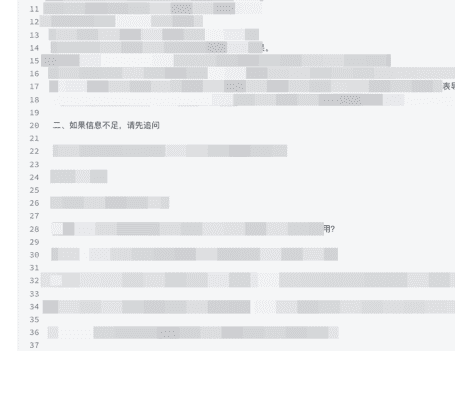

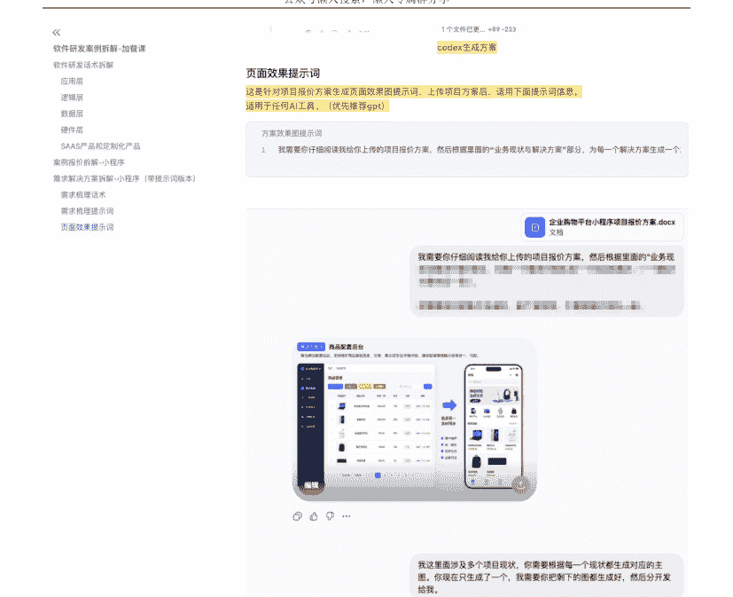

再到后面，我们放弃了很多非标的场景，将我们熟悉的客户群体和解决方案沉淀下来，搭建标准的 SaaS 产品、针对不同场景的销冠手册和百问百答库。在这个基础上，用户提出的大部分问题，我们都能预判到并且给出更适合的方案，对于新的伙伴来说也能更快地上手，这些东西是非常有用的，团队业绩也实现了突破。

但是我总觉得少了点什么，少了一种我非常想要做这件事情，并且将这个事情做到底的感觉。

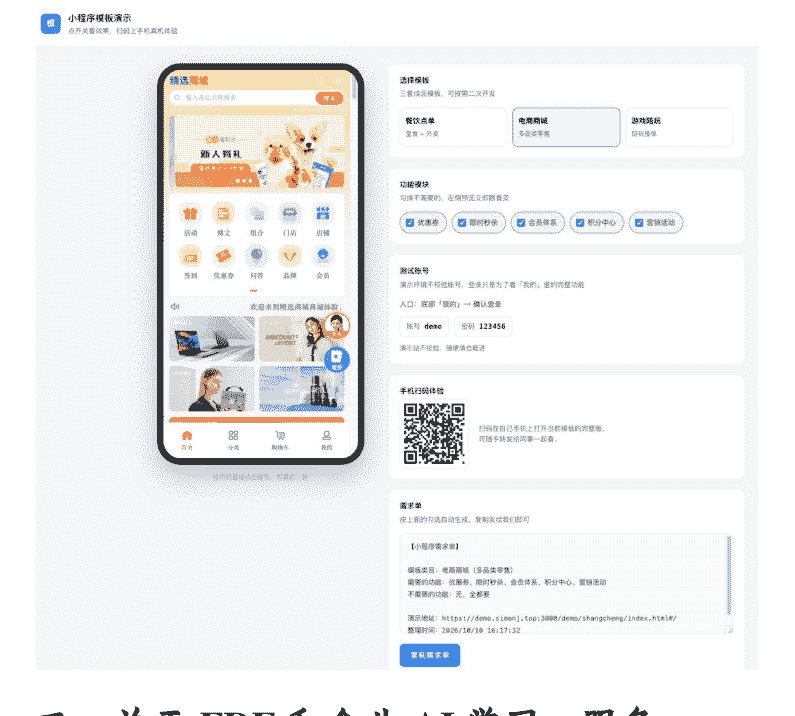

## 三：关于 FDE 和企业 AI 学习、服务

直到今年 8 月份左右，身边慢慢出现了一些声音，是关于 FDE 和企业 AI 培训这个方向。第一次了解到这个方向的我，有种被击中的感觉，好像找到了那块缺失的拼图：过去做 AI 写作，我跑通了获客、销转、交付；做陪跑，让我学会了搭团队、梳理 SOP，去复刻自己成功的经验；再加上之前做产品经理、现在做软件开发，锻炼的是我对用户需求和交付的理解。这几件事情，让我现在找到一个项目机会将他们融合到一起。

但想法归想法，能不能做成生意，还得继续验证。企业 AI 服务我目前没有跑通一个收费的案例，更多的是帮助朋友去搭建一个系统。所以下面更多是分享我的一些判断，以及接下来打算怎么做。

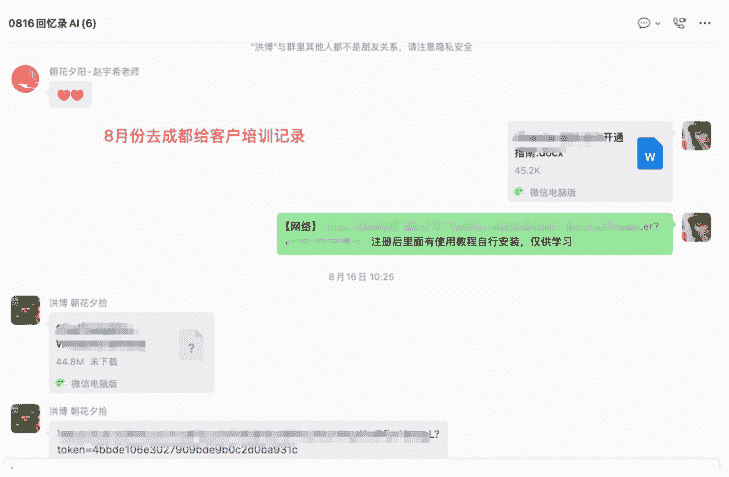

### 1. 企业 AI 落地的六个阶段

为什么今年能听到企业 AI 服务和 FDE 的声音越来越响，它是一个新出现的产物吗？肯定不是，之前的 n8n、AI 工作流、企业培训这些需求早就存在了，也有非常多的圈友拿到了很好的结果。

真正让这件事情更广泛地让我们知道的核心原因还是，AI 越来越强，从个人提效到组织提效的案例越来越多。

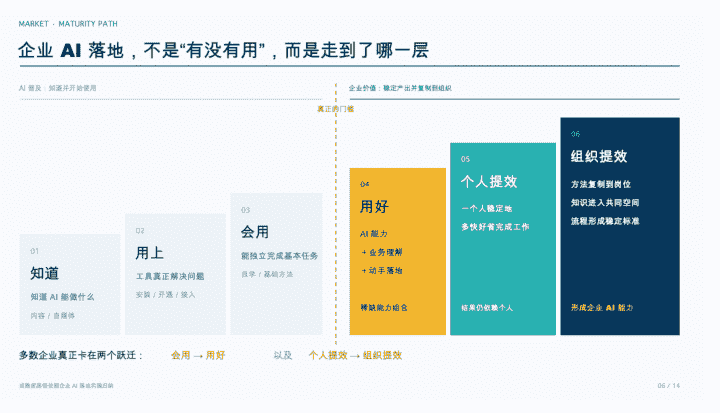

知道、用上、会用、用好、个人提效、组织提效。知道 AI 能做什么，安装好工具，学会基本的操作，能独立完成一些任务，解决的是前三个阶段的问题。再往后，重点就不只是工具了。

我们学习了解 AI，从 GPT、Gemini、Claude 到小龙虾，再到现在的 Codex、知识库、智能体、Bot，我们知道 AI 能做什么，安装好工具，学会基本的操作，能独立完成一些任务，就可以解决前三个阶段的问题。但是再往后，就不只是工具了，你得有业务能力，你得知道用户背后的需求是什么，你得判断 AI 给出来的方案是不是客户真正想要的，如果是我们不懂的领域，AI 是大哥，是更正确的答案，但是回到咱们擅长的专业领域，不好意思！！我们才是标准答案。

毕竟我们给客户出一个方案，AI 不可能知道 B 公司就因为他满足了甲方五彩斑斓黑的需求，多陪甲方爸爸喝了两顿酒才能谈下这个生意的。AI 也不可能知道，这个方案被 pass 的原因，就是中层干部怕 AI 效率太高，怕被 AI 取代了，在老板面前吹了耳旁风。

所以，从“会用”到“用好”，最大的门槛是业务理解。

一个人已经有了稳定的方法，又了解业务需求，能够借助 AI 更快、更好地完成工作，就实现了个人提效。下一步的问题就是：只是这个人厉害，其他同事还是不会。

组织提效要解决的，就是怎么把这部分能力复制出去。资料能不能共同使用，方法能不能整理下来，工作有没有明确的标准，换一个人以后还能不能做。

这里面常见的解决办法就是，搭建个人级别和组织级别的知识库、skill、工作流，个人级别的内容按照真实的需求不断去使用复盘迭代，里面共性和好用的部分再由业务负责人去进行提炼和规范到组织级别。

### 2. 我为什么更看好培训和陪跑

怕钱都收到了，后期的维护和沟通成本会把团队拖死。

我本来就不想继续做原来的事情才离职，总不能换了一个 AI 的名字，又给自己接了一堆产品经理的活。

培训更吸引我的地方，是同一类问题有机会重复交付。

我把服务类业务的获客销转研究清楚，整理好案例、资料、操作方法和练习。后面面对相似需求的人，前面投入的东西就还能继续用，不需要每次从零开始。内容越做越熟，也更有机会让团队参与，而不是所有环节都绑在我身上。

这是我想要的积累。不能做完十个客户，除了收了十笔钱，交付第十一个客户的时候，还是一样费劲。我想做的培训，会围绕一个比较明确的业务场景。客户带着自己的问题来，我们有对应的案例、方法和工具，带着他完成，再把容易出错的地方讲清楚。交付到什么程度，后面提供什么支持，都要有范围。

### 3. 接下来，先完善自己的 AI 获客销转工作台

回到项目的实际情况，想切入企业 AI 学习和服务还是需要时间的，但我们脚步也不能停下来。我准备继续完善 AI 获客销转工作台。一方面服务现在的软件研发获客项目，另一方面，也把它作为未来对外服务的一个切入点。

有自己项目最大的好处就是，不用先去找一个陌生行业，研究他们可能有什么 AI 需求。我们自己每天就在获客、谈单、准备方案，这里已经有很多事情值得改了。

前面通过放大投流，解决了一部分咨询量的问题。但能不能用 AI 赋能拿到更多的流量，客户进来以后，需求怎么理解，方案怎么准备，销转环节有没有更好的话术，哪些问题可以让小伙伴独立处理，哪些问题可以全部交给 AI 完成。

这些都是现成的业务问题，不需要为了做 AI 再去找一个场景。

客户咨询里反复出现的问题，可以帮助我们找选题、写获客内容；零散的聊天信息，可以辅助整理成需求，再结合已有案例准备方案；谈单过程中有效的方法，也可以留下来，下次遇到类似情况时有地方查。

价格怎么报、功能能不能承诺，仍然要人判断。我们也不可能想着 AI 解决全部的问题，AI 获客销转工作台本质上是用 AI 将当前的业务重新做一遍，变成一套可以沉淀和迭代的工作方法，而不是由几个提示词、skill、数据大屏组成的工作台。

对我来说不只是一个内部提效工具。我是在用自己的软件研发业务，验证后面可能对外提供的产品和服务。这一步，也是我从个人提效往组织提效做的尝试，这类业务我相对熟悉，也更容易判断哪些东西能直接用，哪些必须调整。不会因为自己在软件研发里用顺了，就认为所有行业都能照搬。

就算外部客户暂时没有成交，也不代表前面的投入全部白费。只要自己的获客销转有改善，团队少依赖我一点，这件事情就已经在产生价值。

接下来，我还是会继续跑软件研发业务，同时先把需求整理、辅助出方案这部分做扎实，交给团队实际使用。我们都是在不断地找项目、找方向，没有人能保证今年这个事情可以赚到钱，明年还依旧可以赚到钱，市场和项目终归是不断改变的，不变的是我们在这些项目中锻炼出来的能力。再结合一些运气，总会把一个项目发展为一个事业的！！！

我是蛋挞，爱吃蛋挞的那个蛋挞。欢迎对这个业务感兴趣的圈友来切磋交流。

分割线

看完这篇 SOP，你觉得你懂了。但 90% 的人一到实操就会卡在第一步。

工具和教程只是最低级的壁垒，真正的壁垒是“立刻动手”和“圈层信息差”。

如果你想看全网最新的变现玩法，并且和一群执行力极强的极客一起下场拿结果，欢迎围观我的核心私域：【懒人专属群】。

我们不聊虚的，只做商业闭环的拆解与 AI 效率的压榨。系统内已沉淀 1000+ 跑通的套利实战局。

- ☐ 查阅圈子完整数字资产与上车门槛；

https://lazyso.com/insider/

认同价值、准备好下场干活的，扫码加我微信（lazyhelper1）

备注：【实操上车】，不闲聊

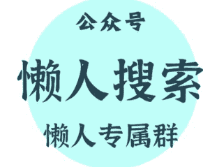

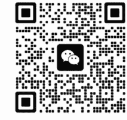

微信：lazyhelper1
