# 从免费到 100 万客单，服务 100+企业客户 | “从 0 开始做 FDE”说人话 SOP

261014 副业 SC 精华
整理：公众号懒人搜索，懒人专属群精选
懒人微信：lazyhelper1

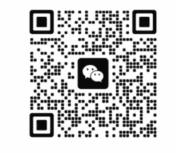

微信：lazyhelper1

> 小懒判断 | 适合有行业经验、会点 AI、想接企业单的人，不适合连客户业务都没接触过就想着报高价的新手。最值得看的是第三章第一单从哪来：律师圈友做合同小工具分享给同行，熟人客户 5 万试水，起点都是最烦的那件小事。坑在报价章节，尾款和成本项没算清，演示再好看也白干。

大家好！我是一登，AI 教练，坐标厦门，产品经理出身，创业十来年，四年前入局 AI，做过 AI 绘画小程序，累计 5 万用户和 2000+付费用户，后来转做 ToB 服务，接触过 100 多家企业，深度服务了 10+家，覆盖跨境、医疗、法律、外贸、制造、新媒体等行业。

梳理了一套从 0 入门 FDE 的方法论，全文 3W 字，带你近距离了解熟悉一线 FDE 的成长心路历程和实战 SOP。

分成八大部份，可按需跳读：

- 认识 FDE（第一、二章），企业 AI 服务的钱怎么赚，FDE 的权责范围。
- 拿到第一单（第三、四章），从熟悉的行业、身边的朋友关系和小范围公开利他分享开始。
- **从需求到方案**（第五至八章），选场景、问需求、梳理 SOP，定技术实现方案。
- **案例拆解**（第九至十二章），招投标、人力法务风控、医学意见书、微信知识库四个项目。
- **选客户、报价与算账**（第十三至十六章），什么客户值得做，怎么报价，成本项有哪些。
- **交付与使用**（第十七、十八章），初次交付之后的磨合和迭代。
- **能力与心态**（第十九、二十章），FDE 需要具备哪些能力，以及情绪价值的重要性。
- **答疑与下一步**（第二十一、二十二章），常见问题，以及完成第一单后的方向规划。

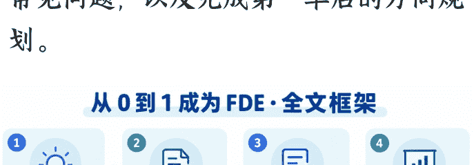

## 一、企业 AI 服务的钱，究竟是怎么赚到的

### 1. 我的背景：从产品、C端创业到B端重交付

大家好，我是一登，坐标厦门，产品经理出身，做过人才网 CPO，也创业十来年。

最近三四年，我主要在 AI 方向深耕，从面向个人的软件，到面向企业的定制服务，都做过。

我们做过一款 AI 绘画小程序，累计五万多用户、两千多付费用户。后来，因为利润驱使，企业服务在业务里的占比越来越高：给企业做 AI 培训、做定制软件，也和有行业经验的伙伴一起做垂类产品。法律、医疗、跨境电商、贸易等行业，我们都接触或服务过。

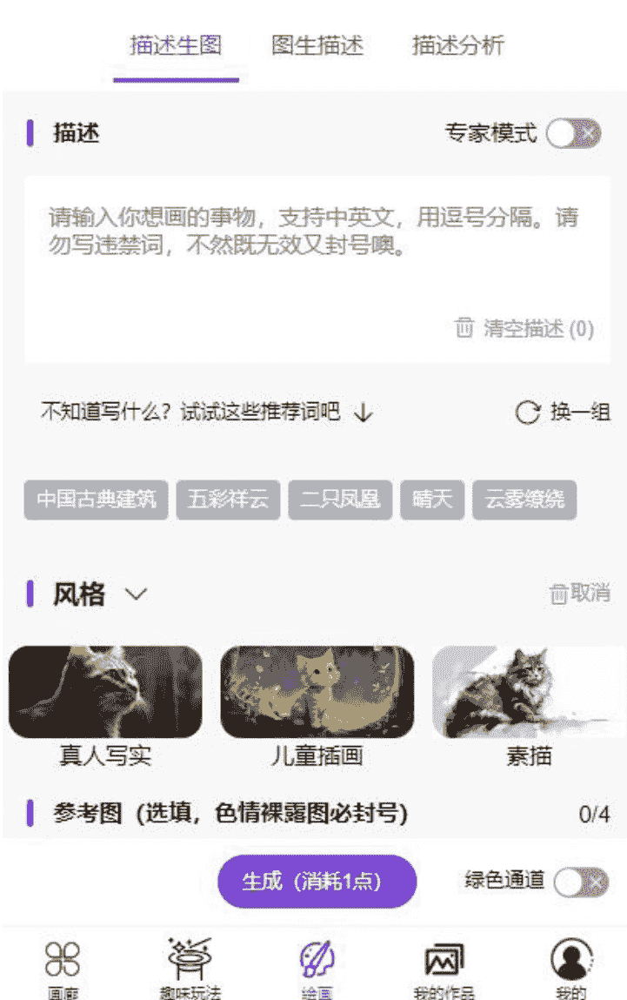

这些经历让我具备跳出开发者的视角看问题的能力。

有用户和有付费用户，差别很大；有人付了第一笔预付启动款，和项目最终顺利结项、真正赚到尾款的钱，差别也很大。演示时客户觉得不错、跃跃欲试，等真正进了公司使用，又会冒出一堆你没想到的奇奇怪怪问题。

我们做 AI 绘画产品的时候，很在意技术领先和成本优势。团队挺能省钱，单次生成的成本一直在优化，也觉得自己的技术方案很有竞争力。但推广出去之后，付费转化没有跟上。用户因为便宜而来，价格稍微提高一点，他可能就走了。技术再厉害，卖不出去，拿不到大结果。

### 2. 这里想讲的：从接触客户到收款

所以这次聊企业 AI 服务，我想多讲讲从接触客户到收款之间的事。这恰恰是 AI 很难替代的部分。

比如，老板说要用 AI，你怎么知道他愿意为这件事投入？他提出一个需求，你怎么判断有没有必要做？第一次做出来的东西不好用，客户开始烦了，下面的员工也不配合，你怎么继续往下推进？项目要验收了，双方对效果的理解不一样，怎么办？

这些问题我都碰过。有些已经摸出了一点经验，有些到现在还在调整。

这几年我们接触过一百多家企业，其中有十多家做得比较深入。在我同时推进的项目里，前期诊断、谈价、开发、调试、培训、收尾款，各个阶段都有。跨的行业多，见到的問題也多，这里我们只拿真实的案例拆给大家看。

不过我也想先把预期说清楚——读完这篇文章，你一般不会突然就能独立承接任何企业的项目。这件事需要练习，需要进入真实的业务，也需要跟真实的人多打交道，如果你之前还不具备这些能力，那你通过这次的学习，有意识的往这个方面去尝试，你就会比较快上手。

而且你能更清楚地知道，自己现在有什么资源和技能条件，种子客户在哪里，第一步值得尝试什么细分赛道和交付形式，以及哪些话暂时不能随便承诺。

尤其是已经有行业经验、平时会用 AI、想开始做企业服务的人，我觉得你们有一个很好的起点。你过去工作里见过的流程、反复处理过的麻烦、听过的客户抱怨，都值得拿出来重新挖掘。

你不用一上来就解决一家公司的所有问题。能找到一个具体的场景，帮一个愿意配合的人解决掉，让他真的用起来，已经很有意义了。

## 二、FDE 这个名字背后，究竟承担什么工作

### 1. 一个人，承担三种职责

FDE 是 Forward Deployed Engineer 的缩写，即“前沿部署工程师”。可以把它理解为深入业务现场、做出解决方案、并推动客户真正用起来的人。

#### FDE：一个人，三种职责

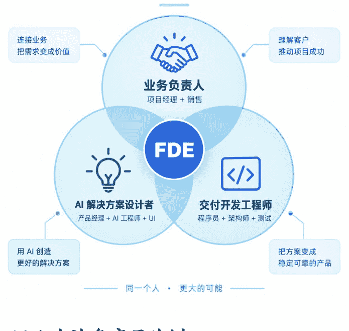

### 2. 以人力法务产品为例

拿我们做的人力法务产品来说（第十章会完整展开），你得大致了解企业在合同续签、试用期管理、员工确认这些事情上会遇到什么麻烦。专业法律判断需要律师参与，但你至少要能理解：为什么一个通知要在这个时间发，为什么某份材料需要保留，什么情况要交给 HR 处理。

如果只知道让 AI 生成一份合同，后面还有大量工作没人接。合同的信息放在哪里，什么时候提醒负责人，谁决定是否续签，员工有没有确认，没回复该怎么办，这些才是企业每天会遇到的细节。

把这些单点串成一个能自己运转的流程，客户才能真正省下时间。

这也是我反复讲业务细节的原因。企业买了一套系统，总要在自己的工作里感受到变化。少漏一个关键节点，少到几个网站重复查询，员工不用再来回抄同一份数据，

## 三、第一单，先从你已经懂的行业或者认识的人开始

### 1. 先做熟悉行业里的一个小工具

很多人最想问的恐怕还是：客户在哪里？

我比较建议从自己熟悉的行业开始。这个建议听起来很普通，但能省掉的时间非常多。

你在一个行业工作过，至少知道大家每天在处理什么，某个岗位经常被什么事情耽误，哪些材料难找，哪些数据总要重复整理。外行去了解这些，可能要问很多轮，你已经有一部分答案。

再具体一点，不必一下子把“跨境电商”这么大的行业都包进来。你可能只熟悉某个平台，某个品类，或者某一种岗位的工作。就在这个范围里找一个有用的小工具，也可以开始。

举个律师的例子。一位圈友给自己做了一个处理特定合同场景的小工具，能生成和修改他经常需要调整的内容。站在软件产品的角度看，它还有不少可以改进的地方；但他分享给同行后，同行一看就明白它解决了什么问题。

这一点很关键。一个陌生人看你演示功能，只觉得新鲜。但一个每天被同样事情困扰的人，会很有触动。

你自己先用，觉得有用，再拿给同事或同行试，听听他们的反馈。有人愿意继续用，你就有机会往下打磨。至于最后是做成软件、定制服务，还是围绕这个场景做培训，可以在接触真实需求之后再判断。

我们给跨境电商设计部门做过的东西，一开始也没有多复杂。设计师会用现成的生图工具，但他们工作中还有参考图、改图、批量任务、排队这些需要。大家下班前想提交一批任务，明天来看结果；或者希望围绕某个固定视角，批量生成一组图片。

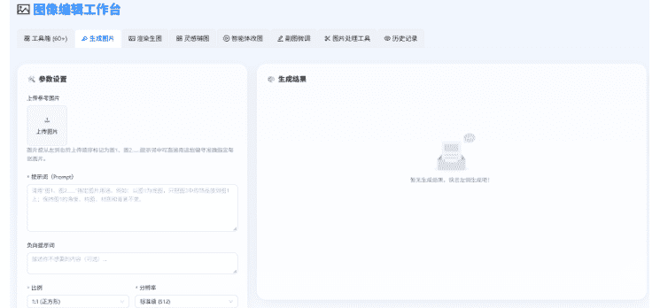

模型本身已经能画图了，但他们原来的使用方式不方便。把这些操作组织起来，让任务能排队、参考材料能一起提交，他们就会觉得好用起来。

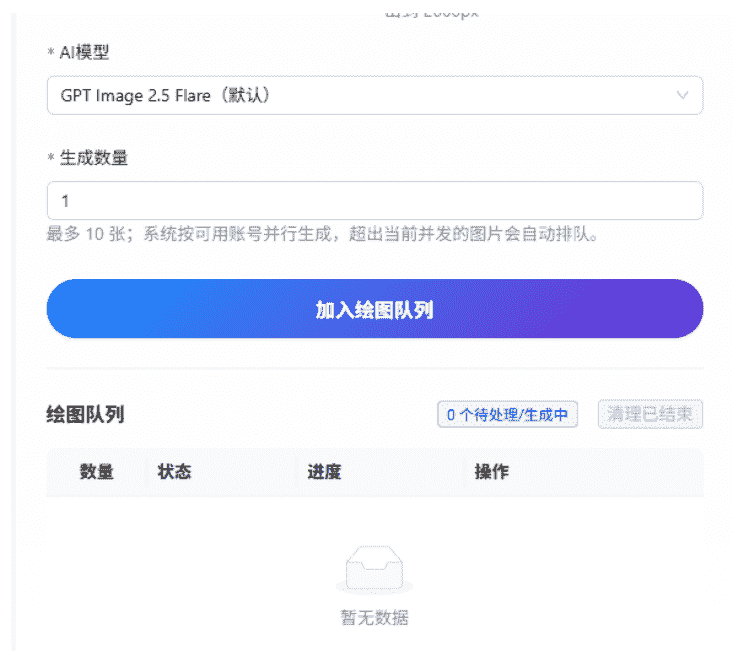

用户的需求往往很具体，你需要走进他的工作过程，才能看到。他未必会主动跟你说要一个很高级的 AI 系统，他可能只想少点几次按钮。

### 2. 从已有信任开始，但合作条件仍要说清

第二个起点，是已经信任你的人。

我早期有个跨境电商客户，是熟人。对方愿意先拿五万元出来，让我们尝试改造一个部门。这背后是对人的信任：他并没有完全弄懂我们会怎么做，但愿意给一次合作的机会。

但这不意味着，新人随便找个老板就能收到五万元。陌生客户没有这层信任，通常会需要更多证明。你需要让他看到，你懂他的业务，知道 AI 怎么融合进去，也愿意把事情落到实处。

所以可以先想想，身边有没有认识的企业经营者，过去的同事有没有开始创业，老客户有没有一个明确的问题。你跟他们交流的成本，通常会比全然的陌生的人低一些。

但熟人也要把规则讲清楚。信任让双方快速开始合作，但不能替代需求厘清和费用约定。关系越熟，越容易谈不清楚，做着做着双方有思想隔阂，反而伤关系。

### 3. 用小范围 Demo 验证合作意愿

我们现在遇到一些比较大的客户，如果这个行业还没有足够的案例，也会先做一个 Demo，让对方看看解决问题的可行性。特殊情况下，这个 Demo 可以免费，也可以约定后续签约时计入项目费用，具体看合作情况。

Demo 是敲门砖的作用。比如，对方给出一个实际问题，我们用一个小范围的结果，让他判断方案是否值得继续。这个阶段不适合承诺把整个系统都交出来。

如果你已经做了很多轮免费修改，客户仍然不愿意提供资料、不愿意确认下一步，或者开始谈费用问题，就需要停下来想想：你继续投入，究竟是在验证合作，还是在替一个没有明确计划的人反复试验？

第一单的目标应该尽量简单。确认一个真实问题，找到一个愿意配合的人，做出能让他判断价值的小结果，再把正式合同谈清楚。人的时间和精力有限，别一开始就把自己耗在没有尽头的尝试里。简而言之——第一单，往往就是你最熟悉的那件麻烦事。

## 四、公开分享，是实测有效的获客秘籍

### 1. 分享实际过程，让客户看懂你怎么做事

还有一个获客方式，我自己受益良多，就是组局分享。

我的分享经常会带来后续咨询，有时也会促成合作。但前提是，你讲的是自己实际做过的案例。

一个项目的客户最开始怎么表达需求，为什么第一版没做好，后来改了什么，费用为什么这样收，哪些情况最后没有接，这些都可以讲。你愿意把判断过程说出来，别人才能知道你做事是什么样的，也能相信你真的做了，细节透露出真相。

不用担心别人听了就会去做，而把所有内容都藏起来。这类企业服务，需要投入真实的时间，也需要处理客户现场的情况。别人听到一个方案，距离把它做好还有不少工作。而且整个市场很大，潜在的企业客户和场景也很多，个人能够服务的数量其实很有限，再多服务商一起瓜分都做不完。

做分享的时候，我更关心一个人听完之后，会不会觉得，自己的企业里也有类似问题，可以找我聊聊。这种咨询比较容易进入业务细节，因为前面的理解和信任已经有了一部分。

### 2. 老板也愿意为外部经验和判断付费

有些老板找你，也很清楚自己在买什么。他的团队可能有技术人员，也有人在研究 AI，但他想看外部的人如何解决同类问题，想少花一点自己摸索的时间。你讲的案例越具体，他越便于判断你的能力和经验对他有没有帮助。

我们有服务过圈友的企业。前期有很多沟通在线上完成，并没有一开始就见到老板本人。合作能推进，跟对方愿意探索，也跟已有的信任背书有关，生财标签就是一个很好的背书。

这个经历说明，远程合作可以成立，但信任要求更高。而且无论远程与否，建立信任、了解业务、持续沟通这些工作省不了。

### 3. 把投入和损耗一起讲，信任才有依据

还有一个细节，我比较愿意讲利润、投入和损耗。只讲营业额，很容易让人产生误解。项目收了几万元，跟自己最后留下几万元，是两件不同的事。交付拖久一点，多跑几趟现场，再加上合作伙伴的分工，钱很快就消耗完了。

把这些也分享出来，可能没有一个很大的数字吸引人，但会让真正想做这件事的人少走一些弯路。另外我希望来找我的客户，也能理解我们交付成本的构成，以及为什么需要有投入。

如果你暂时没有大案例，也可以先分享一个自己处理过的小问题。讲清楚原来是什么样子，你尝试改变了什么，现在还有哪里不顺。真实的过程本身就有信息量，不需要额外编一个很夸张的成绩。

公开分享还能帮你收集反馈。比如同行会给你补充信息或者其他方法，比如客户会提供不同场景的案例，你会逐渐知道哪些部分可以复用，哪些部分需要逐个定制。逐步形成你的项目体感。

## 五、见到老板之后，先别急着定大方案

见到客户，尤其是第一次见老板，很容易进入这样一种状态：对方说想做 AI 转型，你也想证明自己懂得多，于是从培训讲到智能体，再讲到公司的全面改造。

讲完之后，双方都觉得可以做很多事。但下一步先做什么，谁来配合，拿什么资料，还是没有确定。

我们一般会先找一个具体场景。第一个场景选得好，后面的合作会顺很多。场景功能选得太大，或者涉及太多部门，可能还没看到效果，大家已经在协调中消耗掉了耐心。

### 1. 从高重复工作、高犯错成本和高人员流失成本中找场景

我通常会问客户，哪一件事每天都在重复，而且占用了不少人的时间？

这类事情有个好处，员工做得频繁，多少想过哪里麻烦。哪怕他没有完整的流程文档，也比较容易拿出最近的例子。你可以顺着问，一天处理多少次，每次大概多久，要在几个地方查信息，最后把结果交给谁。

第二类是容易出错，而且出错后代价比较大的事。有人重复花时间，老板未必马上觉得痛；但一旦错误影响了客户、付款、重要日期或企业风险，老板通常更警觉。

还有一类，是岗位流失带来的损失。一个人离开之后，新人很难接手，原来的经验没有留在公司里。你可以看看，有哪些经验能整理成流程，让新人更容易学会，也让企业减少对个别人的依赖。

这三个方向，最后都要落到具体动作（SOP）上。不是泛泛的“公司效率低”“需要更智能”这样的描述，没有帮助。一个问题如果连发生在哪里都说不清楚，后面很难判断改善效果。

### 2. 数据和规则，要拿实际材料来核对

我会看客户真实数据。有没有历史记录，能不能拿出实际文件，原来的耗时有没有依据。客户说自己数字化做得不错，我们还是要看材料。系统多，不等于数据可以直接用。

有的企业买了不少软件，但同一个字段在不同表里又有不同叫法。

有些记录只在个人电脑里，还有些流程看起来虽然在线上，但关键决定仍然靠口头交代。

你需要知道真实情况，才能估计工作量。

规则也一样。客户说流程很成熟，可以请他拿一份最近处理的记录，带着你走一遍。如果到一个节点，他突然说这次情况特殊，要去问另一个人，你就知道这里必然还有没写明白的逻辑。

### 3. 要找到配合的人

老板同意了，只是开始。具体负责这个板块的人愿不愿意试，能不能讲清业务，有没有时间给反馈，影响很大。一个看起来技术难度不高的项目，如果没人回答问题，你可能要等很久才能往前走一步。

选择首个场景时，我会优先检查这五件事：

- 高频，这件事会反复发生，改善之后有持续用途。
- 资料可得，能拿到实际样本，知道数据缺在哪里。
- 规则相对清楚，至少能说清第一版要处理的情况。

后来我们调整了方案，考虑通过 RPA 处理。因为在线页面本身很慢，如果仍然逐条在线搜索，速度改善也有限，就把表格下载到本地，先比对，找出需要修改的内容，再回到线上更新。

这样减少了部分重复查询，但仍受线上系统速度的限制，整个过程还需要十几分钟，并不是完全不用等。不过，做到这个程度，对客户来说已经有体感，已经可以讨论下一步的合作意向。

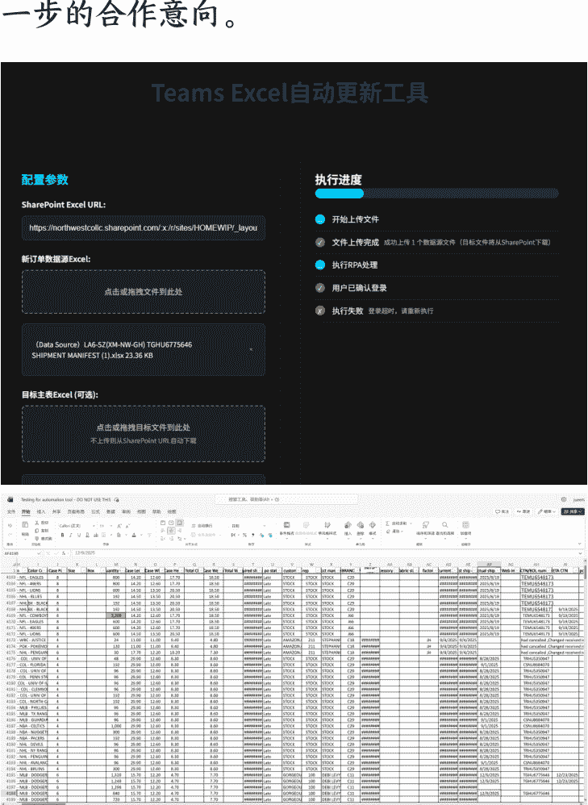

## 六、外贸表格更新：两种方案

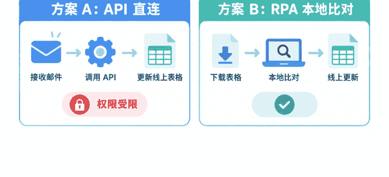

以一票否决，哪些指标只是参考。不同平台、不同品类，甚至同一家公司不同运营人员的习惯，都可能不同。

有些判断可以量化，有些暂时不能。能量化的，尽量明确标准；需要经验判断的，就继续挖例子做总结变为 SOP。一个可用和不可用的案例放在一起，往往比让对方解释“优质产品是什么”更省口舌。

### 2. 讲不清和不愿讲，需要分别处理

这个过程中，经常会碰到两种情况。一种是员工愿意讲，但讲不清楚。他每天都在做，已经形成习惯，不会把每个小动作都当成值得解释的信息。另一种是他暂时不愿意讲，可能担心工作被替代，也可能觉得你在审计他。

两种情况，处理方式并不一样。

讲不清楚，可以请他演示，用最近的一次真实任务走一遍。你看他在哪儿停顿、去哪个系统找资料、什么时候需要问同事。获得同意后，也可以用录屏或录音辅助整理，后面再一起确认。

不愿意讲，先别把对方当成障碍。有时你需要先帮他解决一个确实烦了很久的小问题，让他知道合作会给自己的工作带来什么帮助。信任建立起来，会更容易沟通和激发愿景。

### 3. 决策层定目标，执行层补细节

我经常会先从基层员工的痛点入手。老板关心公司整体的效率和风险，员工更在意今天能不能少做一点重复的事情。这两边都需要照顾。

如果你只跟老板聊，会漏掉大量 corner-case。如果你只跟员工聊，也可能做出一个员工喜欢、但老板却认为不值得投入的东西。决策层和执行层都要沟通，前者帮助你明确投入、产出和风险，后者告诉你细节操作与真正的限制。

这也是为什么现场调研很花时间。有些企业有现成 SOP，但拿到手后，仍然要核对它跟现在的工作是否一致。有些细节早就改过，只是文档没更新。还有些流程写得特别完整，现场却一直采用另一种更省事的做法。

把那份文档原样变成程序，很可能得到一个没人愿意用的系统。

我们做医疗相关项目的时候，就遇到过专业人员很难把自己的判断过程完整说出来。他能够看资料、给结果，但让他逐步解释，反而困难。你得通过实际案例和反馈，慢慢理解哪些信息重要，怎样表达结果更合适。

### 4. 用真实试跑修正 SOP，工具深挖细节和记录

所以，第一次梳理出来的 SOP 一定还会改。客户看到软件之后，才会想起自己原来还有做某个动作，某类资料应该分开判断，某个异常需要额外处理。这些反馈会继续修正流程。

前期多问一点，会减少后面的返工，但前

期也不可能穷尽一切。我的做法是，尽量把当前最重要的部分讲清楚，然后做出能试用的初版，让真实使用来补缺补漏。

工具方面，我会用 Grill me 这类提问辅助方式的 skill 追问需求，用 OpenSpec 之类的方式记录需求和开发习惯约定。工具能帮你发现思考上的遗漏，也能让项目上下文不容易丢失，但最终仍要由企业里真正落地方案的人来确认。

### 第 1 题：第一版产品服务谁？

- A. 只服务你自己的代账团队（推荐）：先用 3-5 家真实公司跑通资料收集、流水核对、凭证草拟、申报检查和归档，暂不让客户自主操作。
- B. 一开始就做客户可登录的 SaaS。
- C. 先做 AI 财税问答，不承担实际记账交付。

我推荐 A，因为当前最大的不确定性是业务判断和资料缺口，而不是技术。先把内部交付跑顺，再提炼成客户产品。

你选 A、B、C，或直接修改你的答案？

> A但是，因为我们将来是要服务其他客户的，所以如果有一些不好改的点，可以先做预留。不过目前更多的是先把自己的流程跑通

用时 47s >

### 第 2 题：谁承担实际记账和报税的法定义务？

- A. 已有代理记账许可证，并有合资格的负责人/会计。
- B. 目前没有许可证，先做内部辅助工具，实际记账、申报和最终核签由持证机构或合资格会计承担（推荐）。
- C. 目前没有许可证，但准备直接以自己的名义承担记账报税。

中国大陆除会计师事务所以外，机构从事代理记账通常需要取得财政部门批准的代理记账许可证书，代理记账人员还要按统一会计制度和委托合同处理业务。 财政部《代理记账管理办法》

你目前是哪一种？

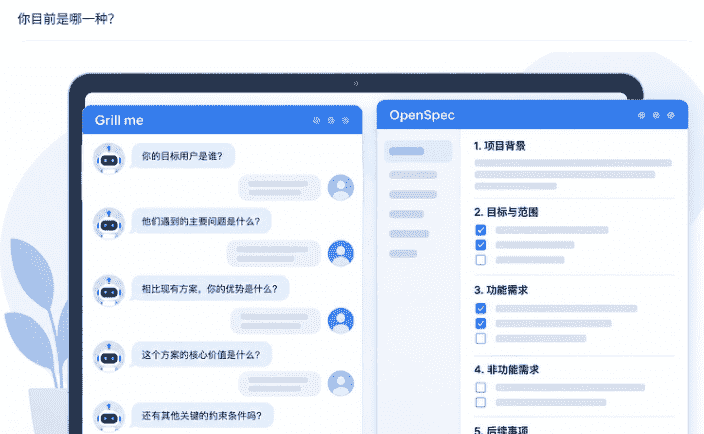

一份 AI 帮你写得很完整的 SOP，如果没经过业务核对，完整也只是文字上的看起来完整。实际运行需要的某个数据，可能根本没有；它默认每一步都有人配合，实际上那个负责人可能一周才处理一次。

这些差异只能通过沟通、观察和试跑去发现。前期尽量细，后面的开发才更稳。

## 八、程序、RPA、AI和人工，各自放在合适的位置

### 1. 规则明确的部分，优先交给程序

SOP 梳理完之后，我们会把规则清楚、能够固定下来的部分写成程序。

例如，按编号匹配一条记录，比较两个字段是否一致，到了日期发送提醒，按照已确认的条件进入下一步。这些事情有清晰的规则，用程序通常更稳定，执行成本也更容易控制。

### 2. 没有合适接口，再评估界面自动化

再看 RPA。你可以把它理解成模拟人的电脑操作。某个系统没有合适的接口，但人可以通过页面完成任务，我们就会考虑能否让自动化工具代为操作。

这里要注意，页面能操作，跟长期稳定操作还有区别。因为页面会变，登录状态会失效，权限和验证方式也会限制自动化的执行。你需要把这些情况纳入交付考虑，并确认数据访问和操作是在授权范围内。

如果接口能用，优先评估接口。没接口不得已时，再看如何减少不必要的点击与等待。前面外贸表格的例子，就是在接口条件不具备后，调整了自动化的做法。

### 3. 需要理解、识别和生成的地方，再用模型

一样，访问条件也不一样，有的还涉及登录和验证。

他们最开始的痛点很直接。工作人员要去很多地方看新标，有新信息再判断跟自己的业务有没有关系，工作量大，时间也不够。于是希望把这些信息集中到一个地方，方便处理。

只听到这里，你可能想到可以做一个信息聚合工具。但我们继续聊之后，发现还有几个问题需要解决。信息收回来了，哪些值得看？哪些应该优先看？为什么这一条潜力高，另一条可以暂时不管？

这些问题涉及客户的具体业务，不是采集回来就解决了的。

我们咨询了客户的业务分类。客户提供了比较清楚的 SKU 分类，也就是他们内部对产品或服务的分类描述。每个类别是什么，哪些业务更重要，具体的业务定义是什么。

这样的具体的 SKU 表对交付结果有效性帮助很大。但很多企业暂时没有这类细化整理过的资料，就需要 FDE 跟着一起梳理，项目节奏就会慢一些。

有了业务分类，还可以区分重点客户。是不是有一些企业是他们特别想服务的？有没有分级？某个项目跟他们的业务很相关，但客户类型不合适，是否应该调整优先级？

接下来是投标资格和条件。某个标看起来金额高，但要求的资质、过往经验等条件不满足，花再多的时间研究也可能没有意义。这部分要把硬性条件和偏好区分开。

把对应信息提取出来。

### 4. 客户给的权重，也需要校验

我们经历过评分很不准的情况。

客户最开始给过一版权重。但得到的评分两极分化比较明显，有些结果很高，有些很低，中间缺乏过渡区分。表上有了分数，但对员工帮助不大。

如果是传统的软件开发流程，按照客户给的内容做功能，客户怎么给，就只能做到这个程度，如果抱有这种心态，可不行。

得跟对方一起讨论优化，哪些分得不合理，哪项权重需要调整，某个硬性条件是否应该先筛掉，不能只在总分里轻轻扣一点，这本身也是帮客户在细化明确和优化 SOP。

当然，调整也要由业务方参与确认。你不能凭自己的感觉替客户决定哪一类逻辑更重要。FDE 在这里的作用，是把规则运行后的问题呈现出来，帮助双方更清楚地讨论。

这个项目经历了两三个月的磨合。听起来，最开始不过是收集一些招标信息；真的使用之后，评分、字段、查看方式、消息通知，都需要修改。当然也有一些沟通档期同步上的时间消耗。

### 5. 先落地，再拓展

结果交互上，跟一开始提的需求比起来，也有一个明显变化。一开始我们把信息同步到飞书表格里，后来又往飞书群里推送。

原因很现实，数据放在表格员工不一定会按时打开。信息触达更近一些会更方便。

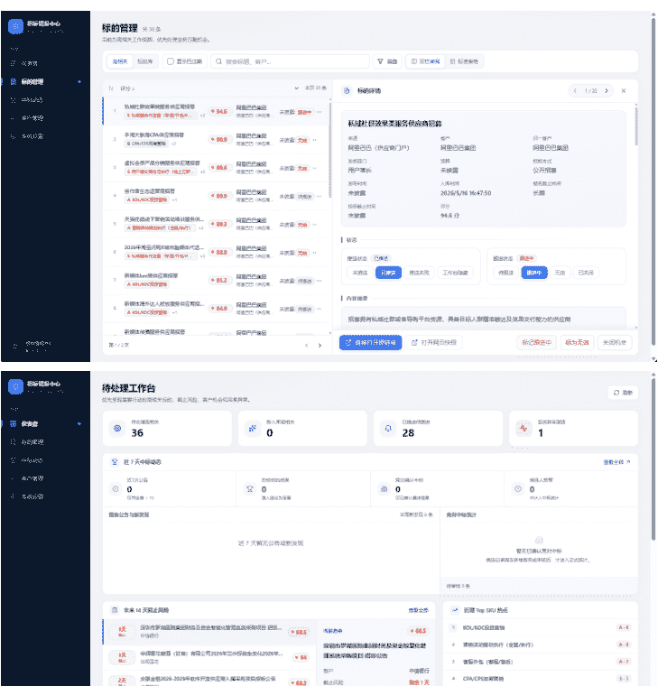

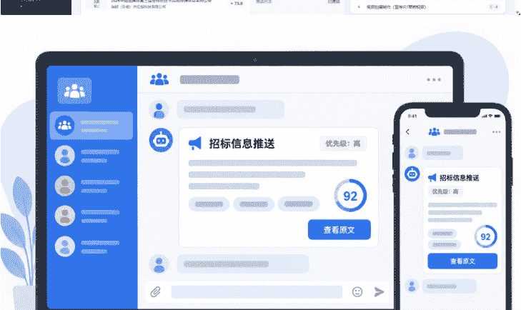

你会发现，开发一个功能和促成使用，中间还有很多这种小事。表格已经有了，通知有没有到？人看到了，能不能快速判断是否要处理？需要进一步了解时，能不能快速找到原始材料？

这些决定了工具是否好用，能融入工作习惯。

再往后，还能有更多拓展。比如，在已有客户信息的基础上，研究招标周期、历史项目、竞争情况，给业务人员提供进一步参考。但这些只是后续可以讨论的方向，还不是当前项目已经完成的成果（已有功能但还未得到客户的验证，因为是很新的业务流程尝试，本身这个 SOP）。

对刚开始做 FDE 的人，我更建议注意这个案例的前半段。客户最初表达得很少，你通过追问，把决策方案的业务信息一点点找出来。等系统跑起来，双方再用结果修正规则。软件才会越来越好用。

## 十、人力法务产品，立了规矩没人执行的问题

### 1. 专家诊断要落地，还需要有大量日常操作

第二个案例，是我们和法律专业伙伴一起做的人力法务产品“职法狮”。

企业遇到用工问题，会找律师咨询，也可能请律师优化合同、制度、流程。优化后的制度有了，日常动作是否到位，仍然是一个问题。

到了某个时间，该找负责人确认的事情没有确认；需要收集的材料没收齐；员工回复留在聊天里，找不到了。HR 每天有很多琐碎工作，不一定能把每个节点都盯住，不能完全依赖人，很危险。我们想解决的，就是这些日常执行的缺失。

### 2. 自动推进标准动作，把例外交给人

产品里有几个比较典型的场景。劳动合同进入续签决策期，系统调取合同信息，向直属负责人收集意见。审批完成后，再按已经确认的决定，发送需要员工确认的内容，保存通知记录和材料。

如果某个环节超时，或者存在信息冲突，再让 HR 介入处理。

试用期管理也类似。到了相应时间节点，负责人需要提供评价和辅导等过程材料，员工需要确认的内容及时发出。当资料缺失、材料矛盾，或者快超时时，系统提醒 HR 介入。

还有考勤相关的确认。发现记录与已有申请不一致，可以先收集说明和依据，之后由负责的 HR 判断。系统关注的是流程怎么推进、资料怎么保存。某个记录在法律上意味着什么，如果逻辑复杂，仍需要专业人员判断，不能单纯一条规则直接下结论。

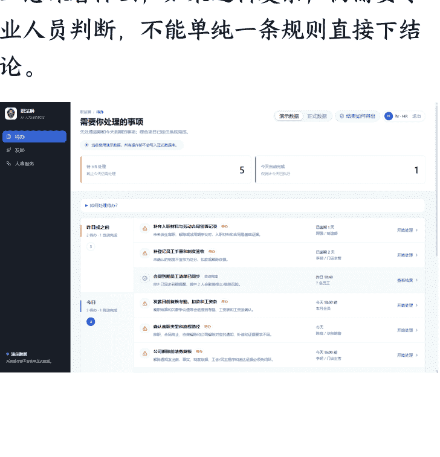

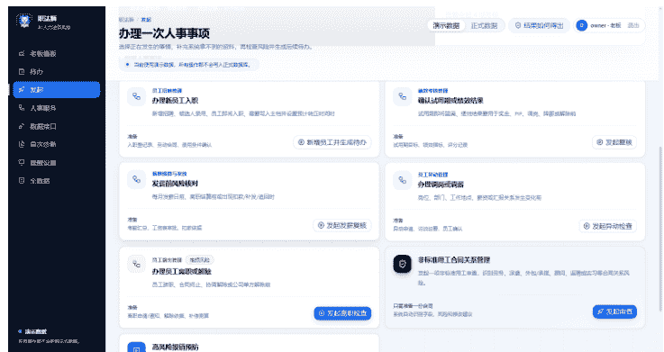

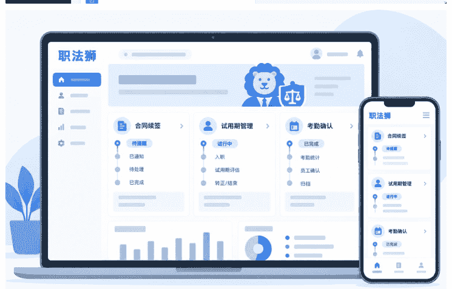

### 3. 律师专业经验与企业数据，需要一起接入

做这类 AI 产品，一个重要前提条件是垂类专业伙伴有实际服务企业的经验。哪些节点容易遗漏，哪些材料经常缺，什么事情需要人来判断，他们比较清楚。AI 可以协助整理，但不能凭空替代这些经过实践的认识。

然后，我们要把它接到企业现有的工具里。公司用飞书、钉钉、企业微信，或者已有的人事系统，要看哪些数据可以按授权获取，任务通过什么渠道发送，处理结果如何回到系统，都要明确。

对数字化基础好的企业，可以尽量接现有数据。对资料比较分散的小企业，可能还需要时间补齐。假如合同日期都没有可靠记录，自动提醒也缺少可靠的依据。

我觉得这个案例的价值，在于它同时解决两边的痛点。企业希望日常动作更容易执行，律师也希望自己的专业意见能落到实务工作里。双方各自提供一部分能力，才有机会把产品做得更落地。

对小企业而言，很多原来需要较多人工执行的事情（很多企业 HR 和行政财务甚至都是一个人兼职，分身乏术），可以通过软件获得一些提效。但能覆盖哪些场景、需要怎样的专业法律支持，仍要一事一议。

### 4. 先有一个种子客户，再找可复用部分

我们最开始开发第一家客户时，也是按定制项目来执行的。即使手里有一套专业法律流程，进到企业之后，仍然要面对数据、现有工具和人员习惯的问题。但是有真实落地的体感，便于提取可以复用的部分，下一家就会更容易些。

为什么我们选择这个方向去做 AI 产品，是因为某些用工管理事项有比较共通的法律专业要求。法律的变化比起业务的变化来说，比较慢，而且放之各个公司，法律都是一致的要求，有很强的通用性。跟跨境电商不同公司的运营方式相比，流程的差异更可控。不过，各家公司适用的人力资源相关的管理情况和具体事实仍然有差别，无法一套规则卖给所有人。

产品化也需要从这些差别里找边界。有的内容是标准功能，有的是可配置的可选功能，还有一小部分是需要专业法律人士介入的。把场景功能分类清楚，才能更有把握地报价和交付。

修改的量级。材料多少、病例复杂程度、文书要求和审核深度都会影响时间。

## 十一、医疗文书：前后对比

### 2. 初版反馈很差，逐步变得离不开

这个案例有意思的地方，在于一开始交付并不顺。

第一版拿过去，客户觉得不好用，反馈也很直接，大差评。对我们来说，已经花了不少心思，听到这样的评价当然会有压力。但继续观察对方的使用情况，你会发现，确实有很多地方跟他们工作不贴合。

专业人员不一定能在软件开发前把每个要求讲明白。看到生成结果，他们才会指出某个内容应该放前面，某种表达不合适，或者某份资料不能这样合并。于是需求不断增加，初版之后其实还有大量调整。

一个月收到一两百条需求或反馈，并不稀奇。这里面不全是新增功能。有些是原来没说清的规则，有些是操作不方便，也有些是使用后才发现的异常。

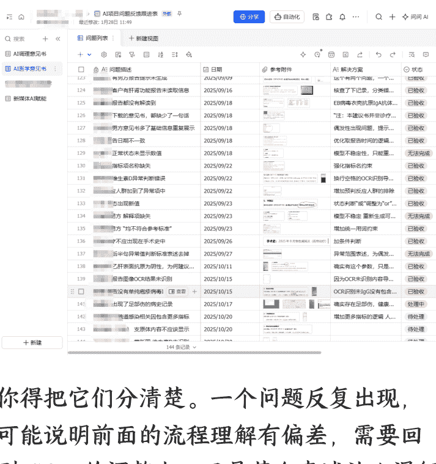

你得把它们分清楚。一个问题反复出现，可能说明前面的流程理解有偏差，需要回到 SOP 的调整上；只是某个表述让人误解，可能调整交互就能解决。不能所有反馈都简单理解成再加一个按钮。

### 3. 用户越依赖系统，维护要求越高

后来，客户逐渐用顺了，对系统的依赖也增加。原来要花时间劝他们试，等他们真的觉得省事，系统出了问题，他们会主动跳起来着急解决，是真离不开了。

这时候你就能直观地感受到，软件有没有融入到日常工作中。客户口上说不错，只是一种反馈；他愿意再真实工作中用，而且希望你保持稳定可用，是更确定的可用反馈。

但这种依赖也意味着责任增加。服务中断会大大影响对方工作，你对稳定性、异常处理和后续维护的响应要跟上。

前面也提到，这个客户非常重视客情关系，部分服务的客单价很高。给出一段不合适的话，可能影响的损失远远超过一次模型调用的费用。因此，把AI用在资料和初稿上，再由医生二次确认，比0人工审核更符合当时的需求。

同一个模型，放在不同位置，承担的风险不一样。FDE需要理解这种差别，并跟客户一起决定它能做什么、做到什么程度。

## 十二、微信知识库，需求和风险并存

### 1. 先区分知识和待办，再设计整理方式

最后一个案例，是我自己还在探索的方向：把工作中的聊天信息整理进知识库。

微信里有很多有用的信息。跟客户聊需求细节，群里讨论一个场景的解决方案，有人交代一件待办的事，这些内容分散在不同对话中。每天靠自己回头翻，很容易漏，也很费时间。

我想做的是，把需要关注的对话整理出来，区分哪些是值得保存的知识，哪些是需要做的事情，再由人确认核心点后，进入相应的知识库或待办。

这跟简单把聊天记录全部存起来，有不少差别。

一个客户群里的内容，可能需要回记到这个客户的资料集里。一个同行再群里讨论的技术方案，适合放在方案库里。有人临时说让我下周提供一份材料，那更像一项待办。它们后续的用法不一样，前面就应该分开处理。

哪些群不需要处理，哪些私人对话不要进入工作资料，也需要控制。整理信息不能忽略隐私和授权。拥有某台电脑或某个账户，不代表所有对话内容都可以随意扩散或交给外部服务。

### 2. 区分演示 demo 和可用产品

我当时做的是 Windows 环境下的微信知识库探索，并没有做成向大家广泛出售的成熟安装包。除了自己使用，也给已有客户做了小范围尝试，安全性、兼容性和账号风险还在评估。

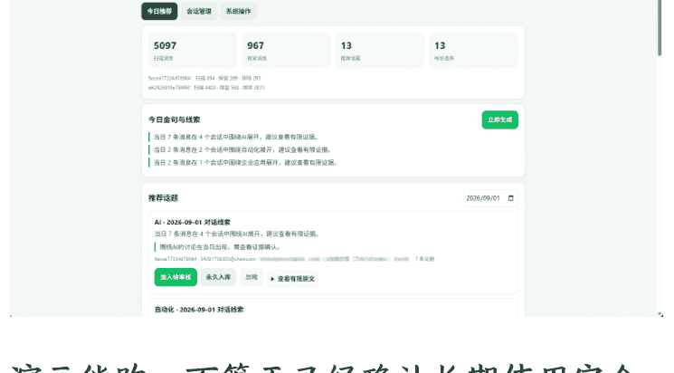

演示能跑，不等于已经确认长期使用安全不会封号。我还没有把它作为放心交付的成熟工具，后面的观察验证工作得继续。

### 3. 围绕用户的实际用途，设计知识结构

后面如果能否用可靠、合规、经过授权的方式取得资料，知识库如何分类和维护，仍然有很多工作要做。每个人关注的事情不一样，行业也不一样，很难把自己的一套结构直接复制给所有人。

医生关注案例、产品、客户等信息，法律从业者的资料组织方式又不同。有些企业按品牌和产品线管理，有些更关心客户特征或某个关键指标，哪怕同个行业也有不同的专注点。你得先了解他们准备如何使用，再决定怎么整理。

所以，我看好的是围绕实际用途做信息结构搭建和使用流程搭建的服务。它可以从个人工作延伸到企业，也可以专门服务某个行业。是否适合做成标准产品，需要做共性提取。

对我自己来说，它也有直接价值。过去讲过的课程、讨论过的方案，整理好，下次准备分享时就更容易找到材料，再按听众关注的问题直接让 AI 组织内容。省下来的时间不一定马上变成收入，但确实能减少重复工作。

这个案例和前两个成熟度不同，把它也讲出来，是想让大家看到探索阶段是什么样子。发现需求、做出原型、确认安全性、验证使用、考虑售卖，这几个状态要分清楚，不能看见一个 demo 就把后面的工作都省略了。

## 十三、我怎样筛选合作客户

做过一些项目之后，我越来越关注前期客户筛选。

在我接触的这些企业里，确实有大量可以着手改善的需求。但有没有需求，跟适不适合由我们来做，是两个需要分别判断的问题。

### 1. 选企业客户，别只看行业热度

我会优先看企业和业务是否在发展，利润情况是否支持它投入。一个正在扩张、愿意改善流程的企业，通常更容易讨论长期
广告相关业务的企业。沟通里能感觉到内部几位关键人物有矛盾，外部项目人员很容易被卷进去。你明明来讨论工作，最后对话却变成了内部权利关系争论的延伸。

这种情况要谨慎。你跟其中一位关系不错，未必就能顺利推进，因为对立的另一位可能掌握实际配合资源。项目对他们各自的意义，可能也不一样，没必要耗在上面。

我不建议新人把协调复杂内部矛盾当成首单的工作内容，难度指数暴增。先找配合关系比较好的客户，让自己把需求到交付的过程先走通，有意向再去啃那些硬骨头，会更合适。

当然，任何企业都会有阻力。外部人带着新系统进来，改变工作方式，本来就需要时间渗透。我们要判断的是，这股阻力有没有被看见，有没有愿意一起解决的人，而不必须要求每个员工从第一天就热情欢迎。

### 2. 判断自己承担得起什么样的软硬件投入

关于制造业，我有一些观点。

我接触过电厂相关的节能需求。里面涉及现有控制逻辑、监测指标，还有传感器和执行设备等。你要改善节能，可能同时需要软件、硬件和专业工艺的配合。

当时有段很经典的沟通：企业觉得自己现有水平已经不错，但聊到更细的控制方式，又承认有些工作还没做，自相矛盾。这种情况下，除了出有效的技术方案之外，还要看有没有人愿意推动、有没有人愿意承认问题还可以继续改进。

直接决定你能拿多少钱时，更要看有没有可核对的记录。毕竟扯皮是很累的，你有选择。

### 3. 指标要能核对，承诺要在能力范围内

同样是节约人力，口径也有很多问题。你说做完之后可以少用一个人，老板后来把这个人调到别的岗位了，没有裁员，怎么计算？还是原来这些人，但他们接了更多工作，又怎么算？

如果只约定按裁掉多少人来分成，最后人没裁，你做的改善可能就没办法按那个约定结算。你不能替企业决定用工安排，也不能把自己的回款完全放在对方后续的组织决定上。

所以，我比较愿意先找更容易观察的指标。比如特定流程的耗时，单位时间处理的数量，符合约定标准的结果比例。具体选什么，要双方一起确定。

这里还会碰到另一个限制。有些企业希望你帮它从无到有解决获客问题，但手里没有经过验证的流程。如果我们擅长的是优化现有业务，就要把能力范围说清楚。

如果客户原来有一套引流方法，想把其中收集、整理、处理的步骤做得更高效，可以做。如果对方没有方法，希望你一接手就保证有新客户进来，这已经涉及另一种不确定性，不能因为想拿单就一起包下来，这已经不是 FDE 的范畴，而是卖流量卖运营，你要用不同的结算方式。

客户有期待很正常；但哪些期待你目前有

不过，前提就像上一章说的：基准和验收方式要能确认。如果结果很难归因，数据又拿不到，就不要因为“按效果付费”听起来有吸引力而仓促答应。

我也尝试过围绕节省成本和业务增长讨论分成。

节省支出的空间通常有极限边界。企业成本上限就在那里，想象空间不大。增长相关的空间就大很多了，当然难度也会更大，而且影响增长的因素也更多，更要说清哪些变化可以归到这次合作，需要一些信任基础。

增长抽成如果按总收入来算，老板可能觉得不合理，因为自己有业务成本也在增长；如果完全按净利润来算，服务方又很难掌握所有费用，毕竟企业的有些支出不容易透明。我们讨论过以毛利等口径作为参考，但仍然需要逐项约定，不能把一个词写上去就当作双方理解相同。

我们谈过的一些分成比例，都是特定谈判里的方案，单独拿出来意义不大。从 10% 到 50% 都是有可能的，你先看你投入了什么、承担了什么、有什么数据维度能用来核算，再看具体比例是否合适。没有完美的谈判，不如先推进尽快完成，拿下更多客户能赚得更多。

## 十四、AI 战略合作报价

外部团队负责 AI 战略、FDE 落地、评测和资料整理；▇▇提供业务资料、数据权限、内部负责人。

| 分三部分报价 | 固定服务包含 |
|---|---|
| **固定服务费** 60万元：启动费5万元，余款55万元按月度目标或里程碑节点结算 **成本改善激励** 40%：首个合作年度，经核验且直接归因于AI **开源提效激励** 30%：首个合作年度，经核验且直接归因于AI的新增毛利 **股权激励评估**：合作满6个月后另行评估 | 1. 同管理层定期评议阶段目标、合作节奏及激励依据指标 2. 重点部门流程与SOP梳理、访谈、痛点需求挖掘 3. AI场景筛选、方案设计、AI中台及工具开发 4. 潜在企业内FDE人员挖掘、AI识图培训、最优算力渠道筛选 5. 协助数据规范化、流程数据化、权限设计、系统接口对接 6. 必要功能培训、反馈收集、限期优化、功能文档整理 |
| **激励定义** | **不包含的费用** |
| **成本改善**：已实现、可复核并直接归因于AI的现金成本改善，包含人力、财务、系统、第三方、硬件等成本支出项 **开源提效**：已实现、可复核并直接归因于AI的新增毛利或实际回款贡献，不直接按营业额或GMV计算 **结算口径**：项目启动后三个月内确认基线逻辑、数据来源、计算方式、归因逻辑和审核人，同一结果只计算一次，复核通过后按合同结算 | 1. 第三方算力和模型费用 2. 云资源、服务器、存储和流量费用 3. 软件订阅或采购费用 4. 接口、API和其他第三方服务费用 |

### 3. 组合报价更柔性

还有一种组合方式，启动费、阶段费用、效果分成放在一起。前面的费用支持必要投入，用来把控交付的节奏，后面的部分跟约定效果联系起来。金额更大的长期合作，我们会按某个板块或某个阶段来拆付款节点。

几万元的小项目和持续一年的合作，付款安排一般不同。有的项目先收一部分，验收后再结剩余；有的要拆成多个阶段。尽量避免不确定工作由你先承担，没有清楚的阶段确认和付款安排。

在表达上，我也会注意按项目、阶段和服务范围的术语来谈。外部合作如果只剩下“每月给你多少钱”，对方容易用员工的方式代入衡量，却没有同步明确外部服务的时间、职责和边界，会有思维定式，后面会出现期待差异。

## 十五、三种报价方式

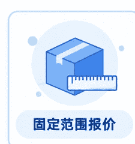

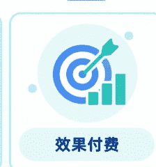

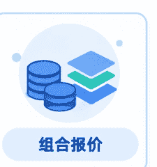

### 4. 长期合作，先磨合再考虑股权合作

至于股权或技术合作，我觉得可以作为更长期的方向。先一起做一段时间，看到彼此做事的方式，再谈是否适合更深入地合作。

初次接触就把未来收益谈得很大，双方对业务和配合都没验证，意义有限，有时候是白费时间。我们有些合作会先磨合几个月，再讨论后续。

对新人而言，能把第一笔固定费用、第一阶段范围和验收讲明白，已经是很重要的一步。不要因为别人谈了分红，就觉得自己的项目也必须从分红开始。

## 十六、成本——别只算开发费，沟通和后续修改都在花钱

一个项目到底赚不赚钱，必须把成本看全。

### 1. 把获客、沟通和后续调整都算进去

我把一个项目里的工作拆成六类，报价前可以对照检查有没有遗漏：

- 获客和项目管理，介绍、沟通、推进合作、项目管理，有时还包括资源协调和回款跟进。
- **产品与流程**，需求调研、SOP 梳理、交互设计和范围确认。
- **技术实现**，架构、初版开发、AI 方案设计和数据结构化。
- **测试与调整**，初版验证，以及使用后继续修改和测试。
- **培训与维护**，安排试用和培训、收集反馈、持续运维。
- **外部支出**，差旅、工具、模型算力、服务器及第三方采购。

### 2. 项目真实投入

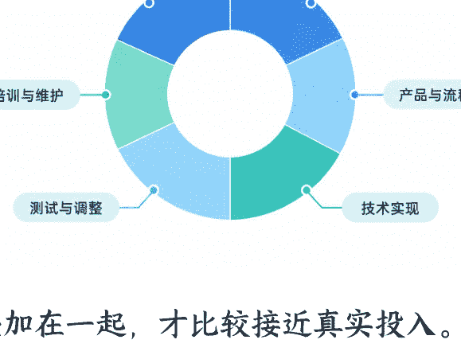

这些加在一起，才比较接近真实投入。

销售带来了客户，如果还负责推进、协调、跟进付款、项目管理，他承担的事情更多。你不能只看最后是谁写了代码，就决定所有收益怎么分。

产品沟通同样需要时间。去现场，把大家说得不一样的地方整理出来，找例子确认，把业务规则讲清楚，这些往往直接决定后面能不能顺利做完。

有些项目的难点在数据。材料杂，格式不

即使现在费用很小，也得说清楚。

### 3. 省费用，也要算自己的时间和精力

至于模型成本本身，我的态度是，不要为了省几百元，把大量时间花在折腾上。我们自己早期很扛，后来能感觉到，精力和机会同样有成本。

你为了找一个便宜一点的工具，花了一整天，结果该给客户的方案没做完，或者没精力处理一个重要反馈，省下的费用可能远小于损失。

以我们交付过一些客户为例，模型支出每月大概几百元。但这是特定用量和方案下的情况，不能拿去承诺所有项目的月成本。图片、视频、大量文档、复杂智能体的用法，成本都可能不同。

### 4. 上线所需的资质和手续，尽早确认责任人

还有很容易遗漏的事，域名、备案、小程序认证、支付开通、主体资料等。具体项目需要哪些，要看产品形态，但一旦涉及，就得提前问清楚由谁准备、还需要什么条件。

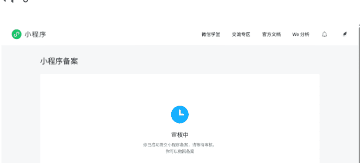

这些流程未必由你决定进度。代码做好了，对应资质还没准备好，客户一样不能按计划用。遇到自己不熟的部分，可以请有经验的人帮忙，必要时付费咨询，通常比凭印象反复尝试省事。

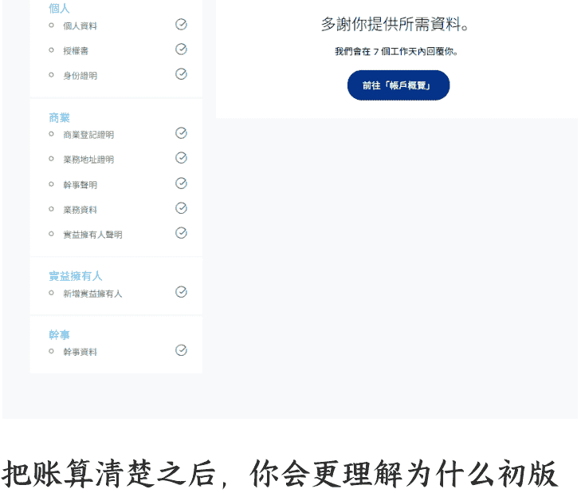

把账算清楚之后，你会更理解为什么初版开发很快，项目总报价却不可能只按写代码的几天来算。后面有人在持续迭代，有人需要协调需求，真实使用还要继续打磨，这些都必须有人承担。如果在报价里漏掉，最后只会在你的利润里面扣。

## 十七、第一版之后，交付才刚开始

### 1. 明确初版范围，做好预期管理

AI 编程让初版出来得很快。对于范围合适、条件比较明确的需求，我们可以在一到七天内做出初版。但这个时间只指初版开发，并不是说所有项目一周内都能正式完成。

客户开始使用，才会暴露很多之前看不到的问题。

先要做好预期管理。你可以在使用前告诉对方，第一版覆盖的是当前确认过的场景，会有需要调整的地方，希望通过实际使用尽早发现。哪些部分可以拿来尝试用于生产，哪些暂时不要用于正式业务，也要说明。

但也并不代表可以交付一个完全没检查的初版。已确认的基本功能、必要的安全条件和操作范围，还是要做好。

初版之后的修改，几乎必然比初版本身花的时间更多，除非这个 SOP 极其完美真实高可用。这需要在自己安排工作和对客户说明时，都提前考虑。

### 2. 测试要看边角情况，模拟不能代替验收

我们通常会让 Agent 帮忙测试。除了走一遍正常流程，也会让它尝试不同的使用情况，找边角问题。还可以让它按不同的用户画像，模拟使用时可能遇到的困难。

这种方式对发现问题有帮助，但模拟结果要跟真实结果分开。Agent 模拟了一批用户，不等于真的有这些用户使用过；它生成一份分析报告，也不能直接拿来当客户验收通过的证据。

真正验收，得看客户能否丝滑的使用并在大部分情况下成功完成工作。

测试时，我比较在意那些正常演示时一般不会碰到的场景。比如系统默认接飞书，客户恰好没用飞书，怎么处理？资料不齐时，会不会直接报错？某一步需要其他人确认，对方一直没回复，后面该停住还是继续？

你不一定亲手把所有测试都做一遍，但需要想到这些问题，并安排验证。单例子跑通，离稳定交付还差不少。

### 3. 没反馈≠没问题

还有一种情况，是软件已经交付，客户却一直没有用。

我们就遇到过。更新后，对方没什么反馈，以为没问题。继续问才知道，还没有用上。没用上，也就没有真实反馈，项目其实是停滞的。

这时候可以请负责人拿当天要处理的工作，让相关员工试一遍。看他在哪里停下来，需要问什么，最后结果能不能直接采纳。

比起再培训一遍，这样更容易发现问题。

等用户真的尝到甜头，他自然会想用。医疗项目后来服务偶发故障，客户主动催修，就是一个真实的例子。但初期通常仍需要负责人推进一下，不能把安装完成当成推广完成。

如果每次都要你大力推才能用上，还是得复盘下交付物。是不是操作太复杂，还是结果用不了，或者选的场景对员工本来就不重要？推广方式是一个原因，产品也是一个原因。

## 十八、不需要培训的产品才是好产品

### 1. 让软件顺着工作走，减少记忆和操作

我挺在意交互体验。尤其企业软件，每多一点学习成本，都可能变成推广使用上的

培训也是需要的，但要有实际案例的辅助。

以前我们给企业做通识培训，有些人当下听进去了，过一两个月不用，又忘得差不多了。也遇到讲了几遍，有人仍然没有用过。

这未必是对方故意不配合。他手头有工作，原来的办法虽然麻烦，但已经熟悉。新工具还没给他带来足够明显的好处，或者培训没有实际案例的关联，没有体感，他就容易先放一边。

因此，培训最好跟一个实际场景连在一起。今天刚好有这份资料，就用新办法处理一次；做完之后，看原来要做的哪些动作省掉了。这样获得的理解，往往比听一小时功能介绍更具体。讲故事确实比讲方法来得容易被接受。

### 2. 培养内部 FDE

也可以在企业里寻找有探索精神的人。我们给客户装好 AI 编程工具后，有的人会主动研究，很快做出自己的小尝试；有的人需要先看场景演示，再跟着做；还有人暂时没有行动。

这些差异可以帮助你筛选出主动探索的人，可以多给一些支持，让他逐渐承担部门里的小开发任务。

判断一个人适不适合培养，不能只看工具消耗量或登录次数。用得多是一个信号，但也要看他做出了什么、有没有认真吸收。

（从企业内部人员的 Token 使用量可以初

片和文字交付比较多，可以在这部分多探索；做视频的朋友，应该要对新视频工具更熟。所以同行之间分享不同赛道的实际体验，可以帮助彼此少走一些弯路。

### 3. 老板视角与销售能力，让方案和投入更合理

老板视角，需要调整好心态和积累一些观察经验。你需要理解这笔钱从哪里出，项目影响什么工作，老板为什么现在愿意投入。他愿意花钱，通常有自己的经营考虑，你把方案跟这些考虑联系起来，沟通才不会一直停在功能上。

销售能力，自然不用说，FDE 也是头号销售。这里包括取得信任、了解决策过程、谈判、澄清费用方案，以及推进款项。

我原来销售能力并不好，产品经理出身，有时拉不下脸，不太好意思谈钱。后来做得多了，才慢慢过这一关。你愿意做事，还需要让别人知道你能做什么，清楚地提出合作条件。

讲解和培训也是重要的沟通能力。你能不能把产品用客户听得懂的大白话说明白，出了问题怎样沟通，怎样让对方愿意继续配合，都会影响交付效果。

### 4. 项目管理、技术和测试，把交付做稳

项目管理解决的是执行安排资源问题。如果手里同时有几个项目，哪一个要先交，谁还欠一份材料，哪个环节有风险，合作伙伴什么时候入场，你得有数。只想着自己今天写什么代码，项目很容易在各种地方停住。

技术基础则帮助你理解系统怎样运行，也便于跟企业内的技术部门沟通。前端和后端大概做什么，数据放在哪里，怎样部署让别人使用，服务器权限、安全、性能和持续费用怎么考虑，至少要有基本概念。

尤其从自己电脑上的本地软件到部署给企业多人同时使用，会有很多问题。自己能打开的东西，别人未必能正常访问，在本机跑一次没问题，持续运行时可能出故障。你可以请 AI 或专业伙伴帮忙，但要知道自己正在面临什么类型的问题，懂一点才不慌。

测试意识前面提过，就是对边角情况保持敏感。看到一个顺利的流程，会想想资料缺失、权限不足、某一步失败、多人使用的场景会怎样。你不必一开始就成为高级测试工程师，但不能对这些问题毫无概念。

### 5. 先了解自己

这些能力也可以通过合作来补齐。你业务经验很强，技术基础暂时弱，可以找到可靠的技术伙伴；你开发很强，需求和销售比较弱，可以跟擅长销售的人配合。重要的是知道缺什么，以及找谁补上。

不要因为这个能力清单长，就觉得必须全部学完才能开始。选一个自己熟悉的小场景，做的过程中会更清楚哪些能力真的用到了。干中学，也更容易记住。

## 二十、情绪价值，是每天都可能遇到的具体工作

技术之外，人的状态和做事方式，也非常重要。

### 1. 接住反馈，再把情绪与具体问题分开

比如你把第一版交过去，对方说难用。你会不会马上觉得自己被否定，开始解释自己的工作？还是能先听出他到底在哪一步觉得不好用，把对方的情绪和具体问题分开处理？

你当然可以说明客观限制，也可以讨论哪些要求超出约定。但如果对方一着急，你也跟着急，后面很难继续谈清楚。

### 2. 理解老板与员工各自担心什么

老板需要的情绪价值，有时就是知道这个事情有人在认真跟进。他提出的问题被看见了，目前卡在哪里，有什么办法，下一步会怎样。你不必每次都立刻给他一个完美答案，但不能让他一直猜不去沟通。

员工需要的又不太一样。他担心你不了解实际情况，担心新系统增加他们的工作负担，也担心自己的经验被复制之后，自己就没有价值了。你要理解这些担心，才能知道怎样邀请他参与进来。

如果你一开始就告诉员工，来这里是为了减少多少人，对方未必愿意把工作里最有用的经验告诉你。先解决一个他自己的痛点，让他感受到与你合作的好处，更容易继续。

不过，情绪价值也不能靠乱许诺来提供。暂时做不到的效果，不能为了让人高兴先口头答应；专业上需要二次确认的问题，也不能马上给一个让人舒服但没有依据的结论。

我更看重的品质是诚实、负责和愿意沟通。出了问题，能不能承认自己漏了什么，及时补上；答应了一个时间，做不到时会不会提前说；需要对方提供资料，能不能讲清楚为什么需要。

这些动作很小，但持续做下来，对你是很大的加分项。

### 3. 倾听和引导都需要

有的人会觉得，前期适当减少自己的发言，多让对方讲，先把材料收集和整理好，再输出判断。这样能降低沟通的消耗，也更容易让对方接受。

我自己更倾向于在客户现场主动提问和引导，因为如果对方只按原来的思路描述，可能一直停在不够准确的需求上。有时需要你提出问题，他才会换个角度。

这两种方式要结合客户和场景选择。对方还没讲清楚，你急着输出，容易听漏；对方一直绕着一个误解说，你完全不问，也可能花了很长时间，仍然没有弄明白问题。

所以，并没有一个统一的“少说多听比例”。更值得记住的是：观察对方有没有表达够，也看这次沟通的方案是否只停在表面。

### 4. 用具体行动兑现责任、承诺和好奇心

责任心、承诺、信任、愿意付出、对新东西的好奇心，这些词大家都知道，真正做起来并不容易。

| 真我价值
激情
活出真我 自由选择 | 自律
承诺
聚焦 诚信 | 无分别心
负责任
愿意 主动 |
|---|---|---|
| 气度
共赢
尊重 体谅 | 理想
感召
启发 印证 | 爱
欣赏
接纳 珍惜 |
| 创造
信任
放弃控制 无惧 | 自私
付出
无我 喜悦 | 空
可能性
探寻 谦虚 |

一个 bug 卡住很久，你还愿不愿意研究？客户反馈很多很杂，你能不能认真挖？看到别人用了一个更好的工具，你会不会愿意试，而不只是觉得自己原来的办法已经够好？

我早期做 RPA，处理过一个看起来很小的问题，花了一个晚上。那时候我也不是专业程序员，很清楚地感受到技术短板。后来工具进步了，也会跟技术强的人合作，但愿意继续把问题处理完的习惯，还是要自己有。

同样，工具更新很快，大家难免焦虑，觉得自己刚学会的东西又换了方式。我也会有这种感受。不过，愿意去了解新东西能解决哪些之前做不了的问题，会更有益。

你过去的业务经验、对用户的理解、审美，以及跟人相处的能力，都还会参与判断。

工具越能替你执行，你越需要知道该让它执行什么。

## 二十一、几个经典问题

### 1. 普通人要先辞职，专门做 FDE 吗？

我的建议是，刚开始先不要急着全职转。第一单从哪里来，后面是否还有客户，交付要花多久，这些都没有验证的时候，收入会很稳定。

你可以先利用已有的行业经验，从熟悉的场景尝试，注意本职工作的时间安排。拿到一笔钱之后，也先别急着扩大投入。看看这笔钱背后花了多少时间，后续还有多少事情没有做完。

我自己有过一边工作、一边探索创业的阶段，做过各种尝试，有赚到钱的，也有亏钱的。起步方式可以根据自己的经济条件选择，不要为了一个身份把生活压力拉得很高。

### 2. 可以远程做 FDE，同时边旅行边工作吗？

有些合作可以，但沟通条件要跟上。前面讲过，我们有在线上推进的客户，也有需要深入现场的客户。

尤其前期，你得了解员工怎么工作，判断关系和配合情况。有些东西在线上能看清，有些需要去现场感受。高金额、深度陪伴的项目，对你投入现场时间的期待也更高。

后期有了信任，系统运行相对稳定，远程沟通会容易一些。自由安排地点也要保持及时响应，不是所有企业都适合完全远程交付。

### 3. 给企业做服务，一定要做一个 Agent 吗？

应该先搞清楚，这里 Agent 承担的是什么工作。

如果任务有清楚的规则，普通软件能够稳定处理，就先考虑清楚流程。需要更开放的理解、探索和综合处理时，再评估智能体是否合适。

我们选择方案时，比较在意速度、稳定性和成本维度。有些发散性任务可以接受多尝试几步，用户也愿意等；日常高频流程可能没有这个条件。

因此，你需要拿具体任务测试，看看结果、等待时间和错误处理能不能被客户接受。外部技术进步了，方案也可以跟着调整。

### 4. 本地部署，是不是企业 AI 的必选项？

我接触过一些项目，企业花钱买了设备，但因为自己部署的模型速度和使用效果不理想，实际很少用。所以我不会在还没了解需求时，就先推荐企业买部署设备。

要看的是客户需要什么能力，用量多大，现有硬件和维护能力怎样，能接受怎样的效果和费用。模型放到本地之后，更新和维护的工作是不小的。

企业是否需要本地部署，不能只按成本或资料是否看起来重要来判断，数据敏感程度、合同约定、权限安排和性能要求都需要确认。没有经过评估，不建议把医疗、

法律或其他敏感资料直接交给外部服务商。

本地和云端方案各有优劣。我的经验是先问清楚需求，再比较。

### 5. 知识库读得不准，能从哪里改？

有朋友问：资料放了很多，检索和提取还是会错，怎么办？

我会先看资料怎样组织。产品库、案例库、客户库，后续分别要回答什么问题？哪些字段对输出或者决策很重要？如果用途都没想清楚，直接把所有文件放进去，后面很难知道问题出在资料还是查询方式。

一个办法是分层目录加索引。可以先用一份简洁的索引确定相关范围，再去取需要的材料，让上下文更集中。资料更新时，索引也要跟着更新，否则它会把系统带错方向。

根据场景，还可以考虑结构化字段、语义检索等方式。不同办法解决的问题不同，需要用实际问题和资料来验证。

另一个思路是交叉检查。第一个 Agent 生成内容时给出来源，再让另一个检查者回到相应资料核对，看看结论是否有依据。这有助于发现一部分错误，但增加一个 Agent，不能完全保证可行，还是得测。

而且两个系统也可能犯同样的错误，最后还是要用真实样本看效果，重要内容尤其要保留人工复核。

### 6. 怎样避免 FDE 做成传统外包？

我的理解是，你要持续参与业务判断，知道为什么做这个功能，什么结果值得投入，后面怎样验证。

如果你的合作方式是客户提什么就写什么，而你对业务和结果都没有参与，确实容易陷入反复修改的困境。前面讲的需求梳理、优先级和验收，就是帮助双方减少这种情况。

企业发展以后，软件也会变化。新业务、新规则、新系统接口，都可能产生工作。需要区分哪些是在约定内的问题修正，哪些是后续新出现的调整，再讨论对应服务费用。

做了一个小流程，也可能有维护；做了一个 Agent，也不能只凭名称判断售后有多少。更直接的影响是搞清楚业务和依赖条件会怎样变化，以及双方到底约定了什么。

## 二十二、做完第一单之后，下一步

### 1. 相近行业继续找客户，让经验能够复用

我过去跨了不少行业，做得比较杂。它让我见到很多情况，但也很辛苦。每到一个新行业，都得重新熟悉一遍业务。

所以，现在我会更有意识地看某些方向，比如跨境电商，也会考虑跟合适的大客户深入合作。相近行业做得多，你对流程、常见问题、客户关心的东西都会更加熟悉。

下一次沟通，你能拿出相关案例，对方比较容易听懂，你也更容易评估难点。这种经验复用，比简单复制一份代码的作用更大。

### 2. 从定制项目延伸到产品、陪跑和培训

长期服务可以有几种形态。

一种是围绕一个垂类场景做产品。前面的人力法务就是这样的尝试。先有具体客户，再看共同部分，逐步减少下个客户的定制工作量，直到大部分标准化。

另一种是持续陪跑某家企业。你对它的业务越来越了解，除了已做的部分，也会发现新的改善点。费用可以根据顾问工作、具体项目、约定效果等内容讨论，不只是一次性交付的形式。

培训也可以跟实际项目结合。基础工具怎么用，某个岗位怎么做，企业内部哪些人适合进一步培养，不同需求对应不同内容。培训的价值还是要回到是否帮助人开始使用。

### 3. 探索新的方向——AI 原生组织

我也在探索 AI 原生的做法。讨论一个新流程时，可以尝试从 AI 已经具备的能力出发，重新考虑哪些工作还需要人做、怎样组织数据、如何保留审核。它让你重新梳理工作流程，比在原流程里加一个生成按钮更深入。

不过，对已合作的企业，原来的人员、系统和方案都在运行。具体怎样改，需要分阶段验证。这是一个长期方向，不是马上完全无人的承诺。

还有合作伙伴之间的信息交流也很重要。做视频的、做知识库的、熟悉某个行业的，经验不同，彼此可以分享真实使用情况，也可以按项目需要合作。

我希望这种合作里，大家愿意把实际问题讲出来，哪里做成了，哪里失败了，哪个条件缺失。资源介绍和收益分配可以谈清楚，客户资料的使用范围也要明确。共享经验不代表把客户的原始信息随意传播，会丢失信任。

但这些都是第二个客户之后的事情。你还没开始时，先不必给自己设计一个很庞大的业务版图。

### 4. 从一个场景开始，把讨论变成一次试用

最后，留给大家一个小练习。先写下这四项：

- 一个自己熟悉的行业。
- 一项反复发生的工作。
- 希望改善、能够观察的结果。
- 愿意提供材料和配合试用的人。

去跟这个人聊最近一次具体任务。材料从哪里来，怎么处理，哪里最费时间，什么地方最怕出错，拿到一份经过许可的真实样本。

聊完之后，挑一个自己有把握验证的部分，做出来给他试。下次见面，你们就有一件具体的东西可以继续讨论了。

祝您顺利！

———— 分割线 ————

看完这篇 SOP，你觉得你懂了。但 90% 的人一到实操就会卡在第一步。

工具和教程只是最低级的壁垒，真正的壁垒是“立刻动手”和“圈层信息差”。

如果你想看全网最新的变现玩法，并且和一群执行力极强的极客一起下场拿结果，欢迎围观我的核心私域：【懒人专属群】。

我们不聊虚的，只做商业闭环的拆解与 AI 效率的压榨。系统内已沉淀 1000+ 跑通的套利实战局。

- [ ] 查阅圈子完整数字资产与上车门槛：

[https://lazyso.com/insider/](https://lazyso.com/insider/)

认同价值、准备好下场干活的，扫码加我微信（lazyhelper1）

备注：【实操上车】，不闲聊

微信：lazyhelper1
