# 累计开通 500+YPP，YouTube 直播玩法开源，一份加速圈友出海的礼物

> > 261014 副业 SC 精华
> > 整理：公众号懒人搜索，懒人专属群精选
> > 懒人微信：lazyhelper1

> > 小懒判断 | 适合已经在做 YouTube 或想低成本出海开 YPP 的人，不适合指望躺赚的人——3 个月 80 个号达标是去年窗口期，现在要多号矩阵慢慢磨。最值得记三条红线：直播必须公开、单场不超过 12 小时、版权音乐违规不计时长。坑在于官方规则根本没写直播算时长，政策哪天收紧就全盘作废。

# 前言

大家好，我是 Gary 曹淦，和波妮一起担任 AI 视频深海圈的总教练。

熟悉我们的圈友都知道，咱是 24 年底看到亦仁哥的超级标在 YouTube 做 AI 视频起家的，这两年带生财圈友在 YouTube 少说也搞了几百亿流量。

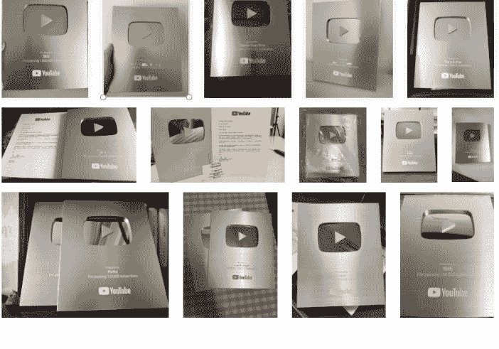

两年以来，我们一直努力扎根在 AI 视频和内容出海的领域里，见证了数不清的赛道拔地而起又归于尘土。

但有一个 YouTube 上的赛道，自从被我们看到，并且和圈友一起开了几百个 YPP 后，过了一年半直到今天，仍然还是蓝海，甚至仍然还拥有着巨大的被开发的潜力。

没错，就是本篇文章的标题——YouTube 直播。

去年，我们工作室用 100 个账号来测试 YouTube 直播，三个月后，将近 80 个账号都成功达到 4000 小时，开通了 YPP，如果大家做过 YouTube，一定知道这个数据有多恐怖——这也是为什么有几段时间，深海圈友开 YPP 如喝水。

| S | T |
|---|---|
| 直播总时长 | 素材更新时间 |
| 3964.91 | 3月9日 |
| 4698.01 | 3月9日 |
| 4147.1 | 3月9日 |
| 4103.8 | 3月9日 |
| 4143.2 | 3月9日 |
| 4679.6 | 3月9日 |
| 4212 | 3月9日 |
| 3786.7 | 3月9日 |
| 3200 | 3月9日 |
| 4169.6 | 3月9日 |
| 5417.6 | 3月9日 |
| 3835.7 | 3月9日 |
| 4020.4 | 3月9日 |
| 4728 | 3月9日 |
| 4130.6 | 3月9日 |
| 3293 | 3月9日 |
| 4114.6 | 3月9日 |
| 4503.9 | 3月9日 |
| 4600.6 | 3月9日 |
| 4076.7 | 3月9日 |
| 3420 | 3月9日 |
| 4280.5 | 3月9日 |
| 4416.1 | 3月9日 |
| 4102.6 | 3月9日 |
| 3652.4 | 3月9日 |
| 4339.8 | 3月9日 |
| 4152.5 | 3月9日 |
| 3814.4 | 3月9日 |
| 3759.4 | 3月9日 |
| 3279.8 | 3月9日 |

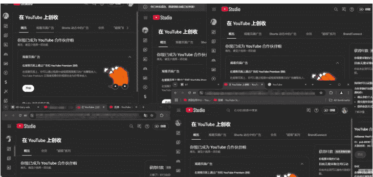

当然了，如此恐怖的数据不可能一直持续，捡钱一般的黄金时期是去年 2-4 月的事了，经过了一年多的摸索与实践，我可以负责任地说，现在 YouTube 直播虽然不再是早期发坨屎都给你推几十万流量的時候了，但仍然是一座巨大的金矿，等待我们去挖掘，因为大家将在这篇文章里看到大量的、我们每个人都能做出来的案例。

刚好亦仁哥最近发布了 x 海外自媒体的超级标、以身作则号召大家进军海外自媒体，而在我的视角里，YouTube 直播也是一个非常适配海外自媒体运营且非常蓝海的渠道之一，值得所有做出海的圈友们关注。

不废话了，这篇文章会分享下直播的底层逻辑和入门级玩法——也是很多圈友都想知道的：

# 直播开通 YPP

## 一、YouTube 直播开 YPP 的底层逻辑

首先，为什么直播能开 YPP 这件事似乎很少听说，它到底是什么原理？ 先给不了解 YouTube 的圈友做个小科普，在 YouTube 上通过视频播放量赚广告费是有门槛的：

> 【官方说明传送门
> https://support.google.com/youtube/answer/72

“有效观看时长”和“有效 Shorts 观看次数”是指什么？

### 有效观看时长

以下情况属于有效观看时长：

- 您设为“公开”的长视频获得的有效观看时长

在评定是否达到加入 YouTube 合作伙伴计划的最低要求时，我们不会考虑通过以下类型的视频获得的观看时长：

- 私享视频
- 不公开列出的视频
- 删除的视频
- 广告系列
- YouTube Shorts 短视频
- 不公开列出、已删除或未转换为视频点播的直播

而去年春节时，经过我们测试，发现直播的时长，确实是计入有效观看时长的，但并非所有情况都计入，总结出来的规则如下：

1.直播必须设为公开，有些账号直播时会默认设置直播为私享，需要手动修改。
2.直播不得超过 12 个小时，超过 12 小时则整场直播不计入开通 ypp 的时长统计。
3.直播间放版权音乐导致社区准则警告等违规情形的直播不计入时长。
了解了规则，那我相信大家能够自然而然地想到第二个问题。

直播听起来一点也不简单啊，怎么通过直播拿到 4000 小时的观看时长？
ok，多说无益，我来给大家看几个近期百万场的直播间。

https://www.youtube.com/watch?v=y82BhSg_hF0 迷之自拍，4 分钟直播，纯新号，180 万场观，时长 4 分钟的直播

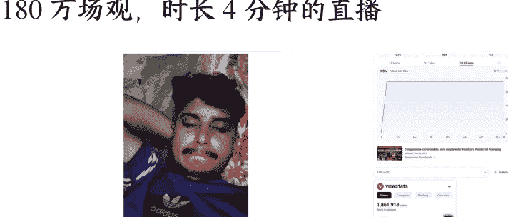

https://www.youtube.com/watch?v=qVObBwi7wy8 注意哈，同一个人，还是谜之自拍，换成了户外，纯新号，200万场观，时长4分钟的直播

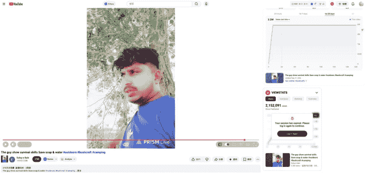

https://www.youtube.com/watch?v=xH0sPuATk6l 国内的路边摊，做鸡蛋汉堡，新号，1200万场观

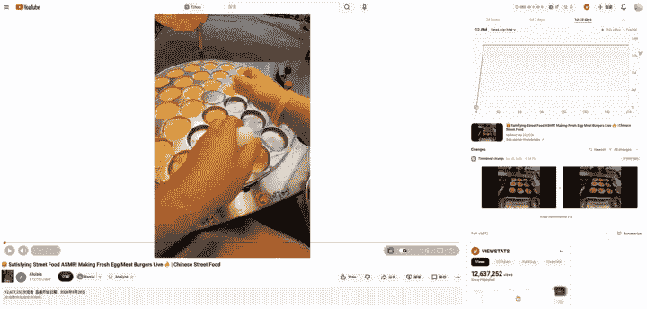

https://www.youtube.com/watch?v=Wueywj8agq 国内的路边摊，做煎饼，小号，320万场观

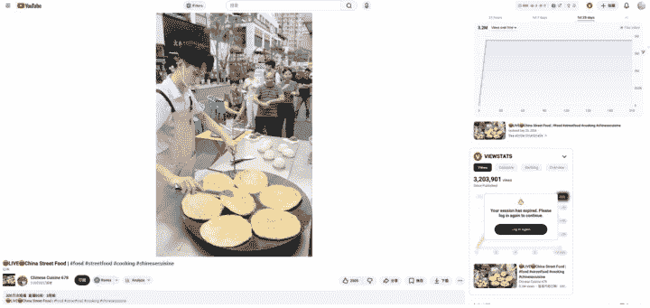

https://www.youtube.com/watch?v=U-MOhVA2Q5E 国内的路边摊，做炒饭，小号，900万场观

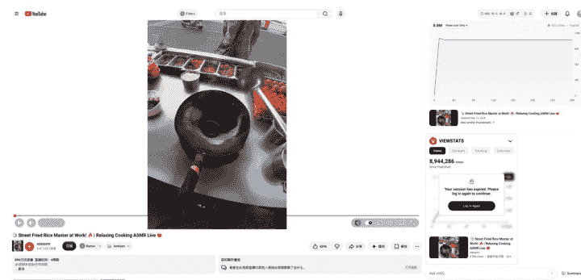

先不提直播的内容，只看这个直播场景和账号订阅量。

如果大家在国内做过直播，一定知道百万场观是什么概念，这跟这些频道一两千，甚至一两万的订阅体量完全是不成正比的。除非是踹到了什么天大的热点，否则我们不可能在抖音看到一个一两万订阅的博主直播，就能够达到万人在线、百万场观对吧？

但在 YouTube，有大量像上面这样订阅量和观看量明显不成正比的直播间。

我们再来看看内容，大家扪心自问一下，上面这几个直播间，让你们来拍，能不能拍出来？

可以。每个人都可以。

这绝不是什么有技术门槛、拍摄门槛的稀缺内容，就是非常普通的自拍、路边摊的摆拍。

我可以非常负责任地说，即便是在 YouTube，把这几个直播间的内容放到 shorts 和长视频的板块去发布，基本不会超过 1000 播放。但在 YouTube 直播的领域里，他们就是现象级的爆款，为什么？

## 

这是我们一场 30 万场观直播的推流分布，可以看到传统横屏直播的推流方式——也就是缩略图展示和点击带来的流量，只有 71 次，其中有 41% 的流量都是来自于 shorts 动态，也就是说，YouTube 把一部分 shorts 的流量池分配给了竖屏直播，而 YouTube shorts，每天的播放量超过 2000 亿，这是一个非常恐怖的基数，

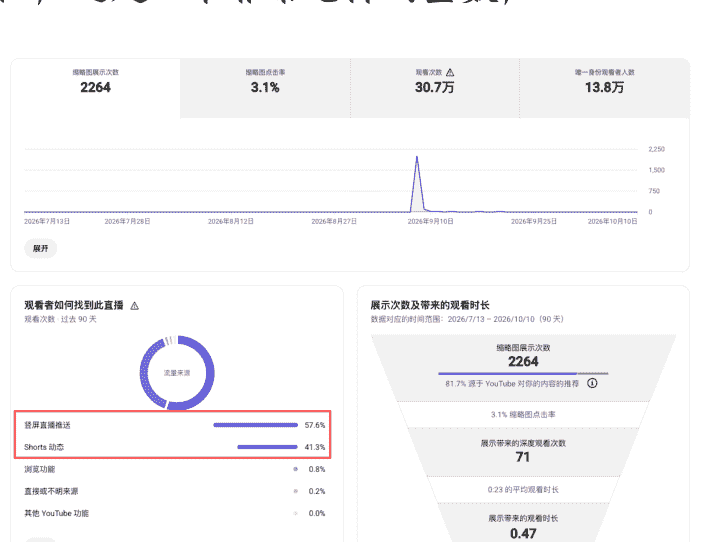

而另一个占比 57% 的“竖屏直播推送”渠道，可以从下面这张去年 1 月的截图看出是这一年以来新增的渠道，是 YouTube 为了推广直播新增的一个单独的推流来源。

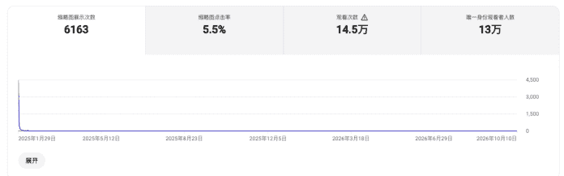

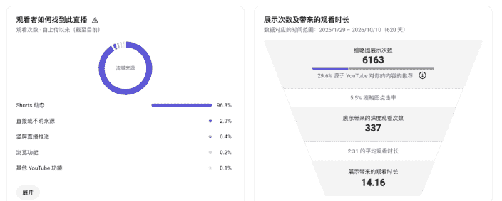

好了，可以针对直播开 YPP 的底层逻辑做出总结，核心就是以下两点：

1.竖屏直播累积的观看时长能够被计入4000 小时的要求内
2.YouTube 竖屏直播缺乏优质内容，且平台大力扶持，因而能够用简单的内容拿到巨大的流量
这些截图都是圈友们过去直播分享的一场直播达标3000 或 4000 小时的真实数据。

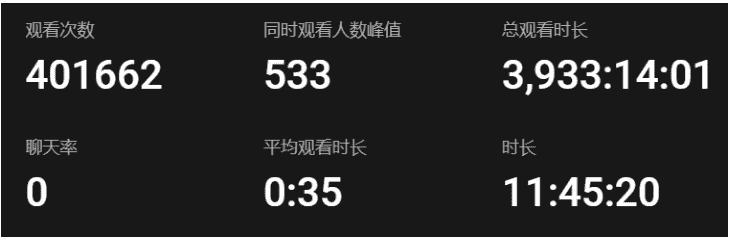

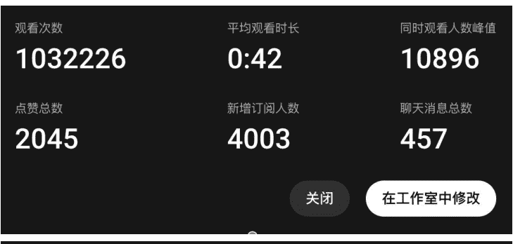

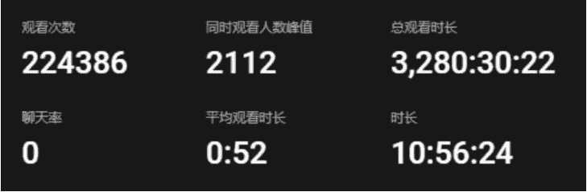

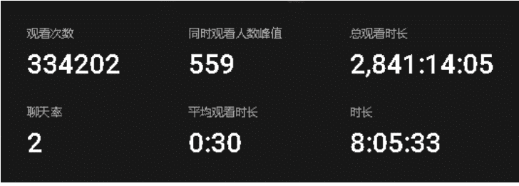

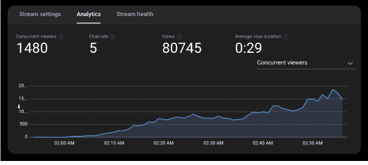

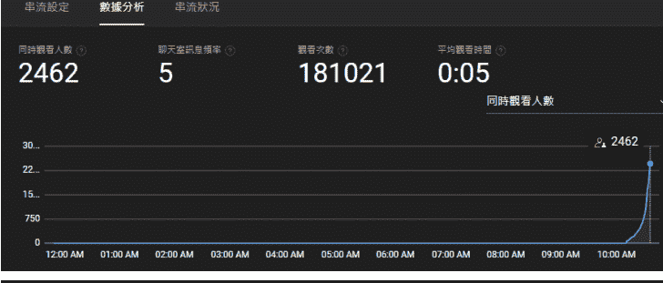

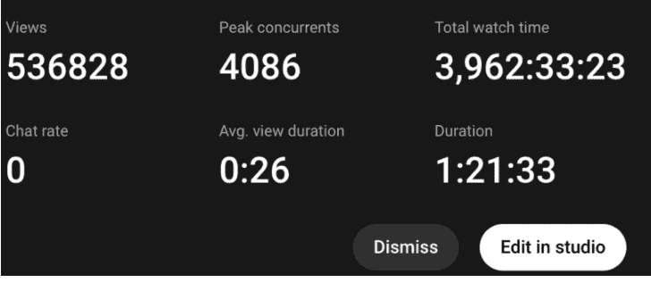

接下来，进入实操。

全文分享的所有工具，包括数据站和直播工具，都在我自己开发的深海圈工具站里，为了方便降低大家的实操门槛，我会给所有生财圈友开放 7 天的免费体验，包括工具的网页版和 MCP 服务，使用生财账号授权登录即可领取体验资格，如果你们觉得跟着文档操作还是太麻烦，可以接入 MCP，让你的 agent 来帮你完成文档内的所有操作。

工具入口：https://auth.ytdeepsea.com/

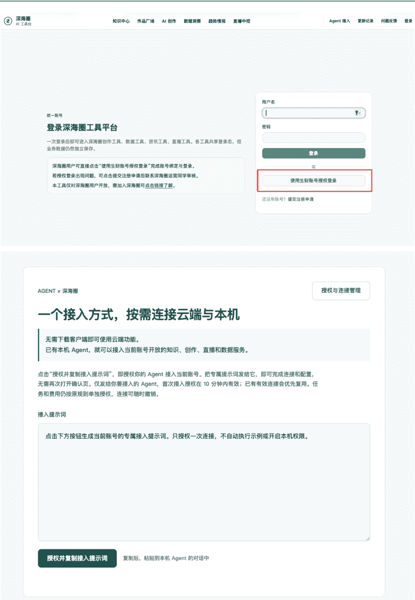

然后提前回答下，由于还没做好支付体系，也不确定单独把工具拿出来有多大的价值，所以工具和 MCP 目前暂时只对深海圈友开放，还是个内部工具。即便不使用我的工具，也同样能完成所有的步骤，只是操作麻烦点而已，用熟练了你们完全可以自己手搓一个直播工具。看完全文大家应该会理解，其实这篇文档的价值也完全不是在工具上。

## 二、如何挖掘出一个有潜力的竖屏直播赛道

在开始直播前，我们需要先挖掘出一些在 YouTube 有爆款潜力的直播赛道，这和我们做 shorts、做长视频都是一样的逻辑。

### 渠道 1：风向标历史直播赛道（大部分直播的赛道内，高热度、低卷度即值得对标）

百人在线的直播间就很不错了，可以算一下，每秒 100 人，平均观看时长 20 秒，持续一小时即 100 人在线 × 3600 秒 / 20 秒平均观看时长 = 18,000 次播放每小时 18,000 次，换算成观看时长就是 18,000 × 20 秒 = 360,000 秒 = 100 小时观看时长/小时。

保持 40 小时的 100 人在线即可达标 4000 小时。（不过现在直播在线人数掺了水，要折半计算）

增加观看时长和在线人数都能加速这个过程。

比如鱿鱼游戏搜索结果中，鱿鱼游戏这个词就不是垂直赛道，但是上图这个竖屏直播的小游戏就是很垂直的一个赛道，垂直到了某个具体小游戏的直播/录播，那看下人数，有 200 人在线，算是不错的，再看看有多少相同的游戏在直播

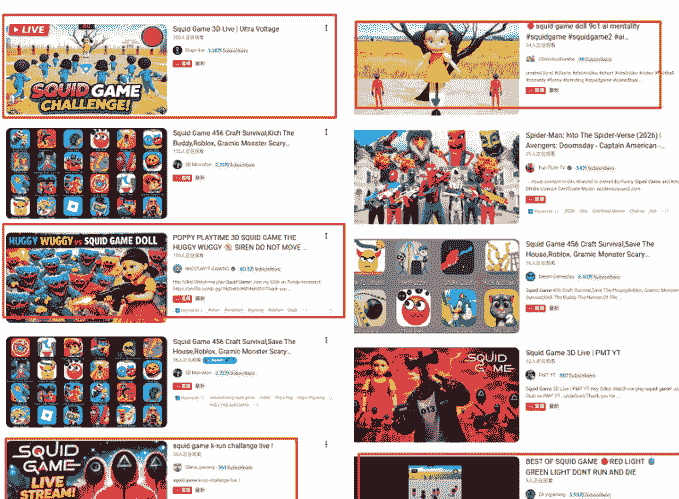

整个【squid game】关键词下，只有 20 个不到的直播间，直播这个游戏的直播间一共五个，每一个都有量，最少也是 9 人在线，而且有两个直播间在线 30 人左右，频道订阅只有 360 和 90，那么这个赛道一定是可以对标的，你进场做，你开五个号直播，现在一共 5 个直播间，相当于他们的流量就有一半要被你抢走。

### 渠道 3：数据挖掘工具

https://scout.ytdeepsea.com/ 我开发的数据站，单独对 YouTube 直播间和直播回放做了抓取，每天都会更新一批数据，目前在库直播间和直播回放数据超过 17 万条。

是的，你大可以调用 MCP 来获取最新的数据。

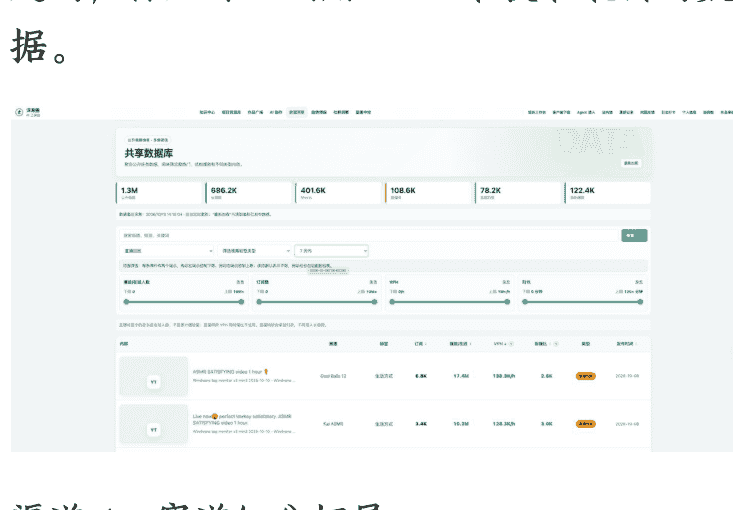

### 渠道 4：赛道细分拓展

以 chinese food 为例，现在已经是流量相当大的一个直播赛道了，但是直播间基本都是“street food”，都是路边摆摊类的，那有没有可能，也可以做手工类的美食直播、正经餐厅后厨的美食直播、中国的街边传统文化小吃（糖画、吹糖人等）？

这个问题没有人能回答，需要自己去测试，

这个测试的成本也很低，比如我们就测试过，直播做手工麻薯也是能爆量的。

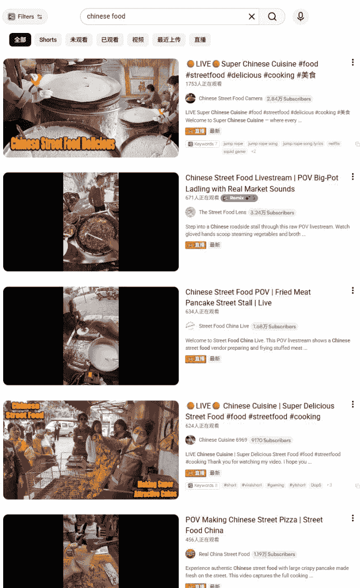

### 渠道 5：送大家一批对标

帮大家找了 100 个低粉高爆的对标，都是近一个月内的案例 近一个月低粉高播放竖屏直播回放 100 例 | 2026-10-12

## 三、直播的内容从哪来

现在我们知道了，一些很简单的内容、国内很常见的直播间，都能在 YouTube 上直播获得巨大的流量，也知道了在哪去找对标，现在的问题是，我们怎么生产这样的内容？

YouTube 大爆的竖屏直播内容类型上可以分成几类
1.游戏类：
游戏类的最好办，无论是大家自己去玩游戏，用手机录屏，还是去找别人玩的录屏素材，还是你真对游戏感兴趣，直接在 YouTube 上直播，都比较容易。

比如这个类似合成大西瓜的 merge fellas，去年有段时间非常火，在线人数经常破万，现在也还是有流量，这种竖屏直播的小游戏在 YouTube 算是常青树，去年有圈友把自己玩羊了个羊的游戏录屏放到 YouTube 直播也爆了百万流量。

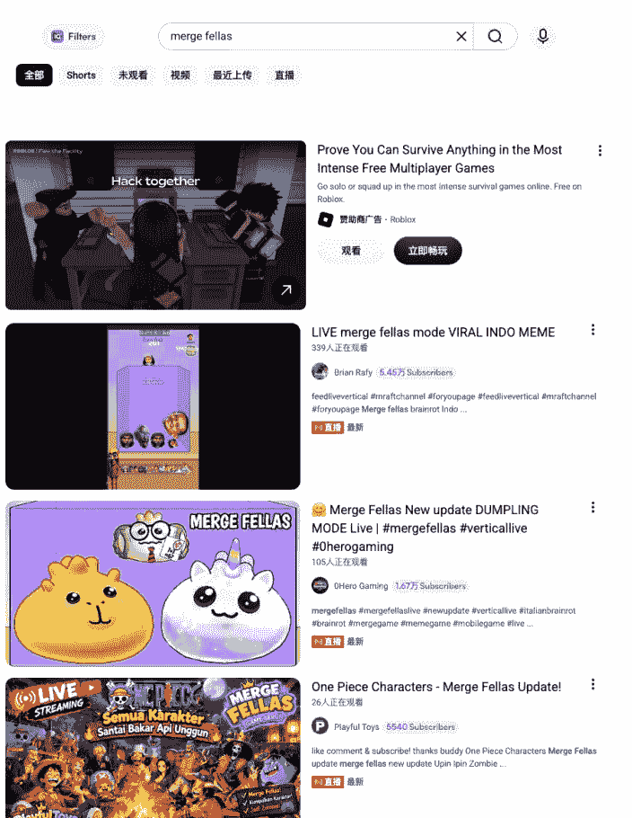

2.摆摊类、生活类、剧情类：
可以在抖音、b 站、快手、小红书等渠道找到稳定直播的中小体量的博主，找他们要个授权，帮他们在 YouTube 上做实况转播，可以先画饼，看看有没有流量，有流量再往下聊合作分成。如果是非常小的直播间，你直接转播其实也无人在意，做起来以后再去找博主聊授权也可以。

比如 chinese food 这个赛道，可以说从去年开始基本都是深海圈友在做。

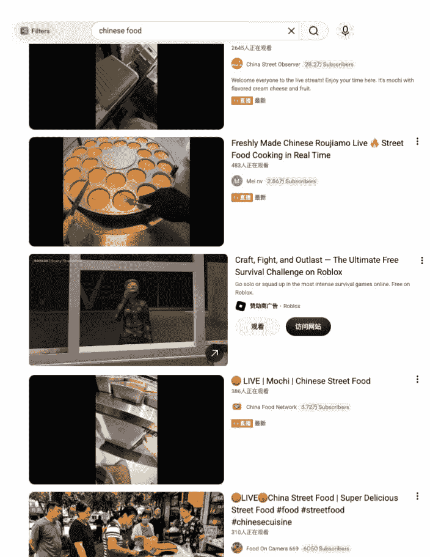

### 3. AI 类、图片类：

这种自己模仿对标复刻就行，不需要抄，直播和 shorts、长视频不一样，只要选题好、账号有权重了就容易被推流，不需要内容质量高。

https://www.youtube.com/watch?v=-TbNU5d5D7o&t=1s（AI 类）1000 万场观的新号

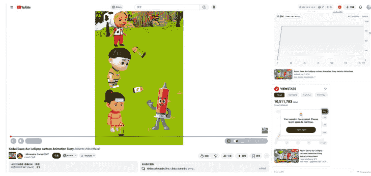

https://www.youtube.com/watch?v=yZVESuYCkUQ&t=20s 图片类，1000 万场观的新号，后面那个背景实际上就是一段录好的视频循环

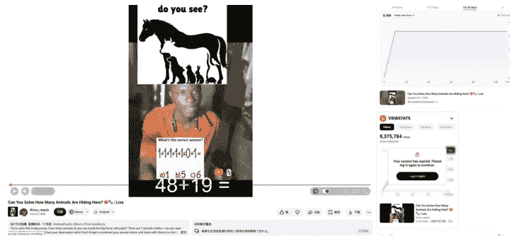

所以从上面内容类型出发，可以用三种方式来做直播：

- 1. 录屏、实拍、手搓等方式产出视频，直播时循环播放视频文件。适用于任何场景。
- 2. 实时转播，直接通过直播间链接对原直播间的内容进行实时转播。适用于拿到原博主转播授权，或者你不怕原博主找你麻烦的场景。
- 3. 真直播。适用于你想自己在 YouTube 做真人 IP 的场景。

后面的实操部分，会教大家如何用 1、2 两种方式来实现直播。

## 四、实操：在 YouTube 进行一场竖屏直播

我用我自己开发的深海圈工具作为演示案例来讲解，建议大家先别纠结为什么是这么操作，先跟着文档的流程实操一遍，逻辑会清晰很多，原理就懒得写了，MCP 都开放了，大家要是感兴趣自己让 agent 接好问下 agent 就知道了。

用工具跑通流程以后，真想继续做直播又不想用我的工具，自己做一个也很简单。

### 重要提醒

- 1. **不能在直播间播放任何版权音乐**，会被社区准则警告，如果不知道怎么判断版权音乐，那就一刀切——除了自己生成的 AI 音乐，其他的任何第三方音乐都不要用
- 2. 建议自己做素材（比如自己实拍或者拿朋友的素材，游戏类的可以自己录屏），或者通过获取博主授权的方式进行转播，以便于在申诉时证明内容的来源；**注意，录制的话需要把比例处理成 9:16，转播则需要选择竖屏直播间，否则就不是竖屏直播了**
- 3. 目的为开通 ypp 时，**单次直播不要超过 12 个小时，超过 12 小时不计入 YPP 时长；**且老的 shorts 和长视频如与直播内容不相关，最好删除
- 4. 如果是有活跃的 YouTube 老频道，很容易起量；**如果是新注册的频道，则可能 0 播 1 个月以上才开始起量，做好预期管理**

### 0 工具与账号准备

#### 深海圈直播工具：

https://restream.ytdeepsea.com/ 使用生财账号授权登录即可，给大家开了 7 天的体验，从激活权限开始计时。

一台用于直播的 VPS：买 21 刀一年的就行。21 刀的大概支持同时转播 2 个直播间，或者录制循环播放 3 个直播间能够在 YouTube 上直播的频道，怎么设置 YouTube 频道后面会讲，这里先准备好 Google 账号：

- a. 手机注册，可以参考 https://www.youtube.com/watch?v=FPFsnytOSI
- b. 买谷歌号，可以找小圈，他的网站 https://shop.jdkai.cc/products/gmail
- c. 购买海外长期手机卡，通过电脑网页直接注册，手机卡成品可直接在咸鱼搜索，这里不做推荐
- d. 购买有一定年份的 YouTube 老频道，如 https://agedprofiles.com/ ，需要使用数字货币完成支付，没发过视频的老频道 3 刀。

说个题外话，现在 Google 账号风控比较严重，买号相当容易被风控，有稳定 Google 账号或者 YouTube 频道的供应商欢迎联系我们合作，大家自己实操过程中我也推荐优先用自己的账号或者自己注册新账号

### 1. 买一台用于直播的 VPS

#### 1.1 购买 Linux 系统的 VPS

没有购买经验的可以购买 racknerd 有经验的按自己的偏好购买即可，要求：能连 YouTube、能访问国内直播间、带宽够多、网速够快 21 刀的流量大概对应 2 个直播间，24 小时直播一个月，35 刀的流量大概对应 4 个直播间，24 小时直播一个月，

#### 1.2 名称或内容赛道分组

- 点击“添加”，等待系统连接 VPS 并初始化推流环境。期间不要重复提交。

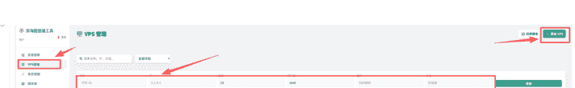

成功标志：VPS 出现在列表中，并显示“在线”。如果状态异常，先点击“测试”检查连接；只有页面提示需要重新部署环境时，才使用“初始化”。

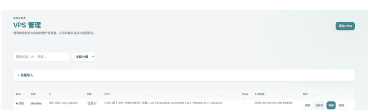

### 2. 配置 YouTube 直播

#### 2.1 开通中级功能

- 进入 YouTube studio https://studio.youtube.com/，点击右上角头像，选择“设置”。
- 点击我的频道中“频道状态和功能”。
- 确认频道模块功能使用资格中的“中级功能”显示为已启用。没有启用时，按照页面提示完成手机号验证（有且仅有此处接码可以使用一次性接码平台完成。一次性接码网站： https://5sim.net/ ）。

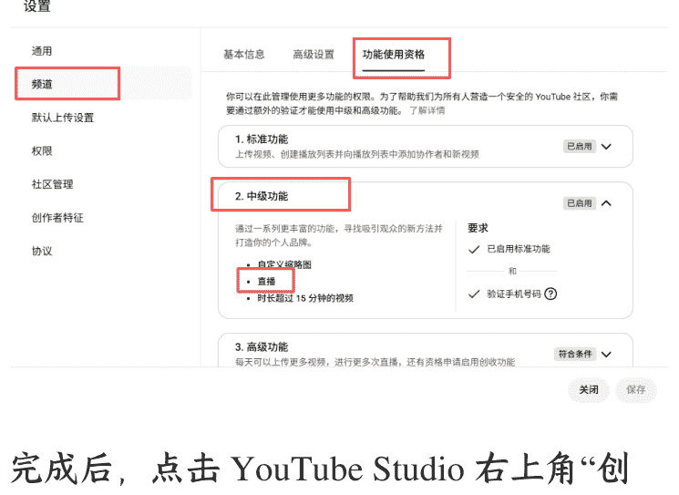

完成后，点击 YouTube Studio 右上角“创建”，选择“开始直播”。第一次使用时，按照页面提示选择编码器直播，并选择受众配置

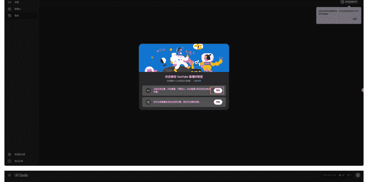

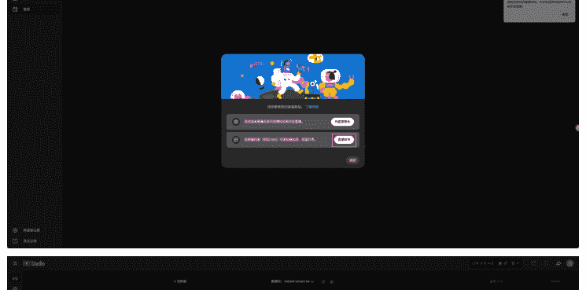

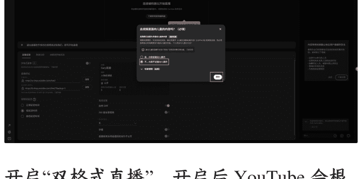

开启“双格式直播”。开启后 YouTube 会根据横屏直播流生成竖屏版本推送到 short，

可以同时在横屏直播和 short 中推送流量。

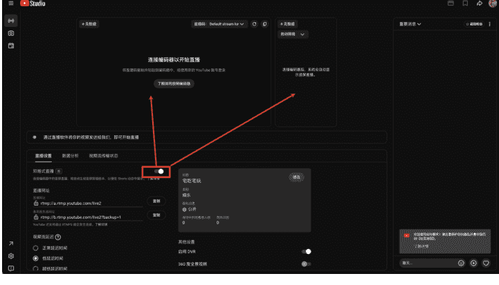

#### 2.2 获取推流密钥和直播间链接

进入当前 YouTube 直播界面，直接复制推流密钥和直播间链接。推流密钥用于把工作台画面推送到 YouTube，相当于直播间密码；直播间链接用于打开直播间，并让工作台显示在线人数和直播结束后的总播放量。两项信息不能填反。若要在同一频道同时开多路直播，再按第 6 章为新增直播安排时间并创建独立直播码。

| 信息 | 工作台字段 | 作用 |
|---|---|---|
| 直播码 / 推流密钥 | YouTube 推流密钥 | 把视频流推到对应直播间 |
| 观众链接 | YouTube 直播间链接 | 打开直播间并统计数据 |

点击“了解如何使用编码器”即可看到直播码（推流密钥）

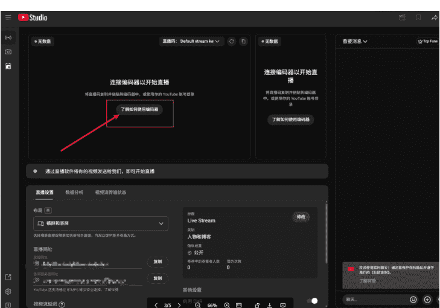

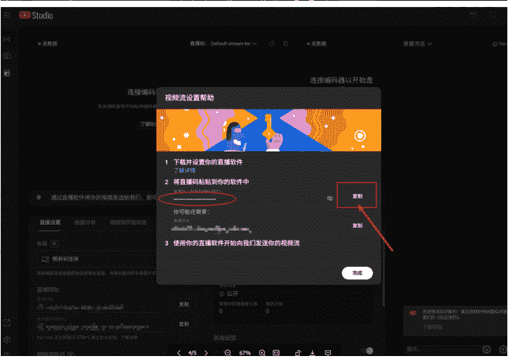

点击右上角分享图标，即可看到直播间链接

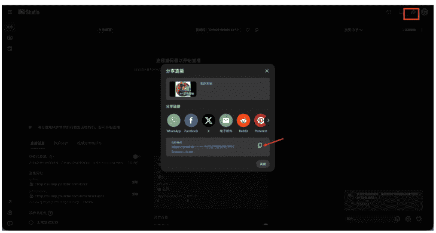

### 3. 在直播中控创建任务

#### 3.1 填写任务信息

进入“任务管理”，展开“创建新任务”。所有播放模式都需要选择 VPS 并填写 YouTube 推流密钥。

直播间链接虽然是可选，但建议填写，用于工具展示在线人数和直播结束后的总播放量；备注可以用于标记账号、项目或直播主题。

直播源 URL 和媒体文件是否需要填写，由播放模式决定。当前支持三种模式：

| 模式 | 适用场景 | 直播源 | 媒体文件 |
|---|---|---|---|
| live_only | 实时转推 正在直播的内容 | 必填 | 不需要 |
| file_loop | 循环播放 VPS 上的已有视频 | 不需要 | 必填 |
| live_with_fallback_file | 直播源断流后自动切文件 | 必填 | 要实现切文件就必须准备 |

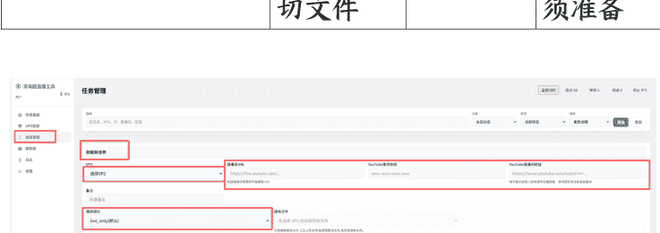

#### 3.2 创建、启动和结束

- 填写完成后点击“创建任务”。任务通常先显示为“已停止”。
- 检查 VPS、推流密钥、直播间链接、播放模式和素材是否对应正确。
- 点击“启动”。“启动中”表示系统正在下发命令；“正在获取直播流”表示暂时没有拿到可用源流；“推流中”表示已经向 YouTube 发送画面。
- 工作台显示“推流中”后，回到 YouTube

等待预览出现。确认画面和声音正常，再点击“开始直播”。

- 需要结束时，先在 YouTube 点击“结束直播”，再回到工作台点击“停止”。

### 4. 三种播放模式

#### 4.1 纯直播模式

纯直播模式适合把正在正常直播的内容实时转推到 YouTube，不需要提前准备视频文件。

- 播放模式保持默认的 live_only。
- 在“直播源 URL”中填写标准直播间地址。
- 媒体文件上传会自动禁用，不需要上传媒体文件。
- 有备用直播间时，在“备用源 URL”中每行填写一个，系统会按顺序尝试。

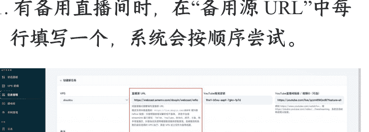

#### 4.2 纯文件循环播

纯文件循环播适合持续循环播放本地已有的视频文件。创建前先到媒体库查看目标 VPS 磁盘压力。

- 播放模式选择 file_loop。
- 直播源输入会自动禁用，不需要填写直播源。

显示“文件循环”。

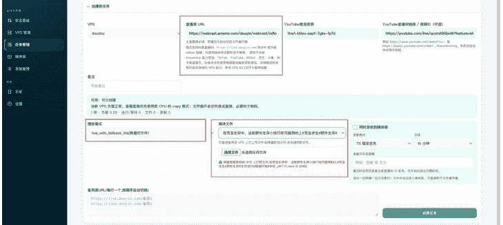

## 常见问题

### 1. 启动后一直“等待直播”

可能原因：

- 源直播间没有开播。
- 直播间开播了，但 VPS 直连被验证码或风控阻断。
- 抖音 Cookie 失效。
- 旧脚本没有同步到 VPS。
- 源链接填错或不是直播间链接。

处理方式：

- 打开源直播间，确认真的在直播。
- 打开任务日志，看是否提示“未找到可用的流”。
- 点击“修复”，同步脚本并检查 VPS 环境。
- 若仍失败，更新 VPS 的抖音 Cookie。
- 需要时填写备用源 URL 或切换到断播切换文件模式。

### 2. YouTube 没有画面或没有数据

### 3. VPS SSH 连接异常

处理方式：

- 到媒体库查看 VPS 磁盘占用。
- 大文件改用 SFTP 上传到 /root/douyin2youtube/uploads/。
- 上传完成后点击“扫描导入 VPS 文件”。
- 创建任务时选择已有文件。

### 5. 任务显示错误但实际还在推流

处理方式：

- 点击“校准”，让系统重新检测 VPS 上的进程。
- 打开 YouTube 直播间确认是否有画面。
- 查看任务日志确认是否有脚本报错。
- 若校准后仍异常，点击“修复”。

排查时优先看任务日志，其次看 VPS 状态，再看是否需要同步脚本、更新 Cookie 或切换播放模式。

## 焚决：自动化直播

是的，知道大家会觉得手动操作太麻烦，所以我做了 MCP。

在这个页面接入 MCP 后

https://auth.ytdeepsea.com/mcp，即可通过 GPT6/6.1、Claude5.5 这个级别的模型，搭配 MCP 实现全自动化的直播（ vps 购买和 YouTube 直播权限的开通还是得提前处理

的）。

我在 egolite 登录了一个 YouTube 频道，是我用来测试的频道，你测试一下，能否直接通过b站/哔哩找到一个人数少于10，没有背景音乐的直播间，然后调用直播 mcp 服务，直接实现对这个直播间转播的全流程闭环

你在 19秒 后停止了

我会先用 ego-browser 检查这个 YouTube 测试频道，并按 deepsea-ai-delivery-loop 核对直播 MCP 的现有流程和验证要求，再找符合条件的直播间。

加载了工具读取文件运行了命令

今天 21:49

用时 12分钟 47秒

你自己操作

验证了，采用“ego lite 浏览器 + 直播 MCP”完成闭环。

- B站直播源：无声自习室，实测1位观众，音频抽样无声。
- MCP 成功启动转播：YouTube 显示信号“极佳”，观众页验证 1080p 持续播放。
- MCP 成功停止任务，YouTube 已结束直播，保留为 非公开测试记录。

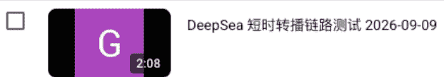

## 关于竖屏直播的经验与技巧

### 1. 直播的宏观规律：

账号活跃度：近期活跃的老号＞过去活跃的老号＞从未活跃的老号＞纯新号赛道蓝海度：赛道流量越大、直播同行越少，起量概率越大。

内容垂直度：有大量在垂直赛道内长期直播，慢慢起量直到稳坐头部的案例；先胜后战素材重复度：直接转播＞素材循环播放和素材重复使用；但并不是一定的这是我们近期测直播 20 天左右的数据，如果想要通过直播开通大量 ypp，是一定要做矩阵的，否则不可能通过个位数的账号去博概率，绝大部分账号的推流，可能一直都是个位数、十位数。

| 登记账号 / 有数据账号 | 有效场次 / 素材登记天数 | 登记观看总量 | 单场中位数 / 均值 |
| :--- | :--- | :--- | :--- |
| 77 / 76 个 | 597 场 / 482 个账号×日 | 225.17万次 | 17 / 3,772 次 |

- **爆款场次**：5.86% · 35 / 597 场
- **出爆款账号**：18.42% · 14 / 76 个有数据账号
- **爆款观看贡献**：84.74% · 190.81万 / 225.17万次

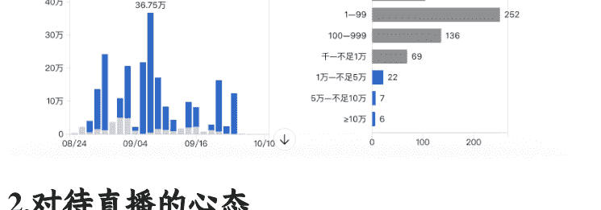

### 2. 对待直播的心态

也有不少圈友问我，现在 YouTube 直播好像没有以前好做了，要这么多账号才能做出一定的结果，普通人是不是没必要了解了？

我就这么说

你能在海外、国内，找到任何一个有一定规模的视频平台，允许你们通过 vps 集群实现大批量的、自动化的、无人值守的直播间运营吗？你相信有人能在不会做视频的情况下，开通 ypp 吗？即便 YouTube 直播时至今日门槛略微提高了，但这仍然改变不了它可以借助 AI 实现批量自动化运营且能够产出 ypp 的客观事实。

而我相信，等到大家对 YouTube 直播的开发更加深入，一定会产生投产更高、潜力更大的玩法，也许是带货、也许是打赏、也许是海外私域，这也是我为什么要写这篇帖子，通过竖屏直播来开通 ypp，只是我们了解 YouTube、了解海外变现玩法的敲门砖，现在积累的经验，必然在未来的某个时间，让我们有机会第一时间吃到那块蛋糕。

### 3. 新手如何开始

适合什么样的人：看好 YouTube 生态或本身就有 YouTube 运营经验、能接受 1-3 个月没有明显结果、有矩阵运营经验或自动化能力建议怎么做：买 1-2 台 vps（成本 200-300 一年）、准备 5-10 个 YouTube 频道（至少），尽量通过自动化的方式来运营直播，每天花 1-2 小时完成所有账号的直播运营，以 15 天为一个周期来测试赛道，熟悉流程、跑通 ypp 后再研究如何放大。

### 4. 0播、百播怎么办

直播很看账号权重，可能 95% 的新号，起步就是 0 播，这就是客观规律，没啥好纠结的，有老号肯定是优先用老号来直播，0 播的概率能降到 50%。

保持直播的活跃度、内容的垂直度，账号权重会慢慢增加，下面三张图是我们同一批账号、用同一批内容在不同时间的播放数据，可以看到一开始绝大部分账号就是 0 播，个位数播放，但是持续一段时间之后，会慢慢开始起量，这个周期快的话可能两周，慢的话可能去到两三个月，这也是我为什么说要多备一些账号、尽量花最少的时间、用自动化的方式来运营，因为你人眼去看数据，可能根本就没用，账号活跃没累计够分析数据

## 2. 横屏直播赚收益

最近 YouTube 上冒出来非常大量的新号，做横屏直播，播 ASMR、音乐类的内容，流量非常大，我们也在测，确实是有量的。

而更重要的是，我们发现横屏直播，相同播放量的 rpm，比长视频都略高一点。而同样的内容，很多账号发长视频是没流量的，但是直播就有流量。

比如这个号
https://www.youtube.com/watch?v=H7XWQurp7hs 人多的时候他有超过 10000 的在线人数，这跟他长视频的流量完全不成正比。

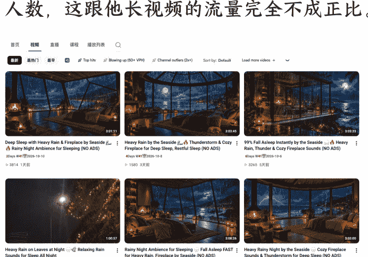

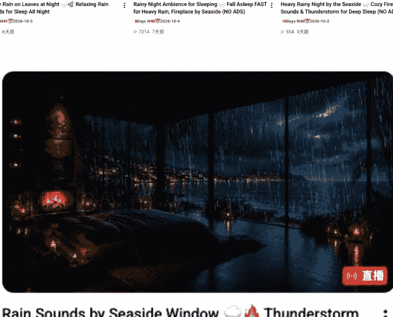

## 3. 做个人 IP 和品牌

在 YouTube 直播生态不健全的时期，有没有可能借着东风，直接把自己的 IP 和品牌做出来呢？

我挖到了一大批百万千万场观的账号，都是来自同一个工作室，换不同的人拍同样的内容，一个月里用几十个号薅了 YouTube 几亿的直播流量，这样的内容我们每个人都有能力实拍出来，那如果用来做 IP 或者做品牌，我相信能达到非常恐怖的投产，我们最近也在安排做实拍的测试。

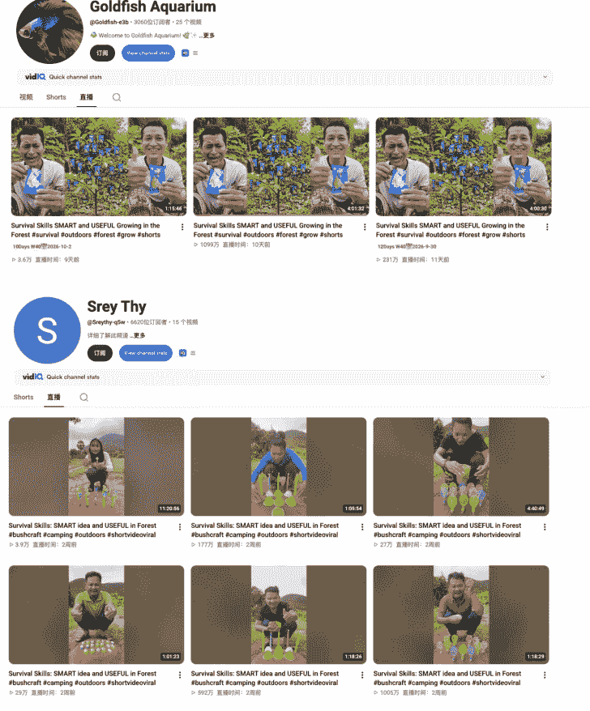

## IN SARON

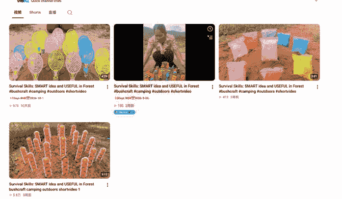

## Mr. Chheng

好了，希望这篇文章能打开大家关于 YouTube 直播的视野，让优秀的圈友开发出更多 YouTube 直播的玩法，也欢迎大家来找我交流，让我们一起出海赚美金！

————分割线————

看完这篇 SOP，你觉得你懂了。但 90% 的人一到实操就会卡在第一步。

工具和教程只是最低级的壁垒，真正的壁垒是“立刻动手”和“圈层信息差”。

如果你想看全网最新的变现玩法，并且和一群执行力极强的极客一起下场拿结果，欢迎围观我的核心私域：【懒人专属群】。

我们不聊虚的，只做商业闭环的拆解与 AI 效率的压榨。系统内已沉淀 1000+ 跑通的

## 套利实战局

- □ 查阅圈子完整数字资产与上车门槛：

https://lazyso.com/insider/

认同价值、准备好下场干活的，扫码加我微信（lazyhelper1）

备注：【实操上车】，不闲聊

