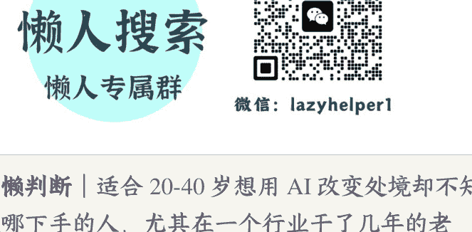

# 普通人如何抓住 AI 时代的机会？

> > 261012 缸中之脑
> > 整理：公众号懒人搜索，懒人专属群精选
> > 懒人微信：lazyhelper1

> > 小懒判断 | 适合 20-40 岁想用 AI 改变处境却不知从哪下手的人，尤其在一个行业干了几年的老手；不适合只想收藏不行动、或指望 AI 副业月入过万快钱的人。最值得关注的是赛道一的 30 天起步法：只选一个行业、找 3 家熟悉的店做 AI 诊断、用现成工具搭方案、记录改造前后对比数据。坑在于 AI 能完成 90% 的工作，但剩下的 10% 决策责任必须自己扛，把 AI 建议直接当结论就是干拔。

这可能是人类历史上，普通人离顶级智慧，最近的一次。

也可能是普通人之间，差距拉得最快、最悬殊的一次。

这两句话，同时成立。

每个月花一百多块，甚至一分钱不用花，我们就能调用一个 24 小时在线，随时响应，会编程、懂法律、懂营销、精通所有语言的智囊团。工具对所有人都一样，门槛前所未有地降低。

但结果完全不一样。有的人，用它干成了一个团队的活，接到了第一个海外订单，做出了第一个付费产品。更多的人，收藏夹越来越满，焦虑越来越重，但生活纹丝不动。

同样的工具，为什么会拉开这么大的差距？差距究竟发生在了哪里？像我们这样 20 岁到 40 岁之间，没有特别背景的普通人，又该怎么站到时代对的一边？

我用了两个月时间，精心打磨出了这篇长文，就是我对这三个问题的完整解答。

它会交付五样东西：

## 1.一个底层判断：AI 到底改变了什么。

读完了这一部分，你会明白，为什么会用 AI，本身并不值钱。以及 AI 时代，人和人之间的差距，正在转移到哪三个地方？

这是后面所有内容的地基。看清了这一层，你就不会再被每周刷屏的新工具牵着走。

## 2.三个大方向：找到你自己的定位。

三种适用于任何行业、任何工作的定位。这一部分能帮你看清，像你这样背景的人，最大的优势应该押在哪里。

## 3.五条可以押注的具体赛道（全文第二重要的部分，约 6000 字）。

一共五条赛道。每一项，我都会讲清楚：为什么是它，适合谁，前期如何起步，之后怎么做大，收入大概在什么量级，最大的坑是什么。我可以负责任地说，我列的每一条赛道，只要你认真投入，都可以让你在 30 天内拿到结果。第一个付费客户、第一笔收入、第一批真实用户。

## 4.三个核心方法论：在行动和变化里，到底怎么想、怎么决策。

## 5.八个具体行动，以及可以直接复制使用的提示词（全文最重要的部分，约 10000 字，包括 24 个我私藏的、你直接拿去可用的提示词）。

没有正确的废话，而是马上就能用于实践的行动，马上就能拿去用的 24 个完整提示词。

这篇文章，我推荐每一个 20-40 岁之间的缸中之脑读者来阅读，你们手里已经有了一些沉淀，能力也好，经验也好，是最有可能被 AI 进一步放大的一群人。

如果你符合以下情况，我最建议你阅读：20 到 40 岁，想用 AI 改变自己的处境，却不知道从哪里下手；在一个行业里干了几年，感觉自己遇到瓶颈，又不甘心就这样；早就有副业想法，却一直停留在收藏夹和"再等等"里；三十多岁、担心自己已经晚了的人，这篇文章里有一部分，是专门写给你的。

我们怕的，不是买错一个工具，而是错过百年一遇的 AI 机遇和时间窗口。

这篇文章想帮你做的，就是把 AI 时代的行动地图摊开、把路径理清、把坑标出来。

好，下面我们正式开始。

### 本质：AI 真正改变的，只有一点

AI到底改变了什么？很多人都没有看清这一点，导致他们走上了完全错误的道路，或者收效甚微。

我的回答是：

AI改变的，不是某一个具体的行业，而是一种东西的价格，也就是：智力的价格。

我们回想一下，在过去，一个没有背景、没有资源的年轻人，想要获得顶级的智力支持，要付出什么成本。

想要一份专业的商业分析，顶级咨询公司按小时收费，一小时几千元。想要学会编程，学到能自己做 APP 的程度，可能得花几年时间、几十万学费去读一个计算机学位。

想要听一听自己行业里，真正懂行的人怎么看，你得先挤进某个圈子，而那个圈子的门票价格，甚至不能用钱衡量。

这就形成了一个死循环。没有资源，就进不了圈子；进不了圈子，就更没有资源。

这个循环，不只困住了我们的处境，更困住了我们的思维。我们会因此变得不敢选、不敢试、不敢换。正是二三十岁的最好年纪，活出了最保守、最不敢试错的状态。但现在，情况发生了一个根本性的变化。每个月花一两百块，甚至都不用。一部普通手机，加几个免费的国产大模型，我们就能调用一个 24 小时在线、不会嫌你问题基础、不看你出身、背后是人类几百年全部知识沉淀的 AI Agent 智囊团。

也就是说，调用人类最高智慧结晶的边际成本，正在趋近于零。

如果你对上一句话没有感觉，我建议你再读三遍。这是一件非常了不起的事。某种意义上，它是这个时代，给普通人最公平的一份礼物。

但问题是，既然每个人都拿到了同一份礼物，为什么有的人因此脱胎换骨，有的人却只是更焦虑了？

我想讲一段历史，它能帮我们看清楚这件事。

经济史学家保罗·戴维，在 1990 年发表过一篇很有名的论文，研究的是电力。

电动机在 19 世纪 80 年代就已经出现了，但奇怪的是，美国工厂的生产率，直到 20 世纪 20 年代才出现显著提升。中间隔了将近四十年。

原因是，早期的工厂主，拿到电动机之后，做的事情很简单，就是把原来那台巨大的蒸汽机拆掉，换成一台巨大的电动机。工厂的布局、传动的方式、工人的流程，全都没变。

而真正的变化，发生在新一代工厂主身上。他们意识到，电力最大的价值，其实并非更强的动力，而是动力可以被拆分，因为每一台机器，都可以装一个小电动机。

于是，工厂就不再需要围着一根中央传动轴来设计，多层厂房变成了单层流水线，整个生产方式被重新组织了一遍。

那一刻，生产率才真正起飞。这个故事说明，技术的红利，从来不属于最早拥有新工具的人，而属于最早用新工具，重新设计工作方式的人。

把这段历史映射回今天，你会发现，我们大多数人用 AI 的方式，就是把蒸汽机，换成了电动机。用它找资料、写周报、润色邮件、翻译文档。工作流程一点没变，只是某几个环节提升了一点效率。

当然，这也有用。但它不会改变你的处境。那真正的差距，会转移到哪里？我的观察，是三个地方。

**第一，从"会不会"，转移到"问不问得对"。**当答案变得廉价，问题就变得昂贵。AI 可以回答几乎所有的问题，但它没办法替你决定该问什么。

而一个人能问出什么样的问题，取决于他知识的广度、对世界的理解，以及他对自己处境的清醒程度。

这也是为什么，美国硅谷那些最懂技术的人，奥特曼也好，马斯克也好，反而建议年轻人，去接受尽可能广博的教育。艺术、科学、工程、历史都去碰一碰。不是为了记住知识，而是为了在面对一台无所不知的机器时，知道该向它要什么。

**第二，从起点高低，转移到迭代快慢。** 以前，一个人的起点，很大程度上决定了他的终点。但在一个工具几个月一换、规则几年一变的时代，起点的权重在下降，迭代速度的权重在上升。

我爱打游戏。游戏领域有一句话，一代版本一代神。上个版本的强者，在新版本里不一定还能赢。

真正能一直赢的，是那个最快适应新版本的人。

#### 第三，从有没有能力，转移到敢不敢负责。

AI 可以帮你写方案、做分析、出设计，但它没法替你承担后果。在 AI 能完成越来越多工作的世界里，愿意用自己的名字，为结果负责，会变得越来越稀缺。而社会往往会把最大的杠杆，交给那些敢于承担责任的人。

我在之前的文章讲过，AI 时代最重要的资产，就是人格资产，是你这个人，你的名字，你的形象，你的个人 IP。这个判断依然成立，而且更重要了。

把这三点合起来，就是我想在这篇文章里说的核心判断：

#### AI 抹平的是能力的落差，放大的是判断的落差。

或者换一种更好理解的说法，在 AI 时代，一个人最大的资本，不是他的起点有多高，而是他的版本迭代有多快。

说到这里，我想专门回应一下三十岁以上的朋友。很多人会觉得，哦，这些是二十岁年轻人的机会，我已经晚了。

根本不是这样。

二十岁的人有二十岁的优势。没有被房贷、家庭、固定支出锁定，转型的成本很低。

三十岁的人也有三十多岁的优势，你在一个行业里摸爬滚打了十年、二十年，积累了大量别人不知道、但你习以为常的经验和判断力。而这恰恰是 AI 最需要、最能放大的东西。

### 三个大方向：机会到底藏在哪里？

理解了智力变便宜了这件事，我们就可以回答下一个问题：机会在呢？

我把它归纳成三个方向。它们不是三个具体的赛道，更像是三种站位。无论你在哪个行业，都可以从这三个位置，去找自己的机会。

第一个方向，成为行业的"翻译者"。把你的特定知识，接上 AI。有一个概念，我觉得在 AI 时代格外重要，叫做"特定知识"。

简单来说，特定知识是那种没法通过培训，批量获得的知识。它源自于一个人的天赋、好奇心和独特经历。可以说，是你在一个领域里泡久了，自然而然生长出来的东西。

它有一个很好用的识别信号。记住这句话：什么事情，在你看来像玩，在别人看来像工作。或者反过来，如果你对某件事的第一反应，是这有什么难的，大家不应该都会吗。就在这里，很可能就藏着你被低估的特定知识。比如，对我来说，我的特定知识就是写作。我从小到大，一路都很会写东西，某段时间，我都不觉得这是优势，因为我感觉这种事情，大家应该都差不多。

但后来我才发现，会写作是一种很稀缺的能力。而写作背后，是清晰表达、问题意识等等一系列能力，而这些能力，就是我的特定知识，也是我的优势壁垒。

为什么特定知识，在 AI 时代这么重要？逻辑其实很简单，你记住，凡是能被系统培训出来的技能，最终都有可能被外包或者被自动化。

考一个证、刷一套题、学一个通用框架，这些当然不是没用，但它们只是让你进入了一个更大的竞争池。池子里不仅有成千上万的同龄人，现在还多了一个永远不会累、超级聪明的 AI。

但特定知识×AI，就完全是另一回事了。我们可以想象这样一个人，她在医院做了八年行政，非常清楚一个科室的排班、耗材申领、病历归档里有多少重复劳动和隐性摩擦。以前，她知道痛点在哪里，但没有能力去解决。因为她不会写代码，也请不起开发团队。

而现在，有了 AI，她可以用自然语言告诉 AI 自己想要什么，一个周末，就能做出一个排班辅助工具，先在自己科室试用，再慢慢推给其他科室。

又或者是，一个做了十年外贸跟单的人。他太清楚海外买家在询盘时，最在意什么、最容易在哪个环节失去耐心。他把这些经验，整理成一套多语言的沟通模板和流程，再接上 AI，帮同行提升回复效率和成交率。

你会发现，在每一个行业里，都存在两类

但是现在，一个人借助 AI，就能完成选题、写作、配图、多平台分发的整套流程。

杠杆有了，那用它去撬什么？

我很认同一个朴素的判断：赚钱的本质，是消除摩擦。

什么是摩擦？信息不对称是摩擦，语言不通是摩擦，跨境支付周期长是摩擦，买家不信任卖家是摩擦，供给和需求找不到彼此也是摩擦。

哪里的摩擦最大，哪里就有最大的商业价值。

AI，恰恰是一台强大的摩擦消除机。尤其是语言和信息差这两种摩擦，正在以肉眼可见的速度下降。

这意味着，我们的视野可以，也值得放得更大一点。

我们身处中国，全球最完整的制造供应链之一，而在东南亚、拉美、中东、非洲的很多市场里，大量中小商家正面临着信息闭塞、语言障碍和数字化工具匮乏的问题。我十一假期去了一趟越南，对这一点，就有很深的感受。过去，要连接这两端，需要一个懂外语、懂营销、懂结算、懂合规的团队。现在，一个懂行的人，加上 AI 翻译、本地化文案和自动化工作流，就能完成相当一部分工作。

再比如，同一种数字服务，设计、文案、数据分析、软件开发，在不同国家和地区的定价差距往往非常大。用合法、可持续的方式，承接这些跨区域的需求，本身就是一种消除信息差和价格差的生意。

这就是为什么这几年，所有的人都在看出海机会，而 AI 无限放大了这种机会。

当然，我必须说一句，全球化的机会是真实的，但它不是一夜暴富的捷径。合规、税务、信用、交付质量，每一项都需要认真对待。

但方向本身是清楚的。就是，你能赚多少钱，很大程度上取决于你能替别人消除多少摩擦。

#### 第三个方向，成为选择权的持有者。财富自由，要先自由，再有财富。

第三个方向，可能是最容易被忽略的，但我认为也是最根本的。

我们常常会听到一种说法，等我赚够了钱，就自由了。

这句话听起来没什么毛病，但它其实是一种因果倒置。

你有没有发现，身边有些人资产不少，却活得比谁都焦虑？他们被房贷、车贷、面子、社会期待层层捆住，任何一个变化，哪怕是很细微的变化，都让他们如临大敌，因为他们没有转身的余地。

反过来，有些人钱不算多，却在每一次变化来临时都能从容转型。因为他们的生活足够轻，选择足够多。

所以我更认同另一种顺序：先自由，后财富。最近孙宇晨有一个四个小时的对谈，也提到了这一点。孙割人品我们不做置评，但这一点，我很认同。

这里说的自由，不是不用工作，而是两样东西。一是，认知上的独立，不被别人的脚本和设定绑架，敢于重新审视自己的判断。二是行动上的机动性，当机会出现的时候，你要能灵活转身。

在一个变化极快的时代，后者格外重要。你可以想象一下，一个新的机会出现了，可能需要你换一座城市，可能需要你接受三个月没有稳定收入，可能需要你从头学一套新东西。

这个时候，一个每月有大笔固定支出、有房贷、车贷，现金流被锁死的人，和一个生活轻盈、手里有半年储蓄的人，谁更有可能抓住它？

这也是为什么，有一种观点会建议，年轻人在 30 岁前不要过早锁定流动性。不要让太早、太重的固定支出，把未来的选择权提前透支掉。

我想补充一句，这并不是说每个人都不该买房、不该结婚。每个人家庭责任、生活需求、风险承受能力都不一样，这些都应该被认真对待。

我想说的是，在做每一个锁定型决定之前，我们至少应该清楚地知道，自己正在用多少选择权去交换它。

另外，选择权还有一个很容易被忽视的载体：身体。

AI时代的机会，往往不是一次冲刺就能拿到的，而是一场需要跑很长距离的比赛。身体是我们唯一的服务器，它一旦宕机，前面所有的努力都会归零。

如果把人比作一家公司，那么肌肉和心肺，就是这家公司账上的现金储备。平时看不出来，但在压力、疾病和衰老来临时，它决定了你能扛多久。

### 五个可以押注的赛道

说完了方向，我们来看看几个具体可落地、值得大力投入的赛道。

这一部分，我想尽量具体。如果今天让我给20到40岁的年轻人，推荐几条可以认真押注的赛道，我会选下面这五条。

我挑选它们，用了三个标准：第一，需求必须是真实的。而且在扩大，不是靠概念炒出来的热度；第二，普通人就能启动。启动成本在几千元以内，业余时间就可以开始，不需要辞职；第三，能形成复利和积累。做得越久越值钱，经验、案例、用户、口碑会像复利一样滚起来。

反过来，有几类看起来来钱快的事情，我刻意没有放进来。包括但不限于炒币，和各种 AI 概念投机、搬运信息差的 AI 副业课、承诺月入过万的代运营加盟。

它们短期也许能赚到钱，但几乎不形成积累，还很容易透支你在 AI 时代最最宝贵的东西：信用。

我可以负责任地说，下面每一条赛道，只要你认真投入，都可以让你在 30 天内拿到一个小结果。第一个付费客户、第一笔收入、第一批真实用户。而几乎所有的 大结果，都是由一连串小结果复利出来的。

小结果，是通往大结果唯一的入口。每条赛道，我都会按同一个结构来讲：为什么是它、适合谁、怎么起步、之后怎么做大、收入大概什么量级、最大的坑在哪里。

#### 赛道一：AI 落地服务。给传统中小企业装上 AI。

2026 年，最火的一个职业，叫 FDE，前沿部署工程师。没听说过不要紧，我们不必抠这么虚的词。它的本质，其实就是 AI 落地服务。我们前面讲过一个空白地带，知道痛点的人不会做工具，会做工具的人不懂痛点。这个空白在哪里最大？在数量庞大的中小企业和个体经营者身上。

我国有上亿户经营主体，其中绝大多数是小微企业和个体户。大公司有自己的技术团队，可以自己摸索 AI，但一家口腔诊所、一间律所、一个装修公司、一个外贸小工厂，老板往往知道 AI 很厉害，却完全不知道怎么用到自己的店里、厂里。

他们缺的不是工具，工具几乎都是现成的。他们真正缺的，是一个懂行、又懂 AI，愿意坐下来帮他把流程理一遍的人。

这些企业里，一定有大量可以被 AI 改造的环节。客服回复常见咨询、外贸询盘的多语种跟进、短视频脚本和商品图的批量生产、报价单和合同初稿的生成、员工手册和产品资料的知识库问答、每天的经营数据汇总……每一个环节，都是一个省人、省时间的具体价值。

这个方向，更适合在某个传统行业干过三年以上、熟悉这个行业怎么运转的人，同时，不怕跟老板打交道、愿意上门的人。

##### 前 30 天怎么起步？

- 1. 只选一个行业。选你最熟的那个，比如你在诊所干过，就只做诊所；在外贸公司干过，就只做外贸工厂。千万不要什么都接。
- 2. 找 3 家熟悉的店或公司，做一次 AI 诊断。可以是前东家、朋友的店、亲戚的厂。免费或者象征性收费，在现场观察一天，把最耗人工的三个环节列出来。
- 3. 用现成工具搭一个解决方案。国产大模型加上智能体（腾讯的 WorkBuddy，或是字节、阿里的同类工具就行，小企业主对国产应用的接受度更高）搭建平台、多维表格、企业微信这类工具，已经足够能搭出一个自动回复 80% 常见咨询的客服助手，或者把每天的询盘自动分类、生成回复草稿的流程。
- 4. 记录改造前后的对比数据。每天少花多少小时，回复速度提升多少，漏掉的客户少了多少。这就是你最值钱的第一个案例。

之后，把做过的方案标准化成套餐。比如诊所 AI 前台套餐，包含部署、员工培训、每月维护。这样，你就从卖时间，变成了卖产品。接下来，把同一套方案，复制给同一个行业的第 10 家、第 50 家。同行之间的口碑传播很快，一个老板用得好，往往会带来一串转介绍。再往后，你可以考虑把这套方案，做成这个行业专用的工具或者模板，规模化地卖。以常见情况作参考，单次部署项目从几千元到数万元不等，后续的月度维护或陪跑服务，每家每月几百到几千元。具体高度很大程度上取决于行业、城市和你的方案到底帮客户省了多少钱，提高了多少效率。不要什么都接，每个客户都是定制，永远做不成标准化，最后把自己累成一个廉价外包。也不要承诺过头，把 AI 吹成万能的，交付时，会反噬口碑。同样，忽视数据安全，客户的数据、个人信息要按照相关法律法规严格处理。

如果你还没做好准备，那么我强烈建议你，先从自己的本职工作入手，看看到底自己的工作，有哪些环节可以用 AI Agent 优化，可以让 AI 做出什么自动化应用，来最大限度地提升效率。

这是最好的起步方式。你只需要成为周围人里最懂 AI 的那个，完全就可以成为你的优势壁垒，也能助益于你工作上得到正向的评价。

#### 赛道二：一人公司的 AI 小产品

前面说过，代码，是这个时代无需许可的杠杆。而现在，用自然语言描述需求，让 AI 帮你写出程序，已经非常简单。一个不会编程的人，也能做出一个能用的小工具。

我昨天就自己亲身搓出来一个我自己个人版的“多邻国”。我也把这个案例，分享到了知识星球里。

提示词不超过五句，制作用了五分钟，部署用了一分钟。比多邻国更好用，因为是免费的，而且一切都根据我个人的情况和需求，量身打造。

它源于这次出国玩，我感觉自己英语口语表达还是很生疏，就顺手搓了个应用。

有想法，AI 就能帮你实现。对普通人来说，这就是最好的时代。

这同时也意味着，有了 AI，一个人就能开一家产品公司。

这里说的产品，不是要你去做下一个微信，而是那些小而美、解决一个具体问题的东西。一个浏览器插件、一个小程序、一个网页小工具、一套效率模板、一个针对某个场景调好的智能体。

比如，帮宠物店管理预约排班的小程序，帮自由译者快速算报价的工具，把会议录音一键整理成某种固定格式纪要的插件，给小红书博主批量生成封面的模板……这类需求有一个特点，大公司看不上，因为太小；普通人做不了，因为过去需要技术。现在，第二道门槛被 AI 拆掉了。

另外一个容易被忽略的事实是，同样一个小工具，放到全球市场，用户基数和付费意愿往往都更高。一个在国内可能只有几百人需要的细分功能，放到全世界，可能就有几万人需要。这一点，适合喜欢折腾工具、对好不好用很敏感、有一些产品感的人。会编程当然更好，但已经不是门槛了。

先从抱怨里找需求。你自己工作中反复遇到的麻烦，或者你所在的社群、论坛、评论区里反复出现的那句话：有没有一个工具能……。这就是需求。

然后，用一周做出最小可用版本。只解决一个问题，界面丑一点没关系。

做好之后，发布到对应的社区。国内可以发在小红书、即刻、少数派这类地方，海外可以发在产品发布社区和相关的论坛。先免费，争取拿到 100 个真实用户。

可以尝试加一个付费功能，看有没有人愿意掏钱。这是验证需求最诚实的方式。人们说好用不算数，掏钱才算数。

不要觉得这种不赚钱。你去小红书看看，一个帮用户算“今天吃什么”的小程序，定价 0.99 元，卖了三万多份。一个测试你工作性价比得分的小程序，定价 3 元，卖了六千多份。

这是一个多次尝试、少数命中的游戏。比较健康的打法，是做产品矩阵，一年里做 10 个小产品，大部分会失败，留下一两个跑出来的，集中资源迭代。

同时，可以尝试公开构建，就是把你做产品的过程、数据、踩的坑公开分享出来。过程本身就是内容，内容就会带来用户。

做个参考，海外的小工具订阅，常见每月几美元到二十几美元，模板类产品一次性几美元到几十美元。跑出来的独立产品，月收入从几百美元到几万美元不等。

但要诚实地说，大多数产品赚不到钱。所以这条赛道最需要的，是低成本、高频次地多试。最大的坑，是只做不卖，很多人花三个月打磨产品，上线后发现没人知道它存在。分发和产品一样重要。

#### 赛道三：AI+出海。把中国的供给，接到全球的需求上。

如果说，赚钱的本质是消除摩擦，那么出海，可能是摩擦最大、也最值钱的地方之一。

一端，是全球最完整的制造供应链，和大量性价比极高的服务能力。另一端，是全球无数需要这些商品和服务，但因为语言、信息、信任、支付而够不着的买家。

过去，横在中间的，是一整个团队的门槛，包括但不限于外语、本地化营销、跨境结算、平台运营、客服。现在，AI 正在把其中很大一部分门槛压低。

多语种的商品页、本地化的短视频脚本、二十四小时的多语种客服草稿、对海外平台热销榜和差评的批量分析，都可以由 AI 辅助完成。这条赛道有两种走法：

重一点的走法，是自己卖货。跨境电商平台、海外短视频电商、独立站，选品、测款、做本地化内容。

轻一点的走法，是不碰货，给要出海的工厂和卖家做服务。比如多语种内容生产、海外社媒代运营、AI 客服搭建、市场调研报告。这条路，适合有外贸、电商、供应链背景的人，或者身处产业带城市、身边就有工厂资源的人。最好懂一门外语，或者对某个海外市场有切身了解的人，比如在东南亚工作过、海外留过学、在中东工作过。

##### 怎么起步？

- 1. 先选定一个品类×一个市场。比如“宠物用品×东南亚”、“户外装备×中东”、“小家电×拉美”。越具体越好，越垂类越好。
- 2. 用 AI 做一份市场研究。让它帮你整理目标平台的热销榜、价格带、竞品的差评。差评很重要，里面藏着最真实的需求和改进空间。
- 3. 小批量测款。先拿几十件货，用 AI 生成多语种商品页和短视频素材，看真实的点击率和转化率。不要一上来就压大批货。
- 4. 或者走轻路线，找一家你身边想出海的工厂，免费或低价帮它做一套多语种的产品资料和社媒内容，拿到第一个案例。

之后，可以转型卖货路线，找到跑通的单品之后，再去深入供应链，争取更好的成本和品质，逐步从卖货，走向做品牌。

或者是，服务路线。和赛道一的逻辑一样，把服务标准化成套餐，专注服务一个品类的出海企业。

这条赛道的收入波动很大。利润主要来自选品判断和本地化质量，而不是简单的信息差搬运。

最大的坑，主要是在平台规则变化、知识产权侵权（仿款、商标）、各国的税务与合规要求、压货带来的资金风险。

所以第一原则是，先测款，再备货。用你的自由跑道，去约束投入的仓位，任何时候都不要押上让自己无法翻身的钱。

#### 赛道四：垂直领域的 AI+专业内容与知识产品。做一个行业里，最会用 AI 的人。

现在，几乎每个职业的人，都在问同一个问题：我们这一行，到底怎么用 AI？

会计在问，老师在问，律师、HR、设计师、销售、写材料的机关人员、做研究的人，都在问。

通用的 AI 教程已经泛滥了，但某个具体职业的 AI 实战依然非常非常稀缺。因为它需要的，恰恰是我前面说的特定知识。一个不懂会计的人，教不了会计怎么用 AI 做账务核对，一个没站过讲台的人，也讲不清老师怎么用 AI 备课和批改。

这正是行业翻译者最直接的变现方式。它的路径是：内容→信任→产品。

先用内容证明你懂，再用信任聚集一批同行，最后把你的方法做成产品。产品包括但不限于，模板包、提示词库、训练营、企业内训、咨询陪跑。

其中，企业内训是一个特别值得关注的方向。很多公司都要求员工学会用 AI，但内部根本没人能教，更没人能结合本行业的具体场景来教。

也因此，这一个方向，适合在某个职业里有三年以上一线经验、愿意持续输出、表达欲比较强的人。

第一步，先用一句话给自己定位。格式是：帮【某个职业】用 AI，把【某件具体的事】的时间缩短一半。比如说，帮小学老师用 AI，把批改作文的时间缩短一半。这一步，一定结合你的实际经验和现实背景来。

第二，每周发布 2 到 3 条实战内容。内容只讲一件事，我今天用 AI 做了什么，改造前后有什么区别，具体怎么操作。不讲概念，只讲实操。

第三，把评论区和私信里的高频问题，整理成一个付费模板包或提示词库。定价 9.9 元，到一两百元，先验证有没有人愿意付费。

攒到大约一千个精准关注者后，开一期小班训练营，人数不用多，十几二十人就可以了，重点是做出口碑和案例。

企业内训和行业社群，是两个主要的放大器。前者客单价高，单场从几千到几万元不等，后者是长期的会员收入。再往后，你可以和行业里的软件公司、协会、培训机构合作，成为这个领域里 AI 应用的代表性人物。

模板和小课程几十到几百元，训练营几百到几千元，企业内训单场几千到几万元。天花板取决于你所在行业的规模，以及你在这个行业里的信任度。

#### 赛道五：AI+健康管理。最刚需的长期陪伴型服务。

前面我反复说，身体是我们唯一的服务器。其实，帮助别人运维好这台服务器，本身也是一个巨大的赛道。

体重管理、控糖、体态矫正、产后恢复、中老年人的力量训练和慢病管理……这些需求有几个共同特点，人群极其庞大，需要长期坚持，而且非常需要有人陪伴和监督。

国家层面也在推动这件事。2024 年，国家卫健委等多个部门联合启动了为期三年的体重管理年活动。可以说，健康管理正在从个人的事，变成社会的事。

这类服务，过去最大的瓶颈是，一个教练或营养师，能认真服务的人数非常有限。记录饮食、计算热量、安排训练、每天提醒，全靠人工，十几个学员就能把一个人忙死。

而 AI，恰好擅长其中最繁琐的那一部分。识别餐食照片估算营养、整理训练记录、生成下一周的计划草稿、按时提醒。人只需要专注在 AI 做不好的部分，比如说共情、鼓励、根据每个人的具体状况做专业调整。

AI 负责记录和计算，人负责陪伴和判断。这个组合，可以让一个专业的人能服务的人数，从几十个扩大到几百个。

这个方向，适合健身教练、营养师、康复治疗师、护士等有相关专业背景的人。以及自己成功减脂、长期坚持训练，并且愿意去考取相关资质的人。

要先把资质和边界弄清楚。考取基础的健身或营养相关资质，并且明确告诉自己和学员，这是健康管理和生活方式指导，不做医疗诊断，不推荐药物。

然后，用 AI 搭一个服务工作流，甚至是做一个小程序。学员每餐拍照上传，AI 估算热量和蛋白质，你审核后给出反馈。学员上传训练记录，AI 生成下周计划草稿，你再根据个人情况调整。

接下来的一步，可以尝试开第一期 10 人左右的小营，周期 21 天或 28 天。价格可以定得低一些，重点是把服务做扎实，拿到完整的前后对比数据和真实反馈。

在征得学员同意后，把他们的真实变化整理成案例，成为你后续招募的内容基础。

之后，可以考虑做分层产品。低价的入门营负责获客，长期的月度陪跑负责留存，一对一服务负责提高客单价。再往后，可以和健身房、社区、企业合作，承接员工健康管理项目。作为参考，线上的减脂营、控糖营常见从几百元到上千元一期，长期陪跑按月收费，一对一服务更高。它最大的价值在于复购和转介绍。

#### 怎么选：一张对照表看完五条赛道

你可能会问：那我到底该选哪一条？

第一，在产生收入之前，不要轻易放弃主业；同时，五条赛道里只选一条主攻，不要同时开五个口子。

第二，至少坚持 6 个月。30 天是拿小结果的周期，6 个月才是看清一条赛道是否适合自己的周期。大多数人放弃的时间点，恰好是复利刚要开始起作用的时候。

第三，用自由跑道决定投入的强度。跑道短，就小步试错；跑道长，才加大投入。永远不要为了押注，把自己逼到没有退路的地方。

### 三个核心方法论：在变化里，我们该怎么想？

在这个部分，我想给出三个，我认为最核心的思考方式。

它们之间是层层递进的：第一个关于如何对待自己，第二个关于如何做决定，第三个关于如何选方向。无论你最终选了哪条赛道，它们都用得上。

#### 方法论一：版本迭代法

很多人都有一个毛病，一定要想清楚了再动手。

这个毛病看起来像是一种审慎，但在 AI 时代，它常常会变成一种瘫痪。因为世界变化太快，你永远不可能想清楚。所以我想提出一个相反的顺序，不是想清楚了才开始，而是开始了才能想清楚。

这就像学游泳。读一本关于游泳的书，不如跳进水里扑腾两下。你在水里呛的第一口水，教给你的东西，比书里的一百页都多。

行动产生认知，而不是认知产生行动。具体怎么迭代，我们可以借用软件开发的思路：

先用很短的时间，比如一周，搭出一个最核心的框架，哪怕粗糙、漏洞百出，也先让它上线，交给真实的人去用。然后，收集真实的反馈，尤其是负面的反馈；再用最快的速度，24 到 72 小时，迭代出一个新版本。

这个循环跑得越快，你进化得就越快。但说实话，这件事真正难的地方不在方法，而在心态。

阻碍我们迭代的，往往是面子。我们害怕拿出一个不完美的东西被人笑话，害怕承认自己之前的判断是错的，害怕过去的成功经验，在新环境里不再管用。

所以我很喜欢一个说法，叫 Small Ego。你可以这么理解，把自尊心调低，把学习率调高。它包含两层意思：一是，不要把某一个版本里的成功，当成永恒的真理。你过去在某个行业、用某种打法里赢过，这很好，但它也可能成为你最大的惯性。一代版本一代神，阻碍我们进化的，常常正是过去的成功。

二是，发现漏洞，就及时打补丁。不为面子拒绝改变，看到新证据就调整做法。

这里有一个特别好用的技巧，来自人工智能神经网络的训练方式。

一个 AI 模型在学习的时候，会用一个叫做损失函数的东西，来衡量自己错了多少，然后根据错误的大小，反向调整自己的参数。错误不是它的敌人，而是它进化的养料。我们也可以这样对待批评。

当你被否定、被嘲讽、被市场冷落时，先别急着生气或者自我怀疑，而是冷静地问自己一个问题：这个批评里，有哪一点恰好指出了我的漏洞？

把它找出来，吸收它，然后修正自己。剩下那些纯粹情绪化的部分，就让它过去。

当然，我也要提醒一句，Small Ego 不等于没有主见。我们不能把所有反对意见都当成嫉妒，也不能把所有反对意见都当成真理。前者会让你变得封闭，后者会让你变得摇摆不定。真正的 Small Ego，是对事实保持开放，对噪音保持定力。

#### 方法论二：分布式参谋，拒绝干拔式的人生决策

篮球里有个术语，叫干拔，就是没有空间、没有摆脱防守，强行起跳投篮。偶尔能进，但命中率很低。

很多年轻人做人生决定，就是在干拔。听朋友说某个项目要火，就把积蓄投进去。刷到几条短视频，说某个行业是风口，就马上辞职转行。跟家里吵了一架，一冲动就去了另一座城市。凭感觉，凭热血，凭身边几个人的只言片语，然后把人生当成赌桌上的筹码。

这种决策方式，在资源稀缺的年代或许情有可原，我们本来就没有更好的参谋可以请教。但现在不一样了。我们完全可以给自己搭一个“分布式参谋部”。

不同的大模型，训练数据、对齐方式、连性格都不太一样。让它们分别给出判断，再进行比较，虽然不能做到完全独立，但已经比只问一个模型、或者只问自己靠谱得多。

具体可以分成三步。

##### 第一步，全景输入。

把你的问题写成一个结构化的、信息充分的描述，同时发给两到三个不同的模型。

这里最关键的是，具体。“我想赚钱，怎么办”这种问题，只能换来一堆正确的废话。但如果你这样写：

> 我今年 26 岁，存款 3 万，会剪视频，英语一般，下班后每天能投入 3 小时，不打算辞职，不碰灰色项目。目标是 6 个月内做出每月 3000 元的稳定副业收入。请给我三条路径，并分别列出启动成本、回本周期、最大风险和失败概率。

你会发现，这样下来，答案的质量会完全不一样。

信息越具体，答案越像人话。信息越模糊，答案就越像鸡汤。

##### 第二步，三策合围。

让不同的模型扮演不同的角色，互相挑刺。这是多 Agent 工作法。

#### 方法论三：探图法。先摸清地图，再投入主力。

玩过即时战略游戏的人，都知道一个基本常识，就是开局的时候，不要急着把主力部队派出去，而是先派一个跑得最快的侦察兵，把地图探开。

哪里有资源，哪里有敌人，哪里是死路。摸清楚了，再决定主力往哪里走。

人生的方向选择和重大决策，也是同样的道理。我把它拆成三个阶段。

##### 第一阶段，探图。

就是说，用最低的成本，尽可能广地了解世界。

AI 正在重塑几乎所有行业，学术研究、医疗、法律、教育、制造、零售、内容……每一个领域里，都有大量正在被改变的环节，和正在出现的新需求。

前面那五条赛道，可以说是我替你探过的一小块地图，但你自己的地图，最好自己亲手再探一遍。

这个阶段，我们可以让 AI 成为自己的侦察兵。一个行业一个行业地去研究，它的产业链是什么样的，未来五到十年哪些环节会被 AI 改变，谁在赚钱，门槛在哪里，风险在哪里。这也呼应了前面说的那个建议，尽可能广博地去了解世界。你探过的地图越大，你能问出的问题就越好，你能发现的机会也就越多。

##### 第二阶段，是验证。

探图之后，不要直接下注，而是用最小的代价去验证。一份实习，一个周末项目，一个小副业，一笔很小的投入。

关键在于，让真实世界给你反馈。你会发现，很多在纸面上看起来很美的方案，一碰到现实就不行了。但是，也会有一些你原本没太在意的方向，反而在验证中显露出了潜力。

##### 第三阶段，下注。

当验证给出了足够的信号，就可以集中资源，投入主力了。

那么，什么时候该停止探索、开始下注？这里有一个有意思的数学工具，叫做最优停止问题，它的结论通常被称为 37%法则。

简单来说，当你需要从一系列依次出现的选项中，选出最好的那个时，可以先用大约前 37%的选项来建立参照系。只看，不选；之后，一旦遇到一个比前面所有选项都好的，就果断选择它。

比如你打算在一段时间里看 100 套房子，那就用前 37 套建立标准，从第 38 套开始，遇到第一套比前面都好的，就出手。当然，现实远比数学模型复杂，预算、时间、机会成本都要考虑，不能机械套用。但它给了我们一个非常重要的提醒，探索是必要的，但探索也需要一个终点。

因为这个方法论最怕的，是两个极端：一是永远在探图，看了一百个行业也不肯下场，成了理论上的巨人；二是一张地图都没看，直接梭哈，又回到了干拔。

### 八个具体行动：明天早上起来，先做什么？

我知道，很多文章写到这里，就会变成要拥抱变化、要终身学习，这类正确但无法执行的话。

我不想这样。下面这八个行动，每一个都尽量具体到可以直接照着做，并且和前面的五条赛道一一接得上。

为了让这一章真正拿来就能用，我把每个行动里，需要和 AI 打交道的环节，都写成了可以直接复制的提示词，一共 24 条。使用之前，先说三点：

- 1. 【 】里的内容，替换成你自己的信息，其余部分直接复制即可；
- 2. 建议在档案库里新建一个“提示词库.md”，把用得顺手的存进去，再根据自己的习惯慢慢改，才会越用越顺；
- 3. 同一段提示词，你给出的背景信息越具体，答案就越像人话。另外，任何涉及健康、法律、财务的输出，都只能作为参考，关键决定请以专业人士的意见为准。

（注：原文的 24 条提示词正文因付费文截图 OCR 限制未能完整保留，以下保留行动主体内容与提示词标题。）

#### 行动 1：建一个个人档案库，让 AI 成为你的私人导师

在手机或电脑里，新建一个文件夹，用最简单的文本格式（推荐 Markdown，这是 AI 最容易理解的格式），按下面的结构建好文件：

- 我的档案库/现状.md（年龄、收入、技能、可投入时间等）
- 我的档案库/目标.md（一年后、三年后的收入、能力、生活方式、身体状态）

很多人卡在第一步，不知道“现状.md”该写什么，对着空白文档发呆半小时，最后不了了之。

其实完全不用自己发愁，可以让 AI 来采访你。

- 提示词①：让 AI 采访你，生成“现状.md”
- “目标.md”也可以用同样的方式生成，只需要把维度换成“一年后、三年后，我希望在收入、能力、生活方式、身体状态上分别达到什么样子”。

档案建好之后，就可以请出你的私人导师了。

- 提示词②：私人导师诊断
- 导师不是聊一次就够的。每个周日晚上，花 20 分钟写完复盘，再交给它看一眼。
- 提示词③：每周 20 分钟复盘

这件事有两个隐藏的好处。

第一，它几乎没有门槛。你不需要一台高配电脑，也不需要每月花几百块订阅最贵的模型。一部普通手机，加上几个免费的国产大模型，就足够起步了。哪怕你每月可支配的收入不到一千块，也完全可以开始。

第二，它让你的数据真正属于你。很多人把自己的笔记、记录、思考分散在各种 App 里，一旦平台涨价、改版或停运，这

这些东西就没了。

但一个存放在本地的文本文件夹，可以被任何模型读取。今天这家模型好用就用这家，明天出现更好的，换一个接口，新的模型读同一个文件夹，接着往下干。

数据放在自己手里，模型随时可以换，这是 AI 时代最朴素、也最重要的个人资产管理原则。.md 格式，就是这个时代的文档革命。

#### 行动 2：写一份"重大决策模板"，并给自己立一条原则

原则是这样的，凡是影响超过三个月、或者金额超过一个月收入的决定，不经过多模型交叉验证，不拍板。

比如换工作、换城市、开始一个副业、选定一条赛道、一笔较大的投资、报一门昂贵的课。都算。

整个决策流程分三步，先用一条提示词，让模型给出三套方案，再把答案交给另一个模型挑剔，最后用一条提示词做"事前验尸"。

把这三条提示词，都存进你的提示词库。

- 提示词④：三策合围决策

把同一段提示词发给两到三个不同的模型。然后，把第一个模型的答案复制给第二个模型，让它来挑剔。

- 提示词⑤：让模型互相反驳

当你已经倾向于某个选项时，还有最后一道保险。

心理学家加里·克莱因（Gary Klein）提出过一种方法，叫做“事前验尸”。简单来说，就是在执行一个决定之前，先假设它已经彻底失败了，再倒推失败的原因。

这个名字有点“晦气”的练习，恰恰能对冲我们做决定时，普遍存在的过度乐观。它也可以用 AI 提示词完成。

- 提示词⑥：事前验尸

最后，留出一个晚上，自己安静地做终审。问自己三个 AI 回答不了的问题：

如果最坏的结果发生了，我和家人承受得住吗？

一年后回头看，我会更后悔没有行动，还是更后悔行动了？

这个决定，符合我想成为的那种人吗？

然后，把最终决定和理由，写进“决策记录”文件夹。半年后回看，它会是你最好的一份教材。

#### 行动 3：做一次 30 天的“全图插眼”

接下来的 30 天里，每天花 30 分钟，让 AI 帮你研究一个行业、一个岗位或一个细分机会。如果你不知道从哪里开始，就从第四部分的五条赛道开始。每条赛道花几天时间，从不同的细分方向去拆。

每天的 30 分钟，分成两段，前 20 分钟让 AI 做侦察和分析，后 10 分钟让它评估这个方向和你的匹配度。

- 提示词⑦：行业侦察（每天一次）

这里有一个细节值得强调，就是要求 AI 区分事实和推测。大模型有时会一本正经地编造数据和案例，这条约束能大幅减少这种情况。对于关键的数字，最好再用联网搜索，或者第二个模型核对一遍。

- 提示词⑧：交叉点匹配

每研究完一个，就把这两段输出整理成一页纸，存进档案库。

这里可以用上前面的 37%法则：前 11 天左右，只看不选，专心建立参照系；从第 12 天开始，一旦遇到一个明显比前面所有方向都更让你心动、而且匹配度评分更高的，就把它标记出来。

30 天结束时，用最后一条提示词，把这张地图拼起来。

- 提示词⑨：30 天地图汇总

#### 行动 4：7 天时间，做一个最小可交付物

选定一个方向之后，给自己 7 天时间，用 AI 做一个能交到别人手里的东西。它可以是一个小工具、一个网页、一套模板、一份行业报告、一个系列内容、一期小营的完整方案。不会编程也完全没关系，就用自然语言，把你想要的东西描述清楚，让 AI 一步一步帮你搭出来。

关键的要求只有两条：第一，交付给至少 5个真实的人使用。不是给自己看，不是存在硬盘里。

第二，收集他们的反馈，尤其是差评，然后在 72 小时内迭代出第二版。

这 7 天，可以用四条提示词串起来：定方案→搭出来→收反馈→改版本。

- 提示词⑩：把想法变成 7 天的最小方案

不会编程的朋友，最怕的是做到一半卡住，然后放弃。下面这条提示词的关键，是要求 AI 一步一停，它不会一次甩给你一大段看不懂的东西。

- 提示词⑪ 零基础搭建陪练

做出来之后，交给真实的用户。但别只问一句"好用吗"，这个问题，几乎所有人都会出于礼貌回答"挺好的"。

- 提示词⑫ 设计一份"问得出真话"的反馈问卷

- 提示词⑬ 差评分析与 72 小时迭代

这件事的意义，在于你第一次完整地跑通了"想法→作品→反馈→迭代"这个循环。一旦跑通一次，你就会发现，那个曾经让你望而生畏的"做成一件事"，其实是可以被拆解、被复制的。

#### 行动 5：开始公开输出，让你的特定知识显性化

一个人的特定知识，如果一直沉默地待在脑子里，它就只是信息。只有被输出、被看见，它才会变成资产。

所以，我建议你从现在开始，每周公开发布一个作品。一篇文章、一条视频、一个工具、一份拆解。主题就围绕你在行动 3 和行动 4 中选定的方向。

这件事的路径大致是：输出→显性化→产品化。先让别人知道你懂什么，再让懂你的人找到你，最后把你懂的东西，变成可以交付的产品或服务。

你可能会担心，我又不想当网红。其实这件事跟当网红没什么关系。公开输出最大的价值，不是流量，而是让机会能找到你。有一句话，我很喜欢，好运往往会被一个人独特的样子所吸引。你持续地、真诚地输出一个领域，那些需要你的人、愿意和你合作的人，才可能在茫茫人海里认出你。

而且你会发现，无论你选的是哪条赛道，公开输出都是它的放大器。AI 落地服务需要案例来获客，小产品需要内容来分发，出海需要内容来建立信任，健康管理需要真实的变化来说服新学员。

在操作层面，可以借助 AI 把整个流程模板化：选题、成稿、分发，各用一条提示词。一个人，也可以运转起一套小小的内容工厂。

- 提示词⑭ 选题挖掘

我的定位是：帮【某类人】用 AI 解决【某类问题】。

- 提示词⑮ 把一次实操，变成一篇内容

AI 给出的初稿，一定再用自己的话改一遍。真正让一篇内容有价值的，是那些只有你才知道的细节和判断。这恰恰是 AI 替你写不出来的部分。

- 提示词⑯ 一稿多平台改写

#### 行动 6：带着增量价值再去"敲门"

很多年轻人都想认识更厉害的人，加入更好的团队，拿到更大的客户。但大多数人"敲门"的方式，是注定会失败的。我见过太多这样的私信和自荐：

"我是你的粉丝，一直很崇拜你，求带、求指点。"这是情绪宣泄，没有给对方任何价值，只增加了对方的负担；"我有一个很大的梦想，想做一番事业……"这是空洞叙事，通篇情怀，没有一个具体方案；"能不能给我一个机会/一份工作/一点资源？"这是索取心态，还没创造任何价值，就先伸手。

正确的方式，不要说"我想帮你"，而是直接做出来。

比如，你想加入一家公司，不要只投一份写着"我很热爱贵公司"的简历。用一个周末，借助 AI 深入研究它的产品和用户，写一份五页的改进建议，附在简历后面。

比如，你想和某位创作者合作，不要只发一句"想和你合作"。先用 AI 帮他把某一期内容做一份传播拆解，或者做一版你认为更好的封面方案，直接发过去。

再比如，你想拿下一家企业做 AI 落地服务，不要只发一份"我们能提供 AI 服务"的介绍。先花一个晚上，研究它公开的产品页和客户评价，告诉老板，你们的客服在这三类问题上回复最慢，我可以用这个方案，在两周内解决。在 AI 时代，先交付价值的成本已经被大大降低了。过去，做一份像样的行业分析可能要花一个月，现在，一个周末就能做出相当不错的版本。

具体做法，可以分两步。先研究对方、找到你能提供的增量价值，再写一封带着实物的"敲门信"。

- 提示词⑰ 研究对方，找到你的增量价值
- 提示词⑱ 写一封敲门信

#### 行动 7：把身体当成唯一的服务器来运维

这一条，很多人会觉得跟抓住 AI 机会没什么关系。但我反而觉得，它可能是八条里最重要的一条。

因为身体有一票否决权。财富、作品、事业，在健康面前，都是后面的零。

好消息是，AI 也可以让身体管理变得更系统、更省心。普通人管理身体靠决心，而我们可以靠系统。

我建议在你常用的大模型里，单独建一个长期对话或项目，专门用来管理身体。这样它能记住你的基本情况和历史数据，越用越懂你。下面是四个可以直接开始的做法，每个都配了一条提示词。

做法一：饮食记录。每餐饭前拍一张照片发给 AI，饭后再拍一张剩余的。AI 的估算难免有误差，但我们要的不是精确到克，而是看清长期趋势。

- 提示词⑲ 餐食识别与营养估算

关于蛋白质，很多运动营养指南给出的参考区间，大约是每公斤体重每天 1.2 到 2 克，具体因人而异，有基础疾病的朋友请先咨询医生。

做法二：力量训练。每周 2 到 3 次抗阻训练，以复合动作为主，遵循渐进式超负荷，就是说每次在重量、次数或组数上比上一次多一点点。同时，配合适量的有氧运动，改善心肺功能。

- 提示词⑳ 训练计划与渐进式超负荷

做法三：健康日报。如果条件允许，可以用智能手环或戒指记录睡眠和心率。每天睡前花两分钟，把当天的數據交给 AI。

- 提示词㉑： 每日健康日报

做法四：主动体检。不要等到身体出问题才去医院。根据自己的年龄、家族史，和医生一起制定一个定期的筛查计划。拿到报告之后，AI 可以帮你看懂它，并整理出需要追问医生的问题，但它不能替代医生的诊断。

- 提示词㉒： 看懂体检报告

把身体从一个黑箱，变成一个可以观察、可以调整的东西。它会在你最需要的时候，

入强度。跑道短，就用业余时间小步试，跑道长，才考虑加大投入，甚至全职押注。

另外，每当你准备做一个锁定型决定，买房买车、背一笔长期贷款，等等，之前，都可以先算一算：这个决定，会把我的跑道缩短多少？我愿意用这么多选择权，去交换它？

- 提示词②④：锁定型决定的代价测算

想清楚了，再做决定。无论你最终怎么选，都是一个清醒的选择。

## 写在最后：把自己接进新的系统

让我们再回到开头那两句话。这可能是普通人离顶级智慧最近的一次，也可能是普通人之间差距拉得最快的一次。

现在我们知道了，这两句话为什么会同时成立。

因为在人类历史上，第一次，最顶尖的智慧，以几乎为零的价格，摆在了每一个普通人面前。

不论你出身在哪里，读的是什么学校，有没有人脉和背景，你都可以调用它。从这个意义上说，它可能是我们这一代人遇到过的、最公平的一次机会。

但这个时代也有它残酷的一面，就是它不会替任何人迈出第一步。

差距，就拉在这第一步上。

我们缺的，从来不是更多教程。我们缺的，

是让 AI 真正改变自己的第一个决定、第一件作品、第一个习惯，以及，在一条选定的路上，第一个付钱给我们的人。

二十岁的你，最大的资本不是钱，而是轻盈和机动；三四十岁的你，最大的资本不是年轻，而是那些只有你才知道的经验。无论哪一种，它们都只有在被接入新系统的那一刻，才会真正开始增值。

所以，我想用这样一段话，结束这篇很长的文章；

保持轻盈的生活，保持高频的迭代，保持对世界的好奇，我们才能真正接住这个时代递过来的东西。

先自由，后财富。先行动，后认知。先交付，后索取。时代的门已经打开了。

剩下的，只是我们愿不愿意，从今天开始，把自己接进新的系统。

--- 分割线 ---

看完这篇 SOP，你觉得你懂了。但 90% 的人一到实操就会卡在第一步。

工具和教程只是最低级的壁垒，真正的壁垒是“立刻动手”和“圈层信息差”。

如果你想看全网最新的变现玩法，并且和一群执行力极强的极客一起下场拿结果，欢迎围观我的核心私域：【懒人专属群】。

我们不聊虚的，只做商业闭环的拆解与 AI 效率的压榨。系统内已沉淀 1000+ 跑通的套利实战局。

- 查阅圈子完整数字资产与上车门槛：

[https://lazyso.com/insider/](https://lazyso.com/insider/)

认同价值、准备好下场干活的，扫码加我微信（lazyhelper1）

备注：【实操上车】，不闲聊

微信：lazyhelper1
