# 从负债 500 万到 9 个月 4000 万营收：我用 TikTok 做入境游的创业复盘

261013 副业 SC 精华

整理：公众号懒人搜索，懒人专属群精选

懒人微信：lazyhelper1

微信：lazyhelper1

小懒判断 | 适合有旅游地接资源或本地交付能力、想做入境游出海内容的人；不适合没英文内容能力、想赚快钱躺赢的人。最值得关注的是轻启动打法：一台电脑一部手机一个账号，混剪+英文文案起步，9个月 4300 单 4000 万营收。坑在于作者之前押注禅修项目上游车房、负债 500 万被政策一刀切——重资产砸上游随时可能归零，这个教训比打法更值钱。

大家好，我是圈友青妙，坐标广州，目前是一家入境游旅行社的创始人，同时也是 TikTok 官方认证的跨境效果广告营销师。

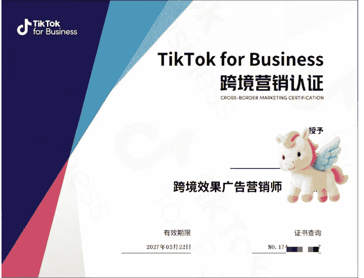

2025 年 4 月，我开始在 TikTok 上做中国入境游，用英语短视频吸引海外游客来中国旅行。用户通过内容看到我们，再进入 WhatsApp 咨询和成交。

从内容创作、账号运营、客户转化，到地接资源整合、产品设计、线路定制和落地交付，我们逐步打通了从前端流量到后端服务的完整链路。

2025 年 4 月到 12 月，我们通过 TikTok 自然流量完成了 4300 个订单，营收超过 4000 万。2026 年至今，月均营业额稳定在 500 万以上，预计全年营业额超过 6000 万。

## 部分业绩统计表：

| 客户名 | 月份 | 出团日期 | 返团日期 | 总收款 |
|---|---|---|---|---|
| CHUNG BOON FOON等4人 | 2月 | 2月11日 | 2月16日 | 11550 |
| SOUL一日包车 | 3月 | 3月7日 | / | 3800 |
| SONYI4大1小 | 3月 | 3月12日 | 3月16日 | 8900 |
| BBTAN3人 | 2月 | 2月15日 | 2月19日 | 11180 |
| LIMPEINEE 2大1小 | 2月 | 2月25日 | 2月27日 | 6930 |
| nancy10大 | 3月 | 3月1日 | 3月9日 | 78490 |
| WUWU12人 | 3月 | 3月3日 |  | 6900 |
| mirror 3大1小 | 3月 | 3月20日 | 3月23日 | 28798 |
| mornica2大2小 | 2月 | 2月3日 | 2月7日 | 12400 |
| GARY4大1小 | 2月 | 2月15日 | 2月20日 | 20450 |
| evon5大2小 | 3月 | 3月3日 | 3月6日 | 11262 |
| 单包车一天 | 3月 | 3月9日 | / | 1000 |
| SLINSA | 3月 | 3月3日 | 3月6日 | 6900 |
| CHHAYLIM 3大 | 3月 | 3月10日 | 3月14日 | 9644 |
| Jenny 5大 | 3月 | 3月10日 | 3月15日 | 11000 |
| Iris tang 5大1小 | 3月 | 3月14日 | 3月17日 | 22500 |
| jasmine 12人 | 3月 | 3月16日 | 3月20日 | 20000 |
| 罗淑玲2人 | 3月 | 3月25日 | 3月29日 | 9760 |
| jovian4大1小 | 2月 | 2月18日 | 2月22日 | 14494 |
| dylan 13大 | 3月 | 3月20日 | 3月26日 | 28800 |
| shiemin 3大1小 | 3月 | 3月23日 | 3月25日 | 6025 |
| KINGSLEY2大1小 | 3月 | 3月26日 | 3月29日 | 8535 |

因为业绩表现突出，受 TikTok 官方邀请进行内部 tk 内容分享，TikTok 工作人员授予我 TikTok 跨境效果广告营销师证书。

这篇文章，我不讲虚的，按六个部分来完整复盘：

- 1、我是如何入局 tiktok 入境游的？
- 2、我是怎么用很轻的方式跑通第一单的？
- 3、从单人轻模式到团队化运营：我们如何用 9 个月做到 4000 万销售额？
- 4、TikTok 做入境游的完整流程
- 5、入境游的市场现状
- 6、新手如何开始做入境游？（以一名山东学员为例）

## 一、我是如何入局 TikTok 入境游的？

在做旅游创业之前，我一直深耕服装行业。

那几年，正好赶上电商和服装行业的红利期。我从一家店开始做，后来陆续开到了 10 家天猫店。生意好的时候，单月利润能突破 30 万。

那时候我一度觉得，只要继续把店铺、供应链、客服和投放做好，这门生意应该还能持续很久。

但后来疫情来了，服装生意开始变得难做，天猫业务亏损非常严重。

一方面，消费需求下降，退货率和库存压力越来越大；另一方面，平台流量越来越贵，投放成本不断上升。以前靠经验、选品和运营还能赚到钱，后来发现很多时候忙了一整个月，最后利润都被库存、退货和广告费吃掉了。

为了维持店铺运转，我不断投入资金，但结果并没有好转。最后，只能一边止损，一边陆续关店。

那段经历对我打击很大。

从月入几十万，到一家家店关掉，我第一次意识到：再好的生意，如果只依赖平台红利和外部环境，一旦风向变了，抗风险能力其实很弱。

生活还要继续，我也被迫转行。

为了找到下一个能长期做的行业，我先去研究餐饮。因为我自己的爱好很简单，一个是吃，一个是旅游，所以最开始很自然地把目光放到了餐饮上。

我把餐饮行业里能看的品类基本都看了一遍，从快餐、小吃、火锅、茶饮，到正餐、加盟、单店模型，都做过了解。甚至还认真测算过坪效、人效、客单价、翻台率、租金成本和回本周期。

但越看越发现，餐饮行业看起来现金流不错，实际非常重。房租、人工、供应链、选址、管理，每一个环节都很考验人，而且一旦选址或模型出问题，试错成本很高。

后来我又重新看自己的优势、兴趣和国家大政策方向。

我发现，旅游这件事虽然也不轻松，但它更符合我的长期兴趣，也更适合通过内容、产品和服务去放大。加上当时文旅复苏是大趋势，我判断旅游行业还有新的机会。

最终，我选择了旅游。 2023 年，我成立了一家旅行社，做组团业务，给全国各地的地接社做代理，主要是

通过小红书平台获客和销售。

那段时间，我们业绩做得很好，做到过小红书商业化大客户，团队最多时有 20 多人。

但做了一段时间后，我发现一个很现实的问题：如果只是依赖平台流量，卖别人的产品，表面上看是在做旅游生意，实际上很容易变成给平台和供应商打工。

流量是平台的，产品是供应商的，客户体验也很大程度取决于后端地接。我们能掌控的环节并不多，利润空间有限，抗风险能力也不强。

这期间，我受到行业内优秀集团邀请，参加了大型集团公司的游学，也参加过阿里巴巴产品大赛。这些经历让我开始重新思考旅游生意的本质。

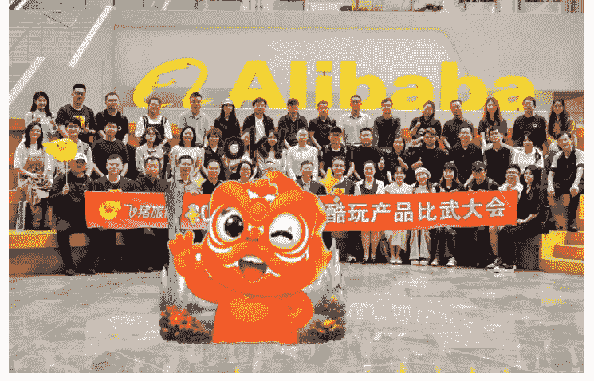

我逐渐意识到，旅游创业不能只停留在“拿产品、卖产品”的阶段。真正想长期做下去，必须从“流量思维”转向“产品思维”，找到自己的细分市场，做出有壁垒、有差异化的产品。

于是，我开始寻找旅游行业里更有差异化、也更有壁垒的蓝海机会。经过一段时间调研和筛选，我把方向聚焦到了禅修项目。

我带着团队不断去寺院沟通资源、设计产品、打磨线路，希望把禅修从一个普通旅游项目，做成一个有文化深度、有体验感，也有资源壁垒的细分产品。

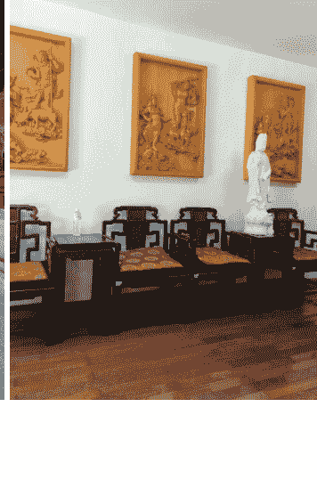

2024年6月，禅修项目正式启动，经营9个月，通过抖音、小红书获客。每周固定2期。实际总共创办213期，总营业额2500万。

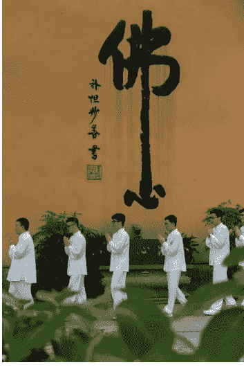

- 第60期普陀山禅修班(25)
  包含: 普陀山静修-如一师兄
- 1.31长寿慈心禅修班(16)
  包含: 普陀山静修-如一师兄
- 普陀山静修 5月23日(32)
- 普陀山静修 4月22日(44)
- 普陀山静修 4月15日(44)
- 普陀山静修 5月27日(26)
- 普陀山静修 4月25日(34)
- 普陀山静修 5月31日(22)
- 普陀山静修 4月30日(23)
- 普陀山正念静修 2月28日(21)
- 普陀山静修 4月18日(28)
- 普陀山静修 4月8日(28)

- 第60期普陀山禅修班(25)
  包含: 普陀山静修-如一师兄
- 1.31长寿慈心禅修班(16)
  包含: 普陀山静修-如一师兄
- 普陀山静修 5月23日(32)
- 普陀山静修 4月22日(44)
- 普陀山静修 4月15日(44)
- 普陀山静修 5月27日(26)
- 普陀山静修 4月25日(34)
- 普陀山静修 5月31日(22)
- 普陀山静修 4月30日(23)
- 普陀山正念静修 2月28日(21)
- 普陀山静修 4月18日(28)
- 普陀山静修 4月8日(28)

- 【普陀山心静】118期(15)
  包含: 普陀山静修-如一师兄
- 普陀山静修 104期(24)
- 【普陀山静修】105期(18)
- 普陀山静修 8月15日(17)
- 普陀山静修 103期(10)
- 普陀山静修 101期(16)
- 普陀山静修 100期(10)
- 普陀山静修 8月8日(17)

尝到甜头后，我更加确信禅修这个方向有机会，也开始有了更大的野心，想真正把它做成一个有资源壁垒的项目。

当时我的判断是：如果只是帮别人卖产品，我们永远只能赚中间差价；但如果能掌握上游资源，绑定寺院、住宿、课程和接待体系，就有机会把禅修做成一个长期稳定、

别人很难复制的细分品类。

所以，我做了一个现在回头看非常激进的决定：把自己的车和房子都抵押出去，又陆续向朋友借钱，把大部分资金投入到寺院资源合作和酒店投资上。

那时候我想得很简单：项目已经跑出了结果，就应该趁热打铁，往上游走，拿下核心资源，形成自己的壁垒。只有这样，才不会继续停留在“拿别人产品来卖”的阶段。

但千算万算，不如天算。

2025年初，政策突然发生变化。寺院不得再由私人承接相关活动，平台上也开始限制“禅修”等相关关键词和类似内容。原本刚刚跑出起色的项目，一下子被按下了暂停键。

那一刻，我真的有一种天塌下来的感觉。

因为前面投入的资金、团队、资源和所有预期，几乎都压在了这个方向上。方向突然变了，之前所有计划都被打乱了。

那时候算下来，车房抵押、朋友借款、项目投入和后续还款压力加在一起，债务最高时接近500万。

更现实的是，当时我几乎已经身无分文，但每个月还有几万元的还款压力。为了维持现金流，只能拆东墙补西墙，到处借钱，先把每个月必须还的款撑过去。

团队也撑不住了，原来二十多人的团队，最后只剩下我和一个销售。

大办公室也退掉了，我俩搬到了一个很小的办公室。

那段时间，我每天最焦虑的不是怎么增长，而是下个月的还款从哪里来，公司还有没有机会活下去，我还能不能撑住。

再难，生意也要继续。我只能一边处理债务和现金流，一边重新寻找机会。

2025 年 3 月，我又回到小红书，尝试重新获客。但我很快发现，国内旅游市场在小红书上已经非常红海。平台上有大量成熟账号、成熟团队和成熟投流玩家，而我当时团队刚解散，手里没有足够的人力、资金和投流预算，继续在这个战场硬卷，并不占优势。

后来我也尝试过 Facebook，想做入境游投放。结果发现，海外投流成本比我想象中更高，一个客资折算成人民币大概 80 元，而且这只是咨询成本，并不代表一定成交。对于当时现金流非常紧张的我来说，这条路也很难持续。

就这样一路试下来，我开始意识到：如果继续依赖传统平台和付费投流，我很难翻身。我要找的不是一个更贵的流量入口，而是一个还有自然流量机会、还能低成本测试新方向的平台。

2025 年 4 月，我注意到 TikTok 很像早期的抖音：流量很大，自然推荐机会也很好，不花钱就能获得大量客资。

于是，我开始尝试在 TikTok 上做中国入境游内容，通过自然流量获取海外游客咨询。

城市、美食、高铁、景点、文化体验等视频素材，重新剪辑、拼接，再配上海外用户能看懂的英文文案和字幕，包装成适合TikTok 用户观看的短视频。

但这里有一个关键点：不是简单搬运，也不是随便剪风景。

我会思考海外游客到底对中国什么感兴趣，他们会被什么内容吸引，又会因为什么产生咨询。

比如他们对中国高铁很好奇，对移动支付很好奇，对中国城市的安全、干净、便利很好奇，也对长城、故宫、兵马俑、熊猫、美食、传统文化这些内容有天然兴趣。

所以早期的视频，很多都是围绕这些海外用户容易产生好奇心的点来做。

视频发出去以后，客户会通过评论区留言，或者点进主页，再进入 WhatsApp 联系我们。

客户来了以后，我们先判断他的基本需求：来自哪个国家，几个人，什么时候来中国，想去哪些城市，是家庭游、商务游、研学游，还是文化深度游。

然后根据他的需求，给他推荐现成产品，或者做一个简单的定制线路。

客户认可后，支付定金，订单就算跑通。

现在回头看，这个流程很粗糙，但它完成了新项目早期最重要的验证：

第一，海外用户会不会被中国旅游内容吸引？

答案是会。

第二，TikTok 自然流量能不能带来真实咨询？

答案是可以。

第三，客户愿不愿意通过 WhatsApp 沟通并支付定金？

答案也是可以。

这三个问题一旦被验证，后面的事情就清楚了。

我们不是在凭感觉判断“TikTok 入境游有机会”，而是用真实内容、真实咨询、真实付款，证明这件事有商业闭环。

很多人做新项目，一开始就想把公司、团队、产品、系统全部搭好。我的感受恰恰相反：早期最重要的不是完美，而是快速验证。

不要一开始就追求账号矩阵，不要一开始就追求高大上的官网，也不要一开始就把产品做得特别复杂。

先证明有人看，再证明有人问，最后证明有人愿意付钱。

只要这三件事成立，后面才值得继续加人、加账号、加产品、加交付。

如果这三件事不成立，前面投入越重，后面掉头越难。

所以，第一单对我来说，不只是赚到钱。

它更重要的意义是，让我看到了一个新的可能性：即使在负债、团队解散、现金流紧张的情况下，我依然可以用一个很轻的方式，重新打开一个增长入口。

这也是我后来一直提醒新手的地方：新项目早期最重要的不是做大，而是用最轻的方式证明：有人看，有人问，有人付钱。

## 三、从个人作战到团队化运营：我们如何做到 4000 万销售额？

第一单跑通以后，我很快意识到：TikTok 入境游这件事，不是只靠一个账号、几条视频就能长期做下去。

早期一个人可以用很轻的方式测试市场，但当咨询越来越多、客户需求越来越复杂、订单金额越来越高的时候，真正考验的就不再是“有没有流量”，而是后端有没有能力接得住。

因为旅游不是卖一件标准品。

客户不是付款后等快递就结束了，而是要跨越国境来到中国，涉及签证政策、城市选择、酒店、用车、导游、餐饮、景点、支付、语言沟通、突发情况处理等一整套服务链路。

所以我开始重新搭建团队。

我们不再只是做一个 TikTok 账号，而是围绕“TikTok 入境游”这件事，把内容、客服、销售、产品、地接和交付重新组织起来。

前端，我们搭建内容团队，持续生产适合海外用户观看的中国旅行内容。

早期只是英语内容，后来我们逐渐尝试多语言账号，根据不同国家和地区用户的需求，做英语、日语、韩语、西班牙语等不同版本。

因为我发现，不同国家客户关心的问题完全不一样。

欧美客户更关注中国是否安全、旅行体验是否深度、语言不通怎么办；日韩客户更关注短途旅行、城市便利性和行程节奏；东南亚客户会更关心性价比、支付方式和签证便利性。

如果只用一套内容打所有市场，流量看起来很热闹，但转化不一定好。

所以我们开始围绕不同客群，设计不同内容。

中间环节，我们搭建客服和销售承接体系。

客户从 TikTok 进入 WhatsApp 后，不是简单发一个报价单就结束。我们会先了解客户来自哪里、几个人、什么时候来中国、预算大概多少、有没有老人孩子、想去哪些城市、喜欢文化体验还是自然风光，是家庭游、商务游、研学游，还是高端定制团。

这些信息确认清楚后，再进入线路设计和报价。

这一步非常重要。

因为高客单入境游不是低价跟团，客户真正买的不是一条线路，而是一套适合他的中国旅行方案。

如果客服和销售不懂客户需求，只会机械发产品，客户很快就流失了。

后端，我们开始搭建产品、供应链、地接和落地服务体系。

一个订单成交以后，才是真正工作的开始。

我们要对接酒店、车辆、导游、景区、餐厅和目的地地接资源，还要确认每一天的行程是否合理，车程会不会太长，客户语言沟通有没有问题，导游是否适合这组客户，遇到航班延迟、天气变化、景区临时调整时有没有预案。

过去做组团业务时，我曾经觉得只要把客户交给地接社就可以了。

但做 TikTok 入境游以后，我发现这个想法非常危险。

客户不会区分这是前端的问题，还是地接的问题。客户只会记住：我是相信你才付款的。

所以我们必须把交付抓在自己手里。

我们开始筛选和整合全国各地的优质地接资源，不只看报价，而是看对方有没有稳定导游、真实接待能力、应急处理经验和服务意识。

同时，我们也开始沉淀自己的服务 SOP。

比如客户咨询后怎么记录需求，方案怎么设计，报价怎么呈现，定金怎么收，出行前要提醒什么，落地后怎么建群，导游如何对接，行程中每天如何反馈，遇到问题先由谁处理，团结束后如何收集评价和复盘。

这些事情看起来很琐碎，但正是这些琐碎环节，决定了订单能不能稳定交付。

2025 年 4 月至 12 月，我们通过 TikTok 自然流量完成了 4000 万销售额。

这里面不是靠一条爆款视频打出来的。

它背后是内容团队持续生产，客服团队及时承接，销售团队完成转化，产品团队设计线路，地接团队落地执行，售后团队跟进反馈，整个链路一起跑通的结果。

过程中，我们也陆续收到来自全球客户的好评和转介绍。

有印度客户在线上和我们详细沟通线路规划，也有哈萨克斯坦客户来到公司考察洽谈研学项目。越来越多客户不再只是因为刷到一条视频来咨询，而是因为看了我们的内容、案例、客户反馈和团队展示后，逐渐建立了信任。

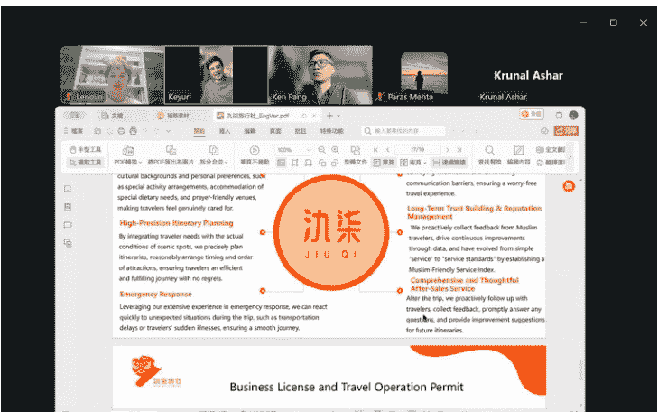

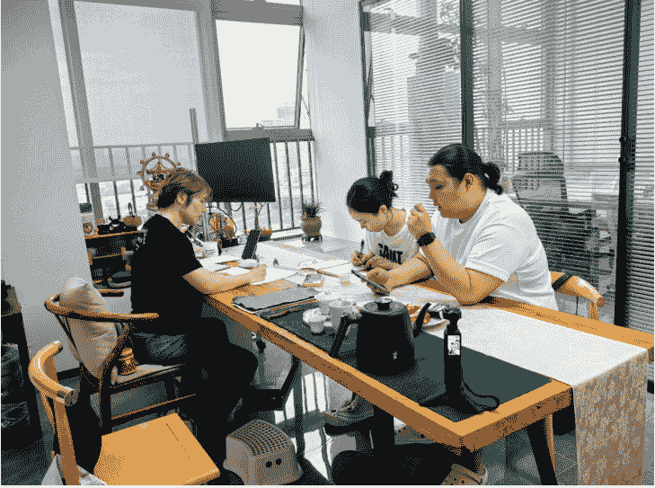

2026 年，公司业务全面转型，聚焦 TikTok 入境游市场。

这一步转型，对我来说很关键。

因为当我们真正跑通了 TikTok 自然流量、WhatsApp 成交、产品设计和落地交付以后，我就知道，这已经不是一个简单的流量项目，而是一个可以长期深耕的业务方向。

从个人作战到团队化运营，我最大的感受是：

早期限制你的，可能是有没有流量。

但订单变多以后，真正限制你的，一定是团队能不能稳定承接、成交和交付。

如果只有流量，没有客服承接，咨询会浪费。

携程宣布未来3年将投入150亿元专项资金，用于入境游全球推广，目标是在5年内引入2亿国际游客。同时，携程还邀请功夫巨星成龙出任“入境游大使”。

这件事对行业释放了一个很明确的信号：入境游已经不只是小部分旅行社在试水，而是头部平台开始重仓布局的方向。

携程集团董事会主席梁建章在采访中也提到，2025 年中国入境游直接收入占 GDP 的比重仅为 0.67%，远低于泰国的 10%以上，也低于欧美国家普遍的 1%–3%。

梁建章认为，不是中国没有吸引力，而是中国入境游的市场潜力还远远没有被释放出来。这个差距背后，蕴藏着万亿级的增量空间。

对我们这些小微创业者来说，头部平台重仓入局，一方面说明竞争会越来越激烈；但另一方面，也说明这个市场正在被教育、被放大、被更多海外用户看见。

大平台负责做声量和基础认知，而真正细分、垂直、有服务能力的小团队，依然有机会在具体人群和具体产品里找到自己的位置。

因为旅游消费本质上是情绪消费。用户刷到一个视频，被一个地方种草，产生了“我也想去”的冲动。如果签证门槛很高，这个冲动很容易被流程消耗掉。

但如果签证越来越方便，甚至可以免签入境，用户从“想去”到“决定去”的路径就会大大缩短。

过去，一个欧洲家庭想来中国，光签证可能就要准备很久。现在，很多国家的游客可以免签入境，说走就走。签证门槛越低，潜在客户就越多，TikTok 内容种草转化成真实咨询和订单的概率也就越高。

这也是为什么我认为，入境游不是一个小风口，而是一个正在释放的大市场。

从数据上看，2024 年中国入境游客接待人数达到 1.3 亿人次，同比增长 61%。2025 年，入境游客突破 1.5 亿人次，同比增长 17%，超过 2019 年同期水平；国际旅游收入达到 1311 亿美元，同比增长 39%。

到 2026 年，如果免签、过境免签、国际航班恢复、海外社媒种草等因素继续叠加，入境游客量仍有机会维持高位增长。

这里面最大的机会，不只是游客数量变多，而是客户结构发生变化。

以前很多海外游客来中国，可能更依赖传统旅行社、商务接待、OTA 或朋友介绍。但现在，越来越多海外年轻人、家庭客户、高净值客户，会先在 TikTok、Instagram、YouTube 上看到中国内容，再产生兴趣，最后进入咨询和预订。也就是说，政策降低了来中国的门槛，而内容平台负责放大用户的兴趣。

这两件事叠加在一起，就是 TikTok 入境游的机会。

### 2、内容红利：TikTok 正在改变海外游客决策路径

过去，海外游客决定来中国旅行，通常有几种方式：

- 通过传统旅行社咨询；
- 在 Google 上搜索攻略；
- 去 OTA 平台比价；
- 看朋友推荐；
- 或者通过商务、学校、机构组织出行。

这个路径比较长，也比较理性。

用户先搜索，再比较，再筛选供应商，最后才下单。

但 TikTok 出现以后，旅游决策路径发生了变化。

很多人的旅行灵感，不再是从搜索开始，而是从“刷到一个视频”开始。

他可能是在 TikTok 上刷到一段中国高铁的视频，发现中国城市之间出行这么方便；也可能看到一个外国人在中国吃夜市、坐地铁、用手机支付、逛故宫、看熊猫、体验传统文化，然后突然产生一种感觉：

“原来中国和我想象的不一样。”

“我也想去一次。”

这就是 TikTok 对旅游行业最大的改变：它不是等用户主动搜索，而是在用户没有明确计划的时候，先把目的地种到他心里。

旅游本来就是一个高度依赖情绪和想象力的消费。

一条好的短视频，可能让用户第一次对中国产生兴趣；连续几十条内容，可能让用户逐渐解除对语言、安全、支付、交通和文化差异的顾虑；等他真正准备出行时，他第一个想到的，就是长期出现在他信息流里的那个账号或品牌。

传统路径是：

Google 搜索 → 阅读攻略 → OTA 比价 → 下单购买。

TikTok 新路径是：

刷到视频 → 被内容打动 → 搜索标签 → 关注账号 → 私信咨询 → WhatsApp 沟通 → 直接预订。

比如，一条介绍成都美食的视频，播放量很快冲到几十万。

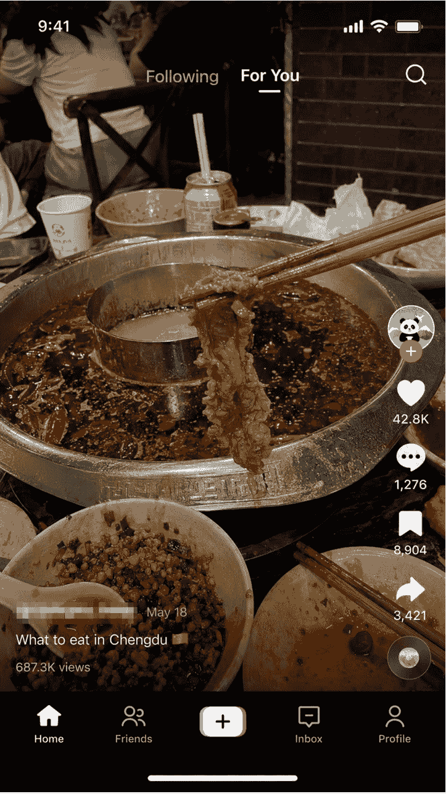

这对普通创业者来说，是一次很大的机会。

过去，获客能力更多掌握在平台、大旅行社、OTA 和传统渠道手里。你没有门店、没有广告预算、没有渠道关系，就很难拿到客户。

但现在，一部分获客能力正在转移到内容创作者手里。

只要你能持续生产海外用户看得懂、感兴趣、愿意信任的内容，就有机会通过 TikTok 获取全球客户。这就意味着，一个个体从业者，一个从来不懂旅游行业的人，也能直接拿到大量入境游客资源。

### 3、行业红利：看起来热，但真正会做的人还不多

很多朋友问我：“现在入境游已经这么热了，TikTok 入境游还有机会吗？”

我的判断是：还有，而且目前仍然处在早期红利期。原因主要有两个：

第一，很多人还没有真正意识到这个机会。

现在大家都知道国内旅游、小红书、抖音、视频号很卷，但真正把目光转向 TikTok 入境游的人，其实还没有那么多。尤其是传统旅行社，很多还停留在国内平台获客、渠道分销、地接合作的逻辑里，对海外内容平台的理解并不深。

第二，TikTok 入境游本身就有一定的门槛。

首先，账号注册、网络环境、设备环境和平台规则，就已经拦住了一部分人。很多传统旅行社老板想做，但第一步就不知道怎么开始。

其次，TikTok 入境游并不是注册一个账号、发几条视频，就能自然成交。你要懂海外用户喜欢看什么内容，要会用英文或多语言表达，要知道怎么把 TikTok 流量导入 WhatsApp 私域，还要具备销售转化、线路设计、地接资源整合和落地交付能力。

也就是说，这个赛道看起来门槛低，实际上是一个综合能力要求很高的生意。流量只是入口，真正能不能赚钱，取决于你能不能把“内容获客—私域承接—客户成交—产品设计—落地交付”整条链路跑通。

这也是我依然看好 TikTok 入境游的原因：

不是没人做，而是会做的人还不多。

## 五、新手如何开始做入境游？

我们算是业内比较早一批开始做 TikTok 入境游的旅行社。因为前期业绩增长比较快，也很快引起了不少同行的关注。

2026 年以来，不只是 TikTok 官方邀请我做专题分享，旅业资讯、酷营等行业平台，也陆续邀请我去分享 TikTok 入境游的实战经验。

同时，也有许多国内外旅行社专程来到广州找我交流，包括韩国、印尼、澳洲等地的同行。他们关心的问题其实都很相似：TikTok 到底怎么起号？什么内容能带来咨询？客户进来后怎么成交？成交后后端交付怎么做？

2026 年 6 月，我开了一期 TikTok 入境游实战营。那一期，接近 30 家旅行社来学习，大家来自不同城市，也覆盖了不同目的地和资源背景。

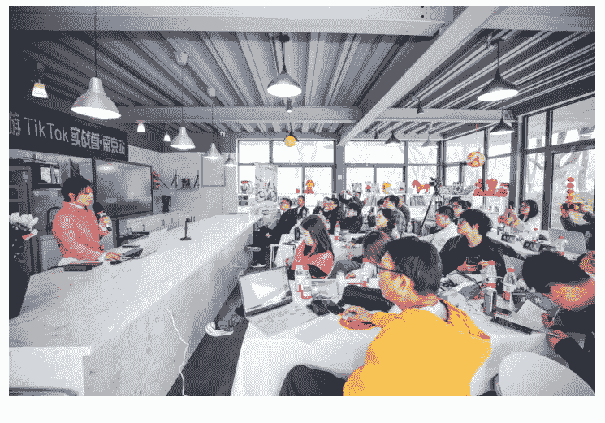

通过这些分享、培训和同行交流，我也进一步链接了全球各地不少优质地接社资源，更深入了解了不同目的地的产品、供应链和服务能力。

同时，我也收集到了大量新手在做 TikTok 入境游时遇到的真实问题。

比如账号怎么注册，内容怎么定位，视频有播放但没咨询怎么办，客户进 WhatsApp 后怎么聊，线路不会设计怎么办，地接资源怎么筛选，成交后怎么保证交付。

这些问题，我自己做业务时遇到过；后来培训学员时，又看到了更多不同类型的案例。解决的问题越多，我对这套方法论的理解也越深。

在这些学员中，我觉得有一个山东学员小 A 的案例非常典型。他是一个新手，对 TikTok 完全不懂，在我们的指导下，他仅用 20 天就拿到了第一个客资，现在每天能通过 TikTok 拿到上百个客资。

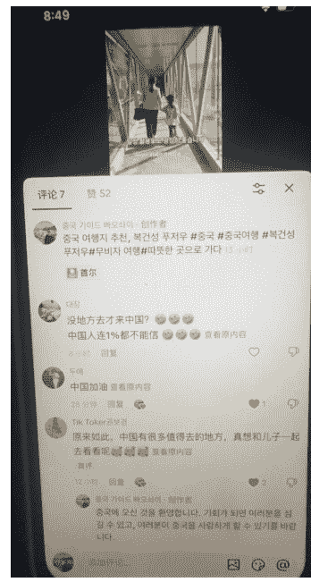

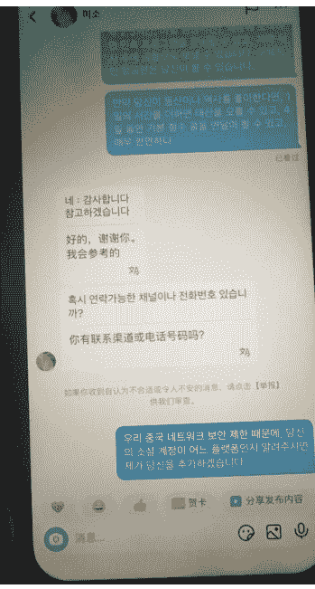

下面我就以他的成长路径为例，详细讲一下：新手做 TikTok 入境游，具体是怎么开始的。

### 第一步：确定产品

很多新手一上来就想做“中国旅游大全”。今天发北京，明天发上海，后天发西安，再过两天发张家界、桂林、成都。看起来内容很多，覆盖面很广，但问题是：账号没有记忆点，客户也不知道你到底擅长什么。

所以第一步，我们没有让小 A 去做全国市场，而是先帮他梳理自己的资源。

小 A 在山东，对本地资源更熟，能接触到山东当地地接、酒店、车辆、导游和线路产品。于是我们最终给他的方向定得很清楚：

山东文化游 / 孔子文化游 / 青岛海滨 + 历史文化线路。这个方向有几个好处。

比如，欧美客户可能更关注文化体验、安全感和深度旅行；东南亚客户可能更关注性价比、签证便利和短途出行；中东客户可能更关注高端接待、家庭出行、隐私和服务规格；韩国客户则更关注行程效率、细节确定性和服务标准；西班牙语市场，包括西班牙、墨西哥、阿根廷、智利、哥伦比亚等国家，用户对中国文化、美食、城市变化和异国体验有很强好奇心；俄罗斯客户则更关注价格透明、路线深度、签证交通和实际体验。

这六个市场的客户画像不同，内容打法不同，转化方式也不同。只有先搞清楚人群，再去设计内容，TikTok 流量才不会只是热闹，而是能真正变成咨询和订单。

经过调研，小 A 选择了韩国市场。

### 第三步：解决账号和环境问题

很多人想做 TikTok，但第一步就卡住了：账号怎么注册？手机怎么准备？网络环境怎么搭？系统语言怎么设置？账号怎么保持稳定？能不能频繁切换地区？要不要插海外电话卡？

这些问题看起来很基础，但对新手来说就是门槛。

如果账号环境不稳定，后面内容做得再好，也可能发不出去、没流量，甚至账号频繁异常。所以我们先帮他把基础环境搭好，让账号能够正常、稳定地发布内容。

### 第四步，开始做内容

我们做 TikTok 入境游，目标绝对不是单纯涨粉，也不是为了让视频看起来很热闹。

真正的目标只有一个：拿到有效询盘，拿到能转化的客资。很多人刚开始做 TikTok，会特别在意播放量、点赞量、粉丝量。视频爆了很兴奋，账号涨粉了也很开心。但做生意不能只看这些表面数据。对入境游来说，一个视频有 100 万播放，如果没有客户咨询，没有人进 WhatsApp，没有人愿意沟通线路和预算，那它对业务的价值其实很有限。

反过来，有些视频播放量不一定特别高，但来的都是精准客户。他们正在计划来中国，愿意询问线路，愿意了解报价，甚至愿意支付定金。这样的内容，才是真正能带来生意的内容。

所以，我们在做内容之前，不能只问“什么视频容易爆”，而要先问：我想吸引哪一类客户？他们为什么想来中国？他们最担心什么？他们愿意为什么付钱？海外客群虽然差异很大，但有一个共同点：他们都很在意你是否真正理解他们。不是你的景点一定要多震撼，也不是你的行程一定要多复杂，而是客户看到你的内容、私信你的第一句话开始，就能感受到：你知道他是谁，你理解他的顾虑，你能用他熟悉的语言和方式解决他的问题。

这也是做 TikTok 入境游非常关键的一点。

所以，我们没有让小 A 一上来就做简单的景点混剪。

打开兴趣。

#### 第二类，认知型内容。

目的是打破海外用户对中国的刻板印象。比如中国安全吗？城市干净吗？交通方便吗？外国人在中国会不会不适应？这类内容负责降低陌生感。

#### 第三类，攻略型内容。

目的是解决实际问题。比如外国人在中国怎么用手机支付？高铁票怎么买？语言不通怎么办？机场怎么接送？签证和免签政策怎么看？这类内容最容易带来精准咨询。

#### 第四类，决策型内容。

目的是帮客户判断城市和线路。比如第一次来中国，北京和上海怎么选？带父母来中国，哪些城市不要排太赶？10 天中国行程怎么安排？这类内容非常接近成交。

#### 第五类，信任型内容。

目的是让客户相信你能交付。比如客户案例、付款记录、接待现场、客户好评、团队介绍、公司办公室、线下沟通、导游服务、车辆和酒店安排等。高客单客户一定会看这些。

举几个选题例子：

- 第一次来中国，北京和上海怎么选？
- 外国人在中国怎么用手机支付？
- 带父母来中国，哪些城市不要排太赶？
- 中国高铁到底有多方便？
- 为什么欧美家庭来中国，最担心的不是景点，而是语言和安全？
- 第一次来中国，10 天线路怎么安排最舒服？
- 带孩子来中国，哪些城市更适合家庭旅行？

这些内容的核心，不是单纯展示中国有多美，而是帮助海外客户做决策、降低顾虑、建立信任。

所以，TikTok 入境游真正要做的，不是“涨粉账号”，而是“客资账号”。

一个能赚钱的 TikTok 账号，一定不是只有播放量，而是能把陌生用户一步步带到 WhatsApp，带到方案沟通，最后带到定金支付。

这才是我们做内容的真正目标。

### 第五步，把咨询导入 WhatsApp。

TikTok 的视频只是第一步，真正的商业转化不在评论区，而是在私域沟通里。

所以账号主页必须清楚告诉用户：我们可以提供中国旅行线路建议，可以通过 WhatsApp 联系。

客户进来后，也不能只简单问一句“你想去哪”，而是要有专业的承接话术。

对于新手来说，前期最重要的任务不是马上学会成交，而是先把客资拿到。

只要能通过 TikTok 内容，把海外客户导入 WhatsApp，并且拿到真实有效的咨询，这一步就已经完成了前端获客的验证。后面的线路沟通、方案设计、报价和成交，可以先交给旅行社里更专业的销售或定制师来完成。

因为高客单入境游的成交，并不是简单回复几句话、发一个报价单就能解决的。它需要理解客户需求、判断预算、设计线路、解释服务细节，还要处理客户对安全、语言、支付、行程和交付的各种顾虑。

如果新手想自己做成交，我建议至少去旅行社系统学习半年到一年，真正接触客户、跟进咨询、看别人怎么报价、怎么谈单、怎么处理异议。

这个环节非常专业，短时间很难讲透，所以这里先不展开。

这一阶段，新手先把重点放在一件事上：通过内容拿到真实客资。只要这件事跑通，后面才有继续学习成交、产品和交付的价值。

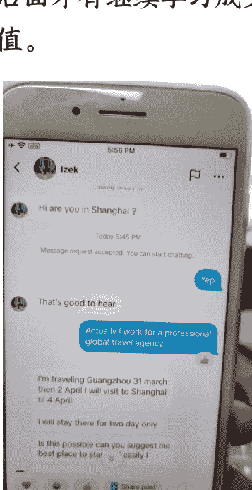

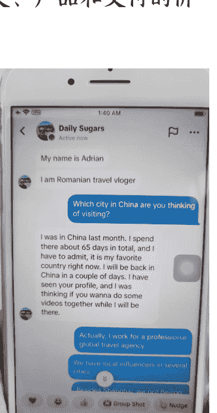

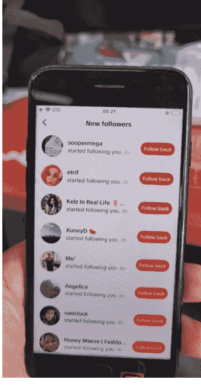

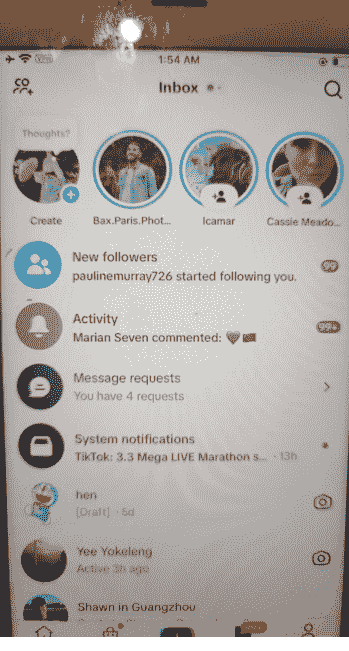

### 第六步，用本地地接资源完成交付

小 A 的优势就在这里。

他不一定懂 TikTok，但他熟悉山东本地资源。客户如果真的对山东文化游、孔子文化游、青岛线路感兴趣，他可以更快找到本地导游、车辆、酒店和地接资源来承接。

这也是我一直强调的：新手不一定要一开始做全国市场。很多人总觉得做入境游就要覆盖北京、上海、西安、成都、桂林、张家界，好像城市越多，生意越大。

但对新手来说，城市越多，后端越复杂，产品越难控，交付风险也越高。

反而从自己最熟悉、最有资源的目的地开始，成功率会更高。

你熟悉本地，知道哪些地方值得去，哪些行程容易踩坑，哪些导游靠谱，哪些酒店适合外国人，哪些餐厅更适合海外客户。这些真实经验，本身就是内容优势，也是交付优势。

小 A 这个案例最典型的地方就在于：他不是从“我要做全中国入境游”开始，而是从“我能不能先用 TikTok，把海外客户吸引到山东”开始。

新手先跑通最关键的一步：**有人看，有人问，有人愿意进一步沟通。** 只要这一步成立，后面才值得继续学习成交、扩充产品、整合地接，甚至搭建自己的完整业务体系。

以上就是我的全部内容了。

我是青妙，如果你对 TikTok 入境游感兴趣，欢迎交流。

——分割线——

看完这篇 SOP，你觉得你懂了。但 90% 的人一到实操就会卡在第一步。

工具和教程只是最低级的壁垒，真正的壁垒是“立刻动手”和“圈层信息差”。

如果你想看全网最新的变现玩法，并且和一群执行力极强的极客一起下场拿结果，欢迎围观我的核心私域：【懒人专属群】。

我们不聊虚的，只做商业闭环的拆解与 AI 效率的压榨。系统内已沉淀 1000+ 跑通的套利实战局。

- 查阅圈子完整数字资产与上车门槛：[https://lazysoc.com/insider/](https://lazysoc.com/insider/)

认同价值、准备好下场干活的，扫码加我微信（lazyhelper1）

备注：【实操上车】，不闲聊

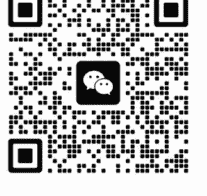

微信：lazyhelper1
